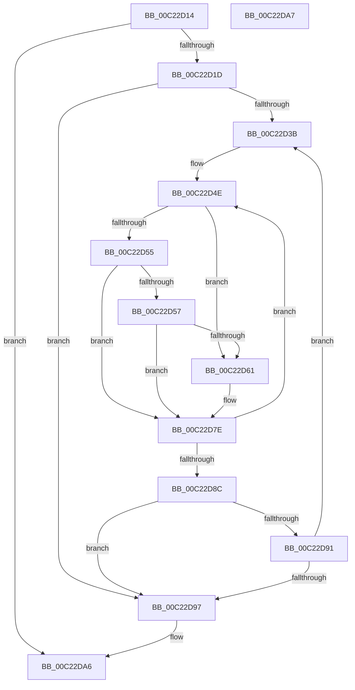

# HalpNumaSortProcessors

- RVA: `0x00C22D14`–`0x00C22DA8` (길이 `148` bytes)
- VA: `0x0000000140C22D14`
- 실행 섹션: `INIT`
- PDB 이름 있음: `예`; PDB Function 태그: `아니요`
- unwind 정보 RVA: `0x000C46F0`
- 디코드: `45`개 명령, `148/148` bytes 표시
- 미해석 바이트: `0` (있으면 어셈블리에 `.byte`로 보존)

> 이 문서는 커널 이미지의 기계어와 PDB 기호를 분석해 생성했습니다. 4번과 5번은 함수 원형과 자료형을 바이너리 사용 방식에서 추정한 C 해석이며 원본 소스 복구 결과는 아닙니다.

## 1. Dependencies

- 직접 호출 지점: **0**; 고유 호출 대상: **0**
- 직접 호출자로 확인된 함수: **1**
- RIP 상대 이미지 참조: **0**

### Outgoing calls
- 직접 디코드된 call 명령이 없습니다.

### Direct callers
- [HalpNumaInitializeStaticConfiguration](HalpNumaInitializeStaticConfiguration_function_00C220D8.md) at `0x00C22838`

### Static image references
- 디코드된 RIP-relative 메모리 참조가 없습니다.

## 2. Other-region calls and transfers

- 다른 실행 섹션으로 향하는 call: **0**
- 별도 외부 분기/꼬리 이동을 확인하지 못했습니다.

## 3. Assembly (complete function range)

```asm
00C22D14  83 F9 02                        cmp ecx, 2
00C22D17  0F 82 89 00 00 00               jb 0x140c22da6
00C22D1D  48 89 5C 24 08                  mov qword ptr [rsp + 8], rbx
00C22D22  48 89 74 24 10                  mov qword ptr [rsp + 0x10], rsi
00C22D27  48 89 7C 24 18                  mov qword ptr [rsp + 0x18], rdi
00C22D2C  44 8D 49 FF                     lea r9d, [rcx - 1]
00C22D30  4D 8B D8                        mov r11, r8
00C22D33  48 8B F2                        mov rsi, rdx
00C22D36  45 85 C9                        test r9d, r9d
00C22D39  74 5C                           je 0x140c22d97
00C22D3B  40 32 FF                        xor dil, dil
00C22D3E  41 8B D9                        mov ebx, r9d
00C22D41  4C 8B D6                        mov r10, rsi
00C22D44  4D 8D 43 04                     lea r8, [r11 + 4]
00C22D48  4D 2B D3                        sub r10, r11
00C22D4B  49 8B D3                        mov rdx, r11
00C22D4E  8B 02                           mov eax, dword ptr [rdx]
00C22D50  41 3B 00                        cmp eax, dword ptr [r8]
00C22D53  77 0C                           ja 0x140c22d61
00C22D55  75 27                           jne 0x140c22d7e
00C22D57  43 8B 04 02                     mov eax, dword ptr [r10 + r8]
00C22D5B  41 39 04 12                     cmp dword ptr [r10 + rdx], eax
00C22D5F  76 1D                           jbe 0x140c22d7e
00C22D61  41 8B 0C 12                     mov ecx, dword ptr [r10 + rdx]
00C22D65  40 B7 01                        mov dil, 1
00C22D68  43 8B 04 02                     mov eax, dword ptr [r10 + r8]
00C22D6C  41 89 04 12                     mov dword ptr [r10 + rdx], eax
00C22D70  43 89 0C 02                     mov dword ptr [r10 + r8], ecx
00C22D74  8B 0A                           mov ecx, dword ptr [rdx]
00C22D76  41 8B 00                        mov eax, dword ptr [r8]
00C22D79  89 02                           mov dword ptr [rdx], eax
00C22D7B  41 89 08                        mov dword ptr [r8], ecx
00C22D7E  49 83 C0 04                     add r8, 4
00C22D82  48 83 C2 04                     add rdx, 4
00C22D86  48 83 EB 01                     sub rbx, 1
00C22D8A  75 C2                           jne 0x140c22d4e
00C22D8C  40 84 FF                        test dil, dil
00C22D8F  74 06                           je 0x140c22d97
00C22D91  41 83 C1 FF                     add r9d, -1
00C22D95  75 A4                           jne 0x140c22d3b
00C22D97  48 8B 5C 24 08                  mov rbx, qword ptr [rsp + 8]
00C22D9C  48 8B 74 24 10                  mov rsi, qword ptr [rsp + 0x10]
00C22DA1  48 8B 7C 24 18                  mov rdi, qword ptr [rsp + 0x18]
00C22DA6  C3                              ret
00C22DA7  CC                              int3
```

## 4. C-style interpretation (structured pseudocode)

```c
__int64 __fastcall HalpNumaSortProcessors(__int64 a1, __int64 a2, __int64 a3)
{
    __int64 result;
    __int64 v_r10;
    __int64 v_rbx;
    __int64 v_rdi;
    unsigned __int64 v_stack_p10;
    unsigned __int64 v_stack_p18;
    unsigned __int64 v_stack_p8;

    if (((unsigned int)(a1)) < 2) goto loc_00C22DA6;
    v_stack_p8 = v_rbx;
    v_stack_p10 = v_rsi;
    v_stack_p18 = v_rdi;
    if ((unsigned int)(a1 - 1) == 0) goto loc_00C22D97;
loc_00C22D3B:
    v_rdi = 0;
    v_r10 = (a2) - (a3);
loc_00C22D4E:
    if (((unsigned int)((unsigned int)(*(unsigned int *)(a3)))) > (*(unsigned int *)(a3 + 4))) goto loc_00C22D61;
    if (((unsigned int)((unsigned int)(*(unsigned int *)(a3)))) != (*(unsigned int *)(a3 + 4))) goto loc_00C22D7E;
    result = (unsigned int)(*(unsigned int *)(v_r10 + a3 + 4 * 1));
    if ((*(unsigned int *)(v_r10 + a3 * 1)) >= = ((unsigned int)((unsigned int)(*(unsigned int *)(v_r10 + a3 + 4 * 1))))) {
        a1 = *(unsigned int *)(v_r10 + a3 * 1);
        v_rdi = 1;
        result = *(unsigned int *)(v_r10 + a3 + 4 * 1);
        *(unsigned int *)(v_r10 + a3 * 1) = (unsigned int)(result);
        *(unsigned int *)(v_r10 + a3 + 4 * 1) = (unsigned int)(a1);
        a1 = *(unsigned int *)(a3);
        result = *(unsigned int *)(a3 + 4);
        *(unsigned int *)(a3) = (unsigned int)(result);
        *(unsigned int *)(a3 + 4) = (unsigned int)(a1);
    }
    a3 = (a3 + 4) + (4);
    a2 = (a3) + (4);
    v_rbx = ((unsigned int)((unsigned int)(a1 - 1))) - (1);
    if (condition_is_not_equal) goto loc_00C22D4E;
    if ((unsigned __int8)(v_rdi) == 0) goto loc_00C22D97;
    a4 = (unsigned int)((a1 - 1) + (-1));
    if (condition_is_not_equal) goto loc_00C22D3B;
loc_00C22D97:
loc_00C22DA6:
    return result;
}
```

## 5. (Beta) C Style

```c
int64_t HalpNumaSortProcessors(int64_t Arg1, void *Arg2, void *Arg3)
{
    uint8_t *arg2 = (uint8_t *)Arg2;
    uint8_t *arg3 = (uint8_t *)Arg3;

    int64_t result;
    int64_t local_r10;
    int64_t local_rbx;
    int64_t local_rdi;
    uint64_t v_stack_p10;
    uint64_t v_stack_p18;
    uint64_t v_stack_p8;

    if (((uint32_t)(Arg1)) < 2) goto loc_00C22DA6;
    v_stack_p8 = local_rbx;
    v_stack_p10 = local_rsi;
    v_stack_p18 = local_rdi;
    if ((uint32_t)(Arg1 - 1) == 0) goto loc_00C22D97;
loc_00C22D3B:
    local_rdi = 0;
    local_r10 = (Arg2) - (Arg3);
loc_00C22D4E:
    if (((uint32_t)((uint32_t)(*(uint32_t *)(arg3)))) > (*(uint32_t *)(arg3 + 0x4))) goto loc_00C22D61;
    if (((uint32_t)((uint32_t)(*(uint32_t *)(arg3)))) != (*(uint32_t *)(arg3 + 0x4))) goto loc_00C22D7E;
    result = (uint32_t)(*(uint32_t *)(local_r10 + arg3 + 0x4 * 1));
    if ((*(uint32_t *)(local_r10 + arg3 * 1)) >= = ((uint32_t)((uint32_t)(*(uint32_t *)(local_r10 + arg3 + 0x4 * 1))))) {
        Arg1 = *(uint32_t *)(local_r10 + arg3 * 1);
        local_rdi = 1;
        result = *(uint32_t *)(local_r10 + arg3 + 0x4 * 1);
        *(uint32_t *)(local_r10 + arg3 * 1) = (uint32_t)(result);
        *(uint32_t *)(local_r10 + arg3 + 0x4 * 1) = (uint32_t)(Arg1);
        Arg1 = *(uint32_t *)(arg3);
        result = *(uint32_t *)(arg3 + 0x4);
        *(uint32_t *)(arg3) = (uint32_t)(result);
        *(uint32_t *)(arg3 + 0x4) = (uint32_t)(Arg1);
    }
    Arg3 = (Arg3 + 4) + (4);
    Arg2 = (Arg3) + (4);
    local_rbx = ((uint32_t)((uint32_t)(Arg1 - 1))) - (1);
    if (condition_is_not_equal) goto loc_00C22D4E;
    if ((uint8_t)(local_rdi) == 0) goto loc_00C22D97;
    a4 = (uint32_t)((Arg1 - 1) + (-1));
    if (condition_is_not_equal) goto loc_00C22D3B;
loc_00C22D97:
loc_00C22DA6:
    return result;
}
```

### 관측된 메모리 오프셋

구조체 형식이 확인되지 않은 접근은 인자 기준의 오프셋으로만 기록했습니다.

| 기준 인자 | 오프셋 표현 | 폭 (bit) | 접근 |
|---|---:|---:|---|
| `Arg2` | `+ 0x0 + r8*1` | `32` | `R` |
| `Arg2` | `+ 0x0 + r8*1` | `32` | `W` |
| `Arg2` | `+ 0x0 + rdx*1` | `32` | `R` |
| `Arg2` | `+ 0x0 + rdx*1` | `32` | `W` |
| `Arg3` | `+ 0x0` | `32` | `R` |
| `Arg3` | `+ 0x0` | `32` | `W` |
| `Arg3` | `+ 0x4` | `64` | `R` |

## 6. Execution-region graph

[열기: 2D/3D 그래프와 함수 탐색 컨트롤 패널](../../../control-panel.html?section=init&rva=0x00C22D14&view=graph)

- 2D 그래프는 위에서 아래로 흐르고, 3D 그래프는 빈 공간을 드래그해 회전합니다. Shift+드래그는 이동, 휠은 확대·축소, 함수 노드 선택은 대상 보고서 이동입니다.

### Static fallback


