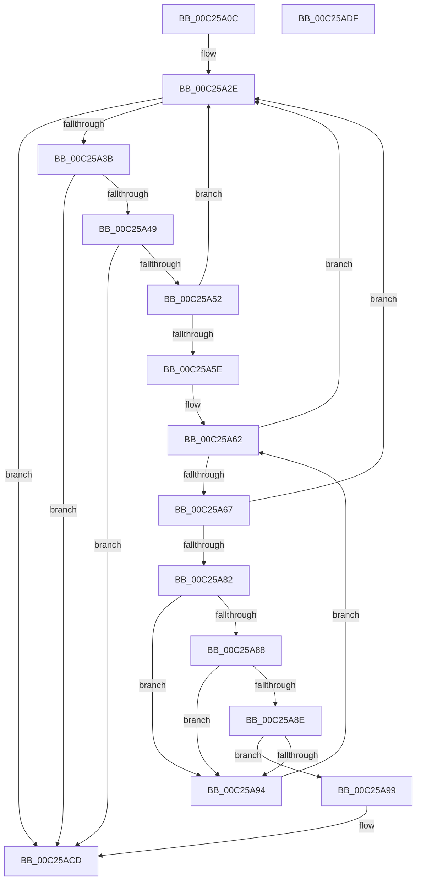

# HalpPciGetHpetInterruptSourceAmd

- RVA: `0x00C25A0C`–`0x00C25AE0` (길이 `212` bytes)
- VA: `0x0000000140C25A0C`
- 실행 섹션: `INIT`
- PDB 이름 있음: `예`; PDB Function 태그: `아니요`
- unwind 정보 RVA: `0x00069588`
- 디코드: `61`개 명령, `212/212` bytes 표시
- 미해석 바이트: `0` (있으면 어셈블리에 `.byte`로 보존)

> 이 문서는 커널 이미지의 기계어와 PDB 기호를 분석해 생성했습니다. 4번과 5번은 함수 원형과 자료형을 바이너리 사용 방식에서 추정한 C 해석이며 원본 소스 복구 결과는 아닙니다.

## 1. Dependencies

- 직접 호출 지점: **0**; 고유 호출 대상: **0**
- 직접 호출자로 확인된 함수: **1**
- RIP 상대 이미지 참조: **0**

### Outgoing calls
- 직접 디코드된 call 명령이 없습니다.

### Direct callers
- [HalpPciGetHpetInterruptSource](HalpPciGetHpetInterruptSource_function_00C25940.md) at `0x00C259A9`

### Static image references
- 디코드된 RIP-relative 메모리 참조가 없습니다.

## 2. Other-region calls and transfers

- 다른 실행 섹션으로 향하는 call: **0**
- 별도 외부 분기/꼬리 이동을 확인하지 못했습니다.

## 3. Assembly (complete function range)

```asm
00C25A0C  48 89 5C 24 08                  mov qword ptr [rsp + 8], rbx
00C25A11  48 89 74 24 10                  mov qword ptr [rsp + 0x10], rsi
00C25A16  48 89 7C 24 18                  mov qword ptr [rsp + 0x18], rdi
00C25A1B  44 8B 51 04                     mov r10d, dword ptr [rcx + 4]
00C25A1F  4C 8D 49 30                     lea r9, [rcx + 0x30]
00C25A23  4C 03 D1                        add r10, rcx
00C25A26  40 8A F2                        mov sil, dl
00C25A29  BB 25 02 00 C0                  mov ebx, 0xc0000225
00C25A2E  49 8D 41 04                     lea rax, [r9 + 4]
00C25A32  49 3B C2                        cmp rax, r10
00C25A35  0F 87 92 00 00 00               ja 0x140c25acd
00C25A3B  41 0F B7 41 02                  movzx eax, word ptr [r9 + 2]
00C25A40  83 F8 04                        cmp eax, 4
00C25A43  0F 82 84 00 00 00               jb 0x140c25acd
00C25A49  49 8D 0C 01                     lea rcx, [r9 + rax]
00C25A4D  49 3B CA                        cmp rcx, r10
00C25A50  77 7B                           ja 0x140c25acd
00C25A52  4D 8B D9                        mov r11, r9
00C25A55  4C 8B C9                        mov r9, rcx
00C25A58  41 80 3B 10                     cmp byte ptr [r11], 0x10
00C25A5C  75 D0                           jne 0x140c25a2e
00C25A5E  49 8D 53 18                     lea rdx, [r11 + 0x18]
00C25A62  49 3B D1                        cmp rdx, r9
00C25A65  73 C7                           jae 0x140c25a2e
00C25A67  0F B6 3A                        movzx edi, byte ptr [rdx]
00C25A6A  B8 01 00 00 00                  mov eax, 1
00C25A6F  8B CF                           mov ecx, edi
00C25A71  C1 E9 06                        shr ecx, 6
00C25A74  83 C1 02                        add ecx, 2
00C25A77  48 D3 E0                        shl rax, cl
00C25A7A  48 03 C2                        add rax, rdx
00C25A7D  49 3B C1                        cmp rax, r9
00C25A80  77 AC                           ja 0x140c25a2e
00C25A82  40 80 FF 48                     cmp dil, 0x48
00C25A86  75 0C                           jne 0x140c25a94
00C25A88  80 7A 07 02                     cmp byte ptr [rdx + 7], 2
00C25A8C  75 06                           jne 0x140c25a94
00C25A8E  40 38 72 04                     cmp byte ptr [rdx + 4], sil
00C25A92  74 05                           je 0x140c25a99
00C25A94  48 8B D0                        mov rdx, rax
00C25A97  EB C9                           jmp 0x140c25a62
00C25A99  33 DB                           xor ebx, ebx
00C25A9B  49 89 58 04                     mov qword ptr [r8 + 4], rbx
00C25A9F  41 C7 00 01 00 00 00            mov dword ptr [r8], 1
00C25AA6  41 0F B7 43 10                  movzx eax, word ptr [r11 + 0x10]
00C25AAB  41 89 40 04                     mov dword ptr [r8 + 4], eax
00C25AAF  8A 4A 06                        mov cl, byte ptr [rdx + 6]
00C25AB2  41 88 48 08                     mov byte ptr [r8 + 8], cl
00C25AB6  8A 4A 05                        mov cl, byte ptr [rdx + 5]
00C25AB9  C0 E9 03                        shr cl, 3
00C25ABC  80 E1 1F                        and cl, 0x1f
00C25ABF  41 88 48 09                     mov byte ptr [r8 + 9], cl
00C25AC3  8A 4A 05                        mov cl, byte ptr [rdx + 5]
00C25AC6  80 E1 07                        and cl, 7
00C25AC9  41 88 48 0A                     mov byte ptr [r8 + 0xa], cl
00C25ACD  48 8B 74 24 10                  mov rsi, qword ptr [rsp + 0x10]
00C25AD2  8B C3                           mov eax, ebx
00C25AD4  48 8B 5C 24 08                  mov rbx, qword ptr [rsp + 8]
00C25AD9  48 8B 7C 24 18                  mov rdi, qword ptr [rsp + 0x18]
00C25ADE  C3                              ret
00C25ADF  CC                              int3
```

## 4. C-style interpretation (structured pseudocode)

```c
__int64 __fastcall HalpPciGetHpetInterruptSourceAmd(__int64 a1, unsigned __int8 a2, __int64 a3)
{
    __int64 result;
    __int64 v_r10;
    __int64 v_rbx;
    unsigned __int64 v_stack_p10;
    unsigned __int64 v_stack_p18;
    unsigned __int64 v_stack_p8;

    v_stack_p8 = v_rbx;
    v_stack_p10 = v_rsi;
    v_stack_p18 = v_rdi;
    v_r10 = ((unsigned int)(*(unsigned int *)(a1 + 4))) + (a1);
loc_00C25A2E:
    if ((a1 + 48 + 4) > v_r10) goto loc_00C25ACD;
    if (((unsigned int)(*(unsigned __int16 *)(a1 + 48 + 2))) < 4) goto loc_00C25ACD;
    if ((a1 + 48 + *(unsigned __int16 *)(a1 + 48 + 2) * 1) > v_r10) goto loc_00C25ACD;
    if ((*(unsigned __int8 *)(a1 + 48)) != 16) goto loc_00C25A2E;
loc_00C25A62:
    if ((a1 + 48 + 24) >= (a1 + 48 + *(unsigned __int16 *)(a1 + 48 + 2) * 1)) goto loc_00C25A2E;
    a1 = (unsigned int)(((unsigned int)((unsigned int)(*(unsigned __int8 *)(a1 + 48 + 24)))) >> (6));
    a1 = (unsigned int)((a1) + (2));
    result = (1) << ((unsigned __int8)(a1));
    result = (result) + (a1 + 48 + 24);
    if (result > (a1 + 48 + *(unsigned __int16 *)(a1 + 48 + 2) * 1)) goto loc_00C25A2E;
    if (((unsigned __int8)(*(unsigned __int8 *)(a1 + 48 + 24))) != 72) goto loc_00C25A94;
    if ((*(unsigned __int8 *)(a1 + 48 + 24 + 7)) != 2) goto loc_00C25A94;
    if ((*(unsigned __int8 *)(a1 + 48 + 24 + 4)) == a2) goto loc_00C25A99;
loc_00C25A94:
    goto loc_00C25A62;
loc_00C25A99:
    v_rbx = 0;
    *(unsigned __int64 *)(a3 + 4) = 0;
    *(unsigned int *)(a3) = 1;
    *(unsigned int *)(a3 + 4) = (unsigned int)(*(unsigned __int16 *)(a1 + 48 + 16));
    *(unsigned __int8 *)(a3 + 8) = (unsigned __int8)(*(unsigned __int8 *)(result + 6));
    a1 = (unsigned __int8)((*(unsigned __int8 *)(result + 5)) >> (3));
    a1 = (unsigned __int8)((a1) & (31));
    *(unsigned __int8 *)(a3 + 9) = (unsigned __int8)(a1);
    a1 = (unsigned __int8)((*(unsigned __int8 *)(result + 5)) & (7));
    *(unsigned __int8 *)(a3 + 10) = (unsigned __int8)(a1);
loc_00C25ACD:
    return 0;
}
```

## 5. (Beta) C Style

```c
int64_t HalpPciGetHpetInterruptSourceAmd(void *Arg1, uint8_t Arg2, void *Arg3)
{
    uint8_t *arg1 = (uint8_t *)Arg1;
    uint8_t *arg3 = (uint8_t *)Arg3;

    int64_t result;
    int64_t local_r10;
    int64_t local_rbx;
    uint64_t v_stack_p10;
    uint64_t v_stack_p18;
    uint64_t v_stack_p8;

    v_stack_p8 = local_rbx;
    v_stack_p10 = local_rsi;
    v_stack_p18 = local_rdi;
    local_r10 = ((uint32_t)(*(uint32_t *)(arg1 + 0x4))) + (Arg1);
loc_00C25A2E:
    if ((Arg1 + 48 + 4) > local_r10) goto loc_00C25ACD;
    if (((uint32_t)(*(uint16_t *)(arg1 + 0x30 + 0x2))) < 4) goto loc_00C25ACD;
    if ((Arg1 + 48 + *(uint16_t *)(arg1 + 0x30 + 0x2) * 1) > local_r10) goto loc_00C25ACD;
    if ((*(uint8_t *)(arg1 + 0x30)) != 16) goto loc_00C25A2E;
loc_00C25A62:
    if ((Arg1 + 48 + 24) >= (Arg1 + 48 + *(uint16_t *)(arg1 + 0x30 + 0x2) * 1)) goto loc_00C25A2E;
    Arg1 = (uint32_t)(((uint32_t)((uint32_t)(*(uint8_t *)(arg1 + 0x30 + 0x18)))) >> (6));
    Arg1 = (uint32_t)((Arg1) + (2));
    result = (1) << ((uint8_t)(Arg1));
    result = (result) + (Arg1 + 48 + 24);
    if (result > (Arg1 + 48 + *(uint16_t *)(arg1 + 0x30 + 0x2) * 1)) goto loc_00C25A2E;
    if (((uint8_t)(*(uint8_t *)(arg1 + 0x30 + 0x18))) != 72) goto loc_00C25A94;
    if ((*(uint8_t *)(arg1 + 0x30 + 0x18 + 0x7)) != 2) goto loc_00C25A94;
    if ((*(uint8_t *)(arg1 + 0x30 + 0x18 + 0x4)) == Arg2) goto loc_00C25A99;
loc_00C25A94:
    goto loc_00C25A62;
loc_00C25A99:
    local_rbx = 0;
    *(uint64_t *)(arg3 + 0x4) = 0;
    *(uint32_t *)(arg3) = 1;
    *(uint32_t *)(arg3 + 0x4) = (uint32_t)(*(uint16_t *)(arg1 + 0x30 + 0x10));
    *(uint8_t *)(arg3 + 0x8) = (uint8_t)(*(uint8_t *)(result + 0x6));
    Arg1 = (uint8_t)((*(uint8_t *)(result + 0x5)) >> (3));
    Arg1 = (uint8_t)((Arg1) & (31));
    *(uint8_t *)(arg3 + 0x9) = (uint8_t)(Arg1);
    Arg1 = (uint8_t)((*(uint8_t *)(result + 0x5)) & (7));
    *(uint8_t *)(arg3 + 0xA) = (uint8_t)(Arg1);
loc_00C25ACD:
    return 0;
}
```

### 관측된 메모리 오프셋

구조체 형식이 확인되지 않은 접근은 인자 기준의 오프셋으로만 기록했습니다.

| 기준 인자 | 오프셋 표현 | 폭 (bit) | 접근 |
|---|---:|---:|---|
| `Arg1` | `+ 0x4` | `32` | `R` |
| `Arg1` | `+ 0x30` | `64` | `R` |
| `Arg3` | `+ 0x0` | `32` | `W` |
| `Arg3` | `+ 0x4` | `32` | `W` |
| `Arg3` | `+ 0x4` | `64` | `W` |
| `Arg3` | `+ 0x8` | `8` | `W` |
| `Arg3` | `+ 0x9` | `8` | `W` |
| `Arg3` | `+ 0xA` | `8` | `W` |

## 6. Execution-region graph

[열기: 2D/3D 그래프와 함수 탐색 컨트롤 패널](../../../control-panel.html?section=init&rva=0x00C25A0C&view=graph)

- 2D 그래프는 위에서 아래로 흐르고, 3D 그래프는 빈 공간을 드래그해 회전합니다. Shift+드래그는 이동, 휠은 확대·축소, 함수 노드 선택은 대상 보고서 이동입니다.

### Static fallback


