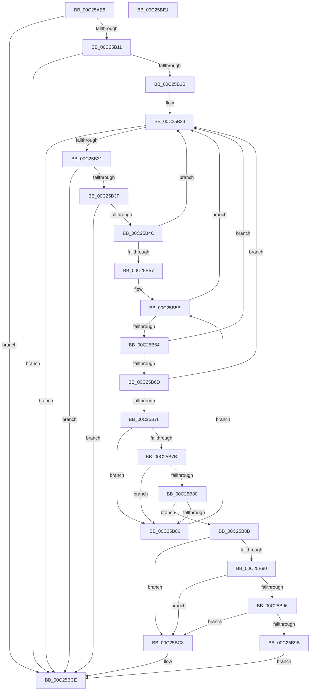

# HalpPciGetHpetInterruptSourceIntel

- RVA: `0x00C25AE8`–`0x00C25BE2` (길이 `250` bytes)
- VA: `0x0000000140C25AE8`
- 실행 섹션: `INIT`
- PDB 이름 있음: `예`; PDB Function 태그: `아니요`
- unwind 정보 RVA: `0x000C5104`
- 디코드: `70`개 명령, `250/250` bytes 표시
- 미해석 바이트: `0` (있으면 어셈블리에 `.byte`로 보존)

> 이 문서는 커널 이미지의 기계어와 PDB 기호를 분석해 생성했습니다. 4번과 5번은 함수 원형과 자료형을 바이너리 사용 방식에서 추정한 C 해석이며 원본 소스 복구 결과는 아닙니다.

## 1. Dependencies

- 직접 호출 지점: **0**; 고유 호출 대상: **0**
- 직접 호출자로 확인된 함수: **1**
- RIP 상대 이미지 참조: **0**

### Outgoing calls
- 직접 디코드된 call 명령이 없습니다.

### Direct callers
- [HalpPciGetHpetInterruptSource](HalpPciGetHpetInterruptSource_function_00C25940.md) at `0x00C25983`

### Static image references
- 디코드된 RIP-relative 메모리 참조가 없습니다.

## 2. Other-region calls and transfers

- 다른 실행 섹션으로 향하는 call: **0**
- 별도 외부 분기/꼬리 이동을 확인하지 못했습니다.

## 3. Assembly (complete function range)

```asm
00C25AE8  48 89 5C 24 08                  mov qword ptr [rsp + 8], rbx
00C25AED  48 89 6C 24 10                  mov qword ptr [rsp + 0x10], rbp
00C25AF2  48 89 7C 24 18                  mov qword ptr [rsp + 0x18], rdi
00C25AF7  44 8B 51 04                     mov r10d, dword ptr [rcx + 4]
00C25AFB  4D 8B D8                        mov r11, r8
00C25AFE  40 8A FA                        mov dil, dl
00C25B01  41 B9 25 02 00 C0               mov r9d, 0xc0000225
00C25B07  41 83 FA 30                     cmp r10d, 0x30
00C25B0B  0F 82 BD 00 00 00               jb 0x140c25bce
00C25B11  F6 41 25 01                     test byte ptr [rcx + 0x25], 1
00C25B15  0F 84 B3 00 00 00               je 0x140c25bce
00C25B1B  4C 03 D1                        add r10, rcx
00C25B1E  4C 8D 41 30                     lea r8, [rcx + 0x30]
00C25B22  33 ED                           xor ebp, ebp
00C25B24  49 8D 40 04                     lea rax, [r8 + 4]
00C25B28  49 3B C2                        cmp rax, r10
00C25B2B  0F 87 9D 00 00 00               ja 0x140c25bce
00C25B31  41 0F B7 40 02                  movzx eax, word ptr [r8 + 2]
00C25B36  83 F8 04                        cmp eax, 4
00C25B39  0F 82 8F 00 00 00               jb 0x140c25bce
00C25B3F  49 8D 0C 00                     lea rcx, [r8 + rax]
00C25B43  49 3B CA                        cmp rcx, r10
00C25B46  0F 87 82 00 00 00               ja 0x140c25bce
00C25B4C  49 8B D8                        mov rbx, r8
00C25B4F  4C 8B C1                        mov r8, rcx
00C25B52  66 39 2B                        cmp word ptr [rbx], bp
00C25B55  75 CD                           jne 0x140c25b24
00C25B57  48 8D 4B 10                     lea rcx, [rbx + 0x10]
00C25B5B  48 8D 41 02                     lea rax, [rcx + 2]
00C25B5F  49 3B C0                        cmp rax, r8
00C25B62  77 C0                           ja 0x140c25b24
00C25B64  0F B6 51 01                     movzx edx, byte ptr [rcx + 1]
00C25B68  80 FA 02                        cmp dl, 2
00C25B6B  72 B7                           jb 0x140c25b24
00C25B6D  48 8D 04 11                     lea rax, [rcx + rdx]
00C25B71  49 3B C0                        cmp rax, r8
00C25B74  77 AE                           ja 0x140c25b24
00C25B76  80 FA 08                        cmp dl, 8
00C25B79  72 0B                           jb 0x140c25b86
00C25B7B  80 39 04                        cmp byte ptr [rcx], 4
00C25B7E  75 06                           jne 0x140c25b86
00C25B80  40 38 79 04                     cmp byte ptr [rcx + 4], dil
00C25B84  74 05                           je 0x140c25b8b
00C25B86  48 8B C8                        mov rcx, rax
00C25B89  EB D0                           jmp 0x140c25b5b
00C25B8B  80 FA 08                        cmp dl, 8
00C25B8E  75 38                           jne 0x140c25bc8
00C25B90  80 79 06 20                     cmp byte ptr [rcx + 6], 0x20
00C25B94  73 32                           jae 0x140c25bc8
00C25B96  38 51 07                        cmp byte ptr [rcx + 7], dl
00C25B99  73 2D                           jae 0x140c25bc8
00C25B9B  49 89 6B 04                     mov qword ptr [r11 + 4], rbp
00C25B9F  44 8B CD                        mov r9d, ebp
00C25BA2  41 C7 03 01 00 00 00            mov dword ptr [r11], 1
00C25BA9  0F B7 43 06                     movzx eax, word ptr [rbx + 6]
00C25BAD  41 89 43 04                     mov dword ptr [r11 + 4], eax
00C25BB1  8A 41 05                        mov al, byte ptr [rcx + 5]
00C25BB4  41 88 43 08                     mov byte ptr [r11 + 8], al
00C25BB8  8A 41 06                        mov al, byte ptr [rcx + 6]
00C25BBB  41 88 43 09                     mov byte ptr [r11 + 9], al
00C25BBF  8A 41 07                        mov al, byte ptr [rcx + 7]
00C25BC2  41 88 43 0A                     mov byte ptr [r11 + 0xa], al
00C25BC6  EB 06                           jmp 0x140c25bce
00C25BC8  41 B9 BB 00 00 C0               mov r9d, 0xc00000bb
00C25BCE  48 8B 5C 24 08                  mov rbx, qword ptr [rsp + 8]
00C25BD3  41 8B C1                        mov eax, r9d
00C25BD6  48 8B 6C 24 10                  mov rbp, qword ptr [rsp + 0x10]
00C25BDB  48 8B 7C 24 18                  mov rdi, qword ptr [rsp + 0x18]
00C25BE0  C3                              ret
00C25BE1  CC                              int3
```

## 4. C-style interpretation (structured pseudocode)

```c
__int64 __fastcall HalpPciGetHpetInterruptSourceIntel(__int64 a1, unsigned __int8 a2, __int64 a3)
{
    __int64 v_r10;
    __int64 v_rbp;
    unsigned __int64 v_stack_p10;
    unsigned __int64 v_stack_p18;
    unsigned __int64 v_stack_p8;

    v_stack_p8 = v_rbx;
    v_stack_p10 = v_rbp;
    v_stack_p18 = v_rdi;
    if (((unsigned int)((unsigned int)(*(unsigned int *)(a1 + 4)))) < 48) goto loc_00C25BCE;
    if (((*(unsigned __int8 *)(a1 + 37)) & (1)) == 0) goto loc_00C25BCE;
    v_r10 = ((unsigned int)(*(unsigned int *)(a1 + 4))) + (a1);
    v_rbp = 0;
loc_00C25B24:
    if ((a1 + 48 + 4) > v_r10) goto loc_00C25BCE;
    if (((unsigned int)(*(unsigned __int16 *)(a1 + 48 + 2))) < 4) goto loc_00C25BCE;
    if ((a1 + 48 + *(unsigned __int16 *)(a1 + 48 + 2) * 1) > v_r10) goto loc_00C25BCE;
    if ((*(unsigned __int16 *)(a1 + 48)) != 0) goto loc_00C25B24;
loc_00C25B5B:
    if ((a1 + 48 + 16 + 2) > (a1 + 48 + *(unsigned __int16 *)(a1 + 48 + 2) * 1)) goto loc_00C25B24;
    if (((unsigned __int8)(*(unsigned __int8 *)(a1 + 48 + 16 + 1))) < 2) goto loc_00C25B24;
    if ((a1 + 48 + 16 + *(unsigned __int8 *)(a1 + 48 + 16 + 1) * 1) > (a1 + 48 + *(unsigned __int16 *)(a1 + 48 + 2) * 1)) goto loc_00C25B24;
    if (((unsigned __int8)(*(unsigned __int8 *)(a1 + 48 + 16 + 1))) < 8) goto loc_00C25B86;
    if ((*(unsigned __int8 *)(a1 + 48 + 16)) != 4) goto loc_00C25B86;
    if ((*(unsigned __int8 *)(a1 + 48 + 16 + 4)) == a2) goto loc_00C25B8B;
loc_00C25B86:
    goto loc_00C25B5B;
loc_00C25B8B:
    if (((unsigned __int8)(*(unsigned __int8 *)(a1 + 48 + 16 + 1))) != 8) goto loc_00C25BC8;
    if ((*(unsigned __int8 *)(a1 + 48 + 16 + *(unsigned __int8 *)(a1 + 48 + 16 + 1) * 1 + 6)) >= 32) goto loc_00C25BC8;
    if ((*(unsigned __int8 *)(a1 + 48 + 16 + *(unsigned __int8 *)(a1 + 48 + 16 + 1) * 1 + 7)) >= ((unsigned __int8)(*(unsigned __int8 *)(a1 + 48 + 16 + 1)))) goto loc_00C25BC8;
    *(unsigned __int64 *)(a3 + 4) = 0;
    *(unsigned int *)(a3) = 1;
    *(unsigned int *)(a3 + 4) = (unsigned int)(*(unsigned __int16 *)(a1 + 48 + 6));
    *(unsigned __int8 *)(a3 + 8) = (unsigned __int8)(*(unsigned __int8 *)(a1 + 48 + 16 + *(unsigned __int8 *)(a1 + 48 + 16 + 1) * 1 + 5));
    *(unsigned __int8 *)(a3 + 9) = (unsigned __int8)(*(unsigned __int8 *)(a1 + 48 + 16 + *(unsigned __int8 *)(a1 + 48 + 16 + 1) * 1 + 6));
    *(unsigned __int8 *)(a3 + 10) = (unsigned __int8)(*(unsigned __int8 *)(a1 + 48 + 16 + *(unsigned __int8 *)(a1 + 48 + 16 + 1) * 1 + 7));
    goto loc_00C25BCE;
loc_00C25BC8:
loc_00C25BCE:
    return (unsigned int)((unsigned int)((unsigned int)(0xC00000BBULL)));
}
```

## 5. (Beta) C Style

```c
int64_t HalpPciGetHpetInterruptSourceIntel(void *Arg1, uint8_t Arg2, void *Arg3)
{
    uint8_t *arg1 = (uint8_t *)Arg1;
    uint8_t *arg3 = (uint8_t *)Arg3;

    int64_t local_r10;
    int64_t local_rbp;
    uint64_t v_stack_p10;
    uint64_t v_stack_p18;
    uint64_t v_stack_p8;

    v_stack_p8 = local_rbx;
    v_stack_p10 = local_rbp;
    v_stack_p18 = local_rdi;
    if (((uint32_t)((uint32_t)(*(uint32_t *)(arg1 + 0x4)))) < 48) goto loc_00C25BCE;
    if (((*(uint8_t *)(arg1 + 0x25)) & (1)) == 0) goto loc_00C25BCE;
    local_r10 = ((uint32_t)(*(uint32_t *)(arg1 + 0x4))) + (Arg1);
    local_rbp = 0;
loc_00C25B24:
    if ((Arg1 + 48 + 4) > local_r10) goto loc_00C25BCE;
    if (((uint32_t)(*(uint16_t *)(arg1 + 0x30 + 0x2))) < 4) goto loc_00C25BCE;
    if ((Arg1 + 48 + *(uint16_t *)(arg1 + 0x30 + 0x2) * 1) > local_r10) goto loc_00C25BCE;
    if ((*(uint16_t *)(arg1 + 0x30)) != 0) goto loc_00C25B24;
loc_00C25B5B:
    if ((Arg1 + 48 + 16 + 2) > (Arg1 + 48 + *(uint16_t *)(arg1 + 0x30 + 0x2) * 1)) goto loc_00C25B24;
    if (((uint8_t)(*(uint8_t *)(arg1 + 0x30 + 0x10 + 0x1))) < 2) goto loc_00C25B24;
    if ((Arg1 + 48 + 16 + *(uint8_t *)(arg1 + 0x30 + 0x10 + 0x1) * 1) > (Arg1 + 48 + *(uint16_t *)(arg1 + 0x30 + 0x2) * 1)) goto loc_00C25B24;
    if (((uint8_t)(*(uint8_t *)(arg1 + 0x30 + 0x10 + 0x1))) < 8) goto loc_00C25B86;
    if ((*(uint8_t *)(arg1 + 0x30 + 0x10)) != 4) goto loc_00C25B86;
    if ((*(uint8_t *)(arg1 + 0x30 + 0x10 + 0x4)) == Arg2) goto loc_00C25B8B;
loc_00C25B86:
    goto loc_00C25B5B;
loc_00C25B8B:
    if (((uint8_t)(*(uint8_t *)(arg1 + 0x30 + 0x10 + 0x1))) != 8) goto loc_00C25BC8;
    if ((*(uint8_t *)(arg1 + 0x30 + 0x10 + *(uint8_t *)(arg1 + 0x30 + 0x10 + 0x1) * 1 + 0x6)) >= 32) goto loc_00C25BC8;
    if ((*(uint8_t *)(arg1 + 0x30 + 0x10 + *(uint8_t *)(arg1 + 0x30 + 0x10 + 0x1) * 1 + 0x7)) >= ((uint8_t)(*(uint8_t *)(arg1 + 0x30 + 0x10 + 0x1)))) goto loc_00C25BC8;
    *(uint64_t *)(arg3 + 0x4) = 0;
    *(uint32_t *)(arg3) = 1;
    *(uint32_t *)(arg3 + 0x4) = (uint32_t)(*(uint16_t *)(arg1 + 0x30 + 0x6));
    *(uint8_t *)(arg3 + 0x8) = (uint8_t)(*(uint8_t *)(arg1 + 0x30 + 0x10 + *(uint8_t *)(arg1 + 0x30 + 0x10 + 0x1) * 1 + 0x5));
    *(uint8_t *)(arg3 + 0x9) = (uint8_t)(*(uint8_t *)(arg1 + 0x30 + 0x10 + *(uint8_t *)(arg1 + 0x30 + 0x10 + 0x1) * 1 + 0x6));
    *(uint8_t *)(arg3 + 0xA) = (uint8_t)(*(uint8_t *)(arg1 + 0x30 + 0x10 + *(uint8_t *)(arg1 + 0x30 + 0x10 + 0x1) * 1 + 0x7));
    goto loc_00C25BCE;
loc_00C25BC8:
loc_00C25BCE:
    return (uint32_t)((uint32_t)((uint32_t)(0xC00000BBULL)));
}
```

### 관측된 메모리 오프셋

구조체 형식이 확인되지 않은 접근은 인자 기준의 오프셋으로만 기록했습니다.

| 기준 인자 | 오프셋 표현 | 폭 (bit) | 접근 |
|---|---:|---:|---|
| `Arg1` | `+ 0x4` | `32` | `R` |
| `Arg1` | `+ 0x25` | `8` | `R` |
| `Arg1` | `+ 0x30` | `64` | `R` |
| `Arg3` | `+ 0x0` | `32` | `W` |
| `Arg3` | `+ 0x4` | `32` | `W` |
| `Arg3` | `+ 0x4` | `64` | `W` |
| `Arg3` | `+ 0x8` | `8` | `W` |
| `Arg3` | `+ 0x9` | `8` | `W` |
| `Arg3` | `+ 0xA` | `8` | `W` |

## 6. Execution-region graph

[열기: 2D/3D 그래프와 함수 탐색 컨트롤 패널](../../../control-panel.html?section=init&rva=0x00C25AE8&view=graph)

- 2D 그래프는 위에서 아래로 흐르고, 3D 그래프는 빈 공간을 드래그해 회전합니다. Shift+드래그는 이동, 휠은 확대·축소, 함수 노드 선택은 대상 보고서 이동입니다.

### Static fallback


