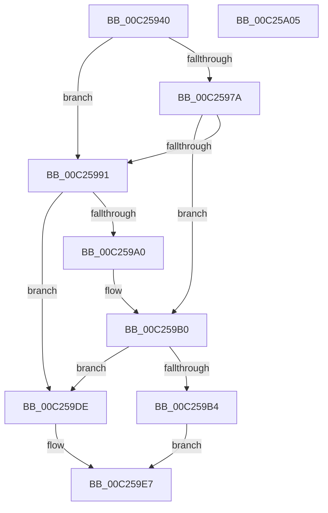

# HalpPciGetHpetInterruptSource

- RVA: `0x00C25940`–`0x00C25A06` (길이 `198` bytes)
- VA: `0x0000000140C25940`
- 실행 섹션: `INIT`
- PDB 이름 있음: `예`; PDB Function 태그: `아니요`
- unwind 정보 RVA: `0x00060300`
- 디코드: `63`개 명령, `198/198` bytes 표시
- 미해석 바이트: `0` (있으면 어셈블리에 `.byte`로 보존)

> 이 문서는 커널 이미지의 기계어와 PDB 기호를 분석해 생성했습니다. 4번과 5번은 함수 원형과 자료형을 바이너리 사용 방식에서 추정한 C 해석이며 원본 소스 복구 결과는 아닙니다.

## 1. Dependencies

- 직접 호출 지점: **4**; 고유 호출 대상: **3**
- 직접 호출자로 확인된 함수: **1**
- RIP 상대 이미지 참조: **0**

### Outgoing calls
- `0x00C2596E` → [HalSocGetAcpiTable](../../text/56/HalSocGetAcpiTable_function_00561580.md) (function, `0x00561580`)
- `0x00C25983` → [HalpPciGetHpetInterruptSourceIntel](HalpPciGetHpetInterruptSourceIntel_function_00C25AE8.md) (function, `0x00C25AE8`)
- `0x00C25996` → [HalSocGetAcpiTable](../../text/56/HalSocGetAcpiTable_function_00561580.md) (function, `0x00561580`)
- `0x00C259A9` → [HalpPciGetHpetInterruptSourceAmd](HalpPciGetHpetInterruptSourceAmd_function_00C25A0C.md) (function, `0x00C25A0C`)

### Direct callers
- [HalpTimerRegister](../../text/56/HalpTimerRegister_function_005616BC.md) at `0x0056198D`

### Static image references
- 디코드된 RIP-relative 메모리 참조가 없습니다.

## 2. Other-region calls and transfers

- 다른 실행 섹션으로 향하는 call: **2**
  - `0x00C2596E` → [HalSocGetAcpiTable](../../text/56/HalSocGetAcpiTable_function_00561580.md) (`INIT` → `.text`)
  - `0x00C25996` → [HalSocGetAcpiTable](../../text/56/HalSocGetAcpiTable_function_00561580.md) (`INIT` → `.text`)
- 별도 외부 분기/꼬리 이동을 확인하지 못했습니다.

## 3. Assembly (complete function range)

```asm
00C25940  48 89 5C 24 08                  mov qword ptr [rsp + 8], rbx
00C25945  48 89 6C 24 10                  mov qword ptr [rsp + 0x10], rbp
00C2594A  48 89 74 24 18                  mov qword ptr [rsp + 0x18], rsi
00C2594F  57                              push rdi
00C25950  41 56                           push r14
00C25952  41 57                           push r15
00C25954  48 83 EC 20                     sub rsp, 0x20
00C25958  40 8A E9                        mov bpl, cl
00C2595B  4D 8B F1                        mov r14, r9
00C2595E  B9 44 4D 41 52                  mov ecx, 0x52414d44
00C25963  4D 8B F8                        mov r15, r8
00C25966  48 8B FA                        mov rdi, rdx
00C25969  BE 25 02 00 C0                  mov esi, 0xc0000225
00C2596E  E8 0D BC 93 FF                  call 0x140561580
00C25973  33 DB                           xor ebx, ebx
00C25975  48 85 C0                        test rax, rax
00C25978  74 17                           je 0x140c25991
00C2597A  4C 8B C7                        mov r8, rdi
00C2597D  40 8A D5                        mov dl, bpl
00C25980  48 8B C8                        mov rcx, rax
00C25983  E8 60 01 00 00                  call 0x140c25ae8
00C25988  8B F0                           mov esi, eax
00C2598A  3D 25 02 00 C0                  cmp eax, 0xc0000225
00C2598F  75 1F                           jne 0x140c259b0
00C25991  B9 49 56 52 53                  mov ecx, 0x53525649
00C25996  E8 E5 BB 93 FF                  call 0x140561580
00C2599B  48 85 C0                        test rax, rax
00C2599E  74 3E                           je 0x140c259de
00C259A0  4C 8B C7                        mov r8, rdi
00C259A3  40 8A D5                        mov dl, bpl
00C259A6  48 8B C8                        mov rcx, rax
00C259A9  E8 5E 00 00 00                  call 0x140c25a0c
00C259AE  8B F0                           mov esi, eax
00C259B0  85 F6                           test esi, esi
00C259B2  78 2A                           js 0x140c259de
00C259B4  0F B6 47 08                     movzx eax, byte ptr [rdi + 8]
00C259B8  8B 4F 04                        mov ecx, dword ptr [rdi + 4]
00C259BB  C1 E1 08                        shl ecx, 8
00C259BE  0B C8                           or ecx, eax
00C259C0  41 89 0F                        mov dword ptr [r15], ecx
00C259C3  41 89 1E                        mov dword ptr [r14], ebx
00C259C6  0F B6 47 09                     movzx eax, byte ptr [rdi + 9]
00C259CA  83 E0 1F                        and eax, 0x1f
00C259CD  41 89 06                        mov dword ptr [r14], eax
00C259D0  0F B6 5F 0A                     movzx ebx, byte ptr [rdi + 0xa]
00C259D4  83 E3 07                        and ebx, 7
00C259D7  C1 E3 05                        shl ebx, 5
00C259DA  0B D8                           or ebx, eax
00C259DC  EB 09                           jmp 0x140c259e7
00C259DE  48 89 5F 04                     mov qword ptr [rdi + 4], rbx
00C259E2  89 1F                           mov dword ptr [rdi], ebx
00C259E4  41 89 1F                        mov dword ptr [r15], ebx
00C259E7  41 89 1E                        mov dword ptr [r14], ebx
00C259EA  8B C6                           mov eax, esi
00C259EC  48 8B 5C 24 40                  mov rbx, qword ptr [rsp + 0x40]
00C259F1  48 8B 6C 24 48                  mov rbp, qword ptr [rsp + 0x48]
00C259F6  48 8B 74 24 50                  mov rsi, qword ptr [rsp + 0x50]
00C259FB  48 83 C4 20                     add rsp, 0x20
00C259FF  41 5F                           pop r15
00C25A01  41 5E                           pop r14
00C25A03  5F                              pop rdi
00C25A04  C3                              ret
00C25A05  CC                              int3
```

## 4. C-style interpretation (structured pseudocode)

```c
__int64 __fastcall HalpPciGetHpetInterruptSource(unsigned __int8 a1, __int64 a2, __int64 a3, __int64 a4)
{
    __int64 result;
    __int64 v_rbx;
    __int64 v_rsp;
    unsigned __int64 v_stack_p10;
    unsigned __int64 v_stack_p18;
    unsigned __int64 v_stack_p8;

    v_stack_p8 = v_rbx;
    v_stack_p10 = v_rbp;
    v_stack_p18 = v_rsi;
    v_rsp = (v_rsp) - (32);
    result = HalSocGetAcpiTable((unsigned int)(0x52414D44ULL), a2, a3, a4);
    v_rbx = 0;
    if (result == 0) goto loc_00C25991;
    result = HalpPciGetHpetInterruptSourceIntel(result, a1, a2, a4);
    if (((unsigned int)(result)) != 0xC0000225ULL) goto loc_00C259B0;
loc_00C25991:
    result = HalSocGetAcpiTable((unsigned int)(0x53525649ULL), a1, a2, a4);
    if (result == 0) goto loc_00C259DE;
    result = HalpPciGetHpetInterruptSourceAmd(result, a1, a2, a4);
loc_00C259B0:
    if (sign_flag) goto loc_00C259DE;
    a1 = (unsigned int)(((unsigned int)(*(unsigned int *)(a2 + 4))) << (8));
    a1 = (unsigned int)((a1) | ((unsigned int)(*(unsigned __int8 *)(a2 + 8))));
    *(unsigned int *)(a3) = a1;
    *(unsigned int *)(a4) = 0;
    result = (unsigned int)((*(unsigned __int8 *)(a2 + 9)) & (31));
    *(unsigned int *)(a4) = (unsigned int)(result);
    v_rbx = (unsigned int)((*(unsigned __int8 *)(a2 + 10)) & (7));
    v_rbx = (unsigned int)((v_rbx) << (5));
    v_rbx = (unsigned int)((v_rbx) | ((unsigned int)(result)));
    goto loc_00C259E7;
loc_00C259DE:
    *(unsigned __int64 *)(a2 + 4) = v_rbx;
    *(unsigned int *)(a2) = (unsigned int)(v_rbx);
    *(unsigned int *)(a3) = (unsigned int)(v_rbx);
loc_00C259E7:
    *(unsigned int *)(a4) = (unsigned int)(v_rbx);
    v_rsp = (v_rsp) + (32);
    return (unsigned int)((unsigned int)((unsigned int)((unsigned int)(result))));
}
```

## 5. (Beta) C Style

```c
int64_t HalpPciGetHpetInterruptSource(uint8_t Arg1, void *Arg2, void *Arg3, void *Arg4)
{
    uint8_t *arg2 = (uint8_t *)Arg2;
    uint8_t *arg3 = (uint8_t *)Arg3;
    uint8_t *arg4 = (uint8_t *)Arg4;

    int64_t result;
    int64_t local_rbx;
    int64_t local_rsp;
    uint64_t v_stack_p10;
    uint64_t v_stack_p18;
    uint64_t v_stack_p8;

    v_stack_p8 = local_rbx;
    v_stack_p10 = local_rbp;
    v_stack_p18 = local_rsi;
    local_rsp = (local_rsp) - (32);
    result = HalSocGetAcpiTable((uint32_t)(0x52414D44ULL), Arg2, Arg3, Arg4);
    local_rbx = 0;
    if (result == 0) goto loc_00C25991;
    result = HalpPciGetHpetInterruptSourceIntel(result, Arg1, Arg2, Arg4);
    if (((uint32_t)(result)) != 0xC0000225ULL) goto loc_00C259B0;
loc_00C25991:
    result = HalSocGetAcpiTable((uint32_t)(0x53525649ULL), Arg1, Arg2, Arg4);
    if (result == 0) goto loc_00C259DE;
    result = HalpPciGetHpetInterruptSourceAmd(result, Arg1, Arg2, Arg4);
loc_00C259B0:
    if (sign_flag) goto loc_00C259DE;
    Arg1 = (uint32_t)(((uint32_t)(*(uint32_t *)(arg2 + 0x4))) << (8));
    Arg1 = (uint32_t)((Arg1) | ((uint32_t)(*(uint8_t *)(arg2 + 0x8))));
    *(uint32_t *)(arg3) = Arg1;
    *(uint32_t *)(arg4) = 0;
    result = (uint32_t)((*(uint8_t *)(arg2 + 0x9)) & (31));
    *(uint32_t *)(arg4) = (uint32_t)(result);
    local_rbx = (uint32_t)((*(uint8_t *)(arg2 + 0xA)) & (7));
    local_rbx = (uint32_t)((local_rbx) << (5));
    local_rbx = (uint32_t)((local_rbx) | ((uint32_t)(result)));
    goto loc_00C259E7;
loc_00C259DE:
    *(uint64_t *)(arg2 + 0x4) = local_rbx;
    *(uint32_t *)(arg2) = (uint32_t)(local_rbx);
    *(uint32_t *)(arg3) = (uint32_t)(local_rbx);
loc_00C259E7:
    *(uint32_t *)(arg4) = (uint32_t)(local_rbx);
    local_rsp = (local_rsp) + (32);
    return (uint32_t)((uint32_t)((uint32_t)((uint32_t)(result))));
}
```

### 관측된 메모리 오프셋

구조체 형식이 확인되지 않은 접근은 인자 기준의 오프셋으로만 기록했습니다.

| 기준 인자 | 오프셋 표현 | 폭 (bit) | 접근 |
|---|---:|---:|---|
| `Arg2` | `+ 0x0` | `32` | `W` |
| `Arg2` | `+ 0x4` | `32` | `R` |
| `Arg2` | `+ 0x4` | `64` | `W` |
| `Arg2` | `+ 0x8` | `8` | `R` |
| `Arg2` | `+ 0x9` | `8` | `R` |
| `Arg2` | `+ 0xA` | `8` | `R` |
| `Arg3` | `+ 0x0` | `32` | `W` |
| `Arg4` | `+ 0x0` | `32` | `W` |

## 6. Execution-region graph

[열기: 2D/3D 그래프와 함수 탐색 컨트롤 패널](../../../control-panel.html?section=init&rva=0x00C25940&view=graph)

- 2D 그래프는 위에서 아래로 흐르고, 3D 그래프는 빈 공간을 드래그해 회전합니다. Shift+드래그는 이동, 휠은 확대·축소, 함수 노드 선택은 대상 보고서 이동입니다.

### Static fallback


