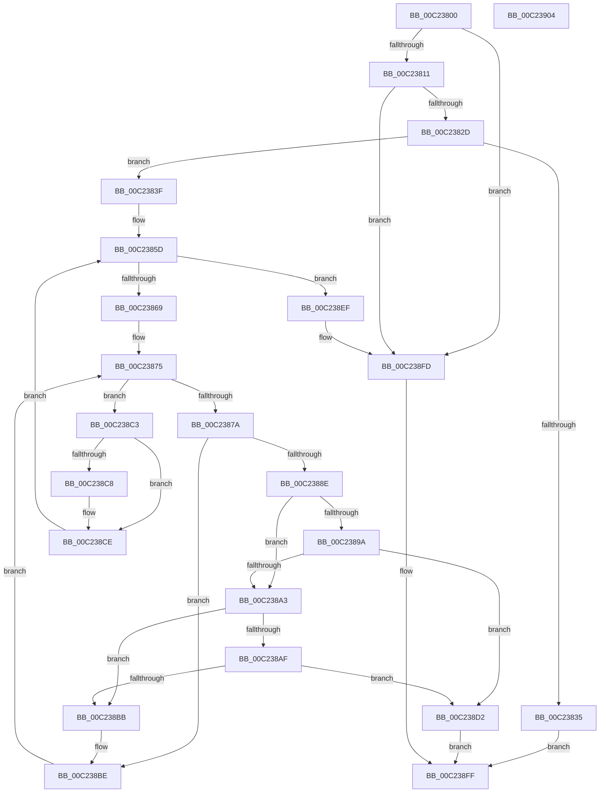

# HalpPciInitializeMmConfigAccess

- RVA: `0x00C23800`–`0x00C23905` (길이 `261` bytes)
- VA: `0x0000000140C23800`
- 실행 섹션: `INIT`
- PDB 이름 있음: `예`; PDB Function 태그: `아니요`
- unwind 정보 RVA: `0x0005C788`
- 디코드: `64`개 명령, `261/261` bytes 표시
- 미해석 바이트: `0` (있으면 어셈블리에 `.byte`로 보존)

> 이 문서는 커널 이미지의 기계어와 PDB 기호를 분석해 생성했습니다. 4번과 5번은 함수 원형과 자료형을 바이너리 사용 방식에서 추정한 C 해석이며 원본 소스 복구 결과는 아닙니다.

## 1. Dependencies

- 직접 호출 지점: **1**; 고유 호출 대상: **1**
- 직접 호출자로 확인된 함수: **1**
- RIP 상대 이미지 참조: **10**

### Outgoing calls
- `0x00C2381C` → [HalpAcpiGetTable](../../text/3F/HalpAcpiGetTable_function_003F6BF8.md) (function, `0x003F6BF8`)

### Direct callers
- [HalpPciInitSystem](../../pagelk/B5/HalpPciInitSystem_function_00B5D6C0.md) at `0x00B5D6E0`

### Static image references
- `0x00C23804` → RVA `0x00E103F8` (`.data`; read)
- `0x00C2383F` → RVA `0x00F901F0` (`.data`; read/write)
- `0x00C2384E` → RVA `0x00F901E0` (`.data`; write)
- `0x00C23856` → RVA `0x00F90200` (`.data`; write)
- `0x00C2385D` → RVA `0x00F901E0` (`.data`; read)
- `0x00C2389A` → RVA `0x00F90208` (`.data`; read)
- `0x00C238D2` → RVA `0x00F90200` (`.data`; read/write)
- `0x00C238DF` → RVA `0x00F901E0` (`.data`; read/write)
- `0x00C238EF` → RVA `0x0043F360` (`HalpPciGetDeviceLocationFromPhysicalAddress`; read)
- `0x00C238F6` → RVA `0x00E00CC0` (`.data`; write)

## 2. Other-region calls and transfers

- 다른 실행 섹션으로 향하는 call: **1**
  - `0x00C2381C` → [HalpAcpiGetTable](../../text/3F/HalpAcpiGetTable_function_003F6BF8.md) (`INIT` → `.text`)
- 별도 외부 분기/꼬리 이동을 확인하지 못했습니다.

## 3. Assembly (complete function range)

```asm
00C23800  48 83 EC 28                     sub rsp, 0x28
00C23804  80 3D ED CB 1E 00 00            cmp byte ptr [rip + 0x1ecbed], 0
00C2380B  0F 85 EC 00 00 00               jne 0x140c238fd
00C23811  45 33 C9                        xor r9d, r9d
00C23814  45 33 C0                        xor r8d, r8d
00C23817  BA 4D 43 46 47                  mov edx, 0x4746434d
00C2381C  E8 D7 33 7D FF                  call 0x1403f6bf8
00C23821  48 8B C8                        mov rcx, rax
00C23824  48 85 C0                        test rax, rax
00C23827  0F 84 D0 00 00 00               je 0x140c238fd
00C2382D  8B 40 04                        mov eax, dword ptr [rax + 4]
00C23830  83 F8 3C                        cmp eax, 0x3c
00C23833  73 0A                           jae 0x140c2383f
00C23835  B8 01 00 00 C0                  mov eax, 0xc0000001
00C2383A  E9 C0 00 00 00                  jmp 0x140c238ff
00C2383F  83 25 AA C9 36 00 00            and dword ptr [rip + 0x36c9aa], 0
00C23846  48 83 E8 2C                     sub rax, 0x2c
00C2384A  48 C1 E8 04                     shr rax, 4
00C2384E  89 05 8C C9 36 00               mov dword ptr [rip + 0x36c98c], eax
00C23854  33 D2                           xor edx, edx
00C23856  48 89 0D A3 C9 36 00            mov qword ptr [rip + 0x36c9a3], rcx
00C2385D  3B 15 7D C9 36 00               cmp edx, dword ptr [rip + 0x36c97d]
00C23863  0F 83 86 00 00 00               jae 0x140c238ef
00C23869  44 8B C2                        mov r8d, edx
00C2386C  45 32 DB                        xor r11b, r11b
00C2386F  4D 03 C0                        add r8, r8
00C23872  45 33 D2                        xor r10d, r10d
00C23875  44 3B D2                        cmp r10d, edx
00C23878  73 49                           jae 0x140c238c3
00C2387A  42 0F B7 44 C1 34               movzx eax, word ptr [rcx + r8*8 + 0x34]
00C23880  45 8B CA                        mov r9d, r10d
00C23883  4D 03 C9                        add r9, r9
00C23886  66 42 39 44 C9 34               cmp word ptr [rcx + r9*8 + 0x34], ax
00C2388C  75 30                           jne 0x140c238be
00C2388E  4A 8B 44 C1 2C                  mov rax, qword ptr [rcx + r8*8 + 0x2c]
00C23893  4A 39 44 C9 2C                  cmp qword ptr [rcx + r9*8 + 0x2c], rax
00C23898  74 09                           je 0x140c238a3
00C2389A  80 3D 67 C9 36 00 00            cmp byte ptr [rip + 0x36c967], 0
00C238A1  74 2F                           je 0x140c238d2
00C238A3  42 8A 44 C1 37                  mov al, byte ptr [rcx + r8*8 + 0x37]
00C238A8  42 38 44 C9 36                  cmp byte ptr [rcx + r9*8 + 0x36], al
00C238AD  77 0C                           ja 0x140c238bb
00C238AF  42 8A 44 C1 36                  mov al, byte ptr [rcx + r8*8 + 0x36]
00C238B4  42 38 44 C9 37                  cmp byte ptr [rcx + r9*8 + 0x37], al
00C238B9  73 17                           jae 0x140c238d2
00C238BB  41 B3 01                        mov r11b, 1
00C238BE  41 FF C2                        inc r10d
00C238C1  EB B2                           jmp 0x140c23875
00C238C3  45 84 DB                        test r11b, r11b
00C238C6  75 06                           jne 0x140c238ce
00C238C8  FF 05 22 C9 36 00               inc dword ptr [rip + 0x36c922]
00C238CE  FF C2                           inc edx
00C238D0  EB 8B                           jmp 0x140c2385d
00C238D2  48 83 25 26 C9 36 00 00         and qword ptr [rip + 0x36c926], 0
00C238DA  B8 01 00 00 C0                  mov eax, 0xc0000001
00C238DF  83 25 FA C8 36 00 00            and dword ptr [rip + 0x36c8fa], 0
00C238E6  83 25 03 C9 36 00 00            and dword ptr [rip + 0x36c903], 0
00C238ED  EB 10                           jmp 0x140c238ff
00C238EF  48 8D 0D 6A BA 81 FF            lea rcx, [rip - 0x7e4596]
00C238F6  48 89 0D C3 D3 1D 00            mov qword ptr [rip + 0x1dd3c3], rcx
00C238FD  33 C0                           xor eax, eax
00C238FF  48 83 C4 28                     add rsp, 0x28
00C23903  C3                              ret
00C23904  CC                              int3
```

## 4. C-style interpretation (structured pseudocode)

```c
__int64 __fastcall HalpPciInitializeMmConfigAccess(__int64 a1, __int64 a2, int a3, int a4)
{
    __int64 result;
    __int64 v_r10;
    __int64 v_r11;
    __int64 v_rsp;

    v_rsp = (v_rsp) - (40);
    if ((*(unsigned __int8 *)(v_rip + 2018285)) != 0) goto loc_00C238FD;
    a4 = 0;
    a3 = 0;
    result = HalpAcpiGetTable(a1, (unsigned int)(0x4746434DULL), a3, a4);
    if (result == 0) goto loc_00C238FD;
    if (((unsigned int)((unsigned int)(*(unsigned int *)(result + 4)))) >= 60) goto loc_00C2383F;
    goto loc_00C238FF;
loc_00C2383F:
    result = ((unsigned int)(0xC0000001ULL)) - (44);
    result = (result) >> (4);
    *(unsigned int *)(v_rip + 3590540) = (unsigned int)(result);
    a2 = 0;
    *(unsigned __int64 *)(v_rip + 3590563) = result;
loc_00C2385D:
    if (0 >= (*(unsigned int *)(v_rip + 3590525))) goto loc_00C238EF;
    v_r11 = 0;
    a3 = (0) + (0);
    v_r10 = 0;
loc_00C23875:
    if (0 >= 0) goto loc_00C238C3;
    a4 = (0) + (0);
    if ((*(unsigned __int16 *)(result + a4 * 8 + 52)) != ((unsigned __int16)(*(unsigned __int16 *)(result + a3 * 8 + 52)))) goto loc_00C238BE;
    if ((*(unsigned __int64 *)(result + a4 * 8 + 44)) == (*(unsigned __int64 *)(result + a3 * 8 + 44))) goto loc_00C238A3;
    if ((*(unsigned __int8 *)(v_rip + 3590503)) == 0) goto loc_00C238D2;
loc_00C238A3:
    if ((*(unsigned __int8 *)(result + a4 * 8 + 54)) > ((unsigned __int8)(*(unsigned __int8 *)(result + a3 * 8 + 55)))) goto loc_00C238BB;
    if ((*(unsigned __int8 *)(result + a4 * 8 + 55)) >= ((unsigned __int8)(*(unsigned __int8 *)(result + a3 * 8 + 54)))) goto loc_00C238D2;
loc_00C238BB:
loc_00C238BE:
    v_r10 = (unsigned int)((v_r10) + 1);
    goto loc_00C23875;
loc_00C238C3:
    if (1 == 0) {
    }
    a2 = (unsigned int)((a2) + 1);
    goto loc_00C2385D;
loc_00C238D2:
    goto loc_00C238FF;
loc_00C238EF:
    *(unsigned __int64 *)(v_rip + 1954755) = v_rip - 8275350;
loc_00C238FD:
    result = 0;
loc_00C238FF:
    v_rsp = (v_rsp) + (40);
    return result;
}
```

## 5. (Beta) C Style

```c
int64_t HalpPciInitializeMmConfigAccess(int64_t Arg1, int64_t Arg2, int32_t Arg3, int32_t Arg4)
{
    int64_t result;
    int64_t local_r10;
    int64_t local_r11;
    int64_t local_rsp;

    local_rsp = (local_rsp) - (40);
    if ((*(uint8_t *)(v_rip + 0x1ECBED)) != 0) goto loc_00C238FD;
    Arg4 = 0;
    Arg3 = 0;
    result = HalpAcpiGetTable(Arg1, (uint32_t)(0x4746434DULL), Arg3, Arg4);
    if (result == 0) goto loc_00C238FD;
    if (((uint32_t)((uint32_t)(*(uint32_t *)(result + 0x4)))) >= 60) goto loc_00C2383F;
    goto loc_00C238FF;
loc_00C2383F:
    result = ((uint32_t)(0xC0000001ULL)) - (44);
    result = (result) >> (4);
    *(uint32_t *)(v_rip + 0x36C98C) = (uint32_t)(result);
    Arg2 = 0;
    *(uint64_t *)(v_rip + 0x36C9A3) = result;
loc_00C2385D:
    if (0 >= (*(uint32_t *)(v_rip + 0x36C97D))) goto loc_00C238EF;
    local_r11 = 0;
    Arg3 = (0) + (0);
    local_r10 = 0;
loc_00C23875:
    if (0 >= 0) goto loc_00C238C3;
    Arg4 = (0) + (0);
    if ((*(uint16_t *)(result + Arg4 * 8 + 0x34)) != ((uint16_t)(*(uint16_t *)(result + Arg3 * 8 + 0x34)))) goto loc_00C238BE;
    if ((*(uint64_t *)(result + Arg4 * 8 + 0x2C)) == (*(uint64_t *)(result + Arg3 * 8 + 0x2C))) goto loc_00C238A3;
    if ((*(uint8_t *)(v_rip + 0x36C967)) == 0) goto loc_00C238D2;
loc_00C238A3:
    if ((*(uint8_t *)(result + Arg4 * 8 + 0x36)) > ((uint8_t)(*(uint8_t *)(result + Arg3 * 8 + 0x37)))) goto loc_00C238BB;
    if ((*(uint8_t *)(result + Arg4 * 8 + 0x37)) >= ((uint8_t)(*(uint8_t *)(result + Arg3 * 8 + 0x36)))) goto loc_00C238D2;
loc_00C238BB:
loc_00C238BE:
    local_r10 = (uint32_t)((local_r10) + 1);
    goto loc_00C23875;
loc_00C238C3:
    if (1 == 0) {
    }
    Arg2 = (uint32_t)((Arg2) + 1);
    goto loc_00C2385D;
loc_00C238D2:
    goto loc_00C238FF;
loc_00C238EF:
    *(uint64_t *)(v_rip + 0x1DD3C3) = v_rip - 8275350;
loc_00C238FD:
    result = 0;
loc_00C238FF:
    local_rsp = (local_rsp) + (40);
    return result;
}
```

## 6. Execution-region graph

[열기: 2D/3D 그래프와 함수 탐색 컨트롤 패널](../../../control-panel.html?section=init&rva=0x00C23800&view=graph)

- 2D 그래프는 위에서 아래로 흐르고, 3D 그래프는 빈 공간을 드래그해 회전합니다. Shift+드래그는 이동, 휠은 확대·축소, 함수 노드 선택은 대상 보고서 이동입니다.

### Static fallback


