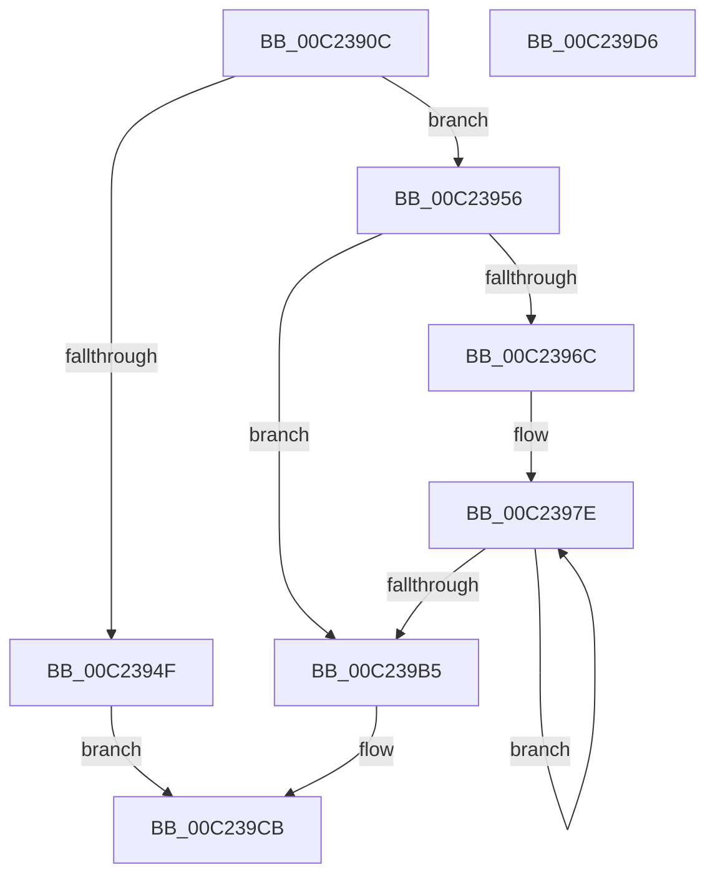

# HalpPciReportMmConfigAddressRange

- RVA: `0x00C2390C`–`0x00C239D7` (길이 `203` bytes)
- VA: `0x0000000140C2390C`
- 실행 섹션: `INIT`
- PDB 이름 있음: `예`; PDB Function 태그: `아니요`
- unwind 정보 RVA: `0x0005CAAC`
- 디코드: `55`개 명령, `203/203` bytes 표시
- 미해석 바이트: `0` (있으면 어셈블리에 `.byte`로 보존)

> 이 문서는 커널 이미지의 기계어와 PDB 기호를 분석해 생성했습니다. 4번과 5번은 함수 원형과 자료형을 바이너리 사용 방식에서 추정한 C 해석이며 원본 소스 복구 결과는 아닙니다.

## 1. Dependencies

- 직접 호출 지점: **4**; 고유 호출 대상: **4**
- 직접 호출자로 확인된 함수: **1**
- RIP 상대 이미지 참조: **2**

### Outgoing calls
- `0x00C23916` → [ArbDeleteMmConfigRange](ArbDeleteMmConfigRange_function_00C25D5C.md) (function, `0x00C25D5C`)
- `0x00C23942` → [ExAllocatePool2](../../poolcode/B8/ExAllocatePool2_function_00B820F0.md) (function, `0x00B820F0`)
- `0x00C239B8` → [ArbInitializeMmConfigRange](ArbInitializeMmConfigRange_function_00C25E6C.md) (function, `0x00C25E6C`)
- `0x00C239C4` → [ExFreePoolWithTag](../../poolcode/B8/ExFreePoolWithTag_function_00B82870.md) (function, `0x00B82870`)

### Direct callers
- [HalpPciInitSystem](../../pagelk/B5/HalpPciInitSystem_function_00B5D6C0.md) at `0x00B5D6CE`

### Static image references
- `0x00C23925` → RVA `0x00F901E0` (`.data`; read)
- `0x00C2396C` → RVA `0x00F90200` (`.data`; read)

## 2. Other-region calls and transfers

- 다른 실행 섹션으로 향하는 call: **2**
  - `0x00C23942` → [ExAllocatePool2](../../poolcode/B8/ExAllocatePool2_function_00B820F0.md) (`INIT` → `POOLCODE`)
  - `0x00C239C4` → [ExFreePoolWithTag](../../poolcode/B8/ExFreePoolWithTag_function_00B82870.md) (`INIT` → `POOLCODE`)
- 별도 외부 분기/꼬리 이동을 확인하지 못했습니다.

## 3. Assembly (complete function range)

```asm
00C2390C  48 89 5C 24 08                  mov qword ptr [rsp + 8], rbx
00C23911  57                              push rdi
00C23912  48 83 EC 20                     sub rsp, 0x20
00C23916  E8 41 24 00 00                  call 0x140c25d5c
00C2391B  BB 01 00 00 00                  mov ebx, 1
00C23920  B9 40 00 00 00                  mov ecx, 0x40
00C23925  39 1D B5 C8 36 00               cmp dword ptr [rip + 0x36c8b5], ebx
00C2392B  41 B8 48 61 6C 50               mov r8d, 0x506c6148
00C23931  0F 47 1D A8 C8 36 00            cmova ebx, dword ptr [rip + 0x36c8a8]
00C23938  FF CB                           dec ebx
00C2393A  C1 E3 05                        shl ebx, 5
00C2393D  83 C3 48                        add ebx, 0x48
00C23940  8B D3                           mov edx, ebx
00C23942  E8 A9 E7 F5 FF                  call 0x140b820f0
00C23947  48 8B F8                        mov rdi, rax
00C2394A  48 85 C0                        test rax, rax
00C2394D  75 07                           jne 0x140c23956
00C2394F  B8 9A 00 00 C0                  mov eax, 0xc000009a
00C23954  EB 75                           jmp 0x140c239cb
00C23956  8B 0D 84 C8 36 00               mov ecx, dword ptr [rip + 0x36c884]
00C2395C  89 18                           mov dword ptr [rax], ebx
00C2395E  C7 40 1C 01 00 00 00            mov dword ptr [rax + 0x1c], 1
00C23965  89 48 24                        mov dword ptr [rax + 0x24], ecx
00C23968  85 C9                           test ecx, ecx
00C2396A  74 49                           je 0x140c239b5
00C2396C  48 8B 15 8D C8 36 00            mov rdx, qword ptr [rip + 0x36c88d]
00C23973  4C 8D 40 38                     lea r8, [rax + 0x38]
00C23977  48 83 C2 2C                     add rdx, 0x2c
00C2397B  44 8B C9                        mov r9d, ecx
00C2397E  41 C6 40 F1 03                  mov byte ptr [r8 - 0xf], 3
00C23983  0F B6 42 0A                     movzx eax, byte ptr [rdx + 0xa]
00C23987  48 C1 E0 14                     shl rax, 0x14
00C2398B  48 03 02                        add rax, qword ptr [rdx]
00C2398E  49 89 00                        mov qword ptr [r8], rax
00C23991  4D 8D 40 20                     lea r8, [r8 + 0x20]
00C23995  0F B6 4A 0B                     movzx ecx, byte ptr [rdx + 0xb]
00C23999  48 C1 E1 14                     shl rcx, 0x14
00C2399D  48 81 C1 FF FF 0F 00            add rcx, 0xfffff
00C239A4  48 03 0A                        add rcx, qword ptr [rdx]
00C239A7  48 8D 52 10                     lea rdx, [rdx + 0x10]
00C239AB  49 89 48 E8                     mov qword ptr [r8 - 0x18], rcx
00C239AF  49 83 E9 01                     sub r9, 1
00C239B3  75 C9                           jne 0x140c2397e
00C239B5  48 8B CF                        mov rcx, rdi
00C239B8  E8 AF 24 00 00                  call 0x140c25e6c
00C239BD  33 D2                           xor edx, edx
00C239BF  48 8B CF                        mov rcx, rdi
00C239C2  8B D8                           mov ebx, eax
00C239C4  E8 A7 EE F5 FF                  call 0x140b82870
00C239C9  8B C3                           mov eax, ebx
00C239CB  48 8B 5C 24 30                  mov rbx, qword ptr [rsp + 0x30]
00C239D0  48 83 C4 20                     add rsp, 0x20
00C239D4  5F                              pop rdi
00C239D5  C3                              ret
00C239D6  CC                              int3
```

## 4. C-style interpretation (structured pseudocode)

```c
__int64 __fastcall HalpPciReportMmConfigAddressRange(void)
{
    __int64 result;
    __int64 v_rbx;
    __int64 v_rsp;
    unsigned __int64 v_stack_p8;

    v_stack_p8 = v_rbx;
    v_rsp = (v_rsp) - (32);
    result = ArbDeleteMmConfigRange(a1, a2, a3, a4);
    v_rbx = 1;
    if ((*(unsigned int *)(v_rip + 3590325)) > 1) { v_rbx = *(unsigned int *)(v_rip + 3590312); }
    v_rbx = (unsigned int)((v_rbx) - 1);
    v_rbx = (unsigned int)((v_rbx) << (5));
    v_rbx = (unsigned int)((v_rbx) + (72));
    result = ExAllocatePool2(64, (unsigned int)((unsigned int)(v_rbx)), (unsigned int)(0x506C6148ULL), a4);
    if (result != 0) goto loc_00C23956;
    goto loc_00C239CB;
loc_00C23956:
    *(unsigned int *)((unsigned int)(0xC000009AULL)) = (unsigned int)(v_rbx);
    *(unsigned int *)((unsigned int)(0xC000009AULL) + 28) = 1;
    *(unsigned int *)((unsigned int)(0xC000009AULL) + 36) = (unsigned int)((unsigned int)(*(unsigned int *)(v_rip + 3590276)));
    if ((unsigned int)((unsigned int)(*(unsigned int *)(v_rip + 3590276))) == 0) goto loc_00C239B5;
    a2 = (*(unsigned __int64 *)(v_rip + 3590285)) + (44);
loc_00C2397E:
    *(unsigned __int8 *)((unsigned int)(0xC000009AULL) + 56 - 15) = 3;
    result = (*(unsigned __int8 *)(a2 + 10)) << (20);
    result = (result) + (*(unsigned __int64 *)(a2));
    *(unsigned __int64 *)((unsigned int)(0xC000009AULL) + 56) = result;
    a1 = (*(unsigned __int8 *)(a2 + 11)) << (20);
    a1 = (a1) + (0xFFFFFULL);
    a1 = (a1) + (*(unsigned __int64 *)(a2));
    *(unsigned __int64 *)((unsigned int)(0xC000009AULL) + 56 + 32 - 24) = a1;
    a4 = ((unsigned int)((unsigned int)((unsigned int)(*(unsigned int *)(v_rip + 3590276))))) - (1);
    if (condition_is_not_equal) goto loc_00C2397E;
loc_00C239B5:
    result = ArbInitializeMmConfigRange(result, a2 + 16, (unsigned int)(0xC000009AULL) + 56 + 32, a4);
    a2 = 0;
    result = ExFreePoolWithTag(result, a2, (unsigned int)(0xC000009AULL) + 56 + 32, a4);
loc_00C239CB:
    v_rsp = (v_rsp) + (32);
    return (unsigned int)((unsigned int)((unsigned int)((unsigned int)(result))));
}
```

## 5. (Beta) C Style

```c
void HalpPciReportMmConfigAddressRange(void)
{
    int64_t result;
    int64_t local_rbx;
    int64_t local_rsp;
    uint64_t v_stack_p8;

    v_stack_p8 = local_rbx;
    local_rsp = (local_rsp) - (32);
    result = ArbDeleteMmConfigRange(a1, a2, a3, a4);
    local_rbx = 1;
    if ((*(uint32_t *)(v_rip + 0x36C8B5)) > 1) { local_rbx = *(uint32_t *)(v_rip + 0x36C8A8); }
    local_rbx = (uint32_t)((local_rbx) - 1);
    local_rbx = (uint32_t)((local_rbx) << (5));
    local_rbx = (uint32_t)((local_rbx) + (72));
    result = ExAllocatePool2(64, (uint32_t)((uint32_t)(local_rbx)), (uint32_t)(0x506C6148ULL), a4);
    if (result != 0) goto loc_00C23956;
    goto loc_00C239CB;
loc_00C23956:
    *(uint32_t *)((uint32_t)(0xC000009AULL)) = (uint32_t)(local_rbx);
    *(uint32_t *)((uint32_t)(0xC000009AULL) + 0x1C) = 1;
    *(uint32_t *)((uint32_t)(0xC000009AULL) + 0x24) = (uint32_t)((uint32_t)(*(uint32_t *)(v_rip + 0x36C884)));
    if ((uint32_t)((uint32_t)(*(uint32_t *)(v_rip + 0x36C884))) == 0) goto loc_00C239B5;
    a2 = (*(uint64_t *)(v_rip + 0x36C88D)) + (44);
loc_00C2397E:
    *(uint8_t *)((uint32_t)(0xC000009AULL) + 0x38 - 0xF) = 3;
    result = (*(uint8_t *)(a2 + 0xA)) << (20);
    result = (result) + (*(uint64_t *)(a2));
    *(uint64_t *)((uint32_t)(0xC000009AULL) + 0x38) = result;
    a1 = (*(uint8_t *)(a2 + 0xB)) << (20);
    a1 = (a1) + (0xFFFFFULL);
    a1 = (a1) + (*(uint64_t *)(a2));
    *(uint64_t *)((uint32_t)(0xC000009AULL) + 0x38 + 0x20 - 0x18) = a1;
    a4 = ((uint32_t)((uint32_t)((uint32_t)(*(uint32_t *)(v_rip + 0x36C884))))) - (1);
    if (condition_is_not_equal) goto loc_00C2397E;
loc_00C239B5:
    result = ArbInitializeMmConfigRange(result, a2 + 16, (uint32_t)(0xC000009AULL) + 56 + 32, a4);
    a2 = 0;
    result = ExFreePoolWithTag(result, a2, (uint32_t)(0xC000009AULL) + 56 + 32, a4);
loc_00C239CB:
    local_rsp = (local_rsp) + (32);
    return (uint32_t)((uint32_t)((uint32_t)((uint32_t)(result))));
}
```

## 6. Execution-region graph

[열기: 2D/3D 그래프와 함수 탐색 컨트롤 패널](../../../control-panel.html?section=init&rva=0x00C2390C&view=graph)

- 2D 그래프는 위에서 아래로 흐르고, 3D 그래프는 빈 공간을 드래그해 회전합니다. Shift+드래그는 이동, 휠은 확대·축소, 함수 노드 선택은 대상 보고서 이동입니다.

### Static fallback


