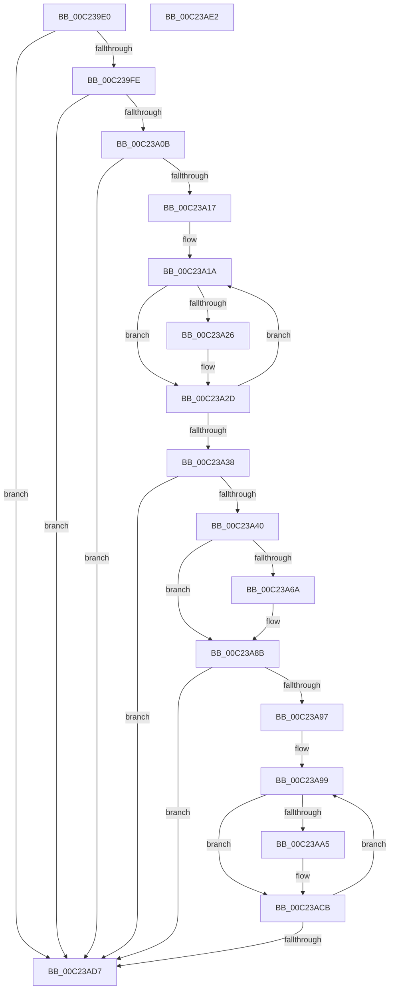

# HalpPowerInitNvsRegionData

- RVA: `0x00C239E0`–`0x00C23AE3` (길이 `259` bytes)
- VA: `0x0000000140C239E0`
- 실행 섹션: `INIT`
- PDB 이름 있음: `예`; PDB Function 태그: `아니요`
- unwind 정보 RVA: `0x0006E5F8`
- 디코드: `68`개 명령, `259/259` bytes 표시
- 미해석 바이트: `0` (있으면 어셈블리에 `.byte`로 보존)

> 이 문서는 커널 이미지의 기계어와 PDB 기호를 분석해 생성했습니다. 4번과 5번은 함수 원형과 자료형을 바이너리 사용 방식에서 추정한 C 해석이며 원본 소스 복구 결과는 아닙니다.

## 1. Dependencies

- 직접 호출 지점: **2**; 고유 호출 대상: **2**
- 직접 호출자로 확인된 함수: **1**
- RIP 상대 이미지 참조: **6**

### Outgoing calls
- `0x00C23A59` → [HalpMmAllocateMemoryInternal](../../text/54/HalpMmAllocateMemoryInternal_function_00544990.md) (function, `0x00544990`)
- `0x00C23A85` → [KeBugCheckEx](../../text/4F/KeBugCheckEx_function_004FD660.md) (function, `0x004FD660`)

### Direct callers
- [HalpPowerInitDiscard](../C1/HalpPowerInitDiscard_function_00C1EB40.md) at `0x00C1EC1A`

### Static image references
- `0x00C239EA` → RVA `0x00E0F680` (`.data`; read)
- `0x00C23A43` → RVA `0x00F90018` (`.data`; write)
- `0x00C23A53` → RVA `0x00F90028` (`.data`; write)
- `0x00C23A5E` → RVA `0x00F90168` (`.data`; write)
- `0x00C23A6C` → RVA `0x00025910` (`.rdata`; read)
- `0x00C23AAE` → RVA `0x00F90168` (`.data`; read)

## 2. Other-region calls and transfers

- 다른 실행 섹션으로 향하는 call: **2**
  - `0x00C23A59` → [HalpMmAllocateMemoryInternal](../../text/54/HalpMmAllocateMemoryInternal_function_00544990.md) (`INIT` → `.text`)
  - `0x00C23A85` → [KeBugCheckEx](../../text/4F/KeBugCheckEx_function_004FD660.md) (`INIT` → `.text`)
- 별도 외부 분기/꼬리 이동을 확인하지 못했습니다.

## 3. Assembly (complete function range)

```asm
00C239E0  48 89 5C 24 08                  mov qword ptr [rsp + 8], rbx
00C239E5  57                              push rdi
00C239E6  48 83 EC 30                     sub rsp, 0x30
00C239EA  48 8B 1D 8F BC 1E 00            mov rbx, qword ptr [rip + 0x1ebc8f]
00C239F1  33 C0                           xor eax, eax
00C239F3  33 D2                           xor edx, edx
00C239F5  48 85 DB                        test rbx, rbx
00C239F8  0F 84 D9 00 00 00               je 0x140c23ad7
00C239FE  48 8B 4B 08                     mov rcx, qword ptr [rbx + 8]
00C23A02  48 85 C9                        test rcx, rcx
00C23A05  0F 84 CC 00 00 00               je 0x140c23ad7
00C23A0B  45 33 C9                        xor r9d, r9d
00C23A0E  48 85 C9                        test rcx, rcx
00C23A11  0F 84 C0 00 00 00               je 0x140c23ad7
00C23A17  45 33 C0                        xor r8d, r8d
00C23A1A  4F 8D 14 40                     lea r10, [r8 + r8*2]
00C23A1E  42 83 7C D3 20 04               cmp dword ptr [rbx + r10*8 + 0x20], 4
00C23A24  75 07                           jne 0x140c23a2d
00C23A26  42 03 44 D3 18                  add eax, dword ptr [rbx + r10*8 + 0x18]
00C23A2B  FF C2                           inc edx
00C23A2D  41 FF C1                        inc r9d
00C23A30  45 8B C1                        mov r8d, r9d
00C23A33  4C 3B C1                        cmp r8, rcx
00C23A36  72 E2                           jb 0x140c23a1a
00C23A38  85 C0                           test eax, eax
00C23A3A  0F 84 97 00 00 00               je 0x140c23ad7
00C23A40  8D 3C 52                        lea edi, [rdx + rdx*2]
00C23A43  89 15 CF C5 36 00               mov dword ptr [rip + 0x36c5cf], edx
00C23A49  C1 E7 03                        shl edi, 3
00C23A4C  BA 01 00 00 00                  mov edx, 1
00C23A51  8B CF                           mov ecx, edi
00C23A53  89 05 CF C5 36 00               mov dword ptr [rip + 0x36c5cf], eax
00C23A59  E8 32 0F 92 FF                  call 0x140544990
00C23A5E  48 89 05 03 C7 36 00            mov qword ptr [rip + 0x36c703], rax
00C23A65  48 85 C0                        test rax, rax
00C23A68  75 21                           jne 0x140c23a8b
00C23A6A  8B D7                           mov edx, edi
00C23A6C  4C 8D 0D 9D 1E 40 FF            lea r9, [rip - 0xbfe163]
00C23A73  B9 AC 00 00 00                  mov ecx, 0xac
00C23A78  48 C7 44 24 20 42 07 00 00      mov qword ptr [rsp + 0x20], 0x742
00C23A81  44 8D 40 01                     lea r8d, [rax + 1]
00C23A85  E8 D6 9B 8D FF                  call 0x1404fd660
00C23A8A  CC                              int3
00C23A8B  45 33 D2                        xor r10d, r10d
00C23A8E  45 33 C0                        xor r8d, r8d
00C23A91  4C 39 43 08                     cmp qword ptr [rbx + 8], r8
00C23A95  76 40                           jbe 0x140c23ad7
00C23A97  33 C0                           xor eax, eax
00C23A99  4C 8D 0C 40                     lea r9, [rax + rax*2]
00C23A9D  42 83 7C CB 20 04               cmp dword ptr [rbx + r9*8 + 0x20], 4
00C23AA3  75 26                           jne 0x140c23acb
00C23AA5  4A 8B 44 CB 10                  mov rax, qword ptr [rbx + r9*8 + 0x10]
00C23AAA  4B 8D 14 52                     lea rdx, [r10 + r10*2]
00C23AAE  48 8B 0D B3 C6 36 00            mov rcx, qword ptr [rip + 0x36c6b3]
00C23AB5  48 89 04 D1                     mov qword ptr [rcx + rdx*8], rax
00C23AB9  42 8B 44 CB 18                  mov eax, dword ptr [rbx + r9*8 + 0x18]
00C23ABE  48 83 64 D1 10 00               and qword ptr [rcx + rdx*8 + 0x10], 0
00C23AC4  41 FF C2                        inc r10d
00C23AC7  89 44 D1 08                     mov dword ptr [rcx + rdx*8 + 8], eax
00C23ACB  41 FF C0                        inc r8d
00C23ACE  41 8B C0                        mov eax, r8d
00C23AD1  48 3B 43 08                     cmp rax, qword ptr [rbx + 8]
00C23AD5  72 C2                           jb 0x140c23a99
00C23AD7  48 8B 5C 24 40                  mov rbx, qword ptr [rsp + 0x40]
00C23ADC  48 83 C4 30                     add rsp, 0x30
00C23AE0  5F                              pop rdi
00C23AE1  C3                              ret
00C23AE2  CC                              int3
```

## 4. C-style interpretation (structured pseudocode)

```c
__int64 __fastcall HalpPowerInitNvsRegionData(__int64 a1, int a2, int a3, int a4)
{
    __int64 result;
    __int64 v_r10;
    __int64 v_rdi;
    __int64 v_rsp;
    unsigned __int64 v_stack_m18;
    unsigned __int64 v_stack_p8;

    v_stack_p8 = v_rbx;
    v_rsp = (v_rsp) - (48);
    result = 0;
    a2 = 0;
    if (*(unsigned __int64 *)(v_rip + 2014351) == 0) goto loc_00C23AD7;
    if (*(unsigned __int64 *)(*(unsigned __int64 *)(v_rip + 2014351) + 8) == 0) goto loc_00C23AD7;
    a4 = 0;
    if (*(unsigned __int64 *)(*(unsigned __int64 *)(v_rip + 2014351) + 8) == 0) goto loc_00C23AD7;
    a3 = 0;
loc_00C23A1A:
    if ((*(unsigned int *)(*(unsigned __int64 *)(v_rip + 2014351) + a3 + a3 * 2 * 8 + 32)) == 4) {
        result = (unsigned int)((result) + (*(unsigned int *)(*(unsigned __int64 *)(v_rip + 2014351) + a3 + a3 * 2 * 8 + 24)));
        a2 = (unsigned int)((a2) + 1);
    }
    a4 = (unsigned int)((a4) + 1);
    if (((unsigned int)(a4)) < (*(unsigned __int64 *)(*(unsigned __int64 *)(v_rip + 2014351) + 8))) goto loc_00C23A1A;
    if ((unsigned int)(result) == 0) goto loc_00C23AD7;
    *(unsigned int *)(v_rip + 3589583) = a2;
    v_rdi = (unsigned int)((a2 + a2 * 2) << (3));
    *(unsigned int *)(v_rip + 3589583) = (unsigned int)(result);
    result = HalpMmAllocateMemoryInternal((unsigned int)((unsigned int)(v_rdi)), 1, (unsigned int)(a4), a4);
    *(unsigned __int64 *)(v_rip + 3589891) = result;
    if (result == 0) {
        a2 = (unsigned int)(v_rdi);
        a4 = v_rip - 12575075;
        a1 = 172;
        v_stack_m18 = 0x742ULL;
        a3 = result + 1;
        result = KeBugCheckEx(a1, a2, a3, a4);
    }
    v_r10 = 0;
    a3 = 0;
    if ((*(unsigned __int64 *)(*(unsigned __int64 *)(v_rip + 2014351) + 8)) <= 0) goto loc_00C23AD7;
    result = 0;
loc_00C23A99:
    if ((*(unsigned int *)(*(unsigned __int64 *)(v_rip + 2014351) + result + result * 2 * 8 + 32)) == 4) {
        result = *(unsigned __int64 *)(*(unsigned __int64 *)(v_rip + 2014351) + result + result * 2 * 8 + 16);
        a2 = v_r10 + v_r10 * 2;
        a1 = *(unsigned __int64 *)(v_rip + 3589811);
        *(unsigned __int64 *)(a1 + a2 * 8) = result;
        result = *(unsigned int *)(*(unsigned __int64 *)(v_rip + 2014351) + result + result * 2 * 8 + 24);
        v_r10 = (unsigned int)((v_r10) + 1);
        *(unsigned int *)(a1 + a2 * 8 + 8) = (unsigned int)(result);
    }
    a3 = (unsigned int)((a3) + 1);
    if (((unsigned int)(a3)) < (*(unsigned __int64 *)(*(unsigned __int64 *)(v_rip + 2014351) + 8))) goto loc_00C23A99;
loc_00C23AD7:
    v_rsp = (v_rsp) + (48);
    return (unsigned int)(a3);
}
```

## 5. (Beta) C Style

```c
int64_t HalpPowerInitNvsRegionData(int64_t Arg1, int32_t Arg2, int32_t Arg3, int32_t Arg4)
{
    int64_t result;
    int64_t local_r10;
    int64_t local_rdi;
    int64_t local_rsp;
    uint64_t v_stack_m18;
    uint64_t v_stack_p8;

    v_stack_p8 = local_rbx;
    local_rsp = (local_rsp) - (48);
    result = 0;
    Arg2 = 0;
    if (*(uint64_t *)(v_rip + 0x1EBC8F) == 0) goto loc_00C23AD7;
    if (*(uint64_t *)(*(uint64_t *)(v_rip + 0x1EBC8F) + 0x8) == 0) goto loc_00C23AD7;
    Arg4 = 0;
    if (*(uint64_t *)(*(uint64_t *)(v_rip + 0x1EBC8F) + 0x8) == 0) goto loc_00C23AD7;
    Arg3 = 0;
loc_00C23A1A:
    if ((*(uint32_t *)(*(uint64_t *)(v_rip + 0x1EBC8F) + Arg3 + Arg3 * 2 * 8 + 0x20)) == 4) {
        result = (uint32_t)((result) + (*(uint32_t *)(*(uint64_t *)(v_rip + 0x1EBC8F) + Arg3 + Arg3 * 2 * 8 + 0x18)));
        Arg2 = (uint32_t)((Arg2) + 1);
    }
    Arg4 = (uint32_t)((Arg4) + 1);
    if (((uint32_t)(Arg4)) < (*(uint64_t *)(*(uint64_t *)(v_rip + 0x1EBC8F) + 0x8))) goto loc_00C23A1A;
    if ((uint32_t)(result) == 0) goto loc_00C23AD7;
    *(uint32_t *)(v_rip + 0x36C5CF) = Arg2;
    local_rdi = (uint32_t)((Arg2 + Arg2 * 2) << (3));
    *(uint32_t *)(v_rip + 0x36C5CF) = (uint32_t)(result);
    result = HalpMmAllocateMemoryInternal((uint32_t)((uint32_t)(local_rdi)), 1, (uint32_t)(Arg4), Arg4);
    *(uint64_t *)(v_rip + 0x36C703) = result;
    if (result == 0) {
        Arg2 = (uint32_t)(local_rdi);
        Arg4 = v_rip - 12575075;
        Arg1 = 172;
        v_stack_m18 = 0x742ULL;
        Arg3 = result + 1;
        result = KeBugCheckEx(Arg1, Arg2, Arg3, Arg4);
    }
    local_r10 = 0;
    Arg3 = 0;
    if ((*(uint64_t *)(*(uint64_t *)(v_rip + 0x1EBC8F) + 0x8)) <= 0) goto loc_00C23AD7;
    result = 0;
loc_00C23A99:
    if ((*(uint32_t *)(*(uint64_t *)(v_rip + 0x1EBC8F) + result + result * 2 * 8 + 0x20)) == 4) {
        result = *(uint64_t *)(*(uint64_t *)(v_rip + 0x1EBC8F) + result + result * 2 * 8 + 0x10);
        Arg2 = local_r10 + local_r10 * 2;
        Arg1 = *(uint64_t *)(v_rip + 0x36C6B3);
        *(uint64_t *)(Arg1 + Arg2 * 8) = result;
        result = *(uint32_t *)(*(uint64_t *)(v_rip + 0x1EBC8F) + result + result * 2 * 8 + 0x18);
        local_r10 = (uint32_t)((local_r10) + 1);
        *(uint32_t *)(Arg1 + Arg2 * 8 + 0x8) = (uint32_t)(result);
    }
    Arg3 = (uint32_t)((Arg3) + 1);
    if (((uint32_t)(Arg3)) < (*(uint64_t *)(*(uint64_t *)(v_rip + 0x1EBC8F) + 0x8))) goto loc_00C23A99;
loc_00C23AD7:
    local_rsp = (local_rsp) + (48);
    return (uint32_t)(Arg3);
}
```

## 6. Execution-region graph

[열기: 2D/3D 그래프와 함수 탐색 컨트롤 패널](../../../control-panel.html?section=init&rva=0x00C239E0&view=graph)

- 2D 그래프는 위에서 아래로 흐르고, 3D 그래프는 빈 공간을 드래그해 회전합니다. Shift+드래그는 이동, 휠은 확대·축소, 함수 노드 선택은 대상 보고서 이동입니다.

### Static fallback


