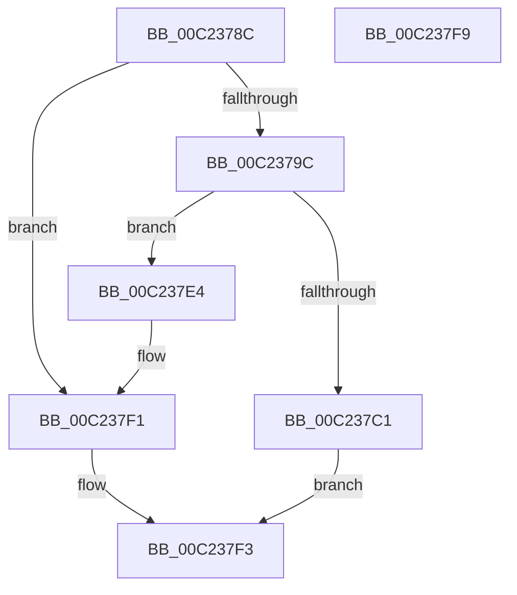

# HalpPreAllocateKInterrupts

- RVA: `0x00C2378C`–`0x00C237FA` (길이 `110` bytes)
- VA: `0x0000000140C2378C`
- 실행 섹션: `INIT`
- PDB 이름 있음: `예`; PDB Function 태그: `아니요`
- unwind 정보 RVA: `0x00064C80`
- 디코드: `29`개 명령, `110/110` bytes 표시
- 미해석 바이트: `0` (있으면 어셈블리에 `.byte`로 보존)

> 이 문서는 커널 이미지의 기계어와 PDB 기호를 분석해 생성했습니다. 4번과 5번은 함수 원형과 자료형을 바이너리 사용 방식에서 추정한 C 해석이며 원본 소스 복구 결과는 아닙니다.

## 1. Dependencies

- 직접 호출 지점: **3**; 고유 호출 대상: **3**
- 직접 호출자로 확인된 함수: **1**
- RIP 상대 이미지 참조: **4**

### Outgoing calls
- `0x00C2379C` → [HalpQueryMaximumRegisteredProcessorCount](../../text/54/HalpQueryMaximumRegisteredProcessorCount_function_00543BE8.md) (function, `0x00543BE8`)
- `0x00C237B7` → [ExAllocatePool2](../../poolcode/B8/ExAllocatePool2_function_00B820F0.md) (function, `0x00B820F0`)
- `0x00C237D8` → [HalpInterruptSetProblemEx](../../text/48/HalpInterruptSetProblemEx_function_0048AC8C.md) (function, `0x0048AC8C`)

### Direct callers
- [HalpInterruptInitSystem](../../pagelk/B5/HalpInterruptInitSystem_function_00B5D550.md) at `0x00B5D66C`

### Static image references
- `0x00C23792` → RVA `0x00E11740` (`.data`; read)
- `0x00C237C1` → RVA `0x000258E0` (`.rdata`; read)
- `0x00C237E4` → RVA `0x00E11740` (`.data`; write)
- `0x00C237EB` → RVA `0x00E1053C` (`.data`; write)

## 2. Other-region calls and transfers

- 다른 실행 섹션으로 향하는 call: **3**
  - `0x00C2379C` → [HalpQueryMaximumRegisteredProcessorCount](../../text/54/HalpQueryMaximumRegisteredProcessorCount_function_00543BE8.md) (`INIT` → `.text`)
  - `0x00C237B7` → [ExAllocatePool2](../../poolcode/B8/ExAllocatePool2_function_00B820F0.md) (`INIT` → `POOLCODE`)
  - `0x00C237D8` → [HalpInterruptSetProblemEx](../../text/48/HalpInterruptSetProblemEx_function_0048AC8C.md) (`INIT` → `.text`)
- 별도 외부 분기/꼬리 이동을 확인하지 못했습니다.

## 3. Assembly (complete function range)

```asm
00C2378C  40 53                           push rbx
00C2378E  48 83 EC 30                     sub rsp, 0x30
00C23792  48 83 3D A6 DF 1E 00 00         cmp qword ptr [rip + 0x1edfa6], 0
00C2379A  75 55                           jne 0x140c237f1
00C2379C  E8 47 04 92 FF                  call 0x140543be8
00C237A1  8B D8                           mov ebx, eax
00C237A3  B9 40 00 00 00                  mov ecx, 0x40
00C237A8  C1 E3 04                        shl ebx, 4
00C237AB  41 B8 48 61 6C 4B               mov r8d, 0x4b6c6148
00C237B1  8D 14 DB                        lea edx, [rbx + rbx*8]
00C237B4  C1 E2 05                        shl edx, 5
00C237B7  E8 34 E9 F5 FF                  call 0x140b820f0
00C237BC  48 85 C0                        test rax, rax
00C237BF  75 23                           jne 0x140c237e4
00C237C1  4C 8D 0D 18 21 40 FF            lea r9, [rip - 0xbfdee8]
00C237C8  C7 44 24 20 C8 00 00 00         mov dword ptr [rsp + 0x20], 0xc8
00C237D0  45 33 C0                        xor r8d, r8d
00C237D3  8D 50 1E                        lea edx, [rax + 0x1e]
00C237D6  33 C9                           xor ecx, ecx
00C237D8  E8 AF 74 86 FF                  call 0x14048ac8c
00C237DD  B8 17 00 00 C0                  mov eax, 0xc0000017
00C237E2  EB 0F                           jmp 0x140c237f3
00C237E4  48 89 05 55 DF 1E 00            mov qword ptr [rip + 0x1edf55], rax
00C237EB  89 1D 4B CD 1E 00               mov dword ptr [rip + 0x1ecd4b], ebx
00C237F1  33 C0                           xor eax, eax
00C237F3  48 83 C4 30                     add rsp, 0x30
00C237F7  5B                              pop rbx
00C237F8  C3                              ret
00C237F9  CC                              int3
```

## 4. C-style interpretation (structured pseudocode)

```c
__int64 __fastcall HalpPreAllocateKInterrupts(void)
{
    __int64 result;
    __int64 v_rbx;
    __int64 v_rsp;
    unsigned int v_stack_m18;

    v_rsp = (v_rsp) - (48);
    if ((*(unsigned __int64 *)(v_rip + 2023334)) != 0) goto loc_00C237F1;
    result = HalpQueryMaximumRegisteredProcessorCount(a1, a2, a3, a4);
    v_rbx = (unsigned int)(((unsigned int)((unsigned int)(result))) << (4));
    a2 = (unsigned int)((v_rbx + v_rbx * 8) << (5));
    result = ExAllocatePool2(64, a2, (unsigned int)(0x4B6C6148ULL), a4);
    if (result != 0) goto loc_00C237E4;
    v_stack_m18 = 200;
    a3 = 0;
    a1 = 0;
    result = HalpInterruptSetProblemEx(a1, result + 30, a3, v_rip - 12574440);
    goto loc_00C237F3;
loc_00C237E4:
    *(unsigned __int64 *)(v_rip + 2023253) = (unsigned int)(0xC0000017ULL);
    *(unsigned int *)(v_rip + 2018635) = (unsigned int)(v_rbx);
loc_00C237F1:
    result = 0;
loc_00C237F3:
    v_rsp = (v_rsp) + (48);
    return result;
}
```

## 5. (Beta) C Style

```c
void HalpPreAllocateKInterrupts(void)
{
    int64_t result;
    int64_t local_rbx;
    int64_t local_rsp;
    uint32_t v_stack_m18;

    local_rsp = (local_rsp) - (48);
    if ((*(uint64_t *)(v_rip + 0x1EDFA6)) != 0) goto loc_00C237F1;
    result = HalpQueryMaximumRegisteredProcessorCount(a1, a2, a3, a4);
    local_rbx = (uint32_t)(((uint32_t)((uint32_t)(result))) << (4));
    a2 = (uint32_t)((local_rbx + local_rbx * 8) << (5));
    result = ExAllocatePool2(64, a2, (uint32_t)(0x4B6C6148ULL), a4);
    if (result != 0) goto loc_00C237E4;
    v_stack_m18 = 200;
    a3 = 0;
    a1 = 0;
    result = HalpInterruptSetProblemEx(a1, result + 30, a3, v_rip - 12574440);
    goto loc_00C237F3;
loc_00C237E4:
    *(uint64_t *)(v_rip + 0x1EDF55) = (uint32_t)(0xC0000017ULL);
    *(uint32_t *)(v_rip + 0x1ECD4B) = (uint32_t)(local_rbx);
loc_00C237F1:
    result = 0;
loc_00C237F3:
    local_rsp = (local_rsp) + (48);
    return result;
}
```

## 6. Execution-region graph

[열기: 2D/3D 그래프와 함수 탐색 컨트롤 패널](../../../control-panel.html?section=init&rva=0x00C2378C&view=graph)

- 2D 그래프는 위에서 아래로 흐르고, 3D 그래프는 빈 공간을 드래그해 회전합니다. Shift+드래그는 이동, 휠은 확대·축소, 함수 노드 선택은 대상 보고서 이동입니다.

### Static fallback


