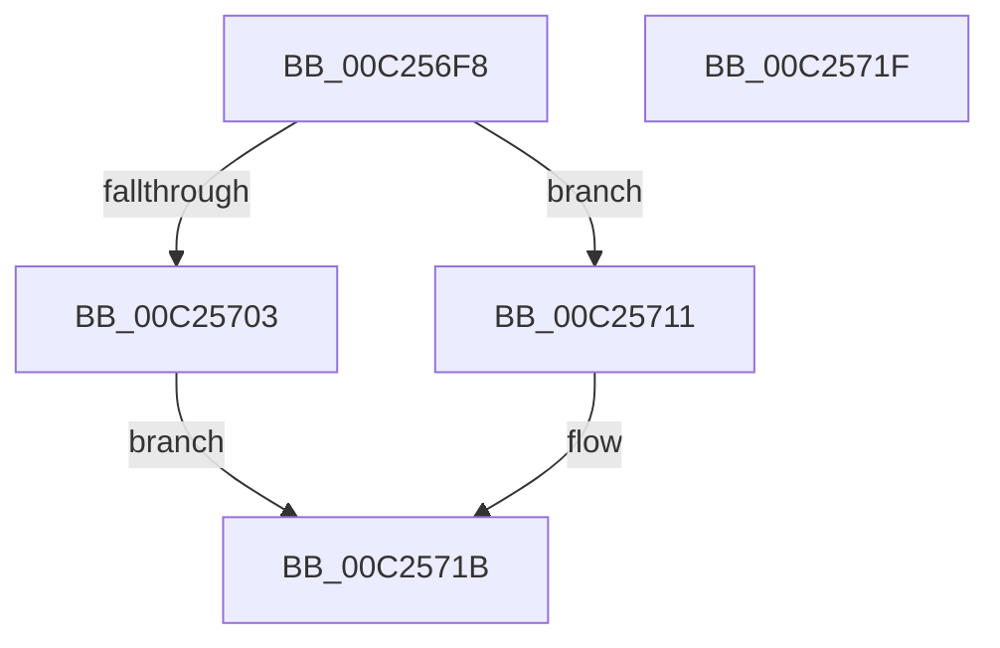

# HalpQueryChannelTopologyInformation

- RVA: `0x00C256F8`–`0x00C25720` (길이 `40` bytes)
- VA: `0x0000000140C256F8`
- 실행 섹션: `INIT`
- PDB 이름 있음: `예`; PDB Function 태그: `아니요`
- unwind 정보 RVA: `0x000DB714`
- 디코드: `13`개 명령, `40/40` bytes 표시
- 미해석 바이트: `0` (있으면 어셈블리에 `.byte`로 보존)

> 이 문서는 커널 이미지의 기계어와 PDB 기호를 분석해 생성했습니다. 4번과 5번은 함수 원형과 자료형을 바이너리 사용 방식에서 추정한 C 해석이며 원본 소스 복구 결과는 아닙니다.

## 1. Dependencies

- 직접 호출 지점: **0**; 고유 호출 대상: **0**
- 직접 호출자로 확인된 함수: **1**
- RIP 상대 이미지 참조: **1**

### Outgoing calls
- 직접 디코드된 call 명령이 없습니다.

### Direct callers
- [HaliQuerySystemInformation](../../pagelk/B7/HaliQuerySystemInformation_function_00B7A990.md) at `0x00B7AB73`

### Static image references
- `0x00C25703` → RVA `0x00F8F9D8` (`.data`; read)

## 2. Other-region calls and transfers

- 다른 실행 섹션으로 향하는 call: **0**
- 별도 외부 분기/꼬리 이동을 확인하지 못했습니다.

## 3. Assembly (complete function range)

```asm
00C256F8  41 B9 08 00 00 00               mov r9d, 8
00C256FE  41 3B D1                        cmp edx, r9d
00C25701  72 0E                           jb 0x140c25711
00C25703  48 8B 05 CE A2 36 00            mov rax, qword ptr [rip + 0x36a2ce]
00C2570A  48 89 01                        mov qword ptr [rcx], rax
00C2570D  33 C0                           xor eax, eax
00C2570F  EB 0A                           jmp 0x140c2571b
00C25711  33 C0                           xor eax, eax
00C25713  44 8B C8                        mov r9d, eax
00C25716  B8 04 00 00 C0                  mov eax, 0xc0000004
00C2571B  45 89 08                        mov dword ptr [r8], r9d
00C2571E  C3                              ret
00C2571F  CC                              int3
```

## 4. C-style interpretation (structured pseudocode)

```c
__int64 __fastcall HalpQueryChannelTopologyInformation(__int64 a1, int a2, __int64 a3)
{
    __int64 result;

    if (a2 < 8) goto loc_00C25711;
    *(unsigned __int64 *)(a1) = *(unsigned __int64 *)(v_rip + 3580622);
    result = 0;
    goto loc_00C2571B;
loc_00C25711:
    result = 0;
loc_00C2571B:
    *(unsigned int *)(a3) = 0;
    return (unsigned int)(0xC0000004ULL);
}
```

## 5. (Beta) C Style

```c
int64_t HalpQueryChannelTopologyInformation(void *Arg1, int32_t Arg2, void *Arg3)
{
    uint8_t *arg1 = (uint8_t *)Arg1;
    uint8_t *arg3 = (uint8_t *)Arg3;

    int64_t result;

    if (Arg2 < 8) goto loc_00C25711;
    *(uint64_t *)(arg1) = *(uint64_t *)(v_rip + 0x36A2CE);
    result = 0;
    goto loc_00C2571B;
loc_00C25711:
    result = 0;
loc_00C2571B:
    *(uint32_t *)(arg3) = 0;
    return (uint32_t)(0xC0000004ULL);
}
```

### 관측된 메모리 오프셋

구조체 형식이 확인되지 않은 접근은 인자 기준의 오프셋으로만 기록했습니다.

| 기준 인자 | 오프셋 표현 | 폭 (bit) | 접근 |
|---|---:|---:|---|
| `Arg1` | `+ 0x0` | `64` | `W` |
| `Arg3` | `+ 0x0` | `32` | `W` |

## 6. Execution-region graph

[열기: 2D/3D 그래프와 함수 탐색 컨트롤 패널](../../../control-panel.html?section=init&rva=0x00C256F8&view=graph)

- 2D 그래프는 위에서 아래로 흐르고, 3D 그래프는 빈 공간을 드래그해 회전합니다. Shift+드래그는 이동, 휠은 확대·축소, 함수 노드 선택은 대상 보고서 이동입니다.

### Static fallback


