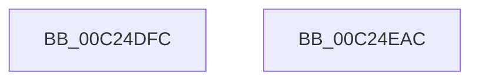

# HalpRegisterKdSupportFunctions

- RVA: `0x00C24DFC`–`0x00C24EAD` (길이 `177` bytes)
- VA: `0x0000000140C24DFC`
- 실행 섹션: `INIT`
- PDB 이름 있음: `예`; PDB Function 태그: `아니요`
- unwind 정보 RVA: `0x000DB714`
- 디코드: `27`개 명령, `177/177` bytes 표시
- 미해석 바이트: `0` (있으면 어셈블리에 `.byte`로 보존)

> 이 문서는 커널 이미지의 기계어와 PDB 기호를 분석해 생성했습니다. 4번과 5번은 함수 원형과 자료형을 바이너리 사용 방식에서 추정한 C 해석이며 원본 소스 복구 결과는 아닙니다.

## 1. Dependencies

- 직접 호출 지점: **0**; 고유 호출 대상: **0**
- 직접 호출자로 확인된 함수: **1**
- RIP 상대 이미지 참조: **25**

### Outgoing calls
- 직접 디코드된 call 명령이 없습니다.

### Direct callers
- [HalpDbgInitSystem](../../pagelk/B5/HalpDbgInitSystem_function_00B5D710.md) at `0x00B5D738`

### Static image references
- `0x00C24DFC` → RVA `0x00546660` (`HalpCheckPowerButton`; read)
- `0x00C24E03` → RVA `0x00E00870` (`.data`; write)
- `0x00C24E0A` → RVA `0x00B85A80` (`HalpKdSetupDebuggingDevice`; read)
- `0x00C24E11` → RVA `0x0053EA00` (`HalAcpiGetTable`; read)
- `0x00C24E18` → RVA `0x00E00858` (`.data`; write)
- `0x00C24E1F` → RVA `0x00E00868` (`.data`; write)
- `0x00C24E26` → RVA `0x00544890` (`HalpMapPhysicalMemoryWriteThrough64`; read)
- `0x00C24E2D` → RVA `0x00E00880` (`.data`; write)
- `0x00C24E34` → RVA `0x003F8C30` (`HalpUnmapVirtualAddress`; read)
- `0x00C24E3B` → RVA `0x00E00888` (`.data`; write)
- `0x00C24E42` → RVA `0x0056E850` (`HalpKdReadPCIConfig`; read)
- `0x00C24E49` → RVA `0x00E00890` (`.data`; write)
- `0x00C24E50` → RVA `0x0056E880` (`HalpKdWritePCIConfig`; read)
- `0x00C24E57` → RVA `0x00E00898` (`.data`; write)
- `0x00C24E5E` → RVA `0x00B85850` (`HalpKdEnumerateDebuggingDevices`; read)
- `0x00C24E65` → RVA `0x00E00A88` (`.data`; write)
- `0x00C24E6C` → RVA `0x00B85A20` (`HalpKdReleaseDebuggingDevice`; read)
- `0x00C24E73` → RVA `0x00E00860` (`.data`; write)
- `0x00C24E7A` → RVA `0x00E00968` (`.data`; write)
- `0x00C24E81` → RVA `0x0054C8E0` (`HalpWatchdogDelayExpiration`; read)
- `0x00C24E88` → RVA `0x00E00BB8` (`.data`; write)
- `0x00C24E8F` → RVA `0x00F8FB68` (`.data`; read)
- `0x00C24E96` → RVA `0x00F8FB70` (`.data`; write)
- `0x00C24E9D` → RVA `0x00F8FB68` (`.data`; write)
- `0x00C24EA4` → RVA `0x00E00960` (`.data`; write)

## 2. Other-region calls and transfers

- 다른 실행 섹션으로 향하는 call: **0**
- 별도 외부 분기/꼬리 이동을 확인하지 못했습니다.

## 3. Assembly (complete function range)

```asm
00C24DFC  48 8D 05 5D 18 92 FF            lea rax, [rip - 0x6de7a3]
00C24E03  48 89 05 66 BA 1D 00            mov qword ptr [rip + 0x1dba66], rax
00C24E0A  48 8D 0D 6F 0C F6 FF            lea rcx, [rip - 0x9f391]
00C24E11  48 8D 05 E8 9B 91 FF            lea rax, [rip - 0x6e6418]
00C24E18  48 89 0D 39 BA 1D 00            mov qword ptr [rip + 0x1dba39], rcx
00C24E1F  48 89 05 42 BA 1D 00            mov qword ptr [rip + 0x1dba42], rax
00C24E26  48 8D 05 63 FA 91 FF            lea rax, [rip - 0x6e059d]
00C24E2D  48 89 05 4C BA 1D 00            mov qword ptr [rip + 0x1dba4c], rax
00C24E34  48 8D 05 F5 3D 7D FF            lea rax, [rip - 0x82c20b]
00C24E3B  48 89 05 46 BA 1D 00            mov qword ptr [rip + 0x1dba46], rax
00C24E42  48 8D 05 07 9A 94 FF            lea rax, [rip - 0x6b65f9]
00C24E49  48 89 05 40 BA 1D 00            mov qword ptr [rip + 0x1dba40], rax
00C24E50  48 8D 05 29 9A 94 FF            lea rax, [rip - 0x6b65d7]
00C24E57  48 89 05 3A BA 1D 00            mov qword ptr [rip + 0x1dba3a], rax
00C24E5E  48 8D 05 EB 09 F6 FF            lea rax, [rip - 0x9f615]
00C24E65  48 89 05 1C BC 1D 00            mov qword ptr [rip + 0x1dbc1c], rax
00C24E6C  48 8D 05 AD 0B F6 FF            lea rax, [rip - 0x9f453]
00C24E73  48 89 05 E6 B9 1D 00            mov qword ptr [rip + 0x1db9e6], rax
00C24E7A  48 89 05 E7 BA 1D 00            mov qword ptr [rip + 0x1dbae7], rax
00C24E81  48 8D 05 58 7A 92 FF            lea rax, [rip - 0x6d85a8]
00C24E88  48 89 05 29 BD 1D 00            mov qword ptr [rip + 0x1dbd29], rax
00C24E8F  48 8D 05 D2 AC 36 00            lea rax, [rip + 0x36acd2]
00C24E96  48 89 05 D3 AC 36 00            mov qword ptr [rip + 0x36acd3], rax
00C24E9D  48 89 05 C4 AC 36 00            mov qword ptr [rip + 0x36acc4], rax
00C24EA4  48 89 0D B5 BA 1D 00            mov qword ptr [rip + 0x1dbab5], rcx
00C24EAB  C3                              ret
00C24EAC  CC                              int3
```

## 4. C-style interpretation (structured pseudocode)

```c
__int64 __fastcall HalpRegisterKdSupportFunctions(void)
{
    *(unsigned __int64 *)(v_rip + 1948262) = v_rip - 7202723;
    *(unsigned __int64 *)(v_rip + 1948217) = v_rip - 652177;
    *(unsigned __int64 *)(v_rip + 1948226) = v_rip - 7234584;
    *(unsigned __int64 *)(v_rip + 1948236) = v_rip - 7210397;
    *(unsigned __int64 *)(v_rip + 1948230) = v_rip - 8569355;
    *(unsigned __int64 *)(v_rip + 1948224) = v_rip - 7038457;
    *(unsigned __int64 *)(v_rip + 1948218) = v_rip - 7038423;
    *(unsigned __int64 *)(v_rip + 1948700) = v_rip - 652821;
    *(unsigned __int64 *)(v_rip + 1948134) = v_rip - 652371;
    *(unsigned __int64 *)(v_rip + 1948391) = v_rip - 652371;
    *(unsigned __int64 *)(v_rip + 1948969) = v_rip - 7177640;
    *(unsigned __int64 *)(v_rip + 3583187) = v_rip + 3583186;
    *(unsigned __int64 *)(v_rip + 3583172) = v_rip + 3583186;
    *(unsigned __int64 *)(v_rip + 1948341) = v_rip - 652177;
    return v_rip + 3583186;
}
```

## 5. (Beta) C Style

```c
void HalpRegisterKdSupportFunctions(void)
{
    *(uint64_t *)(v_rip + 0x1DBA66) = v_rip - 7202723;
    *(uint64_t *)(v_rip + 0x1DBA39) = v_rip - 652177;
    *(uint64_t *)(v_rip + 0x1DBA42) = v_rip - 7234584;
    *(uint64_t *)(v_rip + 0x1DBA4C) = v_rip - 7210397;
    *(uint64_t *)(v_rip + 0x1DBA46) = v_rip - 8569355;
    *(uint64_t *)(v_rip + 0x1DBA40) = v_rip - 7038457;
    *(uint64_t *)(v_rip + 0x1DBA3A) = v_rip - 7038423;
    *(uint64_t *)(v_rip + 0x1DBC1C) = v_rip - 652821;
    *(uint64_t *)(v_rip + 0x1DB9E6) = v_rip - 652371;
    *(uint64_t *)(v_rip + 0x1DBAE7) = v_rip - 652371;
    *(uint64_t *)(v_rip + 0x1DBD29) = v_rip - 7177640;
    *(uint64_t *)(v_rip + 0x36ACD3) = v_rip + 3583186;
    *(uint64_t *)(v_rip + 0x36ACC4) = v_rip + 3583186;
    *(uint64_t *)(v_rip + 0x1DBAB5) = v_rip - 652177;
    return v_rip + 3583186;
}
```

## 6. Execution-region graph

[열기: 2D/3D 그래프와 함수 탐색 컨트롤 패널](../../../control-panel.html?section=init&rva=0x00C24DFC&view=graph)

- 2D 그래프는 위에서 아래로 흐르고, 3D 그래프는 빈 공간을 드래그해 회전합니다. Shift+드래그는 이동, 휠은 확대·축소, 함수 노드 선택은 대상 보고서 이동입니다.

### Static fallback


