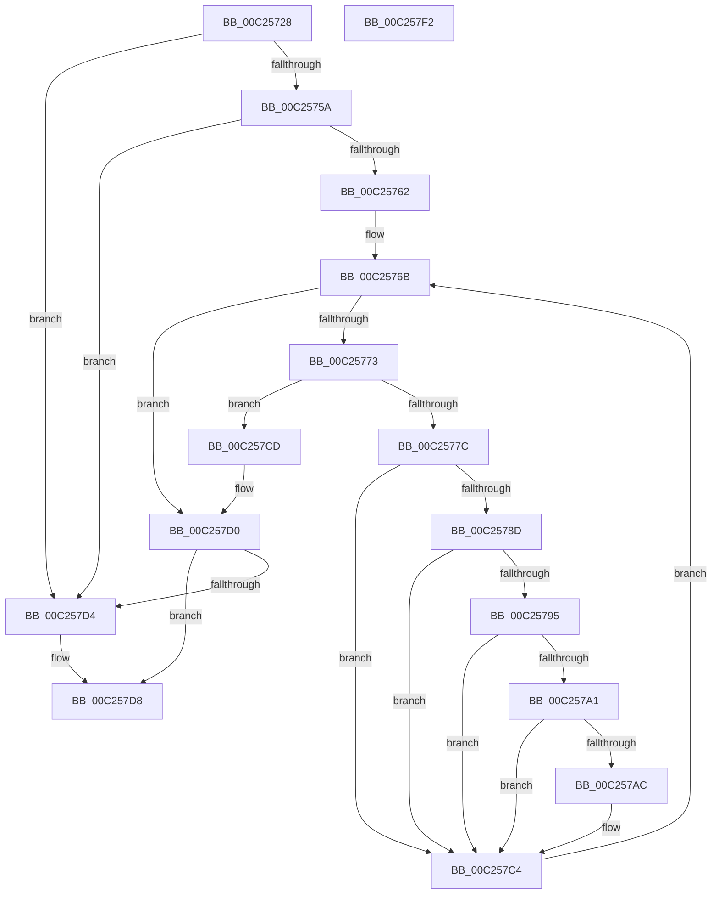

# HalpSelectFeasibleLowPowerState

- RVA: `0x00C25728`–`0x00C257F3` (길이 `203` bytes)
- VA: `0x0000000140C25728`
- 실행 섹션: `INIT`
- PDB 이름 있음: `예`; PDB Function 태그: `아니요`
- unwind 정보 RVA: `0x000A6CEC`
- 디코드: `66`개 명령, `203/203` bytes 표시
- 미해석 바이트: `0` (있으면 어셈블리에 `.byte`로 보존)

> 이 문서는 커널 이미지의 기계어와 PDB 기호를 분석해 생성했습니다. 4번과 5번은 함수 원형과 자료형을 바이너리 사용 방식에서 추정한 C 해석이며 원본 소스 복구 결과는 아닙니다.

## 1. Dependencies

- 직접 호출 지점: **0**; 고유 호출 대상: **0**
- 직접 호출자로 확인된 함수: **1**
- RIP 상대 이미지 참조: **0**

### Outgoing calls
- 직접 디코드된 call 명령이 없습니다.

### Direct callers
- [HalpChannelInitializeStaticConfiguration](HalpChannelInitializeStaticConfiguration_function_00C25318.md) at `0x00C2563F`

### Static image references
- 디코드된 RIP-relative 메모리 참조가 없습니다.

## 2. Other-region calls and transfers

- 다른 실행 섹션으로 향하는 call: **0**
- 별도 외부 분기/꼬리 이동을 확인하지 못했습니다.

## 3. Assembly (complete function range)

```asm
00C25728  48 8B C4                        mov rax, rsp
00C2572B  48 89 58 08                     mov qword ptr [rax + 8], rbx
00C2572F  48 89 68 10                     mov qword ptr [rax + 0x10], rbp
00C25733  48 89 70 18                     mov qword ptr [rax + 0x18], rsi
00C25737  48 89 78 20                     mov qword ptr [rax + 0x20], rdi
00C2573B  41 56                           push r14
00C2573D  8A 01                           mov al, byte ptr [rcx]
00C2573F  32 DB                           xor bl, bl
00C25741  24 03                           and al, 3
00C25743  41 BE 01 00 00 00               mov r14d, 1
00C25749  49 8B F1                        mov rsi, r9
00C2574C  41 0F B7 E8                     movzx ebp, r8w
00C25750  4C 8B DA                        mov r11, rdx
00C25753  45 8B D6                        mov r10d, r14d
00C25756  3C 03                           cmp al, 3
00C25758  75 7A                           jne 0x140c257d4
00C2575A  8B 79 18                        mov edi, dword ptr [rcx + 0x18]
00C2575D  41 3B FE                        cmp edi, r14d
00C25760  76 72                           jbe 0x140c257d4
00C25762  88 1A                           mov byte ptr [rdx], bl
00C25764  45 32 C0                        xor r8b, r8b
00C25767  48 8D 51 20                     lea rdx, [rcx + 0x20]
00C2576B  41 0F B6 C0                     movzx eax, r8b
00C2576F  3B C7                           cmp eax, edi
00C25771  73 5D                           jae 0x140c257d0
00C25773  0F B6 4A 01                     movzx ecx, byte ptr [rdx + 1]
00C25777  66 3B CD                        cmp cx, bp
00C2577A  73 51                           jae 0x140c257cd
00C2577C  4C 6B C9 1C                     imul r9, rcx, 0x1c
00C25780  41 8A 0C 31                     mov cl, byte ptr [r9 + rsi]
00C25784  8A C1                           mov al, cl
00C25786  24 3F                           and al, 0x3f
00C25788  41 3A C6                        cmp al, r14b
00C2578B  75 37                           jne 0x140c257c4
00C2578D  80 E1 C0                        and cl, 0xc0
00C25790  80 F9 40                        cmp cl, 0x40
00C25793  75 2F                           jne 0x140c257c4
00C25795  41 8A 44 31 01                  mov al, byte ptr [r9 + rsi + 1]
00C2579A  24 05                           and al, 5
00C2579C  41 3A C6                        cmp al, r14b
00C2579F  75 23                           jne 0x140c257c4
00C257A1  49 81 7C 31 0C 00 CA 9A 3B      cmp qword ptr [r9 + rsi + 0xc], 0x3b9aca00
00C257AA  77 18                           ja 0x140c257c4
00C257AC  41 0F B6 03                     movzx eax, byte ptr [r11]
00C257B0  0F B6 0A                        movzx ecx, byte ptr [rdx]
00C257B3  3A C1                           cmp al, cl
00C257B5  0F B6 DB                        movzx ebx, bl
00C257B8  0F 46 C1                        cmovbe eax, ecx
00C257BB  84 C9                           test cl, cl
00C257BD  41 88 03                        mov byte ptr [r11], al
00C257C0  41 0F 44 DE                     cmove ebx, r14d
00C257C4  45 02 C6                        add r8b, r14b
00C257C7  48 83 C2 02                     add rdx, 2
00C257CB  EB 9E                           jmp 0x140c2576b
00C257CD  45 33 D2                        xor r10d, r10d
00C257D0  84 DB                           test bl, bl
00C257D2  75 04                           jne 0x140c257d8
00C257D4  41 C6 03 00                     mov byte ptr [r11], 0
00C257D8  48 8B 5C 24 10                  mov rbx, qword ptr [rsp + 0x10]
00C257DD  41 8B C2                        mov eax, r10d
00C257E0  48 8B 6C 24 18                  mov rbp, qword ptr [rsp + 0x18]
00C257E5  48 8B 74 24 20                  mov rsi, qword ptr [rsp + 0x20]
00C257EA  48 8B 7C 24 28                  mov rdi, qword ptr [rsp + 0x28]
00C257EF  41 5E                           pop r14
00C257F1  C3                              ret
00C257F2  CC                              int3
```

## 4. C-style interpretation (structured pseudocode)

```c
__int64 __fastcall HalpSelectFeasibleLowPowerState(__int64 a1, __int64 a2, unsigned __int16 a3, __int64 a4)
{
    __int64 result;
    __int64 v_r10;
    __int64 v_rbx;
    unsigned __int64 v_stack_p10;
    unsigned __int64 v_stack_p18;
    unsigned __int64 v_stack_p20;
    unsigned __int64 v_stack_p8;

    *(unsigned __int64 *)(v_rsp + 8) = v_rbx;
    *(unsigned __int64 *)(v_rsp + 16) = v_rbp;
    *(unsigned __int64 *)(v_rsp + 24) = v_rsi;
    *(unsigned __int64 *)(v_rsp + 32) = v_rdi;
    v_rbx = 0;
    result = (unsigned __int8)((*(unsigned __int8 *)(a1)) & (3));
    if (((unsigned __int8)(result)) != 3) goto loc_00C257D4;
    if (((unsigned int)((unsigned int)(*(unsigned int *)(a1 + 24)))) <= 1) goto loc_00C257D4;
    *(unsigned __int8 *)(a2) = 0;
    a3 = 0;
loc_00C2576B:
    if (0 >= ((unsigned int)((unsigned int)(*(unsigned int *)(a1 + 24))))) goto loc_00C257D0;
    if (((unsigned __int16)(*(unsigned __int8 *)(a1 + 32 + 1))) >= 0) goto loc_00C257CD;
    a4 = (a4) * (*(unsigned __int8 *)(a1 + 32 + 1));
    result = (unsigned __int8)(((unsigned __int8)(*(unsigned __int8 *)(a4 + a4 * 1))) & (63));
    if (((unsigned __int8)(result)) != 1) goto loc_00C257C4;
    a1 = (unsigned __int8)((*(unsigned __int8 *)(a4 + a4 * 1)) & (192));
    if (((unsigned __int8)(a1)) != 64) goto loc_00C257C4;
    result = (unsigned __int8)((*(unsigned __int8 *)(a4 + a4 * 1 + 1)) & (5));
    if (((unsigned __int8)(result)) != 1) goto loc_00C257C4;
    if ((*(unsigned __int64 *)(a4 + a4 * 1 + 12)) <= 0x3B9ACA00ULL) {
        result = *(unsigned __int8 *)(a2);
        a1 = *(unsigned __int8 *)(a1 + 32);
        v_rbx = 0;
        if (((unsigned __int8)(result)) <= ((unsigned __int8)(a1))) { result = (unsigned int)(a1); }
        *(unsigned __int8 *)(a2) = (unsigned __int8)(result);
        if ((unsigned __int8)(a1) == 0) { v_rbx = 1; }
    }
    a3 = (unsigned __int8)((a3) + (1));
    a2 = (a1 + 32) + (2);
    goto loc_00C2576B;
loc_00C257CD:
    v_r10 = 0;
loc_00C257D0:
    if ((unsigned __int8)(v_rbx) == 0) {
        *(unsigned __int8 *)(a2) = 0;
    }
    return 0;
}
```

## 5. (Beta) C Style

```c
int64_t HalpSelectFeasibleLowPowerState(void *Arg1, void *Arg2, uint16_t Arg3, void *Arg4)
{
    uint8_t *arg1 = (uint8_t *)Arg1;
    uint8_t *arg2 = (uint8_t *)Arg2;
    uint8_t *arg4 = (uint8_t *)Arg4;

    int64_t result;
    int64_t local_r10;
    int64_t local_rbx;
    uint64_t v_stack_p10;
    uint64_t v_stack_p18;
    uint64_t v_stack_p20;
    uint64_t v_stack_p8;

    *(uint64_t *)(local_rsp + 0x8) = local_rbx;
    *(uint64_t *)(local_rsp + 0x10) = local_rbp;
    *(uint64_t *)(local_rsp + 0x18) = local_rsi;
    *(uint64_t *)(local_rsp + 0x20) = local_rdi;
    local_rbx = 0;
    result = (uint8_t)((*(uint8_t *)(arg1)) & (3));
    if (((uint8_t)(result)) != 3) goto loc_00C257D4;
    if (((uint32_t)((uint32_t)(*(uint32_t *)(arg1 + 0x18)))) <= 1) goto loc_00C257D4;
    *(uint8_t *)(arg2) = 0;
    Arg3 = 0;
loc_00C2576B:
    if (0 >= ((uint32_t)((uint32_t)(*(uint32_t *)(arg1 + 0x18))))) goto loc_00C257D0;
    if (((uint16_t)(*(uint8_t *)(arg1 + 0x20 + 0x1))) >= 0) goto loc_00C257CD;
    Arg4 = (Arg4) * (*(uint8_t *)(arg1 + 0x20 + 0x1));
    result = (uint8_t)(((uint8_t)(*(uint8_t *)(arg4 + arg4 * 1))) & (63));
    if (((uint8_t)(result)) != 1) goto loc_00C257C4;
    Arg1 = (uint8_t)((*(uint8_t *)(arg4 + arg4 * 1)) & (192));
    if (((uint8_t)(Arg1)) != 64) goto loc_00C257C4;
    result = (uint8_t)((*(uint8_t *)(arg4 + arg4 * 1 + 0x1)) & (5));
    if (((uint8_t)(result)) != 1) goto loc_00C257C4;
    if ((*(uint64_t *)(arg4 + arg4 * 1 + 0xC)) <= 0x3B9ACA00ULL) {
        result = *(uint8_t *)(arg2);
        Arg1 = *(uint8_t *)(arg1 + 0x20);
        local_rbx = 0;
        if (((uint8_t)(result)) <= ((uint8_t)(Arg1))) { result = (uint32_t)(Arg1); }
        *(uint8_t *)(arg2) = (uint8_t)(result);
        if ((uint8_t)(Arg1) == 0) { local_rbx = 1; }
    }
    Arg3 = (uint8_t)((Arg3) + (1));
    Arg2 = (Arg1 + 32) + (2);
    goto loc_00C2576B;
loc_00C257CD:
    local_r10 = 0;
loc_00C257D0:
    if ((uint8_t)(local_rbx) == 0) {
        *(uint8_t *)(arg2) = 0;
    }
    return 0;
}
```

### 관측된 메모리 오프셋

구조체 형식이 확인되지 않은 접근은 인자 기준의 오프셋으로만 기록했습니다.

| 기준 인자 | 오프셋 표현 | 폭 (bit) | 접근 |
|---|---:|---:|---|
| `Arg1` | `+ 0x0` | `8` | `R` |
| `Arg1` | `+ 0x1` | `8` | `R` |
| `Arg1` | `+ 0x18` | `32` | `R` |
| `Arg1` | `+ 0x20` | `64` | `R` |
| `Arg2` | `+ 0x0` | `8` | `R` |
| `Arg2` | `+ 0x0` | `8` | `W` |
| `Arg4` | `+ 0x0 + rsi*1` | `8` | `R` |
| `Arg4` | `+ 0x1 + rsi*1` | `8` | `R` |
| `Arg4` | `+ 0xC + rsi*1` | `64` | `R` |

## 6. Execution-region graph

[열기: 2D/3D 그래프와 함수 탐색 컨트롤 패널](../../../control-panel.html?section=init&rva=0x00C25728&view=graph)

- 2D 그래프는 위에서 아래로 흐르고, 3D 그래프는 빈 공간을 드래그해 회전합니다. Shift+드래그는 이동, 휠은 확대·축소, 함수 노드 선택은 대상 보고서 이동입니다.

### Static fallback


