# HalpSetupAcpiPhase0

- RVA: `0x00C23EDC`–`0x00C241C6` (길이 `746` bytes)
- VA: `0x0000000140C23EDC`
- 실행 섹션: `INIT`
- PDB 이름 있음: `예`; PDB Function 태그: `아니요`
- unwind 정보 RVA: `0x000C48A4`
- 디코드: `175`개 명령, `746/746` bytes 표시
- 미해석 바이트: `0` (있으면 어셈블리에 `.byte`로 보존)

> 이 문서는 커널 이미지의 기계어와 PDB 기호를 분석해 생성했습니다. 4번과 5번은 함수 원형과 자료형을 바이너리 사용 방식에서 추정한 C 해석이며 원본 소스 복구 결과는 아닙니다.

## 1. Dependencies

- 직접 호출 지점: **17**; 고유 호출 대상: **13**
- 직접 호출자로 확인된 함수: **1**
- RIP 상대 이미지 참조: **32**

### Outgoing calls
- `0x00C23EFB` → [HalpAcpiTableCacheInit](../C7/HalpAcpiTableCacheInit_function_00C77650.md) (function, `0x00C77650`)
- `0x00C23F16` → [HalpAcpiGetTable](../../text/3F/HalpAcpiGetTable_function_003F6BF8.md) (function, `0x003F6BF8`)
- `0x00C23F45` → [memcpy](../../text/6C/memcpy_function_006C6840.md) (function, `0x006C6840`)
- `0x00C23F62` → [strstr](../../text/4F/strstr_function_004FF680.md) (function, `0x004FF680`)
- `0x00C23FC7` → [HalpAcpiInitializePmRegisters](HalpAcpiInitializePmRegisters_function_00C23AEC.md) (function, `0x00C23AEC`)
- `0x00C23FF4` → [HalpAcpiDetectMachineSpecificActions](HalpAcpiDetectMachineSpecificActions_function_00C257FC.md) (function, `0x00C257FC`)
- `0x00C23FFC` → [HalpNumaInitializeStaticConfiguration](HalpNumaInitializeStaticConfiguration_function_00C220D8.md) (function, `0x00C220D8`)
- `0x00C24004` → [HalpNumaInitializeHmaConfiguration](HalpNumaInitializeHmaConfiguration_function_00C22054.md) (function, `0x00C22054`)
- `0x00C2401F` → [HalpAcpiGetTable](../../text/3F/HalpAcpiGetTable_function_003F6BF8.md) (function, `0x003F6BF8`)
- `0x00C24047` → [HalpMmAllocateMemoryInternal](../../text/54/HalpMmAllocateMemoryInternal_function_00544990.md) (function, `0x00544990`)
- `0x00C2406D` → [HalpAcpiGetTable](../../text/3F/HalpAcpiGetTable_function_003F6BF8.md) (function, `0x003F6BF8`)
- `0x00C240AC` → [HalpAllocPhysicalMemoryEx](../C7/HalpAllocPhysicalMemoryEx_function_00C771DC.md) (function, `0x00C771DC`)
- `0x00C240D2` → [HalpMap](../../text/3F/HalpMap_function_003F88F4.md) (function, `0x003F88F4`)
- `0x00C24101` → [HalpMap](../../text/3F/HalpMap_function_003F88F4.md) (function, `0x003F88F4`)
- `0x00C2415F` → [HalpAcpiGetTable](../../text/3F/HalpAcpiGetTable_function_003F6BF8.md) (function, `0x003F6BF8`)
- `0x00C24181` → [HalReadBootRegister](../../pagelk/B6/HalReadBootRegister_function_00B60EBC.md) (function, `0x00B60EBC`)
- `0x00C24196` → [HalWriteBootRegister](../../pagelk/B6/HalWriteBootRegister_function_00B60F00.md) (function, `0x00B60F00`)

### Direct callers
- [HalpAcpiInitDiscard](../C1/HalpAcpiInitDiscard_function_00C1FA54.md) at `0x00C1FA74`

### Static image references
- `0x00C23EEB` → RVA `0x00FC1AB1` (`.data`; read)
- `0x00C23F3E` → RVA `0x00FC1AE0` (`.data`; read)
- `0x00C23F5B` → RVA `0x000259D0` (`.rdata`; read)
- `0x00C23F6C` → RVA `0x00FC1AE8` (`.data`; read)
- `0x00C23F75` → RVA `0x00FC1B50` (`.data`; read)
- `0x00C23F81` → RVA `0x00E0A808` (`.data`; read/write)
- `0x00C23F88` → RVA `0x00FC1B4D` (`.data`; read)
- `0x00C23FA5` → RVA `0x0070BBF0` (`HalpAcpiAoacCapable`; read)
- `0x00C23FAC` → RVA `0x00E00AC0` (`.data`; write)
- `0x00C23FDD` → RVA `0x00E101D6` (`.data`; write)
- `0x00C23FEA` → RVA `0x00E10204` (`.data`; write)
- `0x00C24009` → RVA `0x00E11800` (`.data`; read/write)
- `0x00C2404C` → RVA `0x00E11808` (`.data`; write)
- `0x00C24058` → RVA `0x00E11800` (`.data`; write)
- `0x00C2407A` → RVA `0x00FC1ED4` (`.data`; write)
- `0x00C24080` → RVA `0x00FC1AA0` (`.data`; read)
- `0x00C240B1` → RVA `0x00FC1AA0` (`.data`; write)
- `0x00C240D7` → RVA `0x00FC1AA8` (`.data`; write)
- `0x00C24106` → RVA `0x00FC1AD0` (`.data`; write)
- `0x00C2410D` → RVA `0x0053F1B0` (`HalpAcpiGetPrmCache`; read)
- `0x00C24114` → RVA `0x00FC1AB1` (`.data`; write)
- `0x00C2411B` → RVA `0x00E006E8` (`.data`; write)
- `0x00C24125` → RVA `0x0053F1D0` (`HalpAcpiInvokePrmFwHandler`; read)
- `0x00C24131` → RVA `0x00E006F0` (`.data`; write)
- `0x00C2413B` → RVA `0x003F6C80` (`HalAcpiGetTableDispatch`; read)
- `0x00C24147` → RVA `0x00E006D8` (`.data`; write)
- `0x00C24151` → RVA `0x0049E550` (`EmpCheckErrataList`; read)
- `0x00C24158` → RVA `0x00E006E0` (`.data`; write)
- `0x00C24164` → RVA `0x00E117F8` (`.data`; write)
- `0x00C2419D` → RVA `0x00E117F8` (`.data`; read/write)
- `0x00C241A5` → RVA `0x0070DA60` (`HalpEndOfBoot`; read)
- `0x00C241AC` → RVA `0x00E006C8` (`.data`; write)

## 2. Other-region calls and transfers

- 다른 실행 섹션으로 향하는 call: **11**
  - `0x00C23F16` → [HalpAcpiGetTable](../../text/3F/HalpAcpiGetTable_function_003F6BF8.md) (`INIT` → `.text`)
  - `0x00C23F45` → [memcpy](../../text/6C/memcpy_function_006C6840.md) (`INIT` → `.text`)
  - `0x00C23F62` → [strstr](../../text/4F/strstr_function_004FF680.md) (`INIT` → `.text`)
  - `0x00C2401F` → [HalpAcpiGetTable](../../text/3F/HalpAcpiGetTable_function_003F6BF8.md) (`INIT` → `.text`)
  - `0x00C24047` → [HalpMmAllocateMemoryInternal](../../text/54/HalpMmAllocateMemoryInternal_function_00544990.md) (`INIT` → `.text`)
  - `0x00C2406D` → [HalpAcpiGetTable](../../text/3F/HalpAcpiGetTable_function_003F6BF8.md) (`INIT` → `.text`)
  - `0x00C240D2` → [HalpMap](../../text/3F/HalpMap_function_003F88F4.md) (`INIT` → `.text`)
  - `0x00C24101` → [HalpMap](../../text/3F/HalpMap_function_003F88F4.md) (`INIT` → `.text`)
  - `0x00C2415F` → [HalpAcpiGetTable](../../text/3F/HalpAcpiGetTable_function_003F6BF8.md) (`INIT` → `.text`)
  - `0x00C24181` → [HalReadBootRegister](../../pagelk/B6/HalReadBootRegister_function_00B60EBC.md) (`INIT` → `PAGELK`)
  - `0x00C24196` → [HalWriteBootRegister](../../pagelk/B6/HalWriteBootRegister_function_00B60F00.md) (`INIT` → `PAGELK`)
- 별도 외부 분기/꼬리 이동을 확인하지 못했습니다.

## 3. Assembly (complete function range)

```asm
00C23EDC  48 89 5C 24 08                  mov qword ptr [rsp + 8], rbx
00C23EE1  48 89 6C 24 18                  mov qword ptr [rsp + 0x18], rbp
00C23EE6  57                              push rdi
00C23EE7  48 83 EC 30                     sub rsp, 0x30
00C23EEB  80 3D BF DB 39 00 00            cmp byte ptr [rip + 0x39dbbf], 0
00C23EF2  48 8B D9                        mov rbx, rcx
00C23EF5  0F 85 B8 02 00 00               jne 0x140c241b3
00C23EFB  E8 50 37 05 00                  call 0x140c77650
00C23F00  85 C0                           test eax, eax
00C23F02  0F 88 AD 02 00 00               js 0x140c241b5
00C23F08  45 33 C9                        xor r9d, r9d
00C23F0B  45 33 C0                        xor r8d, r8d
00C23F0E  BA 46 41 43 50                  mov edx, 0x50434146
00C23F13  48 8B CB                        mov rcx, rbx
00C23F16  E8 DD 2C 7D FF                  call 0x1403f6bf8
00C23F1B  48 85 C0                        test rax, rax
00C23F1E  75 0A                           jne 0x140c23f2a
00C23F20  B8 25 02 00 C0                  mov eax, 0xc0000225
00C23F25  E9 8B 02 00 00                  jmp 0x140c241b5
00C23F2A  8B 48 04                        mov ecx, dword ptr [rax + 4]
00C23F2D  41 B8 14 01 00 00               mov r8d, 0x114
00C23F33  41 3B C8                        cmp ecx, r8d
00C23F36  73 03                           jae 0x140c23f3b
00C23F38  44 8B C1                        mov r8d, ecx
00C23F3B  48 8B D0                        mov rdx, rax
00C23F3E  48 8D 0D 9B DB 39 00            lea rcx, [rip + 0x39db9b]
00C23F45  E8 F6 28 AA FF                  call 0x1406c6840
00C23F4A  48 85 DB                        test rbx, rbx
00C23F4D  74 1D                           je 0x140c23f6c
00C23F4F  48 8B 8B D8 00 00 00            mov rcx, qword ptr [rbx + 0xd8]
00C23F56  48 85 C9                        test rcx, rcx
00C23F59  74 11                           je 0x140c23f6c
00C23F5B  48 8D 15 6E 1A 40 FF            lea rdx, [rip - 0xbfe592]
00C23F62  E8 19 B7 8D FF                  call 0x1404ff680
00C23F67  48 85 C0                        test rax, rax
00C23F6A  75 54                           jne 0x140c23fc0
00C23F6C  80 3D 75 DB 39 00 05            cmp byte ptr [rip + 0x39db75], 5
00C23F73  72 4B                           jb 0x140c23fc0
00C23F75  8B 15 D5 DB 39 00               mov edx, dword ptr [rip + 0x39dbd5]
00C23F7B  0F BA E2 14                     bt edx, 0x14
00C23F7F  73 07                           jae 0x140c23f88
00C23F81  83 25 80 68 1E 00 FE            and dword ptr [rip + 0x1e6880], 0xfffffffe
00C23F88  0F B7 05 BE DB 39 00            movzx eax, word ptr [rip + 0x39dbbe]
00C23F8F  A8 02                           test al, 2
00C23F91  75 07                           jne 0x140c23f9a
00C23F93  83 25 6E 68 1E 00 FD            and dword ptr [rip + 0x1e686e], 0xfffffffd
00C23F9A  A8 20                           test al, 0x20
00C23F9C  74 07                           je 0x140c23fa5
00C23F9E  83 25 63 68 1E 00 FB            and dword ptr [rip + 0x1e6863], 0xfffffffb
00C23FA5  48 8D 05 44 7C AE FF            lea rax, [rip - 0x5183bc]
00C23FAC  48 89 05 0D CB 1D 00            mov qword ptr [rip + 0x1dcb0d], rax
00C23FB3  0F BA E2 15                     bt edx, 0x15
00C23FB7  73 07                           jae 0x140c23fc0
00C23FB9  83 0D 48 68 1E 00 08            or dword ptr [rip + 0x1e6848], 8
00C23FC0  48 8D 0D 19 DB 39 00            lea rcx, [rip + 0x39db19]
00C23FC7  E8 20 FB FF FF                  call 0x140c23aec
00C23FCC  8B 05 7E DB 39 00               mov eax, dword ptr [rip + 0x39db7e]
00C23FD2  BD 01 00 00 00                  mov ebp, 1
00C23FD7  0F BA E0 12                     bt eax, 0x12
00C23FDB  73 07                           jae 0x140c23fe4
00C23FDD  40 88 2D F2 C1 1E 00            mov byte ptr [rip + 0x1ec1f2], bpl
00C23FE4  0F BA E0 13                     bt eax, 0x13
00C23FE8  73 07                           jae 0x140c23ff1
00C23FEA  40 88 2D 13 C2 1E 00            mov byte ptr [rip + 0x1ec213], bpl
00C23FF1  48 8B CB                        mov rcx, rbx
00C23FF4  E8 03 18 00 00                  call 0x140c257fc
00C23FF9  48 8B CB                        mov rcx, rbx
00C23FFC  E8 D7 E0 FF FF                  call 0x140c220d8
00C24001  48 8B CB                        mov rcx, rbx
00C24004  E8 4B E0 FF FF                  call 0x140c22054
00C24009  48 83 25 EF D7 1E 00 00         and qword ptr [rip + 0x1ed7ef], 0
00C24011  45 33 C9                        xor r9d, r9d
00C24014  45 33 C0                        xor r8d, r8d
00C24017  BA 50 44 54 54                  mov edx, 0x54544450
00C2401C  48 8B CB                        mov rcx, rbx
00C2401F  E8 D4 2B 7D FF                  call 0x1403f6bf8
00C24024  48 8B F8                        mov rdi, rax
00C24027  48 85 C0                        test rax, rax
00C2402A  74 33                           je 0x140c2405f
00C2402C  8B 4F 28                        mov ecx, dword ptr [rdi + 0x28]
00C2402F  0F B6 40 24                     movzx eax, byte ptr [rax + 0x24]
00C24033  48 8D 14 41                     lea rdx, [rcx + rax*2]
00C24037  8B 4F 04                        mov ecx, dword ptr [rdi + 4]
00C2403A  48 3B CA                        cmp rcx, rdx
00C2403D  72 20                           jb 0x140c2405f
00C2403F  69 C8 88 00 00 00               imul ecx, eax, 0x88
00C24045  8B D5                           mov edx, ebp
00C24047  E8 44 09 92 FF                  call 0x140544990
00C2404C  48 89 05 B5 D7 1E 00            mov qword ptr [rip + 0x1ed7b5], rax
00C24053  48 85 C0                        test rax, rax
00C24056  74 07                           je 0x140c2405f
00C24058  48 89 3D A1 D7 1E 00            mov qword ptr [rip + 0x1ed7a1], rdi
00C2405F  45 33 C9                        xor r9d, r9d
00C24062  45 33 C0                        xor r8d, r8d
00C24065  BA 57 41 45 54                  mov edx, 0x54454157
00C2406A  48 8B CB                        mov rcx, rbx
00C2406D  E8 86 2B 7D FF                  call 0x1403f6bf8
00C24072  48 85 C0                        test rax, rax
00C24075  74 09                           je 0x140c24080
00C24077  8B 40 24                        mov eax, dword ptr [rax + 0x24]
00C2407A  89 05 54 DE 39 00               mov dword ptr [rip + 0x39de54], eax
00C24080  48 83 3D 18 DA 39 00 00         cmp qword ptr [rip + 0x39da18], 0
00C24088  BF 04 00 00 00                  mov edi, 4
00C2408D  75 4F                           jne 0x140c240de
00C2408F  48 83 64 24 20 00               and qword ptr [rsp + 0x20], 0
00C24095  48 8D 54 24 48                  lea rdx, [rsp + 0x48]
00C2409A  45 33 C9                        xor r9d, r9d
00C2409D  48 C7 44 24 48 00 00 10 00      mov qword ptr [rsp + 0x48], 0x100000
00C240A6  44 8B C5                        mov r8d, ebp
00C240A9  48 8B CB                        mov rcx, rbx
00C240AC  E8 2B 31 05 00                  call 0x140c771dc
00C240B1  48 89 05 E8 D9 39 00            mov qword ptr [rip + 0x39d9e8], rax
00C240B8  48 85 C0                        test rax, rax
00C240BB  74 21                           je 0x140c240de
00C240BD  48 83 64 24 28 00               and qword ptr [rsp + 0x28], 0
00C240C3  45 33 C9                        xor r9d, r9d
00C240C6  44 8B C5                        mov r8d, ebp
00C240C9  89 7C 24 20                     mov dword ptr [rsp + 0x20], edi
00C240CD  8B D5                           mov edx, ebp
00C240CF  48 8B C8                        mov rcx, rax
00C240D2  E8 1D 48 7D FF                  call 0x1403f88f4
00C240D7  48 89 05 CA D9 39 00            mov qword ptr [rip + 0x39d9ca], rax
00C240DE  8B 05 6C DA 39 00               mov eax, dword ptr [rip + 0x39da6c]
00C240E4  A8 03                           test al, 3
00C240E6  75 25                           jne 0x140c2410d
00C240E8  48 83 64 24 28 00               and qword ptr [rsp + 0x28], 0
00C240EE  45 33 C9                        xor r9d, r9d
00C240F1  48 8B 0D A8 D9 39 00            mov rcx, qword ptr [rip + 0x39d9a8]
00C240F8  44 8B C5                        mov r8d, ebp
00C240FB  8B D5                           mov edx, ebp
00C240FD  89 7C 24 20                     mov dword ptr [rsp + 0x20], edi
00C24101  E8 EE 47 7D FF                  call 0x1403f88f4
00C24106  48 89 05 C3 D9 39 00            mov qword ptr [rip + 0x39d9c3], rax
00C2410D  48 8D 05 9C B0 91 FF            lea rax, [rip - 0x6e4f64]
00C24114  40 88 2D 96 D9 39 00            mov byte ptr [rip + 0x39d996], bpl
00C2411B  48 89 05 C6 C5 1D 00            mov qword ptr [rip + 0x1dc5c6], rax
00C24122  45 33 C9                        xor r9d, r9d
00C24125  48 8D 05 A4 B0 91 FF            lea rax, [rip - 0x6e4f5c]
00C2412C  C6 44 24 48 00                  mov byte ptr [rsp + 0x48], 0
00C24131  48 89 05 B8 C5 1D 00            mov qword ptr [rip + 0x1dc5b8], rax
00C24138  45 33 C0                        xor r8d, r8d
00C2413B  48 8D 05 3E 2B 7D FF            lea rax, [rip - 0x82d4c2]
00C24142  BA 42 4F 4F 54                  mov edx, 0x544f4f42
00C24147  48 89 05 8A C5 1D 00            mov qword ptr [rip + 0x1dc58a], rax
00C2414E  48 8B CB                        mov rcx, rbx
00C24151  48 8D 05 F8 A3 87 FF            lea rax, [rip - 0x785c08]
00C24158  48 89 05 81 C5 1D 00            mov qword ptr [rip + 0x1dc581], rax
00C2415F  E8 94 2A 7D FF                  call 0x1403f6bf8
00C24164  48 89 05 8D D6 1E 00            mov qword ptr [rip + 0x1ed68d], rax
00C2416B  48 85 C0                        test rax, rax
00C2416E  74 2D                           je 0x140c2419d
00C24170  83 78 04 28                     cmp dword ptr [rax + 4], 0x28
00C24174  72 27                           jb 0x140c2419d
00C24176  80 78 24 09                     cmp byte ptr [rax + 0x24], 9
00C2417A  76 21                           jbe 0x140c2419d
00C2417C  48 8D 4C 24 48                  lea rcx, [rsp + 0x48]
00C24181  E8 36 CD F3 FF                  call 0x140b60ebc
00C24186  85 C0                           test eax, eax
00C24188  75 1B                           jne 0x140c241a5
00C2418A  8A 4C 24 48                     mov cl, byte ptr [rsp + 0x48]
00C2418E  40 84 CD                        test bpl, cl
00C24191  75 12                           jne 0x140c241a5
00C24193  40 0A CD                        or cl, bpl
00C24196  E8 65 CD F3 FF                  call 0x140b60f00
00C2419B  EB 08                           jmp 0x140c241a5
00C2419D  48 83 25 53 D6 1E 00 00         and qword ptr [rip + 0x1ed653], 0
00C241A5  48 8D 05 B4 98 AE FF            lea rax, [rip - 0x51674c]
00C241AC  48 89 05 15 C5 1D 00            mov qword ptr [rip + 0x1dc515], rax
00C241B3  33 C0                           xor eax, eax
00C241B5  48 8B 5C 24 40                  mov rbx, qword ptr [rsp + 0x40]
00C241BA  48 8B 6C 24 50                  mov rbp, qword ptr [rsp + 0x50]
00C241BF  48 83 C4 30                     add rsp, 0x30
00C241C3  5F                              pop rdi
00C241C4  C3                              ret
00C241C5  CC                              int3
```

## 4. C-style interpretation (structured pseudocode)

```c
__int64 __fastcall HalpSetupAcpiPhase0(__int64 a1, __int64 a2, int a3, int a4)
{
    __int64 result;
    __int64 v_rsp;
    unsigned __int64 v_stack_m10;
    unsigned __int64 v_stack_m18;
    unsigned __int64 v_stack_p10;
    unsigned __int64 v_stack_p18;
    unsigned __int64 v_stack_p8;

    v_stack_p8 = v_rbx;
    v_stack_p18 = v_rbp;
    v_rsp = (v_rsp) - (48);
    if ((*(unsigned __int8 *)(v_rip + 3791807)) != 0) goto loc_00C241B3;
    result = HalpAcpiTableCacheInit(a1, a2, a3, a4);
    if (sign_flag) goto loc_00C241B5;
    a4 = 0;
    a3 = 0;
    result = HalpAcpiGetTable(a1, (unsigned int)(0x50434146ULL), a3, a4);
    if (result != 0) goto loc_00C23F2A;
    goto loc_00C241B5;
loc_00C23F2A:
    if (((unsigned int)((unsigned int)(*(unsigned int *)((unsigned int)(0xC0000225ULL) + 4)))) < 276) {
        a3 = (unsigned int)((unsigned int)(*(unsigned int *)((unsigned int)(0xC0000225ULL) + 4)));
    }
    result = memcpy(v_rip + 3791771, (unsigned int)(0xC0000225ULL), a3, a4);
    if (a1 == 0) goto loc_00C23F6C;
    if (*(unsigned __int64 *)(a1 + 216) == 0) goto loc_00C23F6C;
    result = strstr(*(unsigned __int64 *)(a1 + 216), v_rip - 12576146, a3, a4);
    if (result != 0) goto loc_00C23FC0;
loc_00C23F6C:
    if ((*(unsigned __int8 *)(v_rip + 3791733)) < 5) goto loc_00C23FC0;
    if ((*(unsigned __int8 *)(v_rip + 3791733)) < 5) {
    }
    if ((((unsigned __int8)(*(unsigned __int16 *)(v_rip + 3791806))) & (2)) == 0) {
    }
    if ((((unsigned __int8)(*(unsigned __int16 *)(v_rip + 3791806))) & (32)) != 0) {
    }
    *(unsigned __int64 *)(v_rip + 1952525) = v_rip - 5342140;
    if (!(condition_is_above_or_equal)) {
    }
    result = HalpAcpiInitializePmRegisters(v_rip + 3791641, (unsigned int)(*(unsigned int *)(v_rip + 3791829)), a3, a4);
    if (!(condition_is_above_or_equal)) {
        *(unsigned __int8 *)(v_rip + 2015730) = 1;
    }
    if (!(condition_is_above_or_equal)) {
        *(unsigned __int8 *)(v_rip + 2015763) = 1;
    }
    result = HalpAcpiDetectMachineSpecificActions(a1, (unsigned int)(*(unsigned int *)(v_rip + 3791829)), a3, a4);
    result = HalpNumaInitializeStaticConfiguration(a1, (unsigned int)(*(unsigned int *)(v_rip + 3791829)), a3, a4);
    result = HalpNumaInitializeHmaConfiguration(a1, (unsigned int)(*(unsigned int *)(v_rip + 3791829)), a3, a4);
    a4 = 0;
    a3 = 0;
    result = HalpAcpiGetTable(a1, (unsigned int)(0x54544450ULL), a3, a4);
    if (result == 0) goto loc_00C2405F;
    if (((unsigned int)(*(unsigned int *)(result + 4))) < ((unsigned int)(*(unsigned int *)(result + 40)) + *(unsigned __int8 *)(result + 36) * 2)) goto loc_00C2405F;
    a1 = (unsigned int)(((unsigned int)(*(unsigned int *)(result + 4))) * ((unsigned int)(*(unsigned __int8 *)(result + 36))));
    result = HalpMmAllocateMemoryInternal(a1, 1, a3, a4);
    *(unsigned __int64 *)(v_rip + 2021301) = result;
    if (result != 0) {
        *(unsigned __int64 *)(v_rip + 2021281) = result;
    }
    a4 = 0;
    a3 = 0;
    result = HalpAcpiGetTable(a1, (unsigned int)(0x54454157ULL), a3, a4);
    if (result != 0) {
        result = *(unsigned int *)(result + 36);
        *(unsigned int *)(v_rip + 3792468) = (unsigned int)(result);
    }
    if ((*(unsigned __int64 *)(v_rip + 3791384)) != 0) goto loc_00C240DE;
    a4 = 0;
    v_stack_p10 = 0x100000ULL;
    result = HalpAllocPhysicalMemoryEx(a1, v_stack_p10, 1, a4);
    *(unsigned __int64 *)(v_rip + 3791336) = result;
    if (result != 0) {
        a4 = 0;
        a3 = 1;
        v_stack_m18 = 4;
        a2 = 1;
        a1 = result;
        result = HalpMap(a1, a2, a3, a4);
        *(unsigned __int64 *)(v_rip + 3791306) = result;
    }
    result = (unsigned int)(*(unsigned int *)(v_rip + 3791468));
    if ((((unsigned __int8)((unsigned int)(*(unsigned int *)(v_rip + 3791468)))) & (3)) == 0) {
        a4 = 0;
        a1 = *(unsigned __int64 *)(v_rip + 3791272);
        a3 = 1;
        a2 = 1;
        v_stack_m18 = 4;
        result = HalpMap(a1, a2, a3, a4);
        *(unsigned __int64 *)(v_rip + 3791299) = result;
    }
    *(unsigned __int8 *)(v_rip + 3791254) = 1;
    *(unsigned __int64 *)(v_rip + 1951174) = v_rip - 7229284;
    a4 = 0;
    v_stack_p10 = 0;
    *(unsigned __int64 *)(v_rip + 1951160) = v_rip - 7229276;
    a3 = 0;
    *(unsigned __int64 *)(v_rip + 1951114) = v_rip - 8574146;
    *(unsigned __int64 *)(v_rip + 1951105) = v_rip - 7887880;
    result = HalpAcpiGetTable(a1, (unsigned int)(0x544F4F42ULL), a3, a4);
    *(unsigned __int64 *)(v_rip + 2021005) = result;
    if (result == 0) goto loc_00C2419D;
    if ((*(unsigned int *)(result + 4)) < 40) goto loc_00C2419D;
    if ((*(unsigned __int8 *)(result + 36)) <= 9) goto loc_00C2419D;
    result = HalReadBootRegister(v_stack_p10, (unsigned int)(0x544F4F42ULL), a3, a4);
    if ((unsigned int)(result) != 0) goto loc_00C241A5;
    if (((1) & ((unsigned __int8)(v_stack_p10))) != 0) goto loc_00C241A5;
    a1 = (unsigned __int8)((v_stack_p10) | (1));
    result = HalWriteBootRegister(a1, (unsigned int)(0x544F4F42ULL), a3, a4);
    goto loc_00C241A5;
loc_00C2419D:
loc_00C241A5:
    *(unsigned __int64 *)(v_rip + 1950997) = v_rip - 5334860;
loc_00C241B3:
    result = 0;
loc_00C241B5:
    v_rsp = (v_rsp) + (48);
    return result;
}
```

## 5. (Beta) C Style

```c
int64_t HalpSetupAcpiPhase0(int64_t Arg1, int64_t Arg2, int32_t Arg3, int32_t Arg4)
{
    int64_t result;
    int64_t local_rsp;
    uint64_t v_stack_m10;
    uint64_t v_stack_m18;
    uint64_t v_stack_p10;
    uint64_t v_stack_p18;
    uint64_t v_stack_p8;

    v_stack_p8 = local_rbx;
    v_stack_p18 = local_rbp;
    local_rsp = (local_rsp) - (48);
    if ((*(uint8_t *)(v_rip + 0x39DBBF)) != 0) goto loc_00C241B3;
    result = HalpAcpiTableCacheInit(Arg1, Arg2, Arg3, Arg4);
    if (sign_flag) goto loc_00C241B5;
    Arg4 = 0;
    Arg3 = 0;
    result = HalpAcpiGetTable(Arg1, (uint32_t)(0x50434146ULL), Arg3, Arg4);
    if (result != 0) goto loc_00C23F2A;
    goto loc_00C241B5;
loc_00C23F2A:
    if (((uint32_t)((uint32_t)(*(uint32_t *)((uint32_t)(0xC0000225ULL) + 0x4)))) < 276) {
        Arg3 = (uint32_t)((uint32_t)(*(uint32_t *)((uint32_t)(0xC0000225ULL) + 0x4)));
    }
    result = memcpy(v_rip + 3791771, (uint32_t)(0xC0000225ULL), Arg3, Arg4);
    if (Arg1 == 0) goto loc_00C23F6C;
    if (*(uint64_t *)(Arg1 + 0xD8) == 0) goto loc_00C23F6C;
    result = strstr(*(uint64_t *)(Arg1 + 0xD8), v_rip - 12576146, Arg3, Arg4);
    if (result != 0) goto loc_00C23FC0;
loc_00C23F6C:
    if ((*(uint8_t *)(v_rip + 0x39DB75)) < 5) goto loc_00C23FC0;
    if ((*(uint8_t *)(v_rip + 0x39DB75)) < 5) {
    }
    if ((((uint8_t)(*(uint16_t *)(v_rip + 0x39DBBE))) & (2)) == 0) {
    }
    if ((((uint8_t)(*(uint16_t *)(v_rip + 0x39DBBE))) & (32)) != 0) {
    }
    *(uint64_t *)(v_rip + 0x1DCB0D) = v_rip - 5342140;
    if (!(condition_is_above_or_equal)) {
    }
    result = HalpAcpiInitializePmRegisters(v_rip + 3791641, (uint32_t)(*(uint32_t *)(v_rip + 0x39DBD5)), Arg3, Arg4);
    if (!(condition_is_above_or_equal)) {
        *(uint8_t *)(v_rip + 0x1EC1F2) = 1;
    }
    if (!(condition_is_above_or_equal)) {
        *(uint8_t *)(v_rip + 0x1EC213) = 1;
    }
    result = HalpAcpiDetectMachineSpecificActions(Arg1, (uint32_t)(*(uint32_t *)(v_rip + 0x39DBD5)), Arg3, Arg4);
    result = HalpNumaInitializeStaticConfiguration(Arg1, (uint32_t)(*(uint32_t *)(v_rip + 0x39DBD5)), Arg3, Arg4);
    result = HalpNumaInitializeHmaConfiguration(Arg1, (uint32_t)(*(uint32_t *)(v_rip + 0x39DBD5)), Arg3, Arg4);
    Arg4 = 0;
    Arg3 = 0;
    result = HalpAcpiGetTable(Arg1, (uint32_t)(0x54544450ULL), Arg3, Arg4);
    if (result == 0) goto loc_00C2405F;
    if (((uint32_t)(*(uint32_t *)(result + 0x4))) < ((uint32_t)(*(uint32_t *)(result + 0x28)) + *(uint8_t *)(result + 0x24) * 2)) goto loc_00C2405F;
    Arg1 = (uint32_t)(((uint32_t)(*(uint32_t *)(result + 0x4))) * ((uint32_t)(*(uint8_t *)(result + 0x24))));
    result = HalpMmAllocateMemoryInternal(Arg1, 1, Arg3, Arg4);
    *(uint64_t *)(v_rip + 0x1ED7B5) = result;
    if (result != 0) {
        *(uint64_t *)(v_rip + 0x1ED7A1) = result;
    }
    Arg4 = 0;
    Arg3 = 0;
    result = HalpAcpiGetTable(Arg1, (uint32_t)(0x54454157ULL), Arg3, Arg4);
    if (result != 0) {
        result = *(uint32_t *)(result + 0x24);
        *(uint32_t *)(v_rip + 0x39DE54) = (uint32_t)(result);
    }
    if ((*(uint64_t *)(v_rip + 0x39DA18)) != 0) goto loc_00C240DE;
    Arg4 = 0;
    v_stack_p10 = 0x100000ULL;
    result = HalpAllocPhysicalMemoryEx(Arg1, v_stack_p10, 1, Arg4);
    *(uint64_t *)(v_rip + 0x39D9E8) = result;
    if (result != 0) {
        Arg4 = 0;
        Arg3 = 1;
        v_stack_m18 = 4;
        Arg2 = 1;
        Arg1 = result;
        result = HalpMap(Arg1, Arg2, Arg3, Arg4);
        *(uint64_t *)(v_rip + 0x39D9CA) = result;
    }
    result = (uint32_t)(*(uint32_t *)(v_rip + 0x39DA6C));
    if ((((uint8_t)((uint32_t)(*(uint32_t *)(v_rip + 0x39DA6C)))) & (3)) == 0) {
        Arg4 = 0;
        Arg1 = *(uint64_t *)(v_rip + 0x39D9A8);
        Arg3 = 1;
        Arg2 = 1;
        v_stack_m18 = 4;
        result = HalpMap(Arg1, Arg2, Arg3, Arg4);
        *(uint64_t *)(v_rip + 0x39D9C3) = result;
    }
    *(uint8_t *)(v_rip + 0x39D996) = 1;
    *(uint64_t *)(v_rip + 0x1DC5C6) = v_rip - 7229284;
    Arg4 = 0;
    v_stack_p10 = 0;
    *(uint64_t *)(v_rip + 0x1DC5B8) = v_rip - 7229276;
    Arg3 = 0;
    *(uint64_t *)(v_rip + 0x1DC58A) = v_rip - 8574146;
    *(uint64_t *)(v_rip + 0x1DC581) = v_rip - 7887880;
    result = HalpAcpiGetTable(Arg1, (uint32_t)(0x544F4F42ULL), Arg3, Arg4);
    *(uint64_t *)(v_rip + 0x1ED68D) = result;
    if (result == 0) goto loc_00C2419D;
    if ((*(uint32_t *)(result + 0x4)) < 40) goto loc_00C2419D;
    if ((*(uint8_t *)(result + 0x24)) <= 9) goto loc_00C2419D;
    result = HalReadBootRegister(v_stack_p10, (uint32_t)(0x544F4F42ULL), Arg3, Arg4);
    if ((uint32_t)(result) != 0) goto loc_00C241A5;
    if (((1) & ((uint8_t)(v_stack_p10))) != 0) goto loc_00C241A5;
    Arg1 = (uint8_t)((v_stack_p10) | (1));
    result = HalWriteBootRegister(Arg1, (uint32_t)(0x544F4F42ULL), Arg3, Arg4);
    goto loc_00C241A5;
loc_00C2419D:
loc_00C241A5:
    *(uint64_t *)(v_rip + 0x1DC515) = v_rip - 5334860;
loc_00C241B3:
    result = 0;
loc_00C241B5:
    local_rsp = (local_rsp) + (48);
    return result;
}
```

## 6. Execution-region graph

[열기: 2D/3D 그래프와 함수 탐색 컨트롤 패널](../../../control-panel.html?section=init&rva=0x00C23EDC&view=graph)

- 2D 그래프는 위에서 아래로 흐르고, 3D 그래프는 빈 공간을 드래그해 회전합니다. Shift+드래그는 이동, 휠은 확대·축소, 함수 노드 선택은 대상 보고서 이동입니다.

### Static fallback

```mermaid
flowchart TD
  bb_00C23EDC[BB_00C23EDC]
  bb_00C23EFB[BB_00C23EFB]
  bb_00C23F08[BB_00C23F08]
  bb_00C23F20[BB_00C23F20]
  bb_00C23F2A[BB_00C23F2A]
  bb_00C23F38[BB_00C23F38]
  bb_00C23F3B[BB_00C23F3B]
  bb_00C23F4F[BB_00C23F4F]
  bb_00C23F5B[BB_00C23F5B]
  bb_00C23F6C[BB_00C23F6C]
  bb_00C23F75[BB_00C23F75]
  bb_00C23F81[BB_00C23F81]
  bb_00C23F88[BB_00C23F88]
  bb_00C23F93[BB_00C23F93]
  bb_00C23F9A[BB_00C23F9A]
  bb_00C23F9E[BB_00C23F9E]
  bb_00C23FA5[BB_00C23FA5]
  bb_00C23FB9[BB_00C23FB9]
  bb_00C23FC0[BB_00C23FC0]
  bb_00C23FDD[BB_00C23FDD]
  bb_00C23FE4[BB_00C23FE4]
  bb_00C23FEA[BB_00C23FEA]
  bb_00C23FF1[BB_00C23FF1]
  bb_00C2402C[BB_00C2402C]
  bb_00C2403F[BB_00C2403F]
  bb_00C24058[BB_00C24058]
  bb_00C2405F[BB_00C2405F]
  bb_00C24077[BB_00C24077]
  bb_00C24080[BB_00C24080]
  bb_00C2408F[BB_00C2408F]
  bb_00C240BD[BB_00C240BD]
  bb_00C240DE[BB_00C240DE]
  bb_00C240E8[BB_00C240E8]
  bb_00C2410D[BB_00C2410D]
  bb_00C24170[BB_00C24170]
  bb_00C24176[BB_00C24176]
  bb_00C2417C[BB_00C2417C]
  bb_00C2418A[BB_00C2418A]
  bb_00C24193[BB_00C24193]
  bb_00C2419D[BB_00C2419D]
  bb_00C241A5[BB_00C241A5]
  bb_00C241B3[BB_00C241B3]
  bb_00C241B5[BB_00C241B5]
  bb_00C241C5[BB_00C241C5]
  bb_00C23EDC -->|branch| bb_00C241B3
  bb_00C23EDC -->|fallthrough| bb_00C23EFB
  bb_00C23EFB -->|branch| bb_00C241B5
  bb_00C23EFB -->|fallthrough| bb_00C23F08
  bb_00C23F08 -->|branch| bb_00C23F2A
  bb_00C23F08 -->|fallthrough| bb_00C23F20
  bb_00C23F20 -->|branch| bb_00C241B5
  bb_00C23F2A -->|branch| bb_00C23F3B
  bb_00C23F2A -->|fallthrough| bb_00C23F38
  bb_00C23F38 -->|flow| bb_00C23F3B
  bb_00C23F3B -->|branch| bb_00C23F6C
  bb_00C23F3B -->|fallthrough| bb_00C23F4F
  bb_00C23F4F -->|branch| bb_00C23F6C
  bb_00C23F4F -->|fallthrough| bb_00C23F5B
  bb_00C23F5B -->|branch| bb_00C23FC0
  bb_00C23F5B -->|fallthrough| bb_00C23F6C
  bb_00C23F6C -->|branch| bb_00C23FC0
  bb_00C23F6C -->|fallthrough| bb_00C23F75
  bb_00C23F75 -->|branch| bb_00C23F88
  bb_00C23F75 -->|fallthrough| bb_00C23F81
  bb_00C23F81 -->|flow| bb_00C23F88
  bb_00C23F88 -->|branch| bb_00C23F9A
  bb_00C23F88 -->|fallthrough| bb_00C23F93
  bb_00C23F93 -->|flow| bb_00C23F9A
  bb_00C23F9A -->|branch| bb_00C23FA5
  bb_00C23F9A -->|fallthrough| bb_00C23F9E
  bb_00C23F9E -->|flow| bb_00C23FA5
  bb_00C23FA5 -->|branch| bb_00C23FC0
  bb_00C23FA5 -->|fallthrough| bb_00C23FB9
  bb_00C23FB9 -->|flow| bb_00C23FC0
  bb_00C23FC0 -->|branch| bb_00C23FE4
  bb_00C23FC0 -->|fallthrough| bb_00C23FDD
  bb_00C23FDD -->|flow| bb_00C23FE4
  bb_00C23FE4 -->|branch| bb_00C23FF1
  bb_00C23FE4 -->|fallthrough| bb_00C23FEA
  bb_00C23FEA -->|flow| bb_00C23FF1
  bb_00C23FF1 -->|branch| bb_00C2405F
  bb_00C23FF1 -->|fallthrough| bb_00C2402C
  bb_00C2402C -->|branch| bb_00C2405F
  bb_00C2402C -->|fallthrough| bb_00C2403F
  bb_00C2403F -->|branch| bb_00C2405F
  bb_00C2403F -->|fallthrough| bb_00C24058
  bb_00C24058 -->|flow| bb_00C2405F
  bb_00C2405F -->|branch| bb_00C24080
  bb_00C2405F -->|fallthrough| bb_00C24077
  bb_00C24077 -->|flow| bb_00C24080
  bb_00C24080 -->|branch| bb_00C240DE
  bb_00C24080 -->|fallthrough| bb_00C2408F
  bb_00C2408F -->|branch| bb_00C240DE
  bb_00C2408F -->|fallthrough| bb_00C240BD
  bb_00C240BD -->|flow| bb_00C240DE
  bb_00C240DE -->|branch| bb_00C2410D
  bb_00C240DE -->|fallthrough| bb_00C240E8
  bb_00C240E8 -->|flow| bb_00C2410D
  bb_00C2410D -->|branch| bb_00C2419D
  bb_00C2410D -->|fallthrough| bb_00C24170
  bb_00C24170 -->|branch| bb_00C2419D
  bb_00C24170 -->|fallthrough| bb_00C24176
  bb_00C24176 -->|branch| bb_00C2419D
  bb_00C24176 -->|fallthrough| bb_00C2417C
  bb_00C2417C -->|branch| bb_00C241A5
  bb_00C2417C -->|fallthrough| bb_00C2418A
  bb_00C2418A -->|branch| bb_00C241A5
  bb_00C2418A -->|fallthrough| bb_00C24193
  bb_00C24193 -->|branch| bb_00C241A5
  bb_00C2419D -->|flow| bb_00C241A5
  bb_00C241A5 -->|flow| bb_00C241B3
  bb_00C241B3 -->|flow| bb_00C241B5
```


