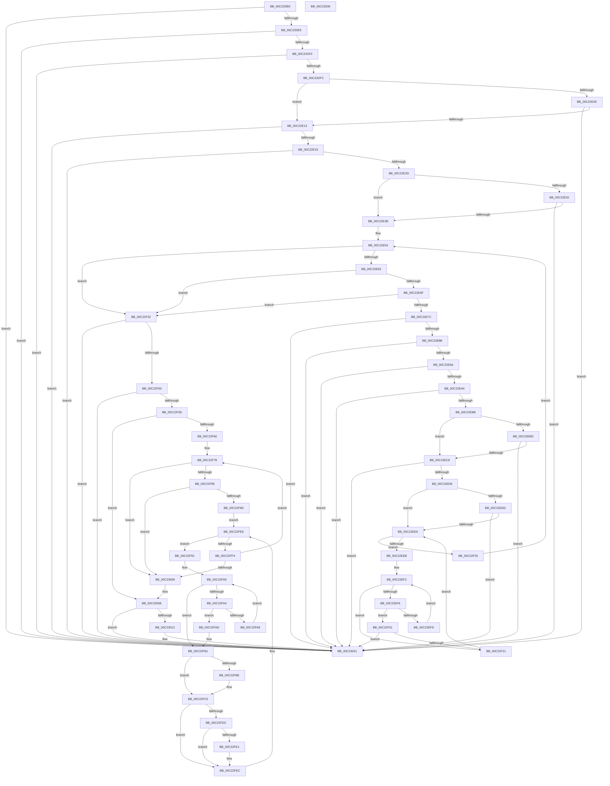

# HalpUpdateConfigurationFromMsct

- RVA: `0x00C22DB0`–`0x00C23037` (길이 `647` bytes)
- VA: `0x0000000140C22DB0`
- 실행 섹션: `INIT`
- PDB 이름 있음: `예`; PDB Function 태그: `아니요`
- unwind 정보 RVA: `0x0008C4BC`
- 디코드: `188`개 명령, `647/647` bytes 표시
- 미해석 바이트: `0` (있으면 어셈블리에 `.byte`로 보존)

> 이 문서는 커널 이미지의 기계어와 PDB 기호를 분석해 생성했습니다. 4번과 5번은 함수 원형과 자료형을 바이너리 사용 방식에서 추정한 C 해석이며 원본 소스 복구 결과는 아닙니다.

## 1. Dependencies

- 직접 호출 지점: **0**; 고유 호출 대상: **0**
- 직접 호출자로 확인된 함수: **2**
- RIP 상대 이미지 참조: **1**

### Outgoing calls
- 직접 디코드된 call 명령이 없습니다.

### Direct callers
- [HalpGetNumaProcMemoryCount](HalpGetNumaProcMemoryCount_function_00C21B40.md) at `0x00C21CCD`
- [HalpNumaInitializeStaticConfiguration](HalpNumaInitializeStaticConfiguration_function_00C220D8.md) at `0x00C225E1`

### Static image references
- `0x00C22DCE` → RVA `0x00F90670` (`.data`; read)

## 2. Other-region calls and transfers

- 다른 실행 섹션으로 향하는 call: **0**
- 별도 외부 분기/꼬리 이동을 확인하지 못했습니다.

## 3. Assembly (complete function range)

```asm
00C22DB0  48 89 5C 24 10                  mov qword ptr [rsp + 0x10], rbx
00C22DB5  4C 89 44 24 18                  mov qword ptr [rsp + 0x18], r8
00C22DBA  48 89 4C 24 08                  mov qword ptr [rsp + 8], rcx
00C22DBF  55                              push rbp
00C22DC0  56                              push rsi
00C22DC1  57                              push rdi
00C22DC2  41 54                           push r12
00C22DC4  41 55                           push r13
00C22DC6  41 56                           push r14
00C22DC8  41 57                           push r15
00C22DCA  48 83 EC 10                     sub rsp, 0x10
00C22DCE  48 8B 3D 9B D8 36 00            mov rdi, qword ptr [rip + 0x36d89b]
00C22DD5  8B DA                           mov ebx, edx
00C22DD7  44 8B 5F 04                     mov r11d, dword ptr [rdi + 4]
00C22DDB  41 83 FB 38                     cmp r11d, 0x38
00C22DDF  0F 82 3C 02 00 00               jb 0x140c23021
00C22DE5  44 8B 57 24                     mov r10d, dword ptr [rdi + 0x24]
00C22DE9  45 3B DA                        cmp r11d, r10d
00C22DEC  0F 82 2F 02 00 00               jb 0x140c23021
00C22DF2  41 83 FA 38                     cmp r10d, 0x38
00C22DF6  0F 82 25 02 00 00               jb 0x140c23021
00C22DFC  48 8B 74 24 70                  mov rsi, qword ptr [rsp + 0x70]
00C22E01  48 85 F6                        test rsi, rsi
00C22E04  74 0D                           je 0x140c22e13
00C22E06  8B 47 2C                        mov eax, dword ptr [rdi + 0x2c]
00C22E09  FF C0                           inc eax
00C22E0B  3B 06                           cmp eax, dword ptr [rsi]
00C22E0D  0F 82 0E 02 00 00               jb 0x140c23021
00C22E13  44 8B 7F 28                     mov r15d, dword ptr [rdi + 0x28]
00C22E17  41 FF C7                        inc r15d
00C22E1A  44 3B FB                        cmp r15d, ebx
00C22E1D  0F 87 FE 01 00 00               ja 0x140c23021
00C22E23  8B 29                           mov ebp, dword ptr [rcx]
00C22E25  3B EB                           cmp ebp, ebx
00C22E27  0F 87 F4 01 00 00               ja 0x140c23021
00C22E2D  45 85 C9                        test r9d, r9d
00C22E30  74 09                           je 0x140c22e3b
00C22E32  45 39 08                        cmp dword ptr [r8], r9d
00C22E35  0F 87 E6 01 00 00               ja 0x140c23021
00C22E3B  33 C0                           xor eax, eax
00C22E3D  4E 8D 04 17                     lea r8, [rdi + r10]
00C22E41  45 33 F6                        xor r14d, r14d
00C22E44  48 89 04 24                     mov qword ptr [rsp], rax
00C22E48  45 33 E4                        xor r12d, r12d
00C22E4B  49 8B C8                        mov rcx, r8
00C22E4E  4C 03 DF                        add r11, rdi
00C22E51  4C 89 5C 24 08                  mov qword ptr [rsp + 8], r11
00C22E56  48 8D 51 02                     lea rdx, [rcx + 2]
00C22E5A  49 3B D3                        cmp rdx, r11
00C22E5D  0F 87 CF 00 00 00               ja 0x140c22f32
00C22E63  0F B6 41 01                     movzx eax, byte ptr [rcx + 1]
00C22E67  3C 02                           cmp al, 2
00C22E69  0F 82 C3 00 00 00               jb 0x140c22f32
00C22E6F  4C 8D 2C 01                     lea r13, [rcx + rax]
00C22E73  4D 3B EB                        cmp r13, r11
00C22E76  0F 87 B6 00 00 00               ja 0x140c22f32
00C22E7C  44 8B 59 06                     mov r11d, dword ptr [rcx + 6]
00C22E80  8B 3A                           mov edi, dword ptr [rdx]
00C22E82  44 3B DF                        cmp r11d, edi
00C22E85  0F 82 96 01 00 00               jb 0x140c23021
00C22E8B  41 8B D3                        mov edx, r11d
00C22E8E  2B D7                           sub edx, edi
00C22E90  FF C2                           inc edx
00C22E92  3B D3                           cmp edx, ebx
00C22E94  0F 87 87 01 00 00               ja 0x140c23021
00C22E9A  44 03 F2                        add r14d, edx
00C22E9D  44 3B F3                        cmp r14d, ebx
00C22EA0  0F 87 7B 01 00 00               ja 0x140c23021
00C22EA6  44 8B 51 0A                     mov r10d, dword ptr [rcx + 0xa]
00C22EAA  B9 00 08 00 00                  mov ecx, 0x800
00C22EAF  44 3B D1                        cmp r10d, ecx
00C22EB2  0F 87 69 01 00 00               ja 0x140c23021
00C22EB8  45 85 C9                        test r9d, r9d
00C22EBB  74 09                           je 0x140c22ec6
00C22EBD  45 3B D1                        cmp r10d, r9d
00C22EC0  0F 87 5B 01 00 00               ja 0x140c23021
00C22EC6  41 8B C2                        mov eax, r10d
00C22EC9  0F AF C2                        imul eax, edx
00C22ECC  44 03 E0                        add r12d, eax
00C22ECF  44 3B E1                        cmp r12d, ecx
00C22ED2  0F 87 49 01 00 00               ja 0x140c23021
00C22ED8  45 85 C9                        test r9d, r9d
00C22EDB  74 09                           je 0x140c22ee6
00C22EDD  45 3B E1                        cmp r12d, r9d
00C22EE0  0F 87 3B 01 00 00               ja 0x140c23021
00C22EE6  41 3B FB                        cmp edi, r11d
00C22EE9  77 3A                           ja 0x140c22f25
00C22EEB  48 8B 54 24 78                  mov rdx, qword ptr [rsp + 0x78]
00C22EF0  33 C0                           xor eax, eax
00C22EF2  3B C5                           cmp eax, ebp
00C22EF4  73 2B                           jae 0x140c22f21
00C22EF6  8B C8                           mov ecx, eax
00C22EF8  39 3C 82                        cmp dword ptr [rdx + rax*4], edi
00C22EFB  74 04                           je 0x140c22f01
00C22EFD  FF C0                           inc eax
00C22EFF  EB F1                           jmp 0x140c22ef2
00C22F01  48 8B 04 24                     mov rax, qword ptr [rsp]
00C22F05  8B C0                           mov eax, eax
00C22F07  48 0F AB C8                     bts rax, rcx
00C22F0B  48 89 04 24                     mov qword ptr [rsp], rax
00C22F0F  48 8B 84 24 80 00 00 00         mov rax, qword ptr [rsp + 0x80]
00C22F17  44 39 14 88                     cmp dword ptr [rax + rcx*4], r10d
00C22F1B  0F 87 00 01 00 00               ja 0x140c23021
00C22F21  FF C7                           inc edi
00C22F23  EB C1                           jmp 0x140c22ee6
00C22F25  4C 8B 5C 24 08                  mov r11, qword ptr [rsp + 8]
00C22F2A  49 8B CD                        mov rcx, r13
00C22F2D  E9 24 FF FF FF                  jmp 0x140c22e56
00C22F32  48 8B 04 24                     mov rax, qword ptr [rsp]
00C22F36  8B CD                           mov ecx, ebp
00C22F38  BD 01 00 00 00                  mov ebp, 1
00C22F3D  8B C0                           mov eax, eax
00C22F3F  8B D5                           mov edx, ebp
00C22F41  48 D3 E2                        shl rdx, cl
00C22F44  48 2B D5                        sub rdx, rbp
00C22F47  48 3B C2                        cmp rax, rdx
00C22F4A  0F 85 D1 00 00 00               jne 0x140c23021
00C22F50  45 3B FE                        cmp r15d, r14d
00C22F53  0F 85 C8 00 00 00               jne 0x140c23021
00C22F59  49 8D 48 02                     lea rcx, [r8 + 2]
00C22F5D  49 3B CB                        cmp rcx, r11
00C22F60  0F 87 A8 00 00 00               ja 0x140c2300e
00C22F66  4C 8B 6C 24 50                  mov r13, qword ptr [rsp + 0x50]
00C22F6B  4C 8B 54 24 60                  mov r10, qword ptr [rsp + 0x60]
00C22F70  48 8B B4 24 80 00 00 00         mov rsi, qword ptr [rsp + 0x80]
00C22F78  41 0F B6 40 01                  movzx eax, byte ptr [r8 + 1]
00C22F7D  3C 02                           cmp al, 2
00C22F7F  0F 82 84 00 00 00               jb 0x140c23009
00C22F85  49 03 C0                        add rax, r8
00C22F88  49 3B C3                        cmp rax, r11
00C22F8B  77 7C                           ja 0x140c23009
00C22F8D  8B 11                           mov edx, dword ptr [rcx]
00C22F8F  EB 5D                           jmp 0x140c22fee
00C22F91  45 8B 48 0A                     mov r9d, dword ptr [r8 + 0xa]
00C22F95  33 FF                           xor edi, edi
00C22F97  41 8B 45 00                     mov eax, dword ptr [r13]
00C22F9B  48 8B 5C 24 78                  mov rbx, qword ptr [rsp + 0x78]
00C22FA0  3B F8                           cmp edi, eax
00C22FA2  73 0D                           jae 0x140c22fb1
00C22FA4  39 14 BB                        cmp dword ptr [rbx + rdi*4], edx
00C22FA7  74 04                           je 0x140c22fad
00C22FA9  03 FD                           add edi, ebp
00C22FAB  EB F3                           jmp 0x140c22fa0
00C22FAD  44 2B 0C BE                     sub r9d, dword ptr [rsi + rdi*4]
00C22FB1  41 8B 40 0A                     mov eax, dword ptr [r8 + 0xa]
00C22FB5  89 04 BE                        mov dword ptr [rsi + rdi*4], eax
00C22FB8  41 3B 7D 00                     cmp edi, dword ptr [r13]
00C22FBC  75 07                           jne 0x140c22fc5
00C22FBE  89 14 BB                        mov dword ptr [rbx + rdi*4], edx
00C22FC1  41 01 6D 00                     add dword ptr [r13], ebp
00C22FC5  41 8B 3A                        mov edi, dword ptr [r10]
00C22FC8  48 8B 9C 24 88 00 00 00         mov rbx, qword ptr [rsp + 0x88]
00C22FD0  42 8D 04 0F                     lea eax, [rdi + r9]
00C22FD4  41 89 02                        mov dword ptr [r10], eax
00C22FD7  48 85 DB                        test rbx, rbx
00C22FDA  74 10                           je 0x140c22fec
00C22FDC  45 85 C9                        test r9d, r9d
00C22FDF  74 0B                           je 0x140c22fec
00C22FE1  41 8B C9                        mov ecx, r9d
00C22FE4  48 8D 3C BB                     lea rdi, [rbx + rdi*4]
00C22FE8  8B C2                           mov eax, edx
00C22FEA  F3 AB                           rep stosd dword ptr [rdi], eax
00C22FEC  03 D5                           add edx, ebp
00C22FEE  41 3B 50 06                     cmp edx, dword ptr [r8 + 6]
00C22FF2  76 9D                           jbe 0x140c22f91
00C22FF4  41 0F B6 40 01                  movzx eax, byte ptr [r8 + 1]
00C22FF9  4C 03 C0                        add r8, rax
00C22FFC  49 8D 48 02                     lea rcx, [r8 + 2]
00C23000  49 3B CB                        cmp rcx, r11
00C23003  0F 86 6F FF FF FF               jbe 0x140c22f78
00C23009  48 8B 74 24 70                  mov rsi, qword ptr [rsp + 0x70]
00C2300E  48 85 F6                        test rsi, rsi
00C23011  74 0E                           je 0x140c23021
00C23013  48 8B 05 56 D6 36 00            mov rax, qword ptr [rip + 0x36d656]
00C2301A  8B 48 2C                        mov ecx, dword ptr [rax + 0x2c]
00C2301D  03 CD                           add ecx, ebp
00C2301F  89 0E                           mov dword ptr [rsi], ecx
00C23021  48 8B 5C 24 58                  mov rbx, qword ptr [rsp + 0x58]
00C23026  48 83 C4 10                     add rsp, 0x10
00C2302A  41 5F                           pop r15
00C2302C  41 5E                           pop r14
00C2302E  41 5D                           pop r13
00C23030  41 5C                           pop r12
00C23032  5F                              pop rdi
00C23033  5E                              pop rsi
00C23034  5D                              pop rbp
00C23035  C3                              ret
00C23036  CC                              int3
```

## 4. C-style interpretation (structured pseudocode)

```c
__int64 __fastcall HalpUpdateConfigurationFromMsct(__int64 a1, int a2, __int64 a3, int a4, __int64 a5, __int64 a6, __int64 a7, __int64 a8)
{
    __int64 result;
    __int64 v_r11;
    __int64 v_r12;
    __int64 v_r14;
    __int64 v_r15;
    __int64 v_rdi;
    __int64 v_rsp;
    unsigned __int64 v_stack_m40;
    unsigned __int64 v_stack_m48;
    unsigned __int64 v_stack_p10;
    unsigned __int64 v_stack_p18;
    unsigned __int64 v_stack_p8;

    v_stack_p10 = v_rbx;
    v_stack_p18 = a3;
    v_stack_p8 = a1;
    v_rsp = (v_rsp) - (16);
    if (((unsigned int)((unsigned int)(*(unsigned int *)(*(unsigned __int64 *)(v_rip + 3594395) + 4)))) < 56) goto loc_00C23021;
    if (((unsigned int)((unsigned int)(*(unsigned int *)(*(unsigned __int64 *)(v_rip + 3594395) + 4)))) < ((unsigned int)((unsigned int)(*(unsigned int *)(*(unsigned __int64 *)(v_rip + 3594395) + 36))))) goto loc_00C23021;
    if (((unsigned int)((unsigned int)(*(unsigned int *)(*(unsigned __int64 *)(v_rip + 3594395) + 36)))) < 56) goto loc_00C23021;
    if (a5 == 0) goto loc_00C22E13;
    result = (unsigned int)(((unsigned int)(*(unsigned int *)(*(unsigned __int64 *)(v_rip + 3594395) + 44))) + 1);
    if (((unsigned int)(result)) < (*(unsigned int *)(a5))) goto loc_00C23021;
loc_00C22E13:
    v_r15 = (unsigned int)(((unsigned int)(*(unsigned int *)(*(unsigned __int64 *)(v_rip + 3594395) + 40))) + 1);
    if (((unsigned int)(v_r15)) > ((unsigned int)((unsigned int)(a2)))) goto loc_00C23021;
    if (((unsigned int)((unsigned int)(*(unsigned int *)(a1)))) > ((unsigned int)((unsigned int)(a2)))) goto loc_00C23021;
    if (a4 == 0) goto loc_00C22E3B;
    if ((*(unsigned int *)(a3)) > a4) goto loc_00C23021;
loc_00C22E3B:
    result = 0;
    v_r14 = 0;
    v_stack_m48 = 0;
    v_r12 = 0;
    v_r11 = ((unsigned int)(*(unsigned int *)(*(unsigned __int64 *)(v_rip + 3594395) + 4))) + (*(unsigned __int64 *)(v_rip + 3594395));
    v_stack_m40 = v_r11;
loc_00C22E56:
    if ((*(unsigned __int64 *)(v_rip + 3594395) + (unsigned int)(*(unsigned int *)(*(unsigned __int64 *)(v_rip + 3594395) + 36)) * 1 + 2) > v_r11) goto loc_00C22F32;
    if (((unsigned __int8)(*(unsigned __int8 *)(*(unsigned __int64 *)(v_rip + 3594395) + (unsigned int)(*(unsigned int *)(*(unsigned __int64 *)(v_rip + 3594395) + 36)) * 1 + 1))) < 2) goto loc_00C22F32;
    if ((*(unsigned __int64 *)(v_rip + 3594395) + (unsigned int)(*(unsigned int *)(*(unsigned __int64 *)(v_rip + 3594395) + 36)) * 1 + *(unsigned __int8 *)(*(unsigned __int64 *)(v_rip + 3594395) + (unsigned int)(*(unsigned int *)(*(unsigned __int64 *)(v_rip + 3594395) + 36)) * 1 + 1) * 1) > v_r11) goto loc_00C22F32;
    if (((unsigned int)((unsigned int)(*(unsigned int *)(*(unsigned __int64 *)(v_rip + 3594395) + (unsigned int)(*(unsigned int *)(*(unsigned __int64 *)(v_rip + 3594395) + 36)) * 1 + 6)))) < ((unsigned int)((unsigned int)(*(unsigned int *)(*(unsigned __int64 *)(v_rip + 3594395) + (unsigned int)(*(unsigned int *)(*(unsigned __int64 *)(v_rip + 3594395) + 36)) * 1 + 2))))) goto loc_00C23021;
    a2 = (unsigned int)(((unsigned int)((unsigned int)((unsigned int)(*(unsigned int *)(*(unsigned __int64 *)(v_rip + 3594395) + (unsigned int)(*(unsigned int *)(*(unsigned __int64 *)(v_rip + 3594395) + 36)) * 1 + 6))))) - ((unsigned int)((unsigned int)(*(unsigned int *)(*(unsigned __int64 *)(v_rip + 3594395) + (unsigned int)(*(unsigned int *)(*(unsigned __int64 *)(v_rip + 3594395) + 36)) * 1 + 2)))));
    a2 = (unsigned int)((a2) + 1);
    if (a2 > ((unsigned int)((unsigned int)(a2)))) goto loc_00C23021;
    v_r14 = (unsigned int)((v_r14) + (a2));
    if (((unsigned int)(v_r14)) > ((unsigned int)((unsigned int)(a2)))) goto loc_00C23021;
    if (((unsigned int)((unsigned int)(*(unsigned int *)(*(unsigned __int64 *)(v_rip + 3594395) + (unsigned int)(*(unsigned int *)(*(unsigned __int64 *)(v_rip + 3594395) + 36)) * 1 + 10)))) > ((unsigned int)((unsigned int)(0x800ULL)))) goto loc_00C23021;
    if (a4 == 0) goto loc_00C22EC6;
    if (((unsigned int)((unsigned int)(*(unsigned int *)(*(unsigned __int64 *)(v_rip + 3594395) + (unsigned int)(*(unsigned int *)(*(unsigned __int64 *)(v_rip + 3594395) + 36)) * 1 + 10)))) > a4) goto loc_00C23021;
loc_00C22EC6:
    result = (unsigned int)(((unsigned int)((unsigned int)((unsigned int)(*(unsigned int *)(*(unsigned __int64 *)(v_rip + 3594395) + (unsigned int)(*(unsigned int *)(*(unsigned __int64 *)(v_rip + 3594395) + 36)) * 1 + 10))))) * (a2));
    v_r12 = (unsigned int)((v_r12) + ((unsigned int)(result)));
    if (((unsigned int)(v_r12)) > ((unsigned int)((unsigned int)(0x800ULL)))) goto loc_00C23021;
    if (a4 == 0) goto loc_00C22EE6;
    if (((unsigned int)(v_r12)) > a4) goto loc_00C23021;
loc_00C22EE6:
    if (((unsigned int)((unsigned int)(*(unsigned int *)(*(unsigned __int64 *)(v_rip + 3594395) + (unsigned int)(*(unsigned int *)(*(unsigned __int64 *)(v_rip + 3594395) + 36)) * 1 + 2)))) > ((unsigned int)((unsigned int)(*(unsigned int *)(*(unsigned __int64 *)(v_rip + 3594395) + (unsigned int)(*(unsigned int *)(*(unsigned __int64 *)(v_rip + 3594395) + 36)) * 1 + 6))))) goto loc_00C22F25;
    result = 0;
loc_00C22EF2:
    if (0 >= ((unsigned int)((unsigned int)(*(unsigned int *)(a1))))) goto loc_00C22F21;
    if ((*(unsigned int *)(a6 + result * 4)) == ((unsigned int)((unsigned int)(*(unsigned int *)(*(unsigned __int64 *)(v_rip + 3594395) + (unsigned int)(*(unsigned int *)(*(unsigned __int64 *)(v_rip + 3594395) + 36)) * 1 + 2))))) goto loc_00C22F01;
    result = (unsigned int)((result) + 1);
    goto loc_00C22EF2;
loc_00C22F01:
    v_stack_m48 = (unsigned int)((unsigned int)(v_stack_m48));
    if ((*(unsigned int *)(a7 + 0 * 4)) > ((unsigned int)((unsigned int)(*(unsigned int *)(*(unsigned __int64 *)(v_rip + 3594395) + (unsigned int)(*(unsigned int *)(*(unsigned __int64 *)(v_rip + 3594395) + 36)) * 1 + 10))))) goto loc_00C23021;
loc_00C22F21:
    v_rdi = (unsigned int)(((unsigned int)(*(unsigned int *)(*(unsigned __int64 *)(v_rip + 3594395) + (unsigned int)(*(unsigned int *)(*(unsigned __int64 *)(v_rip + 3594395) + 36)) * 1 + 2))) + 1);
    goto loc_00C22EE6;
loc_00C22F25:
    goto loc_00C22E56;
loc_00C22F32:
    a2 = (1) << ((unsigned __int8)((unsigned int)((unsigned int)((unsigned int)(*(unsigned int *)(a1))))));
    a2 = (a2) - (1);
    if (((unsigned int)((unsigned int)(v_stack_m48))) != a2) goto loc_00C23021;
    if (((unsigned int)(v_r15)) != ((unsigned int)(v_r14))) goto loc_00C23021;
    if ((*(unsigned __int64 *)(v_rip + 3594395) + (unsigned int)(*(unsigned int *)(*(unsigned __int64 *)(v_rip + 3594395) + 36)) * 1 + 2) > v_stack_m40) goto loc_00C2300E;
loc_00C22F78:
    if (((unsigned __int8)(*(unsigned __int8 *)(*(unsigned __int64 *)(v_rip + 3594395) + (unsigned int)(*(unsigned int *)(*(unsigned __int64 *)(v_rip + 3594395) + 36)) * 1 + 1))) < 2) goto loc_00C23009;
    result = (*(unsigned __int8 *)(*(unsigned __int64 *)(v_rip + 3594395) + (unsigned int)(*(unsigned int *)(*(unsigned __int64 *)(v_rip + 3594395) + 36)) * 1 + 1)) + (*(unsigned __int64 *)(v_rip + 3594395) + (unsigned int)(*(unsigned int *)(*(unsigned __int64 *)(v_rip + 3594395) + 36)) * 1);
    if (result > v_stack_m40) goto loc_00C23009;
    goto loc_00C22FEE;
loc_00C22F91:
    v_rdi = 0;
loc_00C22FA0:
    if (0 >= ((unsigned int)((unsigned int)(*(unsigned int *)(v_stack_p8))))) goto loc_00C22FB1;
    if ((*(unsigned int *)(a6 + v_rdi * 4)) == ((unsigned int)((unsigned int)(*(unsigned int *)(*(unsigned __int64 *)(v_rip + 3594395) + (unsigned int)(*(unsigned int *)(*(unsigned __int64 *)(v_rip + 3594395) + 36)) * 1 + 2))))) goto loc_00C22FAD;
    v_rdi = (unsigned int)((v_rdi) + (1));
    goto loc_00C22FA0;
loc_00C22FAD:
    a4 = (unsigned int)(((unsigned int)(*(unsigned int *)(*(unsigned __int64 *)(v_rip + 3594395) + (unsigned int)(*(unsigned int *)(*(unsigned __int64 *)(v_rip + 3594395) + 36)) * 1 + 10))) - (*(unsigned int *)(a7 + v_rdi * 4)));
loc_00C22FB1:
    *(unsigned int *)(a7 + v_rdi * 4) = (unsigned int)((unsigned int)(*(unsigned int *)(*(unsigned __int64 *)(v_rip + 3594395) + (unsigned int)(*(unsigned int *)(*(unsigned __int64 *)(v_rip + 3594395) + 36)) * 1 + 10)));
    if (((unsigned int)(v_rdi)) == (*(unsigned int *)(v_stack_p8))) {
        *(unsigned int *)(a6 + v_rdi * 4) = (unsigned int)((unsigned int)(*(unsigned int *)(*(unsigned __int64 *)(v_rip + 3594395) + (unsigned int)(*(unsigned int *)(*(unsigned __int64 *)(v_rip + 3594395) + 36)) * 1 + 2)));
    }
    *(unsigned int *)(v_stack_p18) = (unsigned int)((unsigned int)(*(unsigned int *)(v_stack_p18)) + a4 * 1);
    if (a8 == 0) goto loc_00C22FEC;
    result = (unsigned int)(*(unsigned int *)(v_stack_p18)) + a4 * 1;
    v_rdi = (unsigned int)(*(unsigned int *)(v_stack_p18));
    if (a4 != 0) {
        a1 = a4;
        v_rdi = a8 + (unsigned int)(*(unsigned int *)(v_stack_p18)) * 4;
        result = (unsigned int)((unsigned int)(*(unsigned int *)(*(unsigned __int64 *)(v_rip + 3594395) + (unsigned int)(*(unsigned int *)(*(unsigned __int64 *)(v_rip + 3594395) + 36)) * 1 + 2)));
    }
    a2 = (unsigned int)(((unsigned int)(*(unsigned int *)(*(unsigned __int64 *)(v_rip + 3594395) + (unsigned int)(*(unsigned int *)(*(unsigned __int64 *)(v_rip + 3594395) + 36)) * 1 + 2))) + (1));
loc_00C22FEE:
    if (a2 <= (*(unsigned int *)(*(unsigned __int64 *)(v_rip + 3594395) + (unsigned int)(*(unsigned int *)(*(unsigned __int64 *)(v_rip + 3594395) + 36)) * 1 + 6))) goto loc_00C22F91;
    a3 = (*(unsigned __int64 *)(v_rip + 3594395) + (unsigned int)(*(unsigned int *)(*(unsigned __int64 *)(v_rip + 3594395) + 36)) * 1) + (*(unsigned __int8 *)(*(unsigned __int64 *)(v_rip + 3594395) + (unsigned int)(*(unsigned int *)(*(unsigned __int64 *)(v_rip + 3594395) + 36)) * 1 + 1));
    if ((a3 + 2) <= v_stack_m40) goto loc_00C22F78;
loc_00C23009:
loc_00C2300E:
    result = *(unsigned __int8 *)(*(unsigned __int64 *)(v_rip + 3594395) + (unsigned int)(*(unsigned int *)(*(unsigned __int64 *)(v_rip + 3594395) + 36)) * 1 + 1);
    if (a5 != 0) {
        result = *(unsigned __int64 *)(v_rip + 3593814);
        a1 = *(unsigned int *)(result + 44);
        a1 = (unsigned int)((a1) + (1));
        *(unsigned int *)(a5) = (unsigned int)(a1);
    }
    v_rsp = (v_rsp) + (16);
    return result;
}
```

## 5. (Beta) C Style

```c
int64_t HalpUpdateConfigurationFromMsct(void *Arg1, int32_t Arg2, void *Arg3, int32_t Arg4, int64_t Arg5, void *Arg6, void *Arg7, int64_t Arg8)
{
    uint8_t *arg1 = (uint8_t *)Arg1;
    uint8_t *arg3 = (uint8_t *)Arg3;
    uint8_t *arg6 = (uint8_t *)Arg6;
    uint8_t *arg7 = (uint8_t *)Arg7;

    int64_t result;
    int64_t local_r11;
    int64_t local_r12;
    int64_t local_r14;
    int64_t local_r15;
    int64_t local_rdi;
    int64_t local_rsp;
    uint64_t v_stack_m40;
    uint64_t v_stack_m48;
    uint64_t v_stack_p10;
    uint64_t v_stack_p18;
    uint64_t v_stack_p8;

    v_stack_p10 = local_rbx;
    v_stack_p18 = Arg3;
    v_stack_p8 = Arg1;
    local_rsp = (local_rsp) - (16);
    if (((uint32_t)((uint32_t)(*(uint32_t *)(*(uint64_t *)(v_rip + 0x36D89B) + 0x4)))) < 56) goto loc_00C23021;
    if (((uint32_t)((uint32_t)(*(uint32_t *)(*(uint64_t *)(v_rip + 0x36D89B) + 0x4)))) < ((uint32_t)((uint32_t)(*(uint32_t *)(*(uint64_t *)(v_rip + 0x36D89B) + 0x24))))) goto loc_00C23021;
    if (((uint32_t)((uint32_t)(*(uint32_t *)(*(uint64_t *)(v_rip + 0x36D89B) + 0x24)))) < 56) goto loc_00C23021;
    if (Arg5 == 0) goto loc_00C22E13;
    result = (uint32_t)(((uint32_t)(*(uint32_t *)(*(uint64_t *)(v_rip + 0x36D89B) + 0x2C))) + 1);
    if (((uint32_t)(result)) < (*(uint32_t *)(Arg5))) goto loc_00C23021;
loc_00C22E13:
    local_r15 = (uint32_t)(((uint32_t)(*(uint32_t *)(*(uint64_t *)(v_rip + 0x36D89B) + 0x28))) + 1);
    if (((uint32_t)(local_r15)) > ((uint32_t)((uint32_t)(Arg2)))) goto loc_00C23021;
    if (((uint32_t)((uint32_t)(*(uint32_t *)(arg1)))) > ((uint32_t)((uint32_t)(Arg2)))) goto loc_00C23021;
    if (Arg4 == 0) goto loc_00C22E3B;
    if ((*(uint32_t *)(arg3)) > Arg4) goto loc_00C23021;
loc_00C22E3B:
    result = 0;
    local_r14 = 0;
    v_stack_m48 = 0;
    local_r12 = 0;
    local_r11 = ((uint32_t)(*(uint32_t *)(*(uint64_t *)(v_rip + 0x36D89B) + 0x4))) + (*(uint64_t *)(v_rip + 0x36D89B));
    v_stack_m40 = local_r11;
loc_00C22E56:
    if ((*(uint64_t *)(v_rip + 0x36D89B) + (uint32_t)(*(uint32_t *)(*(uint64_t *)(v_rip + 0x36D89B) + 0x24)) * 1 + 2) > local_r11) goto loc_00C22F32;
    if (((uint8_t)(*(uint8_t *)(*(uint64_t *)(v_rip + 0x36D89B) + (uint32_t)(*(uint32_t *)(*(uint64_t *)(v_rip + 0x36D89B) + 0x24)) * 1 + 0x1))) < 2) goto loc_00C22F32;
    if ((*(uint64_t *)(v_rip + 0x36D89B) + (uint32_t)(*(uint32_t *)(*(uint64_t *)(v_rip + 0x36D89B) + 0x24)) * 1 + *(uint8_t *)(*(uint64_t *)(v_rip + 0x36D89B) + (uint32_t)(*(uint32_t *)(*(uint64_t *)(v_rip + 0x36D89B) + 0x24)) * 1 + 0x1) * 1) > local_r11) goto loc_00C22F32;
    if (((uint32_t)((uint32_t)(*(uint32_t *)(*(uint64_t *)(v_rip + 0x36D89B) + (uint32_t)(*(uint32_t *)(*(uint64_t *)(v_rip + 0x36D89B) + 0x24)) * 1 + 0x6)))) < ((uint32_t)((uint32_t)(*(uint32_t *)(*(uint64_t *)(v_rip + 0x36D89B) + (uint32_t)(*(uint32_t *)(*(uint64_t *)(v_rip + 0x36D89B) + 0x24)) * 1 + 0x2))))) goto loc_00C23021;
    Arg2 = (uint32_t)(((uint32_t)((uint32_t)((uint32_t)(*(uint32_t *)(*(uint64_t *)(v_rip + 0x36D89B) + (uint32_t)(*(uint32_t *)(*(uint64_t *)(v_rip + 0x36D89B) + 0x24)) * 1 + 0x6))))) - ((uint32_t)((uint32_t)(*(uint32_t *)(*(uint64_t *)(v_rip + 0x36D89B) + (uint32_t)(*(uint32_t *)(*(uint64_t *)(v_rip + 0x36D89B) + 0x24)) * 1 + 0x2)))));
    Arg2 = (uint32_t)((Arg2) + 1);
    if (Arg2 > ((uint32_t)((uint32_t)(Arg2)))) goto loc_00C23021;
    local_r14 = (uint32_t)((local_r14) + (Arg2));
    if (((uint32_t)(local_r14)) > ((uint32_t)((uint32_t)(Arg2)))) goto loc_00C23021;
    if (((uint32_t)((uint32_t)(*(uint32_t *)(*(uint64_t *)(v_rip + 0x36D89B) + (uint32_t)(*(uint32_t *)(*(uint64_t *)(v_rip + 0x36D89B) + 0x24)) * 1 + 0xA)))) > ((uint32_t)((uint32_t)(0x800ULL)))) goto loc_00C23021;
    if (Arg4 == 0) goto loc_00C22EC6;
    if (((uint32_t)((uint32_t)(*(uint32_t *)(*(uint64_t *)(v_rip + 0x36D89B) + (uint32_t)(*(uint32_t *)(*(uint64_t *)(v_rip + 0x36D89B) + 0x24)) * 1 + 0xA)))) > Arg4) goto loc_00C23021;
loc_00C22EC6:
    result = (uint32_t)(((uint32_t)((uint32_t)((uint32_t)(*(uint32_t *)(*(uint64_t *)(v_rip + 0x36D89B) + (uint32_t)(*(uint32_t *)(*(uint64_t *)(v_rip + 0x36D89B) + 0x24)) * 1 + 0xA))))) * (Arg2));
    local_r12 = (uint32_t)((local_r12) + ((uint32_t)(result)));
    if (((uint32_t)(local_r12)) > ((uint32_t)((uint32_t)(0x800ULL)))) goto loc_00C23021;
    if (Arg4 == 0) goto loc_00C22EE6;
    if (((uint32_t)(local_r12)) > Arg4) goto loc_00C23021;
loc_00C22EE6:
    if (((uint32_t)((uint32_t)(*(uint32_t *)(*(uint64_t *)(v_rip + 0x36D89B) + (uint32_t)(*(uint32_t *)(*(uint64_t *)(v_rip + 0x36D89B) + 0x24)) * 1 + 0x2)))) > ((uint32_t)((uint32_t)(*(uint32_t *)(*(uint64_t *)(v_rip + 0x36D89B) + (uint32_t)(*(uint32_t *)(*(uint64_t *)(v_rip + 0x36D89B) + 0x24)) * 1 + 0x6))))) goto loc_00C22F25;
    result = 0;
loc_00C22EF2:
    if (0 >= ((uint32_t)((uint32_t)(*(uint32_t *)(arg1))))) goto loc_00C22F21;
    if ((*(uint32_t *)(arg6 + result * 4)) == ((uint32_t)((uint32_t)(*(uint32_t *)(*(uint64_t *)(v_rip + 0x36D89B) + (uint32_t)(*(uint32_t *)(*(uint64_t *)(v_rip + 0x36D89B) + 0x24)) * 1 + 0x2))))) goto loc_00C22F01;
    result = (uint32_t)((result) + 1);
    goto loc_00C22EF2;
loc_00C22F01:
    v_stack_m48 = (uint32_t)((uint32_t)(v_stack_m48));
    if ((*(uint32_t *)(arg7 + 0x0 * 4)) > ((uint32_t)((uint32_t)(*(uint32_t *)(*(uint64_t *)(v_rip + 0x36D89B) + (uint32_t)(*(uint32_t *)(*(uint64_t *)(v_rip + 0x36D89B) + 0x24)) * 1 + 0xA))))) goto loc_00C23021;
loc_00C22F21:
    local_rdi = (uint32_t)(((uint32_t)(*(uint32_t *)(*(uint64_t *)(v_rip + 0x36D89B) + (uint32_t)(*(uint32_t *)(*(uint64_t *)(v_rip + 0x36D89B) + 0x24)) * 1 + 0x2))) + 1);
    goto loc_00C22EE6;
loc_00C22F25:
    goto loc_00C22E56;
loc_00C22F32:
    Arg2 = (1) << ((uint8_t)((uint32_t)((uint32_t)((uint32_t)(*(uint32_t *)(arg1))))));
    Arg2 = (Arg2) - (1);
    if (((uint32_t)((uint32_t)(v_stack_m48))) != Arg2) goto loc_00C23021;
    if (((uint32_t)(local_r15)) != ((uint32_t)(local_r14))) goto loc_00C23021;
    if ((*(uint64_t *)(v_rip + 0x36D89B) + (uint32_t)(*(uint32_t *)(*(uint64_t *)(v_rip + 0x36D89B) + 0x24)) * 1 + 2) > v_stack_m40) goto loc_00C2300E;
loc_00C22F78:
    if (((uint8_t)(*(uint8_t *)(*(uint64_t *)(v_rip + 0x36D89B) + (uint32_t)(*(uint32_t *)(*(uint64_t *)(v_rip + 0x36D89B) + 0x24)) * 1 + 0x1))) < 2) goto loc_00C23009;
    result = (*(uint8_t *)(*(uint64_t *)(v_rip + 0x36D89B) + (uint32_t)(*(uint32_t *)(*(uint64_t *)(v_rip + 0x36D89B) + 0x24)) * 1 + 0x1)) + (*(uint64_t *)(v_rip + 0x36D89B) + (uint32_t)(*(uint32_t *)(*(uint64_t *)(v_rip + 0x36D89B) + 0x24)) * 1);
    if (result > v_stack_m40) goto loc_00C23009;
    goto loc_00C22FEE;
loc_00C22F91:
    local_rdi = 0;
loc_00C22FA0:
    if (0 >= ((uint32_t)((uint32_t)(*(uint32_t *)(v_stack_p8))))) goto loc_00C22FB1;
    if ((*(uint32_t *)(arg6 + local_rdi * 4)) == ((uint32_t)((uint32_t)(*(uint32_t *)(*(uint64_t *)(v_rip + 0x36D89B) + (uint32_t)(*(uint32_t *)(*(uint64_t *)(v_rip + 0x36D89B) + 0x24)) * 1 + 0x2))))) goto loc_00C22FAD;
    local_rdi = (uint32_t)((local_rdi) + (1));
    goto loc_00C22FA0;
loc_00C22FAD:
    Arg4 = (uint32_t)(((uint32_t)(*(uint32_t *)(*(uint64_t *)(v_rip + 0x36D89B) + (uint32_t)(*(uint32_t *)(*(uint64_t *)(v_rip + 0x36D89B) + 0x24)) * 1 + 0xA))) - (*(uint32_t *)(arg7 + local_rdi * 4)));
loc_00C22FB1:
    *(uint32_t *)(arg7 + local_rdi * 4) = (uint32_t)((uint32_t)(*(uint32_t *)(*(uint64_t *)(v_rip + 0x36D89B) + (uint32_t)(*(uint32_t *)(*(uint64_t *)(v_rip + 0x36D89B) + 0x24)) * 1 + 0xA)));
    if (((uint32_t)(local_rdi)) == (*(uint32_t *)(v_stack_p8))) {
        *(uint32_t *)(arg6 + local_rdi * 4) = (uint32_t)((uint32_t)(*(uint32_t *)(*(uint64_t *)(v_rip + 0x36D89B) + (uint32_t)(*(uint32_t *)(*(uint64_t *)(v_rip + 0x36D89B) + 0x24)) * 1 + 0x2)));
    }
    *(uint32_t *)(v_stack_p18) = (uint32_t)((uint32_t)(*(uint32_t *)(v_stack_p18)) + Arg4 * 1);
    if (Arg8 == 0) goto loc_00C22FEC;
    result = (uint32_t)(*(uint32_t *)(v_stack_p18)) + Arg4 * 1;
    local_rdi = (uint32_t)(*(uint32_t *)(v_stack_p18));
    if (Arg4 != 0) {
        Arg1 = Arg4;
        local_rdi = Arg8 + (uint32_t)(*(uint32_t *)(v_stack_p18)) * 4;
        result = (uint32_t)((uint32_t)(*(uint32_t *)(*(uint64_t *)(v_rip + 0x36D89B) + (uint32_t)(*(uint32_t *)(*(uint64_t *)(v_rip + 0x36D89B) + 0x24)) * 1 + 0x2)));
    }
    Arg2 = (uint32_t)(((uint32_t)(*(uint32_t *)(*(uint64_t *)(v_rip + 0x36D89B) + (uint32_t)(*(uint32_t *)(*(uint64_t *)(v_rip + 0x36D89B) + 0x24)) * 1 + 0x2))) + (1));
loc_00C22FEE:
    if (Arg2 <= (*(uint32_t *)(*(uint64_t *)(v_rip + 0x36D89B) + (uint32_t)(*(uint32_t *)(*(uint64_t *)(v_rip + 0x36D89B) + 0x24)) * 1 + 0x6))) goto loc_00C22F91;
    Arg3 = (*(uint64_t *)(v_rip + 0x36D89B) + (uint32_t)(*(uint32_t *)(*(uint64_t *)(v_rip + 0x36D89B) + 0x24)) * 1) + (*(uint8_t *)(*(uint64_t *)(v_rip + 0x36D89B) + (uint32_t)(*(uint32_t *)(*(uint64_t *)(v_rip + 0x36D89B) + 0x24)) * 1 + 0x1));
    if ((Arg3 + 2) <= v_stack_m40) goto loc_00C22F78;
loc_00C23009:
loc_00C2300E:
    result = *(uint8_t *)(*(uint64_t *)(v_rip + 0x36D89B) + (uint32_t)(*(uint32_t *)(*(uint64_t *)(v_rip + 0x36D89B) + 0x24)) * 1 + 0x1);
    if (Arg5 != 0) {
        result = *(uint64_t *)(v_rip + 0x36D656);
        Arg1 = *(uint32_t *)(result + 0x2C);
        Arg1 = (uint32_t)((Arg1) + (1));
        *(uint32_t *)(Arg5) = (uint32_t)(Arg1);
    }
    local_rsp = (local_rsp) + (16);
    return result;
}
```

### 관측된 메모리 오프셋

구조체 형식이 확인되지 않은 접근은 인자 기준의 오프셋으로만 기록했습니다.

| 기준 인자 | 오프셋 표현 | 폭 (bit) | 접근 |
|---|---:|---:|---|
| `Arg1` | `+ 0x0` | `32` | `R` |
| `Arg3` | `+ 0x0` | `32` | `R` |
| `Arg6` | `+ 0x0 + rax*4` | `32` | `R` |
| `Arg6` | `+ 0x0 + rdi*4` | `32` | `R` |
| `Arg6` | `+ 0x0 + rdi*4` | `32` | `W` |
| `Arg7` | `+ 0x0 + rcx*4` | `32` | `R` |
| `Arg7` | `+ 0x0 + rdi*4` | `32` | `R` |
| `Arg7` | `+ 0x0 + rdi*4` | `32` | `W` |

## 6. Execution-region graph

[열기: 2D/3D 그래프와 함수 탐색 컨트롤 패널](../../../control-panel.html?section=init&rva=0x00C22DB0&view=graph)

- 2D 그래프는 위에서 아래로 흐르고, 3D 그래프는 빈 공간을 드래그해 회전합니다. Shift+드래그는 이동, 휠은 확대·축소, 함수 노드 선택은 대상 보고서 이동입니다.

### Static fallback


