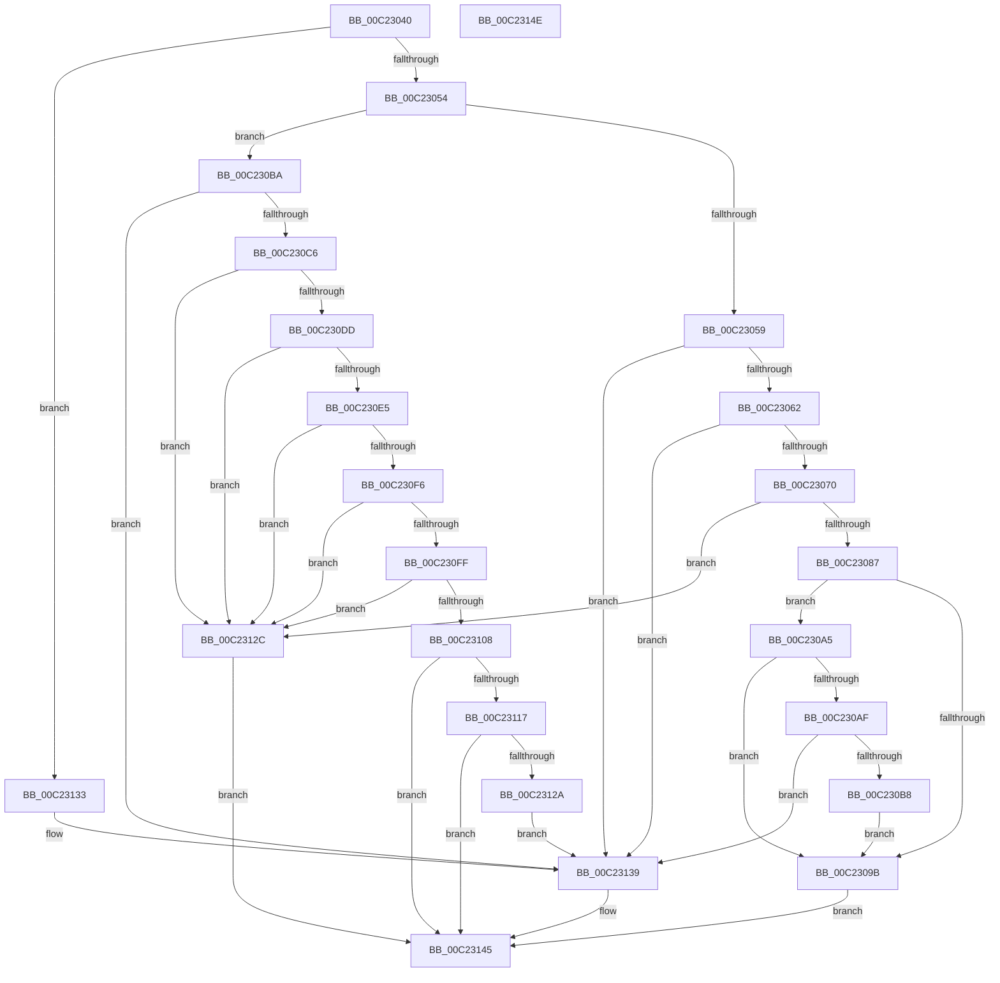

# HalpVerifyHmatEntryValidity

- RVA: `0x00C23040`–`0x00C2314F` (길이 `271` bytes)
- VA: `0x0000000140C23040`
- 실행 섹션: `INIT`
- PDB 이름 있음: `예`; PDB Function 태그: `아니요`
- unwind 정보 RVA: `0x000DB714`
- 디코드: `75`개 명령, `271/271` bytes 표시
- 미해석 바이트: `0` (있으면 어셈블리에 `.byte`로 보존)

> 이 문서는 커널 이미지의 기계어와 PDB 기호를 분석해 생성했습니다. 4번과 5번은 함수 원형과 자료형을 바이너리 사용 방식에서 추정한 C 해석이며 원본 소스 복구 결과는 아닙니다.

## 1. Dependencies

- 직접 호출 지점: **0**; 고유 호출 대상: **0**
- 직접 호출자로 확인된 함수: **1**
- RIP 상대 이미지 참조: **1**

### Outgoing calls
- 직접 디코드된 call 명령이 없습니다.

### Direct callers
- [HalpNumaGetHmatConfigSize](../../text/55/HalpNumaGetHmatConfigSize_function_00559230.md) at `0x005592D0`

### Static image references
- `0x00C23092` → RVA `0x00F90638` (`.data`; read)

## 2. Other-region calls and transfers

- 다른 실행 섹션으로 향하는 call: **0**
- 별도 외부 분기/꼬리 이동을 확인하지 못했습니다.

## 3. Assembly (complete function range)

```asm
00C23040  33 D2                           xor edx, edx
00C23042  4C 8B C9                        mov r9, rcx
00C23045  0F B7 09                        movzx ecx, word ptr [rcx]
00C23048  44 8D 42 08                     lea r8d, [rdx + 8]
00C2304C  85 C9                           test ecx, ecx
00C2304E  0F 84 DF 00 00 00               je 0x140c23133
00C23054  83 E9 01                        sub ecx, 1
00C23057  74 61                           je 0x140c230ba
00C23059  83 F9 01                        cmp ecx, 1
00C2305C  0F 85 D7 00 00 00               jne 0x140c23139
00C23062  44 8D 42 20                     lea r8d, [rdx + 0x20]
00C23066  45 39 41 04                     cmp dword ptr [r9 + 4], r8d
00C2306A  0F 82 C9 00 00 00               jb 0x140c23139
00C23070  41 0F B7 41 1E                  movzx eax, word ptr [r9 + 0x1e]
00C23075  44 8D 04 45 20 00 00 00         lea r8d, [rax*2 + 0x20]
00C2307D  41 83 F8 20                     cmp r8d, 0x20
00C23081  0F 82 A5 00 00 00               jb 0x140c2312c
00C23087  49 8B 49 10                     mov rcx, qword ptr [r9 + 0x10]
00C2308B  48 8B C1                        mov rax, rcx
00C2308E  48 C1 E8 0C                     shr rax, 0xc
00C23092  48 3B 05 9F D5 36 00            cmp rax, qword ptr [rip + 0x36d59f]
00C23099  76 0A                           jbe 0x140c230a5
00C2309B  BA 60 02 00 C0                  mov edx, 0xc0000260
00C230A0  E9 A0 00 00 00                  jmp 0x140c23145
00C230A5  41 0F B7 41 1A                  movzx eax, word ptr [r9 + 0x1a]
00C230AA  48 3B C8                        cmp rcx, rax
00C230AD  72 EC                           jb 0x140c2309b
00C230AF  66 85 C0                        test ax, ax
00C230B2  0F 85 81 00 00 00               jne 0x140c23139
00C230B8  EB E1                           jmp 0x140c2309b
00C230BA  41 B8 20 00 00 00               mov r8d, 0x20
00C230C0  45 39 41 04                     cmp dword ptr [r9 + 4], r8d
00C230C4  72 73                           jb 0x140c23139
00C230C6  41 8B 51 0C                     mov edx, dword ptr [r9 + 0xc]
00C230CA  41 B8 FF FF FF FF               mov r8d, 0xffffffff
00C230D0  48 8D 0C 95 00 00 00 00         lea rcx, [rdx*4]
00C230D8  49 3B C8                        cmp rcx, r8
00C230DB  77 4F                           ja 0x140c2312c
00C230DD  83 C1 20                        add ecx, 0x20
00C230E0  83 F9 20                        cmp ecx, 0x20
00C230E3  72 47                           jb 0x140c2312c
00C230E5  41 8B 41 10                     mov eax, dword ptr [r9 + 0x10]
00C230E9  4C 8D 14 85 00 00 00 00         lea r10, [rax*4]
00C230F1  4D 3B D0                        cmp r10, r8
00C230F4  77 36                           ja 0x140c2312c
00C230F6  46 8D 1C 11                     lea r11d, [rcx + r10]
00C230FA  44 3B D9                        cmp r11d, ecx
00C230FD  72 2D                           jb 0x140c2312c
00C230FF  48 0F AF C2                     imul rax, rdx
00C23103  49 3B C0                        cmp rax, r8
00C23106  77 24                           ja 0x140c2312c
00C23108  8B C8                           mov ecx, eax
00C2310A  BA 95 00 00 C0                  mov edx, 0xc0000095
00C2310F  48 03 C9                        add rcx, rcx
00C23112  49 3B C8                        cmp rcx, r8
00C23115  77 2E                           ja 0x140c23145
00C23117  41 03 CB                        add ecx, r11d
00C2311A  41 3B CB                        cmp ecx, r11d
00C2311D  44 0F 43 C1                     cmovae r8d, ecx
00C23121  1B C0                           sbb eax, eax
00C23123  23 D0                           and edx, eax
00C23125  41 3B CB                        cmp ecx, r11d
00C23128  72 1B                           jb 0x140c23145
00C2312A  EB 0D                           jmp 0x140c23139
00C2312C  BA 95 00 00 C0                  mov edx, 0xc0000095
00C23131  EB 12                           jmp 0x140c23145
00C23133  41 B8 28 00 00 00               mov r8d, 0x28
00C23139  45 39 41 04                     cmp dword ptr [r9 + 4], r8d
00C2313D  B8 0D 00 00 C0                  mov eax, 0xc000000d
00C23142  0F 42 D0                        cmovb edx, eax
00C23145  C1 EA 1F                        shr edx, 0x1f
00C23148  80 F2 01                        xor dl, 1
00C2314B  8A C2                           mov al, dl
00C2314D  C3                              ret
00C2314E  CC                              int3
```

## 4. C-style interpretation (structured pseudocode)

```c
__int64 __fastcall HalpVerifyHmatEntryValidity(__int64 a1, int a2)
{
    __int64 result;

    a2 = 0;
    if ((unsigned int)(*(unsigned __int16 *)(a1)) == 0) goto loc_00C23133;
    a1 = (unsigned int)((*(unsigned __int16 *)(a1)) - (1));
    if (condition_is_equal) goto loc_00C230BA;
    if (((unsigned int)(a1)) != 1) goto loc_00C23139;
    if ((*(unsigned int *)(a1 + 4)) < ((unsigned int)(a2 + 32))) goto loc_00C23139;
    if (((unsigned int)(*(unsigned __int16 *)(a1 + 30) * 2 + 32)) < 32) goto loc_00C2312C;
    result = (*(unsigned __int64 *)(a1 + 16)) >> (12);
    if (result <= (*(unsigned __int64 *)(v_rip + 3593631))) goto loc_00C230A5;
loc_00C2309B:
    goto loc_00C23145;
loc_00C230A5:
    if ((*(unsigned __int64 *)(a1 + 16)) < (*(unsigned __int16 *)(a1 + 26))) goto loc_00C2309B;
    if ((unsigned __int16)(*(unsigned __int16 *)(a1 + 26)) != 0) goto loc_00C23139;
    goto loc_00C2309B;
loc_00C230BA:
    if ((*(unsigned int *)(a1 + 4)) < 32) goto loc_00C23139;
    if (((unsigned int)(*(unsigned int *)(a1 + 12)) * 4) > ((unsigned int)(0xFFFFFFFFULL))) goto loc_00C2312C;
    a1 = (unsigned int)(((unsigned int)(*(unsigned int *)(a1 + 12)) * 4) + (32));
    if (((unsigned int)(a1)) < 32) goto loc_00C2312C;
    if (((unsigned int)(*(unsigned int *)(a1 + 16)) * 4) > ((unsigned int)(0xFFFFFFFFULL))) goto loc_00C2312C;
    if (((unsigned int)(a1 + (unsigned int)(*(unsigned int *)(a1 + 16)) * 4 * 1)) < ((unsigned int)(a1))) goto loc_00C2312C;
    result = ((unsigned int)(*(unsigned int *)(a1 + 16))) * ((unsigned int)(*(unsigned int *)(a1 + 12)));
    if (result > ((unsigned int)(0xFFFFFFFFULL))) goto loc_00C2312C;
    a1 = ((unsigned int)((unsigned int)(result))) + ((unsigned int)((unsigned int)(result)));
    if (a1 > ((unsigned int)(0xFFFFFFFFULL))) goto loc_00C23145;
    a1 = (unsigned int)((a1) + ((unsigned int)(a1 + (unsigned int)(*(unsigned int *)(a1 + 16)) * 4 * 1)));
    a3 = (unsigned int)(0xFFFFFFFFULL);
    if (((unsigned int)(a1)) >= ((unsigned int)(a1 + (unsigned int)(*(unsigned int *)(a1 + 16)) * 4 * 1))) { a3 = (unsigned int)(a1); }
    a2 = (unsigned int)(((unsigned int)(0xC0000095ULL)) & ((unsigned int)(result)));
    if (((unsigned int)(a1)) < ((unsigned int)(a1 + (unsigned int)(*(unsigned int *)(a1 + 16)) * 4 * 1))) goto loc_00C23145;
    goto loc_00C23139;
loc_00C2312C:
    goto loc_00C23145;
loc_00C23133:
loc_00C23139:
    a2 = (unsigned int)(0xC0000095ULL);
    if ((*(unsigned int *)(a1 + 4)) < 40) { a2 = (unsigned int)((unsigned int)(0xC000000DULL)); }
loc_00C23145:
    a2 = (unsigned int)((a2) >> (31));
    a2 = (unsigned __int8)((a2) ^ (1));
    return (unsigned __int8)(a2);
}
```

## 5. (Beta) C Style

```c
int64_t HalpVerifyHmatEntryValidity(void *Arg1, int32_t Arg2)
{
    uint8_t *arg1 = (uint8_t *)Arg1;

    int64_t result;

    Arg2 = 0;
    if ((uint32_t)(*(uint16_t *)(arg1)) == 0) goto loc_00C23133;
    Arg1 = (uint32_t)((*(uint16_t *)(arg1)) - (1));
    if (condition_is_equal) goto loc_00C230BA;
    if (((uint32_t)(Arg1)) != 1) goto loc_00C23139;
    if ((*(uint32_t *)(arg1 + 0x4)) < ((uint32_t)(Arg2 + 32))) goto loc_00C23139;
    if (((uint32_t)(*(uint16_t *)(arg1 + 0x1E) * 2 + 32)) < 32) goto loc_00C2312C;
    result = (*(uint64_t *)(arg1 + 0x10)) >> (12);
    if (result <= (*(uint64_t *)(v_rip + 0x36D59F))) goto loc_00C230A5;
loc_00C2309B:
    goto loc_00C23145;
loc_00C230A5:
    if ((*(uint64_t *)(arg1 + 0x10)) < (*(uint16_t *)(arg1 + 0x1A))) goto loc_00C2309B;
    if ((uint16_t)(*(uint16_t *)(arg1 + 0x1A)) != 0) goto loc_00C23139;
    goto loc_00C2309B;
loc_00C230BA:
    if ((*(uint32_t *)(arg1 + 0x4)) < 32) goto loc_00C23139;
    if (((uint32_t)(*(uint32_t *)(arg1 + 0xC)) * 4) > ((uint32_t)(0xFFFFFFFFULL))) goto loc_00C2312C;
    Arg1 = (uint32_t)(((uint32_t)(*(uint32_t *)(arg1 + 0xC)) * 4) + (32));
    if (((uint32_t)(Arg1)) < 32) goto loc_00C2312C;
    if (((uint32_t)(*(uint32_t *)(arg1 + 0x10)) * 4) > ((uint32_t)(0xFFFFFFFFULL))) goto loc_00C2312C;
    if (((uint32_t)(Arg1 + (uint32_t)(*(uint32_t *)(arg1 + 0x10)) * 4 * 1)) < ((uint32_t)(Arg1))) goto loc_00C2312C;
    result = ((uint32_t)(*(uint32_t *)(arg1 + 0x10))) * ((uint32_t)(*(uint32_t *)(arg1 + 0xC)));
    if (result > ((uint32_t)(0xFFFFFFFFULL))) goto loc_00C2312C;
    Arg1 = ((uint32_t)((uint32_t)(result))) + ((uint32_t)((uint32_t)(result)));
    if (Arg1 > ((uint32_t)(0xFFFFFFFFULL))) goto loc_00C23145;
    Arg1 = (uint32_t)((Arg1) + ((uint32_t)(Arg1 + (uint32_t)(*(uint32_t *)(arg1 + 0x10)) * 4 * 1)));
    a3 = (uint32_t)(0xFFFFFFFFULL);
    if (((uint32_t)(Arg1)) >= ((uint32_t)(Arg1 + (uint32_t)(*(uint32_t *)(arg1 + 0x10)) * 4 * 1))) { a3 = (uint32_t)(Arg1); }
    Arg2 = (uint32_t)(((uint32_t)(0xC0000095ULL)) & ((uint32_t)(result)));
    if (((uint32_t)(Arg1)) < ((uint32_t)(Arg1 + (uint32_t)(*(uint32_t *)(arg1 + 0x10)) * 4 * 1))) goto loc_00C23145;
    goto loc_00C23139;
loc_00C2312C:
    goto loc_00C23145;
loc_00C23133:
loc_00C23139:
    Arg2 = (uint32_t)(0xC0000095ULL);
    if ((*(uint32_t *)(arg1 + 0x4)) < 40) { Arg2 = (uint32_t)((uint32_t)(0xC000000DULL)); }
loc_00C23145:
    Arg2 = (uint32_t)((Arg2) >> (31));
    Arg2 = (uint8_t)((Arg2) ^ (1));
    return (uint8_t)(Arg2);
}
```

### 관측된 메모리 오프셋

구조체 형식이 확인되지 않은 접근은 인자 기준의 오프셋으로만 기록했습니다.

| 기준 인자 | 오프셋 표현 | 폭 (bit) | 접근 |
|---|---:|---:|---|
| `Arg1` | `+ 0x0` | `16` | `R` |
| `Arg1` | `+ 0x4` | `32` | `R` |
| `Arg1` | `+ 0xC` | `32` | `R` |
| `Arg1` | `+ 0x10` | `32` | `R` |
| `Arg1` | `+ 0x10` | `64` | `R` |
| `Arg1` | `+ 0x1A` | `16` | `R` |
| `Arg1` | `+ 0x1E` | `16` | `R` |

## 6. Execution-region graph

[열기: 2D/3D 그래프와 함수 탐색 컨트롤 패널](../../../control-panel.html?section=init&rva=0x00C23040&view=graph)

- 2D 그래프는 위에서 아래로 흐르고, 3D 그래프는 빈 공간을 드래그해 회전합니다. Shift+드래그는 이동, 휠은 확대·축소, 함수 노드 선택은 대상 보고서 이동입니다.

### Static fallback


