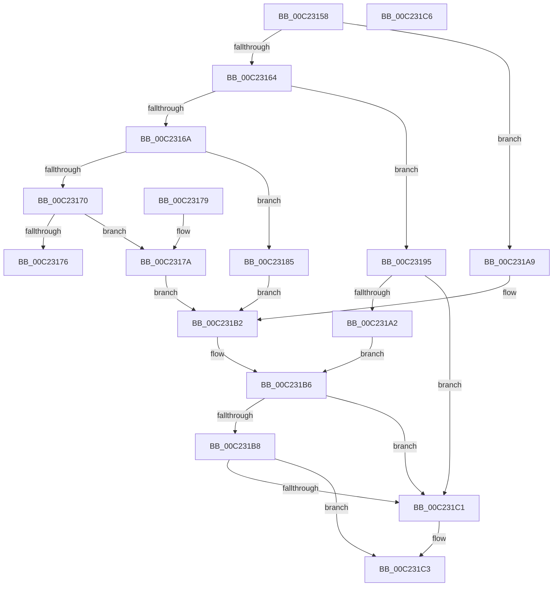

# HalpVerifySratEntryLengthAndFlag

- RVA: `0x00C23158`–`0x00C231C7` (길이 `111` bytes)
- VA: `0x0000000140C23158`
- 실행 섹션: `INIT`
- PDB 이름 있음: `예`; PDB Function 태그: `아니요`
- unwind 정보 RVA: `0x000DB714`
- 디코드: `40`개 명령, `111/111` bytes 표시
- 미해석 바이트: `0` (있으면 어셈블리에 `.byte`로 보존)

> 이 문서는 커널 이미지의 기계어와 PDB 기호를 분석해 생성했습니다. 4번과 5번은 함수 원형과 자료형을 바이너리 사용 방식에서 추정한 C 해석이며 원본 소스 복구 결과는 아닙니다.

## 1. Dependencies

- 직접 호출 지점: **0**; 고유 호출 대상: **0**
- 직접 호출자로 확인된 함수: **2**
- RIP 상대 이미지 참조: **0**

### Outgoing calls
- 직접 디코드된 call 명령이 없습니다.

### Direct callers
- [HalpGetNumaProcMemoryCount](HalpGetNumaProcMemoryCount_function_00C21B40.md) at `0x00C21BC5`
- [HalpNumaInitializeStaticConfiguration](HalpNumaInitializeStaticConfiguration_function_00C220D8.md) at `0x00C222A5`

### Static image references
- 디코드된 RIP-relative 메모리 참조가 없습니다.

## 2. Other-region calls and transfers

- 다른 실행 섹션으로 향하는 call: **0**
- 별도 외부 분기/꼬리 이동을 확인하지 못했습니다.

## 3. Assembly (complete function range)

```asm
00C23158  44 0F B6 01                     movzx r8d, byte ptr [rcx]
00C2315C  4C 8B C9                        mov r9, rcx
00C2315F  45 85 C0                        test r8d, r8d
00C23162  74 45                           je 0x140c231a9
00C23164  41 83 E8 01                     sub r8d, 1
00C23168  74 2B                           je 0x140c23195
00C2316A  41 83 E8 01                     sub r8d, 1
00C2316E  74 15                           je 0x140c23185
00C23170  41 83 F8 01                     cmp r8d, 1
00C23174  74 04                           je 0x140c2317a
00C23176  32 C0                           xor al, al
00C23178  C3                              ret
00C23179  CC                              int3
00C2317A  41 8B 41 0A                     mov eax, dword ptr [r9 + 0xa]
00C2317E  B9 12 00 00 00                  mov ecx, 0x12
00C23183  EB 2D                           jmp 0x140c231b2
00C23185  41 8B 41 0C                     mov eax, dword ptr [r9 + 0xc]
00C23189  F6 DA                           neg dl
00C2318B  1B C9                           sbb ecx, ecx
00C2318D  83 E1 08                        and ecx, 8
00C23190  83 C1 10                        add ecx, 0x10
00C23193  EB 1D                           jmp 0x140c231b2
00C23195  B2 01                           mov dl, 1
00C23197  B9 28 00 00 00                  mov ecx, 0x28
00C2319C  41 84 51 1C                     test byte ptr [r9 + 0x1c], dl
00C231A0  74 1F                           je 0x140c231c1
00C231A2  49 83 79 10 00                  cmp qword ptr [r9 + 0x10], 0
00C231A7  EB 0D                           jmp 0x140c231b6
00C231A9  41 8B 41 04                     mov eax, dword ptr [r9 + 4]
00C231AD  B9 10 00 00 00                  mov ecx, 0x10
00C231B2  B2 01                           mov dl, 1
00C231B4  84 C2                           test dl, al
00C231B6  74 09                           je 0x140c231c1
00C231B8  41 0F B6 41 01                  movzx eax, byte ptr [r9 + 1]
00C231BD  3B C1                           cmp eax, ecx
00C231BF  73 02                           jae 0x140c231c3
00C231C1  32 D2                           xor dl, dl
00C231C3  8A C2                           mov al, dl
00C231C5  C3                              ret
00C231C6  CC                              int3
```

## 4. C-style interpretation (structured pseudocode)

```c
__int64 __fastcall HalpVerifySratEntryLengthAndFlag(__int64 a1, unsigned __int8 a2)
{
    __int64 result;

    if ((unsigned int)(*(unsigned __int8 *)(a1)) == 0) goto loc_00C231A9;
    a3 = (unsigned int)((*(unsigned __int8 *)(a1)) - (1));
    if (condition_is_equal) goto loc_00C23195;
    a3 = (unsigned int)((a3) - (1));
    if (condition_is_equal) goto loc_00C23185;
    if (((unsigned int)(a3)) == 1) goto loc_00C2317A;
    result = 0;
    return result;
loc_00C2317A:
    goto loc_00C231B2;
loc_00C23185:
    a2 = (unsigned __int8)(-(a2));
    a1 = (unsigned int)((18) & (8));
    a1 = (unsigned int)((a1) + (16));
    goto loc_00C231B2;
loc_00C23195:
    if (((*(unsigned __int8 *)(a1 + 28)) & (1)) == 0) goto loc_00C231C1;
    goto loc_00C231B6;
loc_00C231A9:
loc_00C231B2:
loc_00C231B6:
    if (((1) & ((unsigned __int8)((unsigned int)(*(unsigned int *)(a1 + 4))))) == 0) goto loc_00C231C1;
    if (((unsigned int)(*(unsigned __int8 *)(a1 + 1))) < 16) {
        a2 = 0;
    }
    return 0;
}
```

## 5. (Beta) C Style

```c
int64_t HalpVerifySratEntryLengthAndFlag(void *Arg1, uint8_t Arg2)
{
    uint8_t *arg1 = (uint8_t *)Arg1;

    int64_t result;

    if ((uint32_t)(*(uint8_t *)(arg1)) == 0) goto loc_00C231A9;
    a3 = (uint32_t)((*(uint8_t *)(arg1)) - (1));
    if (condition_is_equal) goto loc_00C23195;
    a3 = (uint32_t)((a3) - (1));
    if (condition_is_equal) goto loc_00C23185;
    if (((uint32_t)(a3)) == 1) goto loc_00C2317A;
    result = 0;
    return result;
loc_00C2317A:
    goto loc_00C231B2;
loc_00C23185:
    Arg2 = (uint8_t)(-(Arg2));
    Arg1 = (uint32_t)((18) & (8));
    Arg1 = (uint32_t)((Arg1) + (16));
    goto loc_00C231B2;
loc_00C23195:
    if (((*(uint8_t *)(arg1 + 0x1C)) & (1)) == 0) goto loc_00C231C1;
    goto loc_00C231B6;
loc_00C231A9:
loc_00C231B2:
loc_00C231B6:
    if (((1) & ((uint8_t)((uint32_t)(*(uint32_t *)(arg1 + 0x4))))) == 0) goto loc_00C231C1;
    if (((uint32_t)(*(uint8_t *)(arg1 + 0x1))) < 16) {
        Arg2 = 0;
    }
    return 0;
}
```

### 관측된 메모리 오프셋

구조체 형식이 확인되지 않은 접근은 인자 기준의 오프셋으로만 기록했습니다.

| 기준 인자 | 오프셋 표현 | 폭 (bit) | 접근 |
|---|---:|---:|---|
| `Arg1` | `+ 0x0` | `8` | `R` |
| `Arg1` | `+ 0x1` | `8` | `R` |
| `Arg1` | `+ 0x4` | `32` | `R` |
| `Arg1` | `+ 0xA` | `32` | `R` |
| `Arg1` | `+ 0xC` | `32` | `R` |
| `Arg1` | `+ 0x10` | `64` | `R` |
| `Arg1` | `+ 0x1C` | `8` | `R` |

## 6. Execution-region graph

[열기: 2D/3D 그래프와 함수 탐색 컨트롤 패널](../../../control-panel.html?section=init&rva=0x00C23158&view=graph)

- 2D 그래프는 위에서 아래로 흐르고, 3D 그래프는 빈 공간을 드래그해 회전합니다. Shift+드래그는 이동, 휠은 확대·축소, 함수 노드 선택은 대상 보고서 이동입니다.

### Static fallback


