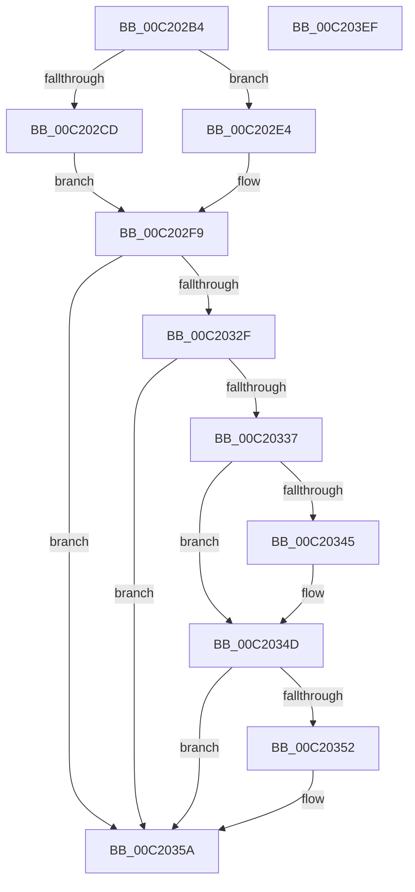

# HalpWheaInitDiscard

- RVA: `0x00C202B4`–`0x00C203F0` (길이 `316` bytes)
- VA: `0x0000000140C202B4`
- 실행 섹션: `INIT`
- PDB 이름 있음: `예`; PDB Function 태그: `아니요`
- unwind 정보 RVA: `0x00063458`
- 디코드: `62`개 명령, `316/316` bytes 표시
- 미해석 바이트: `0` (있으면 어셈블리에 `.byte`로 보존)

> 이 문서는 커널 이미지의 기계어와 PDB 기호를 분석해 생성했습니다. 4번과 5번은 함수 원형과 자료형을 바이너리 사용 방식에서 추정한 C 해석이며 원본 소스 복구 결과는 아닙니다.

## 1. Dependencies

- 직접 호출 지점: **8**; 고유 호출 대상: **4**
- 직접 호출자로 확인된 함수: **1**
- RIP 상대 이미지 참조: **19**

### Outgoing calls
- `0x00C20326` → [KeHwPolicyLocateResource](../C3/KeHwPolicyLocateResource_function_00C38A80.md) (function, `0x00C38A80`)
- `0x00C20377` → `PSHED.dll!PshedSetHalEnlightenments` (import, 간접 대상; import `PSHED.dll!PshedSetHalEnlightenments`)
- `0x00C20383` → [HalpInitializeWheaPhysicalMappings](HalpInitializeWheaPhysicalMappings_function_00C24EB4.md) (function, `0x00C24EB4`)
- `0x00C2039F` → [WheaConfigureErrorSource](../../pagelk/B7/WheaConfigureErrorSource_function_00B733A0.md) (function, `0x00B733A0`)
- `0x00C203B0` → [WheaConfigureErrorSource](../../pagelk/B7/WheaConfigureErrorSource_function_00B733A0.md) (function, `0x00B733A0`)
- `0x00C203C1` → [WheaConfigureErrorSource](../../pagelk/B7/WheaConfigureErrorSource_function_00B733A0.md) (function, `0x00B733A0`)
- `0x00C203D2` → [WheaConfigureErrorSource](../../pagelk/B7/WheaConfigureErrorSource_function_00B733A0.md) (function, `0x00B733A0`)
- `0x00C203E3` → [WheaConfigureErrorSource](../../pagelk/B7/WheaConfigureErrorSource_function_00B733A0.md) (function, `0x00B733A0`)

### Direct callers
- [HalpWheaInitSystem](../../pagelk/B5/HalpWheaInitSystem_function_00B5D770.md) at `0x00B5D7C3`

### Static image references
- `0x00C202C4` → RVA `0x00FC1C48` (`.data`; read)
- `0x00C202CD` → RVA `0x0054C060` (`HalpHvEpCpuid`; read)
- `0x00C202D4` → RVA `0x004B2D40` (`HalpHvEpWriteMsr`; read)
- `0x00C202DB` → RVA `0x00487340` (`HalpHvEpReadMsr`; read)
- `0x00C202E4` → RVA `0x0054E9B0` (`HalpWheaNativeCpuid`; read)
- `0x00C202EB` → RVA `0x004BC800` (`HalpWheaNativeWriteMsr`; read)
- `0x00C202F2` → RVA `0x00486710` (`HalpWheaNativeReadMsr`; read)
- `0x00C202F9` → RVA `0x00FC1980` (`.data`; write)
- `0x00C2030A` → RVA `0x00FC1988` (`.data`; write)
- `0x00C20311` → RVA `0x00FC1990` (`.data`; write)
- `0x00C20345` → RVA `0x00E103E0` (`.data`; read/write)
- `0x00C2035A` → RVA `0x00FC1990` (`.data`; read)
- `0x00C2036B` → RVA `0x00FC1980` (`.data`; read)
- `0x00C20377` → RVA `0x001510B0` (`PSHED.dll!PshedSetHalEnlightenments (IAT)`; read)
- `0x00C20388` → RVA `0x00487160` (`HalpWheaInitProcessorGenericSection`; read)
- `0x00C20391` → RVA `0x00E00360` (`.data`; read)
- `0x00C20398` → RVA `0x00E00918` (`.data`; write)
- `0x00C203B5` → RVA `0x00E00398` (`.data`; read)
- `0x00C203C6` → RVA `0x00E00328` (`.data`; read)

## 2. Other-region calls and transfers

- 다른 실행 섹션으로 향하는 call: **5**
  - `0x00C2039F` → [WheaConfigureErrorSource](../../pagelk/B7/WheaConfigureErrorSource_function_00B733A0.md) (`INIT` → `PAGELK`)
  - `0x00C203B0` → [WheaConfigureErrorSource](../../pagelk/B7/WheaConfigureErrorSource_function_00B733A0.md) (`INIT` → `PAGELK`)
  - `0x00C203C1` → [WheaConfigureErrorSource](../../pagelk/B7/WheaConfigureErrorSource_function_00B733A0.md) (`INIT` → `PAGELK`)
  - `0x00C203D2` → [WheaConfigureErrorSource](../../pagelk/B7/WheaConfigureErrorSource_function_00B733A0.md) (`INIT` → `PAGELK`)
  - `0x00C203E3` → [WheaConfigureErrorSource](../../pagelk/B7/WheaConfigureErrorSource_function_00B733A0.md) (`INIT` → `PAGELK`)
- 별도 외부 분기/꼬리 이동을 확인하지 못했습니다.

## 3. Assembly (complete function range)

```asm
00C202B4  48 83 EC 48                     sub rsp, 0x48
00C202B8  48 83 64 24 60 00               and qword ptr [rsp + 0x60], 0
00C202BE  48 83 64 24 58 00               and qword ptr [rsp + 0x58], 0
00C202C4  80 3D 7D 19 3A 00 00            cmp byte ptr [rip + 0x3a197d], 0
00C202CB  74 17                           je 0x140c202e4
00C202CD  48 8D 05 8C BD 92 FF            lea rax, [rip - 0x6d4274]
00C202D4  48 8D 15 65 2A 89 FF            lea rdx, [rip - 0x76d59b]
00C202DB  4C 8D 05 5E 70 86 FF            lea r8, [rip - 0x798fa2]
00C202E2  EB 15                           jmp 0x140c202f9
00C202E4  48 8D 05 C5 E6 92 FF            lea rax, [rip - 0x6d193b]
00C202EB  48 8D 15 0E C5 89 FF            lea rdx, [rip - 0x763af2]
00C202F2  4C 8D 05 17 64 86 FF            lea r8, [rip - 0x799be9]
00C202F9  48 89 15 80 16 3A 00            mov qword ptr [rip + 0x3a1680], rdx
00C20300  4C 8D 4C 24 60                  lea r9, [rsp + 0x60]
00C20305  BA 66 00 00 00                  mov edx, 0x66
00C2030A  48 89 05 77 16 3A 00            mov qword ptr [rip + 0x3a1677], rax
00C20311  4C 89 05 78 16 3A 00            mov qword ptr [rip + 0x3a1678], r8
00C20318  48 8D 44 24 58                  lea rax, [rsp + 0x58]
00C2031D  48 89 44 24 20                  mov qword ptr [rsp + 0x20], rax
00C20322  44 8D 42 9B                     lea r8d, [rdx - 0x65]
00C20326  E8 55 87 01 00                  call 0x140c38a80
00C2032B  85 C0                           test eax, eax
00C2032D  78 2B                           js 0x140c2035a
00C2032F  48 83 7C 24 58 18               cmp qword ptr [rsp + 0x58], 0x18
00C20335  72 23                           jb 0x140c2035a
00C20337  48 8B 44 24 60                  mov rax, qword ptr [rsp + 0x60]
00C2033C  48 8B 48 10                     mov rcx, qword ptr [rax + 0x10]
00C20340  F6 C1 01                        test cl, 1
00C20343  74 08                           je 0x140c2034d
00C20345  48 83 0D 93 00 1F 00 01         or qword ptr [rip + 0x1f0093], 1
00C2034D  F6 C1 02                        test cl, 2
00C20350  74 08                           je 0x140c2035a
00C20352  48 83 0D 86 00 1F 00 02         or qword ptr [rip + 0x1f0086], 2
00C2035A  48 8B 05 2F 16 3A 00            mov rax, qword ptr [rip + 0x3a162f]
00C20361  48 8D 4C 24 30                  lea rcx, [rsp + 0x30]
00C20366  48 89 44 24 30                  mov qword ptr [rsp + 0x30], rax
00C2036B  48 8B 05 0E 16 3A 00            mov rax, qword ptr [rip + 0x3a160e]
00C20372  48 89 44 24 38                  mov qword ptr [rsp + 0x38], rax
00C20377  48 FF 15 32 0D 53 FF            call qword ptr [rip - 0xacf2ce]
00C2037E  0F 1F 44 00 00                  nop dword ptr [rax + rax]
00C20383  E8 2C 4B 00 00                  call 0x140c24eb4
00C20388  48 8D 05 D1 6D 86 FF            lea rax, [rip - 0x79922f]
00C2038F  33 C9                           xor ecx, ecx
00C20391  48 8D 15 C8 FF 1D 00            lea rdx, [rip + 0x1dffc8]
00C20398  48 89 05 79 05 1E 00            mov qword ptr [rip + 0x1e0579], rax
00C2039F  E8 FC 2F F5 FF                  call 0x140b733a0
00C203A4  48 8D 15 B5 FF 1D 00            lea rdx, [rip + 0x1dffb5]
00C203AB  B9 01 00 00 00                  mov ecx, 1
00C203B0  E8 EB 2F F5 FF                  call 0x140b733a0
00C203B5  48 8D 15 DC FF 1D 00            lea rdx, [rip + 0x1dffdc]
00C203BC  B9 03 00 00 00                  mov ecx, 3
00C203C1  E8 DA 2F F5 FF                  call 0x140b733a0
00C203C6  48 8D 15 5B FF 1D 00            lea rdx, [rip + 0x1dff5b]
00C203CD  B9 05 00 00 00                  mov ecx, 5
00C203D2  E8 C9 2F F5 FF                  call 0x140b733a0
00C203D7  48 8D 15 4A FF 1D 00            lea rdx, [rip + 0x1dff4a]
00C203DE  B9 0C 00 00 00                  mov ecx, 0xc
00C203E3  E8 B8 2F F5 FF                  call 0x140b733a0
00C203E8  33 C0                           xor eax, eax
00C203EA  48 83 C4 48                     add rsp, 0x48
00C203EE  C3                              ret
00C203EF  CC                              int3
```

## 4. C-style interpretation (structured pseudocode)

```c
__int64 __fastcall HalpWheaInitDiscard(void)
{
    __int64 result;
    __int64 v_rsp;
    unsigned __int64 v_stack_m10;
    unsigned __int64 v_stack_m18;
    unsigned __int64 v_stack_m28;
    unsigned __int64 v_stack_p10;
    unsigned __int64 v_stack_p18;

    v_rsp = (v_rsp) - (72);
    if ((*(unsigned __int8 *)(v_rip + 3807613)) == 0) goto loc_00C202E4;
    goto loc_00C202F9;
loc_00C202E4:
loc_00C202F9:
    *(unsigned __int64 *)(v_rip + 3806848) = v_rip - 7748338;
    *(unsigned __int64 *)(v_rip + 3806839) = v_rip - 7149883;
    *(unsigned __int64 *)(v_rip + 3806840) = v_rip - 7969769;
    v_stack_m28 = v_stack_p10;
    result = KeHwPolicyLocateResource(a1, 102, 102 - 101, v_stack_p18);
    if (sign_flag) goto loc_00C2035A;
    if (v_stack_p10 < 24) goto loc_00C2035A;
    if ((((unsigned __int8)(*(unsigned __int64 *)(v_stack_p18 + 16))) & (1)) != 0) {
    }
    if ((((unsigned __int8)(*(unsigned __int64 *)(v_stack_p18 + 16))) & (2)) != 0) {
    }
    v_stack_m18 = *(unsigned __int64 *)(v_rip + 3806767);
    v_stack_m10 = *(unsigned __int64 *)(v_rip + 3806734);
    result = PSHED_dll_PshedSetHalEnlightenments(v_stack_m18, 102, 102 - 101, v_stack_p18);
    result = HalpInitializeWheaPhysicalMappings(v_stack_m18, 102, 102 - 101, v_stack_p18);
    a1 = 0;
    *(unsigned __int64 *)(v_rip + 1967481) = v_rip - 7967279;
    result = WheaConfigureErrorSource(a1, v_rip + 1966024, 102 - 101, v_stack_p18);
    result = WheaConfigureErrorSource(1, v_rip + 1966005, 102 - 101, v_stack_p18);
    result = WheaConfigureErrorSource(3, v_rip + 1966044, 102 - 101, v_stack_p18);
    result = WheaConfigureErrorSource(5, v_rip + 1965915, 102 - 101, v_stack_p18);
    result = WheaConfigureErrorSource(12, v_rip + 1965898, 102 - 101, v_stack_p18);
    result = 0;
    v_rsp = (v_rsp) + (72);
    return result;
}
```

## 5. (Beta) C Style

```c
void HalpWheaInitDiscard(void)
{
    int64_t result;
    int64_t local_rsp;
    uint64_t v_stack_m10;
    uint64_t v_stack_m18;
    uint64_t v_stack_m28;
    uint64_t v_stack_p10;
    uint64_t v_stack_p18;

    local_rsp = (local_rsp) - (72);
    if ((*(uint8_t *)(v_rip + 0x3A197D)) == 0) goto loc_00C202E4;
    goto loc_00C202F9;
loc_00C202E4:
loc_00C202F9:
    *(uint64_t *)(v_rip + 0x3A1680) = v_rip - 7748338;
    *(uint64_t *)(v_rip + 0x3A1677) = v_rip - 7149883;
    *(uint64_t *)(v_rip + 0x3A1678) = v_rip - 7969769;
    v_stack_m28 = v_stack_p10;
    result = KeHwPolicyLocateResource(a1, 102, 102 - 101, v_stack_p18);
    if (sign_flag) goto loc_00C2035A;
    if (v_stack_p10 < 24) goto loc_00C2035A;
    if ((((uint8_t)(*(uint64_t *)(v_stack_p18 + 0x10))) & (1)) != 0) {
    }
    if ((((uint8_t)(*(uint64_t *)(v_stack_p18 + 0x10))) & (2)) != 0) {
    }
    v_stack_m18 = *(uint64_t *)(v_rip + 0x3A162F);
    v_stack_m10 = *(uint64_t *)(v_rip + 0x3A160E);
    result = kernel_indirect_call(v_stack_m18, 102, 102 - 101, v_stack_p18);
    result = HalpInitializeWheaPhysicalMappings(v_stack_m18, 102, 102 - 101, v_stack_p18);
    a1 = 0;
    *(uint64_t *)(v_rip + 0x1E0579) = v_rip - 7967279;
    result = WheaConfigureErrorSource(a1, v_rip + 1966024, 102 - 101, v_stack_p18);
    result = WheaConfigureErrorSource(1, v_rip + 1966005, 102 - 101, v_stack_p18);
    result = WheaConfigureErrorSource(3, v_rip + 1966044, 102 - 101, v_stack_p18);
    result = WheaConfigureErrorSource(5, v_rip + 1965915, 102 - 101, v_stack_p18);
    result = WheaConfigureErrorSource(12, v_rip + 1965898, 102 - 101, v_stack_p18);
    result = 0;
    local_rsp = (local_rsp) + (72);
    return result;
}
```

## 6. Execution-region graph

[열기: 2D/3D 그래프와 함수 탐색 컨트롤 패널](../../../control-panel.html?section=init&rva=0x00C202B4&view=graph)

- 2D 그래프는 위에서 아래로 흐르고, 3D 그래프는 빈 공간을 드래그해 회전합니다. Shift+드래그는 이동, 휠은 확대·축소, 함수 노드 선택은 대상 보고서 이동입니다.

### Static fallback


