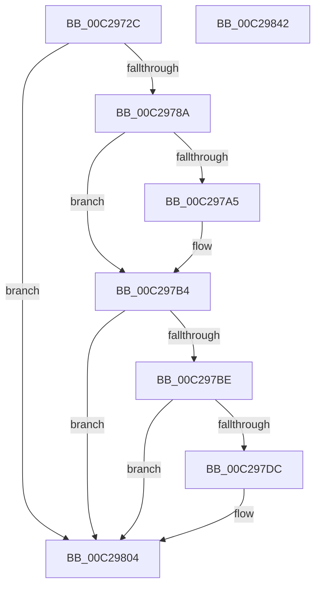

# HvlpDiscoverTopologyAmd

- RVA: `0x00C2972C`–`0x00C29843` (길이 `279` bytes)
- VA: `0x0000000140C2972C`
- 실행 섹션: `INIT`
- PDB 이름 있음: `예`; PDB Function 태그: `아니요`
- unwind 정보 RVA: `0x000C64F4`
- 디코드: `84`개 명령, `279/279` bytes 표시
- 미해석 바이트: `0` (있으면 어셈블리에 `.byte`로 보존)

> 이 문서는 커널 이미지의 기계어와 PDB 기호를 분석해 생성했습니다. 4번과 5번은 함수 원형과 자료형을 바이너리 사용 방식에서 추정한 C 해석이며 원본 소스 복구 결과는 아닙니다.

## 1. Dependencies

- 직접 호출 지점: **5**; 고유 호출 대상: **2**
- 직접 호출자로 확인된 함수: **1**
- RIP 상대 이미지 참조: **1**

### Outgoing calls
- `0x00C29778` → [HvlpLpCpuid](../../page/71/HvlpLpCpuid_function_007183B4.md) (function, `0x007183B4`)
- `0x00C29794` → [HvlpLpCpuid](../../page/71/HvlpLpCpuid_function_007183B4.md) (function, `0x007183B4`)
- `0x00C297CD` → [HvlpLpCpuid](../../page/71/HvlpLpCpuid_function_007183B4.md) (function, `0x007183B4`)
- `0x00C297EB` → [HvlpLpCpuid](../../page/71/HvlpLpCpuid_function_007183B4.md) (function, `0x007183B4`)
- `0x00C29826` → [_security_check_cookie](../../text/6A/_security_check_cookie_function_006AC640.md) (function, `0x006AC640`)

### Direct callers
- [HvlpDiscoverTopologyWorker](../../page/71/HvlpDiscoverTopologyWorker_function_00718384.md) at `0x007183A3`

### Static image references
- `0x00C29742` → RVA `0x00E0A740` (`.data`; read)

## 2. Other-region calls and transfers

- 다른 실행 섹션으로 향하는 call: **5**
  - `0x00C29778` → [HvlpLpCpuid](../../page/71/HvlpLpCpuid_function_007183B4.md) (`INIT` → `PAGE`)
  - `0x00C29794` → [HvlpLpCpuid](../../page/71/HvlpLpCpuid_function_007183B4.md) (`INIT` → `PAGE`)
  - `0x00C297CD` → [HvlpLpCpuid](../../page/71/HvlpLpCpuid_function_007183B4.md) (`INIT` → `PAGE`)
  - `0x00C297EB` → [HvlpLpCpuid](../../page/71/HvlpLpCpuid_function_007183B4.md) (`INIT` → `PAGE`)
  - `0x00C29826` → [_security_check_cookie](../../text/6A/_security_check_cookie_function_006AC640.md) (`INIT` → `.text`)
- 별도 외부 분기/꼬리 이동을 확인하지 못했습니다.

## 3. Assembly (complete function range)

```asm
00C2972C  48 89 5C 24 08                  mov qword ptr [rsp + 8], rbx
00C29731  48 89 6C 24 10                  mov qword ptr [rsp + 0x10], rbp
00C29736  56                              push rsi
00C29737  57                              push rdi
00C29738  41 54                           push r12
00C2973A  41 56                           push r14
00C2973C  41 57                           push r15
00C2973E  48 83 EC 40                     sub rsp, 0x40
00C29742  48 8B 05 F7 0F 1E 00            mov rax, qword ptr [rip + 0x1e0ff7]
00C29749  48 33 C4                        xor rax, rsp
00C2974C  48 89 44 24 38                  mov qword ptr [rsp + 0x38], rax
00C29751  4D 8B E1                        mov r12, r9
00C29754  4D 8B F8                        mov r15, r8
00C29757  44 8B F2                        mov r14d, edx
00C2975A  4C 8D 4C 24 28                  lea r9, [rsp + 0x28]
00C2975F  0F 57 C0                        xorps xmm0, xmm0
00C29762  BF 01 00 00 00                  mov edi, 1
00C29767  45 33 C0                        xor r8d, r8d
00C2976A  BA 00 00 00 80                  mov edx, 0x80000000
00C2976F  0F 11 44 24 28                  movups xmmword ptr [rsp + 0x28], xmm0
00C29774  8B DF                           mov ebx, edi
00C29776  8B F1                           mov esi, ecx
00C29778  E8 37 EC AE FF                  call 0x1407183b4
00C2977D  8B 6C 24 28                     mov ebp, dword ptr [rsp + 0x28]
00C29781  BA 08 00 00 80                  mov edx, 0x80000008
00C29786  3B EA                           cmp ebp, edx
00C29788  72 7A                           jb 0x140c29804
00C2978A  4C 8D 4C 24 28                  lea r9, [rsp + 0x28]
00C2978F  45 33 C0                        xor r8d, r8d
00C29792  8B CE                           mov ecx, esi
00C29794  E8 1B EC AE FF                  call 0x1407183b4
00C29799  8B 4C 24 30                     mov ecx, dword ptr [rsp + 0x30]
00C2979D  C1 E9 0C                        shr ecx, 0xc
00C297A0  83 E1 0F                        and ecx, 0xf
00C297A3  75 0F                           jne 0x140c297b4
00C297A5  0F B6 44 24 30                  movzx eax, byte ptr [rsp + 0x30]
00C297AA  8D 04 45 01 00 00 00            lea eax, [rax*2 + 1]
00C297B1  0F BD C8                        bsr ecx, eax
00C297B4  D3 E3                           shl ebx, cl
00C297B6  81 FD 1E 00 00 80               cmp ebp, 0x8000001e
00C297BC  72 46                           jb 0x140c29804
00C297BE  4C 8D 4C 24 28                  lea r9, [rsp + 0x28]
00C297C3  45 33 C0                        xor r8d, r8d
00C297C6  BA 01 00 00 80                  mov edx, 0x80000001
00C297CB  8B CE                           mov ecx, esi
00C297CD  E8 E2 EB AE FF                  call 0x1407183b4
00C297D2  F7 44 24 30 00 00 40 00         test dword ptr [rsp + 0x30], 0x400000
00C297DA  74 28                           je 0x140c29804
00C297DC  4C 8D 4C 24 28                  lea r9, [rsp + 0x28]
00C297E1  45 33 C0                        xor r8d, r8d
00C297E4  BA 1E 00 00 80                  mov edx, 0x8000001e
00C297E9  8B CE                           mov ecx, esi
00C297EB  E8 C4 EB AE FF                  call 0x1407183b4
00C297F0  8B 4C 24 2C                     mov ecx, dword ptr [rsp + 0x2c]
00C297F4  8B C3                           mov eax, ebx
00C297F6  C1 E9 08                        shr ecx, 8
00C297F9  0F B6 D1                        movzx edx, cl
00C297FC  03 FA                           add edi, edx
00C297FE  33 D2                           xor edx, edx
00C29800  F7 F7                           div edi
00C29802  8B D8                           mov ebx, eax
00C29804  33 D2                           xor edx, edx
00C29806  8B CF                           mov ecx, edi
00C29808  0F AF CB                        imul ecx, ebx
00C2980B  41 8B C6                        mov eax, r14d
00C2980E  F7 F1                           div ecx
00C29810  33 D2                           xor edx, edx
00C29812  41 89 07                        mov dword ptr [r15], eax
00C29815  41 8B C6                        mov eax, r14d
00C29818  F7 F7                           div edi
00C2981A  41 89 04 24                     mov dword ptr [r12], eax
00C2981E  48 8B 4C 24 38                  mov rcx, qword ptr [rsp + 0x38]
00C29823  48 33 CC                        xor rcx, rsp
00C29826  E8 15 2E A8 FF                  call 0x1406ac640
00C2982B  48 8B 5C 24 70                  mov rbx, qword ptr [rsp + 0x70]
00C29830  48 8B 6C 24 78                  mov rbp, qword ptr [rsp + 0x78]
00C29835  48 83 C4 40                     add rsp, 0x40
00C29839  41 5F                           pop r15
00C2983B  41 5E                           pop r14
00C2983D  41 5C                           pop r12
00C2983F  5F                              pop rdi
00C29840  5E                              pop rsi
00C29841  C3                              ret
00C29842  CC                              int3
```

## 4. C-style interpretation (structured pseudocode)

```c
__int64 __fastcall HvlpDiscoverTopologyAmd(int a1, int a2, __int64 a3, __int64 a4)
{
    __int64 result;
    __int64 v_rbx;
    __int64 v_rdi;
    __int64 v_rsp;
    unsigned __int64 v_stack_m30;
    unsigned int v_stack_m38;
    unsigned int v_stack_m3C;
    unsigned __int64 v_stack_m40;
    unsigned __int64 v_stack_p10;
    unsigned __int64 v_stack_p8;

    v_stack_p8 = v_rbx;
    v_stack_p10 = v_rbp;
    v_rsp = (v_rsp) - (64);
    result = (*(unsigned __int64 *)(v_rip + 1970167)) ^ (v_rsp);
    v_stack_m30 = result;
    a3 = 0;
    v_stack_m40 = v_xmm0;
    result = HvlpLpCpuid(a1, (unsigned int)(0x80000000ULL), a3, v_stack_m40);
    if (((unsigned int)((unsigned int)(v_stack_m40))) < ((unsigned int)((unsigned int)(0x80000008ULL)))) goto loc_00C29804;
    a3 = 0;
    result = HvlpLpCpuid((unsigned int)((unsigned int)((unsigned int)(a1))), (unsigned int)(0x80000008ULL), a3, v_stack_m40);
    a1 = (unsigned int)(((unsigned int)(v_stack_m38)) >> (12));
    a1 = (unsigned int)((a1) & (15));
    if (!(condition_is_not_equal)) {
        result = v_stack_m38;
        result = result * 2 + 1;
    }
    v_rbx = (unsigned int)((1) << ((unsigned __int8)(a1)));
    if (((unsigned int)((unsigned int)(v_stack_m40))) < 0x8000001EULL) goto loc_00C29804;
    a3 = 0;
    result = HvlpLpCpuid((unsigned int)((unsigned int)((unsigned int)(a1))), (unsigned int)(0x80000001ULL), a3, v_stack_m40);
    v_rdi = 1;
    if (((v_stack_m38) & (0x400000ULL)) != 0) {
        a4 = v_stack_m40;
        a3 = 0;
        a2 = 0x8000001EULL;
        a1 = (unsigned int)((unsigned int)(a1));
        result = HvlpLpCpuid(a1, a2, a3, a4);
        a1 = v_stack_m3C;
        result = (unsigned int)(v_rbx);
        a1 = (unsigned int)((a1) >> (8));
        a2 = (unsigned __int8)(a1);
        v_rdi = (unsigned int)((1) + (a2));
        a2 = 0;
        v_rbx = (unsigned int)(result);
    }
    a2 = 0;
    a1 = (unsigned int)(((unsigned int)((unsigned int)(v_rdi))) * ((unsigned int)(v_rbx)));
    a2 = 0;
    *(unsigned int *)(a3) = (unsigned int)((unsigned int)((unsigned int)((unsigned int)(a2))));
    *(unsigned int *)(a4) = (unsigned int)((unsigned int)((unsigned int)((unsigned int)(a2))));
    a1 = (v_stack_m30) ^ (v_rsp);
    result = _security_check_cookie(a1, a2, a3, a4);
    v_rsp = (v_rsp) + (64);
    return result;
}
```

## 5. (Beta) C Style

```c
int64_t HvlpDiscoverTopologyAmd(int32_t Arg1, int32_t Arg2, void *Arg3, void *Arg4)
{
    uint8_t *arg3 = (uint8_t *)Arg3;
    uint8_t *arg4 = (uint8_t *)Arg4;

    int64_t result;
    int64_t local_rbx;
    int64_t local_rdi;
    int64_t local_rsp;
    uint64_t v_stack_m30;
    uint32_t v_stack_m38;
    uint32_t v_stack_m3C;
    uint64_t v_stack_m40;
    uint64_t v_stack_p10;
    uint64_t v_stack_p8;

    v_stack_p8 = local_rbx;
    v_stack_p10 = local_rbp;
    local_rsp = (local_rsp) - (64);
    result = (*(uint64_t *)(v_rip + 0x1E0FF7)) ^ (local_rsp);
    v_stack_m30 = result;
    Arg3 = 0;
    v_stack_m40 = v_xmm0;
    result = HvlpLpCpuid(Arg1, (uint32_t)(0x80000000ULL), Arg3, v_stack_m40);
    if (((uint32_t)((uint32_t)(v_stack_m40))) < ((uint32_t)((uint32_t)(0x80000008ULL)))) goto loc_00C29804;
    Arg3 = 0;
    result = HvlpLpCpuid((uint32_t)((uint32_t)((uint32_t)(Arg1))), (uint32_t)(0x80000008ULL), Arg3, v_stack_m40);
    Arg1 = (uint32_t)(((uint32_t)(v_stack_m38)) >> (12));
    Arg1 = (uint32_t)((Arg1) & (15));
    if (!(condition_is_not_equal)) {
        result = v_stack_m38;
        result = result * 2 + 1;
    }
    local_rbx = (uint32_t)((1) << ((uint8_t)(Arg1)));
    if (((uint32_t)((uint32_t)(v_stack_m40))) < 0x8000001EULL) goto loc_00C29804;
    Arg3 = 0;
    result = HvlpLpCpuid((uint32_t)((uint32_t)((uint32_t)(Arg1))), (uint32_t)(0x80000001ULL), Arg3, v_stack_m40);
    local_rdi = 1;
    if (((v_stack_m38) & (0x400000ULL)) != 0) {
        Arg4 = v_stack_m40;
        Arg3 = 0;
        Arg2 = 0x8000001EULL;
        Arg1 = (uint32_t)((uint32_t)(Arg1));
        result = HvlpLpCpuid(Arg1, Arg2, Arg3, Arg4);
        Arg1 = v_stack_m3C;
        result = (uint32_t)(local_rbx);
        Arg1 = (uint32_t)((Arg1) >> (8));
        Arg2 = (uint8_t)(Arg1);
        local_rdi = (uint32_t)((1) + (Arg2));
        Arg2 = 0;
        local_rbx = (uint32_t)(result);
    }
    Arg2 = 0;
    Arg1 = (uint32_t)(((uint32_t)((uint32_t)(local_rdi))) * ((uint32_t)(local_rbx)));
    Arg2 = 0;
    *(uint32_t *)(arg3) = (uint32_t)((uint32_t)((uint32_t)((uint32_t)(Arg2))));
    *(uint32_t *)(arg4) = (uint32_t)((uint32_t)((uint32_t)((uint32_t)(Arg2))));
    Arg1 = (v_stack_m30) ^ (local_rsp);
    result = _security_check_cookie(Arg1, Arg2, Arg3, Arg4);
    local_rsp = (local_rsp) + (64);
    return result;
}
```

### 관측된 메모리 오프셋

구조체 형식이 확인되지 않은 접근은 인자 기준의 오프셋으로만 기록했습니다.

| 기준 인자 | 오프셋 표현 | 폭 (bit) | 접근 |
|---|---:|---:|---|
| `Arg3` | `+ 0x0` | `32` | `W` |
| `Arg4` | `+ 0x0` | `32` | `W` |

## 6. Execution-region graph

[열기: 2D/3D 그래프와 함수 탐색 컨트롤 패널](../../../control-panel.html?section=init&rva=0x00C2972C&view=graph)

- 2D 그래프는 위에서 아래로 흐르고, 3D 그래프는 빈 공간을 드래그해 회전합니다. Shift+드래그는 이동, 휠은 확대·축소, 함수 노드 선택은 대상 보고서 이동입니다.

### Static fallback


