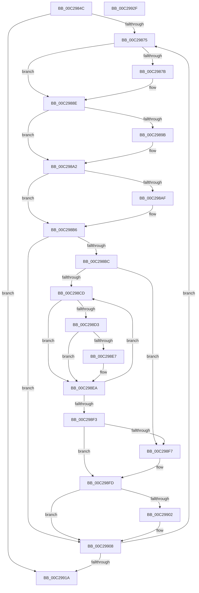

# HvlpDiscoverTopologyComplete

- RVA: `0x00C2984C`–`0x00C29930` (길이 `228` bytes)
- VA: `0x0000000140C2984C`
- 실행 섹션: `INIT`
- PDB 이름 있음: `예`; PDB Function 태그: `아니요`
- unwind 정보 RVA: `0x0005C954`
- 디코드: `61`개 명령, `228/228` bytes 표시
- 미해석 바이트: `0` (있으면 어셈블리에 `.byte`로 보존)

> 이 문서는 커널 이미지의 기계어와 PDB 기호를 분석해 생성했습니다. 4번과 5번은 함수 원형과 자료형을 바이너리 사용 방식에서 추정한 C 해석이며 원본 소스 복구 결과는 아닙니다.

## 1. Dependencies

- 직접 호출 지점: **1**; 고유 호출 대상: **1**
- 직접 호출자로 확인된 함수: **1**
- RIP 상대 이미지 참조: **8**

### Outgoing calls
- `0x00C29889` → [HvlpDiscoverTopologyWorker](../../page/71/HvlpDiscoverTopologyWorker_function_00718384.md) (function, `0x00718384`)

### Direct callers
- [HvlPhase2Initialize](../../text/58/HvlPhase2Initialize_function_00583EA0.md) at `0x00583FAF`

### Static image references
- `0x00C29860` → RVA `0x00FC6C40` (`ALMOSTRO`; read)
- `0x00C29869` → RVA `0x00FC6BA0` (`ALMOSTRO`; read)
- `0x00C29892` → RVA `0x00E3EDC8` (`.data`; read)
- `0x00C2989B` → RVA `0x00E3EDC8` (`.data`; write)
- `0x00C298A6` → RVA `0x00E3EDCC` (`.data`; read)
- `0x00C298AF` → RVA `0x00E3EDCC` (`.data`; write)
- `0x00C298F7` → RVA `0x00FC7004` (`ALMOSTRO`; read/write)
- `0x00C29902` → RVA `0x00FC7000` (`ALMOSTRO`; read/write)

## 2. Other-region calls and transfers

- 다른 실행 섹션으로 향하는 call: **1**
  - `0x00C29889` → [HvlpDiscoverTopologyWorker](../../page/71/HvlpDiscoverTopologyWorker_function_00718384.md) (`INIT` → `PAGE`)
- 별도 외부 분기/꼬리 이동을 확인하지 못했습니다.

## 3. Assembly (complete function range)

```asm
00C2984C  48 89 5C 24 08                  mov qword ptr [rsp + 8], rbx
00C29851  48 89 6C 24 10                  mov qword ptr [rsp + 0x10], rbp
00C29856  48 89 74 24 18                  mov qword ptr [rsp + 0x18], rsi
00C2985B  57                              push rdi
00C2985C  48 83 EC 20                     sub rsp, 0x20
00C29860  48 8B 1D D9 D3 39 00            mov rbx, qword ptr [rip + 0x39d3d9]
00C29867  33 ED                           xor ebp, ebp
00C29869  39 2D 31 D3 39 00               cmp dword ptr [rip + 0x39d331], ebp
00C2986F  0F 84 A5 00 00 00               je 0x140c2991a
00C29875  83 7B 14 FF                     cmp dword ptr [rbx + 0x14], -1
00C29879  75 13                           jne 0x140c2988e
00C2987B  8B 53 08                        mov edx, dword ptr [rbx + 8]
00C2987E  4C 8D 4B 10                     lea r9, [rbx + 0x10]
00C29882  8B 4B 04                        mov ecx, dword ptr [rbx + 4]
00C29885  4C 8D 43 0C                     lea r8, [rbx + 0xc]
00C29889  E8 F6 EA AE FF                  call 0x140718384
00C2988E  44 8B 4B 0C                     mov r9d, dword ptr [rbx + 0xc]
00C29892  44 3B 0D 2F 55 21 00            cmp r9d, dword ptr [rip + 0x21552f]
00C29899  76 07                           jbe 0x140c298a2
00C2989B  44 89 0D 26 55 21 00            mov dword ptr [rip + 0x215526], r9d
00C298A2  44 8B 43 10                     mov r8d, dword ptr [rbx + 0x10]
00C298A6  44 3B 05 1F 55 21 00            cmp r8d, dword ptr [rip + 0x21551f]
00C298AD  76 07                           jbe 0x140c298b6
00C298AF  44 89 05 16 55 21 00            mov dword ptr [rip + 0x215516], r8d
00C298B6  80 7B 62 00                     cmp byte ptr [rbx + 0x62], 0
00C298BA  74 4C                           je 0x140c29908
00C298BC  48 8B 15 7D D3 39 00            mov rdx, qword ptr [rip + 0x39d37d]
00C298C3  B0 01                           mov al, 1
00C298C5  44 8A D0                        mov r10b, al
00C298C8  48 3B D3                        cmp rdx, rbx
00C298CB  74 2A                           je 0x140c298f7
00C298CD  80 7A 62 00                     cmp byte ptr [rdx + 0x62], 0
00C298D1  74 17                           je 0x140c298ea
00C298D3  33 C9                           xor ecx, ecx
00C298D5  0F B6 C0                        movzx eax, al
00C298D8  44 39 4A 0C                     cmp dword ptr [rdx + 0xc], r9d
00C298DC  0F 45 C8                        cmovne ecx, eax
00C298DF  8A C1                           mov al, cl
00C298E1  44 39 42 10                     cmp dword ptr [rdx + 0x10], r8d
00C298E5  75 03                           jne 0x140c298ea
00C298E7  45 32 D2                        xor r10b, r10b
00C298EA  48 83 C2 68                     add rdx, 0x68
00C298EE  48 3B D3                        cmp rdx, rbx
00C298F1  75 DA                           jne 0x140c298cd
00C298F3  84 C0                           test al, al
00C298F5  74 06                           je 0x140c298fd
00C298F7  FF 05 07 D7 39 00               inc dword ptr [rip + 0x39d707]
00C298FD  45 84 D2                        test r10b, r10b
00C29900  74 06                           je 0x140c29908
00C29902  FF 05 F8 D6 39 00               inc dword ptr [rip + 0x39d6f8]
00C29908  FF C5                           inc ebp
00C2990A  48 83 C3 68                     add rbx, 0x68
00C2990E  3B 2D 8C D2 39 00               cmp ebp, dword ptr [rip + 0x39d28c]
00C29914  0F 82 5B FF FF FF               jb 0x140c29875
00C2991A  48 8B 5C 24 30                  mov rbx, qword ptr [rsp + 0x30]
00C2991F  48 8B 6C 24 38                  mov rbp, qword ptr [rsp + 0x38]
00C29924  48 8B 74 24 40                  mov rsi, qword ptr [rsp + 0x40]
00C29929  48 83 C4 20                     add rsp, 0x20
00C2992D  5F                              pop rdi
00C2992E  C3                              ret
00C2992F  CC                              int3
```

## 4. C-style interpretation (structured pseudocode)

```c
__int64 __fastcall HvlpDiscoverTopologyComplete(void)
{
    __int64 result;
    __int64 v_r10;
    __int64 v_rbp;
    __int64 v_rbx;
    __int64 v_rsp;
    unsigned __int64 v_stack_p10;
    unsigned __int64 v_stack_p18;
    unsigned __int64 v_stack_p8;

    v_stack_p8 = v_rbx;
    v_stack_p10 = v_rbp;
    v_stack_p18 = v_rsi;
    v_rsp = (v_rsp) - (32);
    v_rbp = 0;
    if ((*(unsigned int *)(v_rip + 3789617)) == 0) goto loc_00C2991A;
loc_00C29875:
    if ((*(unsigned int *)(*(unsigned __int64 *)(v_rip + 3789785) + 20)) == -1) {
        a2 = *(unsigned int *)(*(unsigned __int64 *)(v_rip + 3789785) + 8);
        a4 = *(unsigned __int64 *)(v_rip + 3789785) + 16;
        a1 = *(unsigned int *)(*(unsigned __int64 *)(v_rip + 3789785) + 4);
        a3 = *(unsigned __int64 *)(v_rip + 3789785) + 12;
        result = HvlpDiscoverTopologyWorker(a1, a2, a3, a4);
    }
    if (((unsigned int)((unsigned int)(*(unsigned int *)(*(unsigned __int64 *)(v_rip + 3789785) + 12)))) >= = (*(unsigned int *)(v_rip + 2184495))) {
        *(unsigned int *)(v_rip + 2184486) = (unsigned int)((unsigned int)(*(unsigned int *)(*(unsigned __int64 *)(v_rip + 3789785) + 12)));
    }
    if (((unsigned int)((unsigned int)(*(unsigned int *)(*(unsigned __int64 *)(v_rip + 3789785) + 16)))) >= = (*(unsigned int *)(v_rip + 2184479))) {
        *(unsigned int *)(v_rip + 2184470) = (unsigned int)((unsigned int)(*(unsigned int *)(*(unsigned __int64 *)(v_rip + 3789785) + 16)));
    }
    if ((*(unsigned __int8 *)(*(unsigned __int64 *)(v_rip + 3789785) + 98)) == 0) goto loc_00C29908;
    if ((*(unsigned __int64 *)(v_rip + 3789693)) == (*(unsigned __int64 *)(v_rip + 3789785))) goto loc_00C298F7;
loc_00C298CD:
    if ((*(unsigned __int8 *)(*(unsigned __int64 *)(v_rip + 3789693) + 98)) == 0) goto loc_00C298EA;
    a1 = 0;
    if ((*(unsigned int *)(*(unsigned __int64 *)(v_rip + 3789693) + 12)) != ((unsigned int)((unsigned int)(*(unsigned int *)(*(unsigned __int64 *)(v_rip + 3789785) + 12))))) { a1 = 1; }
    v_r10 = 1;
    if ((*(unsigned int *)(*(unsigned __int64 *)(v_rip + 3789693) + 16)) == ((unsigned int)((unsigned int)(*(unsigned int *)(*(unsigned __int64 *)(v_rip + 3789785) + 16))))) {
        v_r10 = 0;
    }
    a2 = (*(unsigned __int64 *)(v_rip + 3789693)) + (104);
    if (a2 != (*(unsigned __int64 *)(v_rip + 3789785))) goto loc_00C298CD;
    if ((unsigned __int8)((unsigned __int8)(a1)) != 0) {
    }
    if (0 != 0) {
    }
    v_rbp = (unsigned int)((v_rbp) + 1);
    v_rbx = (*(unsigned __int64 *)(v_rip + 3789785)) + (104);
    if (((unsigned int)(v_rbp)) < (*(unsigned int *)(v_rip + 3789452))) goto loc_00C29875;
loc_00C2991A:
    v_rsp = (v_rsp) + (32);
    return (unsigned __int8)(a1);
}
```

## 5. (Beta) C Style

```c
void HvlpDiscoverTopologyComplete(void)
{
    int64_t result;
    int64_t local_r10;
    int64_t local_rbp;
    int64_t local_rbx;
    int64_t local_rsp;
    uint64_t v_stack_p10;
    uint64_t v_stack_p18;
    uint64_t v_stack_p8;

    v_stack_p8 = local_rbx;
    v_stack_p10 = local_rbp;
    v_stack_p18 = local_rsi;
    local_rsp = (local_rsp) - (32);
    local_rbp = 0;
    if ((*(uint32_t *)(v_rip + 0x39D331)) == 0) goto loc_00C2991A;
loc_00C29875:
    if ((*(uint32_t *)(*(uint64_t *)(v_rip + 0x39D3D9) + 0x14)) == -1) {
        a2 = *(uint32_t *)(*(uint64_t *)(v_rip + 0x39D3D9) + 0x8);
        a4 = *(uint64_t *)(v_rip + 0x39D3D9) + 16;
        a1 = *(uint32_t *)(*(uint64_t *)(v_rip + 0x39D3D9) + 0x4);
        a3 = *(uint64_t *)(v_rip + 0x39D3D9) + 12;
        result = HvlpDiscoverTopologyWorker(a1, a2, a3, a4);
    }
    if (((uint32_t)((uint32_t)(*(uint32_t *)(*(uint64_t *)(v_rip + 0x39D3D9) + 0xC)))) >= = (*(uint32_t *)(v_rip + 0x21552F))) {
        *(uint32_t *)(v_rip + 0x215526) = (uint32_t)((uint32_t)(*(uint32_t *)(*(uint64_t *)(v_rip + 0x39D3D9) + 0xC)));
    }
    if (((uint32_t)((uint32_t)(*(uint32_t *)(*(uint64_t *)(v_rip + 0x39D3D9) + 0x10)))) >= = (*(uint32_t *)(v_rip + 0x21551F))) {
        *(uint32_t *)(v_rip + 0x215516) = (uint32_t)((uint32_t)(*(uint32_t *)(*(uint64_t *)(v_rip + 0x39D3D9) + 0x10)));
    }
    if ((*(uint8_t *)(*(uint64_t *)(v_rip + 0x39D3D9) + 0x62)) == 0) goto loc_00C29908;
    if ((*(uint64_t *)(v_rip + 0x39D37D)) == (*(uint64_t *)(v_rip + 0x39D3D9))) goto loc_00C298F7;
loc_00C298CD:
    if ((*(uint8_t *)(*(uint64_t *)(v_rip + 0x39D37D) + 0x62)) == 0) goto loc_00C298EA;
    a1 = 0;
    if ((*(uint32_t *)(*(uint64_t *)(v_rip + 0x39D37D) + 0xC)) != ((uint32_t)((uint32_t)(*(uint32_t *)(*(uint64_t *)(v_rip + 0x39D3D9) + 0xC))))) { a1 = 1; }
    local_r10 = 1;
    if ((*(uint32_t *)(*(uint64_t *)(v_rip + 0x39D37D) + 0x10)) == ((uint32_t)((uint32_t)(*(uint32_t *)(*(uint64_t *)(v_rip + 0x39D3D9) + 0x10))))) {
        local_r10 = 0;
    }
    a2 = (*(uint64_t *)(v_rip + 0x39D37D)) + (104);
    if (a2 != (*(uint64_t *)(v_rip + 0x39D3D9))) goto loc_00C298CD;
    if ((uint8_t)((uint8_t)(a1)) != 0) {
    }
    if (0 != 0) {
    }
    local_rbp = (uint32_t)((local_rbp) + 1);
    local_rbx = (*(uint64_t *)(v_rip + 0x39D3D9)) + (104);
    if (((uint32_t)(local_rbp)) < (*(uint32_t *)(v_rip + 0x39D28C))) goto loc_00C29875;
loc_00C2991A:
    local_rsp = (local_rsp) + (32);
    return (uint8_t)(a1);
}
```

## 6. Execution-region graph

[열기: 2D/3D 그래프와 함수 탐색 컨트롤 패널](../../../control-panel.html?section=init&rva=0x00C2984C&view=graph)

- 2D 그래프는 위에서 아래로 흐르고, 3D 그래프는 빈 공간을 드래그해 회전합니다. Shift+드래그는 이동, 휠은 확대·축소, 함수 노드 선택은 대상 보고서 이동입니다.

### Static fallback


