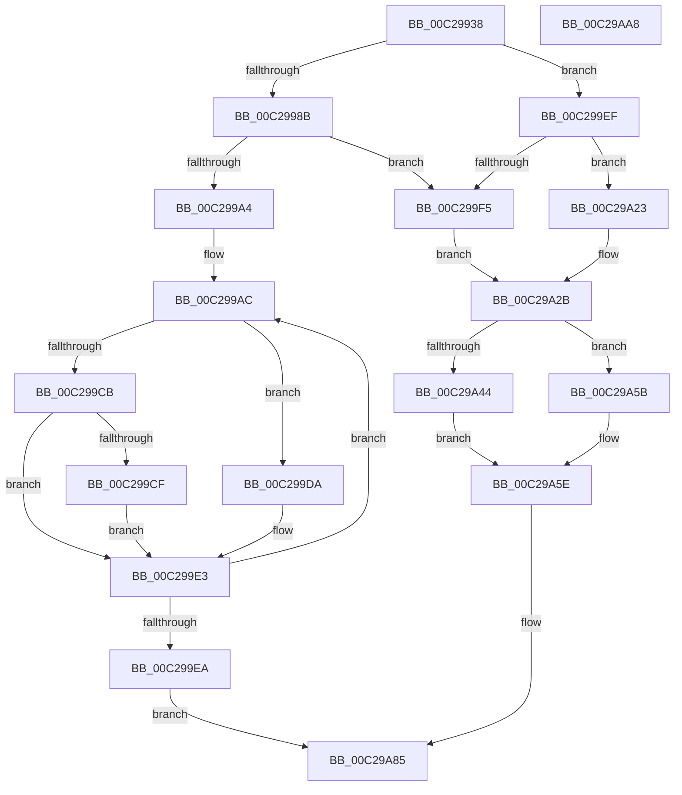

# HvlpDiscoverTopologyIntel

- RVA: `0x00C29938`–`0x00C29AA9` (길이 `369` bytes)
- VA: `0x0000000140C29938`
- 실행 섹션: `INIT`
- PDB 이름 있음: `예`; PDB Function 태그: `아니요`
- unwind 정보 RVA: `0x000C6518`
- 디코드: `116`개 명령, `369/369` bytes 표시
- 미해석 바이트: `0` (있으면 어셈블리에 `.byte`로 보존)

> 이 문서는 커널 이미지의 기계어와 PDB 기호를 분석해 생성했습니다. 4번과 5번은 함수 원형과 자료형을 바이너리 사용 방식에서 추정한 C 해석이며 원본 소스 복구 결과는 아닙니다.

## 1. Dependencies

- 직접 호출 지점: **6**; 고유 호출 대상: **2**
- 직접 호출자로 확인된 함수: **1**
- RIP 상대 이미지 참조: **1**

### Outgoing calls
- `0x00C2997D` → [HvlpLpCpuid](../../page/71/HvlpLpCpuid_function_007183B4.md) (function, `0x007183B4`)
- `0x00C29999` → [HvlpLpCpuid](../../page/71/HvlpLpCpuid_function_007183B4.md) (function, `0x007183B4`)
- `0x00C299BA` → [HvlpLpCpuid](../../page/71/HvlpLpCpuid_function_007183B4.md) (function, `0x007183B4`)
- `0x00C29A02` → [HvlpLpCpuid](../../page/71/HvlpLpCpuid_function_007183B4.md) (function, `0x007183B4`)
- `0x00C29A36` → [HvlpLpCpuid](../../page/71/HvlpLpCpuid_function_007183B4.md) (function, `0x007183B4`)
- `0x00C29A8C` → [_security_check_cookie](../../text/6A/_security_check_cookie_function_006AC640.md) (function, `0x006AC640`)

### Direct callers
- [HvlpDiscoverTopologyWorker](../../page/71/HvlpDiscoverTopologyWorker_function_00718384.md) at `0x0071839C`

### Static image references
- `0x00C29951` → RVA `0x00E0A740` (`.data`; read)

## 2. Other-region calls and transfers

- 다른 실행 섹션으로 향하는 call: **6**
  - `0x00C2997D` → [HvlpLpCpuid](../../page/71/HvlpLpCpuid_function_007183B4.md) (`INIT` → `PAGE`)
  - `0x00C29999` → [HvlpLpCpuid](../../page/71/HvlpLpCpuid_function_007183B4.md) (`INIT` → `PAGE`)
  - `0x00C299BA` → [HvlpLpCpuid](../../page/71/HvlpLpCpuid_function_007183B4.md) (`INIT` → `PAGE`)
  - `0x00C29A02` → [HvlpLpCpuid](../../page/71/HvlpLpCpuid_function_007183B4.md) (`INIT` → `PAGE`)
  - `0x00C29A36` → [HvlpLpCpuid](../../page/71/HvlpLpCpuid_function_007183B4.md) (`INIT` → `PAGE`)
  - `0x00C29A8C` → [_security_check_cookie](../../text/6A/_security_check_cookie_function_006AC640.md) (`INIT` → `.text`)
- 별도 외부 분기/꼬리 이동을 확인하지 못했습니다.

## 3. Assembly (complete function range)

```asm
00C29938  48 89 5C 24 08                  mov qword ptr [rsp + 8], rbx
00C2993D  48 89 74 24 10                  mov qword ptr [rsp + 0x10], rsi
00C29942  55                              push rbp
00C29943  57                              push rdi
00C29944  41 54                           push r12
00C29946  41 56                           push r14
00C29948  41 57                           push r15
00C2994A  48 8B EC                        mov rbp, rsp
00C2994D  48 83 EC 40                     sub rsp, 0x40
00C29951  48 8B 05 E8 0D 1E 00            mov rax, qword ptr [rip + 0x1e0de8]
00C29958  48 33 C4                        xor rax, rsp
00C2995B  48 89 45 F8                     mov qword ptr [rbp - 8], rax
00C2995F  41 89 11                        mov dword ptr [r9], edx
00C29962  4D 8B F9                        mov r15, r9
00C29965  41 89 10                        mov dword ptr [r8], edx
00C29968  4C 8D 4D E8                     lea r9, [rbp - 0x18]
00C2996C  4D 8B F0                        mov r14, r8
00C2996F  0F 57 C0                        xorps xmm0, xmm0
00C29972  45 33 C0                        xor r8d, r8d
00C29975  33 D2                           xor edx, edx
00C29977  8B F1                           mov esi, ecx
00C29979  0F 11 45 E8                     movups xmmword ptr [rbp - 0x18], xmm0
00C2997D  E8 32 EA AE FF                  call 0x1407183b4
00C29982  45 33 E4                        xor r12d, r12d
00C29985  83 7D E8 0B                     cmp dword ptr [rbp - 0x18], 0xb
00C29989  72 64                           jb 0x140c299ef
00C2998B  4C 8D 4D E8                     lea r9, [rbp - 0x18]
00C2998F  45 33 C0                        xor r8d, r8d
00C29992  41 8D 54 24 0B                  lea edx, [r12 + 0xb]
00C29997  8B CE                           mov ecx, esi
00C29999  E8 16 EA AE FF                  call 0x1407183b4
00C2999E  44 39 65 EC                     cmp dword ptr [rbp - 0x14], r12d
00C299A2  74 51                           je 0x140c299f5
00C299A4  41 8B FC                        mov edi, r12d
00C299A7  41 8D 5C 24 01                  lea ebx, [r12 + 1]
00C299AC  4C 8D 4D E8                     lea r9, [rbp - 0x18]
00C299B0  44 8B C7                        mov r8d, edi
00C299B3  BA 0B 00 00 00                  mov edx, 0xb
00C299B8  8B CE                           mov ecx, esi
00C299BA  E8 F5 E9 AE FF                  call 0x1407183b4
00C299BF  8B 45 F0                        mov eax, dword ptr [rbp - 0x10]
00C299C2  03 FB                           add edi, ebx
00C299C4  C1 E8 08                        shr eax, 8
00C299C7  2B C3                           sub eax, ebx
00C299C9  74 0F                           je 0x140c299da
00C299CB  3B C3                           cmp eax, ebx
00C299CD  75 14                           jne 0x140c299e3
00C299CF  8B 4D E8                        mov ecx, dword ptr [rbp - 0x18]
00C299D2  83 E1 1F                        and ecx, 0x1f
00C299D5  41 D3 2E                        shr dword ptr [r14], cl
00C299D8  EB 09                           jmp 0x140c299e3
00C299DA  8B 4D E8                        mov ecx, dword ptr [rbp - 0x18]
00C299DD  83 E1 1F                        and ecx, 0x1f
00C299E0  41 D3 2F                        shr dword ptr [r15], cl
00C299E3  66 44 39 65 EC                  cmp word ptr [rbp - 0x14], r12w
00C299E8  75 C2                           jne 0x140c299ac
00C299EA  E9 96 00 00 00                  jmp 0x140c29a85
00C299EF  83 7D E8 04                     cmp dword ptr [rbp - 0x18], 4
00C299F3  72 2E                           jb 0x140c29a23
00C299F5  45 33 C0                        xor r8d, r8d
00C299F8  4C 8D 4D E8                     lea r9, [rbp - 0x18]
00C299FC  8B CE                           mov ecx, esi
00C299FE  41 8D 50 04                     lea edx, [r8 + 4]
00C29A02  E8 AD E9 AE FF                  call 0x1407183b4
00C29A07  8B 45 E8                        mov eax, dword ptr [rbp - 0x18]
00C29A0A  BB 01 00 00 00                  mov ebx, 1
00C29A0F  C1 E8 1A                        shr eax, 0x1a
00C29A12  8B FB                           mov edi, ebx
00C29A14  8D 04 45 01 00 00 00            lea eax, [rax*2 + 1]
00C29A1B  0F BD C8                        bsr ecx, eax
00C29A1E  40 D2 E7                        shl dil, cl
00C29A21  EB 08                           jmp 0x140c29a2b
00C29A23  BB 01 00 00 00                  mov ebx, 1
00C29A28  40 8A FB                        mov dil, bl
00C29A2B  4C 8D 4D E8                     lea r9, [rbp - 0x18]
00C29A2F  45 33 C0                        xor r8d, r8d
00C29A32  8B D3                           mov edx, ebx
00C29A34  8B CE                           mov ecx, esi
00C29A36  E8 79 E9 AE FF                  call 0x1407183b4
00C29A3B  F7 45 F4 00 00 00 10            test dword ptr [rbp - 0xc], 0x10000000
00C29A42  74 17                           je 0x140c29a5b
00C29A44  8B 45 EC                        mov eax, dword ptr [rbp - 0x14]
00C29A47  C1 E8 10                        shr eax, 0x10
00C29A4A  0F B6 C0                        movzx eax, al
00C29A4D  8D 04 45 FF FF FF FF            lea eax, [rax*2 - 1]
00C29A54  0F BD C8                        bsr ecx, eax
00C29A57  D2 E3                           shl bl, cl
00C29A59  EB 03                           jmp 0x140c29a5e
00C29A5B  40 8A DF                        mov bl, dil
00C29A5E  33 D2                           xor edx, edx
00C29A60  44 0F B6 C3                     movzx r8d, bl
00C29A64  40 0F B6 CF                     movzx ecx, dil
00C29A68  41 8B C0                        mov eax, r8d
00C29A6B  F7 F1                           div ecx
00C29A6D  33 D2                           xor edx, edx
00C29A6F  0F B6 C8                        movzx ecx, al
00C29A72  41 8B 07                        mov eax, dword ptr [r15]
00C29A75  F7 F1                           div ecx
00C29A77  33 D2                           xor edx, edx
00C29A79  41 89 07                        mov dword ptr [r15], eax
00C29A7C  41 8B 06                        mov eax, dword ptr [r14]
00C29A7F  41 F7 F0                        div r8d
00C29A82  41 89 06                        mov dword ptr [r14], eax
00C29A85  48 8B 4D F8                     mov rcx, qword ptr [rbp - 8]
00C29A89  48 33 CC                        xor rcx, rsp
00C29A8C  E8 AF 2B A8 FF                  call 0x1406ac640
00C29A91  48 8B 5C 24 70                  mov rbx, qword ptr [rsp + 0x70]
00C29A96  48 8B 74 24 78                  mov rsi, qword ptr [rsp + 0x78]
00C29A9B  48 83 C4 40                     add rsp, 0x40
00C29A9F  41 5F                           pop r15
00C29AA1  41 5E                           pop r14
00C29AA3  41 5C                           pop r12
00C29AA5  5F                              pop rdi
00C29AA6  5D                              pop rbp
00C29AA7  C3                              ret
00C29AA8  CC                              int3
```

## 4. C-style interpretation (structured pseudocode)

```c
__int64 __fastcall HvlpDiscoverTopologyIntel(int a1, int a2, __int64 a3, __int64 a4)
{
    __int64 result;
    __int64 v_r12;
    __int64 v_rbx;
    __int64 v_rdi;
    __int64 v_rsp;
    unsigned __int64 v_stack_m30;
    unsigned int v_stack_m34;
    unsigned int v_stack_m38;
    unsigned int v_stack_m3C;
    unsigned __int64 v_stack_m40;
    unsigned __int64 v_stack_p10;
    unsigned __int64 v_stack_p8;

    v_stack_p8 = v_rbx;
    v_stack_p10 = v_rsi;
    v_rsp = (v_rsp) - (64);
    result = (*(unsigned __int64 *)(v_rip + 1969640)) ^ (v_rsp);
    v_stack_m30 = result;
    *(unsigned int *)(a4) = a2;
    *(unsigned int *)(a3) = a2;
    a3 = 0;
    a2 = 0;
    v_stack_m40 = v_xmm0;
    result = HvlpLpCpuid(a1, a2, a3, v_stack_m40);
    v_r12 = 0;
    if (v_stack_m40 < 11) goto loc_00C299EF;
    a3 = 0;
    result = HvlpLpCpuid((unsigned int)((unsigned int)((unsigned int)(a1))), v_r12 + 11, a3, v_stack_m40);
    if (v_stack_m3C == 0) goto loc_00C299F5;
loc_00C299AC:
    result = HvlpLpCpuid((unsigned int)((unsigned int)((unsigned int)(a1))), 11, 0, v_stack_m40);
    v_rdi = (unsigned int)((0) + ((unsigned int)(v_r12 + 1)));
    result = (unsigned int)(((unsigned int)(v_stack_m38)) >> (8));
    result = (unsigned int)((result) - ((unsigned int)(v_r12 + 1)));
    if (condition_is_equal) goto loc_00C299DA;
    if (((unsigned int)(result)) != ((unsigned int)(v_r12 + 1))) goto loc_00C299E3;
    a1 = (unsigned int)(((unsigned int)(v_stack_m40)) & (31));
    goto loc_00C299E3;
loc_00C299DA:
    a1 = (unsigned int)(((unsigned int)(v_stack_m40)) & (31));
loc_00C299E3:
    if (v_stack_m3C != 0) goto loc_00C299AC;
    goto loc_00C29A85;
loc_00C299EF:
    if (v_stack_m40 < 4) goto loc_00C29A23;
loc_00C299F5:
    a3 = 0;
    result = HvlpLpCpuid((unsigned int)((unsigned int)((unsigned int)(a1))), a3 + 4, a3, v_stack_m40);
    result = (unsigned int)(((unsigned int)(v_stack_m40)) >> (26));
    v_rdi = (unsigned __int8)((1) << ((unsigned __int8)((unsigned int)((unsigned int)((unsigned int)(a1))))));
    goto loc_00C29A2B;
loc_00C29A23:
loc_00C29A2B:
    a3 = 0;
    result = HvlpLpCpuid((unsigned int)((unsigned int)((unsigned int)(a1))), 1, a3, v_stack_m40);
    if (((v_stack_m34) & (0x10000000ULL)) == 0) goto loc_00C29A5B;
    result = (unsigned int)(((unsigned int)(v_stack_m3C)) >> (16));
    v_rbx = (unsigned __int8)((1) << ((unsigned __int8)((unsigned int)((unsigned int)((unsigned int)(a1))))));
    goto loc_00C29A5E;
loc_00C29A5B:
loc_00C29A5E:
    a2 = 0;
    a2 = 0;
    a2 = 0;
    *(unsigned int *)(a4) = (unsigned int)((unsigned int)(*(unsigned int *)(a4)));
    *(unsigned int *)(a3) = (unsigned int)((unsigned int)(*(unsigned int *)(a3)));
loc_00C29A85:
    a1 = (v_stack_m30) ^ (v_rsp);
    result = _security_check_cookie(a1, a2, 1, v_stack_m40);
    v_rsp = (v_rsp) + (64);
    return result;
}
```

## 5. (Beta) C Style

```c
int64_t HvlpDiscoverTopologyIntel(int32_t Arg1, int32_t Arg2, void *Arg3, void *Arg4)
{
    uint8_t *arg3 = (uint8_t *)Arg3;
    uint8_t *arg4 = (uint8_t *)Arg4;

    int64_t result;
    int64_t local_r12;
    int64_t local_rbx;
    int64_t local_rdi;
    int64_t local_rsp;
    uint64_t v_stack_m30;
    uint32_t v_stack_m34;
    uint32_t v_stack_m38;
    uint32_t v_stack_m3C;
    uint64_t v_stack_m40;
    uint64_t v_stack_p10;
    uint64_t v_stack_p8;

    v_stack_p8 = local_rbx;
    v_stack_p10 = local_rsi;
    local_rsp = (local_rsp) - (64);
    result = (*(uint64_t *)(v_rip + 0x1E0DE8)) ^ (local_rsp);
    v_stack_m30 = result;
    *(uint32_t *)(arg4) = Arg2;
    *(uint32_t *)(arg3) = Arg2;
    Arg3 = 0;
    Arg2 = 0;
    v_stack_m40 = v_xmm0;
    result = HvlpLpCpuid(Arg1, Arg2, Arg3, v_stack_m40);
    local_r12 = 0;
    if (v_stack_m40 < 11) goto loc_00C299EF;
    Arg3 = 0;
    result = HvlpLpCpuid((uint32_t)((uint32_t)((uint32_t)(Arg1))), local_r12 + 11, Arg3, v_stack_m40);
    if (v_stack_m3C == 0) goto loc_00C299F5;
loc_00C299AC:
    result = HvlpLpCpuid((uint32_t)((uint32_t)((uint32_t)(Arg1))), 11, 0, v_stack_m40);
    local_rdi = (uint32_t)((0) + ((uint32_t)(local_r12 + 1)));
    result = (uint32_t)(((uint32_t)(v_stack_m38)) >> (8));
    result = (uint32_t)((result) - ((uint32_t)(local_r12 + 1)));
    if (condition_is_equal) goto loc_00C299DA;
    if (((uint32_t)(result)) != ((uint32_t)(local_r12 + 1))) goto loc_00C299E3;
    Arg1 = (uint32_t)(((uint32_t)(v_stack_m40)) & (31));
    goto loc_00C299E3;
loc_00C299DA:
    Arg1 = (uint32_t)(((uint32_t)(v_stack_m40)) & (31));
loc_00C299E3:
    if (v_stack_m3C != 0) goto loc_00C299AC;
    goto loc_00C29A85;
loc_00C299EF:
    if (v_stack_m40 < 4) goto loc_00C29A23;
loc_00C299F5:
    Arg3 = 0;
    result = HvlpLpCpuid((uint32_t)((uint32_t)((uint32_t)(Arg1))), Arg3 + 4, Arg3, v_stack_m40);
    result = (uint32_t)(((uint32_t)(v_stack_m40)) >> (26));
    local_rdi = (uint8_t)((1) << ((uint8_t)((uint32_t)((uint32_t)((uint32_t)(Arg1))))));
    goto loc_00C29A2B;
loc_00C29A23:
loc_00C29A2B:
    Arg3 = 0;
    result = HvlpLpCpuid((uint32_t)((uint32_t)((uint32_t)(Arg1))), 1, Arg3, v_stack_m40);
    if (((v_stack_m34) & (0x10000000ULL)) == 0) goto loc_00C29A5B;
    result = (uint32_t)(((uint32_t)(v_stack_m3C)) >> (16));
    local_rbx = (uint8_t)((1) << ((uint8_t)((uint32_t)((uint32_t)((uint32_t)(Arg1))))));
    goto loc_00C29A5E;
loc_00C29A5B:
loc_00C29A5E:
    Arg2 = 0;
    Arg2 = 0;
    Arg2 = 0;
    *(uint32_t *)(arg4) = (uint32_t)((uint32_t)(*(uint32_t *)(arg4)));
    *(uint32_t *)(arg3) = (uint32_t)((uint32_t)(*(uint32_t *)(arg3)));
loc_00C29A85:
    Arg1 = (v_stack_m30) ^ (local_rsp);
    result = _security_check_cookie(Arg1, Arg2, 1, v_stack_m40);
    local_rsp = (local_rsp) + (64);
    return result;
}
```

### 관측된 메모리 오프셋

구조체 형식이 확인되지 않은 접근은 인자 기준의 오프셋으로만 기록했습니다.

| 기준 인자 | 오프셋 표현 | 폭 (bit) | 접근 |
|---|---:|---:|---|
| `Arg3` | `+ 0x0` | `32` | `R` |
| `Arg3` | `+ 0x0` | `32` | `R/W` |
| `Arg3` | `+ 0x0` | `32` | `W` |
| `Arg4` | `+ 0x0` | `32` | `R` |
| `Arg4` | `+ 0x0` | `32` | `R/W` |
| `Arg4` | `+ 0x0` | `32` | `W` |

## 6. Execution-region graph

[열기: 2D/3D 그래프와 함수 탐색 컨트롤 패널](../../../control-panel.html?section=init&rva=0x00C29938&view=graph)

- 2D 그래프는 위에서 아래로 흐르고, 3D 그래프는 빈 공간을 드래그해 회전합니다. Shift+드래그는 이동, 휠은 확대·축소, 함수 노드 선택은 대상 보고서 이동입니다.

### Static fallback


