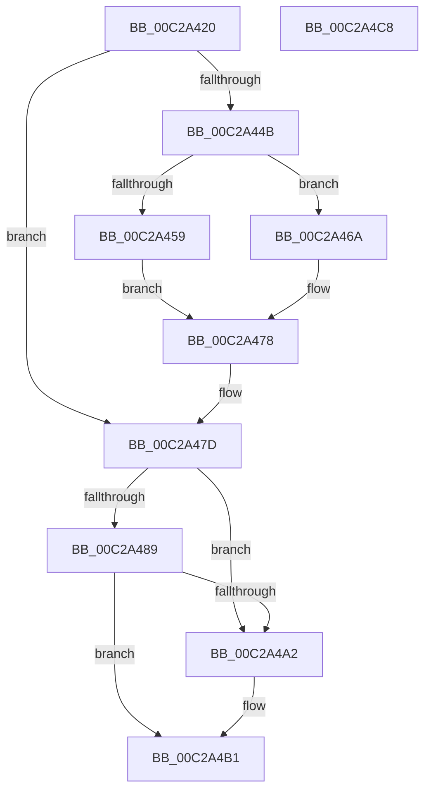

# InbvDriverInitialize

- RVA: `0x00C2A420`–`0x00C2A4C9` (길이 `169` bytes)
- VA: `0x0000000140C2A420`
- 실행 섹션: `INIT`
- PDB 이름 있음: `예`; PDB Function 태그: `아니요`
- unwind 정보 RVA: `0x0005C954`
- 디코드: `47`개 명령, `169/169` bytes 표시
- 미해석 바이트: `0` (있으면 어셈블리에 `.byte`로 보존)

> 이 문서는 커널 이미지의 기계어와 PDB 기호를 분석해 생성했습니다. 4번과 5번은 함수 원형과 자료형을 바이너리 사용 방식에서 추정한 C 해석이며 원본 소스 복구 결과는 아닙니다.

## 1. Dependencies

- 직접 호출 지점: **6**; 고유 호출 대상: **6**
- 직접 호출자로 확인된 함수: **3**
- RIP 상대 이미지 참조: **3**

### Outgoing calls
- `0x00C2A441` → [InbvDetermineFunction](../../text/59/InbvDetermineFunction_function_005901C0.md) (function, `0x005901C0`)
- `0x00C2A450` → [BgkInitialize](../C8/BgkInitialize_function_00C80488.md) (function, `0x00C80488`)
- `0x00C2A478` → [InbvSetFunction](../../text/59/InbvSetFunction_function_00590450.md) (function, `0x00590450`)
- `0x00C2A489` → [strupr](../../text/4F/strupr_function_004FEEE0.md) (function, `0x004FEEE0`)
- `0x00C2A498` → [strstr](../../text/4F/strstr_function_004FF680.md) (function, `0x004FF680`)
- `0x00C2A4AA` → [BvgaDriverInitialize](BvgaDriverInitialize_function_00C2A500.md) (function, `0x00C2A500`)

### Direct callers
- [KiInitializeBootStructures](../../pagelk/B6/KiInitializeBootStructures_function_00B68530.md) at `0x00B68827`
- [InitBootProcessor](../C1/InitBootProcessor_function_00C1B1C8.md) at `0x00C1B7FF`
- [Phase1InitializationDiscard](../C1/Phase1InitializationDiscard_function_00C1C728.md) at `0x00C1CB31`

### Static image references
- `0x00C2A459` → RVA `0x00E65ED0` (`.data`; write)
- `0x00C2A471` → RVA `0x00E65ED0` (`.data`; read/write)
- `0x00C2A48E` → RVA `0x00C798D0` (` ?? ::PBOPGDP::`string'`; read)

## 2. Other-region calls and transfers

- 다른 실행 섹션으로 향하는 call: **4**
  - `0x00C2A441` → [InbvDetermineFunction](../../text/59/InbvDetermineFunction_function_005901C0.md) (`INIT` → `.text`)
  - `0x00C2A478` → [InbvSetFunction](../../text/59/InbvSetFunction_function_00590450.md) (`INIT` → `.text`)
  - `0x00C2A489` → [strupr](../../text/4F/strupr_function_004FEEE0.md) (`INIT` → `.text`)
  - `0x00C2A498` → [strstr](../../text/4F/strstr_function_004FF680.md) (`INIT` → `.text`)
- 별도 외부 분기/꼬리 이동을 확인하지 못했습니다.

## 3. Assembly (complete function range)

```asm
00C2A420  48 89 5C 24 08                  mov qword ptr [rsp + 8], rbx
00C2A425  48 89 6C 24 10                  mov qword ptr [rsp + 0x10], rbp
00C2A42A  48 89 74 24 18                  mov qword ptr [rsp + 0x18], rsi
00C2A42F  57                              push rdi
00C2A430  48 83 EC 20                     sub rsp, 0x20
00C2A434  8B F1                           mov esi, ecx
00C2A436  41 8B E8                        mov ebp, r8d
00C2A439  48 8B CA                        mov rcx, rdx
00C2A43C  48 8B FA                        mov rdi, rdx
00C2A43F  B3 01                           mov bl, 1
00C2A441  E8 7A 5D 96 FF                  call 0x1405901c0
00C2A446  83 F8 02                        cmp eax, 2
00C2A449  74 32                           je 0x140c2a47d
00C2A44B  8B D6                           mov edx, esi
00C2A44D  48 8B CF                        mov rcx, rdi
00C2A450  E8 33 60 05 00                  call 0x140c80488
00C2A455  85 C0                           test eax, eax
00C2A457  78 11                           js 0x140c2a46a
00C2A459  C7 05 6D BA 23 00 02 00 00 00   mov dword ptr [rip + 0x23ba6d], 2
00C2A463  B9 04 00 00 00                  mov ecx, 4
00C2A468  EB 0E                           jmp 0x140c2a478
00C2A46A  32 DB                           xor bl, bl
00C2A46C  B9 03 00 00 00                  mov ecx, 3
00C2A471  83 25 58 BA 23 00 00            and dword ptr [rip + 0x23ba58], 0
00C2A478  E8 D3 5F 96 FF                  call 0x140590450
00C2A47D  48 8B 8F D8 00 00 00            mov rcx, qword ptr [rdi + 0xd8]
00C2A484  48 85 C9                        test rcx, rcx
00C2A487  74 19                           je 0x140c2a4a2
00C2A489  E8 52 4A 8D FF                  call 0x1404feee0
00C2A48E  48 8D 15 3B F4 04 00            lea rdx, [rip + 0x4f43b]
00C2A495  48 8B C8                        mov rcx, rax
00C2A498  E8 E3 51 8D FF                  call 0x1404ff680
00C2A49D  48 85 C0                        test rax, rax
00C2A4A0  75 0F                           jne 0x140c2a4b1
00C2A4A2  44 8B C5                        mov r8d, ebp
00C2A4A5  48 8B D7                        mov rdx, rdi
00C2A4A8  8B CE                           mov ecx, esi
00C2A4AA  E8 51 00 00 00                  call 0x140c2a500
00C2A4AF  8A D8                           mov bl, al
00C2A4B1  48 8B 6C 24 38                  mov rbp, qword ptr [rsp + 0x38]
00C2A4B6  8A C3                           mov al, bl
00C2A4B8  48 8B 5C 24 30                  mov rbx, qword ptr [rsp + 0x30]
00C2A4BD  48 8B 74 24 40                  mov rsi, qword ptr [rsp + 0x40]
00C2A4C2  48 83 C4 20                     add rsp, 0x20
00C2A4C6  5F                              pop rdi
00C2A4C7  C3                              ret
00C2A4C8  CC                              int3
```

## 4. C-style interpretation (structured pseudocode)

```c
__int64 __fastcall InbvDriverInitialize(int a1, __int64 a2, int a3)
{
    __int64 result;
    __int64 v_rbx;
    __int64 v_rsp;
    unsigned __int64 v_stack_p10;
    unsigned __int64 v_stack_p18;
    unsigned __int64 v_stack_p8;

    v_stack_p8 = v_rbx;
    v_stack_p10 = v_rbp;
    v_stack_p18 = v_rsi;
    v_rsp = (v_rsp) - (32);
    result = InbvDetermineFunction(a2, a2, a3, a4);
    if (((unsigned int)(result)) == 2) goto loc_00C2A47D;
    result = BgkInitialize(a2, (unsigned int)((unsigned int)((unsigned int)(a1))), a3, a4);
    if (sign_flag) goto loc_00C2A46A;
    *(unsigned int *)(v_rip + 2341485) = 2;
    goto loc_00C2A478;
loc_00C2A46A:
    v_rbx = 0;
loc_00C2A478:
    result = InbvSetFunction(3, (unsigned int)((unsigned int)((unsigned int)(a1))), a3, a4);
loc_00C2A47D:
    if (*(unsigned __int64 *)(a2 + 216) == 0) goto loc_00C2A4A2;
    result = strupr(*(unsigned __int64 *)(a2 + 216), (unsigned int)((unsigned int)((unsigned int)(a1))), a3, a4);
    result = strstr(result, v_rip + 324667, a3, a4);
    if (result == 0) {
        a3 = (unsigned int)((unsigned int)(a3));
        a2 = a2;
        a1 = (unsigned int)((unsigned int)(a1));
        result = BvgaDriverInitialize(a1, a2, a3, a4);
        v_rbx = (unsigned __int8)(result);
    }
    v_rsp = (v_rsp) + (32);
    return (unsigned __int8)(v_rbx);
}
```

## 5. (Beta) C Style

```c
int64_t InbvDriverInitialize(int32_t Arg1, void *Arg2, int32_t Arg3)
{
    uint8_t *arg2 = (uint8_t *)Arg2;

    int64_t result;
    int64_t local_rbx;
    int64_t local_rsp;
    uint64_t v_stack_p10;
    uint64_t v_stack_p18;
    uint64_t v_stack_p8;

    v_stack_p8 = local_rbx;
    v_stack_p10 = local_rbp;
    v_stack_p18 = local_rsi;
    local_rsp = (local_rsp) - (32);
    result = InbvDetermineFunction(Arg2, Arg2, Arg3, a4);
    if (((uint32_t)(result)) == 2) goto loc_00C2A47D;
    result = BgkInitialize(Arg2, (uint32_t)((uint32_t)((uint32_t)(Arg1))), Arg3, a4);
    if (sign_flag) goto loc_00C2A46A;
    *(uint32_t *)(v_rip + 0x23BA6D) = 2;
    goto loc_00C2A478;
loc_00C2A46A:
    local_rbx = 0;
loc_00C2A478:
    result = InbvSetFunction(3, (uint32_t)((uint32_t)((uint32_t)(Arg1))), Arg3, a4);
loc_00C2A47D:
    if (*(uint64_t *)(arg2 + 0xD8) == 0) goto loc_00C2A4A2;
    result = strupr(*(uint64_t *)(arg2 + 0xD8), (uint32_t)((uint32_t)((uint32_t)(Arg1))), Arg3, a4);
    result = strstr(result, v_rip + 324667, Arg3, a4);
    if (result == 0) {
        Arg3 = (uint32_t)((uint32_t)(Arg3));
        Arg2 = Arg2;
        Arg1 = (uint32_t)((uint32_t)(Arg1));
        result = BvgaDriverInitialize(Arg1, Arg2, Arg3, a4);
        local_rbx = (uint8_t)(result);
    }
    local_rsp = (local_rsp) + (32);
    return (uint8_t)(local_rbx);
}
```

### 관측된 메모리 오프셋

구조체 형식이 확인되지 않은 접근은 인자 기준의 오프셋으로만 기록했습니다.

| 기준 인자 | 오프셋 표현 | 폭 (bit) | 접근 |
|---|---:|---:|---|
| `Arg2` | `+ 0xD8` | `64` | `R` |

## 6. Execution-region graph

[열기: 2D/3D 그래프와 함수 탐색 컨트롤 패널](../../../control-panel.html?section=init&rva=0x00C2A420&view=graph)

- 2D 그래프는 위에서 아래로 흐르고, 3D 그래프는 빈 공간을 드래그해 회전합니다. Shift+드래그는 이동, 휠은 확대·축소, 함수 노드 선택은 대상 보고서 이동입니다.

### Static fallback


