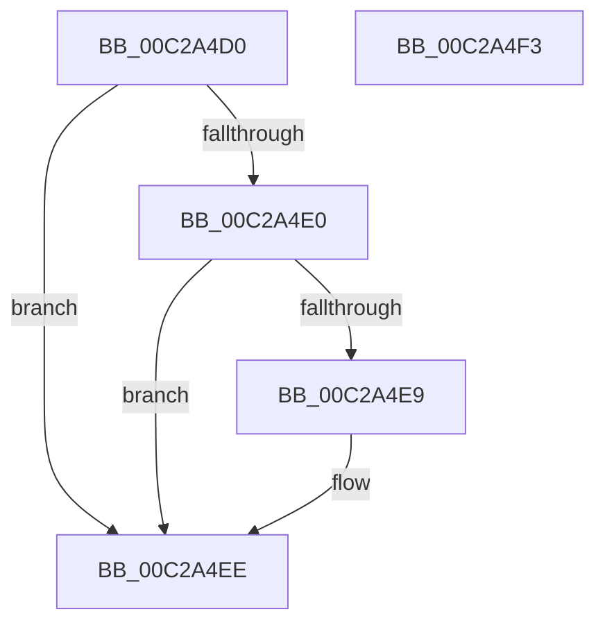

# InbvIndicateProgress

- RVA: `0x00C2A4D0`–`0x00C2A4F4` (길이 `36` bytes)
- VA: `0x0000000140C2A4D0`
- 실행 섹션: `INIT`
- PDB 이름 있음: `예`; PDB Function 태그: `아니요`
- unwind 정보 RVA: `0x0005C788`
- 디코드: `11`개 명령, `36/36` bytes 표시
- 미해석 바이트: `0` (있으면 어셈블리에 `.byte`로 보존)

> 이 문서는 커널 이미지의 기계어와 PDB 기호를 분석해 생성했습니다. 4번과 5번은 함수 원형과 자료형을 바이너리 사용 방식에서 추정한 C 해석이며 원본 소스 복구 결과는 아닙니다.

## 1. Dependencies

- 직접 호출 지점: **1**; 고유 호출 대상: **1**
- 직접 호출자로 확인된 함수: **2**
- RIP 상대 이미지 참조: **1**

### Outgoing calls
- `0x00C2A4E9` → [guard_dispatch_icall](../../text/6B/guard_dispatch_icall_function_006BAAD0.md) (function, `0x006BAAD0`)

### Direct callers
- [IopInitializeSystemDrivers](../C7/IopInitializeSystemDrivers_function_00C73590.md) at `0x00C73749`
- [IopInitializeBuiltinDriver](../C7/IopInitializeBuiltinDriver_function_00C7625C.md) at `0x00C763EC`
- [IopInitializeBuiltinDriver](../C7/IopInitializeBuiltinDriver_function_00C7625C.md) at `0x00C763F3`

### Static image references
- `0x00C2A4D4` → RVA `0x00E65E58` (`.data`; read)

## 2. Other-region calls and transfers

- 다른 실행 섹션으로 향하는 call: **1**
  - `0x00C2A4E9` → [guard_dispatch_icall](../../text/6B/guard_dispatch_icall_function_006BAAD0.md) (`INIT` → `.text`)
- 별도 외부 분기/꼬리 이동을 확인하지 못했습니다.

## 3. Assembly (complete function range)

```asm
00C2A4D0  48 83 EC 28                     sub rsp, 0x28
00C2A4D4  48 8B 05 7D B9 23 00            mov rax, qword ptr [rip + 0x23b97d]
00C2A4DB  48 85 C0                        test rax, rax
00C2A4DE  74 0E                           je 0x140c2a4ee
00C2A4E0  48 8B 40 78                     mov rax, qword ptr [rax + 0x78]
00C2A4E4  48 85 C0                        test rax, rax
00C2A4E7  74 05                           je 0x140c2a4ee
00C2A4E9  E8 E2 05 A9 FF                  call 0x1406baad0
00C2A4EE  48 83 C4 28                     add rsp, 0x28
00C2A4F2  C3                              ret
00C2A4F3  CC                              int3
```

## 4. C-style interpretation (structured pseudocode)

```c
__int64 __fastcall InbvIndicateProgress(void)
{
    __int64 result;
    __int64 v_rsp;

    v_rsp = (v_rsp) - (40);
    if (*(unsigned __int64 *)(v_rip + 2341245) == 0) goto loc_00C2A4EE;
    result = *(unsigned __int64 *)(*(unsigned __int64 *)(v_rip + 2341245) + 120);
    if (*(unsigned __int64 *)(*(unsigned __int64 *)(v_rip + 2341245) + 120) != 0) {
        result = guard_dispatch_icall(a1, a2, a3, a4);
    }
    v_rsp = (v_rsp) + (40);
    return result;
}
```

## 5. (Beta) C Style

```c
void InbvIndicateProgress(void)
{
    int64_t result;
    int64_t local_rsp;

    local_rsp = (local_rsp) - (40);
    if (*(uint64_t *)(v_rip + 0x23B97D) == 0) goto loc_00C2A4EE;
    result = *(uint64_t *)(*(uint64_t *)(v_rip + 0x23B97D) + 0x78);
    if (*(uint64_t *)(*(uint64_t *)(v_rip + 0x23B97D) + 0x78) != 0) {
        result = guard_dispatch_icall(a1, a2, a3, a4);
    }
    local_rsp = (local_rsp) + (40);
    return result;
}
```

## 6. Execution-region graph

[열기: 2D/3D 그래프와 함수 탐색 컨트롤 패널](../../../control-panel.html?section=init&rva=0x00C2A4D0&view=graph)

- 2D 그래프는 위에서 아래로 흐르고, 3D 그래프는 빈 공간을 드래그해 회전합니다. Shift+드래그는 이동, 휠은 확대·축소, 함수 노드 선택은 대상 보고서 이동입니다.

### Static fallback


