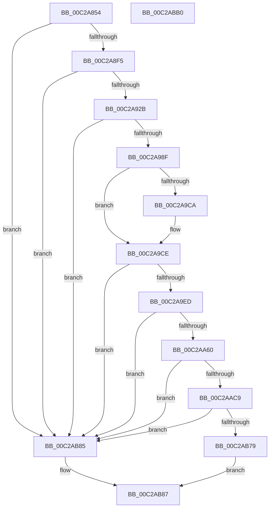

# IoCreateObjectTypes

- RVA: `0x00C2A854`–`0x00C2ABB1` (길이 `861` bytes)
- VA: `0x0000000140C2A854`
- 실행 섹션: `INIT`
- PDB 이름 있음: `예`; PDB Function 태그: `아니요`
- unwind 정보 RVA: `0x000C7324`
- 디코드: `188`개 명령, `861/861` bytes 표시
- 미해석 바이트: `0` (있으면 어셈블리에 `.byte`로 보존)

> 이 문서는 커널 이미지의 기계어와 PDB 기호를 분석해 생성했습니다. 4번과 5번은 함수 원형과 자료형을 바이너리 사용 방식에서 추정한 C 해석이며 원본 소스 복구 결과는 아닙니다.

## 1. Dependencies

- 직접 호출 지점: **17**; 고유 호출 대상: **6**
- 직접 호출자로 확인된 함수: **1**
- RIP 상대 이미지 참조: **30**

### Outgoing calls
- `0x00C2A896` → [memset](../../text/6C/memset_function_006C6C40.md) (function, `0x006C6C40`)
- `0x00C2A8CF` → [RtlInitUnicodeString](../../text/42/RtlInitUnicodeString_function_0042A780.md) (function, `0x0042A780`)
- `0x00C2A8E6` → [ObCreateObjectType](../../page/70/ObCreateObjectType_function_00705230.md) (function, `0x00705230`)
- `0x00C2A900` → [RtlInitUnicodeString](../../text/42/RtlInitUnicodeString_function_0042A780.md) (function, `0x0042A780`)
- `0x00C2A91E` → [ObCreateObjectType](../../page/70/ObCreateObjectType_function_00705230.md) (function, `0x00705230`)
- `0x00C2A936` → [RtlInitUnicodeString](../../text/42/RtlInitUnicodeString_function_0042A780.md) (function, `0x0042A780`)
- `0x00C2A982` → [ObCreateObjectType](../../page/70/ObCreateObjectType_function_00705230.md) (function, `0x00705230`)
- `0x00C2A99A` → [RtlInitUnicodeString](../../text/42/RtlInitUnicodeString_function_0042A780.md) (function, `0x0042A780`)
- `0x00C2A9E0` → [ObCreateObjectType](../../page/70/ObCreateObjectType_function_00705230.md) (function, `0x00705230`)
- `0x00C2A9F8` → [RtlInitUnicodeString](../../text/42/RtlInitUnicodeString_function_0042A780.md) (function, `0x0042A780`)
- `0x00C2AA53` → [ObCreateObjectType](../../page/70/ObCreateObjectType_function_00705230.md) (function, `0x00705230`)
- `0x00C2AA6B` → [RtlInitUnicodeString](../../text/42/RtlInitUnicodeString_function_0042A780.md) (function, `0x0042A780`)
- `0x00C2AABC` → [ObCreateObjectType](../../page/70/ObCreateObjectType_function_00705230.md) (function, `0x00705230`)
- `0x00C2AAD4` → [RtlInitUnicodeString](../../text/42/RtlInitUnicodeString_function_0042A780.md) (function, `0x0042A780`)
- `0x00C2AB70` → [ObCreateObjectTypeEx](../../page/AB/ObCreateObjectTypeEx_function_00AB46D0.md) (function, `0x00AB46D0`)
- `0x00C2AB79` → [IopCreateIoRingObjectType](IopCreateIoRingObjectType_function_00C2E2D4.md) (function, `0x00C2E2D4`)
- `0x00C2AB8E` → [_security_check_cookie](../../text/6A/_security_check_cookie_function_006AC640.md) (function, `0x006AC640`)

### Direct callers
- [Phase1InitializationDiscard](../C1/Phase1InitializationDiscard_function_00C1C728.md) at `0x00C1D203`

### Static image references
- `0x00C2A873` → RVA `0x00E0A740` (`.data`; read)
- `0x00C2A89B` → RVA `0x00B4B110` (`IopFileMapping`; read)
- `0x00C2A8A6` → RVA `0x00C799F0` (` ?? ::PBOPGDP::`string'`; read)
- `0x00C2A8D4` → RVA `0x00FC73A0` (`ALMOSTRO`; read)
- `0x00C2A8F5` → RVA `0x00C799D0` (` ?? ::PBOPGDP::`string'`; read)
- `0x00C2A905` → RVA `0x00FC7320` (`ALMOSTRO`; read)
- `0x00C2A92B` → RVA `0x00C79A80` (` ?? ::PBOPGDP::`string'`; read)
- `0x00C2A93F` → RVA `0x0089E510` (`IopParseDevice`; read)
- `0x00C2A94A` → RVA `0x00873A80` (`IopGetSetSecurityObject`; read)
- `0x00C2A955` → RVA `0x00FC6EE0` (`ALMOSTRO`; read)
- `0x00C2A95C` → RVA `0x00A066B0` (`IopDeleteDevice`; read)
- `0x00C2A98F` → RVA `0x00C79A70` (` ?? ::PBOPGDP::`string'`; read)
- `0x00C2A9A3` → RVA `0x00AA2E50` (`IopDeleteDriver`; read)
- `0x00C2A9AE` → RVA `0x00E681A0` (`.data`; read)
- `0x00C2A9CE` → RVA `0x00FC6C78` (`ALMOSTRO`; read)
- `0x00C2A9ED` → RVA `0x00C79A50` (` ?? ::PBOPGDP::`string'`; read)
- `0x00C2A9FD` → RVA `0x00C826E0` (`IopCompletionMapping`; read)
- `0x00C2AA04` → RVA `0x00A48E70` (`IopCloseIoCompletion`; read)
- `0x00C2AA16` → RVA `0x00FC6CC0` (`ALMOSTRO`; read)
- `0x00C2AA1D` → RVA `0x00A5FCF0` (`IopDeleteIoCompletion`; read)
- `0x00C2AA60` → RVA `0x00C79A20` (` ?? ::PBOPGDP::`string'`; read)
- `0x00C2AA70` → RVA `0x00C826D0` (`IopWaitCompletionMapping`; read)
- `0x00C2AA77` → RVA `0x0042F520` (`IopCloseWaitCompletionPacket`; read)
- `0x00C2AA89` → RVA `0x00FC7080` (`ALMOSTRO`; read)
- `0x00C2AAC9` → RVA `0x00C79AF0` (` ?? ::PBOPGDP::`string'`; read)
- `0x00C2AAE4` → RVA `0x008640C0` (`IopCloseFile`; read)
- `0x00C2AAF4` → RVA `0x00863E00` (`IopDeleteFile`; read)
- `0x00C2AB0A` → RVA `0x009FDB60` (`IopParseFile`; read)
- `0x00C2AB20` → RVA `0x008A8990` (`IopQueryName`; read)
- `0x00C2AB4D` → RVA `0x00FC6AE0` (`ALMOSTRO`; read)

## 2. Other-region calls and transfers

- 다른 실행 섹션으로 향하는 call: **16**
  - `0x00C2A896` → [memset](../../text/6C/memset_function_006C6C40.md) (`INIT` → `.text`)
  - `0x00C2A8CF` → [RtlInitUnicodeString](../../text/42/RtlInitUnicodeString_function_0042A780.md) (`INIT` → `.text`)
  - `0x00C2A8E6` → [ObCreateObjectType](../../page/70/ObCreateObjectType_function_00705230.md) (`INIT` → `PAGE`)
  - `0x00C2A900` → [RtlInitUnicodeString](../../text/42/RtlInitUnicodeString_function_0042A780.md) (`INIT` → `.text`)
  - `0x00C2A91E` → [ObCreateObjectType](../../page/70/ObCreateObjectType_function_00705230.md) (`INIT` → `PAGE`)
  - `0x00C2A936` → [RtlInitUnicodeString](../../text/42/RtlInitUnicodeString_function_0042A780.md) (`INIT` → `.text`)
  - `0x00C2A982` → [ObCreateObjectType](../../page/70/ObCreateObjectType_function_00705230.md) (`INIT` → `PAGE`)
  - `0x00C2A99A` → [RtlInitUnicodeString](../../text/42/RtlInitUnicodeString_function_0042A780.md) (`INIT` → `.text`)
  - `0x00C2A9E0` → [ObCreateObjectType](../../page/70/ObCreateObjectType_function_00705230.md) (`INIT` → `PAGE`)
  - `0x00C2A9F8` → [RtlInitUnicodeString](../../text/42/RtlInitUnicodeString_function_0042A780.md) (`INIT` → `.text`)
  - `0x00C2AA53` → [ObCreateObjectType](../../page/70/ObCreateObjectType_function_00705230.md) (`INIT` → `PAGE`)
  - `0x00C2AA6B` → [RtlInitUnicodeString](../../text/42/RtlInitUnicodeString_function_0042A780.md) (`INIT` → `.text`)
  - `0x00C2AABC` → [ObCreateObjectType](../../page/70/ObCreateObjectType_function_00705230.md) (`INIT` → `PAGE`)
  - `0x00C2AAD4` → [RtlInitUnicodeString](../../text/42/RtlInitUnicodeString_function_0042A780.md) (`INIT` → `.text`)
  - `0x00C2AB70` → [ObCreateObjectTypeEx](../../page/AB/ObCreateObjectTypeEx_function_00AB46D0.md) (`INIT` → `PAGE`)
  - `0x00C2AB8E` → [_security_check_cookie](../../text/6A/_security_check_cookie_function_006AC640.md) (`INIT` → `.text`)
- 별도 외부 분기/꼬리 이동을 확인하지 못했습니다.

## 3. Assembly (complete function range)

```asm
00C2A854  48 8B C4                        mov rax, rsp
00C2A857  48 89 58 08                     mov qword ptr [rax + 8], rbx
00C2A85B  48 89 78 10                     mov qword ptr [rax + 0x10], rdi
00C2A85F  4C 89 60 18                     mov qword ptr [rax + 0x18], r12
00C2A863  4C 89 70 20                     mov qword ptr [rax + 0x20], r14
00C2A867  55                              push rbp
00C2A868  48 8D 68 A1                     lea rbp, [rax - 0x5f]
00C2A86C  48 81 EC D0 00 00 00            sub rsp, 0xd0
00C2A873  48 8B 05 C6 FE 1D 00            mov rax, qword ptr [rip + 0x1dfec6]
00C2A87A  48 33 C4                        xor rax, rsp
00C2A87D  48 89 45 47                     mov qword ptr [rbp + 0x47], rax
00C2A881  0F 57 C0                        xorps xmm0, xmm0
00C2A884  48 8D 4D C7                     lea rcx, [rbp - 0x39]
00C2A888  BB 78 00 00 00                  mov ebx, 0x78
00C2A88D  33 D2                           xor edx, edx
00C2A88F  44 8B C3                        mov r8d, ebx
00C2A892  0F 11 45 B7                     movups xmmword ptr [rbp - 0x49], xmm0
00C2A896  E8 A5 C3 A9 FF                  call 0x1406c6c40
00C2A89B  0F 10 05 6E 08 F2 FF            movups xmm0, xmmword ptr [rip - 0xdf792]
00C2A8A2  80 4D C9 04                     or byte ptr [rbp - 0x37], 4
00C2A8A6  48 8D 15 43 F1 04 00            lea rdx, [rip + 0x4f143]
00C2A8AD  48 8D 4D B7                     lea rcx, [rbp - 0x49]
00C2A8B1  66 89 5D C7                     mov word ptr [rbp - 0x39], bx
00C2A8B5  F3 0F 7F 45 D3                  movdqu xmmword ptr [rbp - 0x2d], xmm0
00C2A8BA  C7 45 CF 00 01 00 00            mov dword ptr [rbp - 0x31], 0x100
00C2A8C1  C7 45 EB 00 02 00 00            mov dword ptr [rbp - 0x15], 0x200
00C2A8C8  C7 45 E3 FF 01 1F 00            mov dword ptr [rbp - 0x1d], 0x1f01ff
00C2A8CF  E8 AC FE 7F FF                  call 0x14042a780
00C2A8D4  4C 8D 0D C5 CA 39 00            lea r9, [rip + 0x39cac5]
00C2A8DB  45 33 C0                        xor r8d, r8d
00C2A8DE  48 8D 55 C7                     lea rdx, [rbp - 0x39]
00C2A8E2  48 8D 4D B7                     lea rcx, [rbp - 0x49]
00C2A8E6  E8 45 A9 AD FF                  call 0x140705230
00C2A8EB  33 DB                           xor ebx, ebx
00C2A8ED  85 C0                           test eax, eax
00C2A8EF  0F 88 90 02 00 00               js 0x140c2ab85
00C2A8F5  48 8D 15 D4 F0 04 00            lea rdx, [rip + 0x4f0d4]
00C2A8FC  48 8D 4D B7                     lea rcx, [rbp - 0x49]
00C2A900  E8 7B FE 7F FF                  call 0x14042a780
00C2A905  4C 8D 0D 14 CA 39 00            lea r9, [rip + 0x39ca14]
00C2A90C  C7 45 F3 48 00 00 00            mov dword ptr [rbp - 0xd], 0x48
00C2A913  45 33 C0                        xor r8d, r8d
00C2A916  48 8D 55 C7                     lea rdx, [rbp - 0x39]
00C2A91A  48 8D 4D B7                     lea rcx, [rbp - 0x49]
00C2A91E  E8 0D A9 AD FF                  call 0x140705230
00C2A923  85 C0                           test eax, eax
00C2A925  0F 88 5A 02 00 00               js 0x140c2ab85
00C2A92B  48 8D 15 4E F1 04 00            lea rdx, [rip + 0x4f14e]
00C2A932  48 8D 4D B7                     lea rcx, [rbp - 0x49]
00C2A936  E8 45 FE 7F FF                  call 0x14042a780
00C2A93B  80 4D C9 01                     or byte ptr [rbp - 0x37], 1
00C2A93F  48 8D 05 CA 3B C7 FF            lea rax, [rip - 0x38c436]
00C2A946  80 4D CA 01                     or byte ptr [rbp - 0x36], 1
00C2A94A  4C 8D 35 2F 91 C4 FF            lea r14, [rip - 0x3b6ed1]
00C2A951  48 89 45 17                     mov qword ptr [rbp + 0x17], rax
00C2A955  4C 8D 0D 84 C5 39 00            lea r9, [rip + 0x39c584]
00C2A95C  48 8D 05 4D BD DD FF            lea rax, [rip - 0x2242b3]
00C2A963  4C 89 75 1F                     mov qword ptr [rbp + 0x1f], r14
00C2A967  BF 50 01 00 00                  mov edi, 0x150
00C2A96C  48 89 45 0F                     mov qword ptr [rbp + 0xf], rax
00C2A970  45 33 C0                        xor r8d, r8d
00C2A973  89 7D F3                        mov dword ptr [rbp - 0xd], edi
00C2A976  48 8D 55 C7                     lea rdx, [rbp - 0x39]
00C2A97A  48 89 5D 27                     mov qword ptr [rbp + 0x27], rbx
00C2A97E  48 8D 4D B7                     lea rcx, [rbp - 0x49]
00C2A982  E8 A9 A8 AD FF                  call 0x140705230
00C2A987  85 C0                           test eax, eax
00C2A989  0F 88 F6 01 00 00               js 0x140c2ab85
00C2A98F  48 8D 15 DA F0 04 00            lea rdx, [rip + 0x4f0da]
00C2A996  48 8D 4D B7                     lea rcx, [rbp - 0x49]
00C2A99A  E8 E1 FD 7F FF                  call 0x14042a780
00C2A99F  80 65 CA FE                     and byte ptr [rbp - 0x36], 0xfe
00C2A9A3  48 8D 05 A6 84 E7 FF            lea rax, [rip - 0x187b5a]
00C2A9AA  48 89 45 0F                     mov qword ptr [rbp + 0xf], rax
00C2A9AE  8B 05 EC D7 23 00               mov eax, dword ptr [rip + 0x23d7ec]
00C2A9B4  89 7D F3                        mov dword ptr [rbp - 0xd], edi
00C2A9B7  8D 7B 20                        lea edi, [rbx + 0x20]
00C2A9BA  48 89 5D 17                     mov qword ptr [rbp + 0x17], rbx
00C2A9BE  48 89 5D 1F                     mov qword ptr [rbp + 0x1f], rbx
00C2A9C2  48 89 5D 27                     mov qword ptr [rbp + 0x27], rbx
00C2A9C6  A8 10                           test al, 0x10
00C2A9C8  74 04                           je 0x140c2a9ce
00C2A9CA  40 08 7D C9                     or byte ptr [rbp - 0x37], dil
00C2A9CE  4C 8D 0D A3 C2 39 00            lea r9, [rip + 0x39c2a3]
00C2A9D5  45 33 C0                        xor r8d, r8d
00C2A9D8  48 8D 55 C7                     lea rdx, [rbp - 0x39]
00C2A9DC  48 8D 4D B7                     lea rcx, [rbp - 0x49]
00C2A9E0  E8 4B A8 AD FF                  call 0x140705230
00C2A9E5  85 C0                           test eax, eax
00C2A9E7  0F 88 98 01 00 00               js 0x140c2ab85
00C2A9ED  48 8D 15 5C F0 04 00            lea rdx, [rip + 0x4f05c]
00C2A9F4  48 8D 4D B7                     lea rcx, [rbp - 0x49]
00C2A9F8  E8 83 FD 7F FF                  call 0x14042a780
00C2A9FD  0F 10 05 DC 7C 05 00            movups xmm0, xmmword ptr [rip + 0x57cdc]
00C2AA04  48 8D 05 65 E4 E1 FF            lea rax, [rip - 0x1e1b9b]
00C2AA0B  C7 45 CF 10 01 00 00            mov dword ptr [rbp - 0x31], 0x110
00C2AA12  48 89 45 07                     mov qword ptr [rbp + 7], rax
00C2AA16  4C 8D 0D A3 C2 39 00            lea r9, [rip + 0x39c2a3]
00C2AA1D  48 8D 05 CC 52 E3 FF            lea rax, [rip - 0x1cad34]
00C2AA24  C7 45 E3 03 00 1F 00            mov dword ptr [rbp - 0x1d], 0x1f0003
00C2AA2B  48 89 45 0F                     mov qword ptr [rbp + 0xf], rax
00C2AA2F  48 8D 55 C7                     lea rdx, [rbp - 0x39]
00C2AA33  8A 45 C9                        mov al, byte ptr [rbp - 0x37]
00C2AA36  48 8D 4D B7                     lea rcx, [rbp - 0x49]
00C2AA3A  24 FB                           and al, 0xfb
00C2AA3C  41 BC 50 00 00 00               mov r12d, 0x50
00C2AA42  0C 80                           or al, 0x80
00C2AA44  44 89 65 F3                     mov dword ptr [rbp - 0xd], r12d
00C2AA48  45 33 C0                        xor r8d, r8d
00C2AA4B  88 45 C9                        mov byte ptr [rbp - 0x37], al
00C2AA4E  F3 0F 7F 45 D3                  movdqu xmmword ptr [rbp - 0x2d], xmm0
00C2AA53  E8 D8 A7 AD FF                  call 0x140705230
00C2AA58  85 C0                           test eax, eax
00C2AA5A  0F 88 25 01 00 00               js 0x140c2ab85
00C2AA60  48 8D 15 B9 EF 04 00            lea rdx, [rip + 0x4efb9]
00C2AA67  48 8D 4D B7                     lea rcx, [rbp - 0x49]
00C2AA6B  E8 10 FD 7F FF                  call 0x14042a780
00C2AA70  0F 10 05 59 7C 05 00            movups xmm0, xmmword ptr [rip + 0x57c59]
00C2AA77  48 8D 05 A2 4A 80 FF            lea rax, [rip - 0x7fb55e]
00C2AA7E  C7 45 F3 70 00 00 00            mov dword ptr [rbp - 0xd], 0x70
00C2AA85  48 89 45 07                     mov qword ptr [rbp + 7], rax
00C2AA89  4C 8D 0D F0 C5 39 00            lea r9, [rip + 0x39c5f0]
00C2AA90  8A 45 C9                        mov al, byte ptr [rbp - 0x37]
00C2AA93  48 8D 55 C7                     lea rdx, [rbp - 0x39]
00C2AA97  24 7B                           and al, 0x7b
00C2AA99  C7 45 CF 10 01 00 00            mov dword ptr [rbp - 0x31], 0x110
00C2AAA0  0C 04                           or al, 4
00C2AAA2  C7 45 E3 01 00 0F 00            mov dword ptr [rbp - 0x1d], 0xf0001
00C2AAA9  45 33 C0                        xor r8d, r8d
00C2AAAC  88 45 C9                        mov byte ptr [rbp - 0x37], al
00C2AAAF  48 8D 4D B7                     lea rcx, [rbp - 0x49]
00C2AAB3  48 89 5D 0F                     mov qword ptr [rbp + 0xf], rbx
00C2AAB7  F3 0F 7F 45 D3                  movdqu xmmword ptr [rbp - 0x2d], xmm0
00C2AABC  E8 6F A7 AD FF                  call 0x140705230
00C2AAC1  85 C0                           test eax, eax
00C2AAC3  0F 88 BC 00 00 00               js 0x140c2ab85
00C2AAC9  48 8D 15 20 F0 04 00            lea rdx, [rip + 0x4f020]
00C2AAD0  48 8D 4D B7                     lea rcx, [rbp - 0x49]
00C2AAD4  E8 A7 FC 7F FF                  call 0x14042a780
00C2AAD9  0F 10 05 30 06 F2 FF            movups xmm0, xmmword ptr [rip - 0xdf9d0]
00C2AAE0  80 4D CA 01                     or byte ptr [rbp - 0x36], 1
00C2AAE4  48 8D 05 D5 95 C3 FF            lea rax, [rip - 0x3c6a2b]
00C2AAEB  48 89 45 07                     mov qword ptr [rbp + 7], rax
00C2AAEF  45 8D 4C 24 4B                  lea r9d, [r12 + 0x4b]
00C2AAF4  48 8D 05 05 93 C3 FF            lea rax, [rip - 0x3c6cfb]
00C2AAFB  C7 45 EF 00 04 00 00            mov dword ptr [rbp - 0x11], 0x400
00C2AB02  48 89 45 0F                     mov qword ptr [rbp + 0xf], rax
00C2AB06  48 8D 55 C7                     lea rdx, [rbp - 0x39]
00C2AB0A  48 8D 05 4F 30 DD FF            lea rax, [rip - 0x22cfb1]
00C2AB11  C7 45 F3 18 01 00 00            mov dword ptr [rbp - 0xd], 0x118
00C2AB18  48 89 45 17                     mov qword ptr [rbp + 0x17], rax
00C2AB1C  48 8D 4D B7                     lea rcx, [rbp - 0x49]
00C2AB20  48 8D 05 69 DE C7 FF            lea rax, [rip - 0x382197]
00C2AB27  C7 45 CF 30 01 00 00            mov dword ptr [rbp - 0x31], 0x130
00C2AB2E  48 89 45 27                     mov qword ptr [rbp + 0x27], rax
00C2AB32  45 33 C0                        xor r8d, r8d
00C2AB35  8A 45 C9                        mov al, byte ptr [rbp - 0x37]
00C2AB38  24 FB                           and al, 0xfb
00C2AB3A  C7 45 CB 01 00 00 00            mov dword ptr [rbp - 0x35], 1
00C2AB41  0C 10                           or al, 0x10
00C2AB43  C7 45 E3 FF 01 1F 00            mov dword ptr [rbp - 0x1d], 0x1f01ff
00C2AB4A  88 45 C9                        mov byte ptr [rbp - 0x37], al
00C2AB4D  48 8D 05 8C BF 39 00            lea rax, [rip + 0x39bf8c]
00C2AB54  48 89 44 24 20                  mov qword ptr [rsp + 0x20], rax
00C2AB59  F3 0F 7F 45 D3                  movdqu xmmword ptr [rbp - 0x2d], xmm0
00C2AB5E  4C 89 75 1F                     mov qword ptr [rbp + 0x1f], r14
00C2AB62  C7 45 37 00 00 00 10            mov dword ptr [rbp + 0x37], 0x10000000
00C2AB69  C7 45 3B 50 00 20 00            mov dword ptr [rbp + 0x3b], 0x200050
00C2AB70  E8 5B 9B E8 FF                  call 0x140ab46d0
00C2AB75  85 C0                           test eax, eax
00C2AB77  78 0C                           js 0x140c2ab85
00C2AB79  E8 56 37 00 00                  call 0x140c2e2d4
00C2AB7E  85 C0                           test eax, eax
00C2AB80  0F 99 C0                        setns al
00C2AB83  EB 02                           jmp 0x140c2ab87
00C2AB85  32 C0                           xor al, al
00C2AB87  48 8B 4D 47                     mov rcx, qword ptr [rbp + 0x47]
00C2AB8B  48 33 CC                        xor rcx, rsp
00C2AB8E  E8 AD 1A A8 FF                  call 0x1406ac640
00C2AB93  4C 8D 9C 24 D0 00 00 00         lea r11, [rsp + 0xd0]
00C2AB9B  49 8B 5B 10                     mov rbx, qword ptr [r11 + 0x10]
00C2AB9F  49 8B 7B 18                     mov rdi, qword ptr [r11 + 0x18]
00C2ABA3  4D 8B 63 20                     mov r12, qword ptr [r11 + 0x20]
00C2ABA7  4D 8B 73 28                     mov r14, qword ptr [r11 + 0x28]
00C2ABAB  49 8B E3                        mov rsp, r11
00C2ABAE  5D                              pop rbp
00C2ABAF  C3                              ret
00C2ABB0  CC                              int3
```

## 4. C-style interpretation (structured pseudocode)

```c
__int64 __fastcall IoCreateObjectTypes(__int64 a1, int a2)
{
    __int64 result;
    __int64 v_rbx;
    __int64 v_rsp;
    unsigned __int64 v_stack_m8;
    unsigned __int64 v_stack_mB8;

    *(unsigned __int64 *)(v_rsp + 8) = v_rbx;
    *(unsigned __int64 *)(v_rsp + 16) = v_rdi;
    *(unsigned __int64 *)(v_rsp + 24) = v_r12;
    *(unsigned __int64 *)(v_rsp + 32) = v_r14;
    v_rsp = (v_rsp) - (208);
    result = (*(unsigned __int64 *)(v_rip + 1965766)) ^ (v_rsp);
    *(unsigned __int64 *)(v_rsp - 95 + 71) = result;
    a2 = 0;
    *(unsigned __int64 *)(v_rsp - 95 - 73) = v_xmm0;
    result = memset(v_rsp - 95 - 57, a2, 120, a4);
    *(unsigned __int16 *)(v_rsp - 95 - 57) = 120;
    *(unsigned __int64 *)(v_rsp - 95 - 45) = v_xmm0;
    *(unsigned int *)(v_rsp - 95 - 49) = 256;
    *(unsigned int *)(v_rsp - 95 - 21) = 512;
    *(unsigned int *)(v_rsp - 95 - 29) = 0x1F01FFULL;
    result = RtlInitUnicodeString(v_rsp - 95 - 73, v_rip + 323907, 120, a4);
    a3 = 0;
    result = ObCreateObjectType(v_rsp - 95 - 73, v_rsp - 95 - 57, a3, v_rip + 3787461);
    v_rbx = 0;
    if (sign_flag) goto loc_00C2AB85;
    result = RtlInitUnicodeString(v_rsp - 95 - 73, v_rip + 323796, a3, v_rip + 3787461);
    *(unsigned int *)(v_rsp - 95 - 13) = 72;
    a3 = 0;
    result = ObCreateObjectType(v_rsp - 95 - 73, v_rsp - 95 - 57, a3, v_rip + 3787284);
    if (sign_flag) goto loc_00C2AB85;
    result = RtlInitUnicodeString(v_rsp - 95 - 73, v_rip + 323918, a3, v_rip + 3787284);
    *(unsigned __int64 *)(v_rsp - 95 + 23) = v_rip - 3720246;
    *(unsigned __int64 *)(v_rsp - 95 + 31) = v_rip - 3894993;
    *(unsigned __int64 *)(v_rsp - 95 + 15) = v_rip - 2245299;
    a3 = 0;
    *(unsigned int *)(v_rsp - 95 - 13) = 336;
    *(unsigned __int64 *)(v_rsp - 95 + 39) = 0;
    result = ObCreateObjectType(v_rsp - 95 - 73, v_rsp - 95 - 57, a3, v_rip + 3786116);
    if (sign_flag) goto loc_00C2AB85;
    result = RtlInitUnicodeString(v_rsp - 95 - 73, v_rip + 323802, a3, v_rip + 3786116);
    *(unsigned __int64 *)(v_rsp - 95 + 15) = v_rip - 1604442;
    *(unsigned int *)(v_rsp - 95 - 13) = 336;
    *(unsigned __int64 *)(v_rsp - 95 + 23) = 0;
    *(unsigned __int64 *)(v_rsp - 95 + 31) = 0;
    *(unsigned __int64 *)(v_rsp - 95 + 39) = 0;
    if ((((unsigned __int8)((unsigned int)(*(unsigned int *)(v_rip + 2349036)))) & (16)) != 0) {
    }
    a3 = 0;
    result = ObCreateObjectType(v_rsp - 95 - 73, v_rsp - 95 - 57, a3, v_rip + 3785379);
    if (sign_flag) goto loc_00C2AB85;
    result = RtlInitUnicodeString(v_rsp - 95 - 73, v_rip + 323676, a3, v_rip + 3785379);
    *(unsigned int *)(v_rsp - 95 - 49) = 272;
    *(unsigned __int64 *)(v_rsp - 95 + 7) = v_rip - 1973147;
    *(unsigned int *)(v_rsp - 95 - 29) = 0x1F0003ULL;
    *(unsigned __int64 *)(v_rsp - 95 + 15) = v_rip - 1879348;
    result = (unsigned __int8)((*(unsigned __int8 *)(v_rsp - 95 - 55)) & (251));
    result = (unsigned __int8)((result) | (128));
    *(unsigned int *)(v_rsp - 95 - 13) = 80;
    a3 = 0;
    *(unsigned __int8 *)(v_rsp - 95 - 55) = (unsigned __int8)(result);
    *(unsigned __int64 *)(v_rsp - 95 - 45) = v_xmm0;
    result = ObCreateObjectType(v_rsp - 95 - 73, v_rsp - 95 - 57, a3, v_rip + 3785379);
    if (sign_flag) goto loc_00C2AB85;
    result = RtlInitUnicodeString(v_rsp - 95 - 73, v_rip + 323513, a3, v_rip + 3785379);
    *(unsigned int *)(v_rsp - 95 - 13) = 112;
    *(unsigned __int64 *)(v_rsp - 95 + 7) = v_rip - 8369502;
    result = (unsigned __int8)((*(unsigned __int8 *)(v_rsp - 95 - 55)) & (123));
    *(unsigned int *)(v_rsp - 95 - 49) = 272;
    result = (unsigned __int8)((result) | (4));
    *(unsigned int *)(v_rsp - 95 - 29) = 0xF0001ULL;
    a3 = 0;
    *(unsigned __int8 *)(v_rsp - 95 - 55) = (unsigned __int8)(result);
    *(unsigned __int64 *)(v_rsp - 95 + 15) = 0;
    *(unsigned __int64 *)(v_rsp - 95 - 45) = v_xmm0;
    result = ObCreateObjectType(v_rsp - 95 - 73, v_rsp - 95 - 57, a3, v_rip + 3786224);
    if (sign_flag) goto loc_00C2AB85;
    result = RtlInitUnicodeString(v_rsp - 95 - 73, v_rip + 323616, a3, v_rip + 3786224);
    *(unsigned __int64 *)(v_rsp - 95 + 7) = v_rip - 3959339;
    *(unsigned int *)(v_rsp - 95 - 17) = 0x400ULL;
    *(unsigned __int64 *)(v_rsp - 95 + 15) = v_rip - 3960059;
    *(unsigned int *)(v_rsp - 95 - 13) = 280;
    *(unsigned __int64 *)(v_rsp - 95 + 23) = v_rip - 2281393;
    *(unsigned int *)(v_rsp - 95 - 49) = 304;
    *(unsigned __int64 *)(v_rsp - 95 + 39) = v_rip - 3678615;
    a3 = 0;
    result = (unsigned __int8)((*(unsigned __int8 *)(v_rsp - 95 - 55)) & (251));
    *(unsigned int *)(v_rsp - 95 - 53) = 1;
    result = (unsigned __int8)((result) | (16));
    *(unsigned int *)(v_rsp - 95 - 29) = 0x1F01FFULL;
    *(unsigned __int8 *)(v_rsp - 95 - 55) = (unsigned __int8)(result);
    v_stack_mB8 = v_rip + 3784588;
    *(unsigned __int64 *)(v_rsp - 95 - 45) = v_xmm0;
    *(unsigned __int64 *)(v_rsp - 95 + 31) = v_rip - 3894993;
    *(unsigned int *)(v_rsp - 95 + 55) = 0x10000000ULL;
    *(unsigned int *)(v_rsp - 95 + 59) = 0x200050ULL;
    result = ObCreateObjectTypeEx(v_rsp - 95 - 73, v_rsp - 95 - 57, a3, 80 + 75);
    if (sign_flag) goto loc_00C2AB85;
    result = IopCreateIoRingObjectType(v_rsp - 95 - 73, v_rsp - 95 - 57, a3, 80 + 75);
    result = (!sign_flag) ? 1 : 0;
    goto loc_00C2AB87;
loc_00C2AB85:
    result = 0;
loc_00C2AB87:
    a1 = (*(unsigned __int64 *)(v_rsp - 95 + 71)) ^ (v_rsp);
    result = _security_check_cookie(a1, v_rsp - 95 - 57, a3, 80 + 75);
    return result;
}
```

## 5. (Beta) C Style

```c
int64_t IoCreateObjectTypes(int64_t Arg1, int32_t Arg2)
{
    int64_t result;
    int64_t local_rbx;
    int64_t local_rsp;
    uint64_t v_stack_m8;
    uint64_t v_stack_mB8;

    *(uint64_t *)(local_rsp + 0x8) = local_rbx;
    *(uint64_t *)(local_rsp + 0x10) = local_rdi;
    *(uint64_t *)(local_rsp + 0x18) = local_r12;
    *(uint64_t *)(local_rsp + 0x20) = local_r14;
    local_rsp = (local_rsp) - (208);
    result = (*(uint64_t *)(v_rip + 0x1DFEC6)) ^ (local_rsp);
    *(uint64_t *)(local_rsp - 0x5F + 0x47) = result;
    Arg2 = 0;
    *(uint64_t *)(local_rsp - 0x5F - 0x49) = v_xmm0;
    result = memset(local_rsp - 95 - 57, Arg2, 120, a4);
    *(uint16_t *)(local_rsp - 0x5F - 0x39) = 120;
    *(uint64_t *)(local_rsp - 0x5F - 0x2D) = v_xmm0;
    *(uint32_t *)(local_rsp - 0x5F - 0x31) = 256;
    *(uint32_t *)(local_rsp - 0x5F - 0x15) = 512;
    *(uint32_t *)(local_rsp - 0x5F - 0x1D) = 0x1F01FFULL;
    result = RtlInitUnicodeString(local_rsp - 95 - 73, v_rip + 323907, 120, a4);
    a3 = 0;
    result = ObCreateObjectType(local_rsp - 95 - 73, local_rsp - 95 - 57, a3, v_rip + 3787461);
    local_rbx = 0;
    if (sign_flag) goto loc_00C2AB85;
    result = RtlInitUnicodeString(local_rsp - 95 - 73, v_rip + 323796, a3, v_rip + 3787461);
    *(uint32_t *)(local_rsp - 0x5F - 0xD) = 72;
    a3 = 0;
    result = ObCreateObjectType(local_rsp - 95 - 73, local_rsp - 95 - 57, a3, v_rip + 3787284);
    if (sign_flag) goto loc_00C2AB85;
    result = RtlInitUnicodeString(local_rsp - 95 - 73, v_rip + 323918, a3, v_rip + 3787284);
    *(uint64_t *)(local_rsp - 0x5F + 0x17) = v_rip - 3720246;
    *(uint64_t *)(local_rsp - 0x5F + 0x1F) = v_rip - 3894993;
    *(uint64_t *)(local_rsp - 0x5F + 0xF) = v_rip - 2245299;
    a3 = 0;
    *(uint32_t *)(local_rsp - 0x5F - 0xD) = 336;
    *(uint64_t *)(local_rsp - 0x5F + 0x27) = 0;
    result = ObCreateObjectType(local_rsp - 95 - 73, local_rsp - 95 - 57, a3, v_rip + 3786116);
    if (sign_flag) goto loc_00C2AB85;
    result = RtlInitUnicodeString(local_rsp - 95 - 73, v_rip + 323802, a3, v_rip + 3786116);
    *(uint64_t *)(local_rsp - 0x5F + 0xF) = v_rip - 1604442;
    *(uint32_t *)(local_rsp - 0x5F - 0xD) = 336;
    *(uint64_t *)(local_rsp - 0x5F + 0x17) = 0;
    *(uint64_t *)(local_rsp - 0x5F + 0x1F) = 0;
    *(uint64_t *)(local_rsp - 0x5F + 0x27) = 0;
    if ((((uint8_t)((uint32_t)(*(uint32_t *)(v_rip + 0x23D7EC)))) & (16)) != 0) {
    }
    a3 = 0;
    result = ObCreateObjectType(local_rsp - 95 - 73, local_rsp - 95 - 57, a3, v_rip + 3785379);
    if (sign_flag) goto loc_00C2AB85;
    result = RtlInitUnicodeString(local_rsp - 95 - 73, v_rip + 323676, a3, v_rip + 3785379);
    *(uint32_t *)(local_rsp - 0x5F - 0x31) = 272;
    *(uint64_t *)(local_rsp - 0x5F + 0x7) = v_rip - 1973147;
    *(uint32_t *)(local_rsp - 0x5F - 0x1D) = 0x1F0003ULL;
    *(uint64_t *)(local_rsp - 0x5F + 0xF) = v_rip - 1879348;
    result = (uint8_t)((*(uint8_t *)(local_rsp - 0x5F - 0x37)) & (251));
    result = (uint8_t)((result) | (128));
    *(uint32_t *)(local_rsp - 0x5F - 0xD) = 80;
    a3 = 0;
    *(uint8_t *)(local_rsp - 0x5F - 0x37) = (uint8_t)(result);
    *(uint64_t *)(local_rsp - 0x5F - 0x2D) = v_xmm0;
    result = ObCreateObjectType(local_rsp - 95 - 73, local_rsp - 95 - 57, a3, v_rip + 3785379);
    if (sign_flag) goto loc_00C2AB85;
    result = RtlInitUnicodeString(local_rsp - 95 - 73, v_rip + 323513, a3, v_rip + 3785379);
    *(uint32_t *)(local_rsp - 0x5F - 0xD) = 112;
    *(uint64_t *)(local_rsp - 0x5F + 0x7) = v_rip - 8369502;
    result = (uint8_t)((*(uint8_t *)(local_rsp - 0x5F - 0x37)) & (123));
    *(uint32_t *)(local_rsp - 0x5F - 0x31) = 272;
    result = (uint8_t)((result) | (4));
    *(uint32_t *)(local_rsp - 0x5F - 0x1D) = 0xF0001ULL;
    a3 = 0;
    *(uint8_t *)(local_rsp - 0x5F - 0x37) = (uint8_t)(result);
    *(uint64_t *)(local_rsp - 0x5F + 0xF) = 0;
    *(uint64_t *)(local_rsp - 0x5F - 0x2D) = v_xmm0;
    result = ObCreateObjectType(local_rsp - 95 - 73, local_rsp - 95 - 57, a3, v_rip + 3786224);
    if (sign_flag) goto loc_00C2AB85;
    result = RtlInitUnicodeString(local_rsp - 95 - 73, v_rip + 323616, a3, v_rip + 3786224);
    *(uint64_t *)(local_rsp - 0x5F + 0x7) = v_rip - 3959339;
    *(uint32_t *)(local_rsp - 0x5F - 0x11) = 0x400ULL;
    *(uint64_t *)(local_rsp - 0x5F + 0xF) = v_rip - 3960059;
    *(uint32_t *)(local_rsp - 0x5F - 0xD) = 280;
    *(uint64_t *)(local_rsp - 0x5F + 0x17) = v_rip - 2281393;
    *(uint32_t *)(local_rsp - 0x5F - 0x31) = 304;
    *(uint64_t *)(local_rsp - 0x5F + 0x27) = v_rip - 3678615;
    a3 = 0;
    result = (uint8_t)((*(uint8_t *)(local_rsp - 0x5F - 0x37)) & (251));
    *(uint32_t *)(local_rsp - 0x5F - 0x35) = 1;
    result = (uint8_t)((result) | (16));
    *(uint32_t *)(local_rsp - 0x5F - 0x1D) = 0x1F01FFULL;
    *(uint8_t *)(local_rsp - 0x5F - 0x37) = (uint8_t)(result);
    v_stack_mB8 = v_rip + 3784588;
    *(uint64_t *)(local_rsp - 0x5F - 0x2D) = v_xmm0;
    *(uint64_t *)(local_rsp - 0x5F + 0x1F) = v_rip - 3894993;
    *(uint32_t *)(local_rsp - 0x5F + 0x37) = 0x10000000ULL;
    *(uint32_t *)(local_rsp - 0x5F + 0x3B) = 0x200050ULL;
    result = ObCreateObjectTypeEx(local_rsp - 95 - 73, local_rsp - 95 - 57, a3, 80 + 75);
    if (sign_flag) goto loc_00C2AB85;
    result = IopCreateIoRingObjectType(local_rsp - 95 - 73, local_rsp - 95 - 57, a3, 80 + 75);
    result = (!sign_flag) ? 1 : 0;
    goto loc_00C2AB87;
loc_00C2AB85:
    result = 0;
loc_00C2AB87:
    Arg1 = (*(uint64_t *)(local_rsp - 0x5F + 0x47)) ^ (local_rsp);
    result = _security_check_cookie(Arg1, local_rsp - 95 - 57, a3, 80 + 75);
    return result;
}
```

## 6. Execution-region graph

[열기: 2D/3D 그래프와 함수 탐색 컨트롤 패널](../../../control-panel.html?section=init&rva=0x00C2A854&view=graph)

- 2D 그래프는 위에서 아래로 흐르고, 3D 그래프는 빈 공간을 드래그해 회전합니다. Shift+드래그는 이동, 휠은 확대·축소, 함수 노드 선택은 대상 보고서 이동입니다.

### Static fallback


