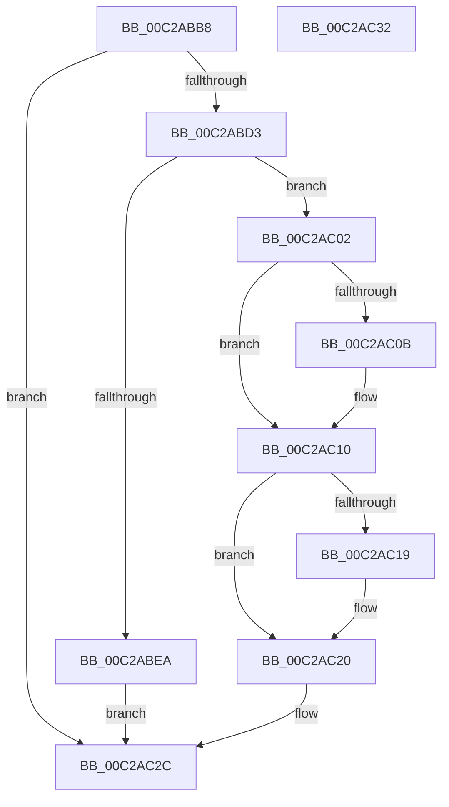

# IoInitSystem

- RVA: `0x00C2ABB8`–`0x00C2AC33` (길이 `123` bytes)
- VA: `0x0000000140C2ABB8`
- 실행 섹션: `INIT`
- PDB 이름 있음: `예`; PDB Function 태그: `아니요`
- unwind 정보 RVA: `0x0005CF00`
- 디코드: `33`개 명령, `123/123` bytes 표시
- 미해석 바이트: `0` (있으면 어셈블리에 `.byte`로 보존)

> 이 문서는 커널 이미지의 기계어와 PDB 기호를 분석해 생성했습니다. 4번과 5번은 함수 원형과 자료형을 바이너리 사용 방식에서 추정한 C 해석이며 원본 소스 복구 결과는 아닙니다.

## 1. Dependencies

- 직접 호출 지점: **8**; 고유 호출 대상: **8**
- 직접 호출자로 확인된 함수: **1**
- RIP 상대 이미지 참조: **5**

### Outgoing calls
- `0x00C2ABCA` → [IoInitSystemPreDrivers](IoInitSystemPreDrivers_function_00C2AC3C.md) (function, `0x00C2AC3C`)
- `0x00C2ABD3` → `ext-ms-win-ntos-werkernel-l1-1-1.dll!WerLiveKernelInitSystem` (import, 간접 대상; import `ext-ms-win-ntos-werkernel-l1-1-1.dll!WerLiveKernelInitSystem`)
- `0x00C2ABDF` → [IopInitializeSystemDrivers](../C7/IopInitializeSystemDrivers_function_00C73590.md) (function, `0x00C73590`)
- `0x00C2ABEF` → [HeadlessKernelAddLogEntry](../../text/4B/HeadlessKernelAddLogEntry_function_004B7DEC.md) (function, `0x004B7DEC`)
- `0x00C2AC0B` → [PnpSerializeBoot](../../text/5A/PnpSerializeBoot_function_005A4F1C.md) (function, `0x005A4F1C`)
- `0x00C2AC1B` → [VfNotifyVerifierOfEvent](../../pagevrfy/B9/VfNotifyVerifierOfEvent_function_00B92E90.md) (function, `0x00B92E90`)
- `0x00C2AC20` → [IopRegistryInitializeCallbacks](../../page/72/IopRegistryInitializeCallbacks_function_00722E58.md) (function, `0x00722E58`)
- `0x00C2AC25` → [IopInitializeMdlCache](../../page/72/IopInitializeMdlCache_function_00722F68.md) (function, `0x00722F68`)

### Direct callers
- [Phase1Initialization](../../page/70/Phase1Initialization_function_007062C0.md) at `0x007062F6`

### Static image references
- `0x00C2ABBE` → RVA `0x00F8D8D0` (`.data`; read)
- `0x00C2ABD3` → RVA `0x00151630` (`ext-ms-win-ntos-werkernel-l1-1-1.dll!WerLiveKernelInitSystem (IAT)`; read)
- `0x00C2ABF6` → RVA `0x00F8D8D0` (`.data`; write)
- `0x00C2AC02` → RVA `0x00E0A9DC` (`.data`; read)
- `0x00C2AC10` → RVA `0x00F04984` (`.data`; read)

## 2. Other-region calls and transfers

- 다른 실행 섹션으로 향하는 call: **5**
  - `0x00C2ABEF` → [HeadlessKernelAddLogEntry](../../text/4B/HeadlessKernelAddLogEntry_function_004B7DEC.md) (`INIT` → `.text`)
  - `0x00C2AC0B` → [PnpSerializeBoot](../../text/5A/PnpSerializeBoot_function_005A4F1C.md) (`INIT` → `.text`)
  - `0x00C2AC1B` → [VfNotifyVerifierOfEvent](../../pagevrfy/B9/VfNotifyVerifierOfEvent_function_00B92E90.md) (`INIT` → `PAGEVRFY`)
  - `0x00C2AC20` → [IopRegistryInitializeCallbacks](../../page/72/IopRegistryInitializeCallbacks_function_00722E58.md) (`INIT` → `PAGE`)
  - `0x00C2AC25` → [IopInitializeMdlCache](../../page/72/IopInitializeMdlCache_function_00722F68.md) (`INIT` → `PAGE`)
- 별도 외부 분기/꼬리 이동을 확인하지 못했습니다.

## 3. Assembly (complete function range)

```asm
00C2ABB8  40 53                           push rbx
00C2ABBA  48 83 EC 20                     sub rsp, 0x20
00C2ABBE  48 8D 05 0B 2D 36 00            lea rax, [rip + 0x362d0b]
00C2ABC5  48 89 44 24 38                  mov qword ptr [rsp + 0x38], rax
00C2ABCA  E8 6D 00 00 00                  call 0x140c2ac3c
00C2ABCF  85 C0                           test eax, eax
00C2ABD1  78 59                           js 0x140c2ac2c
00C2ABD3  48 FF 15 56 6A 52 FF            call qword ptr [rip - 0xad95aa]
00C2ABDA  0F 1F 44 00 00                  nop dword ptr [rax + rax]
00C2ABDF  E8 AC 89 04 00                  call 0x140c73590
00C2ABE4  8B D8                           mov ebx, eax
00C2ABE6  85 C0                           test eax, eax
00C2ABE8  79 18                           jns 0x140c2ac02
00C2ABEA  33 D2                           xor edx, edx
00C2ABEC  8D 4A 0B                        lea ecx, [rdx + 0xb]
00C2ABEF  E8 F8 D1 88 FF                  call 0x1404b7dec
00C2ABF4  8B C3                           mov eax, ebx
00C2ABF6  C7 05 D0 2C 36 00 08 00 00 00   mov dword ptr [rip + 0x362cd0], 8
00C2AC00  EB 2A                           jmp 0x140c2ac2c
00C2AC02  83 3D D3 FD 1D 00 00            cmp dword ptr [rip + 0x1dfdd3], 0
00C2AC09  75 05                           jne 0x140c2ac10
00C2AC0B  E8 0C A3 97 FF                  call 0x1405a4f1c
00C2AC10  83 3D 6D 9D 2D 00 00            cmp dword ptr [rip + 0x2d9d6d], 0
00C2AC17  74 07                           je 0x140c2ac20
00C2AC19  33 C9                           xor ecx, ecx
00C2AC1B  E8 70 82 F6 FF                  call 0x140b92e90
00C2AC20  E8 33 82 AF FF                  call 0x140722e58
00C2AC25  E8 3E 83 AF FF                  call 0x140722f68
00C2AC2A  33 C0                           xor eax, eax
00C2AC2C  48 83 C4 20                     add rsp, 0x20
00C2AC30  5B                              pop rbx
00C2AC31  C3                              ret
00C2AC32  CC                              int3
```

## 4. C-style interpretation (structured pseudocode)

```c
__int64 __fastcall IoInitSystem(__int64 a1, int a2)
{
    __int64 result;
    __int64 v_rsp;
    unsigned __int64 v_stack_p10;

    v_rsp = (v_rsp) - (32);
    v_stack_p10 = v_rip + 3550475;
    result = IoInitSystemPreDrivers(a1, a2, a3, a4);
    if (sign_flag) goto loc_00C2AC2C;
    result = ext_ms_win_ntos_werkernel_l1_1_1_dll_WerLiveKernelInitSystem(a1, a2, a3, a4);
    result = IopInitializeSystemDrivers(a1, a2, a3, a4);
    if (!sign_flag) goto loc_00C2AC02;
    a2 = 0;
    result = HeadlessKernelAddLogEntry(a2 + 11, a2, a3, a4);
    *(unsigned int *)(v_rip + 3550416) = 8;
    goto loc_00C2AC2C;
loc_00C2AC02:
    result = (unsigned int)((unsigned int)((unsigned int)((unsigned int)(result))));
    if ((*(unsigned int *)(v_rip + 1965523)) == 0) {
        result = PnpSerializeBoot(a2 + 11, a2, a3, a4);
    }
    if ((*(unsigned int *)(v_rip + 2989421)) != 0) {
        a1 = 0;
        result = VfNotifyVerifierOfEvent(a1, a2, a3, a4);
    }
    result = IopRegistryInitializeCallbacks(a1, a2, a3, a4);
    result = IopInitializeMdlCache(a1, a2, a3, a4);
    result = 0;
loc_00C2AC2C:
    v_rsp = (v_rsp) + (32);
    return result;
}
```

## 5. (Beta) C Style

```c
int64_t IoInitSystem(int64_t Arg1, int32_t Arg2)
{
    int64_t result;
    int64_t local_rsp;
    uint64_t v_stack_p10;

    local_rsp = (local_rsp) - (32);
    v_stack_p10 = v_rip + 3550475;
    result = IoInitSystemPreDrivers(Arg1, Arg2, a3, a4);
    if (sign_flag) goto loc_00C2AC2C;
    result = kernel_indirect_call(Arg1, Arg2, a3, a4);
    result = IopInitializeSystemDrivers(Arg1, Arg2, a3, a4);
    if (!sign_flag) goto loc_00C2AC02;
    Arg2 = 0;
    result = HeadlessKernelAddLogEntry(Arg2 + 11, Arg2, a3, a4);
    *(uint32_t *)(v_rip + 0x362CD0) = 8;
    goto loc_00C2AC2C;
loc_00C2AC02:
    result = (uint32_t)((uint32_t)((uint32_t)((uint32_t)(result))));
    if ((*(uint32_t *)(v_rip + 0x1DFDD3)) == 0) {
        result = PnpSerializeBoot(Arg2 + 11, Arg2, a3, a4);
    }
    if ((*(uint32_t *)(v_rip + 0x2D9D6D)) != 0) {
        Arg1 = 0;
        result = VfNotifyVerifierOfEvent(Arg1, Arg2, a3, a4);
    }
    result = IopRegistryInitializeCallbacks(Arg1, Arg2, a3, a4);
    result = IopInitializeMdlCache(Arg1, Arg2, a3, a4);
    result = 0;
loc_00C2AC2C:
    local_rsp = (local_rsp) + (32);
    return result;
}
```

## 6. Execution-region graph

[열기: 2D/3D 그래프와 함수 탐색 컨트롤 패널](../../../control-panel.html?section=init&rva=0x00C2ABB8&view=graph)

- 2D 그래프는 위에서 아래로 흐르고, 3D 그래프는 빈 공간을 드래그해 회전합니다. Shift+드래그는 이동, 휠은 확대·축소, 함수 노드 선택은 대상 보고서 이동입니다.

### Static fallback


