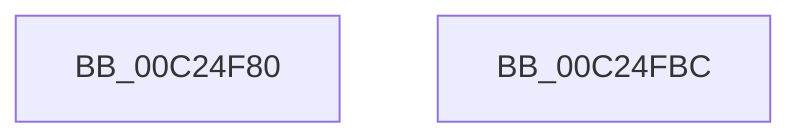

# IommuGetConfiguration

- RVA: `0x00C24F80`–`0x00C24FBD` (길이 `61` bytes)
- VA: `0x0000000140C24F80`
- 실행 섹션: `INIT`
- PDB 이름 있음: `예`; PDB Function 태그: `아니요`
- unwind 정보 RVA: `0x0005CF00`
- 디코드: `20`개 명령, `61/61` bytes 표시
- 미해석 바이트: `0` (있으면 어셈블리에 `.byte`로 보존)

> 이 문서는 커널 이미지의 기계어와 PDB 기호를 분석해 생성했습니다. 4번과 5번은 함수 원형과 자료형을 바이너리 사용 방식에서 추정한 C 해석이며 원본 소스 복구 결과는 아닙니다.

## 1. Dependencies

- 직접 호출 지점: **2**; 고유 호출 대상: **2**
- 직접 호출자로 확인된 함수: **0**
- RIP 상대 이미지 참조: **1**

### Outgoing calls
- `0x00C24F97` → [IommuGetLeastMaximumSupportedAsidValue](../../text/56/IommuGetLeastMaximumSupportedAsidValue_function_00565944.md) (function, `0x00565944`)
- `0x00C24FA2` → [IommupGetSystemContext](../../text/56/IommupGetSystemContext_function_00566310.md) (function, `0x00566310`)

### Direct callers
- 이 함수 시작 RVA로 연결되는 직접 call은 확인되지 않았습니다. 간접 호출은 완전히 역산할 수 없습니다.

### Static image references
- `0x00C24F86` → RVA `0x00FC1754` (`.data`; read)

## 2. Other-region calls and transfers

- 다른 실행 섹션으로 향하는 call: **2**
  - `0x00C24F97` → [IommuGetLeastMaximumSupportedAsidValue](../../text/56/IommuGetLeastMaximumSupportedAsidValue_function_00565944.md) (`INIT` → `.text`)
  - `0x00C24FA2` → [IommupGetSystemContext](../../text/56/IommupGetSystemContext_function_00566310.md) (`INIT` → `.text`)
- 별도 외부 분기/꼬리 이동을 확인하지 못했습니다.

## 3. Assembly (complete function range)

```asm
00C24F80  40 53                           push rbx
00C24F82  48 83 EC 20                     sub rsp, 0x20
00C24F86  8B 05 C8 C7 39 00               mov eax, dword ptr [rip + 0x39c7c8]
00C24F8C  49 8B D9                        mov rbx, r9
00C24F8F  89 02                           mov dword ptr [rdx], eax
00C24F91  4D 8B D8                        mov r11, r8
00C24F94  44 8B D1                        mov r10d, ecx
00C24F97  E8 A8 09 94 FF                  call 0x140565944
00C24F9C  41 8B CA                        mov ecx, r10d
00C24F9F  41 89 03                        mov dword ptr [r11], eax
00C24FA2  E8 69 13 94 FF                  call 0x140566310
00C24FA7  48 89 03                        mov qword ptr [rbx], rax
00C24FAA  48 F7 D8                        neg rax
00C24FAD  1B C0                           sbb eax, eax
00C24FAF  F7 D0                           not eax
00C24FB1  25 9A 00 00 C0                  and eax, 0xc000009a
00C24FB6  48 83 C4 20                     add rsp, 0x20
00C24FBA  5B                              pop rbx
00C24FBB  C3                              ret
00C24FBC  CC                              int3
```

## 4. C-style interpretation (structured pseudocode)

```c
__int64 __fastcall IommuGetConfiguration(int a1, __int64 a2, __int64 a3, __int64 a4)
{
    __int64 result;
    __int64 v_rsp;

    v_rsp = (v_rsp) - (32);
    *(unsigned int *)(a2) = (unsigned int)((unsigned int)(*(unsigned int *)(v_rip + 3786696)));
    result = IommuGetLeastMaximumSupportedAsidValue(a1, a2, a3, a4);
    *(unsigned int *)(a3) = (unsigned int)(result);
    result = IommupGetSystemContext((unsigned int)((unsigned int)((unsigned int)(a1))), a2, a3, a4);
    *(unsigned __int64 *)(a4) = result;
    result = -(result);
    result = (unsigned int)(~(result));
    result = (unsigned int)((result) & (0xC000009AULL));
    v_rsp = (v_rsp) + (32);
    return result;
}
```

## 5. (Beta) C Style

```c
int64_t IommuGetConfiguration(int32_t Arg1, void *Arg2, int64_t Arg3, void *Arg4)
{
    uint8_t *arg2 = (uint8_t *)Arg2;
    uint8_t *arg4 = (uint8_t *)Arg4;

    int64_t result;
    int64_t local_rsp;

    local_rsp = (local_rsp) - (32);
    *(uint32_t *)(arg2) = (uint32_t)((uint32_t)(*(uint32_t *)(v_rip + 0x39C7C8)));
    result = IommuGetLeastMaximumSupportedAsidValue(Arg1, Arg2, Arg3, Arg4);
    *(uint32_t *)(Arg3) = (uint32_t)(result);
    result = IommupGetSystemContext((uint32_t)((uint32_t)((uint32_t)(Arg1))), Arg2, Arg3, Arg4);
    *(uint64_t *)(arg4) = result;
    result = -(result);
    result = (uint32_t)(~(result));
    result = (uint32_t)((result) & (0xC000009AULL));
    local_rsp = (local_rsp) + (32);
    return result;
}
```

### 관측된 메모리 오프셋

구조체 형식이 확인되지 않은 접근은 인자 기준의 오프셋으로만 기록했습니다.

| 기준 인자 | 오프셋 표현 | 폭 (bit) | 접근 |
|---|---:|---:|---|
| `Arg2` | `+ 0x0` | `32` | `W` |
| `Arg4` | `+ 0x0` | `64` | `W` |

## 6. Execution-region graph

[열기: 2D/3D 그래프와 함수 탐색 컨트롤 패널](../../../control-panel.html?section=init&rva=0x00C24F80&view=graph)

- 2D 그래프는 위에서 아래로 흐르고, 3D 그래프는 빈 공간을 드래그해 회전합니다. Shift+드래그는 이동, 휠은 확대·축소, 함수 노드 선택은 대상 보고서 이동입니다.

### Static fallback


