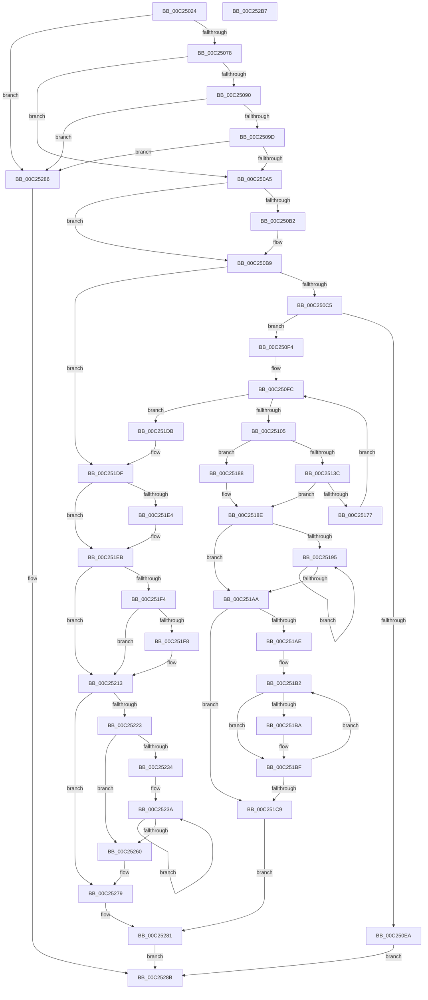

# IommupHvInitializeLibrary

- RVA: `0x00C25024`–`0x00C252B8` (길이 `660` bytes)
- VA: `0x0000000140C25024`
- 실행 섹션: `INIT`
- PDB 이름 있음: `예`; PDB Function 태그: `아니요`
- unwind 정보 RVA: `0x000C4E24`
- 디코드: `169`개 명령, `660/660` bytes 표시
- 미해석 바이트: `0` (있으면 어셈블리에 `.byte`로 보존)

> 이 문서는 커널 이미지의 기계어와 PDB 기호를 분석해 생성했습니다. 4번과 5번은 함수 원형과 자료형을 바이너리 사용 방식에서 추정한 C 해석이며 원본 소스 복구 결과는 아닙니다.

## 1. Dependencies

- 직접 호출 지점: **10**; 고유 호출 대상: **8**
- 직접 호출자로 확인된 함수: **1**
- RIP 상대 이미지 참조: **16**

### Outgoing calls
- `0x00C2507C` → [guard_dispatch_icall](../../text/6B/guard_dispatch_icall_function_006BAAD0.md) (function, `0x006BAAD0`)
- `0x00C250DD` → [ExAllocatePool2](../../poolcode/B8/ExAllocatePool2_function_00B820F0.md) (function, `0x00B820F0`)
- `0x00C2512D` → [MmAllocateContiguousNodeMemory](../../text/3E/MmAllocateContiguousNodeMemory_function_003E9E40.md) (function, `0x003E9E40`)
- `0x00C2514B` → [MmGetPhysicalAddress](../../text/23/MmGetPhysicalAddress_function_0023A500.md) (function, `0x0023A500`)
- `0x00C2516B` → [guard_dispatch_icall](../../text/6B/guard_dispatch_icall_function_006BAAD0.md) (function, `0x006BAAD0`)
- `0x00C2519E` → [guard_dispatch_icall](../../text/6B/guard_dispatch_icall_function_006BAAD0.md) (function, `0x006BAAD0`)
- `0x00C251BA` → [MmFreeContiguousMemory](../../text/3F/MmFreeContiguousMemory_function_003F6F60.md) (function, `0x003F6F60`)
- `0x00C251D1` → [ExFreePoolWithTag](../../poolcode/B8/ExFreePoolWithTag_function_00B82870.md) (function, `0x00B82870`)
- `0x00C25274` → [HalpInterruptSetIdtEntry](../../text/55/HalpInterruptSetIdtEntry_function_0055BAE0.md) (function, `0x0055BAE0`)
- `0x00C25293` → [_security_check_cookie](../../text/6A/_security_check_cookie_function_006AC640.md) (function, `0x006AC640`)

### Direct callers
- [IommuInitializeLibrary](../../text/56/IommuInitializeLibrary_function_00565A64.md) at `0x00565A8E`

### Static image references
- `0x00C25041` → RVA `0x00E0A740` (`.data`; read)
- `0x00C2505B` → RVA `0x00FC1D58` (`.data`; read)
- `0x00C25090` → RVA `0x00FC1711` (`.data`; read)
- `0x00C25160` → RVA `0x00FC1DA8` (`.data`; read)
- `0x00C25195` → RVA `0x00FC1DB0` (`.data`; read)
- `0x00C251E4` → RVA `0x00F8FAD4` (`.data`; write)
- `0x00C251F8` → RVA `0x00F8FAD0` (`.data`; write)
- `0x00C25202` → RVA `0x00E10408` (`.data`; read/write)
- `0x00C2520D` → RVA `0x00F8FAEC` (`.data`; write)
- `0x00C25213` → RVA `0x00F8FAD4` (`.data`; read)
- `0x00C2521A` → RVA `0x00F8FAF0` (`.data`; write)
- `0x00C25223` → RVA `0x00F8FAD8` (`.data`; write)
- `0x00C25229` → RVA `0x00F8FAC8` (`.data`; write)
- `0x00C2523F` → RVA `0x005674A0` (`IommupHvGetPageFault`; read)
- `0x00C25268` → RVA `0x00567600` (`IommupHvInterruptRoutine`; read)
- `0x00C25279` → RVA `0x00F8FAE0` (`.data`; read/write)

## 2. Other-region calls and transfers

- 다른 실행 섹션으로 향하는 call: **10**
  - `0x00C2507C` → [guard_dispatch_icall](../../text/6B/guard_dispatch_icall_function_006BAAD0.md) (`INIT` → `.text`)
  - `0x00C250DD` → [ExAllocatePool2](../../poolcode/B8/ExAllocatePool2_function_00B820F0.md) (`INIT` → `POOLCODE`)
  - `0x00C2512D` → [MmAllocateContiguousNodeMemory](../../text/3E/MmAllocateContiguousNodeMemory_function_003E9E40.md) (`INIT` → `.text`)
  - `0x00C2514B` → [MmGetPhysicalAddress](../../text/23/MmGetPhysicalAddress_function_0023A500.md) (`INIT` → `.text`)
  - `0x00C2516B` → [guard_dispatch_icall](../../text/6B/guard_dispatch_icall_function_006BAAD0.md) (`INIT` → `.text`)
  - `0x00C2519E` → [guard_dispatch_icall](../../text/6B/guard_dispatch_icall_function_006BAAD0.md) (`INIT` → `.text`)
  - `0x00C251BA` → [MmFreeContiguousMemory](../../text/3F/MmFreeContiguousMemory_function_003F6F60.md) (`INIT` → `.text`)
  - `0x00C251D1` → [ExFreePoolWithTag](../../poolcode/B8/ExFreePoolWithTag_function_00B82870.md) (`INIT` → `POOLCODE`)
  - `0x00C25274` → [HalpInterruptSetIdtEntry](../../text/55/HalpInterruptSetIdtEntry_function_0055BAE0.md) (`INIT` → `.text`)
  - `0x00C25293` → [_security_check_cookie](../../text/6A/_security_check_cookie_function_006AC640.md) (`INIT` → `.text`)
- 별도 외부 분기/꼬리 이동을 확인하지 못했습니다.

## 3. Assembly (complete function range)

```asm
00C25024  4C 8B DC                        mov r11, rsp
00C25027  49 89 6B 08                     mov qword ptr [r11 + 8], rbp
00C2502B  49 89 73 10                     mov qword ptr [r11 + 0x10], rsi
00C2502F  49 89 7B 18                     mov qword ptr [r11 + 0x18], rdi
00C25033  4D 89 63 20                     mov qword ptr [r11 + 0x20], r12
00C25037  41 55                           push r13
00C25039  41 56                           push r14
00C2503B  41 57                           push r15
00C2503D  48 83 EC 50                     sub rsp, 0x50
00C25041  48 8B 05 F8 56 1E 00            mov rax, qword ptr [rip + 0x1e56f8]
00C25048  48 33 C4                        xor rax, rsp
00C2504B  48 89 44 24 48                  mov qword ptr [rsp + 0x48], rax
00C25050  33 C0                           xor eax, eax
00C25052  45 33 ED                        xor r13d, r13d
00C25055  89 44 24 40                     mov dword ptr [rsp + 0x40], eax
00C25059  33 F6                           xor esi, esi
00C2505B  48 8B 05 F6 CC 39 00            mov rax, qword ptr [rip + 0x39ccf6]
00C25062  33 ED                           xor ebp, ebp
00C25064  45 33 FF                        xor r15d, r15d
00C25067  0F 57 C0                        xorps xmm0, xmm0
00C2506A  0F 11 44 24 30                  movups xmmword ptr [rsp + 0x30], xmm0
00C2506F  48 85 C0                        test rax, rax
00C25072  0F 84 0E 02 00 00               je 0x140c25286
00C25078  49 8D 4B C8                     lea rcx, [r11 - 0x38]
00C2507C  E8 4F 5A A9 FF                  call 0x1406baad0
00C25081  8B 44 24 30                     mov eax, dword ptr [rsp + 0x30]
00C25085  45 8D 4D 01                     lea r9d, [r13 + 1]
00C25089  8B D0                           mov edx, eax
00C2508B  41 23 D1                        and edx, r9d
00C2508E  75 15                           jne 0x140c250a5
00C25090  40 38 35 7A C6 39 00            cmp byte ptr [rip + 0x39c67a], sil
00C25097  0F 84 E9 01 00 00               je 0x140c25286
00C2509D  A8 04                           test al, 4
00C2509F  0F 84 E1 01 00 00               je 0x140c25286
00C250A5  8B 4C 24 40                     mov ecx, dword ptr [rsp + 0x40]
00C250A9  44 8B 74 24 34                  mov r14d, dword ptr [rsp + 0x34]
00C250AE  85 C9                           test ecx, ecx
00C250B0  74 07                           je 0x140c250b9
00C250B2  41 3B CE                        cmp ecx, r14d
00C250B5  44 0F 42 F1                     cmovb r14d, ecx
00C250B9  48 83 CF FF                     or rdi, 0xffffffffffffffff
00C250BD  85 D2                           test edx, edx
00C250BF  0F 84 1A 01 00 00               je 0x140c251df
00C250C5  8B 74 24 3C                     mov esi, dword ptr [rsp + 0x3c]
00C250C9  8D 4F 41                        lea ecx, [rdi + 0x41]
00C250CC  85 F6                           test esi, esi
00C250CE  41 B8 48 61 6C 49               mov r8d, 0x496c6148
00C250D4  41 0F 44 F1                     cmove esi, r9d
00C250D8  8B D6                           mov edx, esi
00C250DA  C1 E2 06                        shl edx, 6
00C250DD  E8 0E D0 F5 FF                  call 0x140b820f0
00C250E2  48 8B E8                        mov rbp, rax
00C250E5  48 85 C0                        test rax, rax
00C250E8  75 0A                           jne 0x140c250f4
00C250EA  B8 9A 00 00 C0                  mov eax, 0xc000009a
00C250EF  E9 97 01 00 00                  jmp 0x140c2528b
00C250F4  45 33 E4                        xor r12d, r12d
00C250F7  45 8D 4C 24 01                  lea r9d, [r12 + 1]
00C250FC  44 3B E6                        cmp r12d, esi
00C250FF  0F 83 D6 00 00 00               jae 0x140c251db
00C25105  45 8B FC                        mov r15d, r12d
00C25108  45 33 C9                        xor r9d, r9d
00C2510B  49 C1 E7 06                     shl r15, 6
00C2510F  4C 8B C7                        mov r8, rdi
00C25112  C7 44 24 28 00 00 00 80         mov dword ptr [rsp + 0x28], 0x80000000
00C2511A  33 D2                           xor edx, edx
00C2511C  B9 00 20 00 00                  mov ecx, 0x2000
00C25121  C7 44 24 20 04 00 00 00         mov dword ptr [rsp + 0x20], 4
00C25129  45 89 24 2F                     mov dword ptr [r15 + rbp], r12d
00C2512D  E8 0E 4D 7C FF                  call 0x1403e9e40
00C25132  49 89 44 2F 08                  mov qword ptr [r15 + rbp + 8], rax
00C25137  48 85 C0                        test rax, rax
00C2513A  74 4C                           je 0x140c25188
00C2513C  48 8D 88 00 10 00 00            lea rcx, [rax + 0x1000]
00C25143  49 89 4C 2F 10                  mov qword ptr [r15 + rbp + 0x10], rcx
00C25148  48 8B C8                        mov rcx, rax
00C2514B  E8 B0 53 61 FF                  call 0x14023a500
00C25150  83 64 24 20 00                  and dword ptr [rsp + 0x20], 0
00C25155  BA 80 00 00 00                  mov edx, 0x80
00C2515A  4C 8B C0                        mov r8, rax
00C2515D  41 8B CC                        mov ecx, r12d
00C25160  48 8B 05 41 CC 39 00            mov rax, qword ptr [rip + 0x39cc41]
00C25167  44 8D 4A 4E                     lea r9d, [rdx + 0x4e]
00C2516B  E8 60 59 A9 FF                  call 0x1406baad0
00C25170  44 8B F8                        mov r15d, eax
00C25173  85 C0                           test eax, eax
00C25175  78 17                           js 0x140c2518e
00C25177  41 B9 01 00 00 00               mov r9d, 1
00C2517D  45 03 E9                        add r13d, r9d
00C25180  45 03 E1                        add r12d, r9d
00C25183  E9 74 FF FF FF                  jmp 0x140c250fc
00C25188  41 BF 9A 00 00 C0               mov r15d, 0xc000009a
00C2518E  33 FF                           xor edi, edi
00C25190  45 85 ED                        test r13d, r13d
00C25193  74 15                           je 0x140c251aa
00C25195  48 8B 05 14 CC 39 00            mov rax, qword ptr [rip + 0x39cc14]
00C2519C  8B CF                           mov ecx, edi
00C2519E  E8 2D 59 A9 FF                  call 0x1406baad0
00C251A3  FF C7                           inc edi
00C251A5  41 3B FD                        cmp edi, r13d
00C251A8  72 EB                           jb 0x140c25195
00C251AA  85 F6                           test esi, esi
00C251AC  74 1B                           je 0x140c251c9
00C251AE  48 8D 7D 08                     lea rdi, [rbp + 8]
00C251B2  48 8B 0F                        mov rcx, qword ptr [rdi]
00C251B5  48 85 C9                        test rcx, rcx
00C251B8  74 05                           je 0x140c251bf
00C251BA  E8 A1 1D 7D FF                  call 0x1403f6f60
00C251BF  48 83 C7 40                     add rdi, 0x40
00C251C3  48 83 EE 01                     sub rsi, 1
00C251C7  75 E9                           jne 0x140c251b2
00C251C9  BA 48 61 6C 49                  mov edx, 0x496c6148
00C251CE  48 8B CD                        mov rcx, rbp
00C251D1  E8 9A D6 F5 FF                  call 0x140b82870
00C251D6  E9 A6 00 00 00                  jmp 0x140c25281
00C251DB  8B 44 24 30                     mov eax, dword ptr [rsp + 0x30]
00C251DF  41 84 C1                        test r9b, al
00C251E2  74 07                           je 0x140c251eb
00C251E4  44 88 0D E9 A8 36 00            mov byte ptr [rip + 0x36a8e9], r9b
00C251EB  80 3D 1F C5 39 00 00            cmp byte ptr [rip + 0x39c51f], 0
00C251F2  74 1F                           je 0x140c25213
00C251F4  A8 04                           test al, 4
00C251F6  74 1B                           je 0x140c25213
00C251F8  44 88 0D D1 A8 36 00            mov byte ptr [rip + 0x36a8d1], r9b
00C251FF  41 8B C1                        mov eax, r9d
00C25202  F0 0F C1 05 FE B1 1E 00         lock xadd dword ptr [rip + 0x1eb1fe], eax
00C2520A  41 03 C1                        add eax, r9d
00C2520D  89 05 D9 A8 36 00               mov dword ptr [rip + 0x36a8d9], eax
00C25213  80 3D BA A8 36 00 00            cmp byte ptr [rip + 0x36a8ba], 0
00C2521A  44 89 35 CF A8 36 00            mov dword ptr [rip + 0x36a8cf], r14d
00C25221  74 56                           je 0x140c25279
00C25223  89 35 AF A8 36 00               mov dword ptr [rip + 0x36a8af], esi
00C25229  48 89 2D 98 A8 36 00            mov qword ptr [rip + 0x36a898], rbp
00C25230  85 F6                           test esi, esi
00C25232  74 2C                           je 0x140c25260
00C25234  48 8D 45 20                     lea rax, [rbp + 0x20]
00C25238  8B D6                           mov edx, esi
00C2523A  48 83 60 F8 00                  and qword ptr [rax - 8], 0
00C2523F  4C 8D 05 5A 22 94 FF            lea r8, [rip - 0x6bdda6]
00C25246  48 83 20 00                     and qword ptr [rax], 0
00C2524A  83 60 08 00                     and dword ptr [rax + 8], 0
00C2524E  48 83 60 18 00                  and qword ptr [rax + 0x18], 0
00C25253  4C 89 40 10                     mov qword ptr [rax + 0x10], r8
00C25257  48 8D 40 40                     lea rax, [rax + 0x40]
00C2525B  49 2B D1                        sub rdx, r9
00C2525E  75 DA                           jne 0x140c2523a
00C25260  41 B0 0C                        mov r8b, 0xc
00C25263  48 89 7C 24 20                  mov qword ptr [rsp + 0x20], rdi
00C25268  48 8D 15 91 23 94 FF            lea rdx, [rip - 0x6bdc6f]
00C2526F  B9 CE 00 00 00                  mov ecx, 0xce
00C25274  E8 67 68 93 FF                  call 0x14055bae0
00C25279  48 83 25 5F A8 36 00 00         and qword ptr [rip + 0x36a85f], 0
00C25281  41 8B C7                        mov eax, r15d
00C25284  EB 05                           jmp 0x140c2528b
00C25286  B8 BB 00 00 C0                  mov eax, 0xc00000bb
00C2528B  48 8B 4C 24 48                  mov rcx, qword ptr [rsp + 0x48]
00C25290  48 33 CC                        xor rcx, rsp
00C25293  E8 A8 73 A8 FF                  call 0x1406ac640
00C25298  4C 8D 5C 24 50                  lea r11, [rsp + 0x50]
00C2529D  49 8B 6B 20                     mov rbp, qword ptr [r11 + 0x20]
00C252A1  49 8B 73 28                     mov rsi, qword ptr [r11 + 0x28]
00C252A5  49 8B 7B 30                     mov rdi, qword ptr [r11 + 0x30]
00C252A9  4D 8B 63 38                     mov r12, qword ptr [r11 + 0x38]
00C252AD  49 8B E3                        mov rsp, r11
00C252B0  41 5F                           pop r15
00C252B2  41 5E                           pop r14
00C252B4  41 5D                           pop r13
00C252B6  C3                              ret
00C252B7  CC                              int3
```

## 4. C-style interpretation (structured pseudocode)

```c
__int64 __fastcall IommupHvInitializeLibrary(void)
{
    __int64 result;
    __int64 v_r12;
    __int64 v_r13;
    __int64 v_r14;
    __int64 v_r15;
    __int64 v_rbp;
    __int64 v_rdi;
    __int64 v_rsi;
    __int64 v_rsp;
    unsigned __int64 v_stack_m18;
    unsigned __int64 v_stack_m20;
    unsigned int v_stack_m28;
    unsigned int v_stack_m2C;
    unsigned int v_stack_m34;
    unsigned __int64 v_stack_m38;
    unsigned int v_stack_m40;
    unsigned int v_stack_m48;

    *(unsigned __int64 *)(v_rsp + 8) = v_rbp;
    *(unsigned __int64 *)(v_rsp + 16) = v_rsi;
    *(unsigned __int64 *)(v_rsp + 24) = v_rdi;
    *(unsigned __int64 *)(v_rsp + 32) = v_r12;
    v_rsp = (v_rsp) - (80);
    result = (*(unsigned __int64 *)(v_rip + 1988344)) ^ (v_rsp);
    v_stack_m20 = result;
    result = 0;
    v_r13 = 0;
    v_stack_m28 = 0;
    v_rsi = 0;
    v_rbp = 0;
    v_r15 = 0;
    v_stack_m38 = v_xmm0;
    if (*(unsigned __int64 *)(v_rip + 3788022) == 0) goto loc_00C25286;
    result = guard_dispatch_icall(v_rsp - 56, a2, a3, a4);
    a2 = (unsigned int)(((unsigned int)((unsigned int)((unsigned int)(v_stack_m38)))) & ((unsigned int)(v_r13 + 1)));
    if (condition_is_not_equal) goto loc_00C250A5;
    if ((*(unsigned __int8 *)(v_rip + 3786362)) == 0) goto loc_00C25286;
    if ((((unsigned __int8)((unsigned int)(v_stack_m38))) & (4)) == 0) goto loc_00C25286;
loc_00C250A5:
    v_r14 = (unsigned int)(v_stack_m34);
    if ((unsigned int)((unsigned int)(v_stack_m28)) != 0) {
        v_r14 = (unsigned int)(v_stack_m34);
        if (((unsigned int)((unsigned int)(v_stack_m28))) < ((unsigned int)((unsigned int)(v_stack_m34)))) { v_r14 = (unsigned int)((unsigned int)(v_stack_m28)); }
    }
    v_rdi = (v_rdi) | (-1);
    if ((unsigned int)(a2) == 0) goto loc_00C251DF;
    v_rsi = (unsigned int)(v_stack_m2C);
    if ((unsigned int)((unsigned int)(v_stack_m2C)) == 0) { v_rsi = (unsigned int)(v_r13 + 1); }
    a2 = (unsigned int)(((unsigned int)((unsigned int)(v_rsi))) << (6));
    result = ExAllocatePool2(v_rdi + 65, a2, (unsigned int)(0x496C6148ULL), v_r13 + 1);
    if (result != 0) goto loc_00C250F4;
    goto loc_00C2528B;
loc_00C250F4:
    v_r12 = 0;
loc_00C250FC:
    if (0 >= ((unsigned int)(v_rsi))) goto loc_00C251DB;
    a4 = 0;
    v_r15 = (0) << (6);
    v_stack_m40 = 0x80000000ULL;
    a2 = 0;
    v_stack_m48 = 4;
    *(unsigned int *)(v_r15 + result * 1) = 0;
    result = MmAllocateContiguousNodeMemory((unsigned int)(0x2000ULL), a2, v_rdi, a4);
    *(unsigned __int64 *)(v_r15 + result * 1 + 8) = result;
    if (result == 0) goto loc_00C25188;
    *(unsigned __int64 *)(v_r15 + result * 1 + 16) = result + 4096;
    result = MmGetPhysicalAddress(result, a2, v_rdi, a4);
    result = guard_dispatch_icall(0, 128, result, 128 + 78);
    if (sign_flag) goto loc_00C2518E;
    v_r13 = (unsigned int)((v_r13) + (1));
    v_r12 = (unsigned int)((v_r12) + (1));
    goto loc_00C250FC;
loc_00C25188:
loc_00C2518E:
    v_rdi = 0;
    if ((unsigned int)(v_r13) == 0) goto loc_00C251AA;
loc_00C25195:
    result = guard_dispatch_icall(0, 128, result, 1);
    v_rdi = (unsigned int)((v_rdi) + 1);
    if (((unsigned int)(v_rdi)) < ((unsigned int)(v_r13))) goto loc_00C25195;
loc_00C251AA:
    if ((unsigned int)(v_rsi) == 0) goto loc_00C251C9;
loc_00C251B2:
    if (*(unsigned __int64 *)(result + 8) != 0) {
        result = MmFreeContiguousMemory(*(unsigned __int64 *)(result + 8), 128, result, 1);
    }
    v_rdi = (result + 8) + (64);
    v_rsi = (v_rsi) - (1);
    if (condition_is_not_equal) goto loc_00C251B2;
loc_00C251C9:
    result = ExFreePoolWithTag(result, (unsigned int)(0x496C6148ULL), result, 1);
    goto loc_00C25281;
loc_00C251DB:
loc_00C251DF:
    if (((1) & ((unsigned __int8)((unsigned int)(v_stack_m38)))) != 0) {
        *(unsigned __int8 *)(v_rip + 3582185) = 1;
    }
    if ((*(unsigned __int8 *)(v_rip + 3786015)) == 0) goto loc_00C25213;
    result = (unsigned int)(v_stack_m38);
    if ((((unsigned __int8)((unsigned int)(v_stack_m38))) & (4)) != 0) {
        *(unsigned __int8 *)(v_rip + 3582161) = 1;
        result = 1;
        result = (unsigned int)((result) + (1));
        *(unsigned int *)(v_rip + 3582169) = (unsigned int)(result);
    }
    *(unsigned int *)(v_rip + 3582159) = (unsigned int)(v_r14);
    if ((*(unsigned __int8 *)(v_rip + 3582138)) == 0) goto loc_00C25279;
    *(unsigned int *)(v_rip + 3582127) = (unsigned int)(v_rsi);
    *(unsigned __int64 *)(v_rip + 3582104) = result;
    if ((unsigned int)(v_rsi) == 0) goto loc_00C25260;
loc_00C2523A:
    *(unsigned __int64 *)(result + 32 + 16) = v_rip - 7069094;
    a2 = ((unsigned int)((unsigned int)(v_rsi))) - (1);
    if (condition_is_not_equal) goto loc_00C2523A;
loc_00C25260:
    v_stack_m48 = v_rdi;
    result = HalpInterruptSetIdtEntry(206, v_rip - 7068783, 12, 1);
loc_00C25279:
loc_00C25281:
    goto loc_00C2528B;
loc_00C25286:
loc_00C2528B:
    a1 = (v_stack_m20) ^ (v_rsp);
    result = _security_check_cookie(a1, v_rip - 7068783, 12, 1);
    return result;
}
```

## 5. (Beta) C Style

```c
void IommupHvInitializeLibrary(void)
{
    int64_t result;
    int64_t local_r12;
    int64_t local_r13;
    int64_t local_r14;
    int64_t local_r15;
    int64_t local_rbp;
    int64_t local_rdi;
    int64_t local_rsi;
    int64_t local_rsp;
    uint64_t v_stack_m18;
    uint64_t v_stack_m20;
    uint32_t v_stack_m28;
    uint32_t v_stack_m2C;
    uint32_t v_stack_m34;
    uint64_t v_stack_m38;
    uint32_t v_stack_m40;
    uint32_t v_stack_m48;

    *(uint64_t *)(local_rsp + 0x8) = local_rbp;
    *(uint64_t *)(local_rsp + 0x10) = local_rsi;
    *(uint64_t *)(local_rsp + 0x18) = local_rdi;
    *(uint64_t *)(local_rsp + 0x20) = local_r12;
    local_rsp = (local_rsp) - (80);
    result = (*(uint64_t *)(v_rip + 0x1E56F8)) ^ (local_rsp);
    v_stack_m20 = result;
    result = 0;
    local_r13 = 0;
    v_stack_m28 = 0;
    local_rsi = 0;
    local_rbp = 0;
    local_r15 = 0;
    v_stack_m38 = v_xmm0;
    if (*(uint64_t *)(v_rip + 0x39CCF6) == 0) goto loc_00C25286;
    result = guard_dispatch_icall(local_rsp - 56, a2, a3, a4);
    a2 = (uint32_t)(((uint32_t)((uint32_t)((uint32_t)(v_stack_m38)))) & ((uint32_t)(local_r13 + 1)));
    if (condition_is_not_equal) goto loc_00C250A5;
    if ((*(uint8_t *)(v_rip + 0x39C67A)) == 0) goto loc_00C25286;
    if ((((uint8_t)((uint32_t)(v_stack_m38))) & (4)) == 0) goto loc_00C25286;
loc_00C250A5:
    local_r14 = (uint32_t)(v_stack_m34);
    if ((uint32_t)((uint32_t)(v_stack_m28)) != 0) {
        local_r14 = (uint32_t)(v_stack_m34);
        if (((uint32_t)((uint32_t)(v_stack_m28))) < ((uint32_t)((uint32_t)(v_stack_m34)))) { local_r14 = (uint32_t)((uint32_t)(v_stack_m28)); }
    }
    local_rdi = (local_rdi) | (-1);
    if ((uint32_t)(a2) == 0) goto loc_00C251DF;
    local_rsi = (uint32_t)(v_stack_m2C);
    if ((uint32_t)((uint32_t)(v_stack_m2C)) == 0) { local_rsi = (uint32_t)(local_r13 + 1); }
    a2 = (uint32_t)(((uint32_t)((uint32_t)(local_rsi))) << (6));
    result = ExAllocatePool2(local_rdi + 65, a2, (uint32_t)(0x496C6148ULL), local_r13 + 1);
    if (result != 0) goto loc_00C250F4;
    goto loc_00C2528B;
loc_00C250F4:
    local_r12 = 0;
loc_00C250FC:
    if (0 >= ((uint32_t)(local_rsi))) goto loc_00C251DB;
    a4 = 0;
    local_r15 = (0) << (6);
    v_stack_m40 = 0x80000000ULL;
    a2 = 0;
    v_stack_m48 = 4;
    *(uint32_t *)(local_r15 + result * 1) = 0;
    result = MmAllocateContiguousNodeMemory((uint32_t)(0x2000ULL), a2, local_rdi, a4);
    *(uint64_t *)(local_r15 + result * 1 + 0x8) = result;
    if (result == 0) goto loc_00C25188;
    *(uint64_t *)(local_r15 + result * 1 + 0x10) = result + 4096;
    result = MmGetPhysicalAddress(result, a2, local_rdi, a4);
    result = guard_dispatch_icall(0, 128, result, 128 + 78);
    if (sign_flag) goto loc_00C2518E;
    local_r13 = (uint32_t)((local_r13) + (1));
    local_r12 = (uint32_t)((local_r12) + (1));
    goto loc_00C250FC;
loc_00C25188:
loc_00C2518E:
    local_rdi = 0;
    if ((uint32_t)(local_r13) == 0) goto loc_00C251AA;
loc_00C25195:
    result = guard_dispatch_icall(0, 128, result, 1);
    local_rdi = (uint32_t)((local_rdi) + 1);
    if (((uint32_t)(local_rdi)) < ((uint32_t)(local_r13))) goto loc_00C25195;
loc_00C251AA:
    if ((uint32_t)(local_rsi) == 0) goto loc_00C251C9;
loc_00C251B2:
    if (*(uint64_t *)(result + 0x8) != 0) {
        result = MmFreeContiguousMemory(*(uint64_t *)(result + 0x8), 128, result, 1);
    }
    local_rdi = (result + 8) + (64);
    local_rsi = (local_rsi) - (1);
    if (condition_is_not_equal) goto loc_00C251B2;
loc_00C251C9:
    result = ExFreePoolWithTag(result, (uint32_t)(0x496C6148ULL), result, 1);
    goto loc_00C25281;
loc_00C251DB:
loc_00C251DF:
    if (((1) & ((uint8_t)((uint32_t)(v_stack_m38)))) != 0) {
        *(uint8_t *)(v_rip + 0x36A8E9) = 1;
    }
    if ((*(uint8_t *)(v_rip + 0x39C51F)) == 0) goto loc_00C25213;
    result = (uint32_t)(v_stack_m38);
    if ((((uint8_t)((uint32_t)(v_stack_m38))) & (4)) != 0) {
        *(uint8_t *)(v_rip + 0x36A8D1) = 1;
        result = 1;
        result = (uint32_t)((result) + (1));
        *(uint32_t *)(v_rip + 0x36A8D9) = (uint32_t)(result);
    }
    *(uint32_t *)(v_rip + 0x36A8CF) = (uint32_t)(local_r14);
    if ((*(uint8_t *)(v_rip + 0x36A8BA)) == 0) goto loc_00C25279;
    *(uint32_t *)(v_rip + 0x36A8AF) = (uint32_t)(local_rsi);
    *(uint64_t *)(v_rip + 0x36A898) = result;
    if ((uint32_t)(local_rsi) == 0) goto loc_00C25260;
loc_00C2523A:
    *(uint64_t *)(result + 0x20 + 0x10) = v_rip - 7069094;
    a2 = ((uint32_t)((uint32_t)(local_rsi))) - (1);
    if (condition_is_not_equal) goto loc_00C2523A;
loc_00C25260:
    v_stack_m48 = local_rdi;
    result = HalpInterruptSetIdtEntry(206, v_rip - 7068783, 12, 1);
loc_00C25279:
loc_00C25281:
    goto loc_00C2528B;
loc_00C25286:
loc_00C2528B:
    a1 = (v_stack_m20) ^ (local_rsp);
    result = _security_check_cookie(a1, v_rip - 7068783, 12, 1);
    return result;
}
```

## 6. Execution-region graph

[열기: 2D/3D 그래프와 함수 탐색 컨트롤 패널](../../../control-panel.html?section=init&rva=0x00C25024&view=graph)

- 2D 그래프는 위에서 아래로 흐르고, 3D 그래프는 빈 공간을 드래그해 회전합니다. Shift+드래그는 이동, 휠은 확대·축소, 함수 노드 선택은 대상 보고서 이동입니다.

### Static fallback


