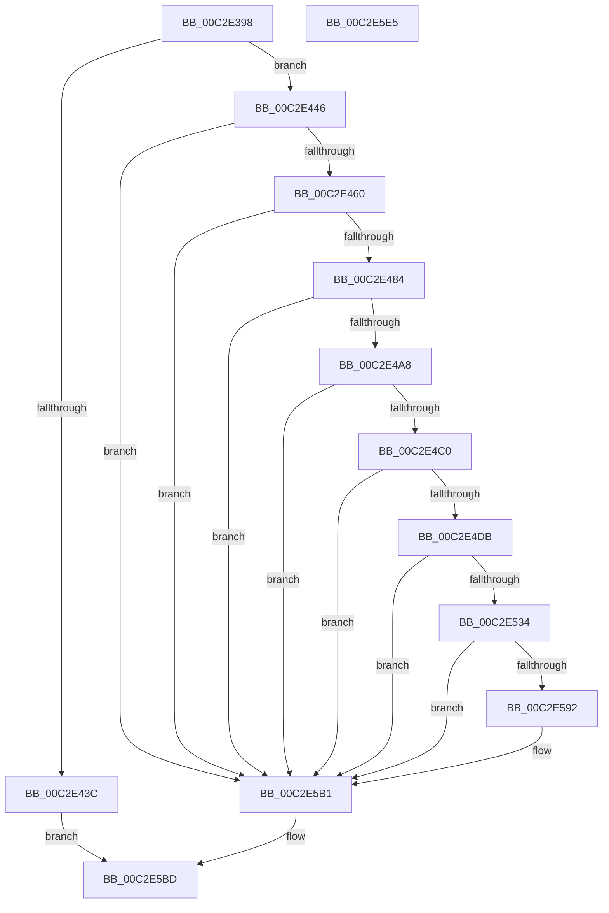

# IopApplySystemPartitionProt

- RVA: `0x00C2E398`–`0x00C2E5E6` (길이 `590` bytes)
- VA: `0x0000000140C2E398`
- 실행 섹션: `INIT`
- PDB 이름 있음: `예`; PDB Function 태그: `아니요`
- unwind 정보 RVA: `0x000C7E38`
- 디코드: `137`개 명령, `590/590` bytes 표시
- 미해석 바이트: `0` (있으면 어셈블리에 `.byte`로 보존)

> 이 문서는 커널 이미지의 기계어와 PDB 기호를 분석해 생성했습니다. 4번과 5번은 함수 원형과 자료형을 바이너리 사용 방식에서 추정한 C 해석이며 원본 소스 복구 결과는 아닙니다.

## 1. Dependencies

- 직접 호출 지점: **15**; 고유 호출 대상: **14**
- 직접 호출자로 확인된 함수: **1**
- RIP 상대 이미지 참조: **3**

### Outgoing calls
- `0x00C2E42F` → [ExAllocatePool2](../../poolcode/B8/ExAllocatePool2_function_00B820F0.md) (function, `0x00B820F0`)
- `0x00C2E451` → [RtlCreateAcl](../../page/91/RtlCreateAcl_function_00916F00.md) (function, `0x00916F00`)
- `0x00C2E475` → [RtlAddAccessAllowedAce](../../page/92/RtlAddAccessAllowedAce_function_009298C0.md) (function, `0x009298C0`)
- `0x00C2E499` → [RtlAddAccessAllowedAce](../../page/92/RtlAddAccessAllowedAce_function_009298C0.md) (function, `0x009298C0`)
- `0x00C2E4B1` → [RtlCreateSecurityDescriptor](../../page/9F/RtlCreateSecurityDescriptor_function_009F1DF0.md) (function, `0x009F1DF0`)
- `0x00C2E4CC` → [RtlSetDaclSecurityDescriptor](../../page/9E/RtlSetDaclSecurityDescriptor_function_009EC210.md) (function, `0x009EC210`)
- `0x00C2E509` → [RtlStringCchPrintfA](../../text/59/RtlStringCchPrintfA_function_00596BC8.md) (function, `0x00596BC8`)
- `0x00C2E517` → [RtlInitAnsiString](../../text/47/RtlInitAnsiString_function_00470F40.md) (function, `0x00470F40`)
- `0x00C2E529` → [RtlAnsiStringToUnicodeString](../../page/90/RtlAnsiStringToUnicodeString_function_0090BEA0.md) (function, `0x0090BEA0`)
- `0x00C2E57D` → [ZwOpenFile](../../text/6A/ZwOpenFile_function_006AD730.md) (function, `0x006AD730`)
- `0x00C2E589` → [RtlFreeAnsiString](../../page/9C/RtlFreeAnsiString_function_009C0800.md) (function, `0x009C0800`)
- `0x00C2E5A0` → [ZwSetSecurityObject](../../text/6B/ZwSetSecurityObject_function_006B0810.md) (function, `0x006B0810`)
- `0x00C2E5AC` → [NtClose](../../page/86/NtClose_function_00868870.md) (function, `0x00868870`)
- `0x00C2E5B6` → [ExFreePoolWithTag](../../poolcode/B8/ExFreePoolWithTag_function_00B82870.md) (function, `0x00B82870`)
- `0x00C2E5C7` → [_security_check_cookie](../../text/6A/_security_check_cookie_function_006AC640.md) (function, `0x006AC640`)

### Direct callers
- [IopProtectSystemPartition](IopProtectSystemPartition_function_00C2E5EC.md) at `0x00C2E6BE`

### Static image references
- `0x00C2E3B6` → RVA `0x00E0A740` (`.data`; read)
- `0x00C2E3E9` → RVA `0x00FD9A68` (`PAGEDATA`; read)
- `0x00C2E403` → RVA `0x00E67D58` (`.data`; read)

## 2. Other-region calls and transfers

- 다른 실행 섹션으로 향하는 call: **15**
  - `0x00C2E42F` → [ExAllocatePool2](../../poolcode/B8/ExAllocatePool2_function_00B820F0.md) (`INIT` → `POOLCODE`)
  - `0x00C2E451` → [RtlCreateAcl](../../page/91/RtlCreateAcl_function_00916F00.md) (`INIT` → `PAGE`)
  - `0x00C2E475` → [RtlAddAccessAllowedAce](../../page/92/RtlAddAccessAllowedAce_function_009298C0.md) (`INIT` → `PAGE`)
  - `0x00C2E499` → [RtlAddAccessAllowedAce](../../page/92/RtlAddAccessAllowedAce_function_009298C0.md) (`INIT` → `PAGE`)
  - `0x00C2E4B1` → [RtlCreateSecurityDescriptor](../../page/9F/RtlCreateSecurityDescriptor_function_009F1DF0.md) (`INIT` → `PAGE`)
  - `0x00C2E4CC` → [RtlSetDaclSecurityDescriptor](../../page/9E/RtlSetDaclSecurityDescriptor_function_009EC210.md) (`INIT` → `PAGE`)
  - `0x00C2E509` → [RtlStringCchPrintfA](../../text/59/RtlStringCchPrintfA_function_00596BC8.md) (`INIT` → `.text`)
  - `0x00C2E517` → [RtlInitAnsiString](../../text/47/RtlInitAnsiString_function_00470F40.md) (`INIT` → `.text`)
  - `0x00C2E529` → [RtlAnsiStringToUnicodeString](../../page/90/RtlAnsiStringToUnicodeString_function_0090BEA0.md) (`INIT` → `PAGE`)
  - `0x00C2E57D` → [ZwOpenFile](../../text/6A/ZwOpenFile_function_006AD730.md) (`INIT` → `.text`)
  - `0x00C2E589` → [RtlFreeAnsiString](../../page/9C/RtlFreeAnsiString_function_009C0800.md) (`INIT` → `PAGE`)
  - `0x00C2E5A0` → [ZwSetSecurityObject](../../text/6B/ZwSetSecurityObject_function_006B0810.md) (`INIT` → `.text`)
  - `0x00C2E5AC` → [NtClose](../../page/86/NtClose_function_00868870.md) (`INIT` → `PAGE`)
  - `0x00C2E5B6` → [ExFreePoolWithTag](../../poolcode/B8/ExFreePoolWithTag_function_00B82870.md) (`INIT` → `POOLCODE`)
  - `0x00C2E5C7` → [_security_check_cookie](../../text/6A/_security_check_cookie_function_006AC640.md) (`INIT` → `.text`)
- 별도 외부 분기/꼬리 이동을 확인하지 못했습니다.

## 3. Assembly (complete function range)

```asm
00C2E398  48 8B C4                        mov rax, rsp
00C2E39B  48 89 58 10                     mov qword ptr [rax + 0x10], rbx
00C2E39F  48 89 70 18                     mov qword ptr [rax + 0x18], rsi
00C2E3A3  48 89 78 20                     mov qword ptr [rax + 0x20], rdi
00C2E3A7  55                              push rbp
00C2E3A8  48 8D A8 18 FF FF FF            lea rbp, [rax - 0xe8]
00C2E3AF  48 81 EC E0 01 00 00            sub rsp, 0x1e0
00C2E3B6  48 8B 05 83 C3 1D 00            mov rax, qword ptr [rip + 0x1dc383]
00C2E3BD  48 33 C4                        xor rax, rsp
00C2E3C0  48 89 85 D0 00 00 00            mov qword ptr [rbp + 0xd0], rax
00C2E3C7  33 C0                           xor eax, eax
00C2E3C9  C7 45 C0 5C 41 72 63            mov dword ptr [rbp - 0x40], 0x6372415c
00C2E3D0  0F 57 C0                        xorps xmm0, xmm0
00C2E3D3  48 89 45 A8                     mov qword ptr [rbp - 0x58], rax
00C2E3D7  48 89 44 24 68                  mov qword ptr [rsp + 0x68], rax
00C2E3DC  48 8B F1                        mov rsi, rcx
00C2E3DF  89 44 24 70                     mov dword ptr [rsp + 0x70], eax
00C2E3E3  41 B8 49 6F 41 63               mov r8d, 0x63416f49
00C2E3E9  48 8B 05 78 B6 3A 00            mov rax, qword ptr [rip + 0x3ab678]
00C2E3F0  0F 11 45 88                     movups xmmword ptr [rbp - 0x78], xmm0
00C2E3F4  C7 45 C4 4E 61 6D 65            mov dword ptr [rbp - 0x3c], 0x656d614e
00C2E3FB  0F 11 45 98                     movups xmmword ptr [rbp - 0x68], xmm0
00C2E3FF  0F B6 50 01                     movzx edx, byte ptr [rax + 1]
00C2E403  48 8B 05 4E 99 23 00            mov rax, qword ptr [rip + 0x23994e]
00C2E40A  0F 11 44 24 48                  movups xmmword ptr [rsp + 0x48], xmm0
00C2E40F  C7 45 C8 5C 25 73 00            mov dword ptr [rbp - 0x38], 0x73255c
00C2E416  0F 11 44 24 58                  movups xmmword ptr [rsp + 0x58], xmm0
00C2E41B  0F B6 48 01                     movzx ecx, byte ptr [rax + 1]
00C2E41F  03 D1                           add edx, ecx
00C2E421  B9 00 01 00 00                  mov ecx, 0x100
00C2E426  8D 1C 95 38 00 00 00            lea ebx, [rdx*4 + 0x38]
00C2E42D  8B D3                           mov edx, ebx
00C2E42F  E8 BC 3C F5 FF                  call 0x140b820f0
00C2E434  48 8B F8                        mov rdi, rax
00C2E437  48 85 C0                        test rax, rax
00C2E43A  75 0A                           jne 0x140c2e446
00C2E43C  B8 9A 00 00 C0                  mov eax, 0xc000009a
00C2E441  E9 77 01 00 00                  jmp 0x140c2e5bd
00C2E446  41 B8 02 00 00 00               mov r8d, 2
00C2E44C  8B D3                           mov edx, ebx
00C2E44E  48 8B CF                        mov rcx, rdi
00C2E451  E8 AA 8A CE FF                  call 0x140916f00
00C2E456  8B D8                           mov ebx, eax
00C2E458  85 C0                           test eax, eax
00C2E45A  0F 88 51 01 00 00               js 0x140c2e5b1
00C2E460  4C 8B 0D F1 98 23 00            mov r9, qword ptr [rip + 0x2398f1]
00C2E467  BA 02 00 00 00                  mov edx, 2
00C2E46C  41 B8 00 00 00 10               mov r8d, 0x10000000
00C2E472  48 8B CF                        mov rcx, rdi
00C2E475  E8 46 B4 CF FF                  call 0x1409298c0
00C2E47A  8B D8                           mov ebx, eax
00C2E47C  85 C0                           test eax, eax
00C2E47E  0F 88 2D 01 00 00               js 0x140c2e5b1
00C2E484  4C 8B 0D DD B5 3A 00            mov r9, qword ptr [rip + 0x3ab5dd]
00C2E48B  BA 02 00 00 00                  mov edx, 2
00C2E490  41 B8 00 00 02 E0               mov r8d, 0xe0020000
00C2E496  48 8B CF                        mov rcx, rdi
00C2E499  E8 22 B4 CF FF                  call 0x1409298c0
00C2E49E  8B D8                           mov ebx, eax
00C2E4A0  85 C0                           test eax, eax
00C2E4A2  0F 88 09 01 00 00               js 0x140c2e5b1
00C2E4A8  BA 01 00 00 00                  mov edx, 1
00C2E4AD  48 8D 4D 88                     lea rcx, [rbp - 0x78]
00C2E4B1  E8 3A 39 DC FF                  call 0x1409f1df0
00C2E4B6  8B D8                           mov ebx, eax
00C2E4B8  85 C0                           test eax, eax
00C2E4BA  0F 88 F1 00 00 00               js 0x140c2e5b1
00C2E4C0  45 33 C9                        xor r9d, r9d
00C2E4C3  48 8D 4D 88                     lea rcx, [rbp - 0x78]
00C2E4C7  4C 8B C7                        mov r8, rdi
00C2E4CA  B2 01                           mov dl, 1
00C2E4CC  E8 3F DD DB FF                  call 0x1409ec210
00C2E4D1  8B D8                           mov ebx, eax
00C2E4D3  85 C0                           test eax, eax
00C2E4D5  0F 88 D6 00 00 00               js 0x140c2e5b1
00C2E4DB  4C 8B 8E C0 00 00 00            mov r9, qword ptr [rsi + 0xc0]
00C2E4E2  4C 8D 45 C0                     lea r8, [rbp - 0x40]
00C2E4E6  48 83 64 24 30 00               and qword ptr [rsp + 0x30], 0
00C2E4EC  48 8D 4D D0                     lea rcx, [rbp - 0x30]
00C2E4F0  0F 57 C0                        xorps xmm0, xmm0
00C2E4F3  0F 57 C9                        xorps xmm1, xmm1
00C2E4F6  BA 00 01 00 00                  mov edx, 0x100
00C2E4FB  0F 11 44 24 78                  movups xmmword ptr [rsp + 0x78], xmm0
00C2E500  0F 11 4C 24 38                  movups xmmword ptr [rsp + 0x38], xmm1
00C2E505  0F 11 45 B0                     movups xmmword ptr [rbp - 0x50], xmm0
00C2E509  E8 BA 86 96 FF                  call 0x140596bc8
00C2E50E  48 8D 55 D0                     lea rdx, [rbp - 0x30]
00C2E512  48 8D 4C 24 78                  lea rcx, [rsp + 0x78]
00C2E517  E8 24 2A 84 FF                  call 0x140470f40
00C2E51C  41 B0 01                        mov r8b, 1
00C2E51F  48 8D 54 24 78                  lea rdx, [rsp + 0x78]
00C2E524  48 8D 4C 24 38                  lea rcx, [rsp + 0x38]
00C2E529  E8 72 D9 CD FF                  call 0x14090bea0
00C2E52E  8B D8                           mov ebx, eax
00C2E530  85 C0                           test eax, eax
00C2E532  78 7D                           js 0x140c2e5b1
00C2E534  83 64 24 28 00                  and dword ptr [rsp + 0x28], 0
00C2E539  48 8D 44 24 38                  lea rax, [rsp + 0x38]
00C2E53E  48 83 64 24 50 00               and qword ptr [rsp + 0x50], 0
00C2E544  4C 8D 4D B0                     lea r9, [rbp - 0x50]
00C2E548  0F 57 C0                        xorps xmm0, xmm0
00C2E54B  48 89 44 24 58                  mov qword ptr [rsp + 0x58], rax
00C2E550  4C 8D 44 24 48                  lea r8, [rsp + 0x48]
00C2E555  C7 44 24 48 30 00 00 00         mov dword ptr [rsp + 0x48], 0x30
00C2E55D  BA 00 00 04 00                  mov edx, 0x40000
00C2E562  C7 44 24 60 40 02 00 00         mov dword ptr [rsp + 0x60], 0x240
00C2E56A  48 8D 4C 24 30                  lea rcx, [rsp + 0x30]
00C2E56F  C7 44 24 20 01 00 00 00         mov dword ptr [rsp + 0x20], 1
00C2E577  F3 0F 7F 44 24 68               movdqu xmmword ptr [rsp + 0x68], xmm0
00C2E57D  E8 AE F1 A7 FF                  call 0x1406ad730
00C2E582  48 8D 4C 24 38                  lea rcx, [rsp + 0x38]
00C2E587  8B D8                           mov ebx, eax
00C2E589  E8 72 22 D9 FF                  call 0x1409c0800
00C2E58E  85 DB                           test ebx, ebx
00C2E590  78 1F                           js 0x140c2e5b1
00C2E592  48 8B 4C 24 30                  mov rcx, qword ptr [rsp + 0x30]
00C2E597  4C 8D 45 88                     lea r8, [rbp - 0x78]
00C2E59B  BA 04 00 00 00                  mov edx, 4
00C2E5A0  E8 6B 22 A8 FF                  call 0x1406b0810
00C2E5A5  48 8B 4C 24 30                  mov rcx, qword ptr [rsp + 0x30]
00C2E5AA  8B D8                           mov ebx, eax
00C2E5AC  E8 BF A2 C3 FF                  call 0x140868870
00C2E5B1  33 D2                           xor edx, edx
00C2E5B3  48 8B CF                        mov rcx, rdi
00C2E5B6  E8 B5 42 F5 FF                  call 0x140b82870
00C2E5BB  8B C3                           mov eax, ebx
00C2E5BD  48 8B 8D D0 00 00 00            mov rcx, qword ptr [rbp + 0xd0]
00C2E5C4  48 33 CC                        xor rcx, rsp
00C2E5C7  E8 74 E0 A7 FF                  call 0x1406ac640
00C2E5CC  4C 8D 9C 24 E0 01 00 00         lea r11, [rsp + 0x1e0]
00C2E5D4  49 8B 5B 18                     mov rbx, qword ptr [r11 + 0x18]
00C2E5D8  49 8B 73 20                     mov rsi, qword ptr [r11 + 0x20]
00C2E5DC  49 8B 7B 28                     mov rdi, qword ptr [r11 + 0x28]
00C2E5E0  49 8B E3                        mov rsp, r11
00C2E5E3  5D                              pop rbp
00C2E5E4  C3                              ret
00C2E5E5  CC                              int3
```

## 4. C-style interpretation (structured pseudocode)

```c
__int64 __fastcall IopApplySystemPartitionProt(__int64 a1)
{
    __int64 result;
    __int64 v_rbx;
    __int64 v_rsp;
    unsigned __int64 v_stack_m170;
    unsigned int v_stack_m178;
    unsigned __int64 v_stack_m180;
    unsigned int v_stack_m188;
    unsigned __int64 v_stack_m190;
    unsigned __int64 v_stack_m198;
    unsigned __int64 v_stack_m1A0;
    unsigned __int64 v_stack_m1B0;
    unsigned __int64 v_stack_m1B8;
    unsigned int v_stack_m1C0;
    unsigned int v_stack_m1C8;
    unsigned __int64 v_stack_m8;

    *(unsigned __int64 *)(v_rsp + 16) = v_rbx;
    *(unsigned __int64 *)(v_rsp + 24) = v_rsi;
    *(unsigned __int64 *)(v_rsp + 32) = v_rdi;
    v_rsp = (v_rsp) - (480);
    result = (*(unsigned __int64 *)(v_rip + 1950595)) ^ (v_rsp);
    *(unsigned __int64 *)(v_rsp - 232 + 208) = result;
    result = 0;
    *(unsigned int *)(v_rsp - 232 - 64) = 0x6372415CULL;
    *(unsigned __int64 *)(v_rsp - 232 - 88) = 0;
    v_stack_m180 = 0;
    v_stack_m178 = 0;
    *(unsigned __int64 *)(v_rsp - 232 - 120) = v_xmm0;
    *(unsigned int *)(v_rsp - 232 - 60) = 0x656D614EULL;
    *(unsigned __int64 *)(v_rsp - 232 - 104) = v_xmm0;
    v_stack_m1A0 = v_xmm0;
    *(unsigned int *)(v_rsp - 232 - 56) = 0x73255CULL;
    v_stack_m190 = v_xmm0;
    a2 = (unsigned int)((*(unsigned __int8 *)(*(unsigned __int64 *)(v_rip + 3847800) + 1)) + ((unsigned int)(*(unsigned __int8 *)(*(unsigned __int64 *)(v_rip + 2333006) + 1))));
    result = ExAllocatePool2(256, (unsigned int)((unsigned int)(a2 * 4 + 56)), (unsigned int)(0x63416F49ULL), a4);
    if (result != 0) goto loc_00C2E446;
    goto loc_00C2E5BD;
loc_00C2E446:
    result = RtlCreateAcl(result, (unsigned int)((unsigned int)(a2 * 4 + 56)), 2, a4);
    if (sign_flag) goto loc_00C2E5B1;
    result = RtlAddAccessAllowedAce(result, 2, (unsigned int)(0x10000000ULL), *(unsigned __int64 *)(v_rip + 2332913));
    if (sign_flag) goto loc_00C2E5B1;
    result = RtlAddAccessAllowedAce(result, 2, (unsigned int)(0xE0020000ULL), *(unsigned __int64 *)(v_rip + 3847645));
    if (sign_flag) goto loc_00C2E5B1;
    result = RtlCreateSecurityDescriptor(v_rsp - 232 - 120, 1, (unsigned int)(0xE0020000ULL), *(unsigned __int64 *)(v_rip + 3847645));
    if (sign_flag) goto loc_00C2E5B1;
    a4 = 0;
    result = RtlSetDaclSecurityDescriptor(v_rsp - 232 - 120, 1, result, a4);
    if (sign_flag) goto loc_00C2E5B1;
    v_stack_m170 = v_xmm0;
    v_stack_m1B0 = v_xmm1;
    *(unsigned __int64 *)(v_rsp - 232 - 80) = v_xmm0;
    result = RtlStringCchPrintfA(v_rsp - 232 - 48, 256, v_rsp - 232 - 64, *(unsigned __int64 *)(a1 + 192));
    result = RtlInitAnsiString(v_stack_m170, v_rsp - 232 - 48, v_rsp - 232 - 64, *(unsigned __int64 *)(a1 + 192));
    result = RtlAnsiStringToUnicodeString(v_stack_m1B0, v_stack_m170, 1, *(unsigned __int64 *)(a1 + 192));
    if (sign_flag) goto loc_00C2E5B1;
    v_stack_m190 = v_stack_m1B0;
    v_stack_m1A0 = 48;
    v_stack_m188 = 576;
    v_stack_m1C8 = 1;
    v_stack_m180 = v_xmm0;
    result = ZwOpenFile(v_stack_m1B8, (unsigned int)(0x40000ULL), v_stack_m1A0, v_rsp - 232 - 80);
    result = RtlFreeAnsiString(v_stack_m1B0, (unsigned int)(0x40000ULL), v_stack_m1A0, v_rsp - 232 - 80);
    v_rbx = (unsigned int)((unsigned int)(result));
    if (!(sign_flag)) {
        a1 = v_stack_m1B8;
        a3 = v_rsp - 232 - 120;
        a2 = 4;
        result = ZwSetSecurityObject(a1, a2, a3, v_rsp - 232 - 80);
        a1 = v_stack_m1B8;
        v_rbx = (unsigned int)(result);
        result = NtClose(a1, a2, a3, v_rsp - 232 - 80);
    }
    a2 = 0;
    result = ExFreePoolWithTag(result, a2, a3, v_rsp - 232 - 80);
loc_00C2E5BD:
    a1 = (*(unsigned __int64 *)(v_rsp - 232 + 208)) ^ (v_rsp);
    result = _security_check_cookie(a1, a2, a3, v_rsp - 232 - 80);
    return result;
}
```

## 5. (Beta) C Style

```c
int64_t IopApplySystemPartitionProt(void *Arg1)
{
    uint8_t *arg1 = (uint8_t *)Arg1;

    int64_t result;
    int64_t local_rbx;
    int64_t local_rsp;
    uint64_t v_stack_m170;
    uint32_t v_stack_m178;
    uint64_t v_stack_m180;
    uint32_t v_stack_m188;
    uint64_t v_stack_m190;
    uint64_t v_stack_m198;
    uint64_t v_stack_m1A0;
    uint64_t v_stack_m1B0;
    uint64_t v_stack_m1B8;
    uint32_t v_stack_m1C0;
    uint32_t v_stack_m1C8;
    uint64_t v_stack_m8;

    *(uint64_t *)(local_rsp + 0x10) = local_rbx;
    *(uint64_t *)(local_rsp + 0x18) = local_rsi;
    *(uint64_t *)(local_rsp + 0x20) = local_rdi;
    local_rsp = (local_rsp) - (480);
    result = (*(uint64_t *)(v_rip + 0x1DC383)) ^ (local_rsp);
    *(uint64_t *)(local_rsp - 0xE8 + 0xD0) = result;
    result = 0;
    *(uint32_t *)(local_rsp - 0xE8 - 0x40) = 0x6372415CULL;
    *(uint64_t *)(local_rsp - 0xE8 - 0x58) = 0;
    v_stack_m180 = 0;
    v_stack_m178 = 0;
    *(uint64_t *)(local_rsp - 0xE8 - 0x78) = v_xmm0;
    *(uint32_t *)(local_rsp - 0xE8 - 0x3C) = 0x656D614EULL;
    *(uint64_t *)(local_rsp - 0xE8 - 0x68) = v_xmm0;
    v_stack_m1A0 = v_xmm0;
    *(uint32_t *)(local_rsp - 0xE8 - 0x38) = 0x73255CULL;
    v_stack_m190 = v_xmm0;
    a2 = (uint32_t)((*(uint8_t *)(*(uint64_t *)(v_rip + 0x3AB678) + 0x1)) + ((uint32_t)(*(uint8_t *)(*(uint64_t *)(v_rip + 0x23994E) + 0x1))));
    result = ExAllocatePool2(256, (uint32_t)((uint32_t)(a2 * 4 + 56)), (uint32_t)(0x63416F49ULL), a4);
    if (result != 0) goto loc_00C2E446;
    goto loc_00C2E5BD;
loc_00C2E446:
    result = RtlCreateAcl(result, (uint32_t)((uint32_t)(a2 * 4 + 56)), 2, a4);
    if (sign_flag) goto loc_00C2E5B1;
    result = RtlAddAccessAllowedAce(result, 2, (uint32_t)(0x10000000ULL), *(uint64_t *)(v_rip + 0x2398F1));
    if (sign_flag) goto loc_00C2E5B1;
    result = RtlAddAccessAllowedAce(result, 2, (uint32_t)(0xE0020000ULL), *(uint64_t *)(v_rip + 0x3AB5DD));
    if (sign_flag) goto loc_00C2E5B1;
    result = RtlCreateSecurityDescriptor(local_rsp - 232 - 120, 1, (uint32_t)(0xE0020000ULL), *(uint64_t *)(v_rip + 0x3AB5DD));
    if (sign_flag) goto loc_00C2E5B1;
    a4 = 0;
    result = RtlSetDaclSecurityDescriptor(local_rsp - 232 - 120, 1, result, a4);
    if (sign_flag) goto loc_00C2E5B1;
    v_stack_m170 = v_xmm0;
    v_stack_m1B0 = v_xmm1;
    *(uint64_t *)(local_rsp - 0xE8 - 0x50) = v_xmm0;
    result = RtlStringCchPrintfA(local_rsp - 232 - 48, 256, local_rsp - 232 - 64, *(uint64_t *)(arg1 + 0xC0));
    result = RtlInitAnsiString(v_stack_m170, local_rsp - 232 - 48, local_rsp - 232 - 64, *(uint64_t *)(arg1 + 0xC0));
    result = RtlAnsiStringToUnicodeString(v_stack_m1B0, v_stack_m170, 1, *(uint64_t *)(arg1 + 0xC0));
    if (sign_flag) goto loc_00C2E5B1;
    v_stack_m190 = v_stack_m1B0;
    v_stack_m1A0 = 48;
    v_stack_m188 = 576;
    v_stack_m1C8 = 1;
    v_stack_m180 = v_xmm0;
    result = ZwOpenFile(v_stack_m1B8, (uint32_t)(0x40000ULL), v_stack_m1A0, local_rsp - 232 - 80);
    result = RtlFreeAnsiString(v_stack_m1B0, (uint32_t)(0x40000ULL), v_stack_m1A0, local_rsp - 232 - 80);
    local_rbx = (uint32_t)((uint32_t)(result));
    if (!(sign_flag)) {
        Arg1 = v_stack_m1B8;
        a3 = local_rsp - 232 - 120;
        a2 = 4;
        result = ZwSetSecurityObject(Arg1, a2, a3, local_rsp - 232 - 80);
        Arg1 = v_stack_m1B8;
        local_rbx = (uint32_t)(result);
        result = NtClose(Arg1, a2, a3, local_rsp - 232 - 80);
    }
    a2 = 0;
    result = ExFreePoolWithTag(result, a2, a3, local_rsp - 232 - 80);
loc_00C2E5BD:
    Arg1 = (*(uint64_t *)(local_rsp - 0xE8 + 0xD0)) ^ (local_rsp);
    result = _security_check_cookie(Arg1, a2, a3, local_rsp - 232 - 80);
    return result;
}
```

### 관측된 메모리 오프셋

구조체 형식이 확인되지 않은 접근은 인자 기준의 오프셋으로만 기록했습니다.

| 기준 인자 | 오프셋 표현 | 폭 (bit) | 접근 |
|---|---:|---:|---|
| `Arg1` | `+ 0xC0` | `64` | `R` |

## 6. Execution-region graph

[열기: 2D/3D 그래프와 함수 탐색 컨트롤 패널](../../../control-panel.html?section=init&rva=0x00C2E398&view=graph)

- 2D 그래프는 위에서 아래로 흐르고, 3D 그래프는 빈 공간을 드래그해 회전합니다. Shift+드래그는 이동, 휠은 확대·축소, 함수 노드 선택은 대상 보고서 이동입니다.

### Static fallback


