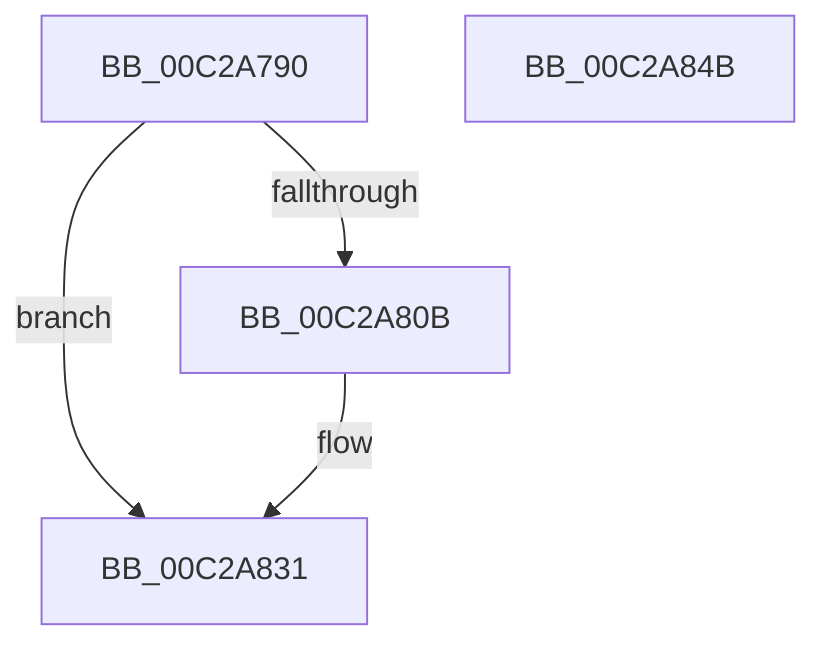

# IopCachePreviousBootData

- RVA: `0x00C2A790`–`0x00C2A84C` (길이 `188` bytes)
- VA: `0x0000000140C2A790`
- 실행 섹션: `INIT`
- PDB 이름 있음: `예`; PDB Function 태그: `아니요`
- unwind 정보 RVA: `0x0005F764`
- 디코드: `41`개 명령, `188/188` bytes 표시
- 미해석 바이트: `0` (있으면 어셈블리에 `.byte`로 보존)

> 이 문서는 커널 이미지의 기계어와 PDB 기호를 분석해 생성했습니다. 4번과 5번은 함수 원형과 자료형을 바이너리 사용 방식에서 추정한 C 해석이며 원본 소스 복구 결과는 아닙니다.

## 1. Dependencies

- 직접 호출 지점: **3**; 고유 호출 대상: **3**
- 직접 호출자로 확인된 함수: **1**
- RIP 상대 이미지 참조: **3**

### Outgoing calls
- `0x00C2A802` → [IoGetEnvironmentVariableEx](../../page/95/IoGetEnvironmentVariableEx_function_00952760.md) (function, `0x00952760`)
- `0x00C2A82C` → [ZwSetValueKey](../../text/6A/ZwSetValueKey_function_006ADCD0.md) (function, `0x006ADCD0`)
- `0x00C2A838` → [_security_check_cookie](../../text/6A/_security_check_cookie_function_006AC640.md) (function, `0x006AC640`)

### Direct callers
- [IopInitializeOfflineCrashDump](../../text/59/IopInitializeOfflineCrashDump_function_00595A24.md) at `0x00595BB2`

### Static image references
- `0x00C2A79D` → RVA `0x00E0A740` (`.data`; read)
- `0x00C2A7B0` → RVA `0x00C79910` (` ?? ::PBOPGDP::`string'`; read)
- `0x00C2A7C8` → RVA `0x00C798F0` (` ?? ::PBOPGDP::`string'`; read)

## 2. Other-region calls and transfers

- 다른 실행 섹션으로 향하는 call: **3**
  - `0x00C2A802` → [IoGetEnvironmentVariableEx](../../page/95/IoGetEnvironmentVariableEx_function_00952760.md) (`INIT` → `PAGE`)
  - `0x00C2A82C` → [ZwSetValueKey](../../text/6A/ZwSetValueKey_function_006ADCD0.md) (`INIT` → `.text`)
  - `0x00C2A838` → [_security_check_cookie](../../text/6A/_security_check_cookie_function_006AC640.md) (`INIT` → `.text`)
- 별도 외부 분기/꼬리 이동을 확인하지 못했습니다.

## 3. Assembly (complete function range)

```asm
00C2A790  48 89 5C 24 10                  mov qword ptr [rsp + 0x10], rbx
00C2A795  55                              push rbp
00C2A796  48 8B EC                        mov rbp, rsp
00C2A799  48 83 EC 70                     sub rsp, 0x70
00C2A79D  48 8B 05 9C FF 1D 00            mov rax, qword ptr [rip + 0x1dff9c]
00C2A7A4  48 33 C4                        xor rax, rsp
00C2A7A7  48 89 45 F0                     mov qword ptr [rbp - 0x10], rax
00C2A7AB  48 83 65 C8 00                  and qword ptr [rbp - 0x38], 0
00C2A7B0  48 8D 05 59 F1 04 00            lea rax, [rip + 0x4f159]
00C2A7B7  48 83 64 24 20 00               and qword ptr [rsp + 0x20], 0
00C2A7BD  4C 8D 4D C0                     lea r9, [rbp - 0x40]
00C2A7C1  48 8B D9                        mov rbx, rcx
00C2A7C4  48 89 45 D8                     mov qword ptr [rbp - 0x28], rax
00C2A7C8  48 8D 0D 21 F1 04 00            lea rcx, [rip + 0x4f121]
00C2A7CF  C7 45 E0 BD 9A FA 77            mov dword ptr [rbp - 0x20], 0x77fa9abd
00C2A7D6  4C 8D 45 C8                     lea r8, [rbp - 0x38]
00C2A7DA  C7 45 E4 59 03 32 4D            mov dword ptr [rbp - 0x1c], 0x4d320359
00C2A7E1  48 8D 55 E0                     lea rdx, [rbp - 0x20]
00C2A7E5  C7 45 E8 BD 60 28 F4            mov dword ptr [rbp - 0x18], 0xf42860bd
00C2A7EC  C7 45 EC E7 8F 78 4B            mov dword ptr [rbp - 0x14], 0x4b788fe7
00C2A7F3  C7 45 C0 08 00 00 00            mov dword ptr [rbp - 0x40], 8
00C2A7FA  48 C7 45 D0 26 00 28 00         mov qword ptr [rbp - 0x30], 0x280026
00C2A802  E8 59 7F D2 FF                  call 0x140952760
00C2A807  85 C0                           test eax, eax
00C2A809  78 26                           js 0x140c2a831
00C2A80B  48 8B 0B                        mov rcx, qword ptr [rbx]
00C2A80E  48 8D 45 C8                     lea rax, [rbp - 0x38]
00C2A812  C7 44 24 28 08 00 00 00         mov dword ptr [rsp + 0x28], 8
00C2A81A  48 8D 55 D0                     lea rdx, [rbp - 0x30]
00C2A81E  41 B9 0B 00 00 00               mov r9d, 0xb
00C2A824  48 89 44 24 20                  mov qword ptr [rsp + 0x20], rax
00C2A829  45 33 C0                        xor r8d, r8d
00C2A82C  E8 9F 34 A8 FF                  call 0x1406adcd0
00C2A831  48 8B 4D F0                     mov rcx, qword ptr [rbp - 0x10]
00C2A835  48 33 CC                        xor rcx, rsp
00C2A838  E8 03 1E A8 FF                  call 0x1406ac640
00C2A83D  48 8B 9C 24 88 00 00 00         mov rbx, qword ptr [rsp + 0x88]
00C2A845  48 83 C4 70                     add rsp, 0x70
00C2A849  5D                              pop rbp
00C2A84A  C3                              ret
00C2A84B  CC                              int3
```

## 4. C-style interpretation (structured pseudocode)

```c
__int64 __fastcall IopCachePreviousBootData(__int64 a1)
{
    __int64 result;
    __int64 v_rsp;
    unsigned __int64 v_stack_m18;
    unsigned int v_stack_m1C;
    unsigned int v_stack_m20;
    unsigned int v_stack_m24;
    unsigned int v_stack_m28;
    unsigned __int64 v_stack_m30;
    unsigned __int64 v_stack_m38;
    unsigned __int64 v_stack_m40;
    unsigned __int64 v_stack_m48;
    unsigned int v_stack_m50;
    unsigned __int64 v_stack_m58;
    unsigned __int64 v_stack_p10;

    v_stack_p10 = v_rbx;
    v_rsp = (v_rsp) - (112);
    result = (*(unsigned __int64 *)(v_rip + 1965980)) ^ (v_rsp);
    v_stack_m18 = result;
    v_stack_m30 = v_rip + 323929;
    v_stack_m28 = 0x77FA9ABDULL;
    v_stack_m24 = 0x4D320359ULL;
    v_stack_m20 = 0xF42860BDULL;
    v_stack_m1C = 0x4B788FE7ULL;
    v_stack_m48 = 8;
    v_stack_m38 = 0x280026ULL;
    result = IoGetEnvironmentVariableEx(v_rip + 323873, v_stack_m28, v_stack_m40, v_stack_m48);
    if (!(sign_flag)) {
        a1 = *(unsigned __int64 *)(a1);
        result = v_stack_m40;
        v_stack_m50 = 8;
        a2 = v_stack_m38;
        a4 = 11;
        v_stack_m58 = result;
        a3 = 0;
        result = ZwSetValueKey(a1, a2, a3, a4);
    }
    a1 = (v_stack_m18) ^ (v_rsp);
    result = _security_check_cookie(a1, a2, a3, a4);
    v_rsp = (v_rsp) + (112);
    return result;
}
```

## 5. (Beta) C Style

```c
int64_t IopCachePreviousBootData(void *Arg1)
{
    uint8_t *arg1 = (uint8_t *)Arg1;

    int64_t result;
    int64_t local_rsp;
    uint64_t v_stack_m18;
    uint32_t v_stack_m1C;
    uint32_t v_stack_m20;
    uint32_t v_stack_m24;
    uint32_t v_stack_m28;
    uint64_t v_stack_m30;
    uint64_t v_stack_m38;
    uint64_t v_stack_m40;
    uint64_t v_stack_m48;
    uint32_t v_stack_m50;
    uint64_t v_stack_m58;
    uint64_t v_stack_p10;

    v_stack_p10 = local_rbx;
    local_rsp = (local_rsp) - (112);
    result = (*(uint64_t *)(v_rip + 0x1DFF9C)) ^ (local_rsp);
    v_stack_m18 = result;
    v_stack_m30 = v_rip + 323929;
    v_stack_m28 = 0x77FA9ABDULL;
    v_stack_m24 = 0x4D320359ULL;
    v_stack_m20 = 0xF42860BDULL;
    v_stack_m1C = 0x4B788FE7ULL;
    v_stack_m48 = 8;
    v_stack_m38 = 0x280026ULL;
    result = IoGetEnvironmentVariableEx(v_rip + 323873, v_stack_m28, v_stack_m40, v_stack_m48);
    if (!(sign_flag)) {
        Arg1 = *(uint64_t *)(arg1);
        result = v_stack_m40;
        v_stack_m50 = 8;
        a2 = v_stack_m38;
        a4 = 11;
        v_stack_m58 = result;
        a3 = 0;
        result = ZwSetValueKey(Arg1, a2, a3, a4);
    }
    Arg1 = (v_stack_m18) ^ (local_rsp);
    result = _security_check_cookie(Arg1, a2, a3, a4);
    local_rsp = (local_rsp) + (112);
    return result;
}
```

### 관측된 메모리 오프셋

구조체 형식이 확인되지 않은 접근은 인자 기준의 오프셋으로만 기록했습니다.

| 기준 인자 | 오프셋 표현 | 폭 (bit) | 접근 |
|---|---:|---:|---|
| `Arg1` | `+ 0x0` | `64` | `R` |

## 6. Execution-region graph

[열기: 2D/3D 그래프와 함수 탐색 컨트롤 패널](../../../control-panel.html?section=init&rva=0x00C2A790&view=graph)

- 2D 그래프는 위에서 아래로 흐르고, 3D 그래프는 빈 공간을 드래그해 회전합니다. Shift+드래그는 이동, 휠은 확대·축소, 함수 노드 선택은 대상 보고서 이동입니다.

### Static fallback


