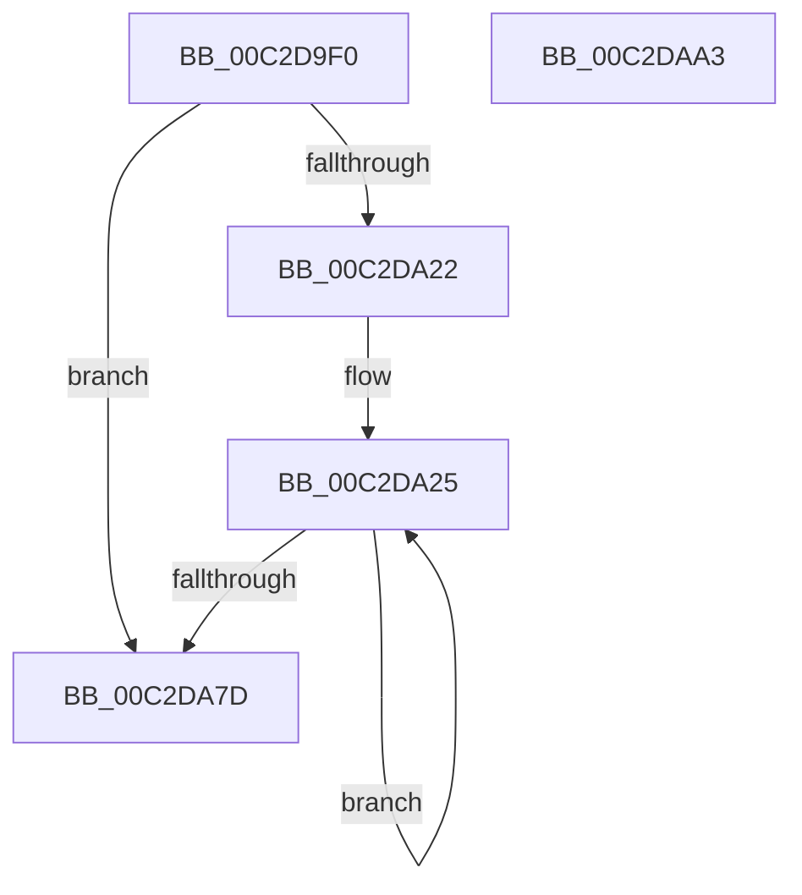

# IopCallBootDriverReinitializationRoutines

- RVA: `0x00C2D9F0`–`0x00C2DAA4` (길이 `180` bytes)
- VA: `0x0000000140C2D9F0`
- 실행 섹션: `INIT`
- PDB 이름 있음: `예`; PDB Function 태그: `아니요`
- unwind 정보 RVA: `0x0005CAAC`
- 디코드: `47`개 명령, `180/180` bytes 표시
- 미해석 바이트: `0` (있으면 어셈블리에 `.byte`로 보존)

> 이 문서는 커널 이미지의 기계어와 PDB 기호를 분석해 생성했습니다. 4번과 5번은 함수 원형과 자료형을 바이너리 사용 방식에서 추정한 C 해석이며 원본 소스 복구 결과는 아닙니다.

## 1. Dependencies

- 직접 호출 지점: **7**; 고유 호출 대상: **5**
- 직접 호출자로 확인된 함수: **1**
- RIP 상대 이미지 참조: **4**

### Outgoing calls
- `0x00C2DA09` → [PnpDiagnosticTrace](../../text/26/PnpDiagnosticTrace_function_0026E384.md) (function, `0x0026E384`)
- `0x00C2DA15` → [IopInterlockedRemoveHeadList](../../text/4B/IopInterlockedRemoveHeadList_function_004B4FB0.md) (function, `0x004B4FB0`)
- `0x00C2DA4C` → [guard_dispatch_icall](../../text/6B/guard_dispatch_icall_function_006BAAD0.md) (function, `0x006BAAD0`)
- `0x00C2DA5A` → [ObfDereferenceObjectWithTag](../../text/2F/ObfDereferenceObjectWithTag_function_002F78E0.md) (function, `0x002F78E0`)
- `0x00C2DA64` → [ExFreePoolWithTag](../../poolcode/B8/ExFreePoolWithTag_function_00B82870.md) (function, `0x00B82870`)
- `0x00C2DA70` → [IopInterlockedRemoveHeadList](../../text/4B/IopInterlockedRemoveHeadList_function_004B4FB0.md) (function, `0x004B4FB0`)
- `0x00C2DA90` → [PnpDiagnosticTrace](../../text/26/PnpDiagnosticTrace_function_0026E384.md) (function, `0x0026E384`)

### Direct callers
- [IopInitializeBootDrivers](IopInitializeBootDrivers_function_00C2E6F4.md) at `0x00C2ED92`

### Static image references
- `0x00C2D9FD` → RVA `0x00026D10` (`.rdata`; read)
- `0x00C2DA0E` → RVA `0x00F8D240` (`.data`; read)
- `0x00C2DA80` → RVA `0x00E66100` (`.data`; write)
- `0x00C2DA89` → RVA `0x00026DE0` (`.rdata`; read)

## 2. Other-region calls and transfers

- 다른 실행 섹션으로 향하는 call: **7**
  - `0x00C2DA09` → [PnpDiagnosticTrace](../../text/26/PnpDiagnosticTrace_function_0026E384.md) (`INIT` → `.text`)
  - `0x00C2DA15` → [IopInterlockedRemoveHeadList](../../text/4B/IopInterlockedRemoveHeadList_function_004B4FB0.md) (`INIT` → `.text`)
  - `0x00C2DA4C` → [guard_dispatch_icall](../../text/6B/guard_dispatch_icall_function_006BAAD0.md) (`INIT` → `.text`)
  - `0x00C2DA5A` → [ObfDereferenceObjectWithTag](../../text/2F/ObfDereferenceObjectWithTag_function_002F78E0.md) (`INIT` → `.text`)
  - `0x00C2DA64` → [ExFreePoolWithTag](../../poolcode/B8/ExFreePoolWithTag_function_00B82870.md) (`INIT` → `POOLCODE`)
  - `0x00C2DA70` → [IopInterlockedRemoveHeadList](../../text/4B/IopInterlockedRemoveHeadList_function_004B4FB0.md) (`INIT` → `.text`)
  - `0x00C2DA90` → [PnpDiagnosticTrace](../../text/26/PnpDiagnosticTrace_function_0026E384.md) (`INIT` → `.text`)
- 별도 외부 분기/꼬리 이동을 확인하지 못했습니다.

## 3. Assembly (complete function range)

```asm
00C2D9F0  48 89 5C 24 08                  mov qword ptr [rsp + 8], rbx
00C2D9F5  57                              push rdi
00C2D9F6  48 83 EC 20                     sub rsp, 0x20
00C2D9FA  45 33 C0                        xor r8d, r8d
00C2D9FD  48 8D 0D 0C 93 3F FF            lea rcx, [rip - 0xc06cf4]
00C2DA04  33 D2                           xor edx, edx
00C2DA06  40 32 FF                        xor dil, dil
00C2DA09  E8 76 09 64 FF                  call 0x14026e384
00C2DA0E  48 8D 0D 2B F8 35 00            lea rcx, [rip + 0x35f82b]
00C2DA15  E8 96 75 88 FF                  call 0x1404b4fb0
00C2DA1A  48 8B D8                        mov rbx, rax
00C2DA1D  48 85 C0                        test rax, rax
00C2DA20  74 5B                           je 0x140c2da7d
00C2DA22  40 B7 01                        mov dil, 1
00C2DA25  48 8B 43 10                     mov rax, qword ptr [rbx + 0x10]
00C2DA29  48 8B 48 30                     mov rcx, qword ptr [rax + 0x30]
00C2DA2D  FF 41 10                        inc dword ptr [rcx + 0x10]
00C2DA30  48 8B 43 10                     mov rax, qword ptr [rbx + 0x10]
00C2DA34  83 60 10 DF                     and dword ptr [rax + 0x10], 0xffffffdf
00C2DA38  48 8B 4B 10                     mov rcx, qword ptr [rbx + 0x10]
00C2DA3C  48 8B 43 18                     mov rax, qword ptr [rbx + 0x18]
00C2DA40  48 8B 53 20                     mov rdx, qword ptr [rbx + 0x20]
00C2DA44  4C 8B 41 30                     mov r8, qword ptr [rcx + 0x30]
00C2DA48  45 8B 40 10                     mov r8d, dword ptr [r8 + 0x10]
00C2DA4C  E8 7F D0 A8 FF                  call 0x1406baad0
00C2DA51  48 8B 4B 10                     mov rcx, qword ptr [rbx + 0x10]
00C2DA55  BA 44 66 6C 74                  mov edx, 0x746c6644
00C2DA5A  E8 81 9E 6C FF                  call 0x1402f78e0
00C2DA5F  33 D2                           xor edx, edx
00C2DA61  48 8B CB                        mov rcx, rbx
00C2DA64  E8 07 4E F5 FF                  call 0x140b82870
00C2DA69  48 8D 0D D0 F7 35 00            lea rcx, [rip + 0x35f7d0]
00C2DA70  E8 3B 75 88 FF                  call 0x1404b4fb0
00C2DA75  48 8B D8                        mov rbx, rax
00C2DA78  48 85 C0                        test rax, rax
00C2DA7B  75 A8                           jne 0x140c2da25
00C2DA7D  45 33 C0                        xor r8d, r8d
00C2DA80  C6 05 79 86 23 00 01            mov byte ptr [rip + 0x238679], 1
00C2DA87  33 D2                           xor edx, edx
00C2DA89  48 8D 0D 50 93 3F FF            lea rcx, [rip - 0xc06cb0]
00C2DA90  E8 EF 08 64 FF                  call 0x14026e384
00C2DA95  48 8B 5C 24 30                  mov rbx, qword ptr [rsp + 0x30]
00C2DA9A  40 8A C7                        mov al, dil
00C2DA9D  48 83 C4 20                     add rsp, 0x20
00C2DAA1  5F                              pop rdi
00C2DAA2  C3                              ret
00C2DAA3  CC                              int3
```

## 4. C-style interpretation (structured pseudocode)

```c
__int64 __fastcall IopCallBootDriverReinitializationRoutines(__int64 a1, int a2, int a3)
{
    __int64 result;
    __int64 v_rdi;
    __int64 v_rsp;
    unsigned __int64 v_stack_p8;

    v_stack_p8 = v_rbx;
    v_rsp = (v_rsp) - (32);
    a3 = 0;
    a2 = 0;
    v_rdi = 0;
    result = PnpDiagnosticTrace(v_rip - 12610804, a2, a3, a4);
    result = IopInterlockedRemoveHeadList(v_rip + 3536939, a2, a3, a4);
    if (result == 0) goto loc_00C2DA7D;
loc_00C2DA25:
    result = guard_dispatch_icall(*(unsigned __int64 *)(result + 16), *(unsigned __int64 *)(result + 32), (unsigned int)(*(unsigned int *)(*(unsigned __int64 *)(*(unsigned __int64 *)(result + 16) + 48) + 16)), a4);
    result = ObfDereferenceObjectWithTag(*(unsigned __int64 *)(result + 16), (unsigned int)(0x746C6644ULL), (unsigned int)(*(unsigned int *)(*(unsigned __int64 *)(*(unsigned __int64 *)(result + 16) + 48) + 16)), a4);
    a2 = 0;
    result = ExFreePoolWithTag(result, a2, (unsigned int)(*(unsigned int *)(*(unsigned __int64 *)(*(unsigned __int64 *)(result + 16) + 48) + 16)), a4);
    result = IopInterlockedRemoveHeadList(v_rip + 3536848, a2, (unsigned int)(*(unsigned int *)(*(unsigned __int64 *)(*(unsigned __int64 *)(result + 16) + 48) + 16)), a4);
    if (result != 0) goto loc_00C2DA25;
loc_00C2DA7D:
    a3 = 0;
    *(unsigned __int8 *)(v_rip + 2328185) = 1;
    a2 = 0;
    result = PnpDiagnosticTrace(v_rip - 12610736, a2, a3, a4);
    v_rsp = (v_rsp) + (32);
    return 1;
}
```

## 5. (Beta) C Style

```c
int64_t IopCallBootDriverReinitializationRoutines(int64_t Arg1, int32_t Arg2, int32_t Arg3)
{
    int64_t result;
    int64_t local_rdi;
    int64_t local_rsp;
    uint64_t v_stack_p8;

    v_stack_p8 = local_rbx;
    local_rsp = (local_rsp) - (32);
    Arg3 = 0;
    Arg2 = 0;
    local_rdi = 0;
    result = PnpDiagnosticTrace(v_rip - 12610804, Arg2, Arg3, a4);
    result = IopInterlockedRemoveHeadList(v_rip + 3536939, Arg2, Arg3, a4);
    if (result == 0) goto loc_00C2DA7D;
loc_00C2DA25:
    result = guard_dispatch_icall(*(uint64_t *)(result + 0x10), *(uint64_t *)(result + 0x20), (uint32_t)(*(uint32_t *)(*(uint64_t *)(*(uint64_t *)(result + 0x10) + 0x30) + 0x10)), a4);
    result = ObfDereferenceObjectWithTag(*(uint64_t *)(result + 0x10), (uint32_t)(0x746C6644ULL), (uint32_t)(*(uint32_t *)(*(uint64_t *)(*(uint64_t *)(result + 0x10) + 0x30) + 0x10)), a4);
    Arg2 = 0;
    result = ExFreePoolWithTag(result, Arg2, (uint32_t)(*(uint32_t *)(*(uint64_t *)(*(uint64_t *)(result + 0x10) + 0x30) + 0x10)), a4);
    result = IopInterlockedRemoveHeadList(v_rip + 3536848, Arg2, (uint32_t)(*(uint32_t *)(*(uint64_t *)(*(uint64_t *)(result + 0x10) + 0x30) + 0x10)), a4);
    if (result != 0) goto loc_00C2DA25;
loc_00C2DA7D:
    Arg3 = 0;
    *(uint8_t *)(v_rip + 0x238679) = 1;
    Arg2 = 0;
    result = PnpDiagnosticTrace(v_rip - 12610736, Arg2, Arg3, a4);
    local_rsp = (local_rsp) + (32);
    return 1;
}
```

## 6. Execution-region graph

[열기: 2D/3D 그래프와 함수 탐색 컨트롤 패널](../../../control-panel.html?section=init&rva=0x00C2D9F0&view=graph)

- 2D 그래프는 위에서 아래로 흐르고, 3D 그래프는 빈 공간을 드래그해 회전합니다. Shift+드래그는 이동, 휠은 확대·축소, 함수 노드 선택은 대상 보고서 이동입니다.

### Static fallback


