# IopCreateArcNamesCd

- RVA: `0x00C2C060`–`0x00C2C58B` (길이 `1,323` bytes)
- VA: `0x0000000140C2C060`
- 실행 섹션: `INIT`
- PDB 이름 있음: `예`; PDB Function 태그: `아니요`
- unwind 정보 RVA: `0x000C72A8`
- 디코드: `333`개 명령, `1,323/1,323` bytes 표시
- 미해석 바이트: `0` (있으면 어셈블리에 `.byte`로 보존)

> 이 문서는 커널 이미지의 기계어와 PDB 기호를 분석해 생성했습니다. 4번과 5번은 함수 원형과 자료형을 바이너리 사용 방식에서 추정한 C 해석이며 원본 소스 복구 결과는 아닙니다.

## 1. Dependencies

- 직접 호출 지점: **35**; 고유 호출 대상: **17**
- 직접 호출자로 확인된 함수: **1**
- RIP 상대 이미지 참조: **4**

### Outgoing calls
- `0x00C2C0DC` → [IoGetConfigurationInformation](../../page/71/IoGetConfigurationInformation_function_0071D5A0.md) (function, `0x0071D5A0`)
- `0x00C2C110` → [IopFetchConfigurationInformation](IopFetchConfigurationInformation_function_00C2CA28.md) (function, `0x00C2CA28`)
- `0x00C2C189` → [ExAllocatePool2](../../poolcode/B8/ExAllocatePool2_function_00B820F0.md) (function, `0x00B820F0`)
- `0x00C2C1E1` → [RtlInitUnicodeString](../../text/42/RtlInitUnicodeString_function_0042A780.md) (function, `0x0042A780`)
- `0x00C2C20E` → [IoGetDeviceObjectPointer](../../page/95/IoGetDeviceObjectPointer_function_00953220.md) (function, `0x00953220`)
- `0x00C2C25A` → [IoBuildDeviceIoControlRequest](../../text/20/IoBuildDeviceIoControlRequest_function_00204FD0.md) (function, `0x00204FD0`)
- `0x00C2C290` → [IofCallDriver](../../text/29/IofCallDriver_function_0029B4B0.md) (function, `0x0029B4B0`)
- `0x00C2C2B1` → [KeWaitForSingleObject](../../text/20/KeWaitForSingleObject_function_0020E6B0.md) (function, `0x0020E6B0`)
- `0x00C2C2D5` → [RtlStringCchPrintfA](../../text/59/RtlStringCchPrintfA_function_00596BC8.md) (function, `0x00596BC8`)
- `0x00C2C2E2` → [RtlInitAnsiString](../../text/47/RtlInitAnsiString_function_00470F40.md) (function, `0x00470F40`)
- `0x00C2C2F3` → [RtlAnsiStringToUnicodeString](../../page/90/RtlAnsiStringToUnicodeString_function_0090BEA0.md) (function, `0x0090BEA0`)
- `0x00C2C319` → [RtlStringCchPrintfA](../../text/59/RtlStringCchPrintfA_function_00596BC8.md) (function, `0x00596BC8`)
- `0x00C2C32E` → [RtlInitAnsiString](../../text/47/RtlInitAnsiString_function_00470F40.md) (function, `0x00470F40`)
- `0x00C2C33F` → [RtlAnsiStringToUnicodeString](../../page/90/RtlAnsiStringToUnicodeString_function_0090BEA0.md) (function, `0x0090BEA0`)
- `0x00C2C35E` → [IoGetDeviceObjectPointer](../../page/95/IoGetDeviceObjectPointer_function_00953220.md) (function, `0x00953220`)
- `0x00C2C3A4` → [IoBuildSynchronousFsdRequest](../../page/A4/IoBuildSynchronousFsdRequest_function_00A49880.md) (function, `0x00A49880`)
- `0x00C2C3DC` → [IofCallDriver](../../text/29/IofCallDriver_function_0029B4B0.md) (function, `0x0029B4B0`)
- `0x00C2C3FB` → [KeWaitForSingleObject](../../text/20/KeWaitForSingleObject_function_0020E6B0.md) (function, `0x0020E6B0`)
- `0x00C2C448` → [ObfDereferenceObjectWithTag](../../text/2F/ObfDereferenceObjectWithTag_function_002F78E0.md) (function, `0x002F78E0`)
- `0x00C2C462` → [RtlFreeAnsiString](../../page/9C/RtlFreeAnsiString_function_009C0800.md) (function, `0x009C0800`)
- `0x00C2C47E` → [ExFreePoolWithTag](../../poolcode/B8/ExFreePoolWithTag_function_00B82870.md) (function, `0x00B82870`)
- `0x00C2C488` → [ExFreePoolWithTag](../../poolcode/B8/ExFreePoolWithTag_function_00B82870.md) (function, `0x00B82870`)
- `0x00C2C4B2` → [RtlStringCchPrintfA](../../text/59/RtlStringCchPrintfA_function_00596BC8.md) (function, `0x00596BC8`)
- `0x00C2C4C2` → [RtlInitAnsiString](../../text/47/RtlInitAnsiString_function_00470F40.md) (function, `0x00470F40`)
- `0x00C2C4D2` → [RtlAnsiStringToUnicodeString](../../page/90/RtlAnsiStringToUnicodeString_function_0090BEA0.md) (function, `0x0090BEA0`)
- `0x00C2C4E6` → [IoCreateSymbolicLink](../../page/A3/IoCreateSymbolicLink_function_00A33760.md) (function, `0x00A33760`)
- `0x00C2C4EF` → [RtlFreeAnsiString](../../page/9C/RtlFreeAnsiString_function_009C0800.md) (function, `0x009C0800`)
- `0x00C2C4F9` → [RtlFreeAnsiString](../../page/9C/RtlFreeAnsiString_function_009C0800.md) (function, `0x009C0800`)
- `0x00C2C503` → [ExFreePoolWithTag](../../poolcode/B8/ExFreePoolWithTag_function_00B82870.md) (function, `0x00B82870`)
- `0x00C2C512` → [ExFreePoolWithTag](../../poolcode/B8/ExFreePoolWithTag_function_00B82870.md) (function, `0x00B82870`)
- `0x00C2C523` → [_security_check_cookie](../../text/6A/_security_check_cookie_function_006AC640.md) (function, `0x006AC640`)
- `0x00C2C54F` → [ExFreePoolWithTag](../../poolcode/B8/ExFreePoolWithTag_function_00B82870.md) (function, `0x00B82870`)
- `0x00C2C55E` → [ExFreePoolWithTag](../../poolcode/B8/ExFreePoolWithTag_function_00B82870.md) (function, `0x00B82870`)
- `0x00C2C568` → [RtlFreeAnsiString](../../page/9C/RtlFreeAnsiString_function_009C0800.md) (function, `0x009C0800`)
- `0x00C2C57C` → [ExFreePoolWithTag](../../poolcode/B8/ExFreePoolWithTag_function_00B82870.md) (function, `0x00B82870`)

### Direct callers
- [IopCreateArcNames](IopCreateArcNames_function_00C2BF1C.md) at `0x00C2C031`

### Static image references
- `0x00C2C086` → RVA `0x00E0A740` (`.data`; read)
- `0x00C2C0E1` → RVA `0x00026308` (`.rdata`; read)
- `0x00C2C2C5` → RVA `0x00C79A10` (` ?? ::PBOPGDP::`string'`; read)
- `0x00C2C498` → RVA `0x00C79A00` (` ?? ::PBOPGDP::`string'`; read)

## 2. Other-region calls and transfers

- 다른 실행 섹션으로 향하는 call: **34**
  - `0x00C2C0DC` → [IoGetConfigurationInformation](../../page/71/IoGetConfigurationInformation_function_0071D5A0.md) (`INIT` → `PAGE`)
  - `0x00C2C189` → [ExAllocatePool2](../../poolcode/B8/ExAllocatePool2_function_00B820F0.md) (`INIT` → `POOLCODE`)
  - `0x00C2C1E1` → [RtlInitUnicodeString](../../text/42/RtlInitUnicodeString_function_0042A780.md) (`INIT` → `.text`)
  - `0x00C2C20E` → [IoGetDeviceObjectPointer](../../page/95/IoGetDeviceObjectPointer_function_00953220.md) (`INIT` → `PAGE`)
  - `0x00C2C25A` → [IoBuildDeviceIoControlRequest](../../text/20/IoBuildDeviceIoControlRequest_function_00204FD0.md) (`INIT` → `.text`)
  - `0x00C2C290` → [IofCallDriver](../../text/29/IofCallDriver_function_0029B4B0.md) (`INIT` → `.text`)
  - `0x00C2C2B1` → [KeWaitForSingleObject](../../text/20/KeWaitForSingleObject_function_0020E6B0.md) (`INIT` → `.text`)
  - `0x00C2C2D5` → [RtlStringCchPrintfA](../../text/59/RtlStringCchPrintfA_function_00596BC8.md) (`INIT` → `.text`)
  - `0x00C2C2E2` → [RtlInitAnsiString](../../text/47/RtlInitAnsiString_function_00470F40.md) (`INIT` → `.text`)
  - `0x00C2C2F3` → [RtlAnsiStringToUnicodeString](../../page/90/RtlAnsiStringToUnicodeString_function_0090BEA0.md) (`INIT` → `PAGE`)
  - `0x00C2C319` → [RtlStringCchPrintfA](../../text/59/RtlStringCchPrintfA_function_00596BC8.md) (`INIT` → `.text`)
  - `0x00C2C32E` → [RtlInitAnsiString](../../text/47/RtlInitAnsiString_function_00470F40.md) (`INIT` → `.text`)
  - `0x00C2C33F` → [RtlAnsiStringToUnicodeString](../../page/90/RtlAnsiStringToUnicodeString_function_0090BEA0.md) (`INIT` → `PAGE`)
  - `0x00C2C35E` → [IoGetDeviceObjectPointer](../../page/95/IoGetDeviceObjectPointer_function_00953220.md) (`INIT` → `PAGE`)
  - `0x00C2C3A4` → [IoBuildSynchronousFsdRequest](../../page/A4/IoBuildSynchronousFsdRequest_function_00A49880.md) (`INIT` → `PAGE`)
  - `0x00C2C3DC` → [IofCallDriver](../../text/29/IofCallDriver_function_0029B4B0.md) (`INIT` → `.text`)
  - `0x00C2C3FB` → [KeWaitForSingleObject](../../text/20/KeWaitForSingleObject_function_0020E6B0.md) (`INIT` → `.text`)
  - `0x00C2C448` → [ObfDereferenceObjectWithTag](../../text/2F/ObfDereferenceObjectWithTag_function_002F78E0.md) (`INIT` → `.text`)
  - `0x00C2C462` → [RtlFreeAnsiString](../../page/9C/RtlFreeAnsiString_function_009C0800.md) (`INIT` → `PAGE`)
  - `0x00C2C47E` → [ExFreePoolWithTag](../../poolcode/B8/ExFreePoolWithTag_function_00B82870.md) (`INIT` → `POOLCODE`)
  - `0x00C2C488` → [ExFreePoolWithTag](../../poolcode/B8/ExFreePoolWithTag_function_00B82870.md) (`INIT` → `POOLCODE`)
  - `0x00C2C4B2` → [RtlStringCchPrintfA](../../text/59/RtlStringCchPrintfA_function_00596BC8.md) (`INIT` → `.text`)
  - `0x00C2C4C2` → [RtlInitAnsiString](../../text/47/RtlInitAnsiString_function_00470F40.md) (`INIT` → `.text`)
  - `0x00C2C4D2` → [RtlAnsiStringToUnicodeString](../../page/90/RtlAnsiStringToUnicodeString_function_0090BEA0.md) (`INIT` → `PAGE`)
  - `0x00C2C4E6` → [IoCreateSymbolicLink](../../page/A3/IoCreateSymbolicLink_function_00A33760.md) (`INIT` → `PAGE`)
  - `0x00C2C4EF` → [RtlFreeAnsiString](../../page/9C/RtlFreeAnsiString_function_009C0800.md) (`INIT` → `PAGE`)
  - `0x00C2C4F9` → [RtlFreeAnsiString](../../page/9C/RtlFreeAnsiString_function_009C0800.md) (`INIT` → `PAGE`)
  - `0x00C2C503` → [ExFreePoolWithTag](../../poolcode/B8/ExFreePoolWithTag_function_00B82870.md) (`INIT` → `POOLCODE`)
  - `0x00C2C512` → [ExFreePoolWithTag](../../poolcode/B8/ExFreePoolWithTag_function_00B82870.md) (`INIT` → `POOLCODE`)
  - `0x00C2C523` → [_security_check_cookie](../../text/6A/_security_check_cookie_function_006AC640.md) (`INIT` → `.text`)
  - `0x00C2C54F` → [ExFreePoolWithTag](../../poolcode/B8/ExFreePoolWithTag_function_00B82870.md) (`INIT` → `POOLCODE`)
  - `0x00C2C55E` → [ExFreePoolWithTag](../../poolcode/B8/ExFreePoolWithTag_function_00B82870.md) (`INIT` → `POOLCODE`)
  - `0x00C2C568` → [RtlFreeAnsiString](../../page/9C/RtlFreeAnsiString_function_009C0800.md) (`INIT` → `PAGE`)
  - `0x00C2C57C` → [ExFreePoolWithTag](../../poolcode/B8/ExFreePoolWithTag_function_00B82870.md) (`INIT` → `POOLCODE`)
- 별도 외부 분기/꼬리 이동을 확인하지 못했습니다.

## 3. Assembly (complete function range)

```asm
00C2C060  48 8B C4                        mov rax, rsp
00C2C063  48 89 58 10                     mov qword ptr [rax + 0x10], rbx
00C2C067  48 89 70 18                     mov qword ptr [rax + 0x18], rsi
00C2C06B  48 89 78 20                     mov qword ptr [rax + 0x20], rdi
00C2C06F  55                              push rbp
00C2C070  41 54                           push r12
00C2C072  41 55                           push r13
00C2C074  41 56                           push r14
00C2C076  41 57                           push r15
00C2C078  48 8D A8 B8 FE FF FF            lea rbp, [rax - 0x148]
00C2C07F  48 81 EC 20 02 00 00            sub rsp, 0x220
00C2C086  48 8B 05 B3 E6 1D 00            mov rax, qword ptr [rip + 0x1de6b3]
00C2C08D  48 33 C4                        xor rax, rsp
00C2C090  48 89 85 10 01 00 00            mov qword ptr [rbp + 0x110], rax
00C2C097  48 8B B9 E8 00 00 00            mov rdi, qword ptr [rcx + 0xe8]
00C2C09E  0F 57 C0                        xorps xmm0, xmm0
00C2C0A1  0F 57 C9                        xorps xmm1, xmm1
00C2C0A4  48 89 4D D0                     mov qword ptr [rbp - 0x30], rcx
00C2C0A8  45 33 ED                        xor r13d, r13d
00C2C0AB  33 C0                           xor eax, eax
00C2C0AD  0F 11 45 98                     movups xmmword ptr [rbp - 0x68], xmm0
00C2C0B1  4C 89 6D 88                     mov qword ptr [rbp - 0x78], r13
00C2C0B5  4C 8B F1                        mov r14, rcx
00C2C0B8  0F 11 4C 24 78                  movups xmmword ptr [rsp + 0x78], xmm1
00C2C0BD  4C 89 6D 90                     mov qword ptr [rbp - 0x70], r13
00C2C0C1  0F 11 45 E8                     movups xmmword ptr [rbp - 0x18], xmm0
00C2C0C5  48 89 44 24 68                  mov qword ptr [rsp + 0x68], rax
00C2C0CA  0F 11 4D D8                     movups xmmword ptr [rbp - 0x28], xmm1
00C2C0CE  44 89 6C 24 50                  mov dword ptr [rsp + 0x50], r13d
00C2C0D3  0F 11 45 A8                     movups xmmword ptr [rbp - 0x58], xmm0
00C2C0D7  0F 11 4C 24 58                  movups xmmword ptr [rsp + 0x58], xmm1
00C2C0DC  E8 BF 14 AF FF                  call 0x14071d5a0
00C2C0E1  0F 10 05 20 A2 3F FF            movups xmm0, xmmword ptr [rip - 0xc05de0]
00C2C0E8  4C 8D 4C 24 50                  lea r9, [rsp + 0x50]
00C2C0ED  4C 89 6C 24 70                  mov qword ptr [rsp + 0x70], r13
00C2C0F2  48 8D 55 C0                     lea rdx, [rbp - 0x40]
00C2C0F6  44 8B 78 08                     mov r15d, dword ptr [rax + 8]
00C2C0FA  48 8D 4C 24 70                  lea rcx, [rsp + 0x70]
00C2C0FF  33 C0                           xor eax, eax
00C2C101  45 8B C7                        mov r8d, r15d
00C2C104  48 89 45 F8                     mov qword ptr [rbp - 8], rax
00C2C108  89 45 00                        mov dword ptr [rbp], eax
00C2C10B  F3 0F 7F 45 C0                  movdqu xmmword ptr [rbp - 0x40], xmm0
00C2C110  E8 13 09 00 00                  call 0x140c2ca28
00C2C115  48 8B 0F                        mov rcx, qword ptr [rdi]
00C2C118  8B F0                           mov esi, eax
00C2C11A  48 8B 5C 24 70                  mov rbx, qword ptr [rsp + 0x70]
00C2C11F  C1 EE 1F                        shr esi, 0x1f
00C2C122  4C 8B E3                        mov r12, rbx
00C2C125  48 3B CF                        cmp rcx, rdi
00C2C128  0F 84 DA 03 00 00               je 0x140c2c508
00C2C12E  4D 8B 96 B8 00 00 00            mov r10, qword ptr [r14 + 0xb8]
00C2C135  48 8B 41 18                     mov rax, qword ptr [rcx + 0x18]
00C2C139  4D 8B CA                        mov r9, r10
00C2C13C  4C 2B C8                        sub r9, rax
00C2C13F  48 89 4C 24 70                  mov qword ptr [rsp + 0x70], rcx
00C2C144  4C 8B D9                        mov r11, rcx
00C2C147  0F B6 10                        movzx edx, byte ptr [rax]
00C2C14A  46 0F B6 04 08                  movzx r8d, byte ptr [rax + r9]
00C2C14F  41 2B D0                        sub edx, r8d
00C2C152  75 08                           jne 0x140c2c15c
00C2C154  48 FF C0                        inc rax
00C2C157  45 85 C0                        test r8d, r8d
00C2C15A  75 EB                           jne 0x140c2c147
00C2C15C  85 D2                           test edx, edx
00C2C15E  74 10                           je 0x140c2c170
00C2C160  48 8B 09                        mov rcx, qword ptr [rcx]
00C2C163  4D 8B DD                        mov r11, r13
00C2C166  4C 89 6C 24 70                  mov qword ptr [rsp + 0x70], r13
00C2C16B  48 3B CF                        cmp rcx, rdi
00C2C16E  75 C5                           jne 0x140c2c135
00C2C170  4D 85 DB                        test r11, r11
00C2C173  0F 84 8F 03 00 00               je 0x140c2c508
00C2C179  BA 00 08 00 00                  mov edx, 0x800
00C2C17E  B9 48 00 00 00                  mov ecx, 0x48
00C2C183  41 B8 49 6F 20 20               mov r8d, 0x20206f49
00C2C189  E8 62 5F F5 FF                  call 0x140b820f0
00C2C18E  48 8B F8                        mov rdi, rax
00C2C191  48 85 C0                        test rax, rax
00C2C194  0F 84 6E 03 00 00               je 0x140c2c508
00C2C19A  8B 44 24 50                     mov eax, dword ptr [rsp + 0x50]
00C2C19E  45 8B F5                        mov r14d, r13d
00C2C1A1  41 3B C7                        cmp eax, r15d
00C2C1A4  44 89 6C 24 50                  mov dword ptr [rsp + 0x50], r13d
00C2C1A9  44 0F 47 F8                     cmova r15d, eax
00C2C1AD  40 84 F6                        test sil, sil
00C2C1B0  74 08                           je 0x140c2c1ba
00C2C1B2  85 C0                           test eax, eax
00C2C1B4  75 04                           jne 0x140c2c1ba
00C2C1B6  41 83 C7 05                     add r15d, 5
00C2C1BA  33 F6                           xor esi, esi
00C2C1BC  45 3B EF                        cmp r13d, r15d
00C2C1BF  0F 83 39 03 00 00               jae 0x140c2c4fe
00C2C1C5  4D 85 E4                        test r12, r12
00C2C1C8  0F 84 38 01 00 00               je 0x140c2c306
00C2C1CE  66 41 39 34 24                  cmp word ptr [r12], si
00C2C1D3  0F 84 2D 01 00 00               je 0x140c2c306
00C2C1D9  49 8B D4                        mov rdx, r12
00C2C1DC  48 8D 4C 24 78                  lea rcx, [rsp + 0x78]
00C2C1E1  E8 9A E5 7F FF                  call 0x14042a780
00C2C1E6  48 83 C8 FF                     or rax, 0xffffffffffffffff
00C2C1EA  48 FF C0                        inc rax
00C2C1ED  66 41 39 34 44                  cmp word ptr [r12 + rax*2], si
00C2C1F2  75 F6                           jne 0x140c2c1ea
00C2C1F4  4D 8D 24 44                     lea r12, [r12 + rax*2]
00C2C1F8  BA 80 00 00 00                  mov edx, 0x80
00C2C1FD  4C 8D 4D 88                     lea r9, [rbp - 0x78]
00C2C201  49 83 C4 02                     add r12, 2
00C2C205  4C 8D 45 90                     lea r8, [rbp - 0x70]
00C2C209  48 8D 4C 24 78                  lea rcx, [rsp + 0x78]
00C2C20E  E8 0D 70 D2 FF                  call 0x140953220
00C2C213  8B F0                           mov esi, eax
00C2C215  85 C0                           test eax, eax
00C2C217  0F 88 57 02 00 00               js 0x140c2c474
00C2C21D  4C 8B 75 88                     mov r14, qword ptr [rbp - 0x78]
00C2C221  48 8D 45 A8                     lea rax, [rbp - 0x58]
00C2C225  48 89 44 24 40                  mov qword ptr [rsp + 0x40], rax
00C2C22A  33 F6                           xor esi, esi
00C2C22C  48 8D 44 24 58                  lea rax, [rsp + 0x58]
00C2C231  45 33 C9                        xor r9d, r9d
00C2C234  48 89 44 24 38                  mov qword ptr [rsp + 0x38], rax
00C2C239  45 33 C0                        xor r8d, r8d
00C2C23C  40 88 74 24 30                  mov byte ptr [rsp + 0x30], sil
00C2C241  48 8D 45 F8                     lea rax, [rbp - 8]
00C2C245  C7 44 24 28 0C 00 00 00         mov dword ptr [rsp + 0x28], 0xc
00C2C24D  49 8B D6                        mov rdx, r14
00C2C250  B9 80 10 2D 00                  mov ecx, 0x2d1080
00C2C255  48 89 44 24 20                  mov qword ptr [rsp + 0x20], rax
00C2C25A  E8 71 8D 5D FF                  call 0x140204fd0
00C2C25F  48 85 C0                        test rax, rax
00C2C262  0F 84 0A 03 00 00               je 0x140c2c572
00C2C268  48 8D 4C 24 60                  lea rcx, [rsp + 0x60]
00C2C26D  66 89 74 24 58                  mov word ptr [rsp + 0x58], si
00C2C272  48 89 4C 24 68                  mov qword ptr [rsp + 0x68], rcx
00C2C277  48 8B D0                        mov rdx, rax
00C2C27A  48 8D 4C 24 60                  lea rcx, [rsp + 0x60]
00C2C27F  C6 44 24 5A 06                  mov byte ptr [rsp + 0x5a], 6
00C2C284  48 89 4C 24 60                  mov qword ptr [rsp + 0x60], rcx
00C2C289  49 8B CE                        mov rcx, r14
00C2C28C  89 74 24 5C                     mov dword ptr [rsp + 0x5c], esi
00C2C290  E8 1B F2 66 FF                  call 0x14029b4b0
00C2C295  8B F0                           mov esi, eax
00C2C297  3D 03 01 00 00                  cmp eax, 0x103
00C2C29C  75 1B                           jne 0x140c2c2b9
00C2C29E  48 83 64 24 20 00               and qword ptr [rsp + 0x20], 0
00C2C2A4  48 8D 4C 24 58                  lea rcx, [rsp + 0x58]
00C2C2A9  45 33 C9                        xor r9d, r9d
00C2C2AC  45 33 C0                        xor r8d, r8d
00C2C2AF  33 D2                           xor edx, edx
00C2C2B1  E8 FA 23 5E FF                  call 0x14020e6b0
00C2C2B6  8B 75 A8                        mov esi, dword ptr [rbp - 0x58]
00C2C2B9  85 F6                           test esi, esi
00C2C2BB  0F 88 B3 01 00 00               js 0x140c2c474
00C2C2C1  44 8B 4D FC                     mov r9d, dword ptr [rbp - 4]
00C2C2C5  4C 8D 05 44 D7 04 00            lea r8, [rip + 0x4d744]
00C2C2CC  BA 80 00 00 00                  mov edx, 0x80
00C2C2D1  48 8D 4D 10                     lea rcx, [rbp + 0x10]
00C2C2D5  E8 EE A8 96 FF                  call 0x140596bc8
00C2C2DA  48 8D 55 10                     lea rdx, [rbp + 0x10]
00C2C2DE  48 8D 4D 98                     lea rcx, [rbp - 0x68]
00C2C2E2  E8 59 4C 84 FF                  call 0x140470f40
00C2C2E7  41 B0 01                        mov r8b, 1
00C2C2EA  48 8D 55 98                     lea rdx, [rbp - 0x68]
00C2C2EE  48 8D 4C 24 78                  lea rcx, [rsp + 0x78]
00C2C2F3  E8 A8 FB CD FF                  call 0x14090bea0
00C2C2F8  8B F0                           mov esi, eax
00C2C2FA  85 C0                           test eax, eax
00C2C2FC  0F 88 72 01 00 00               js 0x140c2c474
00C2C302  33 F6                           xor esi, esi
00C2C304  EB 69                           jmp 0x140c2c36f
00C2C306  45 8B CE                        mov r9d, r14d
00C2C309  4C 8D 05 00 D7 04 00            lea r8, [rip + 0x4d700]
00C2C310  BA 80 00 00 00                  mov edx, 0x80
00C2C315  48 8D 4D 10                     lea rcx, [rbp + 0x10]
00C2C319  E8 AA A8 96 FF                  call 0x140596bc8
00C2C31E  41 FF C6                        inc r14d
00C2C321  48 8D 55 10                     lea rdx, [rbp + 0x10]
00C2C325  48 8D 4D 98                     lea rcx, [rbp - 0x68]
00C2C329  44 89 74 24 50                  mov dword ptr [rsp + 0x50], r14d
00C2C32E  E8 0D 4C 84 FF                  call 0x140470f40
00C2C333  41 B0 01                        mov r8b, 1
00C2C336  48 8D 55 98                     lea rdx, [rbp - 0x68]
00C2C33A  48 8D 4C 24 78                  lea rcx, [rsp + 0x78]
00C2C33F  E8 5C FB CD FF                  call 0x14090bea0
00C2C344  85 C0                           test eax, eax
00C2C346  0F 88 26 02 00 00               js 0x140c2c572
00C2C34C  4C 8D 4D 88                     lea r9, [rbp - 0x78]
00C2C350  BA 80 00 00 00                  mov edx, 0x80
00C2C355  4C 8D 45 90                     lea r8, [rbp - 0x70]
00C2C359  48 8D 4C 24 78                  lea rcx, [rsp + 0x78]
00C2C35E  E8 BD 6E D2 FF                  call 0x140953220
00C2C363  85 C0                           test eax, eax
00C2C365  0F 88 89 01 00 00               js 0x140c2c4f4
00C2C36B  4C 8B 75 88                     mov r14, qword ptr [rbp - 0x78]
00C2C36F  48 8D 45 A8                     lea rax, [rbp - 0x58]
00C2C373  48 C7 45 C0 00 80 00 00         mov qword ptr [rbp - 0x40], 0x8000
00C2C37B  48 89 44 24 30                  mov qword ptr [rsp + 0x30], rax
00C2C380  41 B9 00 08 00 00               mov r9d, 0x800
00C2C386  48 8D 44 24 58                  lea rax, [rsp + 0x58]
00C2C38B  4C 8B C7                        mov r8, rdi
00C2C38E  48 89 44 24 28                  mov qword ptr [rsp + 0x28], rax
00C2C393  49 8B D6                        mov rdx, r14
00C2C396  48 8D 45 C0                     lea rax, [rbp - 0x40]
00C2C39A  B9 03 00 00 00                  mov ecx, 3
00C2C39F  48 89 44 24 20                  mov qword ptr [rsp + 0x20], rax
00C2C3A4  E8 D7 D4 E1 FF                  call 0x140a49880
00C2C3A9  33 C9                           xor ecx, ecx
00C2C3AB  48 85 C0                        test rax, rax
00C2C3AE  0F 84 8B 00 00 00               je 0x140c2c43f
00C2C3B4  66 89 4C 24 58                  mov word ptr [rsp + 0x58], cx
00C2C3B9  48 8B D0                        mov rdx, rax
00C2C3BC  89 4C 24 5C                     mov dword ptr [rsp + 0x5c], ecx
00C2C3C0  48 8D 4C 24 60                  lea rcx, [rsp + 0x60]
00C2C3C5  48 89 4C 24 68                  mov qword ptr [rsp + 0x68], rcx
00C2C3CA  48 8D 4C 24 60                  lea rcx, [rsp + 0x60]
00C2C3CF  48 89 4C 24 60                  mov qword ptr [rsp + 0x60], rcx
00C2C3D4  49 8B CE                        mov rcx, r14
00C2C3D7  C6 44 24 5A 06                  mov byte ptr [rsp + 0x5a], 6
00C2C3DC  E8 CF F0 66 FF                  call 0x14029b4b0
00C2C3E1  3D 03 01 00 00                  cmp eax, 0x103
00C2C3E6  75 1B                           jne 0x140c2c403
00C2C3E8  48 83 64 24 20 00               and qword ptr [rsp + 0x20], 0
00C2C3EE  48 8D 4C 24 58                  lea rcx, [rsp + 0x58]
00C2C3F3  45 33 C9                        xor r9d, r9d
00C2C3F6  45 33 C0                        xor r8d, r8d
00C2C3F9  33 D2                           xor edx, edx
00C2C3FB  E8 B0 22 5E FF                  call 0x14020e6b0
00C2C400  8B 45 A8                        mov eax, dword ptr [rbp - 0x58]
00C2C403  85 C0                           test eax, eax
00C2C405  78 38                           js 0x140c2c43f
00C2C407  33 C0                           xor eax, eax
00C2C409  0F 57 C9                        xorps xmm1, xmm1
00C2C40C  F3 0F 6F 04 87                  movdqu xmm0, xmmword ptr [rdi + rax*4]
00C2C411  48 83 C0 04                     add rax, 4
00C2C415  66 0F FE C1                     paddd xmm0, xmm1
00C2C419  66 0F 6F C8                     movdqa xmm1, xmm0
00C2C41D  48 3D 00 02 00 00               cmp rax, 0x200
00C2C423  72 E7                           jb 0x140c2c40c
00C2C425  66 0F 73 D8 08                  psrldq xmm0, 8
00C2C42A  66 0F FE C8                     paddd xmm1, xmm0
00C2C42E  66 0F 6F C1                     movdqa xmm0, xmm1
00C2C432  66 0F 73 D8 04                  psrldq xmm0, 4
00C2C437  66 0F FE C8                     paddd xmm1, xmm0
00C2C43B  66 0F 7E CE                     movd esi, xmm1
00C2C43F  48 8B 4D 90                     mov rcx, qword ptr [rbp - 0x70]
00C2C443  BA 44 66 6C 74                  mov edx, 0x746c6644
00C2C448  E8 93 B4 6C FF                  call 0x1402f78e0
00C2C44D  48 8B 4C 24 70                  mov rcx, qword ptr [rsp + 0x70]
00C2C452  8B 49 20                        mov ecx, dword ptr [rcx + 0x20]
00C2C455  03 CE                           add ecx, esi
00C2C457  33 F6                           xor esi, esi
00C2C459  85 C9                           test ecx, ecx
00C2C45B  74 37                           je 0x140c2c494
00C2C45D  48 8D 4C 24 78                  lea rcx, [rsp + 0x78]
00C2C462  E8 99 43 D9 FF                  call 0x1409c0800
00C2C467  44 8B 74 24 50                  mov r14d, dword ptr [rsp + 0x50]
00C2C46C  41 FF C5                        inc r13d
00C2C46F  E9 48 FD FF FF                  jmp 0x140c2c1bc
00C2C474  48 85 DB                        test rbx, rbx
00C2C477  74 0A                           je 0x140c2c483
00C2C479  33 D2                           xor edx, edx
00C2C47B  48 8B CB                        mov rcx, rbx
00C2C47E  E8 ED 63 F5 FF                  call 0x140b82870
00C2C483  33 D2                           xor edx, edx
00C2C485  48 8B CF                        mov rcx, rdi
00C2C488  E8 E3 63 F5 FF                  call 0x140b82870
00C2C48D  8B C6                           mov eax, esi
00C2C48F  E9 85 00 00 00                  jmp 0x140c2c519
00C2C494  4C 8B 4D D0                     mov r9, qword ptr [rbp - 0x30]
00C2C498  4C 8D 05 61 D5 04 00            lea r8, [rip + 0x4d561]
00C2C49F  BA 80 00 00 00                  mov edx, 0x80
00C2C4A4  48 8D 8D 90 00 00 00            lea rcx, [rbp + 0x90]
00C2C4AB  4D 8B 89 B8 00 00 00            mov r9, qword ptr [r9 + 0xb8]
00C2C4B2  E8 11 A7 96 FF                  call 0x140596bc8
00C2C4B7  48 8D 95 90 00 00 00            lea rdx, [rbp + 0x90]
00C2C4BE  48 8D 4D E8                     lea rcx, [rbp - 0x18]
00C2C4C2  E8 79 4A 84 FF                  call 0x140470f40
00C2C4C7  41 B0 01                        mov r8b, 1
00C2C4CA  48 8D 55 E8                     lea rdx, [rbp - 0x18]
00C2C4CE  48 8D 4D D8                     lea rcx, [rbp - 0x28]
00C2C4D2  E8 C9 F9 CD FF                  call 0x14090bea0
00C2C4D7  8B F0                           mov esi, eax
00C2C4D9  85 C0                           test eax, eax
00C2C4DB  78 6D                           js 0x140c2c54a
00C2C4DD  48 8D 54 24 78                  lea rdx, [rsp + 0x78]
00C2C4E2  48 8D 4D D8                     lea rcx, [rbp - 0x28]
00C2C4E6  E8 75 72 E0 FF                  call 0x140a33760
00C2C4EB  48 8D 4D D8                     lea rcx, [rbp - 0x28]
00C2C4EF  E8 0C 43 D9 FF                  call 0x1409c0800
00C2C4F4  48 8D 4C 24 78                  lea rcx, [rsp + 0x78]
00C2C4F9  E8 02 43 D9 FF                  call 0x1409c0800
00C2C4FE  33 D2                           xor edx, edx
00C2C500  48 8B CF                        mov rcx, rdi
00C2C503  E8 68 63 F5 FF                  call 0x140b82870
00C2C508  48 85 DB                        test rbx, rbx
00C2C50B  74 0A                           je 0x140c2c517
00C2C50D  33 D2                           xor edx, edx
00C2C50F  48 8B CB                        mov rcx, rbx
00C2C512  E8 59 63 F5 FF                  call 0x140b82870
00C2C517  33 C0                           xor eax, eax
00C2C519  48 8B 8D 10 01 00 00            mov rcx, qword ptr [rbp + 0x110]
00C2C520  48 33 CC                        xor rcx, rsp
00C2C523  E8 18 01 A8 FF                  call 0x1406ac640
00C2C528  4C 8D 9C 24 20 02 00 00         lea r11, [rsp + 0x220]
00C2C530  49 8B 5B 38                     mov rbx, qword ptr [r11 + 0x38]
00C2C534  49 8B 73 40                     mov rsi, qword ptr [r11 + 0x40]
00C2C538  49 8B 7B 48                     mov rdi, qword ptr [r11 + 0x48]
00C2C53C  49 8B E3                        mov rsp, r11
00C2C53F  41 5F                           pop r15
00C2C541  41 5E                           pop r14
00C2C543  41 5D                           pop r13
00C2C545  41 5C                           pop r12
00C2C547  5D                              pop rbp
00C2C548  C3                              ret
00C2C549  CC                              int3
00C2C54A  33 D2                           xor edx, edx
00C2C54C  48 8B CF                        mov rcx, rdi
00C2C54F  E8 1C 63 F5 FF                  call 0x140b82870
00C2C554  48 85 DB                        test rbx, rbx
00C2C557  74 0A                           je 0x140c2c563
00C2C559  33 D2                           xor edx, edx
00C2C55B  48 8B CB                        mov rcx, rbx
00C2C55E  E8 0D 63 F5 FF                  call 0x140b82870
00C2C563  48 8D 4C 24 78                  lea rcx, [rsp + 0x78]
00C2C568  E8 93 42 D9 FF                  call 0x1409c0800
00C2C56D  E9 1B FF FF FF                  jmp 0x140c2c48d
00C2C572  48 85 DB                        test rbx, rbx
00C2C575  74 0A                           je 0x140c2c581
00C2C577  33 D2                           xor edx, edx
00C2C579  48 8B CB                        mov rcx, rbx
00C2C57C  E8 EF 62 F5 FF                  call 0x140b82870
00C2C581  BE 9A 00 00 C0                  mov esi, 0xc000009a
00C2C586  E9 F8 FE FF FF                  jmp 0x140c2c483
```

## 4. C-style interpretation (structured pseudocode)

```c
__int64 __fastcall IopCreateArcNamesCd(__int64 a1)
{
    __int64 result;
    __int64 v_r12;
    __int64 v_r13;
    __int64 v_r14;
    __int64 v_r15;
    __int64 v_rsi;
    __int64 v_rsp;
    unsigned __int64 v_stack_m1A8;
    unsigned __int64 v_stack_m1D0;
    unsigned __int64 v_stack_m1D8;
    unsigned __int64 v_stack_m1E0;
    unsigned __int64 v_stack_m1E8;
    unsigned int v_stack_m1EC;
    unsigned __int8 v_stack_m1EE;
    unsigned __int64 v_stack_m1F0;
    unsigned int v_stack_m1F8;
    unsigned __int64 v_stack_m208;
    unsigned __int64 v_stack_m210;
    unsigned __int8 v_stack_m218;
    unsigned int v_stack_m220;
    unsigned __int64 v_stack_m228;
    unsigned __int64 v_stack_m28;

    *(unsigned __int64 *)(v_rsp + 16) = v_rbx;
    *(unsigned __int64 *)(v_rsp + 24) = v_rsi;
    *(unsigned __int64 *)(v_rsp + 32) = v_rdi;
    v_rsp = (v_rsp) - (544);
    result = (*(unsigned __int64 *)(v_rip + 1959603)) ^ (v_rsp);
    *(unsigned __int64 *)(v_rsp - 328 + 272) = result;
    *(unsigned __int64 *)(v_rsp - 328 - 48) = a1;
    v_r13 = 0;
    result = 0;
    *(unsigned __int64 *)(v_rsp - 328 - 104) = v_xmm0;
    *(unsigned __int64 *)(v_rsp - 328 - 120) = 0;
    v_stack_m1D0 = v_xmm1;
    *(unsigned __int64 *)(v_rsp - 328 - 112) = 0;
    *(unsigned __int64 *)(v_rsp - 328 - 24) = v_xmm0;
    v_stack_m1E0 = 0;
    *(unsigned __int64 *)(v_rsp - 328 - 40) = v_xmm1;
    v_stack_m1F8 = 0;
    *(unsigned __int64 *)(v_rsp - 328 - 88) = v_xmm0;
    v_stack_m1F0 = v_xmm1;
    result = IoGetConfigurationInformation(a1, a2, a3, a4);
    v_stack_m1D8 = 0;
    result = 0;
    *(unsigned __int64 *)(v_rsp - 328 - 8) = 0;
    *(unsigned int *)(v_rsp - 328) = 0;
    *(unsigned __int64 *)(v_rsp - 328 - 64) = v_xmm0;
    result = IopFetchConfigurationInformation(v_stack_m1D8, v_rsp - 328 - 64, (unsigned int)((unsigned int)((unsigned int)(*(unsigned int *)(result + 8)))), v_stack_m1F8);
    v_rsi = (unsigned int)(((unsigned int)((unsigned int)(result))) >> (31));
    if ((*(unsigned __int64 *)(*(unsigned __int64 *)(a1 + 232))) == (*(unsigned __int64 *)(a1 + 232))) goto loc_00C2C508;
loc_00C2C135:
    a4 = (*(unsigned __int64 *)(a1 + 184)) - (*(unsigned __int64 *)(*(unsigned __int64 *)(*(unsigned __int64 *)(a1 + 232)) + 24));
    v_stack_m1D8 = *(unsigned __int64 *)(*(unsigned __int64 *)(a1 + 232));
loc_00C2C147:
    a2 = (unsigned int)((*(unsigned __int8 *)(*(unsigned __int64 *)(*(unsigned __int64 *)(*(unsigned __int64 *)(a1 + 232)) + 24))) - ((unsigned int)(*(unsigned __int8 *)(*(unsigned __int64 *)(*(unsigned __int64 *)(*(unsigned __int64 *)(a1 + 232)) + 24) + a4 * 1))));
    if (condition_is_not_equal) goto loc_00C2C15C;
    result = (*(unsigned __int64 *)(*(unsigned __int64 *)(*(unsigned __int64 *)(a1 + 232)) + 24)) + 1;
    if ((unsigned int)(*(unsigned __int8 *)(*(unsigned __int64 *)(*(unsigned __int64 *)(*(unsigned __int64 *)(a1 + 232)) + 24) + a4 * 1)) != 0) goto loc_00C2C147;
loc_00C2C15C:
    if ((unsigned int)(a2) == 0) goto loc_00C2C170;
    v_stack_m1D8 = 0;
    if ((*(unsigned __int64 *)(*(unsigned __int64 *)(*(unsigned __int64 *)(a1 + 232)))) != (*(unsigned __int64 *)(a1 + 232))) goto loc_00C2C135;
loc_00C2C170:
    if (0 == 0) goto loc_00C2C508;
    result = ExAllocatePool2(72, (unsigned int)(0x800ULL), (unsigned int)(0x20206F49ULL), a4);
    if (result == 0) goto loc_00C2C508;
    v_stack_m1F8 = 0;
    v_r15 = (unsigned int)(*(unsigned int *)(result + 8));
    if (((unsigned int)((unsigned int)(v_stack_m1F8))) > ((unsigned int)((unsigned int)(*(unsigned int *)(result + 8))))) { v_r15 = (unsigned int)((unsigned int)(v_stack_m1F8)); }
    if ((unsigned __int8)(v_rsi) == 0) goto loc_00C2C1BA;
    if ((unsigned int)((unsigned int)(v_stack_m1F8)) == 0) {
        v_r15 = (unsigned int)((v_r15) + (5));
    }
    v_rsi = 0;
loc_00C2C1BC:
    if (0 >= ((unsigned int)(v_r15))) goto loc_00C2C4FE;
    if (v_stack_m1D8 == 0) goto loc_00C2C306;
    if ((*(unsigned __int16 *)(v_stack_m1D8)) == 0) goto loc_00C2C306;
    result = RtlInitUnicodeString(v_stack_m1D0, v_stack_m1D8, (unsigned int)(0x20206F49ULL), a4);
    result = (result) | (-1);
loc_00C2C1EA:
    result = (result) + 1;
    if ((*(unsigned __int16 *)(v_stack_m1D8 + result * 2)) != 0) goto loc_00C2C1EA;
    v_r12 = (v_stack_m1D8 + result * 2) + (2);
    result = IoGetDeviceObjectPointer(v_stack_m1D0, 128, v_rsp - 328 - 112, v_rsp - 328 - 120);
    if (sign_flag) goto loc_00C2C474;
    v_stack_m208 = v_rsp - 328 - 88;
    v_rsi = 0;
    a4 = 0;
    v_stack_m210 = v_stack_m1F0;
    a3 = 0;
    v_stack_m218 = 0;
    v_stack_m220 = 12;
    v_stack_m228 = v_rsp - 328 - 8;
    result = IoBuildDeviceIoControlRequest((unsigned int)(0x2D1080ULL), *(unsigned __int64 *)(v_rsp - 328 - 120), a3, a4);
    if (result == 0) goto loc_00C2C572;
    v_stack_m1F0 = 0;
    v_stack_m1E0 = v_stack_m1E8;
    v_stack_m1EE = 6;
    v_stack_m1E8 = v_stack_m1E8;
    v_stack_m1EC = 0;
    result = IofCallDriver(*(unsigned __int64 *)(v_rsp - 328 - 120), result, a3, a4);
    v_rsi = (unsigned int)((unsigned int)(result));
    if (((unsigned int)(result)) == 259) {
        a1 = v_stack_m1F0;
        a4 = 0;
        a3 = 0;
        a2 = 0;
        result = KeWaitForSingleObject(a1, a2, a3, a4);
        v_rsi = *(unsigned int *)(v_rsp - 328 - 88);
    }
    if (sign_flag) goto loc_00C2C474;
    result = RtlStringCchPrintfA(v_rsp - 328 + 16, 128, v_rip + 317252, (unsigned int)(*(unsigned int *)(v_rsp - 328 - 4)));
    result = RtlInitAnsiString(v_rsp - 328 - 104, v_rsp - 328 + 16, v_rip + 317252, (unsigned int)(*(unsigned int *)(v_rsp - 328 - 4)));
    result = RtlAnsiStringToUnicodeString(v_stack_m1D0, v_rsp - 328 - 104, 1, (unsigned int)(*(unsigned int *)(v_rsp - 328 - 4)));
    if (sign_flag) goto loc_00C2C474;
    v_rsi = 0;
    goto loc_00C2C36F;
loc_00C2C306:
    result = RtlStringCchPrintfA(v_rsp - 328 + 16, 128, v_rip + 317184, (unsigned int)((unsigned int)(*(unsigned __int64 *)(v_rsp - 328 - 120))));
    v_r14 = (unsigned int)((*(unsigned __int64 *)(v_rsp - 328 - 120)) + 1);
    v_stack_m1F8 = (unsigned int)(v_r14);
    result = RtlInitAnsiString(v_rsp - 328 - 104, v_rsp - 328 + 16, v_rip + 317184, (unsigned int)((unsigned int)(*(unsigned __int64 *)(v_rsp - 328 - 120))));
    result = RtlAnsiStringToUnicodeString(v_stack_m1D0, v_rsp - 328 - 104, 1, (unsigned int)((unsigned int)(*(unsigned __int64 *)(v_rsp - 328 - 120))));
    if (sign_flag) goto loc_00C2C572;
    result = IoGetDeviceObjectPointer(v_stack_m1D0, 128, v_rsp - 328 - 112, v_rsp - 328 - 120);
    if (sign_flag) goto loc_00C2C4F4;
loc_00C2C36F:
    *(unsigned __int64 *)(v_rsp - 328 - 64) = 0x8000ULL;
    v_stack_m218 = v_rsp - 328 - 88;
    v_stack_m220 = v_stack_m1F0;
    v_stack_m228 = v_rsp - 328 - 64;
    result = IoBuildSynchronousFsdRequest(3, *(unsigned __int64 *)(v_rsp - 328 - 120), result, (unsigned int)(0x800ULL));
    a1 = 0;
    if (result == 0) goto loc_00C2C43F;
    v_stack_m1F0 = 0;
    v_stack_m1EC = 0;
    v_stack_m1E0 = v_stack_m1E8;
    v_stack_m1E8 = v_stack_m1E8;
    v_stack_m1EE = 6;
    result = IofCallDriver(*(unsigned __int64 *)(v_rsp - 328 - 120), result, result, (unsigned int)(0x800ULL));
    if (((unsigned int)(result)) == 259) {
        a1 = v_stack_m1F0;
        a4 = 0;
        a3 = 0;
        a2 = 0;
        result = KeWaitForSingleObject(a1, a2, a3, a4);
        result = *(unsigned int *)(v_rsp - 328 - 88);
    }
    if (sign_flag) goto loc_00C2C43F;
    result = 0;
loc_00C2C40C:
    result = (result) + (4);
    if (result < 512) goto loc_00C2C40C;
loc_00C2C43F:
    result = ObfDereferenceObjectWithTag(*(unsigned __int64 *)(v_rsp - 328 - 112), (unsigned int)(0x746C6644ULL), a3, a4);
    a1 = (unsigned int)(((unsigned int)(*(unsigned int *)(v_stack_m1D8 + 32))) + (0));
    v_rsi = 0;
    if ((unsigned int)(a1) == 0) goto loc_00C2C494;
    result = RtlFreeAnsiString(v_stack_m1D0, (unsigned int)(0x746C6644ULL), a3, a4);
    v_r13 = (unsigned int)((v_r13) + 1);
    goto loc_00C2C1BC;
loc_00C2C474:
    if (v_stack_m1D8 != 0) {
        a2 = 0;
        a1 = v_stack_m1D8;
        result = ExFreePoolWithTag(a1, a2, a3, a4);
    }
    a2 = 0;
    result = ExFreePoolWithTag(result, a2, a3, a4);
loc_00C2C48D:
    goto loc_00C2C519;
loc_00C2C494:
    result = RtlStringCchPrintfA(v_rsp - 328 + 144, 128, v_rip + 316769, *(unsigned __int64 *)(*(unsigned __int64 *)(v_rsp - 328 - 48) + 184));
    result = RtlInitAnsiString(v_rsp - 328 - 24, v_rsp - 328 + 144, v_rip + 316769, *(unsigned __int64 *)(*(unsigned __int64 *)(v_rsp - 328 - 48) + 184));
    result = RtlAnsiStringToUnicodeString(v_rsp - 328 - 40, v_rsp - 328 - 24, 1, *(unsigned __int64 *)(*(unsigned __int64 *)(v_rsp - 328 - 48) + 184));
    if (sign_flag) goto loc_00C2C54A;
    result = IoCreateSymbolicLink(v_rsp - 328 - 40, v_stack_m1D0, 1, *(unsigned __int64 *)(*(unsigned __int64 *)(v_rsp - 328 - 48) + 184));
    result = RtlFreeAnsiString(v_rsp - 328 - 40, v_stack_m1D0, 1, *(unsigned __int64 *)(*(unsigned __int64 *)(v_rsp - 328 - 48) + 184));
loc_00C2C4F4:
    result = RtlFreeAnsiString(v_stack_m1D0, v_stack_m1D0, 1, *(unsigned __int64 *)(*(unsigned __int64 *)(v_rsp - 328 - 48) + 184));
loc_00C2C4FE:
    a2 = 0;
    result = ExFreePoolWithTag(result, a2, 1, *(unsigned __int64 *)(*(unsigned __int64 *)(v_rsp - 328 - 48) + 184));
loc_00C2C508:
    if (v_stack_m1D8 != 0) {
        a2 = 0;
        a1 = v_stack_m1D8;
        result = ExFreePoolWithTag(a1, a2, 1, *(unsigned __int64 *)(*(unsigned __int64 *)(v_rsp - 328 - 48) + 184));
    }
    result = 0;
loc_00C2C519:
    a1 = (*(unsigned __int64 *)(v_rsp - 328 + 272)) ^ (v_rsp);
    result = _security_check_cookie(a1, a2, 1, *(unsigned __int64 *)(*(unsigned __int64 *)(v_rsp - 328 - 48) + 184));
    return result;
loc_00C2C54A:
    a2 = 0;
    result = ExFreePoolWithTag(*(unsigned __int64 *)(v_stack_m28 + 72), a2, 1, *(unsigned __int64 *)(*(unsigned __int64 *)(v_rsp - 328 - 48) + 184));
    if (*(unsigned __int64 *)(v_stack_m28 + 56) != 0) {
        a2 = 0;
        a1 = *(unsigned __int64 *)(v_stack_m28 + 56);
        result = ExFreePoolWithTag(a1, a2, 1, *(unsigned __int64 *)(*(unsigned __int64 *)(v_rsp - 328 - 48) + 184));
    }
    result = RtlFreeAnsiString(v_stack_m1A8, a2, 1, *(unsigned __int64 *)(*(unsigned __int64 *)(v_rsp - 328 - 48) + 184));
    goto loc_00C2C48D;
loc_00C2C572:
    if (*(unsigned __int64 *)(v_stack_m28 + 56) != 0) {
        a2 = 0;
        a1 = *(unsigned __int64 *)(v_stack_m28 + 56);
        result = ExFreePoolWithTag(a1, a2, 1, *(unsigned __int64 *)(*(unsigned __int64 *)(v_rsp - 328 - 48) + 184));
    }
    goto loc_00C2C483;
}
```

## 5. (Beta) C Style

```c
int64_t IopCreateArcNamesCd(void *Arg1)
{
    uint8_t *arg1 = (uint8_t *)Arg1;

    int64_t result;
    int64_t local_r12;
    int64_t local_r13;
    int64_t local_r14;
    int64_t local_r15;
    int64_t local_rsi;
    int64_t local_rsp;
    uint64_t v_stack_m1A8;
    uint64_t v_stack_m1D0;
    uint64_t v_stack_m1D8;
    uint64_t v_stack_m1E0;
    uint64_t v_stack_m1E8;
    uint32_t v_stack_m1EC;
    uint8_t v_stack_m1EE;
    uint64_t v_stack_m1F0;
    uint32_t v_stack_m1F8;
    uint64_t v_stack_m208;
    uint64_t v_stack_m210;
    uint8_t v_stack_m218;
    uint32_t v_stack_m220;
    uint64_t v_stack_m228;
    uint64_t v_stack_m28;

    *(uint64_t *)(local_rsp + 0x10) = local_rbx;
    *(uint64_t *)(local_rsp + 0x18) = local_rsi;
    *(uint64_t *)(local_rsp + 0x20) = local_rdi;
    local_rsp = (local_rsp) - (544);
    result = (*(uint64_t *)(v_rip + 0x1DE6B3)) ^ (local_rsp);
    *(uint64_t *)(local_rsp - 0x148 + 0x110) = result;
    *(void **)(local_rsp - 0x148 - 0x30) = Arg1;
    local_r13 = 0;
    result = 0;
    *(uint64_t *)(local_rsp - 0x148 - 0x68) = v_xmm0;
    *(uint64_t *)(local_rsp - 0x148 - 0x78) = 0;
    v_stack_m1D0 = v_xmm1;
    *(uint64_t *)(local_rsp - 0x148 - 0x70) = 0;
    *(uint64_t *)(local_rsp - 0x148 - 0x18) = v_xmm0;
    v_stack_m1E0 = 0;
    *(uint64_t *)(local_rsp - 0x148 - 0x28) = v_xmm1;
    v_stack_m1F8 = 0;
    *(uint64_t *)(local_rsp - 0x148 - 0x58) = v_xmm0;
    v_stack_m1F0 = v_xmm1;
    result = IoGetConfigurationInformation(Arg1, a2, a3, a4);
    v_stack_m1D8 = 0;
    result = 0;
    *(uint64_t *)(local_rsp - 0x148 - 0x8) = 0;
    *(uint32_t *)(local_rsp - 0x148) = 0;
    *(uint64_t *)(local_rsp - 0x148 - 0x40) = v_xmm0;
    result = IopFetchConfigurationInformation(v_stack_m1D8, local_rsp - 328 - 64, (uint32_t)((uint32_t)((uint32_t)(*(uint32_t *)(result + 0x8)))), v_stack_m1F8);
    local_rsi = (uint32_t)(((uint32_t)((uint32_t)(result))) >> (31));
    if ((*(uint64_t *)(*(uint64_t *)(arg1 + 0xE8))) == (*(uint64_t *)(arg1 + 0xE8))) goto loc_00C2C508;
loc_00C2C135:
    a4 = (*(uint64_t *)(arg1 + 0xB8)) - (*(uint64_t *)(*(uint64_t *)(*(uint64_t *)(arg1 + 0xE8)) + 0x18));
    v_stack_m1D8 = *(uint64_t *)(*(uint64_t *)(arg1 + 0xE8));
loc_00C2C147:
    a2 = (uint32_t)((*(uint8_t *)(*(uint64_t *)(*(uint64_t *)(*(uint64_t *)(arg1 + 0xE8)) + 0x18))) - ((uint32_t)(*(uint8_t *)(*(uint64_t *)(*(uint64_t *)(*(uint64_t *)(arg1 + 0xE8)) + 0x18) + a4 * 1))));
    if (condition_is_not_equal) goto loc_00C2C15C;
    result = (*(uint64_t *)(*(uint64_t *)(*(uint64_t *)(arg1 + 0xE8)) + 0x18)) + 1;
    if ((uint32_t)(*(uint8_t *)(*(uint64_t *)(*(uint64_t *)(*(uint64_t *)(arg1 + 0xE8)) + 0x18) + a4 * 1)) != 0) goto loc_00C2C147;
loc_00C2C15C:
    if ((uint32_t)(a2) == 0) goto loc_00C2C170;
    v_stack_m1D8 = 0;
    if ((*(uint64_t *)(*(uint64_t *)(*(uint64_t *)(arg1 + 0xE8)))) != (*(uint64_t *)(arg1 + 0xE8))) goto loc_00C2C135;
loc_00C2C170:
    if (0 == 0) goto loc_00C2C508;
    result = ExAllocatePool2(72, (uint32_t)(0x800ULL), (uint32_t)(0x20206F49ULL), a4);
    if (result == 0) goto loc_00C2C508;
    v_stack_m1F8 = 0;
    local_r15 = (uint32_t)(*(uint32_t *)(result + 0x8));
    if (((uint32_t)((uint32_t)(v_stack_m1F8))) > ((uint32_t)((uint32_t)(*(uint32_t *)(result + 0x8))))) { local_r15 = (uint32_t)((uint32_t)(v_stack_m1F8)); }
    if ((uint8_t)(local_rsi) == 0) goto loc_00C2C1BA;
    if ((uint32_t)((uint32_t)(v_stack_m1F8)) == 0) {
        local_r15 = (uint32_t)((local_r15) + (5));
    }
    local_rsi = 0;
loc_00C2C1BC:
    if (0 >= ((uint32_t)(local_r15))) goto loc_00C2C4FE;
    if (v_stack_m1D8 == 0) goto loc_00C2C306;
    if ((*(uint16_t *)(v_stack_m1D8)) == 0) goto loc_00C2C306;
    result = RtlInitUnicodeString(v_stack_m1D0, v_stack_m1D8, (uint32_t)(0x20206F49ULL), a4);
    result = (result) | (-1);
loc_00C2C1EA:
    result = (result) + 1;
    if ((*(uint16_t *)(v_stack_m1D8 + result * 2)) != 0) goto loc_00C2C1EA;
    local_r12 = (v_stack_m1D8 + result * 2) + (2);
    result = IoGetDeviceObjectPointer(v_stack_m1D0, 128, local_rsp - 328 - 112, local_rsp - 328 - 120);
    if (sign_flag) goto loc_00C2C474;
    v_stack_m208 = local_rsp - 328 - 88;
    local_rsi = 0;
    a4 = 0;
    v_stack_m210 = v_stack_m1F0;
    a3 = 0;
    v_stack_m218 = 0;
    v_stack_m220 = 12;
    v_stack_m228 = local_rsp - 328 - 8;
    result = IoBuildDeviceIoControlRequest((uint32_t)(0x2D1080ULL), *(uint64_t *)(local_rsp - 0x148 - 0x78), a3, a4);
    if (result == 0) goto loc_00C2C572;
    v_stack_m1F0 = 0;
    v_stack_m1E0 = v_stack_m1E8;
    v_stack_m1EE = 6;
    v_stack_m1E8 = v_stack_m1E8;
    v_stack_m1EC = 0;
    result = IofCallDriver(*(uint64_t *)(local_rsp - 0x148 - 0x78), result, a3, a4);
    local_rsi = (uint32_t)((uint32_t)(result));
    if (((uint32_t)(result)) == 259) {
        Arg1 = v_stack_m1F0;
        a4 = 0;
        a3 = 0;
        a2 = 0;
        result = KeWaitForSingleObject(Arg1, a2, a3, a4);
        local_rsi = *(uint32_t *)(local_rsp - 0x148 - 0x58);
    }
    if (sign_flag) goto loc_00C2C474;
    result = RtlStringCchPrintfA(local_rsp - 328 + 16, 128, v_rip + 317252, (uint32_t)(*(uint32_t *)(local_rsp - 0x148 - 0x4)));
    result = RtlInitAnsiString(local_rsp - 328 - 104, local_rsp - 328 + 16, v_rip + 317252, (uint32_t)(*(uint32_t *)(local_rsp - 0x148 - 0x4)));
    result = RtlAnsiStringToUnicodeString(v_stack_m1D0, local_rsp - 328 - 104, 1, (uint32_t)(*(uint32_t *)(local_rsp - 0x148 - 0x4)));
    if (sign_flag) goto loc_00C2C474;
    local_rsi = 0;
    goto loc_00C2C36F;
loc_00C2C306:
    result = RtlStringCchPrintfA(local_rsp - 328 + 16, 128, v_rip + 317184, (uint32_t)((uint32_t)(*(uint64_t *)(local_rsp - 0x148 - 0x78))));
    local_r14 = (uint32_t)((*(uint64_t *)(local_rsp - 0x148 - 0x78)) + 1);
    v_stack_m1F8 = (uint32_t)(local_r14);
    result = RtlInitAnsiString(local_rsp - 328 - 104, local_rsp - 328 + 16, v_rip + 317184, (uint32_t)((uint32_t)(*(uint64_t *)(local_rsp - 0x148 - 0x78))));
    result = RtlAnsiStringToUnicodeString(v_stack_m1D0, local_rsp - 328 - 104, 1, (uint32_t)((uint32_t)(*(uint64_t *)(local_rsp - 0x148 - 0x78))));
    if (sign_flag) goto loc_00C2C572;
    result = IoGetDeviceObjectPointer(v_stack_m1D0, 128, local_rsp - 328 - 112, local_rsp - 328 - 120);
    if (sign_flag) goto loc_00C2C4F4;
loc_00C2C36F:
    *(uint64_t *)(local_rsp - 0x148 - 0x40) = 0x8000ULL;
    v_stack_m218 = local_rsp - 328 - 88;
    v_stack_m220 = v_stack_m1F0;
    v_stack_m228 = local_rsp - 328 - 64;
    result = IoBuildSynchronousFsdRequest(3, *(uint64_t *)(local_rsp - 0x148 - 0x78), result, (uint32_t)(0x800ULL));
    Arg1 = 0;
    if (result == 0) goto loc_00C2C43F;
    v_stack_m1F0 = 0;
    v_stack_m1EC = 0;
    v_stack_m1E0 = v_stack_m1E8;
    v_stack_m1E8 = v_stack_m1E8;
    v_stack_m1EE = 6;
    result = IofCallDriver(*(uint64_t *)(local_rsp - 0x148 - 0x78), result, result, (uint32_t)(0x800ULL));
    if (((uint32_t)(result)) == 259) {
        Arg1 = v_stack_m1F0;
        a4 = 0;
        a3 = 0;
        a2 = 0;
        result = KeWaitForSingleObject(Arg1, a2, a3, a4);
        result = *(uint32_t *)(local_rsp - 0x148 - 0x58);
    }
    if (sign_flag) goto loc_00C2C43F;
    result = 0;
loc_00C2C40C:
    result = (result) + (4);
    if (result < 512) goto loc_00C2C40C;
loc_00C2C43F:
    result = ObfDereferenceObjectWithTag(*(uint64_t *)(local_rsp - 0x148 - 0x70), (uint32_t)(0x746C6644ULL), a3, a4);
    Arg1 = (uint32_t)(((uint32_t)(*(uint32_t *)(v_stack_m1D8 + 0x20))) + (0));
    local_rsi = 0;
    if ((uint32_t)(Arg1) == 0) goto loc_00C2C494;
    result = RtlFreeAnsiString(v_stack_m1D0, (uint32_t)(0x746C6644ULL), a3, a4);
    local_r13 = (uint32_t)((local_r13) + 1);
    goto loc_00C2C1BC;
loc_00C2C474:
    if (v_stack_m1D8 != 0) {
        a2 = 0;
        Arg1 = v_stack_m1D8;
        result = ExFreePoolWithTag(Arg1, a2, a3, a4);
    }
    a2 = 0;
    result = ExFreePoolWithTag(result, a2, a3, a4);
loc_00C2C48D:
    goto loc_00C2C519;
loc_00C2C494:
    result = RtlStringCchPrintfA(local_rsp - 328 + 144, 128, v_rip + 316769, *(uint64_t *)(*(uint64_t *)(local_rsp - 0x148 - 0x30) + 0xB8));
    result = RtlInitAnsiString(local_rsp - 328 - 24, local_rsp - 328 + 144, v_rip + 316769, *(uint64_t *)(*(uint64_t *)(local_rsp - 0x148 - 0x30) + 0xB8));
    result = RtlAnsiStringToUnicodeString(local_rsp - 328 - 40, local_rsp - 328 - 24, 1, *(uint64_t *)(*(uint64_t *)(local_rsp - 0x148 - 0x30) + 0xB8));
    if (sign_flag) goto loc_00C2C54A;
    result = IoCreateSymbolicLink(local_rsp - 328 - 40, v_stack_m1D0, 1, *(uint64_t *)(*(uint64_t *)(local_rsp - 0x148 - 0x30) + 0xB8));
    result = RtlFreeAnsiString(local_rsp - 328 - 40, v_stack_m1D0, 1, *(uint64_t *)(*(uint64_t *)(local_rsp - 0x148 - 0x30) + 0xB8));
loc_00C2C4F4:
    result = RtlFreeAnsiString(v_stack_m1D0, v_stack_m1D0, 1, *(uint64_t *)(*(uint64_t *)(local_rsp - 0x148 - 0x30) + 0xB8));
loc_00C2C4FE:
    a2 = 0;
    result = ExFreePoolWithTag(result, a2, 1, *(uint64_t *)(*(uint64_t *)(local_rsp - 0x148 - 0x30) + 0xB8));
loc_00C2C508:
    if (v_stack_m1D8 != 0) {
        a2 = 0;
        Arg1 = v_stack_m1D8;
        result = ExFreePoolWithTag(Arg1, a2, 1, *(uint64_t *)(*(uint64_t *)(local_rsp - 0x148 - 0x30) + 0xB8));
    }
    result = 0;
loc_00C2C519:
    Arg1 = (*(uint64_t *)(local_rsp - 0x148 + 0x110)) ^ (local_rsp);
    result = _security_check_cookie(Arg1, a2, 1, *(uint64_t *)(*(uint64_t *)(local_rsp - 0x148 - 0x30) + 0xB8));
    return result;
loc_00C2C54A:
    a2 = 0;
    result = ExFreePoolWithTag(*(uint64_t *)(v_stack_m28 + 0x48), a2, 1, *(uint64_t *)(*(uint64_t *)(local_rsp - 0x148 - 0x30) + 0xB8));
    if (*(uint64_t *)(v_stack_m28 + 0x38) != 0) {
        a2 = 0;
        Arg1 = *(uint64_t *)(v_stack_m28 + 0x38);
        result = ExFreePoolWithTag(Arg1, a2, 1, *(uint64_t *)(*(uint64_t *)(local_rsp - 0x148 - 0x30) + 0xB8));
    }
    result = RtlFreeAnsiString(v_stack_m1A8, a2, 1, *(uint64_t *)(*(uint64_t *)(local_rsp - 0x148 - 0x30) + 0xB8));
    goto loc_00C2C48D;
loc_00C2C572:
    if (*(uint64_t *)(v_stack_m28 + 0x38) != 0) {
        a2 = 0;
        Arg1 = *(uint64_t *)(v_stack_m28 + 0x38);
        result = ExFreePoolWithTag(Arg1, a2, 1, *(uint64_t *)(*(uint64_t *)(local_rsp - 0x148 - 0x30) + 0xB8));
    }
    goto loc_00C2C483;
}
```

### 관측된 메모리 오프셋

구조체 형식이 확인되지 않은 접근은 인자 기준의 오프셋으로만 기록했습니다.

| 기준 인자 | 오프셋 표현 | 폭 (bit) | 접근 |
|---|---:|---:|---|
| `Arg1` | `+ 0xB8` | `64` | `R` |
| `Arg1` | `+ 0xE8` | `64` | `R` |

## 6. Execution-region graph

[열기: 2D/3D 그래프와 함수 탐색 컨트롤 패널](../../../control-panel.html?section=init&rva=0x00C2C060&view=graph)

- 2D 그래프는 위에서 아래로 흐르고, 3D 그래프는 빈 공간을 드래그해 회전합니다. Shift+드래그는 이동, 휠은 확대·축소, 함수 노드 선택은 대상 보고서 이동입니다.

### Static fallback

```mermaid
flowchart TD
  bb_00C2C060[BB_00C2C060]
  bb_00C2C12E[BB_00C2C12E]
  bb_00C2C135[BB_00C2C135]
  bb_00C2C147[BB_00C2C147]
  bb_00C2C154[BB_00C2C154]
  bb_00C2C15C[BB_00C2C15C]
  bb_00C2C160[BB_00C2C160]
  bb_00C2C170[BB_00C2C170]
  bb_00C2C179[BB_00C2C179]
  bb_00C2C19A[BB_00C2C19A]
  bb_00C2C1B2[BB_00C2C1B2]
  bb_00C2C1B6[BB_00C2C1B6]
  bb_00C2C1BA[BB_00C2C1BA]
  bb_00C2C1BC[BB_00C2C1BC]
  bb_00C2C1C5[BB_00C2C1C5]
  bb_00C2C1CE[BB_00C2C1CE]
  bb_00C2C1D9[BB_00C2C1D9]
  bb_00C2C1EA[BB_00C2C1EA]
  bb_00C2C1F4[BB_00C2C1F4]
  bb_00C2C21D[BB_00C2C21D]
  bb_00C2C268[BB_00C2C268]
  bb_00C2C29E[BB_00C2C29E]
  bb_00C2C2B9[BB_00C2C2B9]
  bb_00C2C2C1[BB_00C2C2C1]
  bb_00C2C302[BB_00C2C302]
  bb_00C2C306[BB_00C2C306]
  bb_00C2C34C[BB_00C2C34C]
  bb_00C2C36B[BB_00C2C36B]
  bb_00C2C36F[BB_00C2C36F]
  bb_00C2C3B4[BB_00C2C3B4]
  bb_00C2C3E8[BB_00C2C3E8]
  bb_00C2C403[BB_00C2C403]
  bb_00C2C407[BB_00C2C407]
  bb_00C2C40C[BB_00C2C40C]
  bb_00C2C425[BB_00C2C425]
  bb_00C2C43F[BB_00C2C43F]
  bb_00C2C45D[BB_00C2C45D]
  bb_00C2C474[BB_00C2C474]
  bb_00C2C479[BB_00C2C479]
  bb_00C2C483[BB_00C2C483]
  bb_00C2C48D[BB_00C2C48D]
  bb_00C2C494[BB_00C2C494]
  bb_00C2C4DD[BB_00C2C4DD]
  bb_00C2C4F4[BB_00C2C4F4]
  bb_00C2C4FE[BB_00C2C4FE]
  bb_00C2C508[BB_00C2C508]
  bb_00C2C50D[BB_00C2C50D]
  bb_00C2C517[BB_00C2C517]
  bb_00C2C519[BB_00C2C519]
  bb_00C2C549[BB_00C2C549]
  bb_00C2C54A[BB_00C2C54A]
  bb_00C2C559[BB_00C2C559]
  bb_00C2C563[BB_00C2C563]
  bb_00C2C572[BB_00C2C572]
  bb_00C2C577[BB_00C2C577]
  bb_00C2C581[BB_00C2C581]
  bb_00C2C060 -->|branch| bb_00C2C508
  bb_00C2C060 -->|fallthrough| bb_00C2C12E
  bb_00C2C12E -->|flow| bb_00C2C135
  bb_00C2C135 -->|flow| bb_00C2C147
  bb_00C2C147 -->|branch| bb_00C2C15C
  bb_00C2C147 -->|fallthrough| bb_00C2C154
  bb_00C2C154 -->|branch| bb_00C2C147
  bb_00C2C154 -->|fallthrough| bb_00C2C15C
  bb_00C2C15C -->|branch| bb_00C2C170
  bb_00C2C15C -->|fallthrough| bb_00C2C160
  bb_00C2C160 -->|branch| bb_00C2C135
  bb_00C2C160 -->|fallthrough| bb_00C2C170
  bb_00C2C170 -->|branch| bb_00C2C508
  bb_00C2C170 -->|fallthrough| bb_00C2C179
  bb_00C2C179 -->|branch| bb_00C2C508
  bb_00C2C179 -->|fallthrough| bb_00C2C19A
  bb_00C2C19A -->|branch| bb_00C2C1BA
  bb_00C2C19A -->|fallthrough| bb_00C2C1B2
  bb_00C2C1B2 -->|branch| bb_00C2C1BA
  bb_00C2C1B2 -->|fallthrough| bb_00C2C1B6
  bb_00C2C1B6 -->|flow| bb_00C2C1BA
  bb_00C2C1BA -->|flow| bb_00C2C1BC
  bb_00C2C1BC -->|branch| bb_00C2C4FE
  bb_00C2C1BC -->|fallthrough| bb_00C2C1C5
  bb_00C2C1C5 -->|branch| bb_00C2C306
  bb_00C2C1C5 -->|fallthrough| bb_00C2C1CE
  bb_00C2C1CE -->|branch| bb_00C2C306
  bb_00C2C1CE -->|fallthrough| bb_00C2C1D9
  bb_00C2C1D9 -->|flow| bb_00C2C1EA
  bb_00C2C1EA -->|branch| bb_00C2C1EA
  bb_00C2C1EA -->|fallthrough| bb_00C2C1F4
  bb_00C2C1F4 -->|branch| bb_00C2C474
  bb_00C2C1F4 -->|fallthrough| bb_00C2C21D
  bb_00C2C21D -->|branch| bb_00C2C572
  bb_00C2C21D -->|fallthrough| bb_00C2C268
  bb_00C2C268 -->|branch| bb_00C2C2B9
  bb_00C2C268 -->|fallthrough| bb_00C2C29E
  bb_00C2C29E -->|flow| bb_00C2C2B9
  bb_00C2C2B9 -->|branch| bb_00C2C474
  bb_00C2C2B9 -->|fallthrough| bb_00C2C2C1
  bb_00C2C2C1 -->|branch| bb_00C2C474
  bb_00C2C2C1 -->|fallthrough| bb_00C2C302
  bb_00C2C302 -->|branch| bb_00C2C36F
  bb_00C2C306 -->|branch| bb_00C2C572
  bb_00C2C306 -->|fallthrough| bb_00C2C34C
  bb_00C2C34C -->|branch| bb_00C2C4F4
  bb_00C2C34C -->|fallthrough| bb_00C2C36B
  bb_00C2C36B -->|flow| bb_00C2C36F
  bb_00C2C36F -->|branch| bb_00C2C43F
  bb_00C2C36F -->|fallthrough| bb_00C2C3B4
  bb_00C2C3B4 -->|branch| bb_00C2C403
  bb_00C2C3B4 -->|fallthrough| bb_00C2C3E8
  bb_00C2C3E8 -->|flow| bb_00C2C403
  bb_00C2C403 -->|branch| bb_00C2C43F
  bb_00C2C403 -->|fallthrough| bb_00C2C407
  bb_00C2C407 -->|flow| bb_00C2C40C
  bb_00C2C40C -->|branch| bb_00C2C40C
  bb_00C2C40C -->|fallthrough| bb_00C2C425
  bb_00C2C425 -->|flow| bb_00C2C43F
  bb_00C2C43F -->|branch| bb_00C2C494
  bb_00C2C43F -->|fallthrough| bb_00C2C45D
  bb_00C2C45D -->|branch| bb_00C2C1BC
  bb_00C2C474 -->|branch| bb_00C2C483
  bb_00C2C474 -->|fallthrough| bb_00C2C479
  bb_00C2C479 -->|flow| bb_00C2C483
  bb_00C2C483 -->|flow| bb_00C2C48D
  bb_00C2C48D -->|branch| bb_00C2C519
  bb_00C2C494 -->|branch| bb_00C2C54A
  bb_00C2C494 -->|fallthrough| bb_00C2C4DD
  bb_00C2C4DD -->|flow| bb_00C2C4F4
  bb_00C2C4F4 -->|flow| bb_00C2C4FE
  bb_00C2C4FE -->|flow| bb_00C2C508
  bb_00C2C508 -->|branch| bb_00C2C517
  bb_00C2C508 -->|fallthrough| bb_00C2C50D
  bb_00C2C50D -->|flow| bb_00C2C517
  bb_00C2C517 -->|flow| bb_00C2C519
  bb_00C2C549 -->|flow| bb_00C2C54A
  bb_00C2C54A -->|branch| bb_00C2C563
  bb_00C2C54A -->|fallthrough| bb_00C2C559
  bb_00C2C559 -->|flow| bb_00C2C563
  bb_00C2C563 -->|branch| bb_00C2C48D
  bb_00C2C572 -->|branch| bb_00C2C581
  bb_00C2C572 -->|fallthrough| bb_00C2C577
  bb_00C2C577 -->|flow| bb_00C2C581
  bb_00C2C581 -->|branch| bb_00C2C483
```


