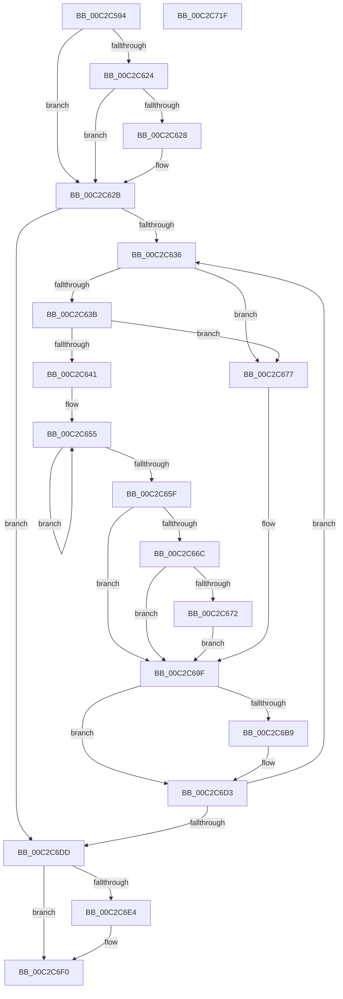

# IopCreateArcNamesDisk

- RVA: `0x00C2C594`–`0x00C2C720` (길이 `396` bytes)
- VA: `0x0000000140C2C594`
- 실행 섹션: `INIT`
- PDB 이름 있음: `예`; PDB Function 태그: `아니요`
- unwind 정보 RVA: `0x000C72D4`
- 디코드: `108`개 명령, `396/396` bytes 표시
- 미해석 바이트: `0` (있으면 어셈블리에 `.byte`로 보존)

> 이 문서는 커널 이미지의 기계어와 PDB 기호를 분석해 생성했습니다. 4번과 5번은 함수 원형과 자료형을 바이너리 사용 방식에서 추정한 C 해석이며 원본 소스 복구 결과는 아닙니다.

## 1. Dependencies

- 직접 호출 지점: **10**; 고유 호출 대상: **9**
- 직접 호출자로 확인된 함수: **1**
- RIP 상대 이미지 참조: **3**

### Outgoing calls
- `0x00C2C5DC` → [IoGetConfigurationInformation](../../page/71/IoGetConfigurationInformation_function_0071D5A0.md) (function, `0x0071D5A0`)
- `0x00C2C605` → [IopFetchConfigurationInformation](IopFetchConfigurationInformation_function_00C2CA28.md) (function, `0x00C2CA28`)
- `0x00C2C64C` → [RtlInitUnicodeString](../../text/42/RtlInitUnicodeString_function_0042A780.md) (function, `0x0042A780`)
- `0x00C2C68D` → [RtlStringCchPrintfW](../../text/48/RtlStringCchPrintfW_function_00482D5C.md) (function, `0x00482D5C`)
- `0x00C2C69A` → [RtlInitUnicodeString](../../text/42/RtlInitUnicodeString_function_0042A780.md) (function, `0x0042A780`)
- `0x00C2C6B0` → [IoGetDeviceObjectPointer](../../page/95/IoGetDeviceObjectPointer_function_00953220.md) (function, `0x00953220`)
- `0x00C2C6C0` → [IopCreateArcName](../../page/A8/IopCreateArcName_function_00A8D580.md) (function, `0x00A8D580`)
- `0x00C2C6CE` → [ObfDereferenceObjectWithTag](../../text/2F/ObfDereferenceObjectWithTag_function_002F78E0.md) (function, `0x002F78E0`)
- `0x00C2C6EB` → [ExFreePoolWithTag](../../poolcode/B8/ExFreePoolWithTag_function_00B82870.md) (function, `0x00B82870`)
- `0x00C2C6F9` → [_security_check_cookie](../../text/6A/_security_check_cookie_function_006AC640.md) (function, `0x006AC640`)

### Direct callers
- [IopCreateArcNames](IopCreateArcNames_function_00C2BF1C.md) at `0x00C2C025`

### Static image references
- `0x00C2C5B7` → RVA `0x00E0A740` (`.data`; read)
- `0x00C2C5E1` → RVA `0x00026318` (`.rdata`; read)
- `0x00C2C67A` → RVA `0x00C79990` (` ?? ::PBOPGDP::`string'`; read)

## 2. Other-region calls and transfers

- 다른 실행 섹션으로 향하는 call: **9**
  - `0x00C2C5DC` → [IoGetConfigurationInformation](../../page/71/IoGetConfigurationInformation_function_0071D5A0.md) (`INIT` → `PAGE`)
  - `0x00C2C64C` → [RtlInitUnicodeString](../../text/42/RtlInitUnicodeString_function_0042A780.md) (`INIT` → `.text`)
  - `0x00C2C68D` → [RtlStringCchPrintfW](../../text/48/RtlStringCchPrintfW_function_00482D5C.md) (`INIT` → `.text`)
  - `0x00C2C69A` → [RtlInitUnicodeString](../../text/42/RtlInitUnicodeString_function_0042A780.md) (`INIT` → `.text`)
  - `0x00C2C6B0` → [IoGetDeviceObjectPointer](../../page/95/IoGetDeviceObjectPointer_function_00953220.md) (`INIT` → `PAGE`)
  - `0x00C2C6C0` → [IopCreateArcName](../../page/A8/IopCreateArcName_function_00A8D580.md) (`INIT` → `PAGE`)
  - `0x00C2C6CE` → [ObfDereferenceObjectWithTag](../../text/2F/ObfDereferenceObjectWithTag_function_002F78E0.md) (`INIT` → `.text`)
  - `0x00C2C6EB` → [ExFreePoolWithTag](../../poolcode/B8/ExFreePoolWithTag_function_00B82870.md) (`INIT` → `POOLCODE`)
  - `0x00C2C6F9` → [_security_check_cookie](../../text/6A/_security_check_cookie_function_006AC640.md) (`INIT` → `.text`)
- 별도 외부 분기/꼬리 이동을 확인하지 못했습니다.

## 3. Assembly (complete function range)

```asm
00C2C594  48 8B C4                        mov rax, rsp
00C2C597  48 89 58 08                     mov qword ptr [rax + 8], rbx
00C2C59B  48 89 70 10                     mov qword ptr [rax + 0x10], rsi
00C2C59F  48 89 78 18                     mov qword ptr [rax + 0x18], rdi
00C2C5A3  4C 89 60 20                     mov qword ptr [rax + 0x20], r12
00C2C5A7  55                              push rbp
00C2C5A8  41 55                           push r13
00C2C5AA  41 57                           push r15
00C2C5AC  48 8D 68 A1                     lea rbp, [rax - 0x5f]
00C2C5B0  48 81 EC F0 00 00 00            sub rsp, 0xf0
00C2C5B7  48 8B 05 82 E1 1D 00            mov rax, qword ptr [rip + 0x1de182]
00C2C5BE  48 33 C4                        xor rax, rsp
00C2C5C1  48 89 45 37                     mov qword ptr [rbp + 0x37], rax
00C2C5C5  45 33 ED                        xor r13d, r13d
00C2C5C8  0F 57 C0                        xorps xmm0, xmm0
00C2C5CB  0F 11 45 97                     movups xmmword ptr [rbp - 0x69], xmm0
00C2C5CF  4C 89 6D 87                     mov qword ptr [rbp - 0x79], r13
00C2C5D3  4C 89 6C 24 28                  mov qword ptr [rsp + 0x28], r13
00C2C5D8  4C 89 6D 8F                     mov qword ptr [rbp - 0x71], r13
00C2C5DC  E8 BF 0F AF FF                  call 0x14071d5a0
00C2C5E1  0F 10 05 30 9D 3F FF            movups xmm0, xmmword ptr [rip - 0xc062d0]
00C2C5E8  4C 8D 4C 24 20                  lea r9, [rsp + 0x20]
00C2C5ED  44 89 6C 24 20                  mov dword ptr [rsp + 0x20], r13d
00C2C5F2  48 8D 55 A7                     lea rdx, [rbp - 0x59]
00C2C5F6  8B 30                           mov esi, dword ptr [rax]
00C2C5F8  48 8D 4C 24 28                  lea rcx, [rsp + 0x28]
00C2C5FD  44 8B C6                        mov r8d, esi
00C2C600  F3 0F 7F 45 A7                  movdqu xmmword ptr [rbp - 0x59], xmm0
00C2C605  E8 1E 04 00 00                  call 0x140c2ca28
00C2C60A  8B 4C 24 20                     mov ecx, dword ptr [rsp + 0x20]
00C2C60E  44 8B E0                        mov r12d, eax
00C2C611  48 8B 5C 24 28                  mov rbx, qword ptr [rsp + 0x28]
00C2C616  41 C1 EC 1F                     shr r12d, 0x1f
00C2C61A  3B CE                           cmp ecx, esi
00C2C61C  0F 47 F1                        cmova esi, ecx
00C2C61F  45 84 E4                        test r12b, r12b
00C2C622  74 07                           je 0x140c2c62b
00C2C624  85 C9                           test ecx, ecx
00C2C626  75 03                           jne 0x140c2c62b
00C2C628  83 C6 14                        add esi, 0x14
00C2C62B  41 8B FD                        mov edi, r13d
00C2C62E  85 F6                           test esi, esi
00C2C630  0F 84 A7 00 00 00               je 0x140c2c6dd
00C2C636  48 85 DB                        test rbx, rbx
00C2C639  74 3C                           je 0x140c2c677
00C2C63B  66 44 39 2B                     cmp word ptr [rbx], r13w
00C2C63F  74 36                           je 0x140c2c677
00C2C641  48 8B D3                        mov rdx, rbx
00C2C644  48 8D 4D 97                     lea rcx, [rbp - 0x69]
00C2C648  41 83 CF FF                     or r15d, 0xffffffff
00C2C64C  E8 2F E1 7F FF                  call 0x14042a780
00C2C651  48 83 C8 FF                     or rax, 0xffffffffffffffff
00C2C655  48 FF C0                        inc rax
00C2C658  66 44 39 2C 43                  cmp word ptr [rbx + rax*2], r13w
00C2C65D  75 F6                           jne 0x140c2c655
00C2C65F  48 8D 1C 43                     lea rbx, [rbx + rax*2]
00C2C663  48 83 C3 02                     add rbx, 2
00C2C667  45 84 E4                        test r12b, r12b
00C2C66A  74 33                           je 0x140c2c69f
00C2C66C  66 44 39 2B                     cmp word ptr [rbx], r13w
00C2C670  75 2D                           jne 0x140c2c69f
00C2C672  8D 77 14                        lea esi, [rdi + 0x14]
00C2C675  EB 28                           jmp 0x140c2c69f
00C2C677  44 8B CF                        mov r9d, edi
00C2C67A  4C 8D 05 0F D3 04 00            lea r8, [rip + 0x4d30f]
00C2C681  BA 40 00 00 00                  mov edx, 0x40
00C2C686  48 8D 4D B7                     lea rcx, [rbp - 0x49]
00C2C68A  44 8B FF                        mov r15d, edi
00C2C68D  E8 CA 66 85 FF                  call 0x140482d5c
00C2C692  48 8D 55 B7                     lea rdx, [rbp - 0x49]
00C2C696  48 8D 4D 97                     lea rcx, [rbp - 0x69]
00C2C69A  E8 E1 E0 7F FF                  call 0x14042a780
00C2C69F  4C 8D 4D 87                     lea r9, [rbp - 0x79]
00C2C6A3  BA 80 00 00 00                  mov edx, 0x80
00C2C6A8  4C 8D 45 8F                     lea r8, [rbp - 0x71]
00C2C6AC  48 8D 4D 97                     lea rcx, [rbp - 0x69]
00C2C6B0  E8 6B 6B D2 FF                  call 0x140953220
00C2C6B5  85 C0                           test eax, eax
00C2C6B7  78 1A                           js 0x140c2c6d3
00C2C6B9  48 8B 4D 87                     mov rcx, qword ptr [rbp - 0x79]
00C2C6BD  41 8B D7                        mov edx, r15d
00C2C6C0  E8 BB 0E E6 FF                  call 0x140a8d580
00C2C6C5  48 8B 4D 8F                     mov rcx, qword ptr [rbp - 0x71]
00C2C6C9  BA 44 66 6C 74                  mov edx, 0x746c6644
00C2C6CE  E8 0D B2 6C FF                  call 0x1402f78e0
00C2C6D3  FF C7                           inc edi
00C2C6D5  3B FE                           cmp edi, esi
00C2C6D7  0F 82 59 FF FF FF               jb 0x140c2c636
00C2C6DD  4C 39 6C 24 28                  cmp qword ptr [rsp + 0x28], r13
00C2C6E2  74 0C                           je 0x140c2c6f0
00C2C6E4  48 8B 4C 24 28                  mov rcx, qword ptr [rsp + 0x28]
00C2C6E9  33 D2                           xor edx, edx
00C2C6EB  E8 80 61 F5 FF                  call 0x140b82870
00C2C6F0  33 C0                           xor eax, eax
00C2C6F2  48 8B 4D 37                     mov rcx, qword ptr [rbp + 0x37]
00C2C6F6  48 33 CC                        xor rcx, rsp
00C2C6F9  E8 42 FF A7 FF                  call 0x1406ac640
00C2C6FE  4C 8D 9C 24 F0 00 00 00         lea r11, [rsp + 0xf0]
00C2C706  49 8B 5B 20                     mov rbx, qword ptr [r11 + 0x20]
00C2C70A  49 8B 73 28                     mov rsi, qword ptr [r11 + 0x28]
00C2C70E  49 8B 7B 30                     mov rdi, qword ptr [r11 + 0x30]
00C2C712  4D 8B 63 38                     mov r12, qword ptr [r11 + 0x38]
00C2C716  49 8B E3                        mov rsp, r11
00C2C719  41 5F                           pop r15
00C2C71B  41 5D                           pop r13
00C2C71D  5D                              pop rbp
00C2C71E  C3                              ret
00C2C71F  CC                              int3
```

## 4. C-style interpretation (structured pseudocode)

```c
__int64 __fastcall IopCreateArcNamesDisk(void)
{
    __int64 result;
    __int64 v_r12;
    __int64 v_r13;
    __int64 v_r15;
    __int64 v_rbx;
    __int64 v_rdi;
    __int64 v_rsi;
    __int64 v_rsp;
    unsigned __int64 v_stack_m18;
    unsigned __int64 v_stack_mE0;
    unsigned __int64 v_stack_mE8;

    *(unsigned __int64 *)(v_rsp + 8) = v_rbx;
    *(unsigned __int64 *)(v_rsp + 16) = v_rsi;
    *(unsigned __int64 *)(v_rsp + 24) = v_rdi;
    *(unsigned __int64 *)(v_rsp + 32) = v_r12;
    v_rsp = (v_rsp) - (240);
    result = (*(unsigned __int64 *)(v_rip + 1958274)) ^ (v_rsp);
    *(unsigned __int64 *)(v_rsp - 95 + 55) = result;
    v_r13 = 0;
    *(unsigned __int64 *)(v_rsp - 95 - 105) = v_xmm0;
    *(unsigned __int64 *)(v_rsp - 95 - 121) = 0;
    v_stack_mE0 = 0;
    *(unsigned __int64 *)(v_rsp - 95 - 113) = 0;
    result = IoGetConfigurationInformation(a1, a2, a3, a4);
    v_stack_mE8 = 0;
    *(unsigned __int64 *)(v_rsp - 95 - 89) = v_xmm0;
    result = IopFetchConfigurationInformation(v_stack_mE0, v_rsp - 95 - 89, (unsigned int)((unsigned int)((unsigned int)(*(unsigned int *)(result)))), v_stack_mE8);
    v_r12 = (unsigned int)(((unsigned int)((unsigned int)(result))) >> (31));
    v_rsi = (unsigned int)(*(unsigned int *)(result));
    if (((unsigned int)((unsigned int)(v_stack_mE8))) > ((unsigned int)((unsigned int)(*(unsigned int *)(result))))) { v_rsi = (unsigned int)((unsigned int)(v_stack_mE8)); }
    if ((unsigned __int8)(v_r12) == 0) goto loc_00C2C62B;
    if ((unsigned int)((unsigned int)(v_stack_mE8)) == 0) {
        v_rsi = (unsigned int)((v_rsi) + (20));
    }
    if ((unsigned int)(v_rsi) == 0) goto loc_00C2C6DD;
loc_00C2C636:
    if (v_stack_mE0 == 0) goto loc_00C2C677;
    if ((*(unsigned __int16 *)(v_stack_mE0)) == 0) goto loc_00C2C677;
    v_r15 = (unsigned int)((v_r15) | (0xFFFFFFFFULL));
    result = RtlInitUnicodeString(v_rsp - 95 - 105, v_stack_mE0, (unsigned int)((unsigned int)((unsigned int)(*(unsigned int *)(result)))), v_stack_mE8);
    result = (result) | (-1);
loc_00C2C655:
    result = (result) + 1;
    if ((*(unsigned __int16 *)(v_stack_mE0 + result * 2)) != 0) goto loc_00C2C655;
    v_rbx = (v_stack_mE0 + result * 2) + (2);
    if ((unsigned __int8)(v_r12) == 0) goto loc_00C2C69F;
    if ((*(unsigned __int16 *)(v_rbx)) != 0) goto loc_00C2C69F;
    goto loc_00C2C69F;
loc_00C2C677:
    result = RtlStringCchPrintfW(v_rsp - 95 - 73, 64, v_rip + 316175, 0);
    result = RtlInitUnicodeString(v_rsp - 95 - 105, v_rsp - 95 - 73, v_rip + 316175, 0);
loc_00C2C69F:
    result = IoGetDeviceObjectPointer(v_rsp - 95 - 105, 128, v_rsp - 95 - 113, v_rsp - 95 - 121);
    if (!(sign_flag)) {
        a1 = *(unsigned __int64 *)(v_rsp - 95 - 121);
        a2 = 0;
        result = IopCreateArcName(a1, a2, v_rsp - 95 - 113, v_rsp - 95 - 121);
        a1 = *(unsigned __int64 *)(v_rsp - 95 - 113);
        a2 = 0x746C6644ULL;
        result = ObfDereferenceObjectWithTag(a1, a2, v_rsp - 95 - 113, v_rsp - 95 - 121);
    }
    v_rdi = (unsigned int)((0) + 1);
    if (((unsigned int)(v_rdi)) < ((unsigned int)(0 + 20))) goto loc_00C2C636;
loc_00C2C6DD:
    if (v_stack_mE0 != 0) {
        a1 = v_stack_mE0;
        a2 = 0;
        result = ExFreePoolWithTag(a1, a2, v_rsp - 95 - 113, v_rsp - 95 - 121);
    }
    result = 0;
    a1 = (*(unsigned __int64 *)(v_rsp - 95 + 55)) ^ (v_rsp);
    result = _security_check_cookie(a1, a2, v_rsp - 95 - 113, v_rsp - 95 - 121);
    return result;
}
```

## 5. (Beta) C Style

```c
void IopCreateArcNamesDisk(void)
{
    int64_t result;
    int64_t local_r12;
    int64_t local_r13;
    int64_t local_r15;
    int64_t local_rbx;
    int64_t local_rdi;
    int64_t local_rsi;
    int64_t local_rsp;
    uint64_t v_stack_m18;
    uint64_t v_stack_mE0;
    uint64_t v_stack_mE8;

    *(uint64_t *)(local_rsp + 0x8) = local_rbx;
    *(uint64_t *)(local_rsp + 0x10) = local_rsi;
    *(uint64_t *)(local_rsp + 0x18) = local_rdi;
    *(uint64_t *)(local_rsp + 0x20) = local_r12;
    local_rsp = (local_rsp) - (240);
    result = (*(uint64_t *)(v_rip + 0x1DE182)) ^ (local_rsp);
    *(uint64_t *)(local_rsp - 0x5F + 0x37) = result;
    local_r13 = 0;
    *(uint64_t *)(local_rsp - 0x5F - 0x69) = v_xmm0;
    *(uint64_t *)(local_rsp - 0x5F - 0x79) = 0;
    v_stack_mE0 = 0;
    *(uint64_t *)(local_rsp - 0x5F - 0x71) = 0;
    result = IoGetConfigurationInformation(a1, a2, a3, a4);
    v_stack_mE8 = 0;
    *(uint64_t *)(local_rsp - 0x5F - 0x59) = v_xmm0;
    result = IopFetchConfigurationInformation(v_stack_mE0, local_rsp - 95 - 89, (uint32_t)((uint32_t)((uint32_t)(*(uint32_t *)(result)))), v_stack_mE8);
    local_r12 = (uint32_t)(((uint32_t)((uint32_t)(result))) >> (31));
    local_rsi = (uint32_t)(*(uint32_t *)(result));
    if (((uint32_t)((uint32_t)(v_stack_mE8))) > ((uint32_t)((uint32_t)(*(uint32_t *)(result))))) { local_rsi = (uint32_t)((uint32_t)(v_stack_mE8)); }
    if ((uint8_t)(local_r12) == 0) goto loc_00C2C62B;
    if ((uint32_t)((uint32_t)(v_stack_mE8)) == 0) {
        local_rsi = (uint32_t)((local_rsi) + (20));
    }
    if ((uint32_t)(local_rsi) == 0) goto loc_00C2C6DD;
loc_00C2C636:
    if (v_stack_mE0 == 0) goto loc_00C2C677;
    if ((*(uint16_t *)(v_stack_mE0)) == 0) goto loc_00C2C677;
    local_r15 = (uint32_t)((local_r15) | (0xFFFFFFFFULL));
    result = RtlInitUnicodeString(local_rsp - 95 - 105, v_stack_mE0, (uint32_t)((uint32_t)((uint32_t)(*(uint32_t *)(result)))), v_stack_mE8);
    result = (result) | (-1);
loc_00C2C655:
    result = (result) + 1;
    if ((*(uint16_t *)(v_stack_mE0 + result * 2)) != 0) goto loc_00C2C655;
    local_rbx = (v_stack_mE0 + result * 2) + (2);
    if ((uint8_t)(local_r12) == 0) goto loc_00C2C69F;
    if ((*(uint16_t *)(local_rbx)) != 0) goto loc_00C2C69F;
    goto loc_00C2C69F;
loc_00C2C677:
    result = RtlStringCchPrintfW(local_rsp - 95 - 73, 64, v_rip + 316175, 0);
    result = RtlInitUnicodeString(local_rsp - 95 - 105, local_rsp - 95 - 73, v_rip + 316175, 0);
loc_00C2C69F:
    result = IoGetDeviceObjectPointer(local_rsp - 95 - 105, 128, local_rsp - 95 - 113, local_rsp - 95 - 121);
    if (!(sign_flag)) {
        a1 = *(uint64_t *)(local_rsp - 0x5F - 0x79);
        a2 = 0;
        result = IopCreateArcName(a1, a2, local_rsp - 95 - 113, local_rsp - 95 - 121);
        a1 = *(uint64_t *)(local_rsp - 0x5F - 0x71);
        a2 = 0x746C6644ULL;
        result = ObfDereferenceObjectWithTag(a1, a2, local_rsp - 95 - 113, local_rsp - 95 - 121);
    }
    local_rdi = (uint32_t)((0) + 1);
    if (((uint32_t)(local_rdi)) < ((uint32_t)(0 + 20))) goto loc_00C2C636;
loc_00C2C6DD:
    if (v_stack_mE0 != 0) {
        a1 = v_stack_mE0;
        a2 = 0;
        result = ExFreePoolWithTag(a1, a2, local_rsp - 95 - 113, local_rsp - 95 - 121);
    }
    result = 0;
    a1 = (*(uint64_t *)(local_rsp - 0x5F + 0x37)) ^ (local_rsp);
    result = _security_check_cookie(a1, a2, local_rsp - 95 - 113, local_rsp - 95 - 121);
    return result;
}
```

## 6. Execution-region graph

[열기: 2D/3D 그래프와 함수 탐색 컨트롤 패널](../../../control-panel.html?section=init&rva=0x00C2C594&view=graph)

- 2D 그래프는 위에서 아래로 흐르고, 3D 그래프는 빈 공간을 드래그해 회전합니다. Shift+드래그는 이동, 휠은 확대·축소, 함수 노드 선택은 대상 보고서 이동입니다.

### Static fallback


