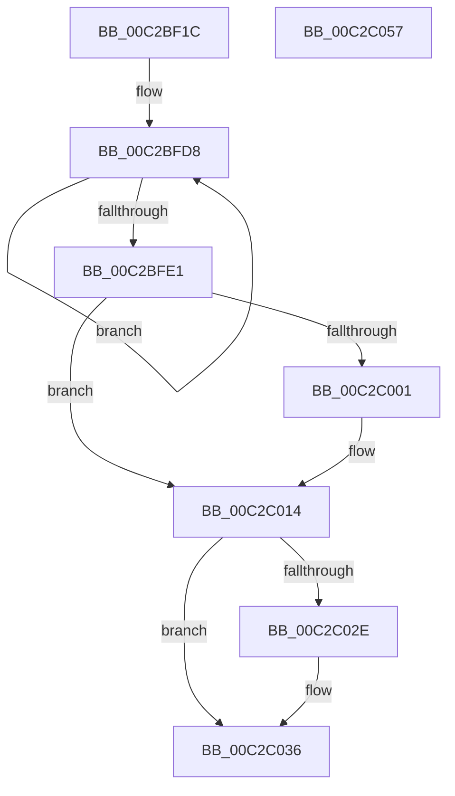

# IopCreateArcNames

- RVA: `0x00C2BF1C`–`0x00C2C058` (길이 `316` bytes)
- VA: `0x0000000140C2BF1C`
- 실행 섹션: `INIT`
- PDB 이름 있음: `예`; PDB Function 태그: `아니요`
- unwind 정보 RVA: `0x000C728C`
- 디코드: `68`개 명령, `316/316` bytes 표시
- 미해석 바이트: `0` (있으면 어셈블리에 `.byte`로 보존)

> 이 문서는 커널 이미지의 기계어와 PDB 기호를 분석해 생성했습니다. 4번과 5번은 함수 원형과 자료형을 바이너리 사용 방식에서 추정한 C 해석이며 원본 소스 복구 결과는 아닙니다.

## 1. Dependencies

- 직접 호출 지점: **12**; 고유 호출 대상: **8**
- 직접 호출자로 확인된 함수: **1**
- RIP 상대 이미지 참조: **5**

### Outgoing calls
- `0x00C2BF68` → [RtlStringCchPrintfA](../../text/59/RtlStringCchPrintfA_function_00596BC8.md) (function, `0x00596BC8`)
- `0x00C2BF77` → [RtlInitAnsiString](../../text/47/RtlInitAnsiString_function_00470F40.md) (function, `0x00470F40`)
- `0x00C2BF8B` → [RtlAnsiStringToUnicodeString](../../page/90/RtlAnsiStringToUnicodeString_function_0090BEA0.md) (function, `0x0090BEA0`)
- `0x00C2BFA5` → [RtlStringCchPrintfA](../../text/59/RtlStringCchPrintfA_function_00596BC8.md) (function, `0x00596BC8`)
- `0x00C2BFB4` → [RtlInitAnsiString](../../text/47/RtlInitAnsiString_function_00470F40.md) (function, `0x00470F40`)
- `0x00C2BFC8` → [RtlAnsiStringToUnicodeString](../../page/90/RtlAnsiStringToUnicodeString_function_0090BEA0.md) (function, `0x0090BEA0`)
- `0x00C2BFF0` → [ExAllocatePool2](../../poolcode/B8/ExAllocatePool2_function_00B820F0.md) (function, `0x00B820F0`)
- `0x00C2C00F` → [memcpy](../../text/6C/memcpy_function_006C6840.md) (function, `0x006C6840`)
- `0x00C2C020` → [RtlInitAnsiString](../../text/47/RtlInitAnsiString_function_00470F40.md) (function, `0x00470F40`)
- `0x00C2C025` → [IopCreateArcNamesDisk](IopCreateArcNamesDisk_function_00C2C594.md) (function, `0x00C2C594`)
- `0x00C2C031` → [IopCreateArcNamesCd](IopCreateArcNamesCd_function_00C2C060.md) (function, `0x00C2C060`)
- `0x00C2C041` → [_security_check_cookie](../../text/6A/_security_check_cookie_function_006AC640.md) (function, `0x006AC640`)

### Direct callers
- [IopInitializeBootDrivers](IopInitializeBootDrivers_function_00C2E6F4.md) at `0x00C2EEEC`

### Static image references
- `0x00C2BF29` → RVA `0x00E0A740` (`.data`; read)
- `0x00C2BF42` → RVA `0x00C79A00` (` ?? ::PBOPGDP::`string'`; read)
- `0x00C2BF84` → RVA `0x00FDA408` (`PAGEDATA`; read)
- `0x00C2BFC1` → RVA `0x00FDA098` (`PAGEDATA`; read)
- `0x00C2BFF5` → RVA `0x00FD9F90` (`PAGEDATA`; write)

## 2. Other-region calls and transfers

- 다른 실행 섹션으로 향하는 call: **10**
  - `0x00C2BF68` → [RtlStringCchPrintfA](../../text/59/RtlStringCchPrintfA_function_00596BC8.md) (`INIT` → `.text`)
  - `0x00C2BF77` → [RtlInitAnsiString](../../text/47/RtlInitAnsiString_function_00470F40.md) (`INIT` → `.text`)
  - `0x00C2BF8B` → [RtlAnsiStringToUnicodeString](../../page/90/RtlAnsiStringToUnicodeString_function_0090BEA0.md) (`INIT` → `PAGE`)
  - `0x00C2BFA5` → [RtlStringCchPrintfA](../../text/59/RtlStringCchPrintfA_function_00596BC8.md) (`INIT` → `.text`)
  - `0x00C2BFB4` → [RtlInitAnsiString](../../text/47/RtlInitAnsiString_function_00470F40.md) (`INIT` → `.text`)
  - `0x00C2BFC8` → [RtlAnsiStringToUnicodeString](../../page/90/RtlAnsiStringToUnicodeString_function_0090BEA0.md) (`INIT` → `PAGE`)
  - `0x00C2BFF0` → [ExAllocatePool2](../../poolcode/B8/ExAllocatePool2_function_00B820F0.md) (`INIT` → `POOLCODE`)
  - `0x00C2C00F` → [memcpy](../../text/6C/memcpy_function_006C6840.md) (`INIT` → `.text`)
  - `0x00C2C020` → [RtlInitAnsiString](../../text/47/RtlInitAnsiString_function_00470F40.md) (`INIT` → `.text`)
  - `0x00C2C041` → [_security_check_cookie](../../text/6A/_security_check_cookie_function_006AC640.md) (`INIT` → `.text`)
- 별도 외부 분기/꼬리 이동을 확인하지 못했습니다.

## 3. Assembly (complete function range)

```asm
00C2BF1C  48 89 5C 24 10                  mov qword ptr [rsp + 0x10], rbx
00C2BF21  57                              push rdi
00C2BF22  48 81 EC D0 00 00 00            sub rsp, 0xd0
00C2BF29  48 8B 05 10 E8 1D 00            mov rax, qword ptr [rip + 0x1de810]
00C2BF30  48 33 C4                        xor rax, rsp
00C2BF33  48 89 84 24 C0 00 00 00         mov qword ptr [rsp + 0xc0], rax
00C2BF3B  4C 8B 89 C0 00 00 00            mov r9, qword ptr [rcx + 0xc0]
00C2BF42  4C 8D 05 B7 DA 04 00            lea r8, [rip + 0x4dab7]
00C2BF49  48 8B F9                        mov rdi, rcx
00C2BF4C  0F 57 C0                        xorps xmm0, xmm0
00C2BF4F  0F 57 C9                        xorps xmm1, xmm1
00C2BF52  48 8D 4C 24 40                  lea rcx, [rsp + 0x40]
00C2BF57  BB 80 00 00 00                  mov ebx, 0x80
00C2BF5C  8B D3                           mov edx, ebx
00C2BF5E  0F 11 44 24 20                  movups xmmword ptr [rsp + 0x20], xmm0
00C2BF63  0F 11 4C 24 30                  movups xmmword ptr [rsp + 0x30], xmm1
00C2BF68  E8 5B AC 96 FF                  call 0x140596bc8
00C2BF6D  48 8D 54 24 40                  lea rdx, [rsp + 0x40]
00C2BF72  48 8D 4C 24 20                  lea rcx, [rsp + 0x20]
00C2BF77  E8 C4 4F 84 FF                  call 0x140470f40
00C2BF7C  41 B0 01                        mov r8b, 1
00C2BF7F  48 8D 54 24 20                  lea rdx, [rsp + 0x20]
00C2BF84  48 8D 0D 7D E4 3A 00            lea rcx, [rip + 0x3ae47d]
00C2BF8B  E8 10 FF CD FF                  call 0x14090bea0
00C2BF90  4C 8B 8F B8 00 00 00            mov r9, qword ptr [rdi + 0xb8]
00C2BF97  4C 8D 05 62 DA 04 00            lea r8, [rip + 0x4da62]
00C2BF9E  8B D3                           mov edx, ebx
00C2BFA0  48 8D 4C 24 40                  lea rcx, [rsp + 0x40]
00C2BFA5  E8 1E AC 96 FF                  call 0x140596bc8
00C2BFAA  48 8D 54 24 40                  lea rdx, [rsp + 0x40]
00C2BFAF  48 8D 4C 24 20                  lea rcx, [rsp + 0x20]
00C2BFB4  E8 87 4F 84 FF                  call 0x140470f40
00C2BFB9  41 B0 01                        mov r8b, 1
00C2BFBC  48 8D 54 24 20                  lea rdx, [rsp + 0x20]
00C2BFC1  48 8D 0D D0 E0 3A 00            lea rcx, [rip + 0x3ae0d0]
00C2BFC8  E8 D3 FE CD FF                  call 0x14090bea0
00C2BFCD  48 8B 87 B8 00 00 00            mov rax, qword ptr [rdi + 0xb8]
00C2BFD4  48 83 CB FF                     or rbx, 0xffffffffffffffff
00C2BFD8  48 FF C3                        inc rbx
00C2BFDB  80 3C 18 00                     cmp byte ptr [rax + rbx], 0
00C2BFDF  75 F7                           jne 0x140c2bfd8
00C2BFE1  41 B8 49 6F 4E 34               mov r8d, 0x344e6f49
00C2BFE7  48 8D 53 01                     lea rdx, [rbx + 1]
00C2BFEB  B9 00 01 00 00                  mov ecx, 0x100
00C2BFF0  E8 FB 60 F5 FF                  call 0x140b820f0
00C2BFF5  48 89 05 94 DF 3A 00            mov qword ptr [rip + 0x3adf94], rax
00C2BFFC  48 85 C0                        test rax, rax
00C2BFFF  74 13                           je 0x140c2c014
00C2C001  48 8B 97 B8 00 00 00            mov rdx, qword ptr [rdi + 0xb8]
00C2C008  4C 8D 43 01                     lea r8, [rbx + 1]
00C2C00C  48 8B C8                        mov rcx, rax
00C2C00F  E8 2C A8 A9 FF                  call 0x1406c6840
00C2C014  48 8B 97 C0 00 00 00            mov rdx, qword ptr [rdi + 0xc0]
00C2C01B  48 8D 4C 24 30                  lea rcx, [rsp + 0x30]
00C2C020  E8 1B 4F 84 FF                  call 0x140470f40
00C2C025  E8 6A 05 00 00                  call 0x140c2c594
00C2C02A  85 C0                           test eax, eax
00C2C02C  78 08                           js 0x140c2c036
00C2C02E  48 8B CF                        mov rcx, rdi
00C2C031  E8 2A 00 00 00                  call 0x140c2c060
00C2C036  48 8B 8C 24 C0 00 00 00         mov rcx, qword ptr [rsp + 0xc0]
00C2C03E  48 33 CC                        xor rcx, rsp
00C2C041  E8 FA 05 A8 FF                  call 0x1406ac640
00C2C046  48 8B 9C 24 E8 00 00 00         mov rbx, qword ptr [rsp + 0xe8]
00C2C04E  48 81 C4 D0 00 00 00            add rsp, 0xd0
00C2C055  5F                              pop rdi
00C2C056  C3                              ret
00C2C057  CC                              int3
```

## 4. C-style interpretation (structured pseudocode)

```c
__int64 __fastcall IopCreateArcNames(__int64 a1)
{
    __int64 result;
    __int64 v_rbx;
    __int64 v_rsp;
    unsigned __int64 v_stack_m18;
    unsigned __int64 v_stack_m98;
    unsigned __int64 v_stack_mA8;
    unsigned __int64 v_stack_mB8;
    unsigned __int64 v_stack_p10;

    v_stack_p10 = v_rbx;
    v_rsp = (v_rsp) - (208);
    result = (*(unsigned __int64 *)(v_rip + 1959952)) ^ (v_rsp);
    v_stack_m18 = result;
    v_stack_mB8 = v_xmm0;
    v_stack_mA8 = v_xmm1;
    result = RtlStringCchPrintfA(v_stack_m98, 128, v_rip + 318135, *(unsigned __int64 *)(a1 + 192));
    result = RtlInitAnsiString(v_stack_mB8, v_stack_m98, v_rip + 318135, *(unsigned __int64 *)(a1 + 192));
    result = RtlAnsiStringToUnicodeString(v_rip + 3859581, v_stack_mB8, 1, *(unsigned __int64 *)(a1 + 192));
    result = RtlStringCchPrintfA(v_stack_m98, 128, v_rip + 318050, *(unsigned __int64 *)(a1 + 184));
    result = RtlInitAnsiString(v_stack_mB8, v_stack_m98, v_rip + 318050, *(unsigned __int64 *)(a1 + 184));
    result = RtlAnsiStringToUnicodeString(v_rip + 3858640, v_stack_mB8, 1, *(unsigned __int64 *)(a1 + 184));
    v_rbx = (128) | (-1);
loc_00C2BFD8:
    v_rbx = (v_rbx) + 1;
    if ((*(unsigned __int8 *)(*(unsigned __int64 *)(a1 + 184) + v_rbx * 1)) != 0) goto loc_00C2BFD8;
    result = ExAllocatePool2(256, v_rbx + 1, (unsigned int)(0x344E6F49ULL), *(unsigned __int64 *)(a1 + 184));
    *(unsigned __int64 *)(v_rip + 3858324) = result;
    if (result != 0) {
        a2 = *(unsigned __int64 *)(a1 + 184);
        a3 = v_rbx + 1;
        a1 = result;
        result = memcpy(a1, a2, a3, *(unsigned __int64 *)(a1 + 184));
    }
    result = RtlInitAnsiString(v_stack_mA8, *(unsigned __int64 *)(a1 + 192), a3, *(unsigned __int64 *)(a1 + 184));
    result = IopCreateArcNamesDisk(v_stack_mA8, *(unsigned __int64 *)(a1 + 192), a3, *(unsigned __int64 *)(a1 + 184));
    if (!(sign_flag)) {
        a1 = a1;
        result = IopCreateArcNamesCd(a1, *(unsigned __int64 *)(a1 + 192), a3, *(unsigned __int64 *)(a1 + 184));
    }
    a1 = (v_stack_m18) ^ (v_rsp);
    result = _security_check_cookie(a1, *(unsigned __int64 *)(a1 + 192), a3, *(unsigned __int64 *)(a1 + 184));
    v_rsp = (v_rsp) + (208);
    return result;
}
```

## 5. (Beta) C Style

```c
int64_t IopCreateArcNames(void *Arg1)
{
    uint8_t *arg1 = (uint8_t *)Arg1;

    int64_t result;
    int64_t local_rbx;
    int64_t local_rsp;
    uint64_t v_stack_m18;
    uint64_t v_stack_m98;
    uint64_t v_stack_mA8;
    uint64_t v_stack_mB8;
    uint64_t v_stack_p10;

    v_stack_p10 = local_rbx;
    local_rsp = (local_rsp) - (208);
    result = (*(uint64_t *)(v_rip + 0x1DE810)) ^ (local_rsp);
    v_stack_m18 = result;
    v_stack_mB8 = v_xmm0;
    v_stack_mA8 = v_xmm1;
    result = RtlStringCchPrintfA(v_stack_m98, 128, v_rip + 318135, *(uint64_t *)(arg1 + 0xC0));
    result = RtlInitAnsiString(v_stack_mB8, v_stack_m98, v_rip + 318135, *(uint64_t *)(arg1 + 0xC0));
    result = RtlAnsiStringToUnicodeString(v_rip + 3859581, v_stack_mB8, 1, *(uint64_t *)(arg1 + 0xC0));
    result = RtlStringCchPrintfA(v_stack_m98, 128, v_rip + 318050, *(uint64_t *)(arg1 + 0xB8));
    result = RtlInitAnsiString(v_stack_mB8, v_stack_m98, v_rip + 318050, *(uint64_t *)(arg1 + 0xB8));
    result = RtlAnsiStringToUnicodeString(v_rip + 3858640, v_stack_mB8, 1, *(uint64_t *)(arg1 + 0xB8));
    local_rbx = (128) | (-1);
loc_00C2BFD8:
    local_rbx = (local_rbx) + 1;
    if ((*(uint8_t *)(*(uint64_t *)(arg1 + 0xB8) + local_rbx * 1)) != 0) goto loc_00C2BFD8;
    result = ExAllocatePool2(256, local_rbx + 1, (uint32_t)(0x344E6F49ULL), *(uint64_t *)(arg1 + 0xB8));
    *(uint64_t *)(v_rip + 0x3ADF94) = result;
    if (result != 0) {
        a2 = *(uint64_t *)(arg1 + 0xB8);
        a3 = local_rbx + 1;
        Arg1 = result;
        result = memcpy(Arg1, a2, a3, *(uint64_t *)(arg1 + 0xB8));
    }
    result = RtlInitAnsiString(v_stack_mA8, *(uint64_t *)(arg1 + 0xC0), a3, *(uint64_t *)(arg1 + 0xB8));
    result = IopCreateArcNamesDisk(v_stack_mA8, *(uint64_t *)(arg1 + 0xC0), a3, *(uint64_t *)(arg1 + 0xB8));
    if (!(sign_flag)) {
        Arg1 = Arg1;
        result = IopCreateArcNamesCd(Arg1, *(uint64_t *)(arg1 + 0xC0), a3, *(uint64_t *)(arg1 + 0xB8));
    }
    Arg1 = (v_stack_m18) ^ (local_rsp);
    result = _security_check_cookie(Arg1, *(uint64_t *)(arg1 + 0xC0), a3, *(uint64_t *)(arg1 + 0xB8));
    local_rsp = (local_rsp) + (208);
    return result;
}
```

### 관측된 메모리 오프셋

구조체 형식이 확인되지 않은 접근은 인자 기준의 오프셋으로만 기록했습니다.

| 기준 인자 | 오프셋 표현 | 폭 (bit) | 접근 |
|---|---:|---:|---|
| `Arg1` | `+ 0xB8` | `64` | `R` |
| `Arg1` | `+ 0xC0` | `64` | `R` |

## 6. Execution-region graph

[열기: 2D/3D 그래프와 함수 탐색 컨트롤 패널](../../../control-panel.html?section=init&rva=0x00C2BF1C&view=graph)

- 2D 그래프는 위에서 아래로 흐르고, 3D 그래프는 빈 공간을 드래그해 회전합니다. Shift+드래그는 이동, 휠은 확대·축소, 함수 노드 선택은 대상 보고서 이동입니다.

### Static fallback


