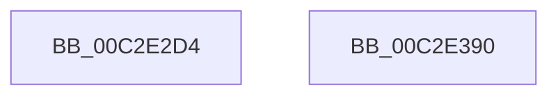

# IopCreateIoRingObjectType

- RVA: `0x00C2E2D4`–`0x00C2E391` (길이 `189` bytes)
- VA: `0x0000000140C2E2D4`
- 실행 섹션: `INIT`
- PDB 이름 있음: `예`; PDB Function 태그: `아니요`
- unwind 정보 RVA: `0x000C43B4`
- 디코드: `41`개 명령, `189/189` bytes 표시
- 미해석 바이트: `0` (있으면 어셈블리에 `.byte`로 보존)

> 이 문서는 커널 이미지의 기계어와 PDB 기호를 분석해 생성했습니다. 4번과 5번은 함수 원형과 자료형을 바이너리 사용 방식에서 추정한 C 해석이며 원본 소스 복구 결과는 아닙니다.

## 1. Dependencies

- 직접 호출 지점: **4**; 고유 호출 대상: **4**
- 직접 호출자로 확인된 함수: **1**
- RIP 상대 이미지 참조: **6**

### Outgoing calls
- `0x00C2E302` → [memset](../../text/6C/memset_function_006C6C40.md) (function, `0x006C6C40`)
- `0x00C2E319` → [RtlInitUnicodeString](../../text/42/RtlInitUnicodeString_function_0042A780.md) (function, `0x0042A780`)
- `0x00C2E36E` → [ObCreateObjectType](../../page/70/ObCreateObjectType_function_00705230.md) (function, `0x00705230`)
- `0x00C2E37A` → [_security_check_cookie](../../text/6A/_security_check_cookie_function_006AC640.md) (function, `0x006AC640`)

### Direct callers
- [IoCreateObjectTypes](IoCreateObjectTypes_function_00C2A854.md) at `0x00C2AB79`

### Static image references
- `0x00C2E2E6` → RVA `0x00E0A740` (`.data`; read)
- `0x00C2E30A` → RVA `0x00C79D90` (` ?? ::PBOPGDP::`string'`; read)
- `0x00C2E322` → RVA `0x00A49730` (`EtwpOpenRealTimeConnectionObject`; read)
- `0x00C2E32D` → RVA `0x00FC7078` (`ALMOSTRO`; read)
- `0x00C2E334` → RVA `0x0071F860` (`IopCloseIoRing`; read)
- `0x00C2E347` → RVA `0x0071F8A0` (`IopDeleteIoRing`; read)

## 2. Other-region calls and transfers

- 다른 실행 섹션으로 향하는 call: **4**
  - `0x00C2E302` → [memset](../../text/6C/memset_function_006C6C40.md) (`INIT` → `.text`)
  - `0x00C2E319` → [RtlInitUnicodeString](../../text/42/RtlInitUnicodeString_function_0042A780.md) (`INIT` → `.text`)
  - `0x00C2E36E` → [ObCreateObjectType](../../page/70/ObCreateObjectType_function_00705230.md) (`INIT` → `PAGE`)
  - `0x00C2E37A` → [_security_check_cookie](../../text/6A/_security_check_cookie_function_006AC640.md) (`INIT` → `.text`)
- 별도 외부 분기/꼬리 이동을 확인하지 못했습니다.

## 3. Assembly (complete function range)

```asm
00C2E2D4  48 89 5C 24 08                  mov qword ptr [rsp + 8], rbx
00C2E2D9  55                              push rbp
00C2E2DA  48 8D 6C 24 A9                  lea rbp, [rsp - 0x57]
00C2E2DF  48 81 EC C0 00 00 00            sub rsp, 0xc0
00C2E2E6  48 8B 05 53 C4 1D 00            mov rax, qword ptr [rip + 0x1dc453]
00C2E2ED  48 33 C4                        xor rax, rsp
00C2E2F0  48 89 45 47                     mov qword ptr [rbp + 0x47], rax
00C2E2F4  BB 78 00 00 00                  mov ebx, 0x78
00C2E2F9  48 8D 4D C7                     lea rcx, [rbp - 0x39]
00C2E2FD  44 8B C3                        mov r8d, ebx
00C2E300  33 D2                           xor edx, edx
00C2E302  E8 39 89 A9 FF                  call 0x1406c6c40
00C2E307  0F 57 C0                        xorps xmm0, xmm0
00C2E30A  48 8D 15 7F BA 04 00            lea rdx, [rip + 0x4ba7f]
00C2E311  48 8D 4D B7                     lea rcx, [rbp - 0x49]
00C2E315  0F 11 45 B7                     movups xmmword ptr [rbp - 0x49], xmm0
00C2E319  E8 62 C4 7F FF                  call 0x14042a780
00C2E31E  80 4D C9 06                     or byte ptr [rbp - 0x37], 6
00C2E322  48 8D 05 07 B4 E1 FF            lea rax, [rip - 0x1e4bf9]
00C2E329  48 89 45 FF                     mov qword ptr [rbp - 1], rax
00C2E32D  4C 8D 0D 44 8D 39 00            lea r9, [rip + 0x398d44]
00C2E334  48 8D 05 25 15 AF FF            lea rax, [rip - 0x50eadb]
00C2E33B  66 89 5D C7                     mov word ptr [rbp - 0x39], bx
00C2E33F  48 89 45 07                     mov qword ptr [rbp + 7], rax
00C2E343  48 8D 55 C7                     lea rdx, [rbp - 0x39]
00C2E347  48 8D 05 52 15 AF FF            lea rax, [rip - 0x50eaae]
00C2E34E  C7 45 CF D2 1D 00 00            mov dword ptr [rbp - 0x31], 0x1dd2
00C2E355  45 33 C0                        xor r8d, r8d
00C2E358  48 89 45 0F                     mov qword ptr [rbp + 0xf], rax
00C2E35C  48 8D 4D B7                     lea rcx, [rbp - 0x49]
00C2E360  C7 45 EB 00 02 00 00            mov dword ptr [rbp - 0x15], 0x200
00C2E367  C7 45 F3 D0 00 00 00            mov dword ptr [rbp - 0xd], 0xd0
00C2E36E  E8 BD 6E AD FF                  call 0x140705230
00C2E373  48 8B 4D 47                     mov rcx, qword ptr [rbp + 0x47]
00C2E377  48 33 CC                        xor rcx, rsp
00C2E37A  E8 C1 E2 A7 FF                  call 0x1406ac640
00C2E37F  48 8B 9C 24 D0 00 00 00         mov rbx, qword ptr [rsp + 0xd0]
00C2E387  48 81 C4 C0 00 00 00            add rsp, 0xc0
00C2E38E  5D                              pop rbp
00C2E38F  C3                              ret
00C2E390  CC                              int3
```

## 4. C-style interpretation (structured pseudocode)

```c
__int64 __fastcall IopCreateIoRingObjectType(__int64 a1, int a2)
{
    __int64 result;
    __int64 v_rsp;
    unsigned __int64 v_stack_m18;
    unsigned __int64 v_stack_m50;
    unsigned __int64 v_stack_m58;
    unsigned __int64 v_stack_m5F;
    unsigned __int64 v_stack_m60;
    unsigned int v_stack_m6C;
    unsigned int v_stack_m74;
    unsigned int v_stack_m90;
    unsigned __int8 v_stack_m96;
    unsigned __int64 v_stack_m98;
    unsigned __int64 v_stack_mA8;
    unsigned __int64 v_stack_p8;

    v_stack_p8 = v_rbx;
    v_rsp = (v_rsp) - (192);
    result = (*(unsigned __int64 *)(v_rip + 1950803)) ^ (v_rsp);
    v_stack_m18 = result;
    a2 = 0;
    result = memset(v_stack_m98, a2, 120, a4);
    v_stack_mA8 = v_xmm0;
    result = RtlInitUnicodeString(v_stack_mA8, v_rip + 309887, 120, a4);
    v_stack_m60 = v_rip - 1985529;
    v_stack_m98 = 120;
    v_stack_m58 = v_rip - 5303003;
    v_stack_m90 = 0x1DD2ULL;
    a3 = 0;
    v_stack_m50 = v_rip - 5302958;
    v_stack_m74 = 512;
    v_stack_m6C = 208;
    result = ObCreateObjectType(v_stack_mA8, v_stack_m98, a3, v_rip + 3771716);
    a1 = (v_stack_m18) ^ (v_rsp);
    result = _security_check_cookie(a1, v_stack_m98, a3, v_rip + 3771716);
    v_rsp = (v_rsp) + (192);
    return result;
}
```

## 5. (Beta) C Style

```c
int64_t IopCreateIoRingObjectType(int64_t Arg1, int32_t Arg2)
{
    int64_t result;
    int64_t local_rsp;
    uint64_t v_stack_m18;
    uint64_t v_stack_m50;
    uint64_t v_stack_m58;
    uint64_t v_stack_m5F;
    uint64_t v_stack_m60;
    uint32_t v_stack_m6C;
    uint32_t v_stack_m74;
    uint32_t v_stack_m90;
    uint8_t v_stack_m96;
    uint64_t v_stack_m98;
    uint64_t v_stack_mA8;
    uint64_t v_stack_p8;

    v_stack_p8 = local_rbx;
    local_rsp = (local_rsp) - (192);
    result = (*(uint64_t *)(v_rip + 0x1DC453)) ^ (local_rsp);
    v_stack_m18 = result;
    Arg2 = 0;
    result = memset(v_stack_m98, Arg2, 120, a4);
    v_stack_mA8 = v_xmm0;
    result = RtlInitUnicodeString(v_stack_mA8, v_rip + 309887, 120, a4);
    v_stack_m60 = v_rip - 1985529;
    v_stack_m98 = 120;
    v_stack_m58 = v_rip - 5303003;
    v_stack_m90 = 0x1DD2ULL;
    a3 = 0;
    v_stack_m50 = v_rip - 5302958;
    v_stack_m74 = 512;
    v_stack_m6C = 208;
    result = ObCreateObjectType(v_stack_mA8, v_stack_m98, a3, v_rip + 3771716);
    Arg1 = (v_stack_m18) ^ (local_rsp);
    result = _security_check_cookie(Arg1, v_stack_m98, a3, v_rip + 3771716);
    local_rsp = (local_rsp) + (192);
    return result;
}
```

## 6. Execution-region graph

[열기: 2D/3D 그래프와 함수 탐색 컨트롤 패널](../../../control-panel.html?section=init&rva=0x00C2E2D4&view=graph)

- 2D 그래프는 위에서 아래로 흐르고, 3D 그래프는 빈 공간을 드래그해 회전합니다. Shift+드래그는 이동, 휠은 확대·축소, 함수 노드 선택은 대상 보고서 이동입니다.

### Static fallback


