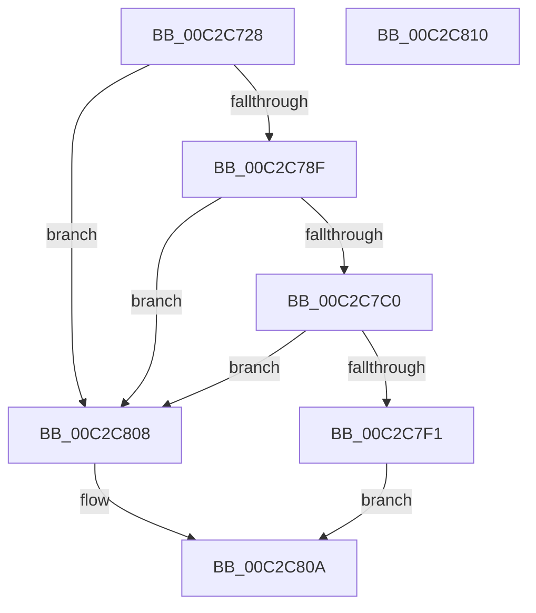

# IopCreateRootDirectories

- RVA: `0x00C2C728`–`0x00C2C811` (길이 `233` bytes)
- VA: `0x0000000140C2C728`
- 실행 섹션: `INIT`
- PDB 이름 있음: `예`; PDB Function 태그: `아니요`
- unwind 정보 RVA: `0x0008A308`
- 디코드: `60`개 명령, `233/233` bytes 표시
- 미해석 바이트: `0` (있으면 어셈블리에 `.byte`로 보존)

> 이 문서는 커널 이미지의 기계어와 PDB 기호를 분석해 생성했습니다. 4번과 5번은 함수 원형과 자료형을 바이너리 사용 방식에서 추정한 C 해석이며 원본 소스 복구 결과는 아닙니다.

## 1. Dependencies

- 직접 호출 지점: **10**; 고유 호출 대상: **4**
- 직접 호출자로 확인된 함수: **1**
- RIP 상대 이미지 참조: **3**

### Outgoing calls
- `0x00C2C758` → [RtlInitUnicodeString](../../text/42/RtlInitUnicodeString_function_0042A780.md) (function, `0x0042A780`)
- `0x00C2C786` → [NtCreateDirectoryObject](../../page/A5/NtCreateDirectoryObject_function_00A561F0.md) (function, `0x00A561F0`)
- `0x00C2C795` → [ObCloseHandle](../../page/8A/ObCloseHandle_function_008A1870.md) (function, `0x008A1870`)
- `0x00C2C7A5` → [RtlInitUnicodeString](../../text/42/RtlInitUnicodeString_function_0042A780.md) (function, `0x0042A780`)
- `0x00C2C7B7` → [NtCreateDirectoryObject](../../page/A5/NtCreateDirectoryObject_function_00A561F0.md) (function, `0x00A561F0`)
- `0x00C2C7C6` → [ObCloseHandle](../../page/8A/ObCloseHandle_function_008A1870.md) (function, `0x008A1870`)
- `0x00C2C7D6` → [RtlInitUnicodeString](../../text/42/RtlInitUnicodeString_function_0042A780.md) (function, `0x0042A780`)
- `0x00C2C7E8` → [NtCreateDirectoryObject](../../page/A5/NtCreateDirectoryObject_function_00A561F0.md) (function, `0x00A561F0`)
- `0x00C2C7F7` → [ObCloseHandle](../../page/8A/ObCloseHandle_function_008A1870.md) (function, `0x008A1870`)
- `0x00C2C7FC` → [IopCreateUmdfDirectory](IopCreateUmdfDirectory_function_00C2C818.md) (function, `0x00C2C818`)

### Direct callers
- [IoInitSystemPreDrivers](IoInitSystemPreDrivers_function_00C2AC3C.md) at `0x00C2B457`

### Static image references
- `0x00C2C736` → RVA `0x00C79AE0` (` ?? ::PBOPGDP::`string'`; read)
- `0x00C2C79A` → RVA `0x00C79AC0` (` ?? ::PBOPGDP::`string'`; read)
- `0x00C2C7CB` → RVA `0x00C79A90` (` ?? ::PBOPGDP::`string'`; read)

## 2. Other-region calls and transfers

- 다른 실행 섹션으로 향하는 call: **9**
  - `0x00C2C758` → [RtlInitUnicodeString](../../text/42/RtlInitUnicodeString_function_0042A780.md) (`INIT` → `.text`)
  - `0x00C2C786` → [NtCreateDirectoryObject](../../page/A5/NtCreateDirectoryObject_function_00A561F0.md) (`INIT` → `PAGE`)
  - `0x00C2C795` → [ObCloseHandle](../../page/8A/ObCloseHandle_function_008A1870.md) (`INIT` → `PAGE`)
  - `0x00C2C7A5` → [RtlInitUnicodeString](../../text/42/RtlInitUnicodeString_function_0042A780.md) (`INIT` → `.text`)
  - `0x00C2C7B7` → [NtCreateDirectoryObject](../../page/A5/NtCreateDirectoryObject_function_00A561F0.md) (`INIT` → `PAGE`)
  - `0x00C2C7C6` → [ObCloseHandle](../../page/8A/ObCloseHandle_function_008A1870.md) (`INIT` → `PAGE`)
  - `0x00C2C7D6` → [RtlInitUnicodeString](../../text/42/RtlInitUnicodeString_function_0042A780.md) (`INIT` → `.text`)
  - `0x00C2C7E8` → [NtCreateDirectoryObject](../../page/A5/NtCreateDirectoryObject_function_00A561F0.md) (`INIT` → `PAGE`)
  - `0x00C2C7F7` → [ObCloseHandle](../../page/8A/ObCloseHandle_function_008A1870.md) (`INIT` → `PAGE`)
- 별도 외부 분기/꼬리 이동을 확인하지 못했습니다.

## 3. Assembly (complete function range)

```asm
00C2C728  40 55                           push rbp
00C2C72A  48 8B EC                        mov rbp, rsp
00C2C72D  48 83 EC 60                     sub rsp, 0x60
00C2C731  48 83 65 10 00                  and qword ptr [rbp + 0x10], 0
00C2C736  48 8D 15 A3 D3 04 00            lea rdx, [rip + 0x4d3a3]
00C2C73D  83 65 EC 00                     and dword ptr [rbp - 0x14], 0
00C2C741  48 8D 4D C0                     lea rcx, [rbp - 0x40]
00C2C745  0F 57 C0                        xorps xmm0, xmm0
00C2C748  48 C7 45 D0 30 00 00 00         mov qword ptr [rbp - 0x30], 0x30
00C2C750  83 65 D4 00                     and dword ptr [rbp - 0x2c], 0
00C2C754  0F 11 45 C0                     movups xmmword ptr [rbp - 0x40], xmm0
00C2C758  E8 23 E0 7F FF                  call 0x14042a780
00C2C75D  48 83 65 D8 00                  and qword ptr [rbp - 0x28], 0
00C2C762  48 8D 45 C0                     lea rax, [rbp - 0x40]
00C2C766  0F 57 C0                        xorps xmm0, xmm0
00C2C769  48 89 45 E0                     mov qword ptr [rbp - 0x20], rax
00C2C76D  4C 8D 45 D0                     lea r8, [rbp - 0x30]
00C2C771  C7 45 E8 10 02 00 00            mov dword ptr [rbp - 0x18], 0x210
00C2C778  BA 0F 00 0F 00                  mov edx, 0xf000f
00C2C77D  48 8D 4D 10                     lea rcx, [rbp + 0x10]
00C2C781  F3 0F 7F 45 F0                  movdqu xmmword ptr [rbp - 0x10], xmm0
00C2C786  E8 65 9A E2 FF                  call 0x140a561f0
00C2C78B  85 C0                           test eax, eax
00C2C78D  78 79                           js 0x140c2c808
00C2C78F  48 8B 4D 10                     mov rcx, qword ptr [rbp + 0x10]
00C2C793  33 D2                           xor edx, edx
00C2C795  E8 D6 50 C7 FF                  call 0x1408a1870
00C2C79A  48 8D 15 1F D3 04 00            lea rdx, [rip + 0x4d31f]
00C2C7A1  48 8D 4D C0                     lea rcx, [rbp - 0x40]
00C2C7A5  E8 D6 DF 7F FF                  call 0x14042a780
00C2C7AA  4C 8D 45 D0                     lea r8, [rbp - 0x30]
00C2C7AE  BA 0F 00 0F 00                  mov edx, 0xf000f
00C2C7B3  48 8D 4D 10                     lea rcx, [rbp + 0x10]
00C2C7B7  E8 34 9A E2 FF                  call 0x140a561f0
00C2C7BC  85 C0                           test eax, eax
00C2C7BE  78 48                           js 0x140c2c808
00C2C7C0  48 8B 4D 10                     mov rcx, qword ptr [rbp + 0x10]
00C2C7C4  33 D2                           xor edx, edx
00C2C7C6  E8 A5 50 C7 FF                  call 0x1408a1870
00C2C7CB  48 8D 15 BE D2 04 00            lea rdx, [rip + 0x4d2be]
00C2C7D2  48 8D 4D C0                     lea rcx, [rbp - 0x40]
00C2C7D6  E8 A5 DF 7F FF                  call 0x14042a780
00C2C7DB  4C 8D 45 D0                     lea r8, [rbp - 0x30]
00C2C7DF  BA 0F 00 0F 00                  mov edx, 0xf000f
00C2C7E4  48 8D 4D 10                     lea rcx, [rbp + 0x10]
00C2C7E8  E8 03 9A E2 FF                  call 0x140a561f0
00C2C7ED  85 C0                           test eax, eax
00C2C7EF  78 17                           js 0x140c2c808
00C2C7F1  48 8B 4D 10                     mov rcx, qword ptr [rbp + 0x10]
00C2C7F5  33 D2                           xor edx, edx
00C2C7F7  E8 74 50 C7 FF                  call 0x1408a1870
00C2C7FC  E8 17 00 00 00                  call 0x140c2c818
00C2C801  85 C0                           test eax, eax
00C2C803  0F 99 C0                        setns al
00C2C806  EB 02                           jmp 0x140c2c80a
00C2C808  32 C0                           xor al, al
00C2C80A  48 83 C4 60                     add rsp, 0x60
00C2C80E  5D                              pop rbp
00C2C80F  C3                              ret
00C2C810  CC                              int3
```

## 4. C-style interpretation (structured pseudocode)

```c
__int64 __fastcall IopCreateRootDirectories(void)
{
    __int64 result;
    __int64 v_rsp;
    unsigned __int64 v_stack_m18;
    unsigned int v_stack_m1C;
    unsigned int v_stack_m20;
    unsigned __int64 v_stack_m28;
    unsigned __int64 v_stack_m30;
    unsigned int v_stack_m34;
    unsigned __int64 v_stack_m38;
    unsigned __int64 v_stack_m48;
    unsigned __int64 v_stack_p8;

    v_rsp = (v_rsp) - (96);
    v_stack_m38 = 48;
    v_stack_m48 = v_xmm0;
    result = RtlInitUnicodeString(v_stack_m48, v_rip + 316323, a3, a4);
    v_stack_m28 = v_stack_m48;
    v_stack_m20 = 528;
    v_stack_m18 = v_xmm0;
    result = NtCreateDirectoryObject(v_stack_p8, (unsigned int)(0xF000FULL), v_stack_m38, a4);
    if (sign_flag) goto loc_00C2C808;
    a2 = 0;
    result = ObCloseHandle(v_stack_p8, a2, v_stack_m38, a4);
    result = RtlInitUnicodeString(v_stack_m48, v_rip + 316191, v_stack_m38, a4);
    result = NtCreateDirectoryObject(v_stack_p8, (unsigned int)(0xF000FULL), v_stack_m38, a4);
    if (sign_flag) goto loc_00C2C808;
    a2 = 0;
    result = ObCloseHandle(v_stack_p8, a2, v_stack_m38, a4);
    result = RtlInitUnicodeString(v_stack_m48, v_rip + 316094, v_stack_m38, a4);
    result = NtCreateDirectoryObject(v_stack_p8, (unsigned int)(0xF000FULL), v_stack_m38, a4);
    if (sign_flag) goto loc_00C2C808;
    a2 = 0;
    result = ObCloseHandle(v_stack_p8, a2, v_stack_m38, a4);
    result = IopCreateUmdfDirectory(v_stack_p8, a2, v_stack_m38, a4);
    result = (!sign_flag) ? 1 : 0;
    goto loc_00C2C80A;
loc_00C2C808:
    result = 0;
loc_00C2C80A:
    v_rsp = (v_rsp) + (96);
    return result;
}
```

## 5. (Beta) C Style

```c
void IopCreateRootDirectories(void)
{
    int64_t result;
    int64_t local_rsp;
    uint64_t v_stack_m18;
    uint32_t v_stack_m1C;
    uint32_t v_stack_m20;
    uint64_t v_stack_m28;
    uint64_t v_stack_m30;
    uint32_t v_stack_m34;
    uint64_t v_stack_m38;
    uint64_t v_stack_m48;
    uint64_t v_stack_p8;

    local_rsp = (local_rsp) - (96);
    v_stack_m38 = 48;
    v_stack_m48 = v_xmm0;
    result = RtlInitUnicodeString(v_stack_m48, v_rip + 316323, a3, a4);
    v_stack_m28 = v_stack_m48;
    v_stack_m20 = 528;
    v_stack_m18 = v_xmm0;
    result = NtCreateDirectoryObject(v_stack_p8, (uint32_t)(0xF000FULL), v_stack_m38, a4);
    if (sign_flag) goto loc_00C2C808;
    a2 = 0;
    result = ObCloseHandle(v_stack_p8, a2, v_stack_m38, a4);
    result = RtlInitUnicodeString(v_stack_m48, v_rip + 316191, v_stack_m38, a4);
    result = NtCreateDirectoryObject(v_stack_p8, (uint32_t)(0xF000FULL), v_stack_m38, a4);
    if (sign_flag) goto loc_00C2C808;
    a2 = 0;
    result = ObCloseHandle(v_stack_p8, a2, v_stack_m38, a4);
    result = RtlInitUnicodeString(v_stack_m48, v_rip + 316094, v_stack_m38, a4);
    result = NtCreateDirectoryObject(v_stack_p8, (uint32_t)(0xF000FULL), v_stack_m38, a4);
    if (sign_flag) goto loc_00C2C808;
    a2 = 0;
    result = ObCloseHandle(v_stack_p8, a2, v_stack_m38, a4);
    result = IopCreateUmdfDirectory(v_stack_p8, a2, v_stack_m38, a4);
    result = (!sign_flag) ? 1 : 0;
    goto loc_00C2C80A;
loc_00C2C808:
    result = 0;
loc_00C2C80A:
    local_rsp = (local_rsp) + (96);
    return result;
}
```

## 6. Execution-region graph

[열기: 2D/3D 그래프와 함수 탐색 컨트롤 패널](../../../control-panel.html?section=init&rva=0x00C2C728&view=graph)

- 2D 그래프는 위에서 아래로 흐르고, 3D 그래프는 빈 공간을 드래그해 회전합니다. Shift+드래그는 이동, 휠은 확대·축소, 함수 노드 선택은 대상 보고서 이동입니다.

### Static fallback


