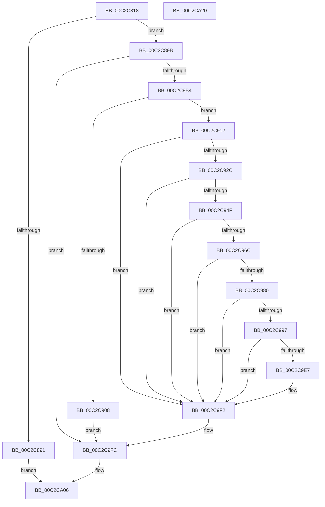

# IopCreateUmdfDirectory

- RVA: `0x00C2C818`–`0x00C2CA21` (길이 `521` bytes)
- VA: `0x0000000140C2C818`
- 실행 섹션: `INIT`
- PDB 이름 있음: `예`; PDB Function 태그: `아니요`
- unwind 정보 RVA: `0x000C7270`
- 디코드: `134`개 명령, `521/521` bytes 표시
- 미해석 바이트: `0` (있으면 어셈블리에 `.byte`로 보존)

> 이 문서는 커널 이미지의 기계어와 PDB 기호를 분석해 생성했습니다. 4번과 5번은 함수 원형과 자료형을 바이너리 사용 방식에서 추정한 C 해석이며 원본 소스 복구 결과는 아닙니다.

## 1. Dependencies

- 직접 호출 지점: **14**; 고유 호출 대상: **11**
- 직접 호출자로 확인된 함수: **1**
- RIP 상대 이미지 참조: **2**

### Outgoing calls
- `0x00C2C870` → [RtlLengthRequiredSid](../../page/9C/RtlLengthRequiredSid_function_009CA4D0.md) (function, `0x009CA4D0`)
- `0x00C2C884` → [ExAllocatePool2](../../poolcode/B8/ExAllocatePool2_function_00B820F0.md) (function, `0x00B820F0`)
- `0x00C2C8A5` → [RtlInitializeSid](../../page/9E/RtlInitializeSid_function_009EB720.md) (function, `0x009EB720`)
- `0x00C2C8FB` → [ExAllocatePool2](../../poolcode/B8/ExAllocatePool2_function_00B820F0.md) (function, `0x00B820F0`)
- `0x00C2C91D` → [RtlCreateAcl](../../page/91/RtlCreateAcl_function_00916F00.md) (function, `0x00916F00`)
- `0x00C2C940` → [RtlAddAccessAllowedAce](../../page/92/RtlAddAccessAllowedAce_function_009298C0.md) (function, `0x009298C0`)
- `0x00C2C95D` → [RtlAddAccessAllowedAce](../../page/92/RtlAddAccessAllowedAce_function_009298C0.md) (function, `0x009298C0`)
- `0x00C2C975` → [RtlCreateSecurityDescriptor](../../page/9F/RtlCreateSecurityDescriptor_function_009F1DF0.md) (function, `0x009F1DF0`)
- `0x00C2C98C` → [RtlSetDaclSecurityDescriptor](../../page/9E/RtlSetDaclSecurityDescriptor_function_009EC210.md) (function, `0x009EC210`)
- `0x00C2C9A2` → [RtlInitUnicodeString](../../text/42/RtlInitUnicodeString_function_0042A780.md) (function, `0x0042A780`)
- `0x00C2C9DC` → [NtCreateDirectoryObject](../../page/A5/NtCreateDirectoryObject_function_00A561F0.md) (function, `0x00A561F0`)
- `0x00C2C9ED` → [ObCloseHandle](../../page/8A/ObCloseHandle_function_008A1870.md) (function, `0x008A1870`)
- `0x00C2C9F7` → [ExFreePoolWithTag](../../poolcode/B8/ExFreePoolWithTag_function_00B82870.md) (function, `0x00B82870`)
- `0x00C2CA01` → [ExFreePoolWithTag](../../poolcode/B8/ExFreePoolWithTag_function_00B82870.md) (function, `0x00B82870`)

### Direct callers
- [IopCreateRootDirectories](IopCreateRootDirectories_function_00C2C728.md) at `0x00C2C7FC`

### Static image references
- `0x00C2C856` → RVA `0x00FD9AA0` (`PAGEDATA`; read)
- `0x00C2C997` → RVA `0x00C79BD0` (` ?? ::PBOPGDP::`string'`; read)

## 2. Other-region calls and transfers

- 다른 실행 섹션으로 향하는 call: **14**
  - `0x00C2C870` → [RtlLengthRequiredSid](../../page/9C/RtlLengthRequiredSid_function_009CA4D0.md) (`INIT` → `PAGE`)
  - `0x00C2C884` → [ExAllocatePool2](../../poolcode/B8/ExAllocatePool2_function_00B820F0.md) (`INIT` → `POOLCODE`)
  - `0x00C2C8A5` → [RtlInitializeSid](../../page/9E/RtlInitializeSid_function_009EB720.md) (`INIT` → `PAGE`)
  - `0x00C2C8FB` → [ExAllocatePool2](../../poolcode/B8/ExAllocatePool2_function_00B820F0.md) (`INIT` → `POOLCODE`)
  - `0x00C2C91D` → [RtlCreateAcl](../../page/91/RtlCreateAcl_function_00916F00.md) (`INIT` → `PAGE`)
  - `0x00C2C940` → [RtlAddAccessAllowedAce](../../page/92/RtlAddAccessAllowedAce_function_009298C0.md) (`INIT` → `PAGE`)
  - `0x00C2C95D` → [RtlAddAccessAllowedAce](../../page/92/RtlAddAccessAllowedAce_function_009298C0.md) (`INIT` → `PAGE`)
  - `0x00C2C975` → [RtlCreateSecurityDescriptor](../../page/9F/RtlCreateSecurityDescriptor_function_009F1DF0.md) (`INIT` → `PAGE`)
  - `0x00C2C98C` → [RtlSetDaclSecurityDescriptor](../../page/9E/RtlSetDaclSecurityDescriptor_function_009EC210.md) (`INIT` → `PAGE`)
  - `0x00C2C9A2` → [RtlInitUnicodeString](../../text/42/RtlInitUnicodeString_function_0042A780.md) (`INIT` → `.text`)
  - `0x00C2C9DC` → [NtCreateDirectoryObject](../../page/A5/NtCreateDirectoryObject_function_00A561F0.md) (`INIT` → `PAGE`)
  - `0x00C2C9ED` → [ObCloseHandle](../../page/8A/ObCloseHandle_function_008A1870.md) (`INIT` → `PAGE`)
  - `0x00C2C9F7` → [ExFreePoolWithTag](../../poolcode/B8/ExFreePoolWithTag_function_00B82870.md) (`INIT` → `POOLCODE`)
  - `0x00C2CA01` → [ExFreePoolWithTag](../../poolcode/B8/ExFreePoolWithTag_function_00B82870.md) (`INIT` → `POOLCODE`)
- 별도 외부 분기/꼬리 이동을 확인하지 못했습니다.

## 3. Assembly (complete function range)

```asm
00C2C818  48 89 5C 24 18                  mov qword ptr [rsp + 0x18], rbx
00C2C81D  48 89 74 24 20                  mov qword ptr [rsp + 0x20], rsi
00C2C822  55                              push rbp
00C2C823  57                              push rdi
00C2C824  41 56                           push r14
00C2C826  48 8D 6C 24 B9                  lea rbp, [rsp - 0x47]
00C2C82B  48 81 EC 90 00 00 00            sub rsp, 0x90
00C2C832  33 C0                           xor eax, eax
00C2C834  66 C7 45 6B 00 05               mov word ptr [rbp + 0x6b], 0x500
00C2C83A  48 21 45 6F                     and qword ptr [rbp + 0x6f], rax
00C2C83E  0F 57 C0                        xorps xmm0, xmm0
00C2C841  21 45 2B                        and dword ptr [rbp + 0x2b], eax
00C2C844  B9 06 00 00 00                  mov ecx, 6
00C2C849  89 45 13                        mov dword ptr [rbp + 0x13], eax
00C2C84C  21 45 13                        and dword ptr [rbp + 0x13], eax
00C2C84F  48 89 45 07                     mov qword ptr [rbp + 7], rax
00C2C853  89 45 67                        mov dword ptr [rbp + 0x67], eax
00C2C856  48 8B 05 43 D2 3A 00            mov rax, qword ptr [rip + 0x3ad243]
00C2C85D  0F 11 45 E7                     movups xmmword ptr [rbp - 0x19], xmm0
00C2C861  0F 11 45 F7                     movups xmmword ptr [rbp - 9], xmm0
00C2C865  0F 11 45 D7                     movups xmmword ptr [rbp - 0x29], xmm0
00C2C869  4C 8B B0 08 01 00 00            mov r14, qword ptr [rax + 0x108]
00C2C870  E8 5B DC D9 FF                  call 0x1409ca4d0
00C2C875  BE 00 01 00 00                  mov esi, 0x100
00C2C87A  8B D0                           mov edx, eax
00C2C87C  8B CE                           mov ecx, esi
00C2C87E  41 B8 49 6F 53 73               mov r8d, 0x73536f49
00C2C884  E8 67 58 F5 FF                  call 0x140b820f0
00C2C889  48 8B F8                        mov rdi, rax
00C2C88C  48 85 C0                        test rax, rax
00C2C88F  75 0A                           jne 0x140c2c89b
00C2C891  BB 9A 00 00 C0                  mov ebx, 0xc000009a
00C2C896  E9 6B 01 00 00                  jmp 0x140c2ca06
00C2C89B  41 B0 06                        mov r8b, 6
00C2C89E  48 8D 55 67                     lea rdx, [rbp + 0x67]
00C2C8A2  48 8B CF                        mov rcx, rdi
00C2C8A5  E8 76 EE DB FF                  call 0x1409eb720
00C2C8AA  8B D8                           mov ebx, eax
00C2C8AC  85 C0                           test eax, eax
00C2C8AE  0F 88 48 01 00 00               js 0x140c2c9fc
00C2C8B4  C7 47 08 50 00 00 00            mov dword ptr [rdi + 8], 0x50
00C2C8BB  41 B8 49 6F 41 63               mov r8d, 0x63416f49
00C2C8C1  C7 47 0C F1 A8 1C 9E            mov dword ptr [rdi + 0xc], 0x9e1ca8f1
00C2C8C8  48 8B CE                        mov rcx, rsi
00C2C8CB  C7 47 10 C1 5B B9 22            mov dword ptr [rdi + 0x10], 0x22b95bc1
00C2C8D2  C7 47 14 7F 81 66 6D            mov dword ptr [rdi + 0x14], 0x6d66817f
00C2C8D9  C7 47 18 59 F5 27 50            mov dword ptr [rdi + 0x18], 0x5027f559
00C2C8E0  C7 47 1C C5 1D A9 2C            mov dword ptr [rdi + 0x1c], 0x2ca91dc5
00C2C8E7  0F B6 57 01                     movzx edx, byte ptr [rdi + 1]
00C2C8EB  41 0F B6 46 01                  movzx eax, byte ptr [r14 + 1]
00C2C8F0  03 D0                           add edx, eax
00C2C8F2  8D 1C 95 28 00 00 00            lea ebx, [rdx*4 + 0x28]
00C2C8F9  8B D3                           mov edx, ebx
00C2C8FB  E8 F0 57 F5 FF                  call 0x140b820f0
00C2C900  48 8B F0                        mov rsi, rax
00C2C903  48 85 C0                        test rax, rax
00C2C906  75 0A                           jne 0x140c2c912
00C2C908  BB 9A 00 00 C0                  mov ebx, 0xc000009a
00C2C90D  E9 EA 00 00 00                  jmp 0x140c2c9fc
00C2C912  41 B8 02 00 00 00               mov r8d, 2
00C2C918  8B D3                           mov edx, ebx
00C2C91A  48 8B CE                        mov rcx, rsi
00C2C91D  E8 DE A5 CE FF                  call 0x140916f00
00C2C922  8B D8                           mov ebx, eax
00C2C924  85 C0                           test eax, eax
00C2C926  0F 88 C6 00 00 00               js 0x140c2c9f2
00C2C92C  4D 8B CE                        mov r9, r14
00C2C92F  BA 02 00 00 00                  mov edx, 2
00C2C934  41 BE 00 00 00 10               mov r14d, 0x10000000
00C2C93A  48 8B CE                        mov rcx, rsi
00C2C93D  45 8B C6                        mov r8d, r14d
00C2C940  E8 7B CF CF FF                  call 0x1409298c0
00C2C945  8B D8                           mov ebx, eax
00C2C947  85 C0                           test eax, eax
00C2C949  0F 88 A3 00 00 00               js 0x140c2c9f2
00C2C94F  4C 8B CF                        mov r9, rdi
00C2C952  45 8B C6                        mov r8d, r14d
00C2C955  BA 02 00 00 00                  mov edx, 2
00C2C95A  48 8B CE                        mov rcx, rsi
00C2C95D  E8 5E CF CF FF                  call 0x1409298c0
00C2C962  8B D8                           mov ebx, eax
00C2C964  85 C0                           test eax, eax
00C2C966  0F 88 86 00 00 00               js 0x140c2c9f2
00C2C96C  BA 01 00 00 00                  mov edx, 1
00C2C971  48 8D 4D E7                     lea rcx, [rbp - 0x19]
00C2C975  E8 76 54 DC FF                  call 0x1409f1df0
00C2C97A  8B D8                           mov ebx, eax
00C2C97C  85 C0                           test eax, eax
00C2C97E  78 72                           js 0x140c2c9f2
00C2C980  45 33 C9                        xor r9d, r9d
00C2C983  48 8D 4D E7                     lea rcx, [rbp - 0x19]
00C2C987  4C 8B C6                        mov r8, rsi
00C2C98A  B2 01                           mov dl, 1
00C2C98C  E8 7F F8 DB FF                  call 0x1409ec210
00C2C991  8B D8                           mov ebx, eax
00C2C993  85 C0                           test eax, eax
00C2C995  78 5B                           js 0x140c2c9f2
00C2C997  48 8D 15 32 D2 04 00            lea rdx, [rip + 0x4d232]
00C2C99E  48 8D 4D D7                     lea rcx, [rbp - 0x29]
00C2C9A2  E8 D9 DD 7F FF                  call 0x14042a780
00C2C9A7  48 83 65 17 00                  and qword ptr [rbp + 0x17], 0
00C2C9AC  48 8D 45 D7                     lea rax, [rbp - 0x29]
00C2C9B0  48 83 65 37 00                  and qword ptr [rbp + 0x37], 0
00C2C9B5  4C 8D 45 0F                     lea r8, [rbp + 0xf]
00C2C9B9  48 89 45 1F                     mov qword ptr [rbp + 0x1f], rax
00C2C9BD  48 8D 4D 6F                     lea rcx, [rbp + 0x6f]
00C2C9C1  48 8D 45 E7                     lea rax, [rbp - 0x19]
00C2C9C5  C7 45 0F 30 00 00 00            mov dword ptr [rbp + 0xf], 0x30
00C2C9CC  BA 0F 00 0F 00                  mov edx, 0xf000f
00C2C9D1  48 89 45 2F                     mov qword ptr [rbp + 0x2f], rax
00C2C9D5  C7 45 27 10 02 00 00            mov dword ptr [rbp + 0x27], 0x210
00C2C9DC  E8 0F 98 E2 FF                  call 0x140a561f0
00C2C9E1  8B D8                           mov ebx, eax
00C2C9E3  85 C0                           test eax, eax
00C2C9E5  78 0B                           js 0x140c2c9f2
00C2C9E7  48 8B 4D 6F                     mov rcx, qword ptr [rbp + 0x6f]
00C2C9EB  33 D2                           xor edx, edx
00C2C9ED  E8 7E 4E C7 FF                  call 0x1408a1870
00C2C9F2  33 D2                           xor edx, edx
00C2C9F4  48 8B CE                        mov rcx, rsi
00C2C9F7  E8 74 5E F5 FF                  call 0x140b82870
00C2C9FC  33 D2                           xor edx, edx
00C2C9FE  48 8B CF                        mov rcx, rdi
00C2CA01  E8 6A 5E F5 FF                  call 0x140b82870
00C2CA06  4C 8D 9C 24 90 00 00 00         lea r11, [rsp + 0x90]
00C2CA0E  8B C3                           mov eax, ebx
00C2CA10  49 8B 5B 30                     mov rbx, qword ptr [r11 + 0x30]
00C2CA14  49 8B 73 38                     mov rsi, qword ptr [r11 + 0x38]
00C2CA18  49 8B E3                        mov rsp, r11
00C2CA1B  41 5E                           pop r14
00C2CA1D  5F                              pop rdi
00C2CA1E  5D                              pop rbp
00C2CA1F  C3                              ret
00C2CA20  CC                              int3
```

## 4. C-style interpretation (structured pseudocode)

```c
__int64 __fastcall IopCreateUmdfDirectory(void)
{
    __int64 result;
    __int64 v_rsp;
    unsigned __int64 v_stack_m18;
    unsigned __int64 v_stack_m28;
    unsigned __int64 v_stack_m30;
    unsigned int v_stack_m34;
    unsigned int v_stack_m38;
    unsigned __int64 v_stack_m40;
    unsigned __int64 v_stack_m48;
    unsigned int v_stack_m4C;
    unsigned __int64 v_stack_m50;
    unsigned __int64 v_stack_m58;
    unsigned __int64 v_stack_m5F;
    unsigned __int64 v_stack_m68;
    unsigned __int64 v_stack_m78;
    unsigned __int64 v_stack_m88;
    unsigned __int64 v_stack_p10;
    unsigned __int64 v_stack_p18;
    unsigned __int64 v_stack_p20;
    unsigned int v_stack_p8;
    unsigned __int16 v_stack_pC;

    v_stack_p18 = v_rbx;
    v_stack_p20 = v_rsi;
    v_rsp = (v_rsp) - (144);
    result = 0;
    v_stack_pC = 0x500ULL;
    v_stack_m4C = 0;
    v_stack_m58 = 0;
    v_stack_p8 = 0;
    v_stack_m78 = v_xmm0;
    v_stack_m68 = v_xmm0;
    v_stack_m88 = v_xmm0;
    result = RtlLengthRequiredSid(6, a2, a3, a4);
    result = ExAllocatePool2(256, (unsigned int)((unsigned int)(result)), (unsigned int)(0x73536F49ULL), a4);
    if (result != 0) goto loc_00C2C89B;
    goto loc_00C2CA06;
loc_00C2C89B:
    result = RtlInitializeSid(result, v_stack_p8, 6, a4);
    if (sign_flag) goto loc_00C2C9FC;
    *(unsigned int *)(result + 8) = 80;
    *(unsigned int *)(result + 12) = 0x9E1CA8F1ULL;
    *(unsigned int *)(result + 16) = 0x22B95BC1ULL;
    *(unsigned int *)(result + 20) = 0x6D66817FULL;
    *(unsigned int *)(result + 24) = 0x5027F559ULL;
    *(unsigned int *)(result + 28) = 0x2CA91DC5ULL;
    a2 = (unsigned int)((*(unsigned __int8 *)(result + 1)) + ((unsigned int)(*(unsigned __int8 *)(*(unsigned __int64 *)(*(unsigned __int64 *)(v_rip + 3854915) + 264) + 1))));
    result = ExAllocatePool2(256, (unsigned int)((unsigned int)(a2 * 4 + 40)), (unsigned int)(0x63416F49ULL), a4);
    if (result != 0) goto loc_00C2C912;
    goto loc_00C2C9FC;
loc_00C2C912:
    result = RtlCreateAcl(result, (unsigned int)((unsigned int)((unsigned int)(0xC000009AULL))), 2, a4);
    if (sign_flag) goto loc_00C2C9F2;
    result = RtlAddAccessAllowedAce(result, 2, (unsigned int)((unsigned int)((unsigned int)(0x10000000ULL))), *(unsigned __int64 *)(*(unsigned __int64 *)(v_rip + 3854915) + 264));
    if (sign_flag) goto loc_00C2C9F2;
    result = RtlAddAccessAllowedAce(result, 2, (unsigned int)((unsigned int)((unsigned int)(0x10000000ULL))), result);
    if (sign_flag) goto loc_00C2C9F2;
    result = RtlCreateSecurityDescriptor(v_stack_m78, 1, (unsigned int)((unsigned int)((unsigned int)(0x10000000ULL))), result);
    if (sign_flag) goto loc_00C2C9F2;
    a4 = 0;
    result = RtlSetDaclSecurityDescriptor(v_stack_m78, 1, result, a4);
    if (sign_flag) goto loc_00C2C9F2;
    result = RtlInitUnicodeString(v_stack_m88, v_rip + 315954, result, a4);
    v_stack_m40 = v_stack_m88;
    v_stack_m50 = 48;
    v_stack_m30 = v_stack_m78;
    v_stack_m38 = 528;
    result = NtCreateDirectoryObject(v_stack_p10, (unsigned int)(0xF000FULL), v_stack_m50, a4);
    if (!(sign_flag)) {
        a1 = v_stack_p10;
        a2 = 0;
        result = ObCloseHandle(a1, a2, v_stack_m50, a4);
    }
    a2 = 0;
    result = ExFreePoolWithTag(result, a2, v_stack_m50, a4);
loc_00C2C9FC:
    a2 = 0;
    result = ExFreePoolWithTag(result, a2, v_stack_m50, a4);
loc_00C2CA06:
    return (unsigned int)((unsigned int)((unsigned int)((unsigned int)(result))));
}
```

## 5. (Beta) C Style

```c
void IopCreateUmdfDirectory(void)
{
    int64_t result;
    int64_t local_rsp;
    uint64_t v_stack_m18;
    uint64_t v_stack_m28;
    uint64_t v_stack_m30;
    uint32_t v_stack_m34;
    uint32_t v_stack_m38;
    uint64_t v_stack_m40;
    uint64_t v_stack_m48;
    uint32_t v_stack_m4C;
    uint64_t v_stack_m50;
    uint64_t v_stack_m58;
    uint64_t v_stack_m5F;
    uint64_t v_stack_m68;
    uint64_t v_stack_m78;
    uint64_t v_stack_m88;
    uint64_t v_stack_p10;
    uint64_t v_stack_p18;
    uint64_t v_stack_p20;
    uint32_t v_stack_p8;
    uint16_t v_stack_pC;

    v_stack_p18 = local_rbx;
    v_stack_p20 = local_rsi;
    local_rsp = (local_rsp) - (144);
    result = 0;
    v_stack_pC = 0x500ULL;
    v_stack_m4C = 0;
    v_stack_m58 = 0;
    v_stack_p8 = 0;
    v_stack_m78 = v_xmm0;
    v_stack_m68 = v_xmm0;
    v_stack_m88 = v_xmm0;
    result = RtlLengthRequiredSid(6, a2, a3, a4);
    result = ExAllocatePool2(256, (uint32_t)((uint32_t)(result)), (uint32_t)(0x73536F49ULL), a4);
    if (result != 0) goto loc_00C2C89B;
    goto loc_00C2CA06;
loc_00C2C89B:
    result = RtlInitializeSid(result, v_stack_p8, 6, a4);
    if (sign_flag) goto loc_00C2C9FC;
    *(uint32_t *)(result + 0x8) = 80;
    *(uint32_t *)(result + 0xC) = 0x9E1CA8F1ULL;
    *(uint32_t *)(result + 0x10) = 0x22B95BC1ULL;
    *(uint32_t *)(result + 0x14) = 0x6D66817FULL;
    *(uint32_t *)(result + 0x18) = 0x5027F559ULL;
    *(uint32_t *)(result + 0x1C) = 0x2CA91DC5ULL;
    a2 = (uint32_t)((*(uint8_t *)(result + 0x1)) + ((uint32_t)(*(uint8_t *)(*(uint64_t *)(*(uint64_t *)(v_rip + 0x3AD243) + 0x108) + 0x1))));
    result = ExAllocatePool2(256, (uint32_t)((uint32_t)(a2 * 4 + 40)), (uint32_t)(0x63416F49ULL), a4);
    if (result != 0) goto loc_00C2C912;
    goto loc_00C2C9FC;
loc_00C2C912:
    result = RtlCreateAcl(result, (uint32_t)((uint32_t)((uint32_t)(0xC000009AULL))), 2, a4);
    if (sign_flag) goto loc_00C2C9F2;
    result = RtlAddAccessAllowedAce(result, 2, (uint32_t)((uint32_t)((uint32_t)(0x10000000ULL))), *(uint64_t *)(*(uint64_t *)(v_rip + 0x3AD243) + 0x108));
    if (sign_flag) goto loc_00C2C9F2;
    result = RtlAddAccessAllowedAce(result, 2, (uint32_t)((uint32_t)((uint32_t)(0x10000000ULL))), result);
    if (sign_flag) goto loc_00C2C9F2;
    result = RtlCreateSecurityDescriptor(v_stack_m78, 1, (uint32_t)((uint32_t)((uint32_t)(0x10000000ULL))), result);
    if (sign_flag) goto loc_00C2C9F2;
    a4 = 0;
    result = RtlSetDaclSecurityDescriptor(v_stack_m78, 1, result, a4);
    if (sign_flag) goto loc_00C2C9F2;
    result = RtlInitUnicodeString(v_stack_m88, v_rip + 315954, result, a4);
    v_stack_m40 = v_stack_m88;
    v_stack_m50 = 48;
    v_stack_m30 = v_stack_m78;
    v_stack_m38 = 528;
    result = NtCreateDirectoryObject(v_stack_p10, (uint32_t)(0xF000FULL), v_stack_m50, a4);
    if (!(sign_flag)) {
        a1 = v_stack_p10;
        a2 = 0;
        result = ObCloseHandle(a1, a2, v_stack_m50, a4);
    }
    a2 = 0;
    result = ExFreePoolWithTag(result, a2, v_stack_m50, a4);
loc_00C2C9FC:
    a2 = 0;
    result = ExFreePoolWithTag(result, a2, v_stack_m50, a4);
loc_00C2CA06:
    return (uint32_t)((uint32_t)((uint32_t)((uint32_t)(result))));
}
```

## 6. Execution-region graph

[열기: 2D/3D 그래프와 함수 탐색 컨트롤 패널](../../../control-panel.html?section=init&rva=0x00C2C818&view=graph)

- 2D 그래프는 위에서 아래로 흐르고, 3D 그래프는 빈 공간을 드래그해 회전합니다. Shift+드래그는 이동, 휠은 확대·축소, 함수 노드 선택은 대상 보고서 이동입니다.

### Static fallback


