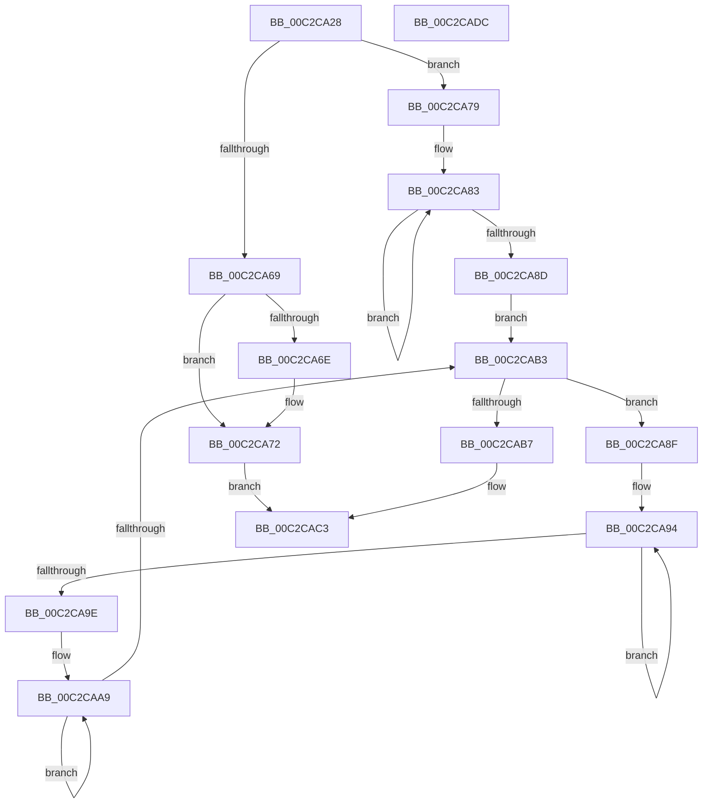

# IopFetchConfigurationInformation

- RVA: `0x00C2CA28`–`0x00C2CADD` (길이 `181` bytes)
- VA: `0x0000000140C2CA28`
- 실행 섹션: `INIT`
- PDB 이름 있음: `예`; PDB Function 태그: `아니요`
- unwind 정보 RVA: `0x00060300`
- 디코드: `59`개 명령, `181/181` bytes 표시
- 미해석 바이트: `0` (있으면 어셈블리에 `.byte`로 보존)

> 이 문서는 커널 이미지의 기계어와 PDB 기호를 분석해 생성했습니다. 4번과 5번은 함수 원형과 자료형을 바이너리 사용 방식에서 추정한 C 해석이며 원본 소스 복구 결과는 아닙니다.

## 1. Dependencies

- 직접 호출 지점: **1**; 고유 호출 대상: **1**
- 직접 호출자로 확인된 함수: **2**
- RIP 상대 이미지 참조: **0**

### Outgoing calls
- `0x00C2CA60` → [IoGetDeviceInterfaces](../../page/95/IoGetDeviceInterfaces_function_00953340.md) (function, `0x00953340`)

### Direct callers
- [IopCreateArcNamesCd](IopCreateArcNamesCd_function_00C2C060.md) at `0x00C2C110`
- [IopCreateArcNamesDisk](IopCreateArcNamesDisk_function_00C2C594.md) at `0x00C2C605`

### Static image references
- 디코드된 RIP-relative 메모리 참조가 없습니다.

## 2. Other-region calls and transfers

- 다른 실행 섹션으로 향하는 call: **1**
  - `0x00C2CA60` → [IoGetDeviceInterfaces](../../page/95/IoGetDeviceInterfaces_function_00953340.md) (`INIT` → `PAGE`)
- 별도 외부 분기/꼬리 이동을 확인하지 못했습니다.

## 3. Assembly (complete function range)

```asm
00C2CA28  48 89 5C 24 08                  mov qword ptr [rsp + 8], rbx
00C2CA2D  48 89 6C 24 10                  mov qword ptr [rsp + 0x10], rbp
00C2CA32  48 89 74 24 18                  mov qword ptr [rsp + 0x18], rsi
00C2CA37  57                              push rdi
00C2CA38  41 56                           push r14
00C2CA3A  41 57                           push r15
00C2CA3C  48 83 EC 20                     sub rsp, 0x20
00C2CA40  48 8B 39                        mov rdi, qword ptr [rcx]
00C2CA43  48 8B C2                        mov rax, rdx
00C2CA46  4D 8B F1                        mov r14, r9
00C2CA49  41 8B E8                        mov ebp, r8d
00C2CA4C  4C 8B C9                        mov r9, rcx
00C2CA4F  48 8B F1                        mov rsi, rcx
00C2CA52  45 33 FF                        xor r15d, r15d
00C2CA55  48 8B C8                        mov rcx, rax
00C2CA58  45 33 C0                        xor r8d, r8d
00C2CA5B  33 D2                           xor edx, edx
00C2CA5D  41 8B DF                        mov ebx, r15d
00C2CA60  E8 DB 68 D2 FF                  call 0x140953340
00C2CA65  85 C0                           test eax, eax
00C2CA67  79 10                           jns 0x140c2ca79
00C2CA69  48 85 FF                        test rdi, rdi
00C2CA6C  74 04                           je 0x140c2ca72
00C2CA6E  66 44 89 3F                     mov word ptr [rdi], r15w
00C2CA72  B8 01 00 00 C0                  mov eax, 0xc0000001
00C2CA77  EB 4A                           jmp 0x140c2cac3
00C2CA79  48 8B 0E                        mov rcx, qword ptr [rsi]
00C2CA7C  48 83 CA FF                     or rdx, 0xffffffffffffffff
00C2CA80  48 8B C2                        mov rax, rdx
00C2CA83  48 FF C0                        inc rax
00C2CA86  66 44 39 3C 41                  cmp word ptr [rcx + rax*2], r15w
00C2CA8B  75 F6                           jne 0x140c2ca83
00C2CA8D  EB 24                           jmp 0x140c2cab3
00C2CA8F  FF C3                           inc ebx
00C2CA91  48 8B C2                        mov rax, rdx
00C2CA94  48 FF C0                        inc rax
00C2CA97  66 44 39 3C 41                  cmp word ptr [rcx + rax*2], r15w
00C2CA9C  75 F6                           jne 0x140c2ca94
00C2CA9E  48 8D 0C 41                     lea rcx, [rcx + rax*2]
00C2CAA2  48 8B C2                        mov rax, rdx
00C2CAA5  48 83 C1 02                     add rcx, 2
00C2CAA9  48 FF C0                        inc rax
00C2CAAC  66 44 39 3C 41                  cmp word ptr [rcx + rax*2], r15w
00C2CAB1  75 F6                           jne 0x140c2caa9
00C2CAB3  85 C0                           test eax, eax
00C2CAB5  75 D8                           jne 0x140c2ca8f
00C2CAB7  3B DD                           cmp ebx, ebp
00C2CAB9  41 89 1E                        mov dword ptr [r14], ebx
00C2CABC  1B C0                           sbb eax, eax
00C2CABE  25 01 00 00 C0                  and eax, 0xc0000001
00C2CAC3  48 8B 5C 24 40                  mov rbx, qword ptr [rsp + 0x40]
00C2CAC8  48 8B 6C 24 48                  mov rbp, qword ptr [rsp + 0x48]
00C2CACD  48 8B 74 24 50                  mov rsi, qword ptr [rsp + 0x50]
00C2CAD2  48 83 C4 20                     add rsp, 0x20
00C2CAD6  41 5F                           pop r15
00C2CAD8  41 5E                           pop r14
00C2CADA  5F                              pop rdi
00C2CADB  C3                              ret
00C2CADC  CC                              int3
```

## 4. C-style interpretation (structured pseudocode)

```c
__int64 __fastcall IopFetchConfigurationInformation(__int64 a1, __int64 a2, int a3, __int64 a4)
{
    __int64 result;
    __int64 v_r15;
    __int64 v_rbx;
    __int64 v_rsp;
    unsigned __int64 v_stack_p10;
    unsigned __int64 v_stack_p18;
    unsigned __int64 v_stack_p8;

    v_stack_p8 = v_rbx;
    v_stack_p10 = v_rbp;
    v_stack_p18 = v_rsi;
    v_rsp = (v_rsp) - (32);
    v_r15 = 0;
    a3 = 0;
    a2 = 0;
    result = IoGetDeviceInterfaces(a2, a2, a3, a1);
    if (!sign_flag) goto loc_00C2CA79;
    if (*(unsigned __int64 *)(a1) != 0) {
        *(unsigned __int16 *)(*(unsigned __int64 *)(a1)) = 0;
    }
    goto loc_00C2CAC3;
loc_00C2CA79:
    a2 = (a2) | (-1);
loc_00C2CA83:
    result = (a2) + 1;
    if ((*(unsigned __int16 *)(*(unsigned __int64 *)(a1) + result * 2)) != 0) goto loc_00C2CA83;
    goto loc_00C2CAB3;
loc_00C2CA8F:
    v_rbx = (unsigned int)((0) + 1);
loc_00C2CA94:
    result = (a2) + 1;
    if ((*(unsigned __int16 *)(*(unsigned __int64 *)(a1) + result * 2)) != 0) goto loc_00C2CA94;
    a1 = (*(unsigned __int64 *)(a1) + result * 2) + (2);
loc_00C2CAA9:
    result = (a2) + 1;
    if ((*(unsigned __int16 *)(a1 + result * 2)) != 0) goto loc_00C2CAA9;
loc_00C2CAB3:
    if ((unsigned int)(result) != 0) goto loc_00C2CA8F;
    *(unsigned int *)(a4) = (unsigned int)(v_rbx);
    result = (unsigned int)((result) & (0xC0000001ULL));
loc_00C2CAC3:
    v_rsp = (v_rsp) + (32);
    return result;
}
```

## 5. (Beta) C Style

```c
int64_t IopFetchConfigurationInformation(void *Arg1, int64_t Arg2, int32_t Arg3, void *Arg4)
{
    uint8_t *arg1 = (uint8_t *)Arg1;
    uint8_t *arg4 = (uint8_t *)Arg4;

    int64_t result;
    int64_t local_r15;
    int64_t local_rbx;
    int64_t local_rsp;
    uint64_t v_stack_p10;
    uint64_t v_stack_p18;
    uint64_t v_stack_p8;

    v_stack_p8 = local_rbx;
    v_stack_p10 = local_rbp;
    v_stack_p18 = local_rsi;
    local_rsp = (local_rsp) - (32);
    local_r15 = 0;
    Arg3 = 0;
    Arg2 = 0;
    result = IoGetDeviceInterfaces(Arg2, Arg2, Arg3, Arg1);
    if (!sign_flag) goto loc_00C2CA79;
    if (*(uint64_t *)(arg1) != 0) {
        *(uint16_t *)(*(uint64_t *)(arg1)) = 0;
    }
    goto loc_00C2CAC3;
loc_00C2CA79:
    Arg2 = (Arg2) | (-1);
loc_00C2CA83:
    result = (Arg2) + 1;
    if ((*(uint16_t *)(*(uint64_t *)(arg1) + result * 2)) != 0) goto loc_00C2CA83;
    goto loc_00C2CAB3;
loc_00C2CA8F:
    local_rbx = (uint32_t)((0) + 1);
loc_00C2CA94:
    result = (Arg2) + 1;
    if ((*(uint16_t *)(*(uint64_t *)(arg1) + result * 2)) != 0) goto loc_00C2CA94;
    Arg1 = (*(uint64_t *)(arg1) + result * 2) + (2);
loc_00C2CAA9:
    result = (Arg2) + 1;
    if ((*(uint16_t *)(arg1 + result * 2)) != 0) goto loc_00C2CAA9;
loc_00C2CAB3:
    if ((uint32_t)(result) != 0) goto loc_00C2CA8F;
    *(uint32_t *)(arg4) = (uint32_t)(local_rbx);
    result = (uint32_t)((result) & (0xC0000001ULL));
loc_00C2CAC3:
    local_rsp = (local_rsp) + (32);
    return result;
}
```

### 관측된 메모리 오프셋

구조체 형식이 확인되지 않은 접근은 인자 기준의 오프셋으로만 기록했습니다.

| 기준 인자 | 오프셋 표현 | 폭 (bit) | 접근 |
|---|---:|---:|---|
| `Arg1` | `+ 0x0` | `64` | `R` |
| `Arg4` | `+ 0x0` | `32` | `W` |

## 6. Execution-region graph

[열기: 2D/3D 그래프와 함수 탐색 컨트롤 패널](../../../control-panel.html?section=init&rva=0x00C2CA28&view=graph)

- 2D 그래프는 위에서 아래로 흐르고, 3D 그래프는 빈 공간을 드래그해 회전합니다. Shift+드래그는 이동, 휠은 확대·축소, 함수 노드 선택은 대상 보고서 이동입니다.

### Static fallback


