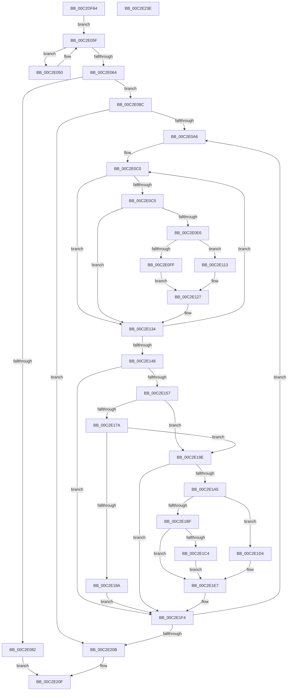

# IopGetBootDiskInformationLite

- RVA: `0x00C2DF64`–`0x00C2E23F` (길이 `731` bytes)
- VA: `0x0000000140C2DF64`
- 실행 섹션: `INIT`
- PDB 이름 있음: `예`; PDB Function 태그: `아니요`
- unwind 정보 RVA: `0x000C7598`
- 디코드: `183`개 명령, `731/731` bytes 표시
- 미해석 바이트: `0` (있으면 어셈블리에 `.byte`로 보존)

> 이 문서는 커널 이미지의 기계어와 PDB 기호를 분석해 생성했습니다. 4번과 5번은 함수 원형과 자료형을 바이너리 사용 방식에서 추정한 C 해석이며 원본 소스 복구 결과는 아닙니다.

## 1. Dependencies

- 직접 호출 지점: **12**; 고유 호출 대상: **8**
- 직접 호출자로 확인된 함수: **1**
- RIP 상대 이미지 참조: **2**

### Outgoing calls
- `0x00C2DFDE` → [memset](../../text/6C/memset_function_006C6C40.md) (function, `0x006C6C40`)
- `0x00C2E007` → [RtlInitAnsiString](../../text/47/RtlInitAnsiString_function_00470F40.md) (function, `0x00470F40`)
- `0x00C2E01E` → [RtlInitAnsiString](../../text/47/RtlInitAnsiString_function_00470F40.md) (function, `0x00470F40`)
- `0x00C2E035` → [RtlInitAnsiString](../../text/47/RtlInitAnsiString_function_00470F40.md) (function, `0x00470F40`)
- `0x00C2E075` → [ExAllocatePool2](../../poolcode/B8/ExAllocatePool2_function_00B820F0.md) (function, `0x00B820F0`)
- `0x00C2E0AF` → [RtlInitAnsiString](../../text/47/RtlInitAnsiString_function_00470F40.md) (function, `0x00470F40`)
- `0x00C2E0DD` → [IopCheckDiskName](../../text/59/IopCheckDiskName_function_00597EB8.md) (function, `0x00597EB8`)
- `0x00C2E12F` → [IopAddBootDiskInformation](../../text/59/IopAddBootDiskInformation_function_00597E20.md) (function, `0x00597E20`)
- `0x00C2E16F` → [VhdiGetDiskParameters](../C6/VhdiGetDiskParameters_function_00C6DEB8.md) (function, `0x00C6DEB8`)
- `0x00C2E18F` → [CimfsGetDiskParameters](../C6/CimfsGetDiskParameters_function_00C6E574.md) (function, `0x00C6E574`)
- `0x00C2E1EF` → [IopAddBootDiskInformation](../../text/59/IopAddBootDiskInformation_function_00597E20.md) (function, `0x00597E20`)
- `0x00C2E218` → [_security_check_cookie](../../text/6A/_security_check_cookie_function_006AC640.md) (function, `0x006AC640`)

### Direct callers
- [IoGetBootDiskInformationLite](../../page/71/IoGetBootDiskInformationLite_function_0071D570.md) at `0x0071D584`

### Static image references
- `0x00C2DF88` → RVA `0x00E0A740` (`.data`; read)
- `0x00C2DFE3` → RVA `0x00FC6B20` (`ALMOSTRO`; read)

## 2. Other-region calls and transfers

- 다른 실행 섹션으로 향하는 call: **10**
  - `0x00C2DFDE` → [memset](../../text/6C/memset_function_006C6C40.md) (`INIT` → `.text`)
  - `0x00C2E007` → [RtlInitAnsiString](../../text/47/RtlInitAnsiString_function_00470F40.md) (`INIT` → `.text`)
  - `0x00C2E01E` → [RtlInitAnsiString](../../text/47/RtlInitAnsiString_function_00470F40.md) (`INIT` → `.text`)
  - `0x00C2E035` → [RtlInitAnsiString](../../text/47/RtlInitAnsiString_function_00470F40.md) (`INIT` → `.text`)
  - `0x00C2E075` → [ExAllocatePool2](../../poolcode/B8/ExAllocatePool2_function_00B820F0.md) (`INIT` → `POOLCODE`)
  - `0x00C2E0AF` → [RtlInitAnsiString](../../text/47/RtlInitAnsiString_function_00470F40.md) (`INIT` → `.text`)
  - `0x00C2E0DD` → [IopCheckDiskName](../../text/59/IopCheckDiskName_function_00597EB8.md) (`INIT` → `.text`)
  - `0x00C2E12F` → [IopAddBootDiskInformation](../../text/59/IopAddBootDiskInformation_function_00597E20.md) (`INIT` → `.text`)
  - `0x00C2E1EF` → [IopAddBootDiskInformation](../../text/59/IopAddBootDiskInformation_function_00597E20.md) (`INIT` → `.text`)
  - `0x00C2E218` → [_security_check_cookie](../../text/6A/_security_check_cookie_function_006AC640.md) (`INIT` → `.text`)
- 별도 외부 분기/꼬리 이동을 확인하지 못했습니다.

## 3. Assembly (complete function range)

```asm
00C2DF64  48 89 5C 24 10                  mov qword ptr [rsp + 0x10], rbx
00C2DF69  48 89 74 24 18                  mov qword ptr [rsp + 0x18], rsi
00C2DF6E  48 89 7C 24 20                  mov qword ptr [rsp + 0x20], rdi
00C2DF73  55                              push rbp
00C2DF74  41 54                           push r12
00C2DF76  41 55                           push r13
00C2DF78  41 56                           push r14
00C2DF7A  41 57                           push r15
00C2DF7C  48 8D 6C 24 A0                  lea rbp, [rsp - 0x60]
00C2DF81  48 81 EC 60 01 00 00            sub rsp, 0x160
00C2DF88  48 8B 05 B1 C7 1D 00            mov rax, qword ptr [rip + 0x1dc7b1]
00C2DF8F  48 33 C4                        xor rax, rsp
00C2DF92  48 89 45 50                     mov qword ptr [rbp + 0x50], rax
00C2DF96  33 C0                           xor eax, eax
00C2DF98  C7 45 10 00 01 00 20            mov dword ptr [rbp + 0x10], 0x20000100
00C2DF9F  0F 57 C0                        xorps xmm0, xmm0
00C2DFA2  66 89 44 24 34                  mov word ptr [rsp + 0x34], ax
00C2DFA7  4C 8B E9                        mov r13, rcx
00C2DFAA  88 44 24 36                     mov byte ptr [rsp + 0x36], al
00C2DFAE  48 8D 4D 80                     lea rcx, [rbp - 0x80]
00C2DFB2  48 89 44 24 50                  mov qword ptr [rsp + 0x50], rax
00C2DFB7  33 D2                           xor edx, edx
00C2DFB9  89 44 24 58                     mov dword ptr [rsp + 0x58], eax
00C2DFBD  41 B8 8C 00 00 00               mov r8d, 0x8c
00C2DFC3  89 45 84                        mov dword ptr [rbp - 0x7c], eax
00C2DFC6  0F 11 44 24 40                  movups xmmword ptr [rsp + 0x40], xmm0
00C2DFCB  C7 45 14 00 00 20 20            mov dword ptr [rbp + 0x14], 0x20200000
00C2DFD2  0F 11 44 24 68                  movups xmmword ptr [rsp + 0x68], xmm0
00C2DFD7  C7 45 18 00 00 00 20            mov dword ptr [rbp + 0x18], 0x20000000
00C2DFDE  E8 5D 8C A9 FF                  call 0x1406c6c40
00C2DFE3  48 8B 15 36 8B 39 00            mov rdx, qword ptr [rip + 0x398b36]
00C2DFEA  48 8D 4D 20                     lea rcx, [rbp + 0x20]
00C2DFEE  33 F6                           xor esi, esi
00C2DFF0  89 74 24 38                     mov dword ptr [rsp + 0x38], esi
00C2DFF4  8B FE                           mov edi, esi
00C2DFF6  40 88 74 24 30                  mov byte ptr [rsp + 0x30], sil
00C2DFFB  48 8B 92 B8 00 00 00            mov rdx, qword ptr [rdx + 0xb8]
00C2E002  48 89 74 24 60                  mov qword ptr [rsp + 0x60], rsi
00C2E007  E8 34 2F 84 FF                  call 0x140470f40
00C2E00C  48 8B 15 0D 8B 39 00            mov rdx, qword ptr [rip + 0x398b0d]
00C2E013  48 8D 4D 30                     lea rcx, [rbp + 0x30]
00C2E017  48 8B 92 C0 00 00 00            mov rdx, qword ptr [rdx + 0xc0]
00C2E01E  E8 1D 2F 84 FF                  call 0x140470f40
00C2E023  48 8B 15 F6 8A 39 00            mov rdx, qword ptr [rip + 0x398af6]
00C2E02A  48 8D 4D 40                     lea rcx, [rbp + 0x40]
00C2E02E  48 8B 92 50 01 00 00            mov rdx, qword ptr [rdx + 0x150]
00C2E035  E8 06 2F 84 FF                  call 0x140470f40
00C2E03A  48 8B 05 DF 8A 39 00            mov rax, qword ptr [rip + 0x398adf]
00C2E041  8D 56 03                        lea edx, [rsi + 3]
00C2E044  4C 8B 88 E8 00 00 00            mov r9, qword ptr [rax + 0xe8]
00C2E04B  4D 8B 01                        mov r8, qword ptr [r9]
00C2E04E  EB 0F                           jmp 0x140c2e05f
00C2E050  49 39 70 38                     cmp qword ptr [r8 + 0x38], rsi
00C2E054  8D 4A 01                        lea ecx, [rdx + 1]
00C2E057  4D 8B 00                        mov r8, qword ptr [r8]
00C2E05A  0F 44 CA                        cmove ecx, edx
00C2E05D  8B D1                           mov edx, ecx
00C2E05F  4D 3B C1                        cmp r8, r9
00C2E062  75 EC                           jne 0x140c2e050
00C2E064  6B D2 1C                        imul edx, edx, 0x1c
00C2E067  B9 40 00 00 00                  mov ecx, 0x40
00C2E06C  41 B8 49 6F 20 20               mov r8d, 0x20206f49
00C2E072  83 C2 04                        add edx, 4
00C2E075  E8 76 40 F5 FF                  call 0x140b820f0
00C2E07A  4C 8B F8                        mov r15, rax
00C2E07D  48 85 C0                        test rax, rax
00C2E080  75 0A                           jne 0x140c2e08c
00C2E082  BF 9A 00 00 C0                  mov edi, 0xc000009a
00C2E087  E9 83 01 00 00                  jmp 0x140c2e20f
00C2E08C  48 8B 05 8D 8A 39 00            mov rax, qword ptr [rip + 0x398a8d]
00C2E093  48 8B 88 E8 00 00 00            mov rcx, qword ptr [rax + 0xe8]
00C2E09A  48 8B 19                        mov rbx, qword ptr [rcx]
00C2E09D  48 3B D9                        cmp rbx, rcx
00C2E0A0  0F 84 65 01 00 00               je 0x140c2e20b
00C2E0A6  48 8B 53 18                     mov rdx, qword ptr [rbx + 0x18]
00C2E0AA  48 8D 4C 24 68                  lea rcx, [rsp + 0x68]
00C2E0AF  E8 8C 2E 84 FF                  call 0x140470f40
00C2E0B4  44 8B F6                        mov r14d, esi
00C2E0B7  4C 8D 65 10                     lea r12, [rbp + 0x10]
00C2E0BB  48 8D 74 24 34                  lea rsi, [rsp + 0x34]
00C2E0C0  80 3E 00                        cmp byte ptr [rsi], 0
00C2E0C3  75 6F                           jne 0x140c2e134
00C2E0C5  41 8B C6                        mov eax, r14d
00C2E0C8  48 8D 55 20                     lea rdx, [rbp + 0x20]
00C2E0CC  48 C1 E0 04                     shl rax, 4
00C2E0D0  4C 8D 44 24 38                  lea r8, [rsp + 0x38]
00C2E0D5  48 03 D0                        add rdx, rax
00C2E0D8  48 8D 4C 24 68                  lea rcx, [rsp + 0x68]
00C2E0DD  E8 D6 9D 96 FF                  call 0x140597eb8
00C2E0E2  84 C0                           test al, al
00C2E0E4  74 4E                           je 0x140c2e134
00C2E0E6  80 7B 26 00                     cmp byte ptr [rbx + 0x26], 0
00C2E0EA  8B 44 24 38                     mov eax, dword ptr [rsp + 0x38]
00C2E0EE  89 44 24 44                     mov dword ptr [rsp + 0x44], eax
00C2E0F2  41 8B 04 24                     mov eax, dword ptr [r12]
00C2E0F6  89 44 24 58                     mov dword ptr [rsp + 0x58], eax
00C2E0FA  C6 06 01                        mov byte ptr [rsi], 1
00C2E0FD  74 14                           je 0x140c2e113
00C2E0FF  0F 10 43 28                     movups xmm0, xmmword ptr [rbx + 0x28]
00C2E103  C7 44 24 40 01 00 00 00         mov dword ptr [rsp + 0x40], 1
00C2E10B  F3 0F 7F 44 24 48               movdqu xmmword ptr [rsp + 0x48], xmm0
00C2E111  EB 14                           jmp 0x140c2e127
00C2E113  8B 43 10                        mov eax, dword ptr [rbx + 0x10]
00C2E116  0F 57 C0                        xorps xmm0, xmm0
00C2E119  83 64 24 40 00                  and dword ptr [rsp + 0x40], 0
00C2E11E  0F 11 44 24 48                  movups xmmword ptr [rsp + 0x48], xmm0
00C2E123  89 44 24 48                     mov dword ptr [rsp + 0x48], eax
00C2E127  48 8D 54 24 40                  lea rdx, [rsp + 0x40]
00C2E12C  49 8B CF                        mov rcx, r15
00C2E12F  E8 EC 9C 96 FF                  call 0x140597e20
00C2E134  41 FF C6                        inc r14d
00C2E137  48 FF C6                        inc rsi
00C2E13A  49 83 C4 04                     add r12, 4
00C2E13E  41 83 FE 03                     cmp r14d, 3
00C2E142  0F 82 78 FF FF FF               jb 0x140c2e0c0
00C2E148  48 8B 4B 38                     mov rcx, qword ptr [rbx + 0x38]
00C2E14C  33 F6                           xor esi, esi
00C2E14E  48 85 C9                        test rcx, rcx
00C2E151  0F 84 9D 00 00 00               je 0x140c2e1f4
00C2E157  48 8D 44 24 78                  lea rax, [rsp + 0x78]
00C2E15C  4C 8D 4C 24 30                  lea r9, [rsp + 0x30]
00C2E161  48 89 44 24 20                  mov qword ptr [rsp + 0x20], rax
00C2E166  4C 8D 44 24 60                  lea r8, [rsp + 0x60]
00C2E16B  48 8D 55 80                     lea rdx, [rbp - 0x80]
00C2E16F  E8 44 FD 03 00                  call 0x140c6deb8
00C2E174  8B F8                           mov edi, eax
00C2E176  85 C0                           test eax, eax
00C2E178  79 24                           jns 0x140c2e19e
00C2E17A  48 8B 4B 38                     mov rcx, qword ptr [rbx + 0x38]
00C2E17E  4C 8D 44 24 60                  lea r8, [rsp + 0x60]
00C2E183  45 33 C9                        xor r9d, r9d
00C2E186  48 89 74 24 20                  mov qword ptr [rsp + 0x20], rsi
00C2E18B  48 8D 55 80                     lea rdx, [rbp - 0x80]
00C2E18F  E8 E0 03 04 00                  call 0x140c6e574
00C2E194  8B F8                           mov edi, eax
00C2E196  85 C0                           test eax, eax
00C2E198  79 04                           jns 0x140c2e19e
00C2E19A  8B FE                           mov edi, esi
00C2E19C  EB 56                           jmp 0x140c2e1f4
00C2E19E  40 38 74 24 30                  cmp byte ptr [rsp + 0x30], sil
00C2E1A3  75 4F                           jne 0x140c2e1f4
00C2E1A5  8B 4D 80                        mov ecx, dword ptr [rbp - 0x80]
00C2E1A8  8B 45 98                        mov eax, dword ptr [rbp - 0x68]
00C2E1AB  89 4C 24 40                     mov dword ptr [rsp + 0x40], ecx
00C2E1AF  89 44 24 44                     mov dword ptr [rsp + 0x44], eax
00C2E1B3  C7 44 24 58 00 00 40 00         mov dword ptr [rsp + 0x58], 0x400000
00C2E1BB  85 C9                           test ecx, ecx
00C2E1BD  74 15                           je 0x140c2e1d4
00C2E1BF  83 F9 01                        cmp ecx, 1
00C2E1C2  75 23                           jne 0x140c2e1e7
00C2E1C4  48 8B 44 24 60                  mov rax, qword ptr [rsp + 0x60]
00C2E1C9  0F 10 00                        movups xmm0, xmmword ptr [rax]
00C2E1CC  F3 0F 7F 44 24 48               movdqu xmmword ptr [rsp + 0x48], xmm0
00C2E1D2  EB 13                           jmp 0x140c2e1e7
00C2E1D4  48 8B 44 24 60                  mov rax, qword ptr [rsp + 0x60]
00C2E1D9  0F 57 C0                        xorps xmm0, xmm0
00C2E1DC  0F 11 44 24 48                  movups xmmword ptr [rsp + 0x48], xmm0
00C2E1E1  8B 08                           mov ecx, dword ptr [rax]
00C2E1E3  89 4C 24 48                     mov dword ptr [rsp + 0x48], ecx
00C2E1E7  48 8D 54 24 40                  lea rdx, [rsp + 0x40]
00C2E1EC  49 8B CF                        mov rcx, r15
00C2E1EF  E8 2C 9C 96 FF                  call 0x140597e20
00C2E1F4  48 8B 05 25 89 39 00            mov rax, qword ptr [rip + 0x398925]
00C2E1FB  48 8B 1B                        mov rbx, qword ptr [rbx]
00C2E1FE  48 3B 98 E8 00 00 00            cmp rbx, qword ptr [rax + 0xe8]
00C2E205  0F 85 9B FE FF FF               jne 0x140c2e0a6
00C2E20B  4D 89 7D 00                     mov qword ptr [r13], r15
00C2E20F  8B C7                           mov eax, edi
00C2E211  48 8B 4D 50                     mov rcx, qword ptr [rbp + 0x50]
00C2E215  48 33 CC                        xor rcx, rsp
00C2E218  E8 23 E4 A7 FF                  call 0x1406ac640
00C2E21D  4C 8D 9C 24 60 01 00 00         lea r11, [rsp + 0x160]
00C2E225  49 8B 5B 38                     mov rbx, qword ptr [r11 + 0x38]
00C2E229  49 8B 73 40                     mov rsi, qword ptr [r11 + 0x40]
00C2E22D  49 8B 7B 48                     mov rdi, qword ptr [r11 + 0x48]
00C2E231  49 8B E3                        mov rsp, r11
00C2E234  41 5F                           pop r15
00C2E236  41 5E                           pop r14
00C2E238  41 5D                           pop r13
00C2E23A  41 5C                           pop r12
00C2E23C  5D                              pop rbp
00C2E23D  C3                              ret
00C2E23E  CC                              int3
```

## 4. C-style interpretation (structured pseudocode)

```c
__int64 __fastcall IopGetBootDiskInformationLite(__int64 a1, int a2)
{
    __int64 result;
    __int64 v_r12;
    __int64 v_r14;
    __int64 v_rsi;
    __int64 v_rsp;
    unsigned int v_stack_m104;
    unsigned __int64 v_stack_m108;
    unsigned __int64 v_stack_m110;
    unsigned __int64 v_stack_m120;
    unsigned __int64 v_stack_m128;
    unsigned int v_stack_m130;
    unsigned __int64 v_stack_m138;
    unsigned __int64 v_stack_m140;
    unsigned int v_stack_m144;
    unsigned __int64 v_stack_m148;
    unsigned int v_stack_m150;
    unsigned __int8 v_stack_m152;
    unsigned __int16 v_stack_m154;
    unsigned __int8 v_stack_m158;
    unsigned __int64 v_stack_m168;
    unsigned __int64 v_stack_m28;
    unsigned __int64 v_stack_m38;
    unsigned __int64 v_stack_m48;
    unsigned __int64 v_stack_m58;
    unsigned __int64 v_stack_m68;
    unsigned int v_stack_m70;
    unsigned int v_stack_m74;
    unsigned int v_stack_m78;
    unsigned __int64 v_stack_m88;
    unsigned int v_stack_mF0;
    unsigned __int64 v_stack_p10;
    unsigned __int64 v_stack_p18;
    unsigned __int64 v_stack_p20;

    v_stack_p10 = v_rbx;
    v_stack_p18 = v_rsi;
    v_stack_p20 = v_rdi;
    v_rsp = (v_rsp) - (352);
    result = (*(unsigned __int64 *)(v_rip + 1951665)) ^ (v_rsp);
    v_stack_m38 = result;
    result = 0;
    v_stack_m78 = 0x20000100ULL;
    v_stack_m154 = 0;
    v_stack_m152 = 0;
    v_stack_m138 = 0;
    a2 = 0;
    v_stack_m130 = 0;
    v_stack_m104 = 0;
    v_stack_m148 = v_xmm0;
    v_stack_m74 = 0x20200000ULL;
    v_stack_m120 = v_xmm0;
    v_stack_m70 = 0x20000000ULL;
    result = memset(v_stack_m108, a2, 140, a4);
    v_rsi = 0;
    v_stack_m150 = 0;
    v_stack_m158 = 0;
    v_stack_m128 = 0;
    result = RtlInitAnsiString(v_stack_m68, *(unsigned __int64 *)(*(unsigned __int64 *)(v_rip + 3771190) + 184), 140, a4);
    result = RtlInitAnsiString(v_stack_m58, *(unsigned __int64 *)(*(unsigned __int64 *)(v_rip + 3771149) + 192), 140, a4);
    result = RtlInitAnsiString(v_stack_m48, *(unsigned __int64 *)(*(unsigned __int64 *)(v_rip + 3771126) + 336), 140, a4);
    goto loc_00C2E05F;
loc_00C2E050:
    a1 = v_rsi + 3 + 1;
    if ((*(unsigned __int64 *)(*(unsigned __int64 *)(*(unsigned __int64 *)(*(unsigned __int64 *)(v_rip + 3771103) + 232)) + 56)) == 0) { a1 = (unsigned int)(v_rsi + 3); }
loc_00C2E05F:
    if ((*(unsigned __int64 *)(*(unsigned __int64 *)(*(unsigned __int64 *)(*(unsigned __int64 *)(v_rip + 3771103) + 232)))) != (*(unsigned __int64 *)(*(unsigned __int64 *)(v_rip + 3771103) + 232))) goto loc_00C2E050;
    a2 = (unsigned int)(((unsigned int)((unsigned int)(a1))) * ((unsigned int)((unsigned int)((unsigned int)(a1)))));
    a2 = (unsigned int)((a2) + (4));
    result = ExAllocatePool2(64, a2, (unsigned int)(0x20206F49ULL), *(unsigned __int64 *)(*(unsigned __int64 *)(v_rip + 3771103) + 232));
    if (result != 0) goto loc_00C2E08C;
    goto loc_00C2E20F;
loc_00C2E08C:
    if ((*(unsigned __int64 *)(*(unsigned __int64 *)(*(unsigned __int64 *)(v_rip + 3771021) + 232))) == (*(unsigned __int64 *)(*(unsigned __int64 *)(v_rip + 3771021) + 232))) goto loc_00C2E20B;
loc_00C2E0A6:
    result = RtlInitAnsiString(v_stack_m120, *(unsigned __int64 *)(*(unsigned __int64 *)(*(unsigned __int64 *)(*(unsigned __int64 *)(v_rip + 3771021) + 232)) + 24), (unsigned int)(0x20206F49ULL), *(unsigned __int64 *)(*(unsigned __int64 *)(v_rip + 3771103) + 232));
loc_00C2E0C0:
    if ((*(unsigned __int8 *)(v_stack_m154)) != 0) goto loc_00C2E134;
    result = (0) << (4);
    a2 = (v_stack_m68) + (result);
    result = IopCheckDiskName(v_stack_m120, a2, v_stack_m150, *(unsigned __int64 *)(*(unsigned __int64 *)(v_rip + 3771103) + 232));
    if ((unsigned __int8)(result) == 0) goto loc_00C2E134;
    v_stack_m144 = (unsigned int)((unsigned int)(v_stack_m150));
    v_stack_m130 = (unsigned int)((unsigned int)(*(unsigned int *)(v_stack_m78)));
    *(unsigned __int8 *)(v_stack_m154) = 1;
    if ((*(unsigned __int8 *)(*(unsigned __int64 *)(*(unsigned __int64 *)(*(unsigned __int64 *)(v_rip + 3771021) + 232)) + 38)) == 0) goto loc_00C2E113;
    v_stack_m148 = 1;
    v_stack_m140 = v_xmm0;
    goto loc_00C2E127;
loc_00C2E113:
    v_stack_m140 = v_xmm0;
    v_stack_m140 = (unsigned int)((unsigned int)(*(unsigned int *)(*(unsigned __int64 *)(*(unsigned __int64 *)(*(unsigned __int64 *)(v_rip + 3771021) + 232)) + 16)));
loc_00C2E127:
    result = IopAddBootDiskInformation(result, v_stack_m148, v_stack_m150, *(unsigned __int64 *)(*(unsigned __int64 *)(v_rip + 3771103) + 232));
loc_00C2E134:
    v_r14 = (unsigned int)((0) + 1);
    v_rsi = (v_stack_m154) + 1;
    v_r12 = (v_stack_m78) + (4);
    if (((unsigned int)(v_r14)) < 3) goto loc_00C2E0C0;
    v_rsi = 0;
    if (*(unsigned __int64 *)(*(unsigned __int64 *)(*(unsigned __int64 *)(*(unsigned __int64 *)(v_rip + 3771021) + 232)) + 56) == 0) goto loc_00C2E1F4;
    v_stack_m168 = v_stack_m110;
    result = VhdiGetDiskParameters(*(unsigned __int64 *)(*(unsigned __int64 *)(*(unsigned __int64 *)(*(unsigned __int64 *)(v_rip + 3771021) + 232)) + 56), v_stack_m108, v_stack_m128, v_stack_m158);
    if (!sign_flag) goto loc_00C2E19E;
    a4 = 0;
    v_stack_m168 = 0;
    result = CimfsGetDiskParameters(*(unsigned __int64 *)(*(unsigned __int64 *)(*(unsigned __int64 *)(*(unsigned __int64 *)(v_rip + 3771021) + 232)) + 56), v_stack_m108, v_stack_m128, a4);
    if (!sign_flag) goto loc_00C2E19E;
    goto loc_00C2E1F4;
loc_00C2E19E:
    if (v_stack_m158 != 0) goto loc_00C2E1F4;
    v_stack_m148 = (unsigned int)((unsigned int)(v_stack_m108));
    v_stack_m144 = (unsigned int)((unsigned int)(v_stack_mF0));
    v_stack_m130 = 0x400000ULL;
    if ((unsigned int)((unsigned int)(v_stack_m108)) == 0) goto loc_00C2E1D4;
    if (((unsigned int)((unsigned int)(v_stack_m108))) != 1) goto loc_00C2E1E7;
    v_stack_m140 = v_xmm0;
    goto loc_00C2E1E7;
loc_00C2E1D4:
    v_stack_m140 = v_xmm0;
    v_stack_m140 = (unsigned int)((unsigned int)(*(unsigned int *)(v_stack_m128)));
loc_00C2E1E7:
    result = IopAddBootDiskInformation(result, v_stack_m148, v_stack_m128, a4);
loc_00C2E1F4:
    if ((*(unsigned __int64 *)(*(unsigned __int64 *)(*(unsigned __int64 *)(*(unsigned __int64 *)(v_rip + 3771021) + 232)))) != (*(unsigned __int64 *)(*(unsigned __int64 *)(v_rip + 3770661) + 232))) goto loc_00C2E0A6;
loc_00C2E20B:
    *(unsigned __int64 *)(a1) = result;
loc_00C2E20F:
    a1 = (v_stack_m38) ^ (v_rsp);
    result = _security_check_cookie(a1, v_stack_m148, v_stack_m128, a4);
    return result;
}
```

## 5. (Beta) C Style

```c
int64_t IopGetBootDiskInformationLite(void *Arg1, int32_t Arg2)
{
    uint8_t *arg1 = (uint8_t *)Arg1;

    int64_t result;
    int64_t local_r12;
    int64_t local_r14;
    int64_t local_rsi;
    int64_t local_rsp;
    uint32_t v_stack_m104;
    uint64_t v_stack_m108;
    uint64_t v_stack_m110;
    uint64_t v_stack_m120;
    uint64_t v_stack_m128;
    uint32_t v_stack_m130;
    uint64_t v_stack_m138;
    uint64_t v_stack_m140;
    uint32_t v_stack_m144;
    uint64_t v_stack_m148;
    uint32_t v_stack_m150;
    uint8_t v_stack_m152;
    uint16_t v_stack_m154;
    uint8_t v_stack_m158;
    uint64_t v_stack_m168;
    uint64_t v_stack_m28;
    uint64_t v_stack_m38;
    uint64_t v_stack_m48;
    uint64_t v_stack_m58;
    uint64_t v_stack_m68;
    uint32_t v_stack_m70;
    uint32_t v_stack_m74;
    uint32_t v_stack_m78;
    uint64_t v_stack_m88;
    uint32_t v_stack_mF0;
    uint64_t v_stack_p10;
    uint64_t v_stack_p18;
    uint64_t v_stack_p20;

    v_stack_p10 = local_rbx;
    v_stack_p18 = local_rsi;
    v_stack_p20 = local_rdi;
    local_rsp = (local_rsp) - (352);
    result = (*(uint64_t *)(v_rip + 0x1DC7B1)) ^ (local_rsp);
    v_stack_m38 = result;
    result = 0;
    v_stack_m78 = 0x20000100ULL;
    v_stack_m154 = 0;
    v_stack_m152 = 0;
    v_stack_m138 = 0;
    Arg2 = 0;
    v_stack_m130 = 0;
    v_stack_m104 = 0;
    v_stack_m148 = v_xmm0;
    v_stack_m74 = 0x20200000ULL;
    v_stack_m120 = v_xmm0;
    v_stack_m70 = 0x20000000ULL;
    result = memset(v_stack_m108, Arg2, 140, a4);
    local_rsi = 0;
    v_stack_m150 = 0;
    v_stack_m158 = 0;
    v_stack_m128 = 0;
    result = RtlInitAnsiString(v_stack_m68, *(uint64_t *)(*(uint64_t *)(v_rip + 0x398B36) + 0xB8), 140, a4);
    result = RtlInitAnsiString(v_stack_m58, *(uint64_t *)(*(uint64_t *)(v_rip + 0x398B0D) + 0xC0), 140, a4);
    result = RtlInitAnsiString(v_stack_m48, *(uint64_t *)(*(uint64_t *)(v_rip + 0x398AF6) + 0x150), 140, a4);
    goto loc_00C2E05F;
loc_00C2E050:
    Arg1 = local_rsi + 3 + 1;
    if ((*(uint64_t *)(*(uint64_t *)(*(uint64_t *)(*(uint64_t *)(v_rip + 0x398ADF) + 0xE8)) + 0x38)) == 0) { Arg1 = (uint32_t)(local_rsi + 3); }
loc_00C2E05F:
    if ((*(uint64_t *)(*(uint64_t *)(*(uint64_t *)(*(uint64_t *)(v_rip + 0x398ADF) + 0xE8)))) != (*(uint64_t *)(*(uint64_t *)(v_rip + 0x398ADF) + 0xE8))) goto loc_00C2E050;
    Arg2 = (uint32_t)(((uint32_t)((uint32_t)(Arg1))) * ((uint32_t)((uint32_t)((uint32_t)(Arg1)))));
    Arg2 = (uint32_t)((Arg2) + (4));
    result = ExAllocatePool2(64, Arg2, (uint32_t)(0x20206F49ULL), *(uint64_t *)(*(uint64_t *)(v_rip + 0x398ADF) + 0xE8));
    if (result != 0) goto loc_00C2E08C;
    goto loc_00C2E20F;
loc_00C2E08C:
    if ((*(uint64_t *)(*(uint64_t *)(*(uint64_t *)(v_rip + 0x398A8D) + 0xE8))) == (*(uint64_t *)(*(uint64_t *)(v_rip + 0x398A8D) + 0xE8))) goto loc_00C2E20B;
loc_00C2E0A6:
    result = RtlInitAnsiString(v_stack_m120, *(uint64_t *)(*(uint64_t *)(*(uint64_t *)(*(uint64_t *)(v_rip + 0x398A8D) + 0xE8)) + 0x18), (uint32_t)(0x20206F49ULL), *(uint64_t *)(*(uint64_t *)(v_rip + 0x398ADF) + 0xE8));
loc_00C2E0C0:
    if ((*(uint8_t *)(v_stack_m154)) != 0) goto loc_00C2E134;
    result = (0) << (4);
    Arg2 = (v_stack_m68) + (result);
    result = IopCheckDiskName(v_stack_m120, Arg2, v_stack_m150, *(uint64_t *)(*(uint64_t *)(v_rip + 0x398ADF) + 0xE8));
    if ((uint8_t)(result) == 0) goto loc_00C2E134;
    v_stack_m144 = (uint32_t)((uint32_t)(v_stack_m150));
    v_stack_m130 = (uint32_t)((uint32_t)(*(uint32_t *)(v_stack_m78)));
    *(uint8_t *)(v_stack_m154) = 1;
    if ((*(uint8_t *)(*(uint64_t *)(*(uint64_t *)(*(uint64_t *)(v_rip + 0x398A8D) + 0xE8)) + 0x26)) == 0) goto loc_00C2E113;
    v_stack_m148 = 1;
    v_stack_m140 = v_xmm0;
    goto loc_00C2E127;
loc_00C2E113:
    v_stack_m140 = v_xmm0;
    v_stack_m140 = (uint32_t)((uint32_t)(*(uint32_t *)(*(uint64_t *)(*(uint64_t *)(*(uint64_t *)(v_rip + 0x398A8D) + 0xE8)) + 0x10)));
loc_00C2E127:
    result = IopAddBootDiskInformation(result, v_stack_m148, v_stack_m150, *(uint64_t *)(*(uint64_t *)(v_rip + 0x398ADF) + 0xE8));
loc_00C2E134:
    local_r14 = (uint32_t)((0) + 1);
    local_rsi = (v_stack_m154) + 1;
    local_r12 = (v_stack_m78) + (4);
    if (((uint32_t)(local_r14)) < 3) goto loc_00C2E0C0;
    local_rsi = 0;
    if (*(uint64_t *)(*(uint64_t *)(*(uint64_t *)(*(uint64_t *)(v_rip + 0x398A8D) + 0xE8)) + 0x38) == 0) goto loc_00C2E1F4;
    v_stack_m168 = v_stack_m110;
    result = VhdiGetDiskParameters(*(uint64_t *)(*(uint64_t *)(*(uint64_t *)(*(uint64_t *)(v_rip + 0x398A8D) + 0xE8)) + 0x38), v_stack_m108, v_stack_m128, v_stack_m158);
    if (!sign_flag) goto loc_00C2E19E;
    a4 = 0;
    v_stack_m168 = 0;
    result = CimfsGetDiskParameters(*(uint64_t *)(*(uint64_t *)(*(uint64_t *)(*(uint64_t *)(v_rip + 0x398A8D) + 0xE8)) + 0x38), v_stack_m108, v_stack_m128, a4);
    if (!sign_flag) goto loc_00C2E19E;
    goto loc_00C2E1F4;
loc_00C2E19E:
    if (v_stack_m158 != 0) goto loc_00C2E1F4;
    v_stack_m148 = (uint32_t)((uint32_t)(v_stack_m108));
    v_stack_m144 = (uint32_t)((uint32_t)(v_stack_mF0));
    v_stack_m130 = 0x400000ULL;
    if ((uint32_t)((uint32_t)(v_stack_m108)) == 0) goto loc_00C2E1D4;
    if (((uint32_t)((uint32_t)(v_stack_m108))) != 1) goto loc_00C2E1E7;
    v_stack_m140 = v_xmm0;
    goto loc_00C2E1E7;
loc_00C2E1D4:
    v_stack_m140 = v_xmm0;
    v_stack_m140 = (uint32_t)((uint32_t)(*(uint32_t *)(v_stack_m128)));
loc_00C2E1E7:
    result = IopAddBootDiskInformation(result, v_stack_m148, v_stack_m128, a4);
loc_00C2E1F4:
    if ((*(uint64_t *)(*(uint64_t *)(*(uint64_t *)(*(uint64_t *)(v_rip + 0x398A8D) + 0xE8)))) != (*(uint64_t *)(*(uint64_t *)(v_rip + 0x398925) + 0xE8))) goto loc_00C2E0A6;
loc_00C2E20B:
    *(uint64_t *)(arg1) = result;
loc_00C2E20F:
    Arg1 = (v_stack_m38) ^ (local_rsp);
    result = _security_check_cookie(Arg1, v_stack_m148, v_stack_m128, a4);
    return result;
}
```

### 관측된 메모리 오프셋

구조체 형식이 확인되지 않은 접근은 인자 기준의 오프셋으로만 기록했습니다.

| 기준 인자 | 오프셋 표현 | 폭 (bit) | 접근 |
|---|---:|---:|---|
| `Arg1` | `+ 0x0` | `64` | `W` |

## 6. Execution-region graph

[열기: 2D/3D 그래프와 함수 탐색 컨트롤 패널](../../../control-panel.html?section=init&rva=0x00C2DF64&view=graph)

- 2D 그래프는 위에서 아래로 흐르고, 3D 그래프는 빈 공간을 드래그해 회전합니다. Shift+드래그는 이동, 휠은 확대·축소, 함수 노드 선택은 대상 보고서 이동입니다.

### Static fallback


