# IopGetBootDiskInformation

- RVA: `0x00C2DAAC`–`0x00C2DF5D` (길이 `1,201` bytes)
- VA: `0x0000000140C2DAAC`
- 실행 섹션: `INIT`
- PDB 이름 있음: `예`; PDB Function 태그: `아니요`
- unwind 정보 RVA: `0x000C75C4`
- 디코드: `304`개 명령, `1,201/1,201` bytes 표시
- 미해석 바이트: `0` (있으면 어셈블리에 `.byte`로 보존)

> 이 문서는 커널 이미지의 기계어와 PDB 기호를 분석해 생성했습니다. 4번과 5번은 함수 원형과 자료형을 바이너리 사용 방식에서 추정한 C 해석이며 원본 소스 복구 결과는 아닙니다.

## 1. Dependencies

- 직접 호출 지점: **27**; 고유 호출 대상: **16**
- 직접 호출자로 확인된 함수: **1**
- RIP 상대 이미지 참조: **5**

### Outgoing calls
- `0x00C2DB26` → [IoGetConfigurationInformation](../../page/71/IoGetConfigurationInformation_function_0071D5A0.md) (function, `0x0071D5A0`)
- `0x00C2DB94` → [RtlInitAnsiString](../../text/47/RtlInitAnsiString_function_00470F40.md) (function, `0x00470F40`)
- `0x00C2DBA4` → [RtlInitAnsiString](../../text/47/RtlInitAnsiString_function_00470F40.md) (function, `0x00470F40`)
- `0x00C2DBCE` → [RtlStringCchPrintfA](../../text/59/RtlStringCchPrintfA_function_00596BC8.md) (function, `0x00596BC8`)
- `0x00C2DBDB` → [RtlInitAnsiString](../../text/47/RtlInitAnsiString_function_00470F40.md) (function, `0x00470F40`)
- `0x00C2DBEB` → [RtlAnsiStringToUnicodeString](../../page/90/RtlAnsiStringToUnicodeString_function_0090BEA0.md) (function, `0x0090BEA0`)
- `0x00C2DC0A` → [IoGetDeviceObjectPointer](../../page/95/IoGetDeviceObjectPointer_function_00953220.md) (function, `0x00953220`)
- `0x00C2DC15` → [RtlFreeAnsiString](../../page/9C/RtlFreeAnsiString_function_009C0800.md) (function, `0x009C0800`)
- `0x00C2DC5D` → [IoBuildDeviceIoControlRequest](../../text/20/IoBuildDeviceIoControlRequest_function_00204FD0.md) (function, `0x00204FD0`)
- `0x00C2DC71` → [ObfDereferenceObjectWithTag](../../text/2F/ObfDereferenceObjectWithTag_function_002F78E0.md) (function, `0x002F78E0`)
- `0x00C2DCA5` → [IofCallDriver](../../text/29/IofCallDriver_function_0029B4B0.md) (function, `0x0029B4B0`)
- `0x00C2DCC5` → [KeWaitForSingleObject](../../text/20/KeWaitForSingleObject_function_0020E6B0.md) (function, `0x0020E6B0`)
- `0x00C2DCE5` → [ExAllocatePool2](../../poolcode/B8/ExAllocatePool2_function_00B820F0.md) (function, `0x00B820F0`)
- `0x00C2DD26` → [IoBuildDeviceIoControlRequest](../../text/20/IoBuildDeviceIoControlRequest_function_00204FD0.md) (function, `0x00204FD0`)
- `0x00C2DD38` → [KeResetEvent](../../text/24/KeResetEvent_function_00248350.md) (function, `0x00248350`)
- `0x00C2DD43` → [IofCallDriver](../../text/29/IofCallDriver_function_0029B4B0.md) (function, `0x0029B4B0`)
- `0x00C2DD66` → [KeWaitForSingleObject](../../text/20/KeWaitForSingleObject_function_0020E6B0.md) (function, `0x0020E6B0`)
- `0x00C2DD7B` → [ExFreePoolWithTag](../../poolcode/B8/ExFreePoolWithTag_function_00B82870.md) (function, `0x00B82870`)
- `0x00C2DD97` → [ObfDereferenceObjectWithTag](../../text/2F/ObfDereferenceObjectWithTag_function_002F78E0.md) (function, `0x002F78E0`)
- `0x00C2DDB1` → [ExFreePoolWithTag](../../poolcode/B8/ExFreePoolWithTag_function_00B82870.md) (function, `0x00B82870`)
- `0x00C2DDF1` → [IopVerifyDiskSignature](../../page/71/IopVerifyDiskSignature_function_0071CE1C.md) (function, `0x0071CE1C`)
- `0x00C2DE50` → [RtlStringCchPrintfA](../../text/59/RtlStringCchPrintfA_function_00596BC8.md) (function, `0x00596BC8`)
- `0x00C2DE60` → [RtlInitAnsiString](../../text/47/RtlInitAnsiString_function_00470F40.md) (function, `0x00470F40`)
- `0x00C2DE70` → [RtlEqualString](../../text/48/RtlEqualString_function_0048BDE0.md) (function, `0x0048BDE0`)
- `0x00C2DEAF` → [RtlEqualString](../../text/48/RtlEqualString_function_0048BDE0.md) (function, `0x0048BDE0`)
- `0x00C2DF0E` → [ExFreePoolWithTag](../../poolcode/B8/ExFreePoolWithTag_function_00B82870.md) (function, `0x00B82870`)
- `0x00C2DF36` → [_security_check_cookie](../../text/6A/_security_check_cookie_function_006AC640.md) (function, `0x006AC640`)

### Direct callers
- [IoGetBootDiskInformation](../../page/71/IoGetBootDiskInformation_function_0071D540.md) at `0x0071D554`

### Static image references
- `0x00C2DAD2` → RVA `0x00E0A740` (`.data`; read)
- `0x00C2DB2B` → RVA `0x00FC41A0` (`.data`; read)
- `0x00C2DB69` → RVA `0x00FC6B20` (`ALMOSTRO`; read)
- `0x00C2DBBE` → RVA `0x00C79D20` (` ?? ::PBOPGDP::`string'`; read)
- `0x00C2DE39` → RVA `0x00C79D10` (` ?? ::PBOPGDP::`string'`; read)

## 2. Other-region calls and transfers

- 다른 실행 섹션으로 향하는 call: **27**
  - `0x00C2DB26` → [IoGetConfigurationInformation](../../page/71/IoGetConfigurationInformation_function_0071D5A0.md) (`INIT` → `PAGE`)
  - `0x00C2DB94` → [RtlInitAnsiString](../../text/47/RtlInitAnsiString_function_00470F40.md) (`INIT` → `.text`)
  - `0x00C2DBA4` → [RtlInitAnsiString](../../text/47/RtlInitAnsiString_function_00470F40.md) (`INIT` → `.text`)
  - `0x00C2DBCE` → [RtlStringCchPrintfA](../../text/59/RtlStringCchPrintfA_function_00596BC8.md) (`INIT` → `.text`)
  - `0x00C2DBDB` → [RtlInitAnsiString](../../text/47/RtlInitAnsiString_function_00470F40.md) (`INIT` → `.text`)
  - `0x00C2DBEB` → [RtlAnsiStringToUnicodeString](../../page/90/RtlAnsiStringToUnicodeString_function_0090BEA0.md) (`INIT` → `PAGE`)
  - `0x00C2DC0A` → [IoGetDeviceObjectPointer](../../page/95/IoGetDeviceObjectPointer_function_00953220.md) (`INIT` → `PAGE`)
  - `0x00C2DC15` → [RtlFreeAnsiString](../../page/9C/RtlFreeAnsiString_function_009C0800.md) (`INIT` → `PAGE`)
  - `0x00C2DC5D` → [IoBuildDeviceIoControlRequest](../../text/20/IoBuildDeviceIoControlRequest_function_00204FD0.md) (`INIT` → `.text`)
  - `0x00C2DC71` → [ObfDereferenceObjectWithTag](../../text/2F/ObfDereferenceObjectWithTag_function_002F78E0.md) (`INIT` → `.text`)
  - `0x00C2DCA5` → [IofCallDriver](../../text/29/IofCallDriver_function_0029B4B0.md) (`INIT` → `.text`)
  - `0x00C2DCC5` → [KeWaitForSingleObject](../../text/20/KeWaitForSingleObject_function_0020E6B0.md) (`INIT` → `.text`)
  - `0x00C2DCE5` → [ExAllocatePool2](../../poolcode/B8/ExAllocatePool2_function_00B820F0.md) (`INIT` → `POOLCODE`)
  - `0x00C2DD26` → [IoBuildDeviceIoControlRequest](../../text/20/IoBuildDeviceIoControlRequest_function_00204FD0.md) (`INIT` → `.text`)
  - `0x00C2DD38` → [KeResetEvent](../../text/24/KeResetEvent_function_00248350.md) (`INIT` → `.text`)
  - `0x00C2DD43` → [IofCallDriver](../../text/29/IofCallDriver_function_0029B4B0.md) (`INIT` → `.text`)
  - `0x00C2DD66` → [KeWaitForSingleObject](../../text/20/KeWaitForSingleObject_function_0020E6B0.md) (`INIT` → `.text`)
  - `0x00C2DD7B` → [ExFreePoolWithTag](../../poolcode/B8/ExFreePoolWithTag_function_00B82870.md) (`INIT` → `POOLCODE`)
  - `0x00C2DD97` → [ObfDereferenceObjectWithTag](../../text/2F/ObfDereferenceObjectWithTag_function_002F78E0.md) (`INIT` → `.text`)
  - `0x00C2DDB1` → [ExFreePoolWithTag](../../poolcode/B8/ExFreePoolWithTag_function_00B82870.md) (`INIT` → `POOLCODE`)
  - `0x00C2DDF1` → [IopVerifyDiskSignature](../../page/71/IopVerifyDiskSignature_function_0071CE1C.md) (`INIT` → `PAGE`)
  - `0x00C2DE50` → [RtlStringCchPrintfA](../../text/59/RtlStringCchPrintfA_function_00596BC8.md) (`INIT` → `.text`)
  - `0x00C2DE60` → [RtlInitAnsiString](../../text/47/RtlInitAnsiString_function_00470F40.md) (`INIT` → `.text`)
  - `0x00C2DE70` → [RtlEqualString](../../text/48/RtlEqualString_function_0048BDE0.md) (`INIT` → `.text`)
  - `0x00C2DEAF` → [RtlEqualString](../../text/48/RtlEqualString_function_0048BDE0.md) (`INIT` → `.text`)
  - `0x00C2DF0E` → [ExFreePoolWithTag](../../poolcode/B8/ExFreePoolWithTag_function_00B82870.md) (`INIT` → `POOLCODE`)
  - `0x00C2DF36` → [_security_check_cookie](../../text/6A/_security_check_cookie_function_006AC640.md) (`INIT` → `.text`)
- 별도 외부 분기/꼬리 이동을 확인하지 못했습니다.

## 3. Assembly (complete function range)

```asm
00C2DAAC  48 8B C4                        mov rax, rsp
00C2DAAF  48 89 58 10                     mov qword ptr [rax + 0x10], rbx
00C2DAB3  48 89 70 18                     mov qword ptr [rax + 0x18], rsi
00C2DAB7  48 89 78 20                     mov qword ptr [rax + 0x20], rdi
00C2DABB  55                              push rbp
00C2DABC  41 54                           push r12
00C2DABE  41 55                           push r13
00C2DAC0  41 56                           push r14
00C2DAC2  41 57                           push r15
00C2DAC4  48 8D A8 A8 FE FF FF            lea rbp, [rax - 0x158]
00C2DACB  48 81 EC 30 02 00 00            sub rsp, 0x230
00C2DAD2  48 8B 05 67 CC 1D 00            mov rax, qword ptr [rip + 0x1dcc67]
00C2DAD9  48 33 C4                        xor rax, rsp
00C2DADC  48 89 85 20 01 00 00            mov qword ptr [rbp + 0x120], rax
00C2DAE3  0F 57 C0                        xorps xmm0, xmm0
00C2DAE6  48 89 4D A0                     mov qword ptr [rbp - 0x60], rcx
00C2DAEA  0F 57 C9                        xorps xmm1, xmm1
00C2DAED  33 C0                           xor eax, eax
00C2DAEF  45 33 F6                        xor r14d, r14d
00C2DAF2  48 89 45 10                     mov qword ptr [rbp + 0x10], rax
00C2DAF6  0F 11 45 E0                     movups xmmword ptr [rbp - 0x20], xmm0
00C2DAFA  4C 89 75 80                     mov qword ptr [rbp - 0x80], r14
00C2DAFE  8B DA                           mov ebx, edx
00C2DB00  0F 11 4D D0                     movups xmmword ptr [rbp - 0x30], xmm1
00C2DB04  4C 89 74 24 60                  mov qword ptr [rsp + 0x60], r14
00C2DB09  48 8B F9                        mov rdi, rcx
00C2DB0C  0F 11 45 B0                     movups xmmword ptr [rbp - 0x50], xmm0
00C2DB10  48 89 44 24 78                  mov qword ptr [rsp + 0x78], rax
00C2DB15  0F 11 45 C0                     movups xmmword ptr [rbp - 0x40], xmm0
00C2DB19  0F 11 4D 88                     movups xmmword ptr [rbp - 0x78], xmm1
00C2DB1D  0F 11 45 00                     movups xmmword ptr [rbp], xmm0
00C2DB21  0F 11 4C 24 68                  movups xmmword ptr [rsp + 0x68], xmm1
00C2DB26  E8 75 FA AE FF                  call 0x14071d5a0
00C2DB2B  83 3D 6E 66 39 00 02            cmp dword ptr [rip + 0x39666e], 2
00C2DB32  0F 57 C0                        xorps xmm0, xmm0
00C2DB35  0F 11 45 F0                     movups xmmword ptr [rbp - 0x10], xmm0
00C2DB39  45 8B E6                        mov r12d, r14d
00C2DB3C  44 89 74 24 50                  mov dword ptr [rsp + 0x50], r14d
00C2DB41  8B 00                           mov eax, dword ptr [rax]
00C2DB43  89 44 24 54                     mov dword ptr [rsp + 0x54], eax
00C2DB47  72 0A                           jb 0x140c2db53
00C2DB49  B8 89 01 00 C0                  mov eax, 0xc0000189
00C2DB4E  E9 D9 03 00 00                  jmp 0x140c2df2c
00C2DB53  83 FB 18                        cmp ebx, 0x18
00C2DB56  73 0A                           jae 0x140c2db62
00C2DB58  B8 0D 00 00 C0                  mov eax, 0xc000000d
00C2DB5D  E9 CA 03 00 00                  jmp 0x140c2df2c
00C2DB62  83 FB 40                        cmp ebx, 0x40
00C2DB65  48 8D 4D E0                     lea rcx, [rbp - 0x20]
00C2DB69  48 8B 1D B0 8F 39 00            mov rbx, qword ptr [rip + 0x398fb0]
00C2DB70  49 8B F6                        mov rsi, r14
00C2DB73  48 0F 43 F7                     cmovae rsi, rdi
00C2DB77  4C 8B AB E8 00 00 00            mov r13, qword ptr [rbx + 0xe8]
00C2DB7E  48 8B 93 B8 00 00 00            mov rdx, qword ptr [rbx + 0xb8]
00C2DB85  4C 89 6D A8                     mov qword ptr [rbp - 0x58], r13
00C2DB89  49 8B 45 00                     mov rax, qword ptr [r13]
00C2DB8D  48 8B 00                        mov rax, qword ptr [rax]
00C2DB90  48 89 45 98                     mov qword ptr [rbp - 0x68], rax
00C2DB94  E8 A7 33 84 FF                  call 0x140470f40
00C2DB99  48 8B 93 C0 00 00 00            mov rdx, qword ptr [rbx + 0xc0]
00C2DBA0  48 8D 4D F0                     lea rcx, [rbp - 0x10]
00C2DBA4  E8 97 33 84 FF                  call 0x140470f40
00C2DBA9  41 8B C6                        mov eax, r14d
00C2DBAC  89 44 24 58                     mov dword ptr [rsp + 0x58], eax
00C2DBB0  44 39 74 24 54                  cmp dword ptr [rsp + 0x54], r14d
00C2DBB5  0F 86 6F 03 00 00               jbe 0x140c2df2a
00C2DBBB  44 8B C8                        mov r9d, eax
00C2DBBE  4C 8D 05 5B C1 04 00            lea r8, [rip + 0x4c15b]
00C2DBC5  BA 80 00 00 00                  mov edx, 0x80
00C2DBCA  48 8D 4D 20                     lea rcx, [rbp + 0x20]
00C2DBCE  E8 F5 8F 96 FF                  call 0x140596bc8
00C2DBD3  48 8D 55 20                     lea rdx, [rbp + 0x20]
00C2DBD7  48 8D 4D D0                     lea rcx, [rbp - 0x30]
00C2DBDB  E8 60 33 84 FF                  call 0x140470f40
00C2DBE0  41 B0 01                        mov r8b, 1
00C2DBE3  48 8D 55 D0                     lea rdx, [rbp - 0x30]
00C2DBE7  48 8D 4D B0                     lea rcx, [rbp - 0x50]
00C2DBEB  E8 B0 E2 CD FF                  call 0x14090bea0
00C2DBF0  85 C0                           test eax, eax
00C2DBF2  0F 88 1E 03 00 00               js 0x140c2df16
00C2DBF8  4C 8D 4D 80                     lea r9, [rbp - 0x80]
00C2DBFC  BA 80 00 00 00                  mov edx, 0x80
00C2DC01  4C 8D 44 24 60                  lea r8, [rsp + 0x60]
00C2DC06  48 8D 4D B0                     lea rcx, [rbp - 0x50]
00C2DC0A  E8 11 56 D2 FF                  call 0x140953220
00C2DC0F  48 8D 4D B0                     lea rcx, [rbp - 0x50]
00C2DC13  8B D8                           mov ebx, eax
00C2DC15  E8 E6 2B D9 FF                  call 0x1409c0800
00C2DC1A  85 DB                           test ebx, ebx
00C2DC1C  0F 88 F4 02 00 00               js 0x140c2df16
00C2DC22  4C 8B 7D 80                     mov r15, qword ptr [rbp - 0x80]
00C2DC26  48 8D 45 88                     lea rax, [rbp - 0x78]
00C2DC2A  48 89 44 24 40                  mov qword ptr [rsp + 0x40], rax
00C2DC2F  45 33 C9                        xor r9d, r9d
00C2DC32  48 8D 44 24 68                  lea rax, [rsp + 0x68]
00C2DC37  45 33 C0                        xor r8d, r8d
00C2DC3A  48 89 44 24 38                  mov qword ptr [rsp + 0x38], rax
00C2DC3F  49 8B D7                        mov rdx, r15
00C2DC42  44 88 74 24 30                  mov byte ptr [rsp + 0x30], r14b
00C2DC47  48 8D 45 00                     lea rax, [rbp]
00C2DC4B  C7 44 24 28 18 00 00 00         mov dword ptr [rsp + 0x28], 0x18
00C2DC53  B9 00 00 07 00                  mov ecx, 0x70000
00C2DC58  48 89 44 24 20                  mov qword ptr [rsp + 0x20], rax
00C2DC5D  E8 6E 73 5D FF                  call 0x140204fd0
00C2DC62  48 85 C0                        test rax, rax
00C2DC65  75 14                           jne 0x140c2dc7b
00C2DC67  48 8B 4C 24 60                  mov rcx, qword ptr [rsp + 0x60]
00C2DC6C  BA 44 66 6C 74                  mov edx, 0x746c6644
00C2DC71  E8 6A 9C 6C FF                  call 0x1402f78e0
00C2DC76  E9 9B 02 00 00                  jmp 0x140c2df16
00C2DC7B  66 83 64 24 68 00               and word ptr [rsp + 0x68], 0
00C2DC81  48 8D 4C 24 70                  lea rcx, [rsp + 0x70]
00C2DC86  48 89 4C 24 78                  mov qword ptr [rsp + 0x78], rcx
00C2DC8B  48 8B D0                        mov rdx, rax
00C2DC8E  48 8D 4C 24 70                  lea rcx, [rsp + 0x70]
00C2DC93  C6 44 24 6A 06                  mov byte ptr [rsp + 0x6a], 6
00C2DC98  48 89 4C 24 70                  mov qword ptr [rsp + 0x70], rcx
00C2DC9D  49 8B CF                        mov rcx, r15
00C2DCA0  44 89 74 24 6C                  mov dword ptr [rsp + 0x6c], r14d
00C2DCA5  E8 06 D8 66 FF                  call 0x14029b4b0
00C2DCAA  3D 03 01 00 00                  cmp eax, 0x103
00C2DCAF  75 1C                           jne 0x140c2dccd
00C2DCB1  45 33 C9                        xor r9d, r9d
00C2DCB4  4C 89 74 24 20                  mov qword ptr [rsp + 0x20], r14
00C2DCB9  45 33 C0                        xor r8d, r8d
00C2DCBC  48 8D 4C 24 68                  lea rcx, [rsp + 0x68]
00C2DCC1  41 8D 51 05                     lea edx, [r9 + 5]
00C2DCC5  E8 E6 09 5E FF                  call 0x14020e6b0
00C2DCCA  8B 45 88                        mov eax, dword ptr [rbp - 0x78]
00C2DCCD  85 C0                           test eax, eax
00C2DCCF  78 96                           js 0x140c2dc67
00C2DCD1  41 BE 00 10 00 00               mov r14d, 0x1000
00C2DCD7  41 8B D6                        mov edx, r14d
00C2DCDA  B9 40 00 00 00                  mov ecx, 0x40
00C2DCDF  41 B8 49 6F 42 6F               mov r8d, 0x6f426f49
00C2DCE5  E8 06 44 F5 FF                  call 0x140b820f0
00C2DCEA  48 8B D8                        mov rbx, rax
00C2DCED  48 85 C0                        test rax, rax
00C2DCF0  0F 84 92 00 00 00               je 0x140c2dd88
00C2DCF6  48 8D 45 88                     lea rax, [rbp - 0x78]
00C2DCFA  45 33 C9                        xor r9d, r9d
00C2DCFD  48 89 44 24 40                  mov qword ptr [rsp + 0x40], rax
00C2DD02  45 33 C0                        xor r8d, r8d
00C2DD05  48 8D 44 24 68                  lea rax, [rsp + 0x68]
00C2DD0A  49 8B D7                        mov rdx, r15
00C2DD0D  48 89 44 24 38                  mov qword ptr [rsp + 0x38], rax
00C2DD12  B9 50 00 07 00                  mov ecx, 0x70050
00C2DD17  C6 44 24 30 00                  mov byte ptr [rsp + 0x30], 0
00C2DD1C  44 89 74 24 28                  mov dword ptr [rsp + 0x28], r14d
00C2DD21  48 89 5C 24 20                  mov qword ptr [rsp + 0x20], rbx
00C2DD26  E8 A5 72 5D FF                  call 0x140204fd0
00C2DD2B  48 8B F8                        mov rdi, rax
00C2DD2E  48 85 C0                        test rax, rax
00C2DD31  74 55                           je 0x140c2dd88
00C2DD33  48 8D 4C 24 68                  lea rcx, [rsp + 0x68]
00C2DD38  E8 13 A6 61 FF                  call 0x140248350
00C2DD3D  48 8B D7                        mov rdx, rdi
00C2DD40  49 8B CF                        mov rcx, r15
00C2DD43  E8 68 D7 66 FF                  call 0x14029b4b0
00C2DD48  8B F8                           mov edi, eax
00C2DD4A  3D 03 01 00 00                  cmp eax, 0x103
00C2DD4F  75 1D                           jne 0x140c2dd6e
00C2DD51  48 83 64 24 20 00               and qword ptr [rsp + 0x20], 0
00C2DD57  48 8D 4C 24 68                  lea rcx, [rsp + 0x68]
00C2DD5C  45 33 C9                        xor r9d, r9d
00C2DD5F  45 33 C0                        xor r8d, r8d
00C2DD62  41 8D 51 05                     lea edx, [r9 + 5]
00C2DD66  E8 45 09 5E FF                  call 0x14020e6b0
00C2DD6B  8B 7D 88                        mov edi, dword ptr [rbp - 0x78]
00C2DD6E  81 FF 23 00 00 C0               cmp edi, 0xc0000023
00C2DD74  75 17                           jne 0x140c2dd8d
00C2DD76  33 D2                           xor edx, edx
00C2DD78  48 8B CB                        mov rcx, rbx
00C2DD7B  E8 F0 4A F5 FF                  call 0x140b82870
00C2DD80  45 03 F6                        add r14d, r14d
00C2DD83  E9 4F FF FF FF                  jmp 0x140c2dcd7
00C2DD88  BF 9A 00 00 C0                  mov edi, 0xc000009a
00C2DD8D  48 8B 4C 24 60                  mov rcx, qword ptr [rsp + 0x60]
00C2DD92  BA 44 66 6C 74                  mov edx, 0x746c6644
00C2DD97  E8 44 9B 6C FF                  call 0x1402f78e0
00C2DD9C  45 33 F6                        xor r14d, r14d
00C2DD9F  85 FF                           test edi, edi
00C2DDA1  79 18                           jns 0x140c2ddbb
00C2DDA3  48 85 DB                        test rbx, rbx
00C2DDA6  0F 84 6A 01 00 00               je 0x140c2df16
00C2DDAC  33 D2                           xor edx, edx
00C2DDAE  48 8B CB                        mov rcx, rbx
00C2DDB1  E8 BA 4A F5 FF                  call 0x140b82870
00C2DDB6  E9 5B 01 00 00                  jmp 0x140c2df16
00C2DDBB  8B 45 14                        mov eax, dword ptr [rbp + 0x14]
00C2DDBE  BF 00 02 00 00                  mov edi, 0x200
00C2DDC3  3B C7                           cmp eax, edi
00C2DDC5  0F 42 C7                        cmovb eax, edi
00C2DDC8  89 45 14                        mov dword ptr [rbp + 0x14], eax
00C2DDCB  4D 8B 75 00                     mov r14, qword ptr [r13]
00C2DDCF  E9 2C 01 00 00                  jmp 0x140c2df00
00C2DDD4  4C 39 6D 98                     cmp qword ptr [rbp - 0x68], r13
00C2DDD8  75 0C                           jne 0x140c2dde6
00C2DDDA  83 7C 24 54 01                  cmp dword ptr [rsp + 0x54], 1
00C2DDDF  75 05                           jne 0x140c2dde6
00C2DDE1  83 3B 00                        cmp dword ptr [rbx], 0
00C2DDE4  74 1D                           je 0x140c2de03
00C2DDE6  4C 8D 44 24 50                  lea r8, [rsp + 0x50]
00C2DDEB  49 8B D6                        mov rdx, r14
00C2DDEE  48 8B CB                        mov rcx, rbx
00C2DDF1  E8 26 F0 AE FF                  call 0x14071ce1c
00C2DDF6  44 8B 64 24 50                  mov r12d, dword ptr [rsp + 0x50]
00C2DDFB  84 C0                           test al, al
00C2DDFD  0F 84 FA 00 00 00               je 0x140c2defd
00C2DE03  45 33 FF                        xor r15d, r15d
00C2DE06  44 39 7B 04                     cmp dword ptr [rbx + 4], r15d
00C2DE0A  0F 86 ED 00 00 00               jbe 0x140c2defd
00C2DE10  4C 8B 6D A0                     mov r13, qword ptr [rbp - 0x60]
00C2DE14  45 85 E4                        test r12d, r12d
00C2DE17  75 09                           jne 0x140c2de22
00C2DE19  44 39 23                        cmp dword ptr [rbx], r12d
00C2DE1C  75 04                           jne 0x140c2de22
00C2DE1E  44 8B 63 08                     mov r12d, dword ptr [rbx + 8]
00C2DE22  4B 8D 3C FF                     lea rdi, [r15 + r15*8]
00C2DE26  48 03 FF                        add rdi, rdi
00C2DE29  8B 44 FB 48                     mov eax, dword ptr [rbx + rdi*8 + 0x48]
00C2DE2D  85 C0                           test eax, eax
00C2DE2F  0F 84 B2 00 00 00               je 0x140c2dee7
00C2DE35  4D 8B 4E 18                     mov r9, qword ptr [r14 + 0x18]
00C2DE39  4C 8D 05 D0 BE 04 00            lea r8, [rip + 0x4bed0]
00C2DE40  BA 80 00 00 00                  mov edx, 0x80
00C2DE45  89 44 24 20                     mov dword ptr [rsp + 0x20], eax
00C2DE49  48 8D 8D A0 00 00 00            lea rcx, [rbp + 0xa0]
00C2DE50  E8 73 8D 96 FF                  call 0x140596bc8
00C2DE55  48 8D 95 A0 00 00 00            lea rdx, [rbp + 0xa0]
00C2DE5C  48 8D 4D C0                     lea rcx, [rbp - 0x40]
00C2DE60  E8 DB 30 84 FF                  call 0x140470f40
00C2DE65  41 B0 01                        mov r8b, 1
00C2DE68  48 8D 55 E0                     lea rdx, [rbp - 0x20]
00C2DE6C  48 8D 4D C0                     lea rcx, [rbp - 0x40]
00C2DE70  E8 6B DF 85 FF                  call 0x14048bde0
00C2DE75  84 C0                           test al, al
00C2DE77  74 2B                           je 0x140c2dea4
00C2DE79  45 89 65 10                     mov dword ptr [r13 + 0x10], r12d
00C2DE7D  48 8B 44 FB 38                  mov rax, qword ptr [rbx + rdi*8 + 0x38]
00C2DE82  49 89 45 00                     mov qword ptr [r13], rax
00C2DE86  8B 03                           mov eax, dword ptr [rbx]
00C2DE88  48 85 F6                        test rsi, rsi
00C2DE8B  74 17                           je 0x140c2dea4
00C2DE8D  83 F8 01                        cmp eax, 1
00C2DE90  75 0E                           jne 0x140c2dea0
00C2DE92  88 46 38                        mov byte ptr [rsi + 0x38], al
00C2DE95  0F 10 43 08                     movups xmm0, xmmword ptr [rbx + 8]
00C2DE99  F3 0F 7F 46 18                  movdqu xmmword ptr [rsi + 0x18], xmm0
00C2DE9E  EB 04                           jmp 0x140c2dea4
00C2DEA0  C6 46 38 00                     mov byte ptr [rsi + 0x38], 0
00C2DEA4  41 B0 01                        mov r8b, 1
00C2DEA7  48 8D 55 F0                     lea rdx, [rbp - 0x10]
00C2DEAB  48 8D 4D C0                     lea rcx, [rbp - 0x40]
00C2DEAF  E8 2C DF 85 FF                  call 0x14048bde0
00C2DEB4  84 C0                           test al, al
00C2DEB6  74 2F                           je 0x140c2dee7
00C2DEB8  45 89 65 14                     mov dword ptr [r13 + 0x14], r12d
00C2DEBC  48 8B 44 FB 38                  mov rax, qword ptr [rbx + rdi*8 + 0x38]
00C2DEC1  49 89 45 08                     mov qword ptr [r13 + 8], rax
00C2DEC5  83 3B 01                        cmp dword ptr [rbx], 1
00C2DEC8  75 14                           jne 0x140c2dede
00C2DECA  48 85 F6                        test rsi, rsi
00C2DECD  74 18                           je 0x140c2dee7
00C2DECF  C6 46 39 01                     mov byte ptr [rsi + 0x39], 1
00C2DED3  0F 10 43 08                     movups xmm0, xmmword ptr [rbx + 8]
00C2DED7  F3 0F 7F 46 28                  movdqu xmmword ptr [rsi + 0x28], xmm0
00C2DEDC  EB 09                           jmp 0x140c2dee7
00C2DEDE  48 85 F6                        test rsi, rsi
00C2DEE1  74 04                           je 0x140c2dee7
00C2DEE3  C6 46 39 00                     mov byte ptr [rsi + 0x39], 0
00C2DEE7  41 FF C7                        inc r15d
00C2DEEA  44 3B 7B 04                     cmp r15d, dword ptr [rbx + 4]
00C2DEEE  0F 82 20 FF FF FF               jb 0x140c2de14
00C2DEF4  4C 8B 6D A8                     mov r13, qword ptr [rbp - 0x58]
00C2DEF8  44 89 64 24 50                  mov dword ptr [rsp + 0x50], r12d
00C2DEFD  4D 8B 36                        mov r14, qword ptr [r14]
00C2DF00  4D 3B F5                        cmp r14, r13
00C2DF03  0F 85 CB FE FF FF               jne 0x140c2ddd4
00C2DF09  33 D2                           xor edx, edx
00C2DF0B  48 8B CB                        mov rcx, rbx
00C2DF0E  E8 5D 49 F5 FF                  call 0x140b82870
00C2DF13  45 33 F6                        xor r14d, r14d
00C2DF16  8B 44 24 58                     mov eax, dword ptr [rsp + 0x58]
00C2DF1A  FF C0                           inc eax
00C2DF1C  89 44 24 58                     mov dword ptr [rsp + 0x58], eax
00C2DF20  3B 44 24 54                     cmp eax, dword ptr [rsp + 0x54]
00C2DF24  0F 82 91 FC FF FF               jb 0x140c2dbbb
00C2DF2A  33 C0                           xor eax, eax
00C2DF2C  48 8B 8D 20 01 00 00            mov rcx, qword ptr [rbp + 0x120]
00C2DF33  48 33 CC                        xor rcx, rsp
00C2DF36  E8 05 E7 A7 FF                  call 0x1406ac640
00C2DF3B  4C 8D 9C 24 30 02 00 00         lea r11, [rsp + 0x230]
00C2DF43  49 8B 5B 38                     mov rbx, qword ptr [r11 + 0x38]
00C2DF47  49 8B 73 40                     mov rsi, qword ptr [r11 + 0x40]
00C2DF4B  49 8B 7B 48                     mov rdi, qword ptr [r11 + 0x48]
00C2DF4F  49 8B E3                        mov rsp, r11
00C2DF52  41 5F                           pop r15
00C2DF54  41 5E                           pop r14
00C2DF56  41 5D                           pop r13
00C2DF58  41 5C                           pop r12
00C2DF5A  5D                              pop rbp
00C2DF5B  C3                              ret
00C2DF5C  CC                              int3
```

## 4. C-style interpretation (structured pseudocode)

```c
__int64 __fastcall IopGetBootDiskInformation(__int64 a1, int a2)
{
    __int64 result;
    __int64 v_r12;
    __int64 v_r14;
    __int64 v_r15;
    __int64 v_rdi;
    __int64 v_rsi;
    __int64 v_rsp;
    unsigned __int64 v_stack_m1E0;
    unsigned __int64 v_stack_m1E8;
    unsigned int v_stack_m1EC;
    unsigned __int8 v_stack_m1EE;
    unsigned __int64 v_stack_m1F0;
    unsigned __int64 v_stack_m1F8;
    unsigned int v_stack_m200;
    unsigned int v_stack_m204;
    unsigned int v_stack_m208;
    unsigned __int64 v_stack_m218;
    unsigned __int64 v_stack_m220;
    unsigned __int8 v_stack_m228;
    unsigned int v_stack_m230;
    unsigned __int64 v_stack_m238;
    unsigned __int64 v_stack_m28;

    *(unsigned __int64 *)(v_rsp + 16) = v_rbx;
    *(unsigned __int64 *)(v_rsp + 24) = v_rsi;
    *(unsigned __int64 *)(v_rsp + 32) = v_rdi;
    v_rsp = (v_rsp) - (560);
    result = (*(unsigned __int64 *)(v_rip + 1952871)) ^ (v_rsp);
    *(unsigned __int64 *)(v_rsp - 344 + 288) = result;
    *(unsigned __int64 *)(v_rsp - 344 - 96) = a1;
    result = 0;
    v_r14 = 0;
    *(unsigned __int64 *)(v_rsp - 344 + 16) = 0;
    *(unsigned __int64 *)(v_rsp - 344 - 32) = v_xmm0;
    *(unsigned __int64 *)(v_rsp - 344 - 128) = 0;
    *(unsigned __int64 *)(v_rsp - 344 - 48) = v_xmm1;
    v_stack_m1F8 = 0;
    *(unsigned __int64 *)(v_rsp - 344 - 80) = v_xmm0;
    v_stack_m1E0 = 0;
    *(unsigned __int64 *)(v_rsp - 344 - 64) = v_xmm0;
    *(unsigned __int64 *)(v_rsp - 344 - 120) = v_xmm1;
    *(unsigned __int64 *)(v_rsp - 344) = v_xmm0;
    v_stack_m1F0 = v_xmm1;
    result = IoGetConfigurationInformation(a1, a2, a3, a4);
    *(unsigned __int64 *)(v_rsp - 344 - 16) = v_xmm0;
    v_stack_m208 = 0;
    v_stack_m204 = (unsigned int)((unsigned int)(*(unsigned int *)(result)));
    if ((*(unsigned int *)(v_rip + 3761774)) < 2) goto loc_00C2DB53;
    goto loc_00C2DF2C;
loc_00C2DB53:
    if (((unsigned int)((unsigned int)(a2))) >= 24) goto loc_00C2DB62;
    goto loc_00C2DF2C;
loc_00C2DB62:
    v_rsi = 0;
    if (((unsigned int)((unsigned int)(a2))) >= 64) { v_rsi = a1; }
    *(unsigned __int64 *)(v_rsp - 344 - 88) = *(unsigned __int64 *)(*(unsigned __int64 *)(v_rip + 3772336) + 232);
    *(unsigned __int64 *)(v_rsp - 344 - 104) = *(unsigned __int64 *)(*(unsigned __int64 *)(*(unsigned __int64 *)(*(unsigned __int64 *)(v_rip + 3772336) + 232)));
    result = RtlInitAnsiString(v_rsp - 344 - 32, *(unsigned __int64 *)(*(unsigned __int64 *)(v_rip + 3772336) + 184), a3, a4);
    result = RtlInitAnsiString(v_rsp - 344 - 16, *(unsigned __int64 *)(*(unsigned __int64 *)(v_rip + 3772336) + 192), a3, a4);
    v_stack_m200 = 0;
    if (v_stack_m204 <= 0) goto loc_00C2DF2A;
loc_00C2DBBB:
    result = RtlStringCchPrintfA(v_rsp - 344 + 32, 128, v_rip + 311643, 0);
    result = RtlInitAnsiString(v_rsp - 344 - 48, v_rsp - 344 + 32, v_rip + 311643, 0);
    result = RtlAnsiStringToUnicodeString(v_rsp - 344 - 80, v_rsp - 344 - 48, 1, 0);
    if (sign_flag) goto loc_00C2DF16;
    result = IoGetDeviceObjectPointer(v_rsp - 344 - 80, 128, v_stack_m1F8, v_rsp - 344 - 128);
    result = RtlFreeAnsiString(v_rsp - 344 - 80, 128, v_stack_m1F8, v_rsp - 344 - 128);
    if (sign_flag) goto loc_00C2DF16;
    v_stack_m218 = v_rsp - 344 - 120;
    a4 = 0;
    a3 = 0;
    v_stack_m220 = v_stack_m1F0;
    v_stack_m228 = 0;
    v_stack_m230 = 24;
    v_stack_m238 = v_rsp - 344;
    result = IoBuildDeviceIoControlRequest((unsigned int)(0x70000ULL), *(unsigned __int64 *)(v_rsp - 344 - 128), a3, a4);
    if (result != 0) goto loc_00C2DC7B;
loc_00C2DC67:
    result = ObfDereferenceObjectWithTag(v_stack_m1F8, (unsigned int)(0x746C6644ULL), a3, a4);
    goto loc_00C2DF16;
loc_00C2DC7B:
    v_stack_m1E0 = v_stack_m1E8;
    v_stack_m1EE = 6;
    v_stack_m1E8 = v_stack_m1E8;
    v_stack_m1EC = 0;
    result = IofCallDriver(*(unsigned __int64 *)(v_rsp - 344 - 128), result, a3, a4);
    if (((unsigned int)(result)) == 259) {
        a4 = 0;
        v_stack_m238 = 0;
        a3 = 0;
        a1 = v_stack_m1F0;
        a2 = a4 + 5;
        result = KeWaitForSingleObject(a1, a2, a3, a4);
        result = *(unsigned int *)(v_rsp - 344 - 120);
    }
    if (sign_flag) goto loc_00C2DC67;
loc_00C2DCD7:
    result = ExAllocatePool2(64, (unsigned int)((unsigned int)((unsigned int)(0x1000ULL))), (unsigned int)(0x6F426F49ULL), a4);
    if (result == 0) goto loc_00C2DD88;
    a4 = 0;
    v_stack_m218 = v_rsp - 344 - 120;
    a3 = 0;
    v_stack_m220 = v_stack_m1F0;
    v_stack_m228 = 0;
    v_stack_m230 = (unsigned int)((unsigned int)(0x1000ULL));
    v_stack_m238 = result;
    result = IoBuildDeviceIoControlRequest((unsigned int)(0x70050ULL), *(unsigned __int64 *)(v_rsp - 344 - 128), a3, a4);
    if (result == 0) goto loc_00C2DD88;
    result = KeResetEvent(v_stack_m1F0, *(unsigned __int64 *)(v_rsp - 344 - 128), a3, a4);
    result = IofCallDriver(*(unsigned __int64 *)(v_rsp - 344 - 128), result, a3, a4);
    v_rdi = (unsigned int)((unsigned int)(result));
    if (((unsigned int)(result)) == 259) {
        a1 = v_stack_m1F0;
        a4 = 0;
        a3 = 0;
        a2 = a4 + 5;
        result = KeWaitForSingleObject(a1, a2, a3, a4);
        v_rdi = *(unsigned int *)(v_rsp - 344 - 120);
    }
    if (((unsigned int)(v_rdi)) != 0xC0000023ULL) goto loc_00C2DD8D;
    a2 = 0;
    result = ExFreePoolWithTag(result, a2, a3, a4);
    v_r14 = (unsigned int)(((unsigned int)(0x1000ULL)) + ((unsigned int)((unsigned int)(0x1000ULL))));
    goto loc_00C2DCD7;
loc_00C2DD88:
loc_00C2DD8D:
    result = ObfDereferenceObjectWithTag(v_stack_m1F8, (unsigned int)(0x746C6644ULL), a3, a4);
    v_r14 = 0;
    if (!sign_flag) goto loc_00C2DDBB;
    if (result == 0) goto loc_00C2DF16;
    a2 = 0;
    result = ExFreePoolWithTag(result, a2, a3, a4);
    goto loc_00C2DF16;
loc_00C2DDBB:
    result = (unsigned int)(*(unsigned int *)(v_rsp - 344 + 20));
    if (((unsigned int)((unsigned int)(*(unsigned int *)(v_rsp - 344 + 20)))) < 512) { result = 512; }
    *(unsigned int *)(v_rsp - 344 + 20) = (unsigned int)(result);
    goto loc_00C2DF00;
loc_00C2DDD4:
    if ((*(unsigned __int64 *)(v_rsp - 344 - 104)) != (*(unsigned __int64 *)(*(unsigned __int64 *)(v_rip + 3772336) + 232))) goto loc_00C2DDE6;
    if (v_stack_m204 != 1) goto loc_00C2DDE6;
    if ((*(unsigned int *)(result)) == 0) goto loc_00C2DE03;
loc_00C2DDE6:
    result = IopVerifyDiskSignature(result, *(unsigned __int64 *)(*(unsigned __int64 *)(*(unsigned __int64 *)(v_rip + 3772336) + 232)), v_stack_m208, a4);
    if ((unsigned __int8)(result) == 0) goto loc_00C2DEFD;
loc_00C2DE03:
    v_r15 = 0;
    if ((*(unsigned int *)(result + 4)) <= 0) goto loc_00C2DEFD;
loc_00C2DE14:
    if ((unsigned int)((unsigned int)(v_stack_m208)) != 0) goto loc_00C2DE22;
    v_r12 = (unsigned int)(v_stack_m208);
    if ((*(unsigned int *)(result)) == ((unsigned int)((unsigned int)(v_stack_m208)))) {
        v_r12 = *(unsigned int *)(result + 8);
    }
    v_rdi = (v_r15 + v_r15 * 8) + (v_r15 + v_r15 * 8);
    if ((unsigned int)((unsigned int)(*(unsigned int *)(result + v_rdi * 8 + 72))) == 0) goto loc_00C2DEE7;
    v_stack_m238 = (unsigned int)((unsigned int)(*(unsigned int *)(result + v_rdi * 8 + 72)));
    result = RtlStringCchPrintfA(v_rsp - 344 + 160, 128, v_rip + 310992, *(unsigned __int64 *)(*(unsigned __int64 *)(*(unsigned __int64 *)(*(unsigned __int64 *)(v_rip + 3772336) + 232)) + 24));
    result = RtlInitAnsiString(v_rsp - 344 - 64, v_rsp - 344 + 160, v_rip + 310992, *(unsigned __int64 *)(*(unsigned __int64 *)(*(unsigned __int64 *)(*(unsigned __int64 *)(v_rip + 3772336) + 232)) + 24));
    result = RtlEqualString(v_rsp - 344 - 64, v_rsp - 344 - 32, 1, *(unsigned __int64 *)(*(unsigned __int64 *)(*(unsigned __int64 *)(*(unsigned __int64 *)(v_rip + 3772336) + 232)) + 24));
    if ((unsigned __int8)(result) == 0) goto loc_00C2DEA4;
    *(unsigned int *)(*(unsigned __int64 *)(v_rsp - 344 - 96) + 16) = (unsigned int)(v_r12);
    *(unsigned __int64 *)(*(unsigned __int64 *)(v_rsp - 344 - 96)) = *(unsigned __int64 *)(result + v_rdi * 8 + 56);
    if (v_rsi == 0) goto loc_00C2DEA4;
    if (((unsigned int)((unsigned int)(*(unsigned int *)(result)))) != 1) goto loc_00C2DEA0;
    *(unsigned __int8 *)(v_rsi + 56) = (unsigned __int8)((unsigned int)(*(unsigned int *)(result)));
    *(unsigned __int64 *)(v_rsi + 24) = v_xmm0;
    goto loc_00C2DEA4;
loc_00C2DEA0:
    *(unsigned __int8 *)(v_rsi + 56) = 0;
loc_00C2DEA4:
    result = RtlEqualString(v_rsp - 344 - 64, v_rsp - 344 - 16, 1, *(unsigned __int64 *)(*(unsigned __int64 *)(*(unsigned __int64 *)(*(unsigned __int64 *)(v_rip + 3772336) + 232)) + 24));
    if ((unsigned __int8)(result) == 0) goto loc_00C2DEE7;
    *(unsigned int *)(*(unsigned __int64 *)(v_rsp - 344 - 96) + 20) = (unsigned int)(v_r12);
    *(unsigned __int64 *)(*(unsigned __int64 *)(v_rsp - 344 - 96) + 8) = *(unsigned __int64 *)(result + v_rdi * 8 + 56);
    if ((*(unsigned int *)(result)) != 1) goto loc_00C2DEDE;
    if (v_rsi == 0) goto loc_00C2DEE7;
    *(unsigned __int8 *)(v_rsi + 57) = 1;
    *(unsigned __int64 *)(v_rsi + 40) = v_xmm0;
    goto loc_00C2DEE7;
loc_00C2DEDE:
    if (v_rsi != 0) {
        *(unsigned __int8 *)(v_rsi + 57) = 0;
    }
    v_r15 = (unsigned int)((v_r15) + 1);
    if (((unsigned int)(v_r15)) < (*(unsigned int *)(result + 4))) goto loc_00C2DE14;
    v_stack_m208 = (unsigned int)(v_r12);
loc_00C2DEFD:
loc_00C2DF00:
    if ((*(unsigned __int64 *)(*(unsigned __int64 *)(*(unsigned __int64 *)(*(unsigned __int64 *)(v_rip + 3772336) + 232)))) != (*(unsigned __int64 *)(v_rsp - 344 - 88))) goto loc_00C2DDD4;
    a2 = 0;
    result = ExFreePoolWithTag(result, a2, 1, *(unsigned __int64 *)(*(unsigned __int64 *)(*(unsigned __int64 *)(*(unsigned __int64 *)(v_rip + 3772336) + 232)) + 24));
    v_r14 = 0;
loc_00C2DF16:
    result = (unsigned int)(((unsigned int)(v_stack_m200)) + 1);
    v_stack_m200 = (unsigned int)(result);
    if (((unsigned int)(result)) < v_stack_m204) goto loc_00C2DBBB;
loc_00C2DF2A:
    result = 0;
loc_00C2DF2C:
    a1 = (*(unsigned __int64 *)(v_rsp - 344 + 288)) ^ (v_rsp);
    result = _security_check_cookie(a1, a2, 1, *(unsigned __int64 *)(*(unsigned __int64 *)(*(unsigned __int64 *)(*(unsigned __int64 *)(v_rip + 3772336) + 232)) + 24));
    return result;
}
```

## 5. (Beta) C Style

```c
int64_t IopGetBootDiskInformation(int64_t Arg1, int32_t Arg2)
{
    int64_t result;
    int64_t local_r12;
    int64_t local_r14;
    int64_t local_r15;
    int64_t local_rdi;
    int64_t local_rsi;
    int64_t local_rsp;
    uint64_t v_stack_m1E0;
    uint64_t v_stack_m1E8;
    uint32_t v_stack_m1EC;
    uint8_t v_stack_m1EE;
    uint64_t v_stack_m1F0;
    uint64_t v_stack_m1F8;
    uint32_t v_stack_m200;
    uint32_t v_stack_m204;
    uint32_t v_stack_m208;
    uint64_t v_stack_m218;
    uint64_t v_stack_m220;
    uint8_t v_stack_m228;
    uint32_t v_stack_m230;
    uint64_t v_stack_m238;
    uint64_t v_stack_m28;

    *(uint64_t *)(local_rsp + 0x10) = local_rbx;
    *(uint64_t *)(local_rsp + 0x18) = local_rsi;
    *(uint64_t *)(local_rsp + 0x20) = local_rdi;
    local_rsp = (local_rsp) - (560);
    result = (*(uint64_t *)(v_rip + 0x1DCC67)) ^ (local_rsp);
    *(uint64_t *)(local_rsp - 0x158 + 0x120) = result;
    *(uint64_t *)(local_rsp - 0x158 - 0x60) = Arg1;
    result = 0;
    local_r14 = 0;
    *(uint64_t *)(local_rsp - 0x158 + 0x10) = 0;
    *(uint64_t *)(local_rsp - 0x158 - 0x20) = v_xmm0;
    *(uint64_t *)(local_rsp - 0x158 - 0x80) = 0;
    *(uint64_t *)(local_rsp - 0x158 - 0x30) = v_xmm1;
    v_stack_m1F8 = 0;
    *(uint64_t *)(local_rsp - 0x158 - 0x50) = v_xmm0;
    v_stack_m1E0 = 0;
    *(uint64_t *)(local_rsp - 0x158 - 0x40) = v_xmm0;
    *(uint64_t *)(local_rsp - 0x158 - 0x78) = v_xmm1;
    *(uint64_t *)(local_rsp - 0x158) = v_xmm0;
    v_stack_m1F0 = v_xmm1;
    result = IoGetConfigurationInformation(Arg1, Arg2, a3, a4);
    *(uint64_t *)(local_rsp - 0x158 - 0x10) = v_xmm0;
    v_stack_m208 = 0;
    v_stack_m204 = (uint32_t)((uint32_t)(*(uint32_t *)(result)));
    if ((*(uint32_t *)(v_rip + 0x39666E)) < 2) goto loc_00C2DB53;
    goto loc_00C2DF2C;
loc_00C2DB53:
    if (((uint32_t)((uint32_t)(Arg2))) >= 24) goto loc_00C2DB62;
    goto loc_00C2DF2C;
loc_00C2DB62:
    local_rsi = 0;
    if (((uint32_t)((uint32_t)(Arg2))) >= 64) { local_rsi = Arg1; }
    *(uint64_t *)(local_rsp - 0x158 - 0x58) = *(uint64_t *)(*(uint64_t *)(v_rip + 0x398FB0) + 0xE8);
    *(uint64_t *)(local_rsp - 0x158 - 0x68) = *(uint64_t *)(*(uint64_t *)(*(uint64_t *)(*(uint64_t *)(v_rip + 0x398FB0) + 0xE8)));
    result = RtlInitAnsiString(local_rsp - 344 - 32, *(uint64_t *)(*(uint64_t *)(v_rip + 0x398FB0) + 0xB8), a3, a4);
    result = RtlInitAnsiString(local_rsp - 344 - 16, *(uint64_t *)(*(uint64_t *)(v_rip + 0x398FB0) + 0xC0), a3, a4);
    v_stack_m200 = 0;
    if (v_stack_m204 <= 0) goto loc_00C2DF2A;
loc_00C2DBBB:
    result = RtlStringCchPrintfA(local_rsp - 344 + 32, 128, v_rip + 311643, 0);
    result = RtlInitAnsiString(local_rsp - 344 - 48, local_rsp - 344 + 32, v_rip + 311643, 0);
    result = RtlAnsiStringToUnicodeString(local_rsp - 344 - 80, local_rsp - 344 - 48, 1, 0);
    if (sign_flag) goto loc_00C2DF16;
    result = IoGetDeviceObjectPointer(local_rsp - 344 - 80, 128, v_stack_m1F8, local_rsp - 344 - 128);
    result = RtlFreeAnsiString(local_rsp - 344 - 80, 128, v_stack_m1F8, local_rsp - 344 - 128);
    if (sign_flag) goto loc_00C2DF16;
    v_stack_m218 = local_rsp - 344 - 120;
    a4 = 0;
    a3 = 0;
    v_stack_m220 = v_stack_m1F0;
    v_stack_m228 = 0;
    v_stack_m230 = 24;
    v_stack_m238 = local_rsp - 344;
    result = IoBuildDeviceIoControlRequest((uint32_t)(0x70000ULL), *(uint64_t *)(local_rsp - 0x158 - 0x80), a3, a4);
    if (result != 0) goto loc_00C2DC7B;
loc_00C2DC67:
    result = ObfDereferenceObjectWithTag(v_stack_m1F8, (uint32_t)(0x746C6644ULL), a3, a4);
    goto loc_00C2DF16;
loc_00C2DC7B:
    v_stack_m1E0 = v_stack_m1E8;
    v_stack_m1EE = 6;
    v_stack_m1E8 = v_stack_m1E8;
    v_stack_m1EC = 0;
    result = IofCallDriver(*(uint64_t *)(local_rsp - 0x158 - 0x80), result, a3, a4);
    if (((uint32_t)(result)) == 259) {
        a4 = 0;
        v_stack_m238 = 0;
        a3 = 0;
        Arg1 = v_stack_m1F0;
        Arg2 = a4 + 5;
        result = KeWaitForSingleObject(Arg1, Arg2, a3, a4);
        result = *(uint32_t *)(local_rsp - 0x158 - 0x78);
    }
    if (sign_flag) goto loc_00C2DC67;
loc_00C2DCD7:
    result = ExAllocatePool2(64, (uint32_t)((uint32_t)((uint32_t)(0x1000ULL))), (uint32_t)(0x6F426F49ULL), a4);
    if (result == 0) goto loc_00C2DD88;
    a4 = 0;
    v_stack_m218 = local_rsp - 344 - 120;
    a3 = 0;
    v_stack_m220 = v_stack_m1F0;
    v_stack_m228 = 0;
    v_stack_m230 = (uint32_t)((uint32_t)(0x1000ULL));
    v_stack_m238 = result;
    result = IoBuildDeviceIoControlRequest((uint32_t)(0x70050ULL), *(uint64_t *)(local_rsp - 0x158 - 0x80), a3, a4);
    if (result == 0) goto loc_00C2DD88;
    result = KeResetEvent(v_stack_m1F0, *(uint64_t *)(local_rsp - 0x158 - 0x80), a3, a4);
    result = IofCallDriver(*(uint64_t *)(local_rsp - 0x158 - 0x80), result, a3, a4);
    local_rdi = (uint32_t)((uint32_t)(result));
    if (((uint32_t)(result)) == 259) {
        Arg1 = v_stack_m1F0;
        a4 = 0;
        a3 = 0;
        Arg2 = a4 + 5;
        result = KeWaitForSingleObject(Arg1, Arg2, a3, a4);
        local_rdi = *(uint32_t *)(local_rsp - 0x158 - 0x78);
    }
    if (((uint32_t)(local_rdi)) != 0xC0000023ULL) goto loc_00C2DD8D;
    Arg2 = 0;
    result = ExFreePoolWithTag(result, Arg2, a3, a4);
    local_r14 = (uint32_t)(((uint32_t)(0x1000ULL)) + ((uint32_t)((uint32_t)(0x1000ULL))));
    goto loc_00C2DCD7;
loc_00C2DD88:
loc_00C2DD8D:
    result = ObfDereferenceObjectWithTag(v_stack_m1F8, (uint32_t)(0x746C6644ULL), a3, a4);
    local_r14 = 0;
    if (!sign_flag) goto loc_00C2DDBB;
    if (result == 0) goto loc_00C2DF16;
    Arg2 = 0;
    result = ExFreePoolWithTag(result, Arg2, a3, a4);
    goto loc_00C2DF16;
loc_00C2DDBB:
    result = (uint32_t)(*(uint32_t *)(local_rsp - 0x158 + 0x14));
    if (((uint32_t)((uint32_t)(*(uint32_t *)(local_rsp - 0x158 + 0x14)))) < 512) { result = 512; }
    *(uint32_t *)(local_rsp - 0x158 + 0x14) = (uint32_t)(result);
    goto loc_00C2DF00;
loc_00C2DDD4:
    if ((*(uint64_t *)(local_rsp - 0x158 - 0x68)) != (*(uint64_t *)(*(uint64_t *)(v_rip + 0x398FB0) + 0xE8))) goto loc_00C2DDE6;
    if (v_stack_m204 != 1) goto loc_00C2DDE6;
    if ((*(uint32_t *)(result)) == 0) goto loc_00C2DE03;
loc_00C2DDE6:
    result = IopVerifyDiskSignature(result, *(uint64_t *)(*(uint64_t *)(*(uint64_t *)(v_rip + 0x398FB0) + 0xE8)), v_stack_m208, a4);
    if ((uint8_t)(result) == 0) goto loc_00C2DEFD;
loc_00C2DE03:
    local_r15 = 0;
    if ((*(uint32_t *)(result + 0x4)) <= 0) goto loc_00C2DEFD;
loc_00C2DE14:
    if ((uint32_t)((uint32_t)(v_stack_m208)) != 0) goto loc_00C2DE22;
    local_r12 = (uint32_t)(v_stack_m208);
    if ((*(uint32_t *)(result)) == ((uint32_t)((uint32_t)(v_stack_m208)))) {
        local_r12 = *(uint32_t *)(result + 0x8);
    }
    local_rdi = (local_r15 + local_r15 * 8) + (local_r15 + local_r15 * 8);
    if ((uint32_t)((uint32_t)(*(uint32_t *)(result + local_rdi * 8 + 0x48))) == 0) goto loc_00C2DEE7;
    v_stack_m238 = (uint32_t)((uint32_t)(*(uint32_t *)(result + local_rdi * 8 + 0x48)));
    result = RtlStringCchPrintfA(local_rsp - 344 + 160, 128, v_rip + 310992, *(uint64_t *)(*(uint64_t *)(*(uint64_t *)(*(uint64_t *)(v_rip + 0x398FB0) + 0xE8)) + 0x18));
    result = RtlInitAnsiString(local_rsp - 344 - 64, local_rsp - 344 + 160, v_rip + 310992, *(uint64_t *)(*(uint64_t *)(*(uint64_t *)(*(uint64_t *)(v_rip + 0x398FB0) + 0xE8)) + 0x18));
    result = RtlEqualString(local_rsp - 344 - 64, local_rsp - 344 - 32, 1, *(uint64_t *)(*(uint64_t *)(*(uint64_t *)(*(uint64_t *)(v_rip + 0x398FB0) + 0xE8)) + 0x18));
    if ((uint8_t)(result) == 0) goto loc_00C2DEA4;
    *(uint32_t *)(*(uint64_t *)(local_rsp - 0x158 - 0x60) + 0x10) = (uint32_t)(local_r12);
    *(uint64_t *)(*(uint64_t *)(local_rsp - 0x158 - 0x60)) = *(uint64_t *)(result + local_rdi * 8 + 0x38);
    if (local_rsi == 0) goto loc_00C2DEA4;
    if (((uint32_t)((uint32_t)(*(uint32_t *)(result)))) != 1) goto loc_00C2DEA0;
    *(uint8_t *)(local_rsi + 0x38) = (uint8_t)((uint32_t)(*(uint32_t *)(result)));
    *(uint64_t *)(local_rsi + 0x18) = v_xmm0;
    goto loc_00C2DEA4;
loc_00C2DEA0:
    *(uint8_t *)(local_rsi + 0x38) = 0;
loc_00C2DEA4:
    result = RtlEqualString(local_rsp - 344 - 64, local_rsp - 344 - 16, 1, *(uint64_t *)(*(uint64_t *)(*(uint64_t *)(*(uint64_t *)(v_rip + 0x398FB0) + 0xE8)) + 0x18));
    if ((uint8_t)(result) == 0) goto loc_00C2DEE7;
    *(uint32_t *)(*(uint64_t *)(local_rsp - 0x158 - 0x60) + 0x14) = (uint32_t)(local_r12);
    *(uint64_t *)(*(uint64_t *)(local_rsp - 0x158 - 0x60) + 0x8) = *(uint64_t *)(result + local_rdi * 8 + 0x38);
    if ((*(uint32_t *)(result)) != 1) goto loc_00C2DEDE;
    if (local_rsi == 0) goto loc_00C2DEE7;
    *(uint8_t *)(local_rsi + 0x39) = 1;
    *(uint64_t *)(local_rsi + 0x28) = v_xmm0;
    goto loc_00C2DEE7;
loc_00C2DEDE:
    if (local_rsi != 0) {
        *(uint8_t *)(local_rsi + 0x39) = 0;
    }
    local_r15 = (uint32_t)((local_r15) + 1);
    if (((uint32_t)(local_r15)) < (*(uint32_t *)(result + 0x4))) goto loc_00C2DE14;
    v_stack_m208 = (uint32_t)(local_r12);
loc_00C2DEFD:
loc_00C2DF00:
    if ((*(uint64_t *)(*(uint64_t *)(*(uint64_t *)(*(uint64_t *)(v_rip + 0x398FB0) + 0xE8)))) != (*(uint64_t *)(local_rsp - 0x158 - 0x58))) goto loc_00C2DDD4;
    Arg2 = 0;
    result = ExFreePoolWithTag(result, Arg2, 1, *(uint64_t *)(*(uint64_t *)(*(uint64_t *)(*(uint64_t *)(v_rip + 0x398FB0) + 0xE8)) + 0x18));
    local_r14 = 0;
loc_00C2DF16:
    result = (uint32_t)(((uint32_t)(v_stack_m200)) + 1);
    v_stack_m200 = (uint32_t)(result);
    if (((uint32_t)(result)) < v_stack_m204) goto loc_00C2DBBB;
loc_00C2DF2A:
    result = 0;
loc_00C2DF2C:
    Arg1 = (*(uint64_t *)(local_rsp - 0x158 + 0x120)) ^ (local_rsp);
    result = _security_check_cookie(Arg1, Arg2, 1, *(uint64_t *)(*(uint64_t *)(*(uint64_t *)(*(uint64_t *)(v_rip + 0x398FB0) + 0xE8)) + 0x18));
    return result;
}
```

## 6. Execution-region graph

[열기: 2D/3D 그래프와 함수 탐색 컨트롤 패널](../../../control-panel.html?section=init&rva=0x00C2DAAC&view=graph)

- 2D 그래프는 위에서 아래로 흐르고, 3D 그래프는 빈 공간을 드래그해 회전합니다. Shift+드래그는 이동, 휠은 확대·축소, 함수 노드 선택은 대상 보고서 이동입니다.

### Static fallback

```mermaid
flowchart TD
  bb_00C2DAAC[BB_00C2DAAC]
  bb_00C2DB49[BB_00C2DB49]
  bb_00C2DB53[BB_00C2DB53]
  bb_00C2DB58[BB_00C2DB58]
  bb_00C2DB62[BB_00C2DB62]
  bb_00C2DBBB[BB_00C2DBBB]
  bb_00C2DBF8[BB_00C2DBF8]
  bb_00C2DC22[BB_00C2DC22]
  bb_00C2DC67[BB_00C2DC67]
  bb_00C2DC7B[BB_00C2DC7B]
  bb_00C2DCB1[BB_00C2DCB1]
  bb_00C2DCCD[BB_00C2DCCD]
  bb_00C2DCD1[BB_00C2DCD1]
  bb_00C2DCD7[BB_00C2DCD7]
  bb_00C2DCF6[BB_00C2DCF6]
  bb_00C2DD33[BB_00C2DD33]
  bb_00C2DD51[BB_00C2DD51]
  bb_00C2DD6E[BB_00C2DD6E]
  bb_00C2DD76[BB_00C2DD76]
  bb_00C2DD88[BB_00C2DD88]
  bb_00C2DD8D[BB_00C2DD8D]
  bb_00C2DDA3[BB_00C2DDA3]
  bb_00C2DDAC[BB_00C2DDAC]
  bb_00C2DDBB[BB_00C2DDBB]
  bb_00C2DDD4[BB_00C2DDD4]
  bb_00C2DDDA[BB_00C2DDDA]
  bb_00C2DDE1[BB_00C2DDE1]
  bb_00C2DDE6[BB_00C2DDE6]
  bb_00C2DE03[BB_00C2DE03]
  bb_00C2DE10[BB_00C2DE10]
  bb_00C2DE14[BB_00C2DE14]
  bb_00C2DE19[BB_00C2DE19]
  bb_00C2DE1E[BB_00C2DE1E]
  bb_00C2DE22[BB_00C2DE22]
  bb_00C2DE35[BB_00C2DE35]
  bb_00C2DE79[BB_00C2DE79]
  bb_00C2DE8D[BB_00C2DE8D]
  bb_00C2DE92[BB_00C2DE92]
  bb_00C2DEA0[BB_00C2DEA0]
  bb_00C2DEA4[BB_00C2DEA4]
  bb_00C2DEB8[BB_00C2DEB8]
  bb_00C2DECA[BB_00C2DECA]
  bb_00C2DECF[BB_00C2DECF]
  bb_00C2DEDE[BB_00C2DEDE]
  bb_00C2DEE3[BB_00C2DEE3]
  bb_00C2DEE7[BB_00C2DEE7]
  bb_00C2DEF4[BB_00C2DEF4]
  bb_00C2DEFD[BB_00C2DEFD]
  bb_00C2DF00[BB_00C2DF00]
  bb_00C2DF09[BB_00C2DF09]
  bb_00C2DF16[BB_00C2DF16]
  bb_00C2DF2A[BB_00C2DF2A]
  bb_00C2DF2C[BB_00C2DF2C]
  bb_00C2DF5C[BB_00C2DF5C]
  bb_00C2DAAC -->|branch| bb_00C2DB53
  bb_00C2DAAC -->|fallthrough| bb_00C2DB49
  bb_00C2DB49 -->|branch| bb_00C2DF2C
  bb_00C2DB53 -->|branch| bb_00C2DB62
  bb_00C2DB53 -->|fallthrough| bb_00C2DB58
  bb_00C2DB58 -->|branch| bb_00C2DF2C
  bb_00C2DB62 -->|branch| bb_00C2DF2A
  bb_00C2DB62 -->|fallthrough| bb_00C2DBBB
  bb_00C2DBBB -->|branch| bb_00C2DF16
  bb_00C2DBBB -->|fallthrough| bb_00C2DBF8
  bb_00C2DBF8 -->|branch| bb_00C2DF16
  bb_00C2DBF8 -->|fallthrough| bb_00C2DC22
  bb_00C2DC22 -->|branch| bb_00C2DC7B
  bb_00C2DC22 -->|fallthrough| bb_00C2DC67
  bb_00C2DC67 -->|branch| bb_00C2DF16
  bb_00C2DC7B -->|branch| bb_00C2DCCD
  bb_00C2DC7B -->|fallthrough| bb_00C2DCB1
  bb_00C2DCB1 -->|flow| bb_00C2DCCD
  bb_00C2DCCD -->|branch| bb_00C2DC67
  bb_00C2DCCD -->|fallthrough| bb_00C2DCD1
  bb_00C2DCD1 -->|flow| bb_00C2DCD7
  bb_00C2DCD7 -->|branch| bb_00C2DD88
  bb_00C2DCD7 -->|fallthrough| bb_00C2DCF6
  bb_00C2DCF6 -->|branch| bb_00C2DD88
  bb_00C2DCF6 -->|fallthrough| bb_00C2DD33
  bb_00C2DD33 -->|branch| bb_00C2DD6E
  bb_00C2DD33 -->|fallthrough| bb_00C2DD51
  bb_00C2DD51 -->|flow| bb_00C2DD6E
  bb_00C2DD6E -->|branch| bb_00C2DD8D
  bb_00C2DD6E -->|fallthrough| bb_00C2DD76
  bb_00C2DD76 -->|branch| bb_00C2DCD7
  bb_00C2DD88 -->|flow| bb_00C2DD8D
  bb_00C2DD8D -->|branch| bb_00C2DDBB
  bb_00C2DD8D -->|fallthrough| bb_00C2DDA3
  bb_00C2DDA3 -->|branch| bb_00C2DF16
  bb_00C2DDA3 -->|fallthrough| bb_00C2DDAC
  bb_00C2DDAC -->|branch| bb_00C2DF16
  bb_00C2DDBB -->|branch| bb_00C2DF00
  bb_00C2DDD4 -->|branch| bb_00C2DDE6
  bb_00C2DDD4 -->|fallthrough| bb_00C2DDDA
  bb_00C2DDDA -->|branch| bb_00C2DDE6
  bb_00C2DDDA -->|fallthrough| bb_00C2DDE1
  bb_00C2DDE1 -->|branch| bb_00C2DE03
  bb_00C2DDE1 -->|fallthrough| bb_00C2DDE6
  bb_00C2DDE6 -->|branch| bb_00C2DEFD
  bb_00C2DDE6 -->|fallthrough| bb_00C2DE03
  bb_00C2DE03 -->|branch| bb_00C2DEFD
  bb_00C2DE03 -->|fallthrough| bb_00C2DE10
  bb_00C2DE10 -->|flow| bb_00C2DE14
  bb_00C2DE14 -->|branch| bb_00C2DE22
  bb_00C2DE14 -->|fallthrough| bb_00C2DE19
  bb_00C2DE19 -->|branch| bb_00C2DE22
  bb_00C2DE19 -->|fallthrough| bb_00C2DE1E
  bb_00C2DE1E -->|flow| bb_00C2DE22
  bb_00C2DE22 -->|branch| bb_00C2DEE7
  bb_00C2DE22 -->|fallthrough| bb_00C2DE35
  bb_00C2DE35 -->|branch| bb_00C2DEA4
  bb_00C2DE35 -->|fallthrough| bb_00C2DE79
  bb_00C2DE79 -->|branch| bb_00C2DEA4
  bb_00C2DE79 -->|fallthrough| bb_00C2DE8D
  bb_00C2DE8D -->|branch| bb_00C2DEA0
  bb_00C2DE8D -->|fallthrough| bb_00C2DE92
  bb_00C2DE92 -->|branch| bb_00C2DEA4
  bb_00C2DEA0 -->|flow| bb_00C2DEA4
  bb_00C2DEA4 -->|branch| bb_00C2DEE7
  bb_00C2DEA4 -->|fallthrough| bb_00C2DEB8
  bb_00C2DEB8 -->|branch| bb_00C2DEDE
  bb_00C2DEB8 -->|fallthrough| bb_00C2DECA
  bb_00C2DECA -->|branch| bb_00C2DEE7
  bb_00C2DECA -->|fallthrough| bb_00C2DECF
  bb_00C2DECF -->|branch| bb_00C2DEE7
  bb_00C2DEDE -->|branch| bb_00C2DEE7
  bb_00C2DEDE -->|fallthrough| bb_00C2DEE3
  bb_00C2DEE3 -->|flow| bb_00C2DEE7
  bb_00C2DEE7 -->|branch| bb_00C2DE14
  bb_00C2DEE7 -->|fallthrough| bb_00C2DEF4
  bb_00C2DEF4 -->|flow| bb_00C2DEFD
  bb_00C2DEFD -->|flow| bb_00C2DF00
  bb_00C2DF00 -->|branch| bb_00C2DDD4
  bb_00C2DF00 -->|fallthrough| bb_00C2DF09
  bb_00C2DF09 -->|flow| bb_00C2DF16
  bb_00C2DF16 -->|branch| bb_00C2DBBB
  bb_00C2DF16 -->|fallthrough| bb_00C2DF2A
  bb_00C2DF2A -->|flow| bb_00C2DF2C
```


