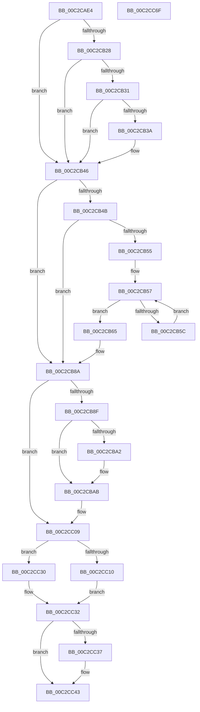

# IopInitCrashDumpDuringSysInit

- RVA: `0x00C2CAE4`–`0x00C2CC70` (길이 `396` bytes)
- VA: `0x0000000140C2CAE4`
- 실행 섹션: `INIT`
- PDB 이름 있음: `예`; PDB Function 태그: `아니요`
- unwind 정보 RVA: `0x000C71C8`
- 디코드: `97`개 명령, `396/396` bytes 표시
- 미해석 바이트: `0` (있으면 어셈블리에 `.byte`로 보존)

> 이 문서는 커널 이미지의 기계어와 PDB 기호를 분석해 생성했습니다. 4번과 5번은 함수 원형과 자료형을 바이너리 사용 방식에서 추정한 C 해석이며 원본 소스 복구 결과는 아닙니다.

## 1. Dependencies

- 직접 호출 지점: **9**; 고유 호출 대상: **9**
- 직접 호출자로 확인된 함수: **1**
- RIP 상대 이미지 참조: **9**

### Outgoing calls
- `0x00C2CB28` → [SecureDump_Init](../../text/5A/SecureDump_Init_function_005A2CC4.md) (function, `0x005A2CC4`)
- `0x00C2CB41` → [IopDumpTraceForceDumpDisabled](../../page/71/IopDumpTraceForceDumpDisabled_function_0071A138.md) (function, `0x0071A138`)
- `0x00C2CB7E` → [MmInitializeMemoryLimits](../C6/MmInitializeMemoryLimits_function_00C67150.md) (function, `0x00C67150`)
- `0x00C2CBA6` → [IoConfigureCrashDump](../../text/59/IoConfigureCrashDump_function_00591CB4.md) (function, `0x00591CB4`)
- `0x00C2CBB6` → [memset](../../text/6C/memset_function_006C6C40.md) (function, `0x006C6C40`)
- `0x00C2CC04` → [RtlQueryRegistryValuesEx](../../page/8C/RtlQueryRegistryValuesEx_function_008C8FF0.md) (function, `0x008C8FF0`)
- `0x00C2CC1D` → [IoInitializeCrashDump](../../page/71/IoInitializeCrashDump_function_00719D88.md) (function, `0x00719D88`)
- `0x00C2CC3E` → [IopInitializeOfflineCrashDump](../../text/59/IopInitializeOfflineCrashDump_function_00595A24.md) (function, `0x00595A24`)
- `0x00C2CC4C` → [_security_check_cookie](../../text/6A/_security_check_cookie_function_006AC640.md) (function, `0x006AC640`)

### Direct callers
- [IoInitSystemPreDrivers](IoInitSystemPreDrivers_function_00C2AC3C.md) at `0x00C2BB4C`
- [IoInitSystemPreDrivers](IoInitSystemPreDrivers_function_00C2AC3C.md) at `0x00C2BCC1`

### Static image references
- `0x00C2CB03` → RVA `0x00E0A740` (`.data`; read)
- `0x00C2CB11` → RVA `0x00E660BC` (`.data`; read)
- `0x00C2CB31` → RVA `0x00E661A8` (`.data`; read)
- `0x00C2CB3A` → RVA `0x00E660BC` (`.data`; write)
- `0x00C2CB4B` → RVA `0x00E65EE0` (`.data`; read)
- `0x00C2CB83` → RVA `0x00E65EE0` (`.data`; write)
- `0x00C2CBC0` → RVA `0x00C2CC80` (`IopInitCrashDumpRegCallback`; read)
- `0x00C2CBD7` → RVA `0x00C79C70` (` ?? ::PBOPGDP::`string'`; read)
- `0x00C2CBDE` → RVA `0x00C79CC0` (` ?? ::PBOPGDP::`string'`; read)

## 2. Other-region calls and transfers

- 다른 실행 섹션으로 향하는 call: **8**
  - `0x00C2CB28` → [SecureDump_Init](../../text/5A/SecureDump_Init_function_005A2CC4.md) (`INIT` → `.text`)
  - `0x00C2CB41` → [IopDumpTraceForceDumpDisabled](../../page/71/IopDumpTraceForceDumpDisabled_function_0071A138.md) (`INIT` → `PAGE`)
  - `0x00C2CBA6` → [IoConfigureCrashDump](../../text/59/IoConfigureCrashDump_function_00591CB4.md) (`INIT` → `.text`)
  - `0x00C2CBB6` → [memset](../../text/6C/memset_function_006C6C40.md) (`INIT` → `.text`)
  - `0x00C2CC04` → [RtlQueryRegistryValuesEx](../../page/8C/RtlQueryRegistryValuesEx_function_008C8FF0.md) (`INIT` → `PAGE`)
  - `0x00C2CC1D` → [IoInitializeCrashDump](../../page/71/IoInitializeCrashDump_function_00719D88.md) (`INIT` → `PAGE`)
  - `0x00C2CC3E` → [IopInitializeOfflineCrashDump](../../text/59/IopInitializeOfflineCrashDump_function_00595A24.md) (`INIT` → `.text`)
  - `0x00C2CC4C` → [_security_check_cookie](../../text/6A/_security_check_cookie_function_006AC640.md) (`INIT` → `.text`)
- 별도 외부 분기/꼬리 이동을 확인하지 못했습니다.

## 3. Assembly (complete function range)

```asm
00C2CAE4  48 8B C4                        mov rax, rsp
00C2CAE7  48 89 58 10                     mov qword ptr [rax + 0x10], rbx
00C2CAEB  48 89 70 18                     mov qword ptr [rax + 0x18], rsi
00C2CAEF  48 89 78 20                     mov qword ptr [rax + 0x20], rdi
00C2CAF3  55                              push rbp
00C2CAF4  48 8D 68 E8                     lea rbp, [rax - 0x18]
00C2CAF8  48 81 EC 10 01 00 00            sub rsp, 0x110
00C2CAFF  0F 29 70 E8                     movaps xmmword ptr [rax - 0x18], xmm6
00C2CB03  48 8B 05 36 DC 1D 00            mov rax, qword ptr [rip + 0x1ddc36]
00C2CB0A  48 33 C4                        xor rax, rsp
00C2CB0D  48 89 45 F0                     mov qword ptr [rbp - 0x10], rax
00C2CB11  80 3D A4 95 23 00 00            cmp byte ptr [rip + 0x2395a4], 0
00C2CB18  40 8A F2                        mov sil, dl
00C2CB1B  48 8B F9                        mov rdi, rcx
00C2CB1E  C6 44 24 30 00                  mov byte ptr [rsp + 0x30], 0
00C2CB23  0F 57 F6                        xorps xmm6, xmm6
00C2CB26  75 1E                           jne 0x140c2cb46
00C2CB28  E8 97 61 97 FF                  call 0x1405a2cc4
00C2CB2D  85 C0                           test eax, eax
00C2CB2F  79 15                           jns 0x140c2cb46
00C2CB31  80 3D 70 96 23 00 00            cmp byte ptr [rip + 0x239670], 0
00C2CB38  75 0C                           jne 0x140c2cb46
00C2CB3A  C6 05 7B 95 23 00 01            mov byte ptr [rip + 0x23957b], 1
00C2CB41  E8 F2 D5 AE FF                  call 0x14071a138
00C2CB46  48 85 FF                        test rdi, rdi
00C2CB49  74 3F                           je 0x140c2cb8a
00C2CB4B  48 83 3D 8D 93 23 00 00         cmp qword ptr [rip + 0x23938d], 0
00C2CB53  75 35                           jne 0x140c2cb8a
00C2CB55  33 C0                           xor eax, eax
00C2CB57  83 F8 2F                        cmp eax, 0x2f
00C2CB5A  73 09                           jae 0x140c2cb65
00C2CB5C  C6 44 05 C0 00                  mov byte ptr [rbp + rax - 0x40], 0
00C2CB61  FF C0                           inc eax
00C2CB63  EB F2                           jmp 0x140c2cb57
00C2CB65  48 8D 55 C0                     lea rdx, [rbp - 0x40]
00C2CB69  66 C7 45 DE 01 01               mov word ptr [rbp - 0x22], 0x101
00C2CB6F  48 8B CF                        mov rcx, rdi
00C2CB72  C6 45 C6 01                     mov byte ptr [rbp - 0x3a], 1
00C2CB76  C6 45 E0 01                     mov byte ptr [rbp - 0x20], 1
00C2CB7A  C6 45 E5 01                     mov byte ptr [rbp - 0x1b], 1
00C2CB7E  E8 CD A5 03 00                  call 0x140c67150
00C2CB83  48 89 05 56 93 23 00            mov qword ptr [rip + 0x239356], rax
00C2CB8A  40 84 F6                        test sil, sil
00C2CB8D  75 7A                           jne 0x140c2cc09
00C2CB8F  48 8B 87 F0 00 00 00            mov rax, qword ptr [rdi + 0xf0]
00C2CB96  F7 80 84 00 00 00 00 00 10 00   test dword ptr [rax + 0x84], 0x100000
00C2CBA0  74 09                           je 0x140c2cbab
00C2CBA2  B2 01                           mov dl, 1
00C2CBA4  33 C9                           xor ecx, ecx
00C2CBA6  E8 09 51 96 FF                  call 0x140591cb4
00C2CBAB  33 D2                           xor edx, edx
00C2CBAD  48 8D 4C 24 50                  lea rcx, [rsp + 0x50]
00C2CBB2  44 8D 42 70                     lea r8d, [rdx + 0x70]
00C2CBB6  E8 85 A0 A9 FF                  call 0x1406c6c40
00C2CBBB  83 64 24 70 00                  and dword ptr [rsp + 0x70], 0
00C2CBC0  48 8D 05 B9 00 00 00            lea rax, [rip + 0xb9]
00C2CBC7  48 83 64 24 20 00               and qword ptr [rsp + 0x20], 0
00C2CBCD  4C 8D 44 24 50                  lea r8, [rsp + 0x50]
00C2CBD2  48 89 44 24 50                  mov qword ptr [rsp + 0x50], rax
00C2CBD7  48 8D 15 92 D0 04 00            lea rdx, [rip + 0x4d092]
00C2CBDE  48 8D 05 DB D0 04 00            lea rax, [rip + 0x4d0db]
00C2CBE5  C7 44 24 58 04 00 00 00         mov dword ptr [rsp + 0x58], 4
00C2CBED  48 89 44 24 60                  mov qword ptr [rsp + 0x60], rax
00C2CBF2  4C 8B CF                        mov r9, rdi
00C2CBF5  48 8D 44 24 30                  lea rax, [rsp + 0x30]
00C2CBFA  B9 02 00 00 00                  mov ecx, 2
00C2CBFF  48 89 44 24 68                  mov qword ptr [rsp + 0x68], rax
00C2CC04  E8 E7 C3 C9 FF                  call 0x1408c8ff0
00C2CC09  80 7C 24 30 00                  cmp byte ptr [rsp + 0x30], 0
00C2CC0E  75 20                           jne 0x140c2cc30
00C2CC10  48 8D 54 24 40                  lea rdx, [rsp + 0x40]
00C2CC15  66 0F 7F 74 24 40               movdqa xmmword ptr [rsp + 0x40], xmm6
00C2CC1B  33 C9                           xor ecx, ecx
00C2CC1D  E8 66 D1 AE FF                  call 0x140719d88
00C2CC22  F6 D8                           neg al
00C2CC24  1B DB                           sbb ebx, ebx
00C2CC26  F7 D3                           not ebx
00C2CC28  81 E3 01 00 00 C0               and ebx, 0xc0000001
00C2CC2E  EB 02                           jmp 0x140c2cc32
00C2CC30  33 DB                           xor ebx, ebx
00C2CC32  40 84 F6                        test sil, sil
00C2CC35  75 0C                           jne 0x140c2cc43
00C2CC37  48 8B 8F F0 00 00 00            mov rcx, qword ptr [rdi + 0xf0]
00C2CC3E  E8 E1 8D 96 FF                  call 0x140595a24
00C2CC43  8B C3                           mov eax, ebx
00C2CC45  48 8B 4D F0                     mov rcx, qword ptr [rbp - 0x10]
00C2CC49  48 33 CC                        xor rcx, rsp
00C2CC4C  E8 EF F9 A7 FF                  call 0x1406ac640
00C2CC51  4C 8D 9C 24 10 01 00 00         lea r11, [rsp + 0x110]
00C2CC59  49 8B 5B 18                     mov rbx, qword ptr [r11 + 0x18]
00C2CC5D  49 8B 73 20                     mov rsi, qword ptr [r11 + 0x20]
00C2CC61  49 8B 7B 28                     mov rdi, qword ptr [r11 + 0x28]
00C2CC65  41 0F 28 73 F0                  movaps xmm6, xmmword ptr [r11 - 0x10]
00C2CC6A  49 8B E3                        mov rsp, r11
00C2CC6D  5D                              pop rbp
00C2CC6E  C3                              ret
00C2CC6F  CC                              int3
```

## 4. C-style interpretation (structured pseudocode)

```c
__int64 __fastcall IopInitCrashDumpDuringSysInit(__int64 a1, unsigned __int8 a2)
{
    __int64 result;
    __int64 v_rbx;
    __int64 v_rsp;
    unsigned __int64 v_stack_m8;
    unsigned int v_stack_mA8;
    unsigned __int64 v_stack_mB0;
    unsigned __int64 v_stack_mB8;
    unsigned int v_stack_mC0;
    unsigned __int64 v_stack_mC8;
    unsigned __int64 v_stack_mD8;
    unsigned __int8 v_stack_mE8;
    unsigned __int64 v_stack_mF8;

    *(unsigned __int64 *)(v_rsp + 16) = v_rbx;
    *(unsigned __int64 *)(v_rsp + 24) = v_rsi;
    *(unsigned __int64 *)(v_rsp + 32) = v_rdi;
    v_rsp = (v_rsp) - (272);
    *(unsigned __int64 *)(v_rsp - 24) = v_xmm6;
    result = (*(unsigned __int64 *)(v_rip + 1956918)) ^ (v_rsp);
    *(unsigned __int64 *)(v_rsp - 24 - 16) = result;
    v_stack_mE8 = 0;
    if ((*(unsigned __int8 *)(v_rip + 2332068)) != 0) goto loc_00C2CB46;
    result = SecureDump_Init(a1, a2, a3, a4);
    if (!sign_flag) goto loc_00C2CB46;
    if ((*(unsigned __int8 *)(v_rip + 2332272)) == 0) {
        *(unsigned __int8 *)(v_rip + 2332027) = 1;
        result = IopDumpTraceForceDumpDisabled(a1, a2, a3, a4);
    }
    if (a1 == 0) goto loc_00C2CB8A;
    if ((*(unsigned __int64 *)(v_rip + 2331533)) != 0) goto loc_00C2CB8A;
    result = 0;
loc_00C2CB57:
    if (0 >= 47) goto loc_00C2CB65;
    *(unsigned __int8 *)(v_rsp - 24 + result * 1 - 64) = 0;
    result = (unsigned int)((result) + 1);
    goto loc_00C2CB57;
loc_00C2CB65:
    *(unsigned __int16 *)(v_rsp - 24 - 34) = 257;
    *(unsigned __int8 *)(v_rsp - 24 - 58) = 1;
    *(unsigned __int8 *)(v_rsp - 24 - 32) = 1;
    *(unsigned __int8 *)(v_rsp - 24 - 27) = 1;
    result = MmInitializeMemoryLimits(a1, v_rsp - 24 - 64, a3, a4);
    *(unsigned __int64 *)(v_rip + 2331478) = result;
loc_00C2CB8A:
    if (a2 != 0) goto loc_00C2CC09;
    result = *(unsigned __int64 *)(a1 + 240);
    if (((*(unsigned int *)(*(unsigned __int64 *)(a1 + 240) + 132)) & (0x100000ULL)) != 0) {
        a2 = 1;
        a1 = 0;
        result = IoConfigureCrashDump(a1, a2, a3, a4);
    }
    a2 = 0;
    result = memset(v_stack_mC8, a2, a2 + 112, a4);
    v_stack_mC8 = v_rip + 185;
    v_stack_mC0 = 4;
    v_stack_mB8 = v_rip + 315611;
    v_stack_mB0 = v_stack_mE8;
    result = RtlQueryRegistryValuesEx(2, v_rip + 315538, v_stack_mC8, 0);
loc_00C2CC09:
    if (v_stack_mE8 != 0) goto loc_00C2CC30;
    v_stack_mD8 = v_xmm6;
    a1 = 0;
    result = IoInitializeCrashDump(a1, v_stack_mD8, v_stack_mC8, 0);
    result = (unsigned __int8)(-(result));
    v_rbx = (unsigned int)(~(v_rbx));
    v_rbx = (unsigned int)((v_rbx) & (0xC0000001ULL));
    goto loc_00C2CC32;
loc_00C2CC30:
    v_rbx = 0;
loc_00C2CC32:
    if (0 == 0) {
        a1 = *(unsigned __int64 *)(a1 + 240);
        result = IopInitializeOfflineCrashDump(a1, v_stack_mD8, v_stack_mC8, 0);
    }
    a1 = (*(unsigned __int64 *)(v_rsp - 24 - 16)) ^ (v_rsp);
    result = _security_check_cookie(a1, v_stack_mD8, v_stack_mC8, 0);
    return result;
}
```

## 5. (Beta) C Style

```c
int64_t IopInitCrashDumpDuringSysInit(int64_t Arg1, uint8_t Arg2)
{
    int64_t result;
    int64_t local_rbx;
    int64_t local_rsp;
    uint64_t v_stack_m8;
    uint32_t v_stack_mA8;
    uint64_t v_stack_mB0;
    uint64_t v_stack_mB8;
    uint32_t v_stack_mC0;
    uint64_t v_stack_mC8;
    uint64_t v_stack_mD8;
    uint8_t v_stack_mE8;
    uint64_t v_stack_mF8;

    *(uint64_t *)(local_rsp + 0x10) = local_rbx;
    *(uint64_t *)(local_rsp + 0x18) = local_rsi;
    *(uint64_t *)(local_rsp + 0x20) = local_rdi;
    local_rsp = (local_rsp) - (272);
    *(uint64_t *)(local_rsp - 0x18) = v_xmm6;
    result = (*(uint64_t *)(v_rip + 0x1DDC36)) ^ (local_rsp);
    *(uint64_t *)(local_rsp - 0x18 - 0x10) = result;
    v_stack_mE8 = 0;
    if ((*(uint8_t *)(v_rip + 0x2395A4)) != 0) goto loc_00C2CB46;
    result = SecureDump_Init(Arg1, Arg2, a3, a4);
    if (!sign_flag) goto loc_00C2CB46;
    if ((*(uint8_t *)(v_rip + 0x239670)) == 0) {
        *(uint8_t *)(v_rip + 0x23957B) = 1;
        result = IopDumpTraceForceDumpDisabled(Arg1, Arg2, a3, a4);
    }
    if (Arg1 == 0) goto loc_00C2CB8A;
    if ((*(uint64_t *)(v_rip + 0x23938D)) != 0) goto loc_00C2CB8A;
    result = 0;
loc_00C2CB57:
    if (0 >= 47) goto loc_00C2CB65;
    *(uint8_t *)(local_rsp - 0x18 + result * 1 - 0x40) = 0;
    result = (uint32_t)((result) + 1);
    goto loc_00C2CB57;
loc_00C2CB65:
    *(uint16_t *)(local_rsp - 0x18 - 0x22) = 257;
    *(uint8_t *)(local_rsp - 0x18 - 0x3A) = 1;
    *(uint8_t *)(local_rsp - 0x18 - 0x20) = 1;
    *(uint8_t *)(local_rsp - 0x18 - 0x1B) = 1;
    result = MmInitializeMemoryLimits(Arg1, local_rsp - 24 - 64, a3, a4);
    *(uint64_t *)(v_rip + 0x239356) = result;
loc_00C2CB8A:
    if (Arg2 != 0) goto loc_00C2CC09;
    result = *(uint64_t *)(Arg1 + 0xF0);
    if (((*(uint32_t *)(*(uint64_t *)(Arg1 + 0xF0) + 0x84)) & (0x100000ULL)) != 0) {
        Arg2 = 1;
        Arg1 = 0;
        result = IoConfigureCrashDump(Arg1, Arg2, a3, a4);
    }
    Arg2 = 0;
    result = memset(v_stack_mC8, Arg2, Arg2 + 112, a4);
    v_stack_mC8 = v_rip + 185;
    v_stack_mC0 = 4;
    v_stack_mB8 = v_rip + 315611;
    v_stack_mB0 = v_stack_mE8;
    result = RtlQueryRegistryValuesEx(2, v_rip + 315538, v_stack_mC8, 0);
loc_00C2CC09:
    if (v_stack_mE8 != 0) goto loc_00C2CC30;
    v_stack_mD8 = v_xmm6;
    Arg1 = 0;
    result = IoInitializeCrashDump(Arg1, v_stack_mD8, v_stack_mC8, 0);
    result = (uint8_t)(-(result));
    local_rbx = (uint32_t)(~(local_rbx));
    local_rbx = (uint32_t)((local_rbx) & (0xC0000001ULL));
    goto loc_00C2CC32;
loc_00C2CC30:
    local_rbx = 0;
loc_00C2CC32:
    if (0 == 0) {
        Arg1 = *(uint64_t *)(Arg1 + 0xF0);
        result = IopInitializeOfflineCrashDump(Arg1, v_stack_mD8, v_stack_mC8, 0);
    }
    Arg1 = (*(uint64_t *)(local_rsp - 0x18 - 0x10)) ^ (local_rsp);
    result = _security_check_cookie(Arg1, v_stack_mD8, v_stack_mC8, 0);
    return result;
}
```

## 6. Execution-region graph

[열기: 2D/3D 그래프와 함수 탐색 컨트롤 패널](../../../control-panel.html?section=init&rva=0x00C2CAE4&view=graph)

- 2D 그래프는 위에서 아래로 흐르고, 3D 그래프는 빈 공간을 드래그해 회전합니다. Shift+드래그는 이동, 휠은 확대·축소, 함수 노드 선택은 대상 보고서 이동입니다.

### Static fallback


