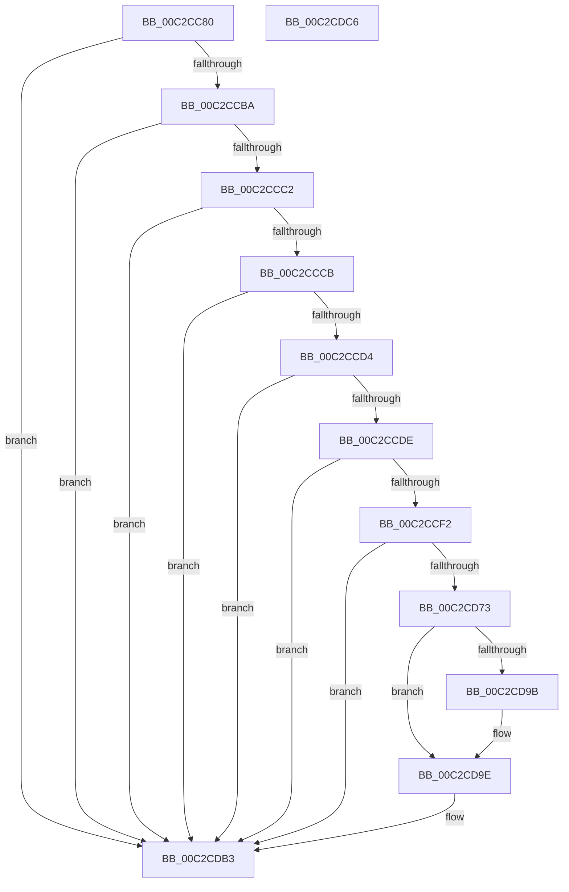

# IopInitCrashDumpRegCallback

- RVA: `0x00C2CC80`–`0x00C2CDC7` (길이 `327` bytes)
- VA: `0x0000000140C2CC80`
- 실행 섹션: `INIT`
- PDB 이름 있음: `예`; PDB Function 태그: `아니요`
- unwind 정보 RVA: `0x00070830`
- 디코드: `73`개 명령, `327/327` bytes 표시
- 미해석 바이트: `0` (있으면 어셈블리에 `.byte`로 보존)

> 이 문서는 커널 이미지의 기계어와 PDB 기호를 분석해 생성했습니다. 4번과 5번은 함수 원형과 자료형을 바이너리 사용 방식에서 추정한 C 해석이며 원본 소스 복구 결과는 아닙니다.

## 1. Dependencies

- 직접 호출 지점: **6**; 고유 호출 대상: **6**
- 직접 호출자로 확인된 함수: **0**
- RIP 상대 이미지 참조: **1**

### Outgoing calls
- `0x00C2CCE5` → [RtlInitUnicodeStringEx](../../text/46/RtlInitUnicodeStringEx_function_00463960.md) (function, `0x00463960`)
- `0x00C2CD6A` → [IoCreateFile](../../page/8A/IoCreateFile_function_008AAF60.md) (function, `0x008AAF60`)
- `0x00C2CD7C` → [ExAcquireResourceExclusiveLite](../../text/21/ExAcquireResourceExclusiveLite_function_00214E20.md) (function, `0x00214E20`)
- `0x00C2CD92` → [IopInitializeCrashDump](../../page/71/IopInitializeCrashDump_function_0071A270.md) (function, `0x0071A270`)
- `0x00C2CDA5` → [ExReleaseResourceLite](../../text/25/ExReleaseResourceLite_function_0025FA10.md) (function, `0x0025FA10`)
- `0x00C2CDAE` → [NtClose](../../page/86/NtClose_function_00868870.md) (function, `0x00868870`)

### Direct callers
- 이 함수 시작 RVA로 연결되는 직접 call은 확인되지 않았습니다. 간접 호출은 완전히 역산할 수 없습니다.

### Static image references
- `0x00C2CD75` → RVA `0x00F8E900` (`.data`; read)

## 2. Other-region calls and transfers

- 다른 실행 섹션으로 향하는 call: **6**
  - `0x00C2CCE5` → [RtlInitUnicodeStringEx](../../text/46/RtlInitUnicodeStringEx_function_00463960.md) (`INIT` → `.text`)
  - `0x00C2CD6A` → [IoCreateFile](../../page/8A/IoCreateFile_function_008AAF60.md) (`INIT` → `PAGE`)
  - `0x00C2CD7C` → [ExAcquireResourceExclusiveLite](../../text/21/ExAcquireResourceExclusiveLite_function_00214E20.md) (`INIT` → `.text`)
  - `0x00C2CD92` → [IopInitializeCrashDump](../../page/71/IopInitializeCrashDump_function_0071A270.md) (`INIT` → `PAGE`)
  - `0x00C2CDA5` → [ExReleaseResourceLite](../../text/25/ExReleaseResourceLite_function_0025FA10.md) (`INIT` → `.text`)
  - `0x00C2CDAE` → [NtClose](../../page/86/NtClose_function_00868870.md) (`INIT` → `PAGE`)
- 별도 외부 분기/꼬리 이동을 확인하지 못했습니다.

## 3. Assembly (complete function range)

```asm
00C2CC80  48 89 5C 24 08                  mov qword ptr [rsp + 8], rbx
00C2CC85  55                              push rbp
00C2CC86  48 8D 6C 24 B9                  lea rbp, [rsp - 0x47]
00C2CC8B  48 81 EC D0 00 00 00            sub rsp, 0xd0
00C2CC92  48 83 65 67 00                  and qword ptr [rbp + 0x67], 0
00C2CC97  33 C0                           xor eax, eax
00C2CC99  21 45 33                        and dword ptr [rbp + 0x33], eax
00C2CC9C  0F 57 C0                        xorps xmm0, xmm0
00C2CC9F  48 8B 5D 7F                     mov rbx, qword ptr [rbp + 0x7f]
00C2CCA3  89 45 1B                        mov dword ptr [rbp + 0x1b], eax
00C2CCA6  21 45 1B                        and dword ptr [rbp + 0x1b], eax
00C2CCA9  0F 11 45 E7                     movups xmmword ptr [rbp - 0x19], xmm0
00C2CCAD  0F 11 45 F7                     movups xmmword ptr [rbp - 9], xmm0
00C2CCB1  48 85 DB                        test rbx, rbx
00C2CCB4  0F 84 F9 00 00 00               je 0x140c2cdb3
00C2CCBA  38 03                           cmp byte ptr [rbx], al
00C2CCBC  0F 85 F1 00 00 00               jne 0x140c2cdb3
00C2CCC2  4D 85 C0                        test r8, r8
00C2CCC5  0F 84 E8 00 00 00               je 0x140c2cdb3
00C2CCCB  45 85 C9                        test r9d, r9d
00C2CCCE  0F 84 DF 00 00 00               je 0x140c2cdb3
00C2CCD4  48 39 45 77                     cmp qword ptr [rbp + 0x77], rax
00C2CCD8  0F 84 D5 00 00 00               je 0x140c2cdb3
00C2CCDE  49 8B D0                        mov rdx, r8
00C2CCE1  48 8D 4D E7                     lea rcx, [rbp - 0x19]
00C2CCE5  E8 76 6C 83 FF                  call 0x140463960
00C2CCEA  85 C0                           test eax, eax
00C2CCEC  0F 88 C1 00 00 00               js 0x140c2cdb3
00C2CCF2  48 83 65 1F 00                  and qword ptr [rbp + 0x1f], 0
00C2CCF7  48 8D 45 E7                     lea rax, [rbp - 0x19]
00C2CCFB  C7 44 24 68 12 01 00 00         mov dword ptr [rsp + 0x68], 0x112
00C2CD03  4C 8D 4D F7                     lea r9, [rbp - 9]
00C2CD07  48 83 64 24 60 00               and qword ptr [rsp + 0x60], 0
00C2CD0D  4C 8D 45 17                     lea r8, [rbp + 0x17]
00C2CD11  83 64 24 58 00                  and dword ptr [rsp + 0x58], 0
00C2CD16  48 8D 4D 67                     lea rcx, [rbp + 0x67]
00C2CD1A  83 64 24 50 00                  and dword ptr [rsp + 0x50], 0
00C2CD1F  0F 57 C0                        xorps xmm0, xmm0
00C2CD22  48 83 64 24 48 00               and qword ptr [rsp + 0x48], 0
00C2CD28  BA 00 00 10 C0                  mov edx, 0xc0100000
00C2CD2D  C7 44 24 40 08 80 00 00         mov dword ptr [rsp + 0x40], 0x8008
00C2CD35  C7 44 24 38 01 00 00 00         mov dword ptr [rsp + 0x38], 1
00C2CD3D  C7 44 24 30 02 00 00 00         mov dword ptr [rsp + 0x30], 2
00C2CD45  C7 44 24 28 06 00 00 00         mov dword ptr [rsp + 0x28], 6
00C2CD4D  48 83 64 24 20 00               and qword ptr [rsp + 0x20], 0
00C2CD53  C7 45 17 30 00 00 00            mov dword ptr [rbp + 0x17], 0x30
00C2CD5A  C7 45 2F 40 00 00 00            mov dword ptr [rbp + 0x2f], 0x40
00C2CD61  48 89 45 27                     mov qword ptr [rbp + 0x27], rax
00C2CD65  F3 0F 7F 45 37                  movdqu xmmword ptr [rbp + 0x37], xmm0
00C2CD6A  E8 F1 E1 C7 FF                  call 0x1408aaf60
00C2CD6F  85 C0                           test eax, eax
00C2CD71  78 40                           js 0x140c2cdb3
00C2CD73  B2 01                           mov dl, 1
00C2CD75  48 8D 0D 84 1B 36 00            lea rcx, [rip + 0x361b84]
00C2CD7C  E8 9F 80 5E FF                  call 0x140214e20
00C2CD81  0F 28 45 E7                     movaps xmm0, xmmword ptr [rbp - 0x19]
00C2CD85  48 8D 55 07                     lea rdx, [rbp + 7]
00C2CD89  48 8B 4D 67                     mov rcx, qword ptr [rbp + 0x67]
00C2CD8D  66 0F 7F 45 07                  movdqa xmmword ptr [rbp + 7], xmm0
00C2CD92  E8 D9 D4 AE FF                  call 0x14071a270
00C2CD97  84 C0                           test al, al
00C2CD99  74 03                           je 0x140c2cd9e
00C2CD9B  C6 03 01                        mov byte ptr [rbx], 1
00C2CD9E  48 8D 0D 5B 1B 36 00            lea rcx, [rip + 0x361b5b]
00C2CDA5  E8 66 2C 63 FF                  call 0x14025fa10
00C2CDAA  48 8B 4D 67                     mov rcx, qword ptr [rbp + 0x67]
00C2CDAE  E8 BD BA C3 FF                  call 0x140868870
00C2CDB3  48 8B 9C 24 E0 00 00 00         mov rbx, qword ptr [rsp + 0xe0]
00C2CDBB  33 C0                           xor eax, eax
00C2CDBD  48 81 C4 D0 00 00 00            add rsp, 0xd0
00C2CDC4  5D                              pop rbp
00C2CDC5  C3                              ret
00C2CDC6  CC                              int3
```

## 4. C-style interpretation (structured pseudocode)

```c
__int64 __fastcall IopInitCrashDumpRegCallback(__int64 a1, __int64 a2, __int64 a3, int a4, __int64 a5, __int64 a6)
{
    __int64 result;
    __int64 v_rsp;
    unsigned __int64 v_stack_m18;
    unsigned int v_stack_m1C;
    unsigned int v_stack_m20;
    unsigned __int64 v_stack_m28;
    unsigned __int64 v_stack_m30;
    unsigned int v_stack_m34;
    unsigned __int64 v_stack_m38;
    unsigned __int64 v_stack_m48;
    unsigned __int64 v_stack_m4F;
    unsigned __int64 v_stack_m58;
    unsigned __int64 v_stack_m68;
    unsigned int v_stack_m70;
    unsigned __int64 v_stack_m78;
    unsigned int v_stack_m80;
    unsigned int v_stack_m88;
    unsigned __int64 v_stack_m90;
    unsigned int v_stack_m98;
    unsigned int v_stack_mA0;
    unsigned int v_stack_mA8;
    unsigned int v_stack_mB0;
    unsigned __int64 v_stack_mB8;
    unsigned __int64 v_stack_p18;
    unsigned __int64 v_stack_p8;

    v_stack_p8 = v_rbx;
    v_rsp = (v_rsp) - (208);
    result = 0;
    v_stack_m34 = 0;
    v_stack_m68 = v_xmm0;
    v_stack_m58 = v_xmm0;
    if (a6 == 0) goto loc_00C2CDB3;
    if ((*(unsigned __int8 *)(a6)) != 0) goto loc_00C2CDB3;
    if (a3 == 0) goto loc_00C2CDB3;
    if (a4 == 0) goto loc_00C2CDB3;
    if (a5 == 0) goto loc_00C2CDB3;
    result = RtlInitUnicodeStringEx(v_stack_m68, a3, a3, a4);
    if (sign_flag) goto loc_00C2CDB3;
    v_stack_m70 = 274;
    v_stack_m98 = 0x8008ULL;
    v_stack_mA0 = 1;
    v_stack_mA8 = 2;
    v_stack_mB0 = 6;
    v_stack_m38 = 48;
    v_stack_m20 = 64;
    v_stack_m28 = v_stack_m68;
    v_stack_m18 = v_xmm0;
    result = IoCreateFile(v_stack_p18, (unsigned int)(0xC0100000ULL), v_stack_m38, v_stack_m58);
    if (sign_flag) goto loc_00C2CDB3;
    result = ExAcquireResourceExclusiveLite(v_rip + 3545988, 1, v_stack_m38, v_stack_m58);
    v_stack_m48 = v_xmm0;
    result = IopInitializeCrashDump(v_stack_p18, v_stack_m48, v_stack_m38, v_stack_m58);
    if ((unsigned __int8)(result) != 0) {
        *(unsigned __int8 *)(a6) = 1;
    }
    result = ExReleaseResourceLite(v_rip + 3545947, v_stack_m48, v_stack_m38, v_stack_m58);
    result = NtClose(v_stack_p18, v_stack_m48, v_stack_m38, v_stack_m58);
loc_00C2CDB3:
    result = 0;
    v_rsp = (v_rsp) + (208);
    return result;
}
```

## 5. (Beta) C Style

```c
int64_t IopInitCrashDumpRegCallback(int64_t Arg1, int64_t Arg2, int64_t Arg3, int32_t Arg4, int64_t Arg5, int64_t Arg6)
{
    int64_t result;
    int64_t local_rsp;
    uint64_t v_stack_m18;
    uint32_t v_stack_m1C;
    uint32_t v_stack_m20;
    uint64_t v_stack_m28;
    uint64_t v_stack_m30;
    uint32_t v_stack_m34;
    uint64_t v_stack_m38;
    uint64_t v_stack_m48;
    uint64_t v_stack_m4F;
    uint64_t v_stack_m58;
    uint64_t v_stack_m68;
    uint32_t v_stack_m70;
    uint64_t v_stack_m78;
    uint32_t v_stack_m80;
    uint32_t v_stack_m88;
    uint64_t v_stack_m90;
    uint32_t v_stack_m98;
    uint32_t v_stack_mA0;
    uint32_t v_stack_mA8;
    uint32_t v_stack_mB0;
    uint64_t v_stack_mB8;
    uint64_t v_stack_p18;
    uint64_t v_stack_p8;

    v_stack_p8 = local_rbx;
    local_rsp = (local_rsp) - (208);
    result = 0;
    v_stack_m34 = 0;
    v_stack_m68 = v_xmm0;
    v_stack_m58 = v_xmm0;
    if (Arg6 == 0) goto loc_00C2CDB3;
    if ((*(uint8_t *)(Arg6)) != 0) goto loc_00C2CDB3;
    if (Arg3 == 0) goto loc_00C2CDB3;
    if (Arg4 == 0) goto loc_00C2CDB3;
    if (Arg5 == 0) goto loc_00C2CDB3;
    result = RtlInitUnicodeStringEx(v_stack_m68, Arg3, Arg3, Arg4);
    if (sign_flag) goto loc_00C2CDB3;
    v_stack_m70 = 274;
    v_stack_m98 = 0x8008ULL;
    v_stack_mA0 = 1;
    v_stack_mA8 = 2;
    v_stack_mB0 = 6;
    v_stack_m38 = 48;
    v_stack_m20 = 64;
    v_stack_m28 = v_stack_m68;
    v_stack_m18 = v_xmm0;
    result = IoCreateFile(v_stack_p18, (uint32_t)(0xC0100000ULL), v_stack_m38, v_stack_m58);
    if (sign_flag) goto loc_00C2CDB3;
    result = ExAcquireResourceExclusiveLite(v_rip + 3545988, 1, v_stack_m38, v_stack_m58);
    v_stack_m48 = v_xmm0;
    result = IopInitializeCrashDump(v_stack_p18, v_stack_m48, v_stack_m38, v_stack_m58);
    if ((uint8_t)(result) != 0) {
        *(uint8_t *)(Arg6) = 1;
    }
    result = ExReleaseResourceLite(v_rip + 3545947, v_stack_m48, v_stack_m38, v_stack_m58);
    result = NtClose(v_stack_p18, v_stack_m48, v_stack_m38, v_stack_m58);
loc_00C2CDB3:
    result = 0;
    local_rsp = (local_rsp) + (208);
    return result;
}
```

## 6. Execution-region graph

[열기: 2D/3D 그래프와 함수 탐색 컨트롤 패널](../../../control-panel.html?section=init&rva=0x00C2CC80&view=graph)

- 2D 그래프는 위에서 아래로 흐르고, 3D 그래프는 빈 공간을 드래그해 회전합니다. Shift+드래그는 이동, 휠은 확대·축소, 함수 노드 선택은 대상 보고서 이동입니다.

### Static fallback


