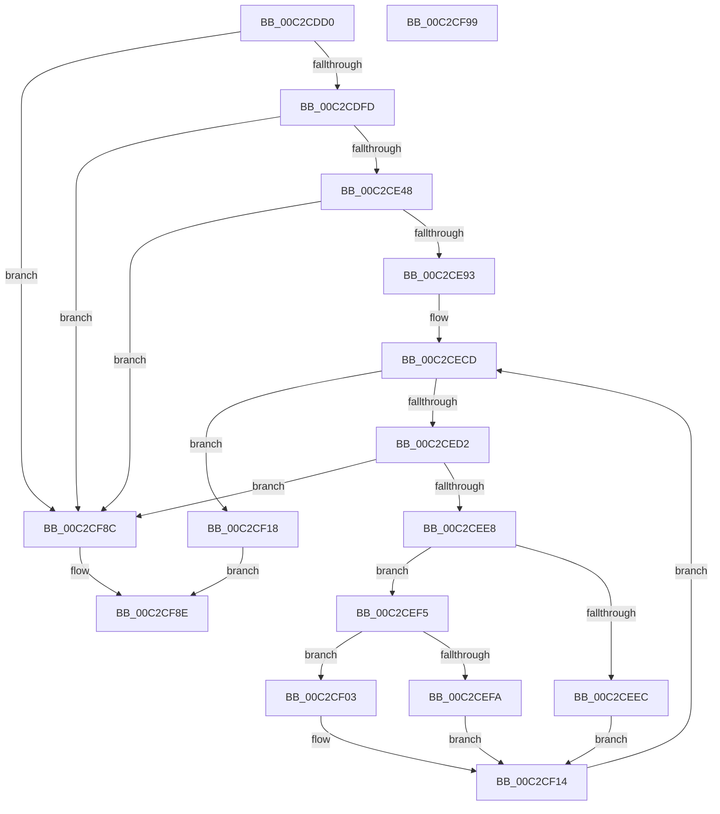

# IopInitializeReserveIrps

- RVA: `0x00C2CDD0`–`0x00C2CF9A` (길이 `458` bytes)
- VA: `0x0000000140C2CDD0`
- 실행 섹션: `INIT`
- PDB 이름 있음: `예`; PDB Function 태그: `아니요`
- unwind 정보 RVA: `0x0005CAAC`
- 디코드: `91`개 명령, `458/458` bytes 표시
- 미해석 바이트: `0` (있으면 어셈블리에 `.byte`로 보존)

> 이 문서는 커널 이미지의 기계어와 PDB 기호를 분석해 생성했습니다. 4번과 5번은 함수 원형과 자료형을 바이너리 사용 방식에서 추정한 C 해석이며 원본 소스 복구 결과는 아닙니다.

## 1. Dependencies

- 직접 호출 지점: **4**; 고유 호출 대상: **1**
- 직접 호출자로 확인된 함수: **1**
- RIP 상대 이미지 참조: **45**

### Outgoing calls
- `0x00C2CDE6` → [IopAllocateIrpWithExtension](../../text/29/IopAllocateIrpWithExtension_function_0029DF38.md) (function, `0x0029DF38`)
- `0x00C2CE33` → [IopAllocateIrpWithExtension](../../text/29/IopAllocateIrpWithExtension_function_0029DF38.md) (function, `0x0029DF38`)
- `0x00C2CE7E` → [IopAllocateIrpWithExtension](../../text/29/IopAllocateIrpWithExtension_function_0029DF38.md) (function, `0x0029DF38`)
- `0x00C2CED7` → [IopAllocateIrpWithExtension](../../text/29/IopAllocateIrpWithExtension_function_0029DF38.md) (function, `0x0029DF38`)

### Direct callers
- [IoInitSystemPreDrivers](IoInitSystemPreDrivers_function_00C2AC3C.md) at `0x00C2B066`

### Static image references
- `0x00C2CDDD` → RVA `0x00F8D660` (`.data`; write)
- `0x00C2CDED` → RVA `0x00F8D580` (`.data`; write)
- `0x00C2CDFD` → RVA `0x00F8D598` (`.data`; read)
- `0x00C2CE04` → RVA `0x00F8D588` (`.data`; write)
- `0x00C2CE0D` → RVA `0x00F8D5A0` (`.data`; write)
- `0x00C2CE16` → RVA `0x00F8D598` (`.data`; write)
- `0x00C2CE1D` → RVA `0x00F8D590` (`.data`; write)
- `0x00C2CE26` → RVA `0x00F8D592` (`.data`; write)
- `0x00C2CE2D` → RVA `0x00F8D594` (`.data`; write)
- `0x00C2CE38` → RVA `0x00F8D5A8` (`.data`; write)
- `0x00C2CE48` → RVA `0x00F8D5C0` (`.data`; read)
- `0x00C2CE4F` → RVA `0x00F8D5B0` (`.data`; write)
- `0x00C2CE58` → RVA `0x00F8D5C8` (`.data`; write)
- `0x00C2CE61` → RVA `0x00F8D5C0` (`.data`; write)
- `0x00C2CE68` → RVA `0x00F8D5B8` (`.data`; write)
- `0x00C2CE71` → RVA `0x00F8D5BA` (`.data`; write)
- `0x00C2CE78` → RVA `0x00F8D5BC` (`.data`; write)
- `0x00C2CE83` → RVA `0x00F8D5D0` (`.data`; write)
- `0x00C2CE93` → RVA `0x00F8D5E8` (`.data`; read)
- `0x00C2CE9A` → RVA `0x00F8D5D8` (`.data`; write)
- `0x00C2CEA0` → RVA `0x00F8D5F0` (`.data`; write)
- `0x00C2CEA9` → RVA `0x00F8D5E8` (`.data`; write)
- `0x00C2CEB0` → RVA `0x00F8D5E0` (`.data`; write)
- `0x00C2CEB9` → RVA `0x00F8D5E2` (`.data`; write)
- `0x00C2CEC0` → RVA `0x00F8D5E4` (`.data`; write)
- `0x00C2CEC6` → RVA `0x00F8D658` (`.data`; write)
- `0x00C2CEEC` → RVA `0x00F8D5F8` (`.data`; write)
- `0x00C2CEFA` → RVA `0x00F8D628` (`.data`; write)
- `0x00C2CF03` → RVA `0x00F8D658` (`.data`; read)
- `0x00C2CF18` → RVA `0x00F8D618` (`.data`; read)
- `0x00C2CF1F` → RVA `0x00F8D600` (`.data`; write)
- `0x00C2CF25` → RVA `0x00F8D620` (`.data`; write)
- `0x00C2CF2E` → RVA `0x00F8D618` (`.data`; write)
- `0x00C2CF35` → RVA `0x00F8D648` (`.data`; read)
- `0x00C2CF3C` → RVA `0x00F8D650` (`.data`; write)
- `0x00C2CF43` → RVA `0x00F8D648` (`.data`; write)
- `0x00C2CF4A` → RVA `0x00F8D630` (`.data`; write)
- `0x00C2CF50` → RVA `0x00F8D608` (`.data`; write)
- `0x00C2CF57` → RVA `0x00F8D638` (`.data`; write)
- `0x00C2CF5E` → RVA `0x00F8D610` (`.data`; write)
- `0x00C2CF67` → RVA `0x00F8D612` (`.data`; write)
- `0x00C2CF6E` → RVA `0x00F8D614` (`.data`; write)
- `0x00C2CF74` → RVA `0x00F8D640` (`.data`; write)
- `0x00C2CF7D` → RVA `0x00F8D642` (`.data`; write)
- `0x00C2CF84` → RVA `0x00F8D644` (`.data`; write)

## 2. Other-region calls and transfers

- 다른 실행 섹션으로 향하는 call: **4**
  - `0x00C2CDE6` → [IopAllocateIrpWithExtension](../../text/29/IopAllocateIrpWithExtension_function_0029DF38.md) (`INIT` → `.text`)
  - `0x00C2CE33` → [IopAllocateIrpWithExtension](../../text/29/IopAllocateIrpWithExtension_function_0029DF38.md) (`INIT` → `.text`)
  - `0x00C2CE7E` → [IopAllocateIrpWithExtension](../../text/29/IopAllocateIrpWithExtension_function_0029DF38.md) (`INIT` → `.text`)
  - `0x00C2CED7` → [IopAllocateIrpWithExtension](../../text/29/IopAllocateIrpWithExtension_function_0029DF38.md) (`INIT` → `.text`)
- 별도 외부 분기/꼬리 이동을 확인하지 못했습니다.

## 3. Assembly (complete function range)

```asm
00C2CDD0  48 89 5C 24 08                  mov qword ptr [rsp + 8], rbx
00C2CDD5  57                              push rdi
00C2CDD6  48 83 EC 20                     sub rsp, 0x20
00C2CDDA  45 33 C0                        xor r8d, r8d
00C2CDDD  C6 05 7C 08 36 00 2A            mov byte ptr [rip + 0x36087c], 0x2a
00C2CDE4  B2 2A                           mov dl, 0x2a
00C2CDE6  E8 4D 11 67 FF                  call 0x14029df38
00C2CDEB  33 FF                           xor edi, edi
00C2CDED  48 89 05 8C 07 36 00            mov qword ptr [rip + 0x36078c], rax
00C2CDF4  48 85 C0                        test rax, rax
00C2CDF7  0F 84 8F 01 00 00               je 0x140c2cf8c
00C2CDFD  48 8D 05 94 07 36 00            lea rax, [rip + 0x360794]
00C2CE04  89 3D 7E 07 36 00               mov dword ptr [rip + 0x36077e], edi
00C2CE0A  45 33 C0                        xor r8d, r8d
00C2CE0D  48 89 05 8C 07 36 00            mov qword ptr [rip + 0x36078c], rax
00C2CE14  B2 2A                           mov dl, 0x2a
00C2CE16  48 89 05 7B 07 36 00            mov qword ptr [rip + 0x36077b], rax
00C2CE1D  66 C7 05 6A 07 36 00 01 00      mov word ptr [rip + 0x36076a], 1
00C2CE26  C6 05 65 07 36 00 06            mov byte ptr [rip + 0x360765], 6
00C2CE2D  89 3D 61 07 36 00               mov dword ptr [rip + 0x360761], edi
00C2CE33  E8 00 11 67 FF                  call 0x14029df38
00C2CE38  48 89 05 69 07 36 00            mov qword ptr [rip + 0x360769], rax
00C2CE3F  48 85 C0                        test rax, rax
00C2CE42  0F 84 44 01 00 00               je 0x140c2cf8c
00C2CE48  48 8D 05 71 07 36 00            lea rax, [rip + 0x360771]
00C2CE4F  89 3D 5B 07 36 00               mov dword ptr [rip + 0x36075b], edi
00C2CE55  45 33 C0                        xor r8d, r8d
00C2CE58  48 89 05 69 07 36 00            mov qword ptr [rip + 0x360769], rax
00C2CE5F  B2 2A                           mov dl, 0x2a
00C2CE61  48 89 05 58 07 36 00            mov qword ptr [rip + 0x360758], rax
00C2CE68  66 C7 05 47 07 36 00 01 00      mov word ptr [rip + 0x360747], 1
00C2CE71  C6 05 42 07 36 00 06            mov byte ptr [rip + 0x360742], 6
00C2CE78  89 3D 3E 07 36 00               mov dword ptr [rip + 0x36073e], edi
00C2CE7E  E8 B5 10 67 FF                  call 0x14029df38
00C2CE83  48 89 05 46 07 36 00            mov qword ptr [rip + 0x360746], rax
00C2CE8A  48 85 C0                        test rax, rax
00C2CE8D  0F 84 F9 00 00 00               je 0x140c2cf8c
00C2CE93  48 8D 05 4E 07 36 00            lea rax, [rip + 0x36074e]
00C2CE9A  89 3D 38 07 36 00               mov dword ptr [rip + 0x360738], edi
00C2CEA0  48 89 05 49 07 36 00            mov qword ptr [rip + 0x360749], rax
00C2CEA7  8B DF                           mov ebx, edi
00C2CEA9  48 89 05 38 07 36 00            mov qword ptr [rip + 0x360738], rax
00C2CEB0  66 C7 05 27 07 36 00 01 00      mov word ptr [rip + 0x360727], 1
00C2CEB9  C6 05 22 07 36 00 06            mov byte ptr [rip + 0x360722], 6
00C2CEC0  89 3D 1E 07 36 00               mov dword ptr [rip + 0x36071e], edi
00C2CEC6  48 89 3D 8B 07 36 00            mov qword ptr [rip + 0x36078b], rdi
00C2CECD  83 FB 08                        cmp ebx, 8
00C2CED0  73 46                           jae 0x140c2cf18
00C2CED2  45 33 C0                        xor r8d, r8d
00C2CED5  B2 2A                           mov dl, 0x2a
00C2CED7  E8 5C 10 67 FF                  call 0x14029df38
00C2CEDC  48 8B C8                        mov rcx, rax
00C2CEDF  48 85 C0                        test rax, rax
00C2CEE2  0F 84 A4 00 00 00               je 0x140c2cf8c
00C2CEE8  85 DB                           test ebx, ebx
00C2CEEA  75 09                           jne 0x140c2cef5
00C2CEEC  48 89 05 05 07 36 00            mov qword ptr [rip + 0x360705], rax
00C2CEF3  EB 1F                           jmp 0x140c2cf14
00C2CEF5  83 FB 01                        cmp ebx, 1
00C2CEF8  75 09                           jne 0x140c2cf03
00C2CEFA  48 89 0D 27 07 36 00            mov qword ptr [rip + 0x360727], rcx
00C2CF01  EB 11                           jmp 0x140c2cf14
00C2CF03  48 8B 05 4E 07 36 00            mov rax, qword ptr [rip + 0x36074e]
00C2CF0A  48 89 01                        mov qword ptr [rcx], rax
00C2CF0D  48 89 0D 44 07 36 00            mov qword ptr [rip + 0x360744], rcx
00C2CF14  FF C3                           inc ebx
00C2CF16  EB B5                           jmp 0x140c2cecd
00C2CF18  48 8D 0D F9 06 36 00            lea rcx, [rip + 0x3606f9]
00C2CF1F  89 3D DB 06 36 00               mov dword ptr [rip + 0x3606db], edi
00C2CF25  48 89 0D F4 06 36 00            mov qword ptr [rip + 0x3606f4], rcx
00C2CF2C  B0 01                           mov al, 1
00C2CF2E  48 89 0D E3 06 36 00            mov qword ptr [rip + 0x3606e3], rcx
00C2CF35  48 8D 0D 0C 07 36 00            lea rcx, [rip + 0x36070c]
00C2CF3C  48 89 0D 0D 07 36 00            mov qword ptr [rip + 0x36070d], rcx
00C2CF43  48 89 0D FE 06 36 00            mov qword ptr [rip + 0x3606fe], rcx
00C2CF4A  89 3D E0 06 36 00               mov dword ptr [rip + 0x3606e0], edi
00C2CF50  48 89 3D B1 06 36 00            mov qword ptr [rip + 0x3606b1], rdi
00C2CF57  48 89 3D DA 06 36 00            mov qword ptr [rip + 0x3606da], rdi
00C2CF5E  66 C7 05 A9 06 36 00 01 00      mov word ptr [rip + 0x3606a9], 1
00C2CF67  C6 05 A4 06 36 00 06            mov byte ptr [rip + 0x3606a4], 6
00C2CF6E  89 3D A0 06 36 00               mov dword ptr [rip + 0x3606a0], edi
00C2CF74  66 C7 05 C3 06 36 00 01 00      mov word ptr [rip + 0x3606c3], 1
00C2CF7D  C6 05 BE 06 36 00 06            mov byte ptr [rip + 0x3606be], 6
00C2CF84  89 3D BA 06 36 00               mov dword ptr [rip + 0x3606ba], edi
00C2CF8A  EB 02                           jmp 0x140c2cf8e
00C2CF8C  32 C0                           xor al, al
00C2CF8E  48 8B 5C 24 30                  mov rbx, qword ptr [rsp + 0x30]
00C2CF93  48 83 C4 20                     add rsp, 0x20
00C2CF97  5F                              pop rdi
00C2CF98  C3                              ret
00C2CF99  CC                              int3
```

## 4. C-style interpretation (structured pseudocode)

```c
__int64 __fastcall IopInitializeReserveIrps(__int64 a1, __int64 a2, int a3)
{
    __int64 result;
    __int64 v_rbx;
    __int64 v_rdi;
    __int64 v_rsp;
    unsigned __int64 v_stack_p8;

    v_stack_p8 = v_rbx;
    v_rsp = (v_rsp) - (32);
    a3 = 0;
    *(unsigned __int8 *)(v_rip + 3541116) = 42;
    result = IopAllocateIrpWithExtension(a1, 42, a3, a4);
    v_rdi = 0;
    *(unsigned __int64 *)(v_rip + 3540876) = result;
    if (result == 0) goto loc_00C2CF8C;
    *(unsigned int *)(v_rip + 3540862) = 0;
    a3 = 0;
    *(unsigned __int64 *)(v_rip + 3540876) = v_rip + 3540884;
    *(unsigned __int64 *)(v_rip + 3540859) = v_rip + 3540884;
    *(unsigned __int16 *)(v_rip + 3540842) = 1;
    *(unsigned __int8 *)(v_rip + 3540837) = 6;
    *(unsigned int *)(v_rip + 3540833) = 0;
    result = IopAllocateIrpWithExtension(a1, 42, a3, a4);
    *(unsigned __int64 *)(v_rip + 3540841) = result;
    if (result == 0) goto loc_00C2CF8C;
    *(unsigned int *)(v_rip + 3540827) = 0;
    a3 = 0;
    *(unsigned __int64 *)(v_rip + 3540841) = v_rip + 3540849;
    *(unsigned __int64 *)(v_rip + 3540824) = v_rip + 3540849;
    *(unsigned __int16 *)(v_rip + 3540807) = 1;
    *(unsigned __int8 *)(v_rip + 3540802) = 6;
    *(unsigned int *)(v_rip + 3540798) = 0;
    result = IopAllocateIrpWithExtension(a1, 42, a3, a4);
    *(unsigned __int64 *)(v_rip + 3540806) = result;
    if (result == 0) goto loc_00C2CF8C;
    *(unsigned int *)(v_rip + 3540792) = 0;
    *(unsigned __int64 *)(v_rip + 3540809) = v_rip + 3540814;
    *(unsigned __int64 *)(v_rip + 3540792) = v_rip + 3540814;
    *(unsigned __int16 *)(v_rip + 3540775) = 1;
    *(unsigned __int8 *)(v_rip + 3540770) = 6;
    *(unsigned int *)(v_rip + 3540766) = 0;
    *(unsigned __int64 *)(v_rip + 3540875) = 0;
loc_00C2CECD:
    if (0 >= 8) goto loc_00C2CF18;
    a3 = 0;
    result = IopAllocateIrpWithExtension(a1, 42, a3, a4);
    if (result == 0) goto loc_00C2CF8C;
    if (0 != 0) goto loc_00C2CEF5;
    *(unsigned __int64 *)(v_rip + 3540741) = result;
    goto loc_00C2CF14;
loc_00C2CEF5:
    if (0 != 1) goto loc_00C2CF03;
    *(unsigned __int64 *)(v_rip + 3540775) = result;
    goto loc_00C2CF14;
loc_00C2CF03:
    *(unsigned __int64 *)(result) = *(unsigned __int64 *)(v_rip + 3540814);
    *(unsigned __int64 *)(v_rip + 3540804) = result;
loc_00C2CF14:
    v_rbx = (unsigned int)((0) + 1);
    goto loc_00C2CECD;
loc_00C2CF18:
    *(unsigned int *)(v_rip + 3540699) = 0;
    *(unsigned __int64 *)(v_rip + 3540724) = v_rip + 3540729;
    *(unsigned __int64 *)(v_rip + 3540707) = v_rip + 3540729;
    *(unsigned __int64 *)(v_rip + 3540749) = v_rip + 3540748;
    *(unsigned __int64 *)(v_rip + 3540734) = v_rip + 3540748;
    *(unsigned int *)(v_rip + 3540704) = 0;
    *(unsigned __int64 *)(v_rip + 3540657) = 0;
    *(unsigned __int64 *)(v_rip + 3540698) = 0;
    *(unsigned __int16 *)(v_rip + 3540649) = 1;
    *(unsigned __int8 *)(v_rip + 3540644) = 6;
    *(unsigned int *)(v_rip + 3540640) = 0;
    *(unsigned __int16 *)(v_rip + 3540675) = 1;
    *(unsigned __int8 *)(v_rip + 3540670) = 6;
    *(unsigned int *)(v_rip + 3540666) = 0;
    goto loc_00C2CF8E;
loc_00C2CF8C:
    result = 0;
loc_00C2CF8E:
    v_rsp = (v_rsp) + (32);
    return result;
}
```

## 5. (Beta) C Style

```c
int64_t IopInitializeReserveIrps(int64_t Arg1, int64_t Arg2, int32_t Arg3)
{
    int64_t result;
    int64_t local_rbx;
    int64_t local_rdi;
    int64_t local_rsp;
    uint64_t v_stack_p8;

    v_stack_p8 = local_rbx;
    local_rsp = (local_rsp) - (32);
    Arg3 = 0;
    *(uint8_t *)(v_rip + 0x36087C) = 42;
    result = IopAllocateIrpWithExtension(Arg1, 42, Arg3, a4);
    local_rdi = 0;
    *(uint64_t *)(v_rip + 0x36078C) = result;
    if (result == 0) goto loc_00C2CF8C;
    *(uint32_t *)(v_rip + 0x36077E) = 0;
    Arg3 = 0;
    *(uint64_t *)(v_rip + 0x36078C) = v_rip + 3540884;
    *(uint64_t *)(v_rip + 0x36077B) = v_rip + 3540884;
    *(uint16_t *)(v_rip + 0x36076A) = 1;
    *(uint8_t *)(v_rip + 0x360765) = 6;
    *(uint32_t *)(v_rip + 0x360761) = 0;
    result = IopAllocateIrpWithExtension(Arg1, 42, Arg3, a4);
    *(uint64_t *)(v_rip + 0x360769) = result;
    if (result == 0) goto loc_00C2CF8C;
    *(uint32_t *)(v_rip + 0x36075B) = 0;
    Arg3 = 0;
    *(uint64_t *)(v_rip + 0x360769) = v_rip + 3540849;
    *(uint64_t *)(v_rip + 0x360758) = v_rip + 3540849;
    *(uint16_t *)(v_rip + 0x360747) = 1;
    *(uint8_t *)(v_rip + 0x360742) = 6;
    *(uint32_t *)(v_rip + 0x36073E) = 0;
    result = IopAllocateIrpWithExtension(Arg1, 42, Arg3, a4);
    *(uint64_t *)(v_rip + 0x360746) = result;
    if (result == 0) goto loc_00C2CF8C;
    *(uint32_t *)(v_rip + 0x360738) = 0;
    *(uint64_t *)(v_rip + 0x360749) = v_rip + 3540814;
    *(uint64_t *)(v_rip + 0x360738) = v_rip + 3540814;
    *(uint16_t *)(v_rip + 0x360727) = 1;
    *(uint8_t *)(v_rip + 0x360722) = 6;
    *(uint32_t *)(v_rip + 0x36071E) = 0;
    *(uint64_t *)(v_rip + 0x36078B) = 0;
loc_00C2CECD:
    if (0 >= 8) goto loc_00C2CF18;
    Arg3 = 0;
    result = IopAllocateIrpWithExtension(Arg1, 42, Arg3, a4);
    if (result == 0) goto loc_00C2CF8C;
    if (0 != 0) goto loc_00C2CEF5;
    *(uint64_t *)(v_rip + 0x360705) = result;
    goto loc_00C2CF14;
loc_00C2CEF5:
    if (0 != 1) goto loc_00C2CF03;
    *(uint64_t *)(v_rip + 0x360727) = result;
    goto loc_00C2CF14;
loc_00C2CF03:
    *(uint64_t *)(result) = *(uint64_t *)(v_rip + 0x36074E);
    *(uint64_t *)(v_rip + 0x360744) = result;
loc_00C2CF14:
    local_rbx = (uint32_t)((0) + 1);
    goto loc_00C2CECD;
loc_00C2CF18:
    *(uint32_t *)(v_rip + 0x3606DB) = 0;
    *(uint64_t *)(v_rip + 0x3606F4) = v_rip + 3540729;
    *(uint64_t *)(v_rip + 0x3606E3) = v_rip + 3540729;
    *(uint64_t *)(v_rip + 0x36070D) = v_rip + 3540748;
    *(uint64_t *)(v_rip + 0x3606FE) = v_rip + 3540748;
    *(uint32_t *)(v_rip + 0x3606E0) = 0;
    *(uint64_t *)(v_rip + 0x3606B1) = 0;
    *(uint64_t *)(v_rip + 0x3606DA) = 0;
    *(uint16_t *)(v_rip + 0x3606A9) = 1;
    *(uint8_t *)(v_rip + 0x3606A4) = 6;
    *(uint32_t *)(v_rip + 0x3606A0) = 0;
    *(uint16_t *)(v_rip + 0x3606C3) = 1;
    *(uint8_t *)(v_rip + 0x3606BE) = 6;
    *(uint32_t *)(v_rip + 0x3606BA) = 0;
    goto loc_00C2CF8E;
loc_00C2CF8C:
    result = 0;
loc_00C2CF8E:
    local_rsp = (local_rsp) + (32);
    return result;
}
```

## 6. Execution-region graph

[열기: 2D/3D 그래프와 함수 탐색 컨트롤 패널](../../../control-panel.html?section=init&rva=0x00C2CDD0&view=graph)

- 2D 그래프는 위에서 아래로 흐르고, 3D 그래프는 빈 공간을 드래그해 회전합니다. Shift+드래그는 이동, 휠은 확대·축소, 함수 노드 선택은 대상 보고서 이동입니다.

### Static fallback


