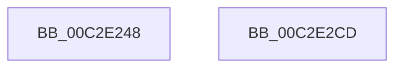

# IopInitializeSessionNotifications

- RVA: `0x00C2E248`–`0x00C2E2CE` (길이 `134` bytes)
- VA: `0x0000000140C2E248`
- 실행 섹션: `INIT`
- PDB 이름 있음: `예`; PDB Function 태그: `아니요`
- unwind 정보 RVA: `0x0008A308`
- 디코드: `30`개 명령, `134/134` bytes 표시
- 미해석 바이트: `0` (있으면 어셈블리에 `.byte`로 보존)

> 이 문서는 커널 이미지의 기계어와 PDB 기호를 분석해 생성했습니다. 4번과 5번은 함수 원형과 자료형을 바이너리 사용 방식에서 추정한 C 해석이며 원본 소스 복구 결과는 아닙니다.

## 1. Dependencies

- 직접 호출 지점: **2**; 고유 호출 대상: **2**
- 직접 호출자로 확인된 함수: **1**
- RIP 상대 이미지 참조: **6**

### Outgoing calls
- `0x00C2E290` → [RtlInitUnicodeString](../../text/42/RtlInitUnicodeString_function_0042A780.md) (function, `0x0042A780`)
- `0x00C2E2C2` → [ExCreateCallback](../../page/A7/ExCreateCallback_function_00A7B9D0.md) (function, `0x00A7B9D0`)

### Direct callers
- [IoInitSystemPreDrivers](IoInitSystemPreDrivers_function_00C2AC3C.md) at `0x00C2B478`

### Static image references
- `0x00C2E255` → RVA `0x00F8D150` (`.data`; read)
- `0x00C2E25C` → RVA `0x00F8D160` (`.data`; read/write)
- `0x00C2E264` → RVA `0x00C79D40` (` ?? ::PBOPGDP::`string'`; read)
- `0x00C2E282` → RVA `0x00F8D158` (`.data`; write)
- `0x00C2E289` → RVA `0x00F8D150` (`.data`; write)
- `0x00C2E2B6` → RVA `0x00F8D110` (`.data`; read)

## 2. Other-region calls and transfers

- 다른 실행 섹션으로 향하는 call: **2**
  - `0x00C2E290` → [RtlInitUnicodeString](../../text/42/RtlInitUnicodeString_function_0042A780.md) (`INIT` → `.text`)
  - `0x00C2E2C2` → [ExCreateCallback](../../page/A7/ExCreateCallback_function_00A7B9D0.md) (`INIT` → `PAGE`)
- 별도 외부 분기/꼬리 이동을 확인하지 못했습니다.

## 3. Assembly (complete function range)

```asm
00C2E248  40 55                           push rbp
00C2E24A  48 8B EC                        mov rbp, rsp
00C2E24D  48 83 EC 60                     sub rsp, 0x60
00C2E251  83 65 EC 00                     and dword ptr [rbp - 0x14], 0
00C2E255  48 8D 05 F4 EE 35 00            lea rax, [rip + 0x35eef4]
00C2E25C  48 83 25 FC EE 35 00 00         and qword ptr [rip + 0x35eefc], 0
00C2E264  48 8D 15 D5 BA 04 00            lea rdx, [rip + 0x4bad5]
00C2E26B  0F 57 C0                        xorps xmm0, xmm0
00C2E26E  48 C7 45 D0 30 00 00 00         mov qword ptr [rbp - 0x30], 0x30
00C2E276  83 65 D4 00                     and dword ptr [rbp - 0x2c], 0
00C2E27A  48 8D 4D C0                     lea rcx, [rbp - 0x40]
00C2E27E  0F 11 45 C0                     movups xmmword ptr [rbp - 0x40], xmm0
00C2E282  48 89 05 CF EE 35 00            mov qword ptr [rip + 0x35eecf], rax
00C2E289  48 89 05 C0 EE 35 00            mov qword ptr [rip + 0x35eec0], rax
00C2E290  E8 EB C4 7F FF                  call 0x14042a780
00C2E295  48 83 65 D8 00                  and qword ptr [rbp - 0x28], 0
00C2E29A  48 8D 45 C0                     lea rax, [rbp - 0x40]
00C2E29E  41 B1 01                        mov r9b, 1
00C2E2A1  C7 45 E8 50 00 00 00            mov dword ptr [rbp - 0x18], 0x50
00C2E2A8  0F 57 C0                        xorps xmm0, xmm0
00C2E2AB  48 89 45 E0                     mov qword ptr [rbp - 0x20], rax
00C2E2AF  45 8A C1                        mov r8b, r9b
00C2E2B2  48 8D 55 D0                     lea rdx, [rbp - 0x30]
00C2E2B6  48 8D 0D 53 EE 35 00            lea rcx, [rip + 0x35ee53]
00C2E2BD  F3 0F 7F 45 F0                  movdqu xmmword ptr [rbp - 0x10], xmm0
00C2E2C2  E8 09 D7 E4 FF                  call 0x140a7b9d0
00C2E2C7  48 83 C4 60                     add rsp, 0x60
00C2E2CB  5D                              pop rbp
00C2E2CC  C3                              ret
00C2E2CD  CC                              int3
```

## 4. C-style interpretation (structured pseudocode)

```c
__int64 __fastcall IopInitializeSessionNotifications(void)
{
    __int64 result;
    __int64 v_rsp;
    unsigned __int64 v_stack_m18;
    unsigned int v_stack_m1C;
    unsigned int v_stack_m20;
    unsigned __int64 v_stack_m28;
    unsigned __int64 v_stack_m30;
    unsigned int v_stack_m34;
    unsigned __int64 v_stack_m38;
    unsigned __int64 v_stack_m48;

    v_rsp = (v_rsp) - (96);
    v_stack_m38 = 48;
    v_stack_m48 = v_xmm0;
    *(unsigned __int64 *)(v_rip + 3534543) = v_rip + 3534580;
    *(unsigned __int64 *)(v_rip + 3534528) = v_rip + 3534580;
    result = RtlInitUnicodeString(v_stack_m48, v_rip + 309973, a3, a4);
    v_stack_m20 = 80;
    v_stack_m28 = v_stack_m48;
    v_stack_m18 = v_xmm0;
    result = ExCreateCallback(v_rip + 3534419, v_stack_m38, 1, 1);
    v_rsp = (v_rsp) + (96);
    return result;
}
```

## 5. (Beta) C Style

```c
void IopInitializeSessionNotifications(void)
{
    int64_t result;
    int64_t local_rsp;
    uint64_t v_stack_m18;
    uint32_t v_stack_m1C;
    uint32_t v_stack_m20;
    uint64_t v_stack_m28;
    uint64_t v_stack_m30;
    uint32_t v_stack_m34;
    uint64_t v_stack_m38;
    uint64_t v_stack_m48;

    local_rsp = (local_rsp) - (96);
    v_stack_m38 = 48;
    v_stack_m48 = v_xmm0;
    *(uint64_t *)(v_rip + 0x35EECF) = v_rip + 3534580;
    *(uint64_t *)(v_rip + 0x35EEC0) = v_rip + 3534580;
    result = RtlInitUnicodeString(v_stack_m48, v_rip + 309973, a3, a4);
    v_stack_m20 = 80;
    v_stack_m28 = v_stack_m48;
    v_stack_m18 = v_xmm0;
    result = ExCreateCallback(v_rip + 3534419, v_stack_m38, 1, 1);
    local_rsp = (local_rsp) + (96);
    return result;
}
```

## 6. Execution-region graph

[열기: 2D/3D 그래프와 함수 탐색 컨트롤 패널](../../../control-panel.html?section=init&rva=0x00C2E248&view=graph)

- 2D 그래프는 위에서 아래로 흐르고, 3D 그래프는 빈 공간을 드래그해 회전합니다. Shift+드래그는 이동, 휠은 확대·축소, 함수 노드 선택은 대상 보고서 이동입니다.

### Static fallback


