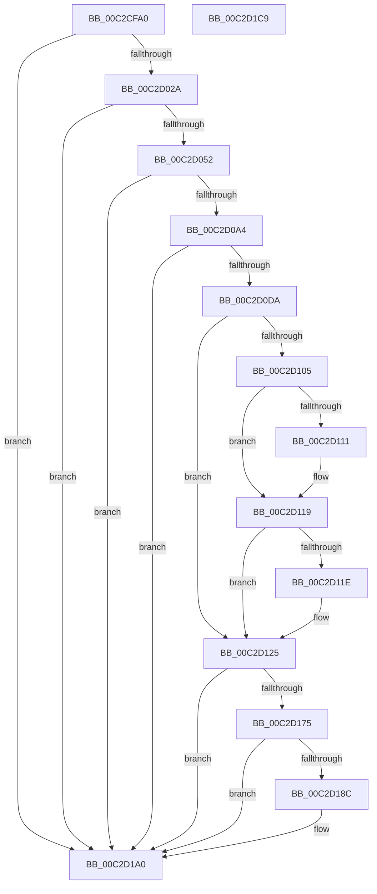

# IopMarkBootPartition

- RVA: `0x00C2CFA0`–`0x00C2D1CA` (길이 `554` bytes)
- VA: `0x0000000140C2CFA0`
- 실행 섹션: `INIT`
- PDB 이름 있음: `예`; PDB Function 태그: `아니요`
- unwind 정보 RVA: `0x000C724C`
- 디코드: `130`개 명령, `554/554` bytes 표시
- 미해석 바이트: `0` (있으면 어셈블리에 `.byte`로 보존)

> 이 문서는 커널 이미지의 기계어와 PDB 기호를 분석해 생성했습니다. 4번과 5번은 함수 원형과 자료형을 바이너리 사용 방식에서 추정한 C 해석이며 원본 소스 복구 결과는 아닙니다.

## 1. Dependencies

- 직접 호출 지점: **16**; 고유 호출 대상: **15**
- 직접 호출자로 확인된 함수: **0**
- RIP 상대 이미지 참조: **5**

### Outgoing calls
- `0x00C2D01B` → [RtlStringCchPrintfA](../../text/59/RtlStringCchPrintfA_function_00596BC8.md) (function, `0x00596BC8`)
- `0x00C2D033` → [RtlInitAnsiString](../../text/47/RtlInitAnsiString_function_00470F40.md) (function, `0x00470F40`)
- `0x00C2D043` → [RtlAnsiStringToUnicodeString](../../page/90/RtlAnsiStringToUnicodeString_function_0090BEA0.md) (function, `0x0090BEA0`)
- `0x00C2D095` → [ZwOpenFile](../../text/6A/ZwOpenFile_function_006AD730.md) (function, `0x006AD730`)
- `0x00C2D0CB` → [ObReferenceObjectByHandle](../../page/86/ObReferenceObjectByHandle_function_00868DB0.md) (function, `0x00868DB0`)
- `0x00C2D0E8` → [IoGetDeviceAttachmentBaseRefWithTag](../../text/27/IoGetDeviceAttachmentBaseRefWithTag_function_00272788.md) (function, `0x00272788`)
- `0x00C2D12A` → [PnpHardwareConfigCreateBootDriverFlags](../../page/72/PnpHardwareConfigCreateBootDriverFlags_function_00723B88.md) (function, `0x00723B88`)
- `0x00C2D138` → [ObfReferenceObjectWithTag](../../text/21/ObfReferenceObjectWithTag_function_00210710.md) (function, `0x00210710`)
- `0x00C2D144` → [ObCloseHandle](../../page/8A/ObCloseHandle_function_008A1870.md) (function, `0x008A1870`)
- `0x00C2D151` → [ObfDereferenceObjectWithTag](../../text/2F/ObfDereferenceObjectWithTag_function_002F78E0.md) (function, `0x002F78E0`)
- `0x00C2D15E` → [ObfDereferenceObjectWithTag](../../text/2F/ObfDereferenceObjectWithTag_function_002F78E0.md) (function, `0x002F78E0`)
- `0x00C2D16A` → [IopStoreBootDriveLetter](IopStoreBootDriveLetter_function_00C2D5CC.md) (function, `0x00C2D5CC`)
- `0x00C2D181` → [IopCreateUnicodeFromAnsiBuffer](../../text/59/IopCreateUnicodeFromAnsiBuffer_function_00596AEC.md) (function, `0x00596AEC`)
- `0x00C2D191` → [IopStoreSystemPartitionInformation](IopStoreSystemPartitionInformation_function_00C2D780.md) (function, `0x00C2D780`)
- `0x00C2D19B` → [RtlFreeAnsiString](../../page/9C/RtlFreeAnsiString_function_009C0800.md) (function, `0x009C0800`)
- `0x00C2D1AC` → [_security_check_cookie](../../text/6A/_security_check_cookie_function_006AC640.md) (function, `0x006AC640`)

### Direct callers
- 이 함수 시작 RVA로 연결되는 직접 call은 확인되지 않았습니다. 간접 호출은 완전히 역산할 수 없습니다.

### Static image references
- `0x00C2CFBD` → RVA `0x00E0A740` (`.data`; read)
- `0x00C2CFE3` → RVA `0x00C79A00` (` ?? ::PBOPGDP::`string'`; read)
- `0x00C2D0A4` → RVA `0x00FC6AE0` (`ALMOSTRO`; read)
- `0x00C2D0FC` → RVA `0x00FC4148` (`.data`; read)
- `0x00C2D111` → RVA `0x00E0F3D8` (`.data`; read/write)

## 2. Other-region calls and transfers

- 다른 실행 섹션으로 향하는 call: **14**
  - `0x00C2D01B` → [RtlStringCchPrintfA](../../text/59/RtlStringCchPrintfA_function_00596BC8.md) (`INIT` → `.text`)
  - `0x00C2D033` → [RtlInitAnsiString](../../text/47/RtlInitAnsiString_function_00470F40.md) (`INIT` → `.text`)
  - `0x00C2D043` → [RtlAnsiStringToUnicodeString](../../page/90/RtlAnsiStringToUnicodeString_function_0090BEA0.md) (`INIT` → `PAGE`)
  - `0x00C2D095` → [ZwOpenFile](../../text/6A/ZwOpenFile_function_006AD730.md) (`INIT` → `.text`)
  - `0x00C2D0CB` → [ObReferenceObjectByHandle](../../page/86/ObReferenceObjectByHandle_function_00868DB0.md) (`INIT` → `PAGE`)
  - `0x00C2D0E8` → [IoGetDeviceAttachmentBaseRefWithTag](../../text/27/IoGetDeviceAttachmentBaseRefWithTag_function_00272788.md) (`INIT` → `.text`)
  - `0x00C2D12A` → [PnpHardwareConfigCreateBootDriverFlags](../../page/72/PnpHardwareConfigCreateBootDriverFlags_function_00723B88.md) (`INIT` → `PAGE`)
  - `0x00C2D138` → [ObfReferenceObjectWithTag](../../text/21/ObfReferenceObjectWithTag_function_00210710.md) (`INIT` → `.text`)
  - `0x00C2D144` → [ObCloseHandle](../../page/8A/ObCloseHandle_function_008A1870.md) (`INIT` → `PAGE`)
  - `0x00C2D151` → [ObfDereferenceObjectWithTag](../../text/2F/ObfDereferenceObjectWithTag_function_002F78E0.md) (`INIT` → `.text`)
  - `0x00C2D15E` → [ObfDereferenceObjectWithTag](../../text/2F/ObfDereferenceObjectWithTag_function_002F78E0.md) (`INIT` → `.text`)
  - `0x00C2D181` → [IopCreateUnicodeFromAnsiBuffer](../../text/59/IopCreateUnicodeFromAnsiBuffer_function_00596AEC.md) (`INIT` → `.text`)
  - `0x00C2D19B` → [RtlFreeAnsiString](../../page/9C/RtlFreeAnsiString_function_009C0800.md) (`INIT` → `PAGE`)
  - `0x00C2D1AC` → [_security_check_cookie](../../text/6A/_security_check_cookie_function_006AC640.md) (`INIT` → `.text`)
- 별도 외부 분기/꼬리 이동을 확인하지 못했습니다.

## 3. Assembly (complete function range)

```asm
00C2CFA0  48 89 5C 24 10                  mov qword ptr [rsp + 0x10], rbx
00C2CFA5  48 89 74 24 20                  mov qword ptr [rsp + 0x20], rsi
00C2CFAA  55                              push rbp
00C2CFAB  57                              push rdi
00C2CFAC  41 57                           push r15
00C2CFAE  48 8D AC 24 50 FF FF FF         lea rbp, [rsp - 0xb0]
00C2CFB6  48 81 EC B0 01 00 00            sub rsp, 0x1b0
00C2CFBD  48 8B 05 7C D7 1D 00            mov rax, qword ptr [rip + 0x1dd77c]
00C2CFC4  48 33 C4                        xor rax, rsp
00C2CFC7  48 89 85 A0 00 00 00            mov qword ptr [rbp + 0xa0], rax
00C2CFCE  4C 8B 89 B8 00 00 00            mov r9, qword ptr [rcx + 0xb8]
00C2CFD5  33 C0                           xor eax, eax
00C2CFD7  21 44 24 74                     and dword ptr [rsp + 0x74], eax
00C2CFDB  49 8B F8                        mov rdi, r8
00C2CFDE  48 21 44 24 30                  and qword ptr [rsp + 0x30], rax
00C2CFE3  4C 8D 05 16 CA 04 00            lea r8, [rip + 0x4ca16]
00C2CFEA  48 21 44 24 48                  and qword ptr [rsp + 0x48], rax
00C2CFEF  48 8B F1                        mov rsi, rcx
00C2CFF2  48 21 44 24 50                  and qword ptr [rsp + 0x50], rax
00C2CFF7  48 8D 4D A0                     lea rcx, [rbp - 0x60]
00C2CFFB  0F 57 C0                        xorps xmm0, xmm0
00C2CFFE  89 44 24 5C                     mov dword ptr [rsp + 0x5c], eax
00C2D002  21 44 24 5C                     and dword ptr [rsp + 0x5c], eax
00C2D006  0F 57 C9                        xorps xmm1, xmm1
00C2D009  41 BF 00 01 00 00               mov r15d, 0x100
00C2D00F  41 8B D7                        mov edx, r15d
00C2D012  0F 11 44 24 38                  movups xmmword ptr [rsp + 0x38], xmm0
00C2D017  0F 11 4D 88                     movups xmmword ptr [rbp - 0x78], xmm1
00C2D01B  E8 A8 9B 96 FF                  call 0x140596bc8
00C2D020  8B D8                           mov ebx, eax
00C2D022  85 C0                           test eax, eax
00C2D024  0F 88 76 01 00 00               js 0x140c2d1a0
00C2D02A  48 8D 55 A0                     lea rdx, [rbp - 0x60]
00C2D02E  48 8D 4C 24 38                  lea rcx, [rsp + 0x38]
00C2D033  E8 08 3F 84 FF                  call 0x140470f40
00C2D038  41 B0 01                        mov r8b, 1
00C2D03B  48 8D 54 24 38                  lea rdx, [rsp + 0x38]
00C2D040  48 8B CF                        mov rcx, rdi
00C2D043  E8 58 EE CD FF                  call 0x14090bea0
00C2D048  8B D8                           mov ebx, eax
00C2D04A  85 C0                           test eax, eax
00C2D04C  0F 88 4E 01 00 00               js 0x140c2d1a0
00C2D052  48 83 64 24 60 00               and qword ptr [rsp + 0x60], 0
00C2D058  4C 8D 4D 88                     lea r9, [rbp - 0x78]
00C2D05C  0F 57 C0                        xorps xmm0, xmm0
00C2D05F  C7 44 24 28 40 00 00 00         mov dword ptr [rsp + 0x28], 0x40
00C2D067  83 64 24 20 00                  and dword ptr [rsp + 0x20], 0
00C2D06C  4C 8D 44 24 58                  lea r8, [rsp + 0x58]
00C2D071  41 8D 57 80                     lea edx, [r15 - 0x80]
00C2D075  C7 44 24 58 30 00 00 00         mov dword ptr [rsp + 0x58], 0x30
00C2D07D  48 8D 4C 24 30                  lea rcx, [rsp + 0x30]
00C2D082  C7 44 24 70 40 02 00 00         mov dword ptr [rsp + 0x70], 0x240
00C2D08A  F3 0F 7F 44 24 78               movdqu xmmword ptr [rsp + 0x78], xmm0
00C2D090  48 89 7C 24 68                  mov qword ptr [rsp + 0x68], rdi
00C2D095  E8 96 06 A8 FF                  call 0x1406ad730
00C2D09A  8B D8                           mov ebx, eax
00C2D09C  85 C0                           test eax, eax
00C2D09E  0F 88 FC 00 00 00               js 0x140c2d1a0
00C2D0A4  4C 8B 05 35 9A 39 00            mov r8, qword ptr [rip + 0x399a35]
00C2D0AB  48 8D 44 24 38                  lea rax, [rsp + 0x38]
00C2D0B0  48 83 64 24 28 00               and qword ptr [rsp + 0x28], 0
00C2D0B6  45 33 C9                        xor r9d, r9d
00C2D0B9  48 8B 4C 24 30                  mov rcx, qword ptr [rsp + 0x30]
00C2D0BE  33 D2                           xor edx, edx
00C2D0C0  48 83 64 24 38 00               and qword ptr [rsp + 0x38], 0
00C2D0C6  48 89 44 24 20                  mov qword ptr [rsp + 0x20], rax
00C2D0CB  E8 E0 BC C3 FF                  call 0x140868db0
00C2D0D0  8B D8                           mov ebx, eax
00C2D0D2  85 C0                           test eax, eax
00C2D0D4  0F 88 C6 00 00 00               js 0x140c2d1a0
00C2D0DA  48 8B 5C 24 38                  mov rbx, qword ptr [rsp + 0x38]
00C2D0DF  BA 44 66 6C 74                  mov edx, 0x746c6644
00C2D0E4  48 8B 4B 08                     mov rcx, qword ptr [rbx + 8]
00C2D0E8  E8 9B 56 64 FF                  call 0x140272788
00C2D0ED  48 8B 4B 08                     mov rcx, qword ptr [rbx + 8]
00C2D0F1  48 8B F8                        mov rdi, rax
00C2D0F4  44 09 79 30                     or dword ptr [rcx + 0x30], r15d
00C2D0F8  44 09 78 30                     or dword ptr [rax + 0x30], r15d
00C2D0FC  80 3D 45 70 39 00 00            cmp byte ptr [rip + 0x397045], 0
00C2D103  74 20                           je 0x140c2d125
00C2D105  48 8B 4B 08                     mov rcx, qword ptr [rbx + 8]
00C2D109  8B 51 34                        mov edx, dword ptr [rcx + 0x34]
00C2D10C  F6 C2 01                        test dl, 1
00C2D10F  74 08                           je 0x140c2d119
00C2D111  0F BA 2D BF 22 1E 00 09         bts dword ptr [rip + 0x1e22bf], 9
00C2D119  F6 C2 02                        test dl, 2
00C2D11C  74 07                           je 0x140c2d125
00C2D11E  44 09 3D B3 22 1E 00            or dword ptr [rip + 0x1e22b3], r15d
00C2D125  48 8B 54 24 30                  mov rdx, qword ptr [rsp + 0x30]
00C2D12A  E8 59 6A AF FF                  call 0x140723b88
00C2D12F  48 8B 4B 08                     mov rcx, qword ptr [rbx + 8]
00C2D133  BA 44 66 6C 74                  mov edx, 0x746c6644
00C2D138  E8 D3 35 5E FF                  call 0x140210710
00C2D13D  48 8B 4C 24 30                  mov rcx, qword ptr [rsp + 0x30]
00C2D142  33 D2                           xor edx, edx
00C2D144  E8 27 47 C7 FF                  call 0x1408a1870
00C2D149  BA 44 66 6C 74                  mov edx, 0x746c6644
00C2D14E  48 8B CB                        mov rcx, rbx
00C2D151  E8 8A A7 6C FF                  call 0x1402f78e0
00C2D156  BA 44 66 6C 74                  mov edx, 0x746c6644
00C2D15B  48 8B CF                        mov rcx, rdi
00C2D15E  E8 7D A7 6C FF                  call 0x1402f78e0
00C2D163  48 8B 8E C8 00 00 00            mov rcx, qword ptr [rsi + 0xc8]
00C2D16A  E8 5D 04 00 00                  call 0x140c2d5cc
00C2D16F  8B D8                           mov ebx, eax
00C2D171  85 C0                           test eax, eax
00C2D173  78 2B                           js 0x140c2d1a0
00C2D175  48 8B 96 D0 00 00 00            mov rdx, qword ptr [rsi + 0xd0]
00C2D17C  48 8D 4C 24 48                  lea rcx, [rsp + 0x48]
00C2D181  E8 66 99 96 FF                  call 0x140596aec
00C2D186  8B D8                           mov ebx, eax
00C2D188  85 C0                           test eax, eax
00C2D18A  78 14                           js 0x140c2d1a0
00C2D18C  48 8D 54 24 48                  lea rdx, [rsp + 0x48]
00C2D191  E8 EA 05 00 00                  call 0x140c2d780
00C2D196  48 8D 4C 24 48                  lea rcx, [rsp + 0x48]
00C2D19B  E8 60 36 D9 FF                  call 0x1409c0800
00C2D1A0  8B C3                           mov eax, ebx
00C2D1A2  48 8B 8D A0 00 00 00            mov rcx, qword ptr [rbp + 0xa0]
00C2D1A9  48 33 CC                        xor rcx, rsp
00C2D1AC  E8 8F F4 A7 FF                  call 0x1406ac640
00C2D1B1  4C 8D 9C 24 B0 01 00 00         lea r11, [rsp + 0x1b0]
00C2D1B9  49 8B 5B 28                     mov rbx, qword ptr [r11 + 0x28]
00C2D1BD  49 8B 73 38                     mov rsi, qword ptr [r11 + 0x38]
00C2D1C1  49 8B E3                        mov rsp, r11
00C2D1C4  41 5F                           pop r15
00C2D1C6  5F                              pop rdi
00C2D1C7  5D                              pop rbp
00C2D1C8  C3                              ret
00C2D1C9  CC                              int3
```

## 4. C-style interpretation (structured pseudocode)

```c
__int64 __fastcall IopMarkBootPartition(__int64 a1, __int64 a2, __int64 a3)
{
    __int64 result;
    __int64 v_rsp;
    unsigned __int64 v_stack_m128;
    unsigned __int64 v_stack_m140;
    unsigned __int64 v_stack_m150;
    unsigned int v_stack_m154;
    unsigned int v_stack_m158;
    unsigned __int64 v_stack_m160;
    unsigned __int64 v_stack_m168;
    unsigned int v_stack_m16C;
    unsigned __int64 v_stack_m170;
    unsigned __int64 v_stack_m178;
    unsigned __int64 v_stack_m18;
    unsigned __int64 v_stack_m180;
    unsigned __int64 v_stack_m190;
    unsigned __int64 v_stack_m198;
    unsigned int v_stack_m1A0;
    unsigned int v_stack_m1A8;
    unsigned __int64 v_stack_m28;
    unsigned __int64 v_stack_mC8;
    unsigned __int64 v_stack_p10;
    unsigned __int64 v_stack_p20;

    v_stack_p10 = v_rbx;
    v_stack_p20 = v_rsi;
    v_rsp = (v_rsp) - (432);
    result = (*(unsigned __int64 *)(v_rip + 1955708)) ^ (v_rsp);
    v_stack_m28 = result;
    result = 0;
    v_stack_m16C = 0;
    v_stack_m190 = v_xmm0;
    v_stack_m140 = v_xmm1;
    result = RtlStringCchPrintfA(v_stack_m128, 256, v_rip + 313878, *(unsigned __int64 *)(a1 + 184));
    if (sign_flag) goto loc_00C2D1A0;
    result = RtlInitAnsiString(v_stack_m190, v_stack_m128, v_rip + 313878, *(unsigned __int64 *)(a1 + 184));
    result = RtlAnsiStringToUnicodeString(a3, v_stack_m190, 1, *(unsigned __int64 *)(a1 + 184));
    if (sign_flag) goto loc_00C2D1A0;
    v_stack_m1A0 = 64;
    v_stack_m170 = 48;
    v_stack_m158 = 576;
    v_stack_m150 = v_xmm0;
    v_stack_m160 = a3;
    result = ZwOpenFile(v_stack_m198, 256 - 128, v_stack_m170, v_stack_m140);
    if (sign_flag) goto loc_00C2D1A0;
    a4 = 0;
    a2 = 0;
    v_stack_m1A8 = v_stack_m190;
    result = ObReferenceObjectByHandle(v_stack_m198, a2, *(unsigned __int64 *)(v_rip + 3775029), a4);
    if (sign_flag) goto loc_00C2D1A0;
    result = IoGetDeviceAttachmentBaseRefWithTag(*(unsigned __int64 *)(v_stack_m190 + 8), (unsigned int)(0x746C6644ULL), *(unsigned __int64 *)(v_rip + 3775029), a4);
    if ((*(unsigned __int8 *)(v_rip + 3764293)) == 0) goto loc_00C2D125;
    if ((((unsigned __int8)((unsigned int)(*(unsigned int *)(*(unsigned __int64 *)(v_stack_m190 + 8) + 52)))) & (1)) != 0) {
    }
    if ((((unsigned __int8)((unsigned int)(*(unsigned int *)(*(unsigned __int64 *)(v_stack_m190 + 8) + 52)))) & (2)) != 0) {
    }
    result = PnpHardwareConfigCreateBootDriverFlags(*(unsigned __int64 *)(v_stack_m190 + 8), v_stack_m198, *(unsigned __int64 *)(v_rip + 3775029), a4);
    result = ObfReferenceObjectWithTag(*(unsigned __int64 *)(v_stack_m190 + 8), (unsigned int)(0x746C6644ULL), *(unsigned __int64 *)(v_rip + 3775029), a4);
    a2 = 0;
    result = ObCloseHandle(v_stack_m198, a2, *(unsigned __int64 *)(v_rip + 3775029), a4);
    result = ObfDereferenceObjectWithTag(v_stack_m190, (unsigned int)(0x746C6644ULL), *(unsigned __int64 *)(v_rip + 3775029), a4);
    result = ObfDereferenceObjectWithTag(result, (unsigned int)(0x746C6644ULL), *(unsigned __int64 *)(v_rip + 3775029), a4);
    result = IopStoreBootDriveLetter(*(unsigned __int64 *)(a1 + 200), (unsigned int)(0x746C6644ULL), *(unsigned __int64 *)(v_rip + 3775029), a4);
    if (sign_flag) goto loc_00C2D1A0;
    result = IopCreateUnicodeFromAnsiBuffer(v_stack_m180, *(unsigned __int64 *)(a1 + 208), *(unsigned __int64 *)(v_rip + 3775029), a4);
    if (!(sign_flag)) {
        a2 = v_stack_m180;
        result = IopStoreSystemPartitionInformation(v_stack_m180, a2, *(unsigned __int64 *)(v_rip + 3775029), a4);
        a1 = v_stack_m180;
        result = RtlFreeAnsiString(a1, a2, *(unsigned __int64 *)(v_rip + 3775029), a4);
    }
    a1 = (v_stack_m28) ^ (v_rsp);
    result = _security_check_cookie(a1, a2, *(unsigned __int64 *)(v_rip + 3775029), a4);
    return result;
}
```

## 5. (Beta) C Style

```c
int64_t IopMarkBootPartition(void *Arg1, int64_t Arg2, int64_t Arg3)
{
    uint8_t *arg1 = (uint8_t *)Arg1;

    int64_t result;
    int64_t local_rsp;
    uint64_t v_stack_m128;
    uint64_t v_stack_m140;
    uint64_t v_stack_m150;
    uint32_t v_stack_m154;
    uint32_t v_stack_m158;
    uint64_t v_stack_m160;
    uint64_t v_stack_m168;
    uint32_t v_stack_m16C;
    uint64_t v_stack_m170;
    uint64_t v_stack_m178;
    uint64_t v_stack_m18;
    uint64_t v_stack_m180;
    uint64_t v_stack_m190;
    uint64_t v_stack_m198;
    uint32_t v_stack_m1A0;
    uint32_t v_stack_m1A8;
    uint64_t v_stack_m28;
    uint64_t v_stack_mC8;
    uint64_t v_stack_p10;
    uint64_t v_stack_p20;

    v_stack_p10 = local_rbx;
    v_stack_p20 = local_rsi;
    local_rsp = (local_rsp) - (432);
    result = (*(uint64_t *)(v_rip + 0x1DD77C)) ^ (local_rsp);
    v_stack_m28 = result;
    result = 0;
    v_stack_m16C = 0;
    v_stack_m190 = v_xmm0;
    v_stack_m140 = v_xmm1;
    result = RtlStringCchPrintfA(v_stack_m128, 256, v_rip + 313878, *(uint64_t *)(arg1 + 0xB8));
    if (sign_flag) goto loc_00C2D1A0;
    result = RtlInitAnsiString(v_stack_m190, v_stack_m128, v_rip + 313878, *(uint64_t *)(arg1 + 0xB8));
    result = RtlAnsiStringToUnicodeString(Arg3, v_stack_m190, 1, *(uint64_t *)(arg1 + 0xB8));
    if (sign_flag) goto loc_00C2D1A0;
    v_stack_m1A0 = 64;
    v_stack_m170 = 48;
    v_stack_m158 = 576;
    v_stack_m150 = v_xmm0;
    v_stack_m160 = Arg3;
    result = ZwOpenFile(v_stack_m198, 256 - 128, v_stack_m170, v_stack_m140);
    if (sign_flag) goto loc_00C2D1A0;
    a4 = 0;
    Arg2 = 0;
    v_stack_m1A8 = v_stack_m190;
    result = ObReferenceObjectByHandle(v_stack_m198, Arg2, *(uint64_t *)(v_rip + 0x399A35), a4);
    if (sign_flag) goto loc_00C2D1A0;
    result = IoGetDeviceAttachmentBaseRefWithTag(*(uint64_t *)(v_stack_m190 + 0x8), (uint32_t)(0x746C6644ULL), *(uint64_t *)(v_rip + 0x399A35), a4);
    if ((*(uint8_t *)(v_rip + 0x397045)) == 0) goto loc_00C2D125;
    if ((((uint8_t)((uint32_t)(*(uint32_t *)(*(uint64_t *)(v_stack_m190 + 0x8) + 0x34)))) & (1)) != 0) {
    }
    if ((((uint8_t)((uint32_t)(*(uint32_t *)(*(uint64_t *)(v_stack_m190 + 0x8) + 0x34)))) & (2)) != 0) {
    }
    result = PnpHardwareConfigCreateBootDriverFlags(*(uint64_t *)(v_stack_m190 + 0x8), v_stack_m198, *(uint64_t *)(v_rip + 0x399A35), a4);
    result = ObfReferenceObjectWithTag(*(uint64_t *)(v_stack_m190 + 0x8), (uint32_t)(0x746C6644ULL), *(uint64_t *)(v_rip + 0x399A35), a4);
    Arg2 = 0;
    result = ObCloseHandle(v_stack_m198, Arg2, *(uint64_t *)(v_rip + 0x399A35), a4);
    result = ObfDereferenceObjectWithTag(v_stack_m190, (uint32_t)(0x746C6644ULL), *(uint64_t *)(v_rip + 0x399A35), a4);
    result = ObfDereferenceObjectWithTag(result, (uint32_t)(0x746C6644ULL), *(uint64_t *)(v_rip + 0x399A35), a4);
    result = IopStoreBootDriveLetter(*(uint64_t *)(arg1 + 0xC8), (uint32_t)(0x746C6644ULL), *(uint64_t *)(v_rip + 0x399A35), a4);
    if (sign_flag) goto loc_00C2D1A0;
    result = IopCreateUnicodeFromAnsiBuffer(v_stack_m180, *(uint64_t *)(arg1 + 0xD0), *(uint64_t *)(v_rip + 0x399A35), a4);
    if (!(sign_flag)) {
        Arg2 = v_stack_m180;
        result = IopStoreSystemPartitionInformation(v_stack_m180, Arg2, *(uint64_t *)(v_rip + 0x399A35), a4);
        Arg1 = v_stack_m180;
        result = RtlFreeAnsiString(Arg1, Arg2, *(uint64_t *)(v_rip + 0x399A35), a4);
    }
    Arg1 = (v_stack_m28) ^ (local_rsp);
    result = _security_check_cookie(Arg1, Arg2, *(uint64_t *)(v_rip + 0x399A35), a4);
    return result;
}
```

### 관측된 메모리 오프셋

구조체 형식이 확인되지 않은 접근은 인자 기준의 오프셋으로만 기록했습니다.

| 기준 인자 | 오프셋 표현 | 폭 (bit) | 접근 |
|---|---:|---:|---|
| `Arg1` | `+ 0xB8` | `64` | `R` |
| `Arg1` | `+ 0xC8` | `64` | `R` |
| `Arg1` | `+ 0xD0` | `64` | `R` |

## 6. Execution-region graph

[열기: 2D/3D 그래프와 함수 탐색 컨트롤 패널](../../../control-panel.html?section=init&rva=0x00C2CFA0&view=graph)

- 2D 그래프는 위에서 아래로 흐르고, 3D 그래프는 빈 공간을 드래그해 회전합니다. Shift+드래그는 이동, 휠은 확대·축소, 함수 노드 선택은 대상 보고서 이동입니다.

### Static fallback


