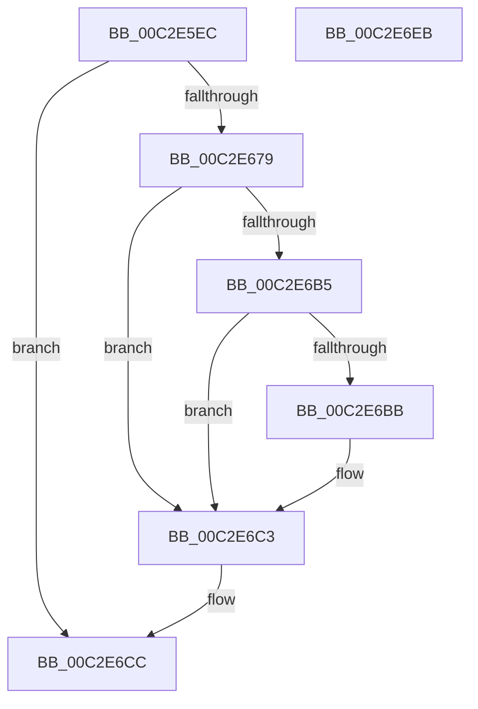

# IopProtectSystemPartition

- RVA: `0x00C2E5EC`–`0x00C2E6EC` (길이 `256` bytes)
- VA: `0x0000000140C2E5EC`
- 실행 섹션: `INIT`
- PDB 이름 있음: `예`; PDB Function 태그: `아니요`
- unwind 정보 RVA: `0x000BCBD0`
- 디코드: `62`개 명령, `256/256` bytes 표시
- 미해석 바이트: `0` (있으면 어셈블리에 `.byte`로 보존)

> 이 문서는 커널 이미지의 기계어와 PDB 기호를 분석해 생성했습니다. 4번과 5번은 함수 원형과 자료형을 바이너리 사용 방식에서 추정한 C 해석이며 원본 소스 복구 결과는 아닙니다.

## 1. Dependencies

- 직접 호출 지점: **7**; 고유 호출 대상: **6**
- 직접 호출자로 확인된 함수: **1**
- RIP 상대 이미지 참조: **3**

### Outgoing calls
- `0x00C2E63B` → [RtlInitUnicodeString](../../text/42/RtlInitUnicodeString_function_0042A780.md) (function, `0x0042A780`)
- `0x00C2E670` → [NtOpenKey](../../page/A4/NtOpenKey_function_00A45CA0.md) (function, `0x00A45CA0`)
- `0x00C2E684` → [RtlInitUnicodeString](../../text/42/RtlInitUnicodeString_function_0042A780.md) (function, `0x0042A780`)
- `0x00C2E6AC` → [NtQueryValueKey](../../page/8B/NtQueryValueKey_function_008B2A00.md) (function, `0x008B2A00`)
- `0x00C2E6BE` → [IopApplySystemPartitionProt](IopApplySystemPartitionProt_function_00C2E398.md) (function, `0x00C2E398`)
- `0x00C2E6C7` → [NtClose](../../page/86/NtClose_function_00868870.md) (function, `0x00868870`)
- `0x00C2E6D5` → [_security_check_cookie](../../text/6A/_security_check_cookie_function_006AC640.md) (function, `0x006AC640`)

### Direct callers
- [IoInitSystemPreDrivers](IoInitSystemPreDrivers_function_00C2AC3C.md) at `0x00C2BD9A`

### Static image references
- `0x00C2E5FE` → RVA `0x00E0A740` (`.data`; read)
- `0x00C2E611` → RVA `0x00C79DE0` (` ?? ::PBOPGDP::`string'`; read)
- `0x00C2E679` → RVA `0x00C79DA0` (` ?? ::PBOPGDP::`string'`; read)

## 2. Other-region calls and transfers

- 다른 실행 섹션으로 향하는 call: **6**
  - `0x00C2E63B` → [RtlInitUnicodeString](../../text/42/RtlInitUnicodeString_function_0042A780.md) (`INIT` → `.text`)
  - `0x00C2E670` → [NtOpenKey](../../page/A4/NtOpenKey_function_00A45CA0.md) (`INIT` → `PAGE`)
  - `0x00C2E684` → [RtlInitUnicodeString](../../text/42/RtlInitUnicodeString_function_0042A780.md) (`INIT` → `.text`)
  - `0x00C2E6AC` → [NtQueryValueKey](../../page/8B/NtQueryValueKey_function_008B2A00.md) (`INIT` → `PAGE`)
  - `0x00C2E6C7` → [NtClose](../../page/86/NtClose_function_00868870.md) (`INIT` → `PAGE`)
  - `0x00C2E6D5` → [_security_check_cookie](../../text/6A/_security_check_cookie_function_006AC640.md) (`INIT` → `.text`)
- 별도 외부 분기/꼬리 이동을 확인하지 못했습니다.

## 3. Assembly (complete function range)

```asm
00C2E5EC  48 89 5C 24 10                  mov qword ptr [rsp + 0x10], rbx
00C2E5F1  55                              push rbp
00C2E5F2  48 8D 6C 24 A9                  lea rbp, [rsp - 0x57]
00C2E5F7  48 81 EC F0 00 00 00            sub rsp, 0xf0
00C2E5FE  48 8B 05 3B C1 1D 00            mov rax, qword ptr [rip + 0x1dc13b]
00C2E605  48 33 C4                        xor rax, rsp
00C2E608  48 89 45 47                     mov qword ptr [rbp + 0x47], rax
00C2E60C  48 83 65 9F 00                  and qword ptr [rbp - 0x61], 0
00C2E611  48 8D 15 C8 B7 04 00            lea rdx, [rip + 0x4b7c8]
00C2E618  33 C0                           xor eax, eax
00C2E61A  48 8B D9                        mov rbx, rcx
00C2E61D  21 45 E3                        and dword ptr [rbp - 0x1d], eax
00C2E620  48 8D 4D A7                     lea rcx, [rbp - 0x59]
00C2E624  21 45 97                        and dword ptr [rbp - 0x69], eax
00C2E627  0F 57 C0                        xorps xmm0, xmm0
00C2E62A  0F 57 C9                        xorps xmm1, xmm1
00C2E62D  89 45 CB                        mov dword ptr [rbp - 0x35], eax
00C2E630  21 45 CB                        and dword ptr [rbp - 0x35], eax
00C2E633  0F 11 45 A7                     movups xmmword ptr [rbp - 0x59], xmm0
00C2E637  0F 11 4D B7                     movups xmmword ptr [rbp - 0x49], xmm1
00C2E63B  E8 40 C1 7F FF                  call 0x14042a780
00C2E640  48 83 65 CF 00                  and qword ptr [rbp - 0x31], 0
00C2E645  48 8D 45 A7                     lea rax, [rbp - 0x59]
00C2E649  0F 57 C0                        xorps xmm0, xmm0
00C2E64C  48 89 45 D7                     mov qword ptr [rbp - 0x29], rax
00C2E650  4C 8D 45 C7                     lea r8, [rbp - 0x39]
00C2E654  C7 45 C7 30 00 00 00            mov dword ptr [rbp - 0x39], 0x30
00C2E65B  BA 19 00 02 00                  mov edx, 0x20019
00C2E660  C7 45 DF 40 00 00 00            mov dword ptr [rbp - 0x21], 0x40
00C2E667  48 8D 4D 9F                     lea rcx, [rbp - 0x61]
00C2E66B  F3 0F 7F 45 E7                  movdqu xmmword ptr [rbp - 0x19], xmm0
00C2E670  E8 2B 76 E1 FF                  call 0x140a45ca0
00C2E675  85 C0                           test eax, eax
00C2E677  78 53                           js 0x140c2e6cc
00C2E679  48 8D 15 20 B7 04 00            lea rdx, [rip + 0x4b720]
00C2E680  48 8D 4D B7                     lea rcx, [rbp - 0x49]
00C2E684  E8 F7 C0 7F FF                  call 0x14042a780
00C2E689  48 8B 4D 9F                     mov rcx, qword ptr [rbp - 0x61]
00C2E68D  48 8D 45 97                     lea rax, [rbp - 0x69]
00C2E691  48 89 44 24 28                  mov qword ptr [rsp + 0x28], rax
00C2E696  4C 8D 4D F7                     lea r9, [rbp - 9]
00C2E69A  41 B8 02 00 00 00               mov r8d, 2
00C2E6A0  C7 44 24 20 14 00 00 00         mov dword ptr [rsp + 0x20], 0x14
00C2E6A8  48 8D 55 B7                     lea rdx, [rbp - 0x49]
00C2E6AC  E8 4F 43 C8 FF                  call 0x1408b2a00
00C2E6B1  85 C0                           test eax, eax
00C2E6B3  78 0E                           js 0x140c2e6c3
00C2E6B5  80 7D 03 00                     cmp byte ptr [rbp + 3], 0
00C2E6B9  74 08                           je 0x140c2e6c3
00C2E6BB  48 8B CB                        mov rcx, rbx
00C2E6BE  E8 D5 FC FF FF                  call 0x140c2e398
00C2E6C3  48 8B 4D 9F                     mov rcx, qword ptr [rbp - 0x61]
00C2E6C7  E8 A4 A1 C3 FF                  call 0x140868870
00C2E6CC  B0 01                           mov al, 1
00C2E6CE  48 8B 4D 47                     mov rcx, qword ptr [rbp + 0x47]
00C2E6D2  48 33 CC                        xor rcx, rsp
00C2E6D5  E8 66 DF A7 FF                  call 0x1406ac640
00C2E6DA  48 8B 9C 24 08 01 00 00         mov rbx, qword ptr [rsp + 0x108]
00C2E6E2  48 81 C4 F0 00 00 00            add rsp, 0xf0
00C2E6E9  5D                              pop rbp
00C2E6EA  C3                              ret
00C2E6EB  CC                              int3
```

## 4. C-style interpretation (structured pseudocode)

```c
__int64 __fastcall IopProtectSystemPartition(__int64 a1)
{
    __int64 result;
    __int64 v_rsp;
    unsigned __int64 v_stack_m18;
    unsigned __int8 v_stack_m5C;
    unsigned __int64 v_stack_m5F;
    unsigned __int64 v_stack_m68;
    unsigned __int64 v_stack_m78;
    unsigned int v_stack_m7C;
    unsigned int v_stack_m80;
    unsigned __int64 v_stack_m88;
    unsigned __int64 v_stack_m90;
    unsigned int v_stack_m94;
    unsigned __int64 v_stack_m98;
    unsigned __int64 v_stack_mA8;
    unsigned __int64 v_stack_mB8;
    unsigned __int64 v_stack_mC0;
    unsigned int v_stack_mC8;
    unsigned __int64 v_stack_mD0;
    unsigned int v_stack_mD8;
    unsigned __int64 v_stack_p10;

    v_stack_p10 = v_rbx;
    v_rsp = (v_rsp) - (240);
    result = (*(unsigned __int64 *)(v_rip + 1950011)) ^ (v_rsp);
    v_stack_m18 = result;
    result = 0;
    v_stack_m94 = 0;
    v_stack_mB8 = v_xmm0;
    v_stack_mA8 = v_xmm1;
    result = RtlInitUnicodeString(v_stack_mB8, v_rip + 309192, a3, a4);
    v_stack_m88 = v_stack_mB8;
    v_stack_m98 = 48;
    v_stack_m80 = 64;
    v_stack_m78 = v_xmm0;
    result = NtOpenKey(v_stack_mC0, (unsigned int)(0x20019ULL), v_stack_m98, a4);
    if (sign_flag) goto loc_00C2E6CC;
    result = RtlInitUnicodeString(v_stack_mA8, v_rip + 309024, v_stack_m98, a4);
    v_stack_mD0 = v_stack_mC8;
    v_stack_mD8 = 20;
    result = NtQueryValueKey(v_stack_mC0, v_stack_mA8, 2, v_stack_m68);
    if (sign_flag) goto loc_00C2E6C3;
    if (v_stack_m5C != 0) {
        a1 = a1;
        result = IopApplySystemPartitionProt(a1, v_stack_mA8, 2, v_stack_m68);
    }
    result = NtClose(v_stack_mC0, v_stack_mA8, 2, v_stack_m68);
loc_00C2E6CC:
    a1 = (v_stack_m18) ^ (v_rsp);
    result = _security_check_cookie(a1, v_stack_mA8, 2, v_stack_m68);
    v_rsp = (v_rsp) + (240);
    return result;
}
```

## 5. (Beta) C Style

```c
int64_t IopProtectSystemPartition(int64_t Arg1)
{
    int64_t result;
    int64_t local_rsp;
    uint64_t v_stack_m18;
    uint8_t v_stack_m5C;
    uint64_t v_stack_m5F;
    uint64_t v_stack_m68;
    uint64_t v_stack_m78;
    uint32_t v_stack_m7C;
    uint32_t v_stack_m80;
    uint64_t v_stack_m88;
    uint64_t v_stack_m90;
    uint32_t v_stack_m94;
    uint64_t v_stack_m98;
    uint64_t v_stack_mA8;
    uint64_t v_stack_mB8;
    uint64_t v_stack_mC0;
    uint32_t v_stack_mC8;
    uint64_t v_stack_mD0;
    uint32_t v_stack_mD8;
    uint64_t v_stack_p10;

    v_stack_p10 = local_rbx;
    local_rsp = (local_rsp) - (240);
    result = (*(uint64_t *)(v_rip + 0x1DC13B)) ^ (local_rsp);
    v_stack_m18 = result;
    result = 0;
    v_stack_m94 = 0;
    v_stack_mB8 = v_xmm0;
    v_stack_mA8 = v_xmm1;
    result = RtlInitUnicodeString(v_stack_mB8, v_rip + 309192, a3, a4);
    v_stack_m88 = v_stack_mB8;
    v_stack_m98 = 48;
    v_stack_m80 = 64;
    v_stack_m78 = v_xmm0;
    result = NtOpenKey(v_stack_mC0, (uint32_t)(0x20019ULL), v_stack_m98, a4);
    if (sign_flag) goto loc_00C2E6CC;
    result = RtlInitUnicodeString(v_stack_mA8, v_rip + 309024, v_stack_m98, a4);
    v_stack_mD0 = v_stack_mC8;
    v_stack_mD8 = 20;
    result = NtQueryValueKey(v_stack_mC0, v_stack_mA8, 2, v_stack_m68);
    if (sign_flag) goto loc_00C2E6C3;
    if (v_stack_m5C != 0) {
        Arg1 = Arg1;
        result = IopApplySystemPartitionProt(Arg1, v_stack_mA8, 2, v_stack_m68);
    }
    result = NtClose(v_stack_mC0, v_stack_mA8, 2, v_stack_m68);
loc_00C2E6CC:
    Arg1 = (v_stack_m18) ^ (local_rsp);
    result = _security_check_cookie(Arg1, v_stack_mA8, 2, v_stack_m68);
    local_rsp = (local_rsp) + (240);
    return result;
}
```

## 6. Execution-region graph

[열기: 2D/3D 그래프와 함수 탐색 컨트롤 패널](../../../control-panel.html?section=init&rva=0x00C2E5EC&view=graph)

- 2D 그래프는 위에서 아래로 흐르고, 3D 그래프는 빈 공간을 드래그해 회전합니다. Shift+드래그는 이동, 휠은 확대·축소, 함수 노드 선택은 대상 보고서 이동입니다.

### Static fallback


