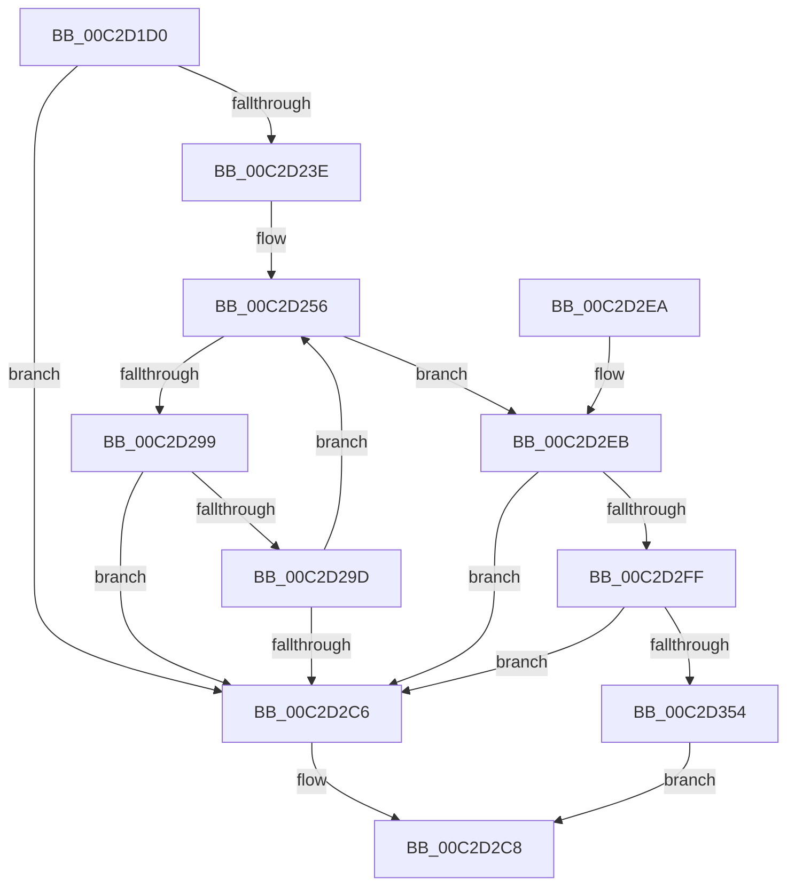

# IopReassignSystemRoot

- RVA: `0x00C2D1D0`–`0x00C2D3BE` (길이 `494` bytes)
- VA: `0x0000000140C2D1D0`
- 실행 섹션: `INIT`
- PDB 이름 있음: `예`; PDB Function 태그: `아니요`
- unwind 정보 RVA: `0x000C7214`
- 디코드: `111`개 명령, `494/494` bytes 표시
- 미해석 바이트: `0` (있으면 어셈블리에 `.byte`로 보존)

> 이 문서는 커널 이미지의 기계어와 PDB 기호를 분석해 생성했습니다. 4번과 5번은 함수 원형과 자료형을 바이너리 사용 방식에서 추정한 C 해석이며 원본 소스 복구 결과는 아닙니다.

## 1. Dependencies

- 직접 호출 지점: **13**; 고유 호출 대상: **9**
- 직접 호출자로 확인된 함수: **1**
- RIP 상대 이미지 참조: **3**

### Outgoing calls
- `0x00C2D231` → [RtlStringCchPrintfW](../../text/48/RtlStringCchPrintfW_function_00482D5C.md) (function, `0x00482D5C`)
- `0x00C2D247` → [RtlInitUnicodeString](../../text/42/RtlInitUnicodeString_function_0042A780.md) (function, `0x0042A780`)
- `0x00C2D28D` → [NtOpenSymbolicLinkObject](../../page/9E/NtOpenSymbolicLinkObject_function_009E7A60.md) (function, `0x009E7A60`)
- `0x00C2D2AF` → [NtQuerySymbolicLinkObject](../../page/9E/NtQuerySymbolicLinkObject_function_009EBA20.md) (function, `0x009EBA20`)
- `0x00C2D2BD` → [ObCloseHandle](../../page/8A/ObCloseHandle_function_008A1870.md) (function, `0x008A1870`)
- `0x00C2D2D2` → [_security_check_cookie](../../text/6A/_security_check_cookie_function_006AC640.md) (function, `0x006AC640`)
- `0x00C2D2F6` → [RtlUnicodeStringToAnsiString](../../page/90/RtlUnicodeStringToAnsiString_function_0090D1F0.md) (function, `0x0090D1F0`)
- `0x00C2D30B` → [RtlInitUnicodeString](../../text/42/RtlInitUnicodeString_function_0042A780.md) (function, `0x0042A780`)
- `0x00C2D347` → [NtOpenSymbolicLinkObject](../../page/9E/NtOpenSymbolicLinkObject_function_009E7A60.md) (function, `0x009E7A60`)
- `0x00C2D359` → [NtMakeTemporaryObject](../../page/A7/NtMakeTemporaryObject_function_00A7F7D0.md) (function, `0x00A7F7D0`)
- `0x00C2D365` → [ObCloseHandle](../../page/8A/ObCloseHandle_function_008A1870.md) (function, `0x008A1870`)
- `0x00C2D3A6` → [NtCreateSymbolicLinkObject](../../page/A3/NtCreateSymbolicLinkObject_function_00A33870.md) (function, `0x00A33870`)
- `0x00C2D3B2` → [ObCloseHandle](../../page/8A/ObCloseHandle_function_008A1870.md) (function, `0x008A1870`)

### Direct callers
- [IoInitSystemPreDrivers](IoInitSystemPreDrivers_function_00C2AC3C.md) at `0x00C2BD75`

### Static image references
- `0x00C2D1E7` → RVA `0x00E0A740` (`.data`; read)
- `0x00C2D1FF` → RVA `0x00C79270` (` ?? ::PBOPGDP::`string'`; read)
- `0x00C2D2FF` → RVA `0x00C79240` (` ?? ::PBOPGDP::`string'`; read)

## 2. Other-region calls and transfers

- 다른 실행 섹션으로 향하는 call: **13**
  - `0x00C2D231` → [RtlStringCchPrintfW](../../text/48/RtlStringCchPrintfW_function_00482D5C.md) (`INIT` → `.text`)
  - `0x00C2D247` → [RtlInitUnicodeString](../../text/42/RtlInitUnicodeString_function_0042A780.md) (`INIT` → `.text`)
  - `0x00C2D28D` → [NtOpenSymbolicLinkObject](../../page/9E/NtOpenSymbolicLinkObject_function_009E7A60.md) (`INIT` → `PAGE`)
  - `0x00C2D2AF` → [NtQuerySymbolicLinkObject](../../page/9E/NtQuerySymbolicLinkObject_function_009EBA20.md) (`INIT` → `PAGE`)
  - `0x00C2D2BD` → [ObCloseHandle](../../page/8A/ObCloseHandle_function_008A1870.md) (`INIT` → `PAGE`)
  - `0x00C2D2D2` → [_security_check_cookie](../../text/6A/_security_check_cookie_function_006AC640.md) (`INIT` → `.text`)
  - `0x00C2D2F6` → [RtlUnicodeStringToAnsiString](../../page/90/RtlUnicodeStringToAnsiString_function_0090D1F0.md) (`INIT` → `PAGE`)
  - `0x00C2D30B` → [RtlInitUnicodeString](../../text/42/RtlInitUnicodeString_function_0042A780.md) (`INIT` → `.text`)
  - `0x00C2D347` → [NtOpenSymbolicLinkObject](../../page/9E/NtOpenSymbolicLinkObject_function_009E7A60.md) (`INIT` → `PAGE`)
  - `0x00C2D359` → [NtMakeTemporaryObject](../../page/A7/NtMakeTemporaryObject_function_00A7F7D0.md) (`INIT` → `PAGE`)
  - `0x00C2D365` → [ObCloseHandle](../../page/8A/ObCloseHandle_function_008A1870.md) (`INIT` → `PAGE`)
  - `0x00C2D3A6` → [NtCreateSymbolicLinkObject](../../page/A3/NtCreateSymbolicLinkObject_function_00A33870.md) (`INIT` → `PAGE`)
  - `0x00C2D3B2` → [ObCloseHandle](../../page/8A/ObCloseHandle_function_008A1870.md) (`INIT` → `PAGE`)
- 별도 외부 분기/꼬리 이동을 확인하지 못했습니다.

## 3. Assembly (complete function range)

```asm
00C2D1D0  48 89 5C 24 18                  mov qword ptr [rsp + 0x18], rbx
00C2D1D5  55                              push rbp
00C2D1D6  56                              push rsi
00C2D1D7  57                              push rdi
00C2D1D8  48 8D AC 24 70 FE FF FF         lea rbp, [rsp - 0x190]
00C2D1E0  48 81 EC 90 02 00 00            sub rsp, 0x290
00C2D1E7  48 8B 05 52 D5 1D 00            mov rax, qword ptr [rip + 0x1dd552]
00C2D1EE  48 33 C4                        xor rax, rsp
00C2D1F1  48 89 85 80 01 00 00            mov qword ptr [rbp + 0x180], rax
00C2D1F8  4C 8B 89 B8 00 00 00            mov r9, qword ptr [rcx + 0xb8]
00C2D1FF  4C 8D 05 6A C0 04 00            lea r8, [rip + 0x4c06a]
00C2D206  33 F6                           xor esi, esi
00C2D208  48 8D 4D 80                     lea rcx, [rbp - 0x80]
00C2D20C  48 8B FA                        mov rdi, rdx
00C2D20F  89 74 24 3C                     mov dword ptr [rsp + 0x3c], esi
00C2D213  0F 57 C0                        xorps xmm0, xmm0
00C2D216  89 74 24 54                     mov dword ptr [rsp + 0x54], esi
00C2D21A  0F 57 C9                        xorps xmm1, xmm1
00C2D21D  48 89 74 24 20                  mov qword ptr [rsp + 0x20], rsi
00C2D222  BA 00 01 00 00                  mov edx, 0x100
00C2D227  0F 11 44 24 68                  movups xmmword ptr [rsp + 0x68], xmm0
00C2D22C  0F 11 4C 24 28                  movups xmmword ptr [rsp + 0x28], xmm1
00C2D231  E8 26 5B 85 FF                  call 0x140482d5c
00C2D236  85 C0                           test eax, eax
00C2D238  0F 88 88 00 00 00               js 0x140c2d2c6
00C2D23E  48 8D 55 80                     lea rdx, [rbp - 0x80]
00C2D242  48 8D 4C 24 28                  lea rcx, [rsp + 0x28]
00C2D247  E8 34 D5 7F FF                  call 0x14042a780
00C2D24C  B8 00 02 00 00                  mov eax, 0x200
00C2D251  66 89 44 24 2A                  mov word ptr [rsp + 0x2a], ax
00C2D256  48 8D 44 24 28                  lea rax, [rsp + 0x28]
00C2D25B  C7 44 24 38 30 00 00 00         mov dword ptr [rsp + 0x38], 0x30
00C2D263  0F 57 C0                        xorps xmm0, xmm0
00C2D266  48 89 44 24 48                  mov qword ptr [rsp + 0x48], rax
00C2D26B  4C 8D 44 24 38                  lea r8, [rsp + 0x38]
00C2D270  48 89 74 24 40                  mov qword ptr [rsp + 0x40], rsi
00C2D275  BA 01 00 0F 00                  mov edx, 0xf0001
00C2D27A  C7 44 24 50 40 02 00 00         mov dword ptr [rsp + 0x50], 0x240
00C2D282  48 8D 4C 24 20                  lea rcx, [rsp + 0x20]
00C2D287  F3 0F 7F 44 24 58               movdqu xmmword ptr [rsp + 0x58], xmm0
00C2D28D  E8 CE A7 DB FF                  call 0x1409e7a60
00C2D292  3D 24 00 00 C0                  cmp eax, 0xc0000024
00C2D297  74 52                           je 0x140c2d2eb
00C2D299  85 C0                           test eax, eax
00C2D29B  78 29                           js 0x140c2d2c6
00C2D29D  48 8B 4C 24 20                  mov rcx, qword ptr [rsp + 0x20]
00C2D2A2  48 8D 54 24 28                  lea rdx, [rsp + 0x28]
00C2D2A7  45 33 C0                        xor r8d, r8d
00C2D2AA  66 89 74 24 28                  mov word ptr [rsp + 0x28], si
00C2D2AF  E8 6C E7 DB FF                  call 0x1409eba20
00C2D2B4  48 8B 4C 24 20                  mov rcx, qword ptr [rsp + 0x20]
00C2D2B9  33 D2                           xor edx, edx
00C2D2BB  8B D8                           mov ebx, eax
00C2D2BD  E8 AE 45 C7 FF                  call 0x1408a1870
00C2D2C2  85 DB                           test ebx, ebx
00C2D2C4  79 90                           jns 0x140c2d256
00C2D2C6  32 C0                           xor al, al
00C2D2C8  48 8B 8D 80 01 00 00            mov rcx, qword ptr [rbp + 0x180]
00C2D2CF  48 33 CC                        xor rcx, rsp
00C2D2D2  E8 69 F3 A7 FF                  call 0x1406ac640
00C2D2D7  48 8B 9C 24 C0 02 00 00         mov rbx, qword ptr [rsp + 0x2c0]
00C2D2DF  48 81 C4 90 02 00 00            add rsp, 0x290
00C2D2E6  5F                              pop rdi
00C2D2E7  5E                              pop rsi
00C2D2E8  5D                              pop rbp
00C2D2E9  C3                              ret
00C2D2EA  CC                              int3
00C2D2EB  45 33 C0                        xor r8d, r8d
00C2D2EE  48 8D 54 24 28                  lea rdx, [rsp + 0x28]
00C2D2F3  48 8B CF                        mov rcx, rdi
00C2D2F6  E8 F5 FE CD FF                  call 0x14090d1f0
00C2D2FB  85 C0                           test eax, eax
00C2D2FD  78 C7                           js 0x140c2d2c6
00C2D2FF  48 8D 15 3A BF 04 00            lea rdx, [rip + 0x4bf3a]
00C2D306  48 8D 4C 24 68                  lea rcx, [rsp + 0x68]
00C2D30B  E8 70 D4 7F FF                  call 0x14042a780
00C2D310  48 8D 44 24 68                  lea rax, [rsp + 0x68]
00C2D315  C7 44 24 38 30 00 00 00         mov dword ptr [rsp + 0x38], 0x30
00C2D31D  0F 57 C0                        xorps xmm0, xmm0
00C2D320  48 89 44 24 48                  mov qword ptr [rsp + 0x48], rax
00C2D325  4C 8D 44 24 38                  lea r8, [rsp + 0x38]
00C2D32A  48 89 74 24 40                  mov qword ptr [rsp + 0x40], rsi
00C2D32F  BA 01 00 0F 00                  mov edx, 0xf0001
00C2D334  C7 44 24 50 40 02 00 00         mov dword ptr [rsp + 0x50], 0x240
00C2D33C  48 8D 4C 24 20                  lea rcx, [rsp + 0x20]
00C2D341  F3 0F 7F 44 24 58               movdqu xmmword ptr [rsp + 0x58], xmm0
00C2D347  E8 14 A7 DB FF                  call 0x1409e7a60
00C2D34C  85 C0                           test eax, eax
00C2D34E  0F 88 72 FF FF FF               js 0x140c2d2c6
00C2D354  48 8B 4C 24 20                  mov rcx, qword ptr [rsp + 0x20]
00C2D359  E8 72 24 E5 FF                  call 0x140a7f7d0
00C2D35E  48 8B 4C 24 20                  mov rcx, qword ptr [rsp + 0x20]
00C2D363  33 D2                           xor edx, edx
00C2D365  E8 06 45 C7 FF                  call 0x1408a1870
00C2D36A  48 8D 44 24 68                  lea rax, [rsp + 0x68]
00C2D36F  C7 44 24 38 30 00 00 00         mov dword ptr [rsp + 0x38], 0x30
00C2D377  0F 57 C0                        xorps xmm0, xmm0
00C2D37A  48 89 44 24 48                  mov qword ptr [rsp + 0x48], rax
00C2D37F  4C 8D 4C 24 28                  lea r9, [rsp + 0x28]
00C2D384  48 89 74 24 40                  mov qword ptr [rsp + 0x40], rsi
00C2D389  4C 8D 44 24 38                  lea r8, [rsp + 0x38]
00C2D38E  C7 44 24 50 50 02 00 00         mov dword ptr [rsp + 0x50], 0x250
00C2D396  BA 01 00 0F 00                  mov edx, 0xf0001
00C2D39B  48 8D 4C 24 20                  lea rcx, [rsp + 0x20]
00C2D3A0  F3 0F 7F 44 24 58               movdqu xmmword ptr [rsp + 0x58], xmm0
00C2D3A6  E8 C5 64 E0 FF                  call 0x140a33870
00C2D3AB  48 8B 4C 24 20                  mov rcx, qword ptr [rsp + 0x20]
00C2D3B0  33 D2                           xor edx, edx
00C2D3B2  E8 B9 44 C7 FF                  call 0x1408a1870
00C2D3B7  B0 01                           mov al, 1
00C2D3B9  E9 0A FF FF FF                  jmp 0x140c2d2c8
```

## 4. C-style interpretation (structured pseudocode)

```c
__int64 __fastcall IopReassignSystemRoot(__int64 a1, __int64 a2)
{
    __int64 result;
    __int64 v_rsi;
    __int64 v_rsp;
    unsigned __int64 v_stack_m1A8;
    unsigned __int64 v_stack_m228;
    unsigned __int64 v_stack_m240;
    unsigned __int64 v_stack_m250;
    unsigned int v_stack_m254;
    unsigned int v_stack_m258;
    unsigned __int64 v_stack_m260;
    unsigned __int64 v_stack_m268;
    unsigned int v_stack_m26C;
    unsigned int v_stack_m270;
    unsigned __int16 v_stack_m27E;
    unsigned __int64 v_stack_m28;
    unsigned __int64 v_stack_m280;
    unsigned __int64 v_stack_m288;
    unsigned __int64 v_stack_p18;
    unsigned __int64 v_stack_p20;
    unsigned __int64 v_stack_p28;
    unsigned int v_stack_p38;
    unsigned __int64 v_stack_p40;
    unsigned __int64 v_stack_p48;
    unsigned int v_stack_p50;
    unsigned __int64 v_stack_p58;
    unsigned __int64 v_stack_p68;

    v_stack_p18 = v_rbx;
    v_rsp = (v_rsp) - (656);
    result = (*(unsigned __int64 *)(v_rip + 1955154)) ^ (v_rsp);
    v_stack_m28 = result;
    v_rsi = 0;
    v_stack_m26C = 0;
    v_stack_m254 = 0;
    v_stack_m288 = 0;
    v_stack_m240 = v_xmm0;
    v_stack_m280 = v_xmm1;
    result = RtlStringCchPrintfW(v_stack_m228, 256, v_rip + 311402, *(unsigned __int64 *)(a1 + 184));
    if (sign_flag) goto loc_00C2D2C6;
    result = RtlInitUnicodeString(v_stack_m280, v_stack_m228, v_rip + 311402, *(unsigned __int64 *)(a1 + 184));
    v_stack_m27E = 512;
loc_00C2D256:
    v_stack_m270 = 48;
    v_stack_m260 = v_stack_m280;
    v_stack_m268 = 0;
    v_stack_m258 = 576;
    v_stack_m250 = v_xmm0;
    result = NtOpenSymbolicLinkObject(v_stack_m288, (unsigned int)(0xF0001ULL), v_stack_m270, *(unsigned __int64 *)(a1 + 184));
    if (((unsigned int)(result)) == 0xC0000024ULL) goto loc_00C2D2EB;
    if (sign_flag) goto loc_00C2D2C6;
    a3 = 0;
    v_stack_m280 = 0;
    result = NtQuerySymbolicLinkObject(v_stack_m288, v_stack_m280, a3, *(unsigned __int64 *)(a1 + 184));
    a2 = 0;
    result = ObCloseHandle(v_stack_m288, a2, a3, *(unsigned __int64 *)(a1 + 184));
    if (!sign_flag) goto loc_00C2D256;
loc_00C2D2C6:
    result = 0;
loc_00C2D2C8:
    a1 = (v_stack_m28) ^ (v_rsp);
    result = _security_check_cookie(a1, a2, a3, *(unsigned __int64 *)(a1 + 184));
    v_rsp = (v_rsp) + (656);
    return result;
loc_00C2D2EB:
    a3 = 0;
    result = RtlUnicodeStringToAnsiString(0, v_stack_p28, a3, *(unsigned __int64 *)(a1 + 184));
    if (sign_flag) goto loc_00C2D2C6;
    result = RtlInitUnicodeString(v_stack_p68, v_rip + 311098, a3, *(unsigned __int64 *)(a1 + 184));
    v_stack_p38 = 48;
    v_stack_p48 = v_stack_p68;
    v_stack_p40 = 0;
    v_stack_p50 = 576;
    v_stack_p58 = v_xmm0;
    result = NtOpenSymbolicLinkObject(v_stack_p20, (unsigned int)(0xF0001ULL), v_stack_p38, *(unsigned __int64 *)(a1 + 184));
    if (sign_flag) goto loc_00C2D2C6;
    result = NtMakeTemporaryObject(v_stack_p20, (unsigned int)(0xF0001ULL), v_stack_p38, *(unsigned __int64 *)(a1 + 184));
    a2 = 0;
    result = ObCloseHandle(v_stack_p20, a2, v_stack_p38, *(unsigned __int64 *)(a1 + 184));
    v_stack_p38 = 48;
    v_stack_p48 = v_stack_p68;
    v_stack_p40 = 0;
    v_stack_p50 = 592;
    v_stack_p58 = v_xmm0;
    result = NtCreateSymbolicLinkObject(v_stack_p20, (unsigned int)(0xF0001ULL), v_stack_p38, v_stack_p28);
    a2 = 0;
    result = ObCloseHandle(v_stack_p20, a2, v_stack_p38, v_stack_p28);
    goto loc_00C2D2C8;
}
```

## 5. (Beta) C Style

```c
int64_t IopReassignSystemRoot(void *Arg1, int64_t Arg2)
{
    uint8_t *arg1 = (uint8_t *)Arg1;

    int64_t result;
    int64_t local_rsi;
    int64_t local_rsp;
    uint64_t v_stack_m1A8;
    uint64_t v_stack_m228;
    uint64_t v_stack_m240;
    uint64_t v_stack_m250;
    uint32_t v_stack_m254;
    uint32_t v_stack_m258;
    uint64_t v_stack_m260;
    uint64_t v_stack_m268;
    uint32_t v_stack_m26C;
    uint32_t v_stack_m270;
    uint16_t v_stack_m27E;
    uint64_t v_stack_m28;
    uint64_t v_stack_m280;
    uint64_t v_stack_m288;
    uint64_t v_stack_p18;
    uint64_t v_stack_p20;
    uint64_t v_stack_p28;
    uint32_t v_stack_p38;
    uint64_t v_stack_p40;
    uint64_t v_stack_p48;
    uint32_t v_stack_p50;
    uint64_t v_stack_p58;
    uint64_t v_stack_p68;

    v_stack_p18 = local_rbx;
    local_rsp = (local_rsp) - (656);
    result = (*(uint64_t *)(v_rip + 0x1DD552)) ^ (local_rsp);
    v_stack_m28 = result;
    local_rsi = 0;
    v_stack_m26C = 0;
    v_stack_m254 = 0;
    v_stack_m288 = 0;
    v_stack_m240 = v_xmm0;
    v_stack_m280 = v_xmm1;
    result = RtlStringCchPrintfW(v_stack_m228, 256, v_rip + 311402, *(uint64_t *)(arg1 + 0xB8));
    if (sign_flag) goto loc_00C2D2C6;
    result = RtlInitUnicodeString(v_stack_m280, v_stack_m228, v_rip + 311402, *(uint64_t *)(arg1 + 0xB8));
    v_stack_m27E = 512;
loc_00C2D256:
    v_stack_m270 = 48;
    v_stack_m260 = v_stack_m280;
    v_stack_m268 = 0;
    v_stack_m258 = 576;
    v_stack_m250 = v_xmm0;
    result = NtOpenSymbolicLinkObject(v_stack_m288, (uint32_t)(0xF0001ULL), v_stack_m270, *(uint64_t *)(arg1 + 0xB8));
    if (((uint32_t)(result)) == 0xC0000024ULL) goto loc_00C2D2EB;
    if (sign_flag) goto loc_00C2D2C6;
    a3 = 0;
    v_stack_m280 = 0;
    result = NtQuerySymbolicLinkObject(v_stack_m288, v_stack_m280, a3, *(uint64_t *)(arg1 + 0xB8));
    Arg2 = 0;
    result = ObCloseHandle(v_stack_m288, Arg2, a3, *(uint64_t *)(arg1 + 0xB8));
    if (!sign_flag) goto loc_00C2D256;
loc_00C2D2C6:
    result = 0;
loc_00C2D2C8:
    Arg1 = (v_stack_m28) ^ (local_rsp);
    result = _security_check_cookie(Arg1, Arg2, a3, *(uint64_t *)(arg1 + 0xB8));
    local_rsp = (local_rsp) + (656);
    return result;
loc_00C2D2EB:
    a3 = 0;
    result = RtlUnicodeStringToAnsiString(0, v_stack_p28, a3, *(uint64_t *)(arg1 + 0xB8));
    if (sign_flag) goto loc_00C2D2C6;
    result = RtlInitUnicodeString(v_stack_p68, v_rip + 311098, a3, *(uint64_t *)(arg1 + 0xB8));
    v_stack_p38 = 48;
    v_stack_p48 = v_stack_p68;
    v_stack_p40 = 0;
    v_stack_p50 = 576;
    v_stack_p58 = v_xmm0;
    result = NtOpenSymbolicLinkObject(v_stack_p20, (uint32_t)(0xF0001ULL), v_stack_p38, *(uint64_t *)(arg1 + 0xB8));
    if (sign_flag) goto loc_00C2D2C6;
    result = NtMakeTemporaryObject(v_stack_p20, (uint32_t)(0xF0001ULL), v_stack_p38, *(uint64_t *)(arg1 + 0xB8));
    Arg2 = 0;
    result = ObCloseHandle(v_stack_p20, Arg2, v_stack_p38, *(uint64_t *)(arg1 + 0xB8));
    v_stack_p38 = 48;
    v_stack_p48 = v_stack_p68;
    v_stack_p40 = 0;
    v_stack_p50 = 592;
    v_stack_p58 = v_xmm0;
    result = NtCreateSymbolicLinkObject(v_stack_p20, (uint32_t)(0xF0001ULL), v_stack_p38, v_stack_p28);
    Arg2 = 0;
    result = ObCloseHandle(v_stack_p20, Arg2, v_stack_p38, v_stack_p28);
    goto loc_00C2D2C8;
}
```

### 관측된 메모리 오프셋

구조체 형식이 확인되지 않은 접근은 인자 기준의 오프셋으로만 기록했습니다.

| 기준 인자 | 오프셋 표현 | 폭 (bit) | 접근 |
|---|---:|---:|---|
| `Arg1` | `+ 0xB8` | `64` | `R` |

## 6. Execution-region graph

[열기: 2D/3D 그래프와 함수 탐색 컨트롤 패널](../../../control-panel.html?section=init&rva=0x00C2D1D0&view=graph)

- 2D 그래프는 위에서 아래로 흐르고, 3D 그래프는 빈 공간을 드래그해 회전합니다. Shift+드래그는 이동, 휠은 확대·축소, 함수 노드 선택은 대상 보고서 이동입니다.

### Static fallback


