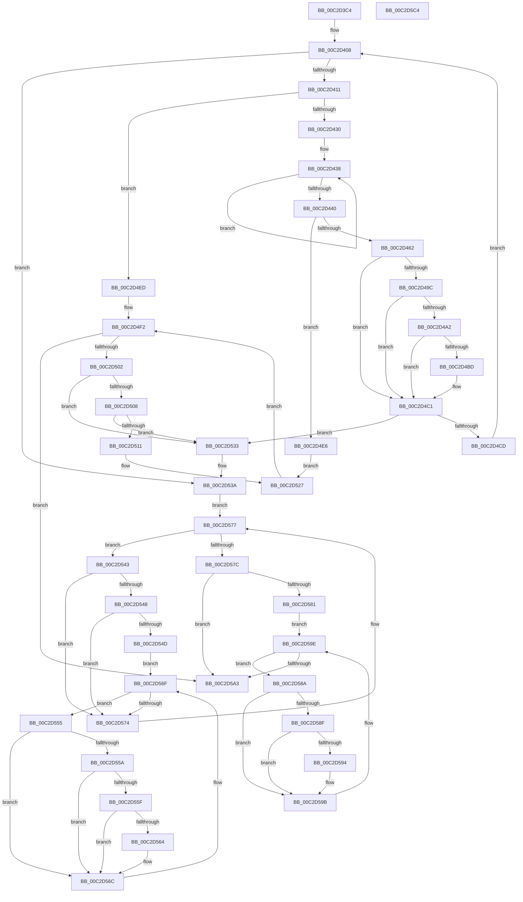

# IopStoreArcInformation

- RVA: `0x00C2D3C4`–`0x00C2D5C5` (길이 `513` bytes)
- VA: `0x0000000140C2D3C4`
- 실행 섹션: `INIT`
- PDB 이름 있음: `예`; PDB Function 태그: `아니요`
- unwind 정보 RVA: `0x0005FEF8`
- 디코드: `140`개 명령, `513/513` bytes 표시
- 미해석 바이트: `0` (있으면 어셈블리에 `.byte`로 보존)

> 이 문서는 커널 이미지의 기계어와 PDB 기호를 분석해 생성했습니다. 4번과 5번은 함수 원형과 자료형을 바이너리 사용 방식에서 추정한 C 해석이며 원본 소스 복구 결과는 아닙니다.

## 1. Dependencies

- 직접 호출 지점: **6**; 고유 호출 대상: **4**
- 직접 호출자로 확인된 함수: **1**
- RIP 상대 이미지 참조: **7**

### Outgoing calls
- `0x00C2D41F` → [ExAllocatePool2](../../poolcode/B8/ExAllocatePool2_function_00B820F0.md) (function, `0x00B820F0`)
- `0x00C2D451` → [ExAllocatePool2](../../poolcode/B8/ExAllocatePool2_function_00B820F0.md) (function, `0x00B820F0`)
- `0x00C2D48E` → [RtlStringCbCopyA](../../text/46/RtlStringCbCopyA_function_0046143C.md) (function, `0x0046143C`)
- `0x00C2D4B4` → [strnicmp](../../text/4F/strnicmp_function_004FFE30.md) (function, `0x004FFE30`)
- `0x00C2D522` → [ExFreePoolWithTag](../../poolcode/B8/ExFreePoolWithTag_function_00B82870.md) (function, `0x00B82870`)
- `0x00C2D52C` → [ExFreePoolWithTag](../../poolcode/B8/ExFreePoolWithTag_function_00B82870.md) (function, `0x00B82870`)

### Direct callers
- [IoInitSystemPreDrivers](IoInitSystemPreDrivers_function_00C2AC3C.md) at `0x00C2B7F8`

### Static image references
- `0x00C2D3E8` → RVA `0x00FD9C58` (`PAGEDATA`; read)
- `0x00C2D3EF` → RVA `0x00EFF050` (`.data`; read)
- `0x00C2D3F7` → RVA `0x00FD9C60` (`PAGEDATA`; write)
- `0x00C2D3FE` → RVA `0x00FD9C58` (`PAGEDATA`; write)
- `0x00C2D4AD` → RVA `0x00C79980` (` ?? ::PBOPGDP::`string'`; read)
- `0x00C2D4C1` → RVA `0x00FD9C60` (`PAGEDATA`; read)
- `0x00C2D594` → RVA `0x00E66219` (`.data`; write)

## 2. Other-region calls and transfers

- 다른 실행 섹션으로 향하는 call: **6**
  - `0x00C2D41F` → [ExAllocatePool2](../../poolcode/B8/ExAllocatePool2_function_00B820F0.md) (`INIT` → `POOLCODE`)
  - `0x00C2D451` → [ExAllocatePool2](../../poolcode/B8/ExAllocatePool2_function_00B820F0.md) (`INIT` → `POOLCODE`)
  - `0x00C2D48E` → [RtlStringCbCopyA](../../text/46/RtlStringCbCopyA_function_0046143C.md) (`INIT` → `.text`)
  - `0x00C2D4B4` → [strnicmp](../../text/4F/strnicmp_function_004FFE30.md) (`INIT` → `.text`)
  - `0x00C2D522` → [ExFreePoolWithTag](../../poolcode/B8/ExFreePoolWithTag_function_00B82870.md) (`INIT` → `POOLCODE`)
  - `0x00C2D52C` → [ExFreePoolWithTag](../../poolcode/B8/ExFreePoolWithTag_function_00B82870.md) (`INIT` → `POOLCODE`)
- 별도 외부 분기/꼬리 이동을 확인하지 못했습니다.

## 3. Assembly (complete function range)

```asm
00C2D3C4  48 8B C4                        mov rax, rsp
00C2D3C7  48 89 58 08                     mov qword ptr [rax + 8], rbx
00C2D3CB  48 89 68 10                     mov qword ptr [rax + 0x10], rbp
00C2D3CF  48 89 70 18                     mov qword ptr [rax + 0x18], rsi
00C2D3D3  48 89 78 20                     mov qword ptr [rax + 0x20], rdi
00C2D3D7  41 54                           push r12
00C2D3D9  41 56                           push r14
00C2D3DB  41 57                           push r15
00C2D3DD  48 83 EC 20                     sub rsp, 0x20
00C2D3E1  4C 8B B9 E8 00 00 00            mov r15, qword ptr [rcx + 0xe8]
00C2D3E8  4C 8D 25 69 C8 3A 00            lea r12, [rip + 0x3ac869]
00C2D3EF  8B 2D 5B 1C 2D 00               mov ebp, dword ptr [rip + 0x2d1c5b]
00C2D3F5  33 DB                           xor ebx, ebx
00C2D3F7  4C 89 25 62 C8 3A 00            mov qword ptr [rip + 0x3ac862], r12
00C2D3FE  4C 89 25 53 C8 3A 00            mov qword ptr [rip + 0x3ac853], r12
00C2D405  4D 8B 37                        mov r14, qword ptr [r15]
00C2D408  4D 3B F7                        cmp r14, r15
00C2D40B  0F 84 29 01 00 00               je 0x140c2d53a
00C2D411  BA 50 00 00 00                  mov edx, 0x50
00C2D416  41 B8 49 6F 20 20               mov r8d, 0x20206f49
00C2D41C  8D 4A F0                        lea ecx, [rdx - 0x10]
00C2D41F  E8 CC 4C F5 FF                  call 0x140b820f0
00C2D424  48 8B F8                        mov rdi, rax
00C2D427  48 85 C0                        test rax, rax
00C2D42A  0F 84 BD 00 00 00               je 0x140c2d4ed
00C2D430  49 8B 46 18                     mov rax, qword ptr [r14 + 0x18]
00C2D434  48 83 CE FF                     or rsi, 0xffffffffffffffff
00C2D438  48 FF C6                        inc rsi
00C2D43B  38 1C 30                        cmp byte ptr [rax + rsi], bl
00C2D43E  75 F8                           jne 0x140c2d438
00C2D440  48 FF C6                        inc rsi
00C2D443  41 B8 49 6F 4E 34               mov r8d, 0x344e6f49
00C2D449  48 8B D6                        mov rdx, rsi
00C2D44C  B9 40 00 00 00                  mov ecx, 0x40
00C2D451  E8 9A 4C F5 FF                  call 0x140b820f0
00C2D456  4C 8B D0                        mov r10, rax
00C2D459  48 85 C0                        test rax, rax
00C2D45C  0F 84 84 00 00 00               je 0x140c2d4e6
00C2D462  41 0F 10 06                     movups xmm0, xmmword ptr [r14]
00C2D466  48 8B D6                        mov rdx, rsi
00C2D469  48 8B C8                        mov rcx, rax
00C2D46C  0F 11 07                        movups xmmword ptr [rdi], xmm0
00C2D46F  41 0F 10 4E 10                  movups xmm1, xmmword ptr [r14 + 0x10]
00C2D474  0F 11 4F 10                     movups xmmword ptr [rdi + 0x10], xmm1
00C2D478  41 0F 10 46 20                  movups xmm0, xmmword ptr [r14 + 0x20]
00C2D47D  0F 11 47 20                     movups xmmword ptr [rdi + 0x20], xmm0
00C2D481  41 0F 10 4E 30                  movups xmm1, xmmword ptr [r14 + 0x30]
00C2D486  0F 11 4F 30                     movups xmmword ptr [rdi + 0x30], xmm1
00C2D48A  4D 8B 46 18                     mov r8, qword ptr [r14 + 0x18]
00C2D48E  E8 A9 3F 83 FF                  call 0x14046143c
00C2D493  4C 89 57 18                     mov qword ptr [rdi + 0x18], r10
00C2D497  83 FD 01                        cmp ebp, 1
00C2D49A  75 25                           jne 0x140c2d4c1
00C2D49C  48 83 FE 09                     cmp rsi, 9
00C2D4A0  72 1F                           jb 0x140c2d4c1
00C2D4A2  49 8D 4A F7                     lea rcx, [r10 - 9]
00C2D4A6  48 03 CE                        add rcx, rsi
00C2D4A9  44 8D 45 07                     lea r8d, [rbp + 7]
00C2D4AD  48 8D 15 CC C4 04 00            lea rdx, [rip + 0x4c4cc]
00C2D4B4  E8 77 29 8D FF                  call 0x1404ffe30
00C2D4B9  85 C0                           test eax, eax
00C2D4BB  75 04                           jne 0x140c2d4c1
00C2D4BD  40 88 6F 4C                     mov byte ptr [rdi + 0x4c], bpl
00C2D4C1  48 8B 05 98 C7 3A 00            mov rax, qword ptr [rip + 0x3ac798]
00C2D4C8  4C 39 20                        cmp qword ptr [rax], r12
00C2D4CB  75 66                           jne 0x140c2d533
00C2D4CD  4C 89 27                        mov qword ptr [rdi], r12
00C2D4D0  48 89 47 08                     mov qword ptr [rdi + 8], rax
00C2D4D4  48 89 38                        mov qword ptr [rax], rdi
00C2D4D7  48 89 3D 82 C7 3A 00            mov qword ptr [rip + 0x3ac782], rdi
00C2D4DE  4D 8B 36                        mov r14, qword ptr [r14]
00C2D4E1  E9 22 FF FF FF                  jmp 0x140c2d408
00C2D4E6  BB 9A 00 00 C0                  mov ebx, 0xc000009a
00C2D4EB  EB 3A                           jmp 0x140c2d527
00C2D4ED  BB 9A 00 00 C0                  mov ebx, 0xc000009a
00C2D4F2  48 8B 3D 5F C7 3A 00            mov rdi, qword ptr [rip + 0x3ac75f]
00C2D4F9  49 3B FC                        cmp rdi, r12
00C2D4FC  0F 84 A1 00 00 00               je 0x140c2d5a3
00C2D502  4C 39 67 08                     cmp qword ptr [rdi + 8], r12
00C2D506  75 2B                           jne 0x140c2d533
00C2D508  48 8B 07                        mov rax, qword ptr [rdi]
00C2D50B  48 39 78 08                     cmp qword ptr [rax + 8], rdi
00C2D50F  75 22                           jne 0x140c2d533
00C2D511  48 89 05 40 C7 3A 00            mov qword ptr [rip + 0x3ac740], rax
00C2D518  33 D2                           xor edx, edx
00C2D51A  4C 89 60 08                     mov qword ptr [rax + 8], r12
00C2D51E  48 8B 4F 18                     mov rcx, qword ptr [rdi + 0x18]
00C2D522  E8 49 53 F5 FF                  call 0x140b82870
00C2D527  33 D2                           xor edx, edx
00C2D529  48 8B CF                        mov rcx, rdi
00C2D52C  E8 3F 53 F5 FF                  call 0x140b82870
00C2D531  EB BF                           jmp 0x140c2d4f2
00C2D533  B9 03 00 00 00                  mov ecx, 3
00C2D538  CD 29                           int 0x29
00C2D53A  48 8B 05 17 C7 3A 00            mov rax, qword ptr [rip + 0x3ac717]
00C2D541  EB 34                           jmp 0x140c2d577
00C2D543  38 58 24                        cmp byte ptr [rax + 0x24], bl
00C2D546  75 2C                           jne 0x140c2d574
00C2D548  38 58 48                        cmp byte ptr [rax + 0x48], bl
00C2D54B  75 27                           jne 0x140c2d574
00C2D54D  8B 50 20                        mov edx, dword ptr [rax + 0x20]
00C2D550  48 8B 08                        mov rcx, qword ptr [rax]
00C2D553  EB 1A                           jmp 0x140c2d56f
00C2D555  38 59 24                        cmp byte ptr [rcx + 0x24], bl
00C2D558  75 12                           jne 0x140c2d56c
00C2D55A  38 59 48                        cmp byte ptr [rcx + 0x48], bl
00C2D55D  75 0D                           jne 0x140c2d56c
00C2D55F  3B 51 20                        cmp edx, dword ptr [rcx + 0x20]
00C2D562  75 08                           jne 0x140c2d56c
00C2D564  C6 40 48 01                     mov byte ptr [rax + 0x48], 1
00C2D568  C6 41 48 01                     mov byte ptr [rcx + 0x48], 1
00C2D56C  48 8B 09                        mov rcx, qword ptr [rcx]
00C2D56F  49 3B CC                        cmp rcx, r12
00C2D572  75 E1                           jne 0x140c2d555
00C2D574  48 8B 00                        mov rax, qword ptr [rax]
00C2D577  49 3B C4                        cmp rax, r12
00C2D57A  75 C7                           jne 0x140c2d543
00C2D57C  83 FD 01                        cmp ebp, 1
00C2D57F  75 22                           jne 0x140c2d5a3
00C2D581  48 8B 0D D0 C6 3A 00            mov rcx, qword ptr [rip + 0x3ac6d0]
00C2D588  EB 14                           jmp 0x140c2d59e
00C2D58A  38 59 4C                        cmp byte ptr [rcx + 0x4c], bl
00C2D58D  74 0C                           je 0x140c2d59b
00C2D58F  38 59 48                        cmp byte ptr [rcx + 0x48], bl
00C2D592  74 07                           je 0x140c2d59b
00C2D594  C6 05 7E 8C 23 00 01            mov byte ptr [rip + 0x238c7e], 1
00C2D59B  48 8B 09                        mov rcx, qword ptr [rcx]
00C2D59E  49 3B CC                        cmp rcx, r12
00C2D5A1  75 E7                           jne 0x140c2d58a
00C2D5A3  48 8B 6C 24 48                  mov rbp, qword ptr [rsp + 0x48]
00C2D5A8  8B C3                           mov eax, ebx
00C2D5AA  48 8B 5C 24 40                  mov rbx, qword ptr [rsp + 0x40]
00C2D5AF  48 8B 74 24 50                  mov rsi, qword ptr [rsp + 0x50]
00C2D5B4  48 8B 7C 24 58                  mov rdi, qword ptr [rsp + 0x58]
00C2D5B9  48 83 C4 20                     add rsp, 0x20
00C2D5BD  41 5F                           pop r15
00C2D5BF  41 5E                           pop r14
00C2D5C1  41 5C                           pop r12
00C2D5C3  C3                              ret
00C2D5C4  CC                              int3
```

## 4. C-style interpretation (structured pseudocode)

```c
__int64 __fastcall IopStoreArcInformation(__int64 a1)
{
    __int64 result;
    __int64 v_rbx;
    __int64 v_rsi;
    __int64 v_rsp;
    unsigned __int64 v_stack_p10;
    unsigned __int64 v_stack_p18;
    unsigned __int64 v_stack_p20;
    unsigned __int64 v_stack_p8;

    *(unsigned __int64 *)(v_rsp + 8) = v_rbx;
    *(unsigned __int64 *)(v_rsp + 16) = v_rbp;
    *(unsigned __int64 *)(v_rsp + 24) = v_rsi;
    *(unsigned __int64 *)(v_rsp + 32) = v_rdi;
    v_rsp = (v_rsp) - (32);
    v_rbx = 0;
    *(unsigned __int64 *)(v_rip + 3852386) = v_rip + 3852393;
    *(unsigned __int64 *)(v_rip + 3852371) = v_rip + 3852393;
loc_00C2D408:
    if ((*(unsigned __int64 *)(*(unsigned __int64 *)(a1 + 232))) == (*(unsigned __int64 *)(a1 + 232))) goto loc_00C2D53A;
    result = ExAllocatePool2(80 - 16, 80, (unsigned int)(0x20206F49ULL), a4);
    if (result == 0) goto loc_00C2D4ED;
    v_rsi = (v_rsi) | (-1);
loc_00C2D438:
    v_rsi = (v_rsi) + 1;
    if ((*(unsigned __int8 *)(*(unsigned __int64 *)(*(unsigned __int64 *)(*(unsigned __int64 *)(a1 + 232)) + 24) + v_rsi * 1)) != 0) goto loc_00C2D438;
    v_rsi = (v_rsi) + 1;
    result = ExAllocatePool2(64, v_rsi, (unsigned int)(0x344E6F49ULL), a4);
    if (result == 0) goto loc_00C2D4E6;
    *(unsigned __int64 *)(result) = v_xmm0;
    *(unsigned __int64 *)(result + 16) = v_xmm1;
    *(unsigned __int64 *)(result + 32) = v_xmm0;
    *(unsigned __int64 *)(result + 48) = v_xmm1;
    result = RtlStringCbCopyA(result, v_rsi, *(unsigned __int64 *)(*(unsigned __int64 *)(*(unsigned __int64 *)(a1 + 232)) + 24), a4);
    *(unsigned __int64 *)(result + 24) = result;
    if (((unsigned int)((unsigned int)(*(unsigned int *)(v_rip + 2956379)))) != 1) goto loc_00C2D4C1;
    if (v_rsi < 9) goto loc_00C2D4C1;
    a1 = (result - 9) + (v_rsi);
    result = strnicmp(a1, v_rip + 312524, (unsigned int)(*(unsigned int *)(v_rip + 2956379)) + 7, a4);
    if ((unsigned int)(result) == 0) {
        *(unsigned __int8 *)(result + 76) = (unsigned __int8)((unsigned int)(*(unsigned int *)(v_rip + 2956379)));
    }
    if ((*(unsigned __int64 *)(*(unsigned __int64 *)(v_rip + 3852184))) != (v_rip + 3852393)) goto loc_00C2D533;
    *(unsigned __int64 *)(result) = v_rip + 3852393;
    *(unsigned __int64 *)(result + 8) = *(unsigned __int64 *)(v_rip + 3852184);
    *(unsigned __int64 *)(*(unsigned __int64 *)(v_rip + 3852184)) = result;
    *(unsigned __int64 *)(v_rip + 3852162) = result;
    goto loc_00C2D408;
loc_00C2D4E6:
    goto loc_00C2D527;
loc_00C2D4ED:
loc_00C2D4F2:
    if ((*(unsigned __int64 *)(v_rip + 3852127)) == (v_rip + 3852393)) goto loc_00C2D5A3;
    if ((*(unsigned __int64 *)(*(unsigned __int64 *)(v_rip + 3852127) + 8)) != (v_rip + 3852393)) goto loc_00C2D533;
    if ((*(unsigned __int64 *)(*(unsigned __int64 *)(*(unsigned __int64 *)(v_rip + 3852127)) + 8)) != (*(unsigned __int64 *)(v_rip + 3852127))) goto loc_00C2D533;
    *(unsigned __int64 *)(v_rip + 3852096) = *(unsigned __int64 *)(*(unsigned __int64 *)(v_rip + 3852127));
    a2 = 0;
    *(unsigned __int64 *)(*(unsigned __int64 *)(*(unsigned __int64 *)(v_rip + 3852127)) + 8) = v_rip + 3852393;
    result = ExFreePoolWithTag(*(unsigned __int64 *)(*(unsigned __int64 *)(v_rip + 3852127) + 24), a2, (unsigned int)(*(unsigned int *)(v_rip + 2956379)) + 7, a4);
loc_00C2D527:
    a2 = 0;
    result = ExFreePoolWithTag(*(unsigned __int64 *)(v_rip + 3852127), a2, (unsigned int)(*(unsigned int *)(v_rip + 2956379)) + 7, a4);
    goto loc_00C2D4F2;
loc_00C2D533:
loc_00C2D53A:
    goto loc_00C2D577;
loc_00C2D543:
    if ((*(unsigned __int8 *)(*(unsigned __int64 *)(v_rip + 3852055) + 36)) != ((unsigned __int8)((unsigned int)(0xC000009AULL)))) goto loc_00C2D574;
    if ((*(unsigned __int8 *)(*(unsigned __int64 *)(v_rip + 3852055) + 72)) != ((unsigned __int8)((unsigned int)(0xC000009AULL)))) goto loc_00C2D574;
    goto loc_00C2D56F;
loc_00C2D555:
    if ((*(unsigned __int8 *)(*(unsigned __int64 *)(*(unsigned __int64 *)(v_rip + 3852055)) + 36)) != ((unsigned __int8)((unsigned int)(0xC000009AULL)))) goto loc_00C2D56C;
    if ((*(unsigned __int8 *)(*(unsigned __int64 *)(*(unsigned __int64 *)(v_rip + 3852055)) + 72)) != ((unsigned __int8)((unsigned int)(0xC000009AULL)))) goto loc_00C2D56C;
    if (((unsigned int)((unsigned int)(*(unsigned int *)(*(unsigned __int64 *)(v_rip + 3852055) + 32)))) == (*(unsigned int *)(*(unsigned __int64 *)(*(unsigned __int64 *)(v_rip + 3852055)) + 32))) {
        *(unsigned __int8 *)(*(unsigned __int64 *)(v_rip + 3852055) + 72) = 1;
        *(unsigned __int8 *)(*(unsigned __int64 *)(*(unsigned __int64 *)(v_rip + 3852055)) + 72) = 1;
    }
loc_00C2D56F:
    if ((*(unsigned __int64 *)(*(unsigned __int64 *)(*(unsigned __int64 *)(v_rip + 3852055)))) != (v_rip + 3852393)) goto loc_00C2D555;
loc_00C2D574:
loc_00C2D577:
    if ((*(unsigned __int64 *)(*(unsigned __int64 *)(v_rip + 3852055))) != (v_rip + 3852393)) goto loc_00C2D543;
    if (((unsigned int)((unsigned int)(*(unsigned int *)(v_rip + 2956379)))) != 1) goto loc_00C2D5A3;
    goto loc_00C2D59E;
loc_00C2D58A:
    if ((*(unsigned __int8 *)(*(unsigned __int64 *)(v_rip + 3851984) + 76)) == ((unsigned __int8)((unsigned int)(0xC000009AULL)))) goto loc_00C2D59B;
    if ((*(unsigned __int8 *)(*(unsigned __int64 *)(v_rip + 3851984) + 72)) != ((unsigned __int8)((unsigned int)(0xC000009AULL)))) {
        *(unsigned __int8 *)(v_rip + 2329726) = 1;
    }
loc_00C2D59E:
    if ((*(unsigned __int64 *)(*(unsigned __int64 *)(v_rip + 3851984))) != (v_rip + 3852393)) goto loc_00C2D58A;
loc_00C2D5A3:
    v_rsp = (v_rsp) + (32);
    return (unsigned int)((unsigned int)((unsigned int)(0xC000009AULL)));
}
```

## 5. (Beta) C Style

```c
int64_t IopStoreArcInformation(void *Arg1)
{
    uint8_t *arg1 = (uint8_t *)Arg1;

    int64_t result;
    int64_t local_rbx;
    int64_t local_rsi;
    int64_t local_rsp;
    uint64_t v_stack_p10;
    uint64_t v_stack_p18;
    uint64_t v_stack_p20;
    uint64_t v_stack_p8;

    *(uint64_t *)(local_rsp + 0x8) = local_rbx;
    *(uint64_t *)(local_rsp + 0x10) = local_rbp;
    *(uint64_t *)(local_rsp + 0x18) = local_rsi;
    *(uint64_t *)(local_rsp + 0x20) = local_rdi;
    local_rsp = (local_rsp) - (32);
    local_rbx = 0;
    *(uint64_t *)(v_rip + 0x3AC862) = v_rip + 3852393;
    *(uint64_t *)(v_rip + 0x3AC853) = v_rip + 3852393;
loc_00C2D408:
    if ((*(uint64_t *)(*(uint64_t *)(arg1 + 0xE8))) == (*(uint64_t *)(arg1 + 0xE8))) goto loc_00C2D53A;
    result = ExAllocatePool2(80 - 16, 80, (uint32_t)(0x20206F49ULL), a4);
    if (result == 0) goto loc_00C2D4ED;
    local_rsi = (local_rsi) | (-1);
loc_00C2D438:
    local_rsi = (local_rsi) + 1;
    if ((*(uint8_t *)(*(uint64_t *)(*(uint64_t *)(*(uint64_t *)(arg1 + 0xE8)) + 0x18) + local_rsi * 1)) != 0) goto loc_00C2D438;
    local_rsi = (local_rsi) + 1;
    result = ExAllocatePool2(64, local_rsi, (uint32_t)(0x344E6F49ULL), a4);
    if (result == 0) goto loc_00C2D4E6;
    *(uint64_t *)(result) = v_xmm0;
    *(uint64_t *)(result + 0x10) = v_xmm1;
    *(uint64_t *)(result + 0x20) = v_xmm0;
    *(uint64_t *)(result + 0x30) = v_xmm1;
    result = RtlStringCbCopyA(result, local_rsi, *(uint64_t *)(*(uint64_t *)(*(uint64_t *)(arg1 + 0xE8)) + 0x18), a4);
    *(uint64_t *)(result + 0x18) = result;
    if (((uint32_t)((uint32_t)(*(uint32_t *)(v_rip + 0x2D1C5B)))) != 1) goto loc_00C2D4C1;
    if (local_rsi < 9) goto loc_00C2D4C1;
    Arg1 = (result - 9) + (local_rsi);
    result = strnicmp(Arg1, v_rip + 312524, (uint32_t)(*(uint32_t *)(v_rip + 0x2D1C5B)) + 7, a4);
    if ((uint32_t)(result) == 0) {
        *(uint8_t *)(result + 0x4C) = (uint8_t)((uint32_t)(*(uint32_t *)(v_rip + 0x2D1C5B)));
    }
    if ((*(uint64_t *)(*(uint64_t *)(v_rip + 0x3AC798))) != (v_rip + 3852393)) goto loc_00C2D533;
    *(uint64_t *)(result) = v_rip + 3852393;
    *(uint64_t *)(result + 0x8) = *(uint64_t *)(v_rip + 0x3AC798);
    *(uint64_t *)(*(uint64_t *)(v_rip + 0x3AC798)) = result;
    *(uint64_t *)(v_rip + 0x3AC782) = result;
    goto loc_00C2D408;
loc_00C2D4E6:
    goto loc_00C2D527;
loc_00C2D4ED:
loc_00C2D4F2:
    if ((*(uint64_t *)(v_rip + 0x3AC75F)) == (v_rip + 3852393)) goto loc_00C2D5A3;
    if ((*(uint64_t *)(*(uint64_t *)(v_rip + 0x3AC75F) + 0x8)) != (v_rip + 3852393)) goto loc_00C2D533;
    if ((*(uint64_t *)(*(uint64_t *)(*(uint64_t *)(v_rip + 0x3AC75F)) + 0x8)) != (*(uint64_t *)(v_rip + 0x3AC75F))) goto loc_00C2D533;
    *(uint64_t *)(v_rip + 0x3AC740) = *(uint64_t *)(*(uint64_t *)(v_rip + 0x3AC75F));
    a2 = 0;
    *(uint64_t *)(*(uint64_t *)(*(uint64_t *)(v_rip + 0x3AC75F)) + 0x8) = v_rip + 3852393;
    result = ExFreePoolWithTag(*(uint64_t *)(*(uint64_t *)(v_rip + 0x3AC75F) + 0x18), a2, (uint32_t)(*(uint32_t *)(v_rip + 0x2D1C5B)) + 7, a4);
loc_00C2D527:
    a2 = 0;
    result = ExFreePoolWithTag(*(uint64_t *)(v_rip + 0x3AC75F), a2, (uint32_t)(*(uint32_t *)(v_rip + 0x2D1C5B)) + 7, a4);
    goto loc_00C2D4F2;
loc_00C2D533:
loc_00C2D53A:
    goto loc_00C2D577;
loc_00C2D543:
    if ((*(uint8_t *)(*(uint64_t *)(v_rip + 0x3AC717) + 0x24)) != ((uint8_t)((uint32_t)(0xC000009AULL)))) goto loc_00C2D574;
    if ((*(uint8_t *)(*(uint64_t *)(v_rip + 0x3AC717) + 0x48)) != ((uint8_t)((uint32_t)(0xC000009AULL)))) goto loc_00C2D574;
    goto loc_00C2D56F;
loc_00C2D555:
    if ((*(uint8_t *)(*(uint64_t *)(*(uint64_t *)(v_rip + 0x3AC717)) + 0x24)) != ((uint8_t)((uint32_t)(0xC000009AULL)))) goto loc_00C2D56C;
    if ((*(uint8_t *)(*(uint64_t *)(*(uint64_t *)(v_rip + 0x3AC717)) + 0x48)) != ((uint8_t)((uint32_t)(0xC000009AULL)))) goto loc_00C2D56C;
    if (((uint32_t)((uint32_t)(*(uint32_t *)(*(uint64_t *)(v_rip + 0x3AC717) + 0x20)))) == (*(uint32_t *)(*(uint64_t *)(*(uint64_t *)(v_rip + 0x3AC717)) + 0x20))) {
        *(uint8_t *)(*(uint64_t *)(v_rip + 0x3AC717) + 0x48) = 1;
        *(uint8_t *)(*(uint64_t *)(*(uint64_t *)(v_rip + 0x3AC717)) + 0x48) = 1;
    }
loc_00C2D56F:
    if ((*(uint64_t *)(*(uint64_t *)(*(uint64_t *)(v_rip + 0x3AC717)))) != (v_rip + 3852393)) goto loc_00C2D555;
loc_00C2D574:
loc_00C2D577:
    if ((*(uint64_t *)(*(uint64_t *)(v_rip + 0x3AC717))) != (v_rip + 3852393)) goto loc_00C2D543;
    if (((uint32_t)((uint32_t)(*(uint32_t *)(v_rip + 0x2D1C5B)))) != 1) goto loc_00C2D5A3;
    goto loc_00C2D59E;
loc_00C2D58A:
    if ((*(uint8_t *)(*(uint64_t *)(v_rip + 0x3AC6D0) + 0x4C)) == ((uint8_t)((uint32_t)(0xC000009AULL)))) goto loc_00C2D59B;
    if ((*(uint8_t *)(*(uint64_t *)(v_rip + 0x3AC6D0) + 0x48)) != ((uint8_t)((uint32_t)(0xC000009AULL)))) {
        *(uint8_t *)(v_rip + 0x238C7E) = 1;
    }
loc_00C2D59E:
    if ((*(uint64_t *)(*(uint64_t *)(v_rip + 0x3AC6D0))) != (v_rip + 3852393)) goto loc_00C2D58A;
loc_00C2D5A3:
    local_rsp = (local_rsp) + (32);
    return (uint32_t)((uint32_t)((uint32_t)(0xC000009AULL)));
}
```

### 관측된 메모리 오프셋

구조체 형식이 확인되지 않은 접근은 인자 기준의 오프셋으로만 기록했습니다.

| 기준 인자 | 오프셋 표현 | 폭 (bit) | 접근 |
|---|---:|---:|---|
| `Arg1` | `+ 0xE8` | `64` | `R` |

## 6. Execution-region graph

[열기: 2D/3D 그래프와 함수 탐색 컨트롤 패널](../../../control-panel.html?section=init&rva=0x00C2D3C4&view=graph)

- 2D 그래프는 위에서 아래로 흐르고, 3D 그래프는 빈 공간을 드래그해 회전합니다. Shift+드래그는 이동, 휠은 확대·축소, 함수 노드 선택은 대상 보고서 이동입니다.

### Static fallback


