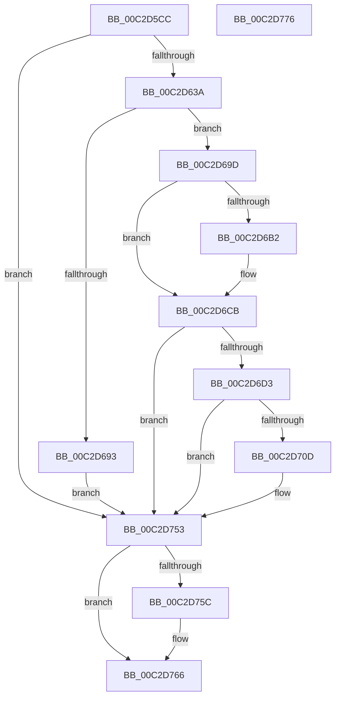

# IopStoreBootDriveLetter

- RVA: `0x00C2D5CC`–`0x00C2D777` (길이 `427` bytes)
- VA: `0x0000000140C2D5CC`
- 실행 섹션: `INIT`
- PDB 이름 있음: `예`; PDB Function 태그: `아니요`
- unwind 정보 RVA: `0x000C7234`
- 디코드: `114`개 명령, `427/427` bytes 표시
- 미해석 바이트: `0` (있으면 어셈블리에 `.byte`로 보존)

> 이 문서는 커널 이미지의 기계어와 PDB 기호를 분석해 생성했습니다. 4번과 5번은 함수 원형과 자료형을 바이너리 사용 방식에서 추정한 C 해석이며 원본 소스 복구 결과는 아닙니다.

## 1. Dependencies

- 직접 호출 지점: **9**; 고유 호출 대상: **9**
- 직접 호출자로 확인된 함수: **1**
- RIP 상대 이미지 참조: **4**

### Outgoing calls
- `0x00C2D615` → [RtlInitUnicodeString](../../text/42/RtlInitUnicodeString_function_0042A780.md) (function, `0x0042A780`)
- `0x00C2D62B` → [IoGetDeviceObjectPointer](../../page/95/IoGetDeviceObjectPointer_function_00953220.md) (function, `0x00953220`)
- `0x00C2D689` → [IoBuildDeviceIoControlRequest](../../text/20/IoBuildDeviceIoControlRequest_function_00204FD0.md) (function, `0x00204FD0`)
- `0x00C2D6A4` → [IofCallDriver](../../text/29/IofCallDriver_function_0029B4B0.md) (function, `0x0029B4B0`)
- `0x00C2D6C3` → [KeWaitForSingleObject](../../text/20/KeWaitForSingleObject_function_0020E6B0.md) (function, `0x0020E6B0`)
- `0x00C2D6D3` → [RtlGetHostNtSystemRoot](../../page/AB/RtlGetHostNtSystemRoot_function_00AB7800.md) (function, `0x00AB7800`)
- `0x00C2D702` → [RtlUnicodeStringPrintf](../../text/48/RtlUnicodeStringPrintf_function_0048B984.md) (function, `0x0048B984`)
- `0x00C2D74C` → [RtlWriteRegistryValue](../../page/A6/RtlWriteRegistryValue_function_00A6C620.md) (function, `0x00A6C620`)
- `0x00C2D761` → [ObfDereferenceObjectWithTag](../../text/2F/ObfDereferenceObjectWithTag_function_002F78E0.md) (function, `0x002F78E0`)

### Direct callers
- [IopMarkBootPartition](IopMarkBootPartition_function_00C2CFA0.md) at `0x00C2D16A`

### Static image references
- `0x00C2D5E2` → RVA `0x00C79B00` (` ?? ::PBOPGDP::`string'`; read)
- `0x00C2D6DB` → RVA `0x00C79C60` (` ?? ::PBOPGDP::`string'`; read)
- `0x00C2D6EB` → RVA `0x00FC5008` (`ALMOSTRO`; read)
- `0x00C2D710` → RVA `0x00C79C30` (` ?? ::PBOPGDP::`string'`; read)

## 2. Other-region calls and transfers

- 다른 실행 섹션으로 향하는 call: **9**
  - `0x00C2D615` → [RtlInitUnicodeString](../../text/42/RtlInitUnicodeString_function_0042A780.md) (`INIT` → `.text`)
  - `0x00C2D62B` → [IoGetDeviceObjectPointer](../../page/95/IoGetDeviceObjectPointer_function_00953220.md) (`INIT` → `PAGE`)
  - `0x00C2D689` → [IoBuildDeviceIoControlRequest](../../text/20/IoBuildDeviceIoControlRequest_function_00204FD0.md) (`INIT` → `.text`)
  - `0x00C2D6A4` → [IofCallDriver](../../text/29/IofCallDriver_function_0029B4B0.md) (`INIT` → `.text`)
  - `0x00C2D6C3` → [KeWaitForSingleObject](../../text/20/KeWaitForSingleObject_function_0020E6B0.md) (`INIT` → `.text`)
  - `0x00C2D6D3` → [RtlGetHostNtSystemRoot](../../page/AB/RtlGetHostNtSystemRoot_function_00AB7800.md) (`INIT` → `PAGE`)
  - `0x00C2D702` → [RtlUnicodeStringPrintf](../../text/48/RtlUnicodeStringPrintf_function_0048B984.md) (`INIT` → `.text`)
  - `0x00C2D74C` → [RtlWriteRegistryValue](../../page/A6/RtlWriteRegistryValue_function_00A6C620.md) (`INIT` → `PAGE`)
  - `0x00C2D761` → [ObfDereferenceObjectWithTag](../../text/2F/ObfDereferenceObjectWithTag_function_002F78E0.md) (`INIT` → `.text`)
- 별도 외부 분기/꼬리 이동을 확인하지 못했습니다.

## 3. Assembly (complete function range)

```asm
00C2D5CC  40 55                           push rbp
00C2D5CE  53                              push rbx
00C2D5CF  56                              push rsi
00C2D5D0  57                              push rdi
00C2D5D1  41 56                           push r14
00C2D5D3  48 8D 6C 24 C9                  lea rbp, [rsp - 0x37]
00C2D5D8  48 81 EC 90 00 00 00            sub rsp, 0x90
00C2D5DF  0F 57 C0                        xorps xmm0, xmm0
00C2D5E2  48 8D 15 17 C5 04 00            lea rdx, [rip + 0x4c517]
00C2D5E9  45 33 F6                        xor r14d, r14d
00C2D5EC  48 8B F1                        mov rsi, rcx
00C2D5EF  33 C0                           xor eax, eax
00C2D5F1  44 89 75 77                     mov dword ptr [rbp + 0x77], r14d
00C2D5F5  48 8D 4D FF                     lea rcx, [rbp - 1]
00C2D5F9  4C 89 75 7F                     mov qword ptr [rbp + 0x7f], r14
00C2D5FD  0F 11 45 FF                     movups xmmword ptr [rbp - 1], xmm0
00C2D601  44 88 75 6F                     mov byte ptr [rbp + 0x6f], r14b
00C2D605  0F 11 45 1F                     movups xmmword ptr [rbp + 0x1f], xmm0
00C2D609  48 89 45 2F                     mov qword ptr [rbp + 0x2f], rax
00C2D60D  0F 11 45 0F                     movups xmmword ptr [rbp + 0xf], xmm0
00C2D611  4C 89 75 F7                     mov qword ptr [rbp - 9], r14
00C2D615  E8 66 D1 7F FF                  call 0x14042a780
00C2D61A  4C 8D 4D 7F                     lea r9, [rbp + 0x7f]
00C2D61E  BA 80 00 00 00                  mov edx, 0x80
00C2D623  4C 8D 45 F7                     lea r8, [rbp - 9]
00C2D627  48 8D 4D FF                     lea rcx, [rbp - 1]
00C2D62B  E8 F0 5B D2 FF                  call 0x140953220
00C2D630  8B D8                           mov ebx, eax
00C2D632  85 C0                           test eax, eax
00C2D634  0F 88 19 01 00 00               js 0x140c2d753
00C2D63A  48 8B 55 7F                     mov rdx, qword ptr [rbp + 0x7f]
00C2D63E  48 8D 45 27                     lea rax, [rbp + 0x27]
00C2D642  48 89 45 2F                     mov qword ptr [rbp + 0x2f], rax
00C2D646  45 33 C9                        xor r9d, r9d
00C2D649  48 8D 45 27                     lea rax, [rbp + 0x27]
00C2D64D  C6 45 21 06                     mov byte ptr [rbp + 0x21], 6
00C2D651  48 89 45 27                     mov qword ptr [rbp + 0x27], rax
00C2D655  45 33 C0                        xor r8d, r8d
00C2D658  48 8D 45 0F                     lea rax, [rbp + 0xf]
00C2D65C  44 89 75 23                     mov dword ptr [rbp + 0x23], r14d
00C2D660  48 89 44 24 40                  mov qword ptr [rsp + 0x40], rax
00C2D665  B9 44 C0 6D 00                  mov ecx, 0x6dc044
00C2D66A  48 8D 45 1F                     lea rax, [rbp + 0x1f]
00C2D66E  48 89 44 24 38                  mov qword ptr [rsp + 0x38], rax
00C2D673  48 8D 45 6F                     lea rax, [rbp + 0x6f]
00C2D677  44 88 74 24 30                  mov byte ptr [rsp + 0x30], r14b
00C2D67C  C7 44 24 28 01 00 00 00         mov dword ptr [rsp + 0x28], 1
00C2D684  48 89 44 24 20                  mov qword ptr [rsp + 0x20], rax
00C2D689  E8 42 79 5D FF                  call 0x140204fd0
00C2D68E  48 85 C0                        test rax, rax
00C2D691  75 0A                           jne 0x140c2d69d
00C2D693  BB 9A 00 00 C0                  mov ebx, 0xc000009a
00C2D698  E9 B6 00 00 00                  jmp 0x140c2d753
00C2D69D  48 8B 4D 7F                     mov rcx, qword ptr [rbp + 0x7f]
00C2D6A1  48 8B D0                        mov rdx, rax
00C2D6A4  E8 07 DE 66 FF                  call 0x14029b4b0
00C2D6A9  8B D8                           mov ebx, eax
00C2D6AB  3D 03 01 00 00                  cmp eax, 0x103
00C2D6B0  75 19                           jne 0x140c2d6cb
00C2D6B2  45 33 C9                        xor r9d, r9d
00C2D6B5  4C 89 74 24 20                  mov qword ptr [rsp + 0x20], r14
00C2D6BA  45 33 C0                        xor r8d, r8d
00C2D6BD  48 8D 4D 1F                     lea rcx, [rbp + 0x1f]
00C2D6C1  33 D2                           xor edx, edx
00C2D6C3  E8 E8 0F 5E FF                  call 0x14020e6b0
00C2D6C8  8B 5D 0F                        mov ebx, dword ptr [rbp + 0xf]
00C2D6CB  85 DB                           test ebx, ebx
00C2D6CD  0F 88 80 00 00 00               js 0x140c2d753
00C2D6D3  E8 28 A1 E8 FF                  call 0x140ab7800
00C2D6D8  4C 8B CE                        mov r9, rsi
00C2D6DB  48 8D 15 7E C5 04 00            lea rdx, [rip + 0x4c57e]
00C2D6E2  48 8B F8                        mov rdi, rax
00C2D6E5  66 C7 40 02 08 02               mov word ptr [rax + 2], 0x208
00C2D6EB  48 8B 0D 16 79 39 00            mov rcx, qword ptr [rip + 0x397916]
00C2D6F2  48 83 C1 30                     add rcx, 0x30
00C2D6F6  48 89 48 08                     mov qword ptr [rax + 8], rcx
00C2D6FA  48 8B C8                        mov rcx, rax
00C2D6FD  44 0F BE 45 6F                  movsx r8d, byte ptr [rbp + 0x6f]
00C2D702  E8 7D E2 85 FF                  call 0x14048b984
00C2D707  8B D8                           mov ebx, eax
00C2D709  85 C0                           test eax, eax
00C2D70B  78 46                           js 0x140c2d753
00C2D70D  0F B7 07                        movzx eax, word ptr [rdi]
00C2D710  4C 8D 05 19 C5 04 00            lea r8, [rip + 0x4c519]
00C2D717  B9 02 00 00 00                  mov ecx, 2
00C2D71C  66 2B C1                        sub ax, cx
00C2D71F  66 89 07                        mov word ptr [rdi], ax
00C2D722  0F B7 D0                        movzx edx, ax
00C2D725  48 8B 47 08                     mov rax, qword ptr [rdi + 8]
00C2D729  44 8D 49 02                     lea r9d, [rcx + 2]
00C2D72D  48 D1 EA                        shr rdx, 1
00C2D730  44 89 4C 24 28                  mov dword ptr [rsp + 0x28], r9d
00C2D735  66 44 89 34 50                  mov word ptr [rax + rdx*2], r14w
00C2D73A  33 D2                           xor edx, edx
00C2D73C  0F BE 45 6F                     movsx eax, byte ptr [rbp + 0x6f]
00C2D740  89 45 77                        mov dword ptr [rbp + 0x77], eax
00C2D743  48 8D 45 77                     lea rax, [rbp + 0x77]
00C2D747  48 89 44 24 20                  mov qword ptr [rsp + 0x20], rax
00C2D74C  E8 CF EE E3 FF                  call 0x140a6c620
00C2D751  8B D8                           mov ebx, eax
00C2D753  48 8B 4D F7                     mov rcx, qword ptr [rbp - 9]
00C2D757  48 85 C9                        test rcx, rcx
00C2D75A  74 0A                           je 0x140c2d766
00C2D75C  BA 44 66 6C 74                  mov edx, 0x746c6644
00C2D761  E8 7A A1 6C FF                  call 0x1402f78e0
00C2D766  8B C3                           mov eax, ebx
00C2D768  48 81 C4 90 00 00 00            add rsp, 0x90
00C2D76F  41 5E                           pop r14
00C2D771  5F                              pop rdi
00C2D772  5E                              pop rsi
00C2D773  5B                              pop rbx
00C2D774  5D                              pop rbp
00C2D775  C3                              ret
00C2D776  CC                              int3
```

## 4. C-style interpretation (structured pseudocode)

```c
__int64 __fastcall IopStoreBootDriveLetter(__int64 a1)
{
    __int64 result;
    __int64 v_r14;
    __int64 v_rbx;
    __int64 v_rsp;
    unsigned __int64 v_stack_m30;
    unsigned __int64 v_stack_m38;
    unsigned int v_stack_m3C;
    unsigned __int8 v_stack_m3E;
    unsigned __int64 v_stack_m40;
    unsigned __int64 v_stack_m50;
    unsigned __int64 v_stack_m5F;
    unsigned __int64 v_stack_m60;
    unsigned __int64 v_stack_m68;
    unsigned __int64 v_stack_m78;
    unsigned __int64 v_stack_m80;
    unsigned __int8 v_stack_m88;
    unsigned int v_stack_m90;
    unsigned __int64 v_stack_m98;
    unsigned __int8 v_stack_p10;
    unsigned int v_stack_p18;
    unsigned __int64 v_stack_p20;

    v_rsp = (v_rsp) - (144);
    v_r14 = 0;
    result = 0;
    v_stack_p18 = 0;
    v_stack_p20 = 0;
    v_stack_m60 = v_xmm0;
    v_stack_p10 = 0;
    v_stack_m40 = v_xmm0;
    v_stack_m30 = 0;
    v_stack_m50 = v_xmm0;
    v_stack_m68 = 0;
    result = RtlInitUnicodeString(v_stack_m60, v_rip + 312599, a3, a4);
    result = IoGetDeviceObjectPointer(v_stack_m60, 128, v_stack_m68, v_stack_p20);
    if (sign_flag) goto loc_00C2D753;
    v_stack_m30 = v_stack_m38;
    a4 = 0;
    v_stack_m3E = 6;
    v_stack_m38 = v_stack_m38;
    a3 = 0;
    v_stack_m3C = 0;
    v_stack_m78 = v_stack_m50;
    v_stack_m80 = v_stack_m40;
    v_stack_m88 = 0;
    v_stack_m90 = 1;
    v_stack_m98 = v_stack_p10;
    result = IoBuildDeviceIoControlRequest((unsigned int)(0x6DC044ULL), v_stack_p20, a3, a4);
    if (result != 0) goto loc_00C2D69D;
    goto loc_00C2D753;
loc_00C2D69D:
    result = IofCallDriver(v_stack_p20, result, a3, a4);
    v_rbx = (unsigned int)((unsigned int)(result));
    if (((unsigned int)(result)) == 259) {
        a4 = 0;
        v_stack_m98 = 0;
        a3 = 0;
        a1 = v_stack_m40;
        a2 = 0;
        result = KeWaitForSingleObject(a1, a2, a3, a4);
        v_rbx = v_stack_m50;
    }
    if (sign_flag) goto loc_00C2D753;
    result = RtlGetHostNtSystemRoot(a1, a2, a3, a4);
    *(unsigned __int16 *)(result + 2) = 520;
    a1 = (*(unsigned __int64 *)(v_rip + 3766550)) + (48);
    *(unsigned __int64 *)(result + 8) = a1;
    result = RtlUnicodeStringPrintf(result, v_rip + 312702, (__int8)(v_stack_p10), a1);
    v_rbx = (unsigned int)((unsigned int)(result));
    if (!(sign_flag)) {
        result = *(unsigned __int16 *)(result);
        a3 = v_rip + 312601;
        a1 = 2;
        result = (unsigned __int16)((result) - ((unsigned __int16)(a1)));
        *(unsigned __int16 *)(result) = (unsigned __int16)(result);
        a2 = (unsigned __int16)(result);
        result = *(unsigned __int64 *)(result + 8);
        a4 = a1 + 2;
        a2 = (a2) >> (1);
        v_stack_m90 = (unsigned int)(a4);
        *(unsigned __int16 *)(result + a2 * 2) = 0;
        a2 = 0;
        result = (__int8)(v_stack_p10);
        v_stack_p18 = (unsigned int)(result);
        result = v_stack_p18;
        v_stack_m98 = result;
        result = RtlWriteRegistryValue(a1, a2, a3, a4);
        v_rbx = (unsigned int)(result);
    }
    if (v_stack_m68 != 0) {
        a2 = 0x746C6644ULL;
        result = ObfDereferenceObjectWithTag(v_stack_m68, a2, a3, a4);
    }
    v_rsp = (v_rsp) + (144);
    return (unsigned int)((unsigned int)(v_rbx));
}
```

## 5. (Beta) C Style

```c
int64_t IopStoreBootDriveLetter(int64_t Arg1)
{
    int64_t result;
    int64_t local_r14;
    int64_t local_rbx;
    int64_t local_rsp;
    uint64_t v_stack_m30;
    uint64_t v_stack_m38;
    uint32_t v_stack_m3C;
    uint8_t v_stack_m3E;
    uint64_t v_stack_m40;
    uint64_t v_stack_m50;
    uint64_t v_stack_m5F;
    uint64_t v_stack_m60;
    uint64_t v_stack_m68;
    uint64_t v_stack_m78;
    uint64_t v_stack_m80;
    uint8_t v_stack_m88;
    uint32_t v_stack_m90;
    uint64_t v_stack_m98;
    uint8_t v_stack_p10;
    uint32_t v_stack_p18;
    uint64_t v_stack_p20;

    local_rsp = (local_rsp) - (144);
    local_r14 = 0;
    result = 0;
    v_stack_p18 = 0;
    v_stack_p20 = 0;
    v_stack_m60 = v_xmm0;
    v_stack_p10 = 0;
    v_stack_m40 = v_xmm0;
    v_stack_m30 = 0;
    v_stack_m50 = v_xmm0;
    v_stack_m68 = 0;
    result = RtlInitUnicodeString(v_stack_m60, v_rip + 312599, a3, a4);
    result = IoGetDeviceObjectPointer(v_stack_m60, 128, v_stack_m68, v_stack_p20);
    if (sign_flag) goto loc_00C2D753;
    v_stack_m30 = v_stack_m38;
    a4 = 0;
    v_stack_m3E = 6;
    v_stack_m38 = v_stack_m38;
    a3 = 0;
    v_stack_m3C = 0;
    v_stack_m78 = v_stack_m50;
    v_stack_m80 = v_stack_m40;
    v_stack_m88 = 0;
    v_stack_m90 = 1;
    v_stack_m98 = v_stack_p10;
    result = IoBuildDeviceIoControlRequest((uint32_t)(0x6DC044ULL), v_stack_p20, a3, a4);
    if (result != 0) goto loc_00C2D69D;
    goto loc_00C2D753;
loc_00C2D69D:
    result = IofCallDriver(v_stack_p20, result, a3, a4);
    local_rbx = (uint32_t)((uint32_t)(result));
    if (((uint32_t)(result)) == 259) {
        a4 = 0;
        v_stack_m98 = 0;
        a3 = 0;
        Arg1 = v_stack_m40;
        a2 = 0;
        result = KeWaitForSingleObject(Arg1, a2, a3, a4);
        local_rbx = v_stack_m50;
    }
    if (sign_flag) goto loc_00C2D753;
    result = RtlGetHostNtSystemRoot(Arg1, a2, a3, a4);
    *(uint16_t *)(result + 0x2) = 520;
    Arg1 = (*(uint64_t *)(v_rip + 0x397916)) + (48);
    *(uint64_t *)(result + 0x8) = Arg1;
    result = RtlUnicodeStringPrintf(result, v_rip + 312702, (int8_t)(v_stack_p10), Arg1);
    local_rbx = (uint32_t)((uint32_t)(result));
    if (!(sign_flag)) {
        result = *(uint16_t *)(result);
        a3 = v_rip + 312601;
        Arg1 = 2;
        result = (uint16_t)((result) - ((uint16_t)(Arg1)));
        *(uint16_t *)(result) = (uint16_t)(result);
        a2 = (uint16_t)(result);
        result = *(uint64_t *)(result + 0x8);
        a4 = Arg1 + 2;
        a2 = (a2) >> (1);
        v_stack_m90 = (uint32_t)(a4);
        *(uint16_t *)(result + a2 * 2) = 0;
        a2 = 0;
        result = (int8_t)(v_stack_p10);
        v_stack_p18 = (uint32_t)(result);
        result = v_stack_p18;
        v_stack_m98 = result;
        result = RtlWriteRegistryValue(Arg1, a2, a3, a4);
        local_rbx = (uint32_t)(result);
    }
    if (v_stack_m68 != 0) {
        a2 = 0x746C6644ULL;
        result = ObfDereferenceObjectWithTag(v_stack_m68, a2, a3, a4);
    }
    local_rsp = (local_rsp) + (144);
    return (uint32_t)((uint32_t)(local_rbx));
}
```

## 6. Execution-region graph

[열기: 2D/3D 그래프와 함수 탐색 컨트롤 패널](../../../control-panel.html?section=init&rva=0x00C2D5CC&view=graph)

- 2D 그래프는 위에서 아래로 흐르고, 3D 그래프는 빈 공간을 드래그해 회전합니다. Shift+드래그는 이동, 휠은 확대·축소, 함수 노드 선택은 대상 보고서 이동입니다.

### Static fallback


