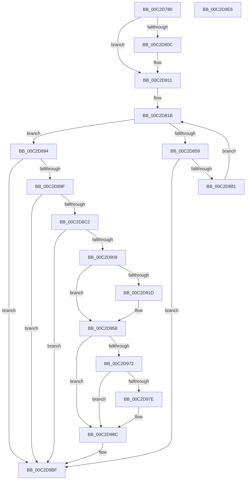

# IopStoreSystemPartitionInformation

- RVA: `0x00C2D780`–`0x00C2D9E7` (길이 `615` bytes)
- VA: `0x0000000140C2D780`
- 실행 섹션: `INIT`
- PDB 이름 있음: `예`; PDB Function 태그: `아니요`
- unwind 정보 RVA: `0x000C71F0`
- 디코드: `143`개 명령, `615/615` bytes 표시
- 미해석 바이트: `0` (있으면 어셈블리에 `.byte`로 보존)

> 이 문서는 커널 이미지의 기계어와 PDB 기호를 분석해 생성했습니다. 4번과 5번은 함수 원형과 자료형을 바이너리 사용 방식에서 추정한 C 해석이며 원본 소스 복구 결과는 아닙니다.

## 1. Dependencies

- 직접 호출 지점: **14**; 고유 호출 대상: **9**
- 직접 호출자로 확인된 함수: **1**
- RIP 상대 이미지 참조: **8**

### Outgoing calls
- `0x00C2D7E5` → [RtlStringCchCopyW](../../text/26/RtlStringCchCopyW_function_0026E9A4.md) (function, `0x0026E9A4`)
- `0x00C2D850` → [ZwOpenSymbolicLinkObject](../../text/6A/ZwOpenSymbolicLinkObject_function_006AF7F0.md) (function, `0x006AF7F0`)
- `0x00C2D866` → [NtQuerySymbolicLinkObject](../../page/9E/NtQuerySymbolicLinkObject_function_009EBA20.md) (function, `0x009EBA20`)
- `0x00C2D874` → [ObCloseHandle](../../page/8A/ObCloseHandle_function_008A1870.md) (function, `0x008A1870`)
- `0x00C2D8B5` → [IopOpenRegistryKeyEx](../../page/A5/IopOpenRegistryKeyEx_function_00A51B44.md) (function, `0x00A51B44`)
- `0x00C2D8CE` → [RtlInitUnicodeString](../../text/42/RtlInitUnicodeString_function_0042A780.md) (function, `0x0042A780`)
- `0x00C2D8EE` → [IopCreateRegistryKeyEx](../../page/A8/IopCreateRegistryKeyEx_function_00A89038.md) (function, `0x00A89038`)
- `0x00C2D8FC` → [ObCloseHandle](../../page/8A/ObCloseHandle_function_008A1870.md) (function, `0x008A1870`)
- `0x00C2D929` → [RtlInitUnicodeString](../../text/42/RtlInitUnicodeString_function_0042A780.md) (function, `0x0042A780`)
- `0x00C2D953` → [NtSetValueKey](../../page/84/NtSetValueKey_function_00844EA0.md) (function, `0x00844EA0`)
- `0x00C2D964` → [RtlInitUnicodeString](../../text/42/RtlInitUnicodeString_function_0042A780.md) (function, `0x0042A780`)
- `0x00C2D9B0` → [NtSetValueKey](../../page/84/NtSetValueKey_function_00844EA0.md) (function, `0x00844EA0`)
- `0x00C2D9BA` → [ObCloseHandle](../../page/8A/ObCloseHandle_function_008A1870.md) (function, `0x008A1870`)
- `0x00C2D9C9` → [_security_check_cookie](../../text/6A/_security_check_cookie_function_006AC640.md) (function, `0x006AC640`)

### Direct callers
- [IopMarkBootPartition](IopMarkBootPartition_function_00C2CFA0.md) at `0x00C2D191`

### Static image references
- `0x00C2D79D` → RVA `0x00E0A740` (`.data`; read)
- `0x00C2D7AE` → RVA `0x00FDA410` (`PAGEDATA`; read)
- `0x00C2D7EA` → RVA `0x00FDA408` (`PAGEDATA`; read)
- `0x00C2D8A4` → RVA `0x00FDA0D8` (`PAGEDATA`; read)
- `0x00C2D8C2` → RVA `0x00C79C20` (` ?? ::PBOPGDP::`string'`; read)
- `0x00C2D909` → RVA `0x00FC4148` (`.data`; read)
- `0x00C2D91D` → RVA `0x00C79C00` (` ?? ::PBOPGDP::`string'`; read)
- `0x00C2D958` → RVA `0x00C79CF0` (` ?? ::PBOPGDP::`string'`; read)

## 2. Other-region calls and transfers

- 다른 실행 섹션으로 향하는 call: **14**
  - `0x00C2D7E5` → [RtlStringCchCopyW](../../text/26/RtlStringCchCopyW_function_0026E9A4.md) (`INIT` → `.text`)
  - `0x00C2D850` → [ZwOpenSymbolicLinkObject](../../text/6A/ZwOpenSymbolicLinkObject_function_006AF7F0.md) (`INIT` → `.text`)
  - `0x00C2D866` → [NtQuerySymbolicLinkObject](../../page/9E/NtQuerySymbolicLinkObject_function_009EBA20.md) (`INIT` → `PAGE`)
  - `0x00C2D874` → [ObCloseHandle](../../page/8A/ObCloseHandle_function_008A1870.md) (`INIT` → `PAGE`)
  - `0x00C2D8B5` → [IopOpenRegistryKeyEx](../../page/A5/IopOpenRegistryKeyEx_function_00A51B44.md) (`INIT` → `PAGE`)
  - `0x00C2D8CE` → [RtlInitUnicodeString](../../text/42/RtlInitUnicodeString_function_0042A780.md) (`INIT` → `.text`)
  - `0x00C2D8EE` → [IopCreateRegistryKeyEx](../../page/A8/IopCreateRegistryKeyEx_function_00A89038.md) (`INIT` → `PAGE`)
  - `0x00C2D8FC` → [ObCloseHandle](../../page/8A/ObCloseHandle_function_008A1870.md) (`INIT` → `PAGE`)
  - `0x00C2D929` → [RtlInitUnicodeString](../../text/42/RtlInitUnicodeString_function_0042A780.md) (`INIT` → `.text`)
  - `0x00C2D953` → [NtSetValueKey](../../page/84/NtSetValueKey_function_00844EA0.md) (`INIT` → `PAGE`)
  - `0x00C2D964` → [RtlInitUnicodeString](../../text/42/RtlInitUnicodeString_function_0042A780.md) (`INIT` → `.text`)
  - `0x00C2D9B0` → [NtSetValueKey](../../page/84/NtSetValueKey_function_00844EA0.md) (`INIT` → `PAGE`)
  - `0x00C2D9BA` → [ObCloseHandle](../../page/8A/ObCloseHandle_function_008A1870.md) (`INIT` → `PAGE`)
  - `0x00C2D9C9` → [_security_check_cookie](../../text/6A/_security_check_cookie_function_006AC640.md) (`INIT` → `.text`)
- 별도 외부 분기/꼬리 이동을 확인하지 못했습니다.

## 3. Assembly (complete function range)

```asm
00C2D780  48 89 5C 24 08                  mov qword ptr [rsp + 8], rbx
00C2D785  48 89 74 24 18                  mov qword ptr [rsp + 0x18], rsi
00C2D78A  55                              push rbp
00C2D78B  57                              push rdi
00C2D78C  41 56                           push r14
00C2D78E  48 8D AC 24 50 FE FF FF         lea rbp, [rsp - 0x1b0]
00C2D796  48 81 EC B0 02 00 00            sub rsp, 0x2b0
00C2D79D  48 8B 05 9C CF 1D 00            mov rax, qword ptr [rip + 0x1dcf9c]
00C2D7A4  48 33 C4                        xor rax, rsp
00C2D7A7  48 89 85 A0 01 00 00            mov qword ptr [rbp + 0x1a0], rax
00C2D7AE  4C 8B 05 5B CC 3A 00            mov r8, qword ptr [rip + 0x3acc5b]
00C2D7B5  48 8D 4D A0                     lea rcx, [rbp - 0x60]
00C2D7B9  33 F6                           xor esi, esi
00C2D7BB  48 8B FA                        mov rdi, rdx
00C2D7BE  0F 57 C0                        xorps xmm0, xmm0
00C2D7C1  48 89 74 24 40                  mov qword ptr [rsp + 0x40], rsi
00C2D7C6  BA 00 01 00 00                  mov edx, 0x100
00C2D7CB  89 74 24 6C                     mov dword ptr [rsp + 0x6c], esi
00C2D7CF  89 75 84                        mov dword ptr [rbp - 0x7c], esi
00C2D7D2  48 89 74 24 48                  mov qword ptr [rsp + 0x48], rsi
00C2D7D7  48 89 74 24 60                  mov qword ptr [rsp + 0x60], rsi
00C2D7DC  0F 11 44 24 50                  movups xmmword ptr [rsp + 0x50], xmm0
00C2D7E1  89 74 24 34                     mov dword ptr [rsp + 0x34], esi
00C2D7E5  E8 BA 11 64 FF                  call 0x14026e9a4
00C2D7EA  44 0F B7 1D 16 CC 3A 00         movzx r11d, word ptr [rip + 0x3acc16]
00C2D7F2  48 8D 45 A0                     lea rax, [rbp - 0x60]
00C2D7F6  48 89 44 24 38                  mov qword ptr [rsp + 0x38], rax
00C2D7FB  B8 00 02 00 00                  mov eax, 0x200
00C2D800  66 44 89 5C 24 30               mov word ptr [rsp + 0x30], r11w
00C2D806  66 41 3B C3                     cmp ax, r11w
00C2D80A  73 05                           jae 0x140c2d811
00C2D80C  66 89 44 24 30                  mov word ptr [rsp + 0x30], ax
00C2D811  B8 FE 01 00 00                  mov eax, 0x1fe
00C2D816  66 89 44 24 32                  mov word ptr [rsp + 0x32], ax
00C2D81B  48 8D 44 24 30                  lea rax, [rsp + 0x30]
00C2D820  C7 44 24 68 30 00 00 00         mov dword ptr [rsp + 0x68], 0x30
00C2D828  0F 57 C0                        xorps xmm0, xmm0
00C2D82B  48 89 44 24 78                  mov qword ptr [rsp + 0x78], rax
00C2D830  4C 8D 44 24 68                  lea r8, [rsp + 0x68]
00C2D835  48 89 74 24 70                  mov qword ptr [rsp + 0x70], rsi
00C2D83A  BA 01 00 00 00                  mov edx, 1
00C2D83F  C7 45 80 40 02 00 00            mov dword ptr [rbp - 0x80], 0x240
00C2D846  48 8D 4C 24 40                  lea rcx, [rsp + 0x40]
00C2D84B  F3 0F 7F 45 88                  movdqu xmmword ptr [rbp - 0x78], xmm0
00C2D850  E8 9B 1F A8 FF                  call 0x1406af7f0
00C2D855  85 C0                           test eax, eax
00C2D857  78 3B                           js 0x140c2d894
00C2D859  48 8B 4C 24 40                  mov rcx, qword ptr [rsp + 0x40]
00C2D85E  48 8D 54 24 30                  lea rdx, [rsp + 0x30]
00C2D863  45 33 C0                        xor r8d, r8d
00C2D866  E8 B5 E1 DB FF                  call 0x1409eba20
00C2D86B  48 8B 4C 24 40                  mov rcx, qword ptr [rsp + 0x40]
00C2D870  33 D2                           xor edx, edx
00C2D872  8B D8                           mov ebx, eax
00C2D874  E8 F7 3F C7 FF                  call 0x1408a1870
00C2D879  85 DB                           test ebx, ebx
00C2D87B  0F 88 3E 01 00 00               js 0x140c2d9bf
00C2D881  0F B7 4C 24 30                  movzx ecx, word ptr [rsp + 0x30]
00C2D886  48 8B 44 24 38                  mov rax, qword ptr [rsp + 0x38]
00C2D88B  48 D1 E9                        shr rcx, 1
00C2D88E  66 89 34 48                     mov word ptr [rax + rcx*2], si
00C2D892  EB 87                           jmp 0x140c2d81b
00C2D894  3D 24 00 00 C0                  cmp eax, 0xc0000024
00C2D899  0F 85 20 01 00 00               jne 0x140c2d9bf
00C2D89F  BB 3F 00 0F 00                  mov ebx, 0xf003f
00C2D8A4  4C 8D 05 2D C8 3A 00            lea r8, [rip + 0x3ac82d]
00C2D8AB  44 8B CB                        mov r9d, ebx
00C2D8AE  48 8D 4C 24 48                  lea rcx, [rsp + 0x48]
00C2D8B3  33 D2                           xor edx, edx
00C2D8B5  E8 8A 42 E2 FF                  call 0x140a51b44
00C2D8BA  85 C0                           test eax, eax
00C2D8BC  0F 88 FD 00 00 00               js 0x140c2d9bf
00C2D8C2  48 8D 15 57 C3 04 00            lea rdx, [rip + 0x4c357]
00C2D8C9  48 8D 4C 24 50                  lea rcx, [rsp + 0x50]
00C2D8CE  E8 AD CE 7F FF                  call 0x14042a780
00C2D8D3  48 8B 54 24 48                  mov rdx, qword ptr [rsp + 0x48]
00C2D8D8  4C 8D 44 24 50                  lea r8, [rsp + 0x50]
00C2D8DD  44 8B CB                        mov r9d, ebx
00C2D8E0  48 89 74 24 28                  mov qword ptr [rsp + 0x28], rsi
00C2D8E5  48 8D 4C 24 60                  lea rcx, [rsp + 0x60]
00C2D8EA  89 74 24 20                     mov dword ptr [rsp + 0x20], esi
00C2D8EE  E8 45 B7 E5 FF                  call 0x140a89038
00C2D8F3  48 8B 4C 24 48                  mov rcx, qword ptr [rsp + 0x48]
00C2D8F8  33 D2                           xor edx, edx
00C2D8FA  8B D8                           mov ebx, eax
00C2D8FC  E8 6F 3F C7 FF                  call 0x1408a1870
00C2D901  85 DB                           test ebx, ebx
00C2D903  0F 88 B6 00 00 00               js 0x140c2d9bf
00C2D909  40 38 35 38 68 39 00            cmp byte ptr [rip + 0x396838], sil
00C2D910  41 BE 02 00 00 00               mov r14d, 2
00C2D916  48 8B 5C 24 60                  mov rbx, qword ptr [rsp + 0x60]
00C2D91B  75 3B                           jne 0x140c2d958
00C2D91D  48 8D 15 DC C2 04 00            lea rdx, [rip + 0x4c2dc]
00C2D924  48 8D 4C 24 50                  lea rcx, [rsp + 0x50]
00C2D929  E8 52 CE 7F FF                  call 0x14042a780
00C2D92E  0F B7 44 24 30                  movzx eax, word ptr [rsp + 0x30]
00C2D933  45 8D 4E FF                     lea r9d, [r14 - 1]
00C2D937  41 03 C6                        add eax, r14d
00C2D93A  48 8D 54 24 50                  lea rdx, [rsp + 0x50]
00C2D93F  89 44 24 28                     mov dword ptr [rsp + 0x28], eax
00C2D943  45 33 C0                        xor r8d, r8d
00C2D946  48 8B 44 24 38                  mov rax, qword ptr [rsp + 0x38]
00C2D94B  48 8B CB                        mov rcx, rbx
00C2D94E  48 89 44 24 20                  mov qword ptr [rsp + 0x20], rax
00C2D953  E8 48 75 C1 FF                  call 0x140844ea0
00C2D958  48 8D 15 91 C3 04 00            lea rdx, [rip + 0x4c391]
00C2D95F  48 8D 4C 24 50                  lea rcx, [rsp + 0x50]
00C2D964  E8 17 CE 7F FF                  call 0x14042a780
00C2D969  0F B7 0F                        movzx ecx, word ptr [rdi]
00C2D96C  66 41 3B CE                     cmp cx, r14w
00C2D970  76 1A                           jbe 0x140c2d98c
00C2D972  48 8B 57 08                     mov rdx, qword ptr [rdi + 8]
00C2D976  66 83 7C 11 FE 5C               cmp word ptr [rcx + rdx - 2], 0x5c
00C2D97C  75 0E                           jne 0x140c2d98c
00C2D97E  66 41 2B CE                     sub cx, r14w
00C2D982  0F B7 C1                        movzx eax, cx
00C2D985  66 89 07                        mov word ptr [rdi], ax
00C2D988  66 89 34 10                     mov word ptr [rax + rdx], si
00C2D98C  0F B7 07                        movzx eax, word ptr [rdi]
00C2D98F  48 8D 54 24 50                  lea rdx, [rsp + 0x50]
00C2D994  41 03 C6                        add eax, r14d
00C2D997  41 B9 01 00 00 00               mov r9d, 1
00C2D99D  89 44 24 28                     mov dword ptr [rsp + 0x28], eax
00C2D9A1  45 33 C0                        xor r8d, r8d
00C2D9A4  48 8B 47 08                     mov rax, qword ptr [rdi + 8]
00C2D9A8  48 8B CB                        mov rcx, rbx
00C2D9AB  48 89 44 24 20                  mov qword ptr [rsp + 0x20], rax
00C2D9B0  E8 EB 74 C1 FF                  call 0x140844ea0
00C2D9B5  33 D2                           xor edx, edx
00C2D9B7  48 8B CB                        mov rcx, rbx
00C2D9BA  E8 B1 3E C7 FF                  call 0x1408a1870
00C2D9BF  48 8B 8D A0 01 00 00            mov rcx, qword ptr [rbp + 0x1a0]
00C2D9C6  48 33 CC                        xor rcx, rsp
00C2D9C9  E8 72 EC A7 FF                  call 0x1406ac640
00C2D9CE  4C 8D 9C 24 B0 02 00 00         lea r11, [rsp + 0x2b0]
00C2D9D6  49 8B 5B 20                     mov rbx, qword ptr [r11 + 0x20]
00C2D9DA  49 8B 73 30                     mov rsi, qword ptr [r11 + 0x30]
00C2D9DE  49 8B E3                        mov rsp, r11
00C2D9E1  41 5E                           pop r14
00C2D9E3  5F                              pop rdi
00C2D9E4  5D                              pop rbp
00C2D9E5  C3                              ret
00C2D9E6  CC                              int3
```

## 4. C-style interpretation (structured pseudocode)

```c
__int64 __fastcall IopStoreSystemPartitionInformation(__int64 a1, __int64 a2)
{
    __int64 result;
    __int64 v_rsi;
    __int64 v_rsp;
    unsigned __int64 v_stack_m18;
    unsigned __int64 v_stack_m1C8;
    unsigned __int64 v_stack_m228;
    unsigned __int64 v_stack_m240;
    unsigned int v_stack_m244;
    unsigned int v_stack_m248;
    unsigned __int64 v_stack_m250;
    unsigned __int64 v_stack_m258;
    unsigned int v_stack_m25C;
    unsigned int v_stack_m260;
    unsigned __int64 v_stack_m268;
    unsigned __int64 v_stack_m278;
    unsigned __int64 v_stack_m28;
    unsigned __int64 v_stack_m280;
    unsigned __int64 v_stack_m288;
    unsigned __int64 v_stack_m290;
    unsigned int v_stack_m294;
    unsigned __int16 v_stack_m296;
    unsigned __int16 v_stack_m298;
    unsigned __int64 v_stack_m2A0;
    unsigned int v_stack_m2A8;
    unsigned __int64 v_stack_p18;
    unsigned __int64 v_stack_p8;

    v_stack_p8 = v_rbx;
    v_stack_p18 = v_rsi;
    v_rsp = (v_rsp) - (688);
    result = (*(unsigned __int64 *)(v_rip + 1953692)) ^ (v_rsp);
    v_stack_m28 = result;
    v_rsi = 0;
    v_stack_m288 = 0;
    v_stack_m25C = 0;
    v_stack_m244 = 0;
    v_stack_m280 = 0;
    v_stack_m268 = 0;
    v_stack_m278 = v_xmm0;
    v_stack_m294 = 0;
    result = RtlStringCchCopyW(v_stack_m228, 256, *(unsigned __int64 *)(v_rip + 3853403), a4);
    v_stack_m290 = v_stack_m228;
    v_stack_m298 = (unsigned __int16)(*(unsigned __int16 *)(v_rip + 3853334));
    if (512 < ((unsigned __int16)(*(unsigned __int16 *)(v_rip + 3853334)))) {
        v_stack_m298 = 512;
    }
    v_stack_m296 = 510;
loc_00C2D81B:
    v_stack_m260 = 48;
    v_stack_m250 = v_stack_m298;
    v_stack_m258 = 0;
    v_stack_m248 = 576;
    v_stack_m240 = v_xmm0;
    result = ZwOpenSymbolicLinkObject(v_stack_m288, 1, v_stack_m260, a4);
    if (sign_flag) goto loc_00C2D894;
    a3 = 0;
    result = NtQuerySymbolicLinkObject(v_stack_m288, v_stack_m298, a3, a4);
    a2 = 0;
    result = ObCloseHandle(v_stack_m288, a2, a3, a4);
    if (sign_flag) goto loc_00C2D9BF;
    a1 = (v_stack_m298) >> (1);
    *(unsigned __int16 *)(v_stack_m290 + a1 * 2) = 0;
    goto loc_00C2D81B;
loc_00C2D894:
    if (((unsigned int)(v_stack_m290)) != 0xC0000024ULL) goto loc_00C2D9BF;
    a2 = 0;
    result = IopOpenRegistryKeyEx(v_stack_m280, a2, v_rip + 3852333, (unsigned int)((unsigned int)((unsigned int)(0xF003FULL))));
    if (sign_flag) goto loc_00C2D9BF;
    result = RtlInitUnicodeString(v_stack_m278, v_rip + 312151, v_rip + 3852333, (unsigned int)((unsigned int)((unsigned int)(0xF003FULL))));
    v_stack_m2A0 = 0;
    v_stack_m2A8 = 0;
    result = IopCreateRegistryKeyEx(v_stack_m268, v_stack_m280, v_stack_m278, (unsigned int)((unsigned int)((unsigned int)(0xF003FULL))));
    a2 = 0;
    result = ObCloseHandle(v_stack_m280, a2, v_stack_m278, (unsigned int)((unsigned int)((unsigned int)(0xF003FULL))));
    if (sign_flag) goto loc_00C2D9BF;
    if ((*(unsigned __int8 *)(v_rip + 3762232)) == 0) {
        a2 = v_rip + 312028;
        a1 = v_stack_m278;
        result = RtlInitUnicodeString(a1, a2, v_stack_m278, (unsigned int)((unsigned int)((unsigned int)(0xF003FULL))));
        result = v_stack_m298;
        a4 = 2 - 1;
        result = (unsigned int)((result) + (2));
        a2 = v_stack_m278;
        v_stack_m2A0 = (unsigned int)(result);
        a3 = 0;
        result = v_stack_m290;
        a1 = v_stack_m268;
        v_stack_m2A8 = result;
        result = NtSetValueKey(a1, a2, a3, a4);
    }
    result = RtlInitUnicodeString(v_stack_m278, v_rip + 312209, a3, a4);
    if (((unsigned __int16)(*(unsigned __int16 *)(a2))) <= 2) goto loc_00C2D98C;
    if ((*(unsigned __int16 *)(*(unsigned __int16 *)(a2) + *(unsigned __int64 *)(a2 + 8) * 1 - 2)) == 92) {
        a1 = (unsigned __int16)((*(unsigned __int16 *)(a2)) - (2));
        result = (unsigned __int16)(a1);
        *(unsigned __int16 *)(a2) = (unsigned __int16)(result);
        *(unsigned __int16 *)(result + *(unsigned __int64 *)(a2 + 8) * 1) = 0;
    }
    result = (unsigned int)((*(unsigned __int16 *)(a2)) + (2));
    v_stack_m2A0 = (unsigned int)(result);
    a3 = 0;
    v_stack_m2A8 = *(unsigned __int64 *)(a2 + 8);
    result = NtSetValueKey(v_stack_m268, v_stack_m278, a3, 1);
    a2 = 0;
    result = ObCloseHandle(v_stack_m268, a2, a3, 1);
loc_00C2D9BF:
    a1 = (v_stack_m28) ^ (v_rsp);
    result = _security_check_cookie(a1, a2, a3, 1);
    return result;
}
```

## 5. (Beta) C Style

```c
int64_t IopStoreSystemPartitionInformation(int64_t Arg1, void *Arg2)
{
    uint8_t *arg2 = (uint8_t *)Arg2;

    int64_t result;
    int64_t local_rsi;
    int64_t local_rsp;
    uint64_t v_stack_m18;
    uint64_t v_stack_m1C8;
    uint64_t v_stack_m228;
    uint64_t v_stack_m240;
    uint32_t v_stack_m244;
    uint32_t v_stack_m248;
    uint64_t v_stack_m250;
    uint64_t v_stack_m258;
    uint32_t v_stack_m25C;
    uint32_t v_stack_m260;
    uint64_t v_stack_m268;
    uint64_t v_stack_m278;
    uint64_t v_stack_m28;
    uint64_t v_stack_m280;
    uint64_t v_stack_m288;
    uint64_t v_stack_m290;
    uint32_t v_stack_m294;
    uint16_t v_stack_m296;
    uint16_t v_stack_m298;
    uint64_t v_stack_m2A0;
    uint32_t v_stack_m2A8;
    uint64_t v_stack_p18;
    uint64_t v_stack_p8;

    v_stack_p8 = local_rbx;
    v_stack_p18 = local_rsi;
    local_rsp = (local_rsp) - (688);
    result = (*(uint64_t *)(v_rip + 0x1DCF9C)) ^ (local_rsp);
    v_stack_m28 = result;
    local_rsi = 0;
    v_stack_m288 = 0;
    v_stack_m25C = 0;
    v_stack_m244 = 0;
    v_stack_m280 = 0;
    v_stack_m268 = 0;
    v_stack_m278 = v_xmm0;
    v_stack_m294 = 0;
    result = RtlStringCchCopyW(v_stack_m228, 256, *(uint64_t *)(v_rip + 0x3ACC5B), a4);
    v_stack_m290 = v_stack_m228;
    v_stack_m298 = (uint16_t)(*(uint16_t *)(v_rip + 0x3ACC16));
    if (512 < ((uint16_t)(*(uint16_t *)(v_rip + 0x3ACC16)))) {
        v_stack_m298 = 512;
    }
    v_stack_m296 = 510;
loc_00C2D81B:
    v_stack_m260 = 48;
    v_stack_m250 = v_stack_m298;
    v_stack_m258 = 0;
    v_stack_m248 = 576;
    v_stack_m240 = v_xmm0;
    result = ZwOpenSymbolicLinkObject(v_stack_m288, 1, v_stack_m260, a4);
    if (sign_flag) goto loc_00C2D894;
    a3 = 0;
    result = NtQuerySymbolicLinkObject(v_stack_m288, v_stack_m298, a3, a4);
    Arg2 = 0;
    result = ObCloseHandle(v_stack_m288, Arg2, a3, a4);
    if (sign_flag) goto loc_00C2D9BF;
    Arg1 = (v_stack_m298) >> (1);
    *(uint16_t *)(v_stack_m290 + Arg1 * 2) = 0;
    goto loc_00C2D81B;
loc_00C2D894:
    if (((uint32_t)(v_stack_m290)) != 0xC0000024ULL) goto loc_00C2D9BF;
    Arg2 = 0;
    result = IopOpenRegistryKeyEx(v_stack_m280, Arg2, v_rip + 3852333, (uint32_t)((uint32_t)((uint32_t)(0xF003FULL))));
    if (sign_flag) goto loc_00C2D9BF;
    result = RtlInitUnicodeString(v_stack_m278, v_rip + 312151, v_rip + 3852333, (uint32_t)((uint32_t)((uint32_t)(0xF003FULL))));
    v_stack_m2A0 = 0;
    v_stack_m2A8 = 0;
    result = IopCreateRegistryKeyEx(v_stack_m268, v_stack_m280, v_stack_m278, (uint32_t)((uint32_t)((uint32_t)(0xF003FULL))));
    Arg2 = 0;
    result = ObCloseHandle(v_stack_m280, Arg2, v_stack_m278, (uint32_t)((uint32_t)((uint32_t)(0xF003FULL))));
    if (sign_flag) goto loc_00C2D9BF;
    if ((*(uint8_t *)(v_rip + 0x396838)) == 0) {
        Arg2 = v_rip + 312028;
        Arg1 = v_stack_m278;
        result = RtlInitUnicodeString(Arg1, Arg2, v_stack_m278, (uint32_t)((uint32_t)((uint32_t)(0xF003FULL))));
        result = v_stack_m298;
        a4 = 2 - 1;
        result = (uint32_t)((result) + (2));
        Arg2 = v_stack_m278;
        v_stack_m2A0 = (uint32_t)(result);
        a3 = 0;
        result = v_stack_m290;
        Arg1 = v_stack_m268;
        v_stack_m2A8 = result;
        result = NtSetValueKey(Arg1, Arg2, a3, a4);
    }
    result = RtlInitUnicodeString(v_stack_m278, v_rip + 312209, a3, a4);
    if (((uint16_t)(*(uint16_t *)(arg2))) <= 2) goto loc_00C2D98C;
    if ((*(uint16_t *)(*(uint16_t *)(arg2) + *(uint64_t *)(arg2 + 0x8) * 1 - 0x2)) == 92) {
        Arg1 = (uint16_t)((*(uint16_t *)(arg2)) - (2));
        result = (uint16_t)(Arg1);
        *(uint16_t *)(arg2) = (uint16_t)(result);
        *(uint16_t *)(result + *(uint64_t *)(arg2 + 0x8) * 1) = 0;
    }
    result = (uint32_t)((*(uint16_t *)(arg2)) + (2));
    v_stack_m2A0 = (uint32_t)(result);
    a3 = 0;
    v_stack_m2A8 = *(uint64_t *)(arg2 + 0x8);
    result = NtSetValueKey(v_stack_m268, v_stack_m278, a3, 1);
    Arg2 = 0;
    result = ObCloseHandle(v_stack_m268, Arg2, a3, 1);
loc_00C2D9BF:
    Arg1 = (v_stack_m28) ^ (local_rsp);
    result = _security_check_cookie(Arg1, Arg2, a3, 1);
    return result;
}
```

### 관측된 메모리 오프셋

구조체 형식이 확인되지 않은 접근은 인자 기준의 오프셋으로만 기록했습니다.

| 기준 인자 | 오프셋 표현 | 폭 (bit) | 접근 |
|---|---:|---:|---|
| `Arg2` | `+ 0x0` | `16` | `R` |
| `Arg2` | `+ 0x0` | `16` | `W` |
| `Arg2` | `+ 0x8` | `64` | `R` |

## 6. Execution-region graph

[열기: 2D/3D 그래프와 함수 탐색 컨트롤 패널](../../../control-panel.html?section=init&rva=0x00C2D780&view=graph)

- 2D 그래프는 위에서 아래로 흐르고, 3D 그래프는 빈 공간을 드래그해 회전합니다. Shift+드래그는 이동, 휠은 확대·축소, 함수 노드 선택은 대상 보고서 이동입니다.

### Static fallback


