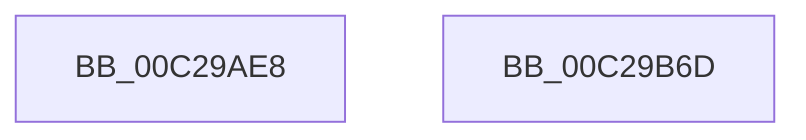

# VslApplyDynamicRelocations

- RVA: `0x00C29AE8`–`0x00C29B6E` (길이 `134` bytes)
- VA: `0x0000000140C29AE8`
- 실행 섹션: `INIT`
- PDB 이름 있음: `예`; PDB Function 태그: `아니요`
- unwind 정보 RVA: `0x000AFF04`
- 디코드: `32`개 명령, `134/134` bytes 표시
- 미해석 바이트: `0` (있으면 어셈블리에 `.byte`로 보존)

> 이 문서는 커널 이미지의 기계어와 PDB 기호를 분석해 생성했습니다. 4번과 5번은 함수 원형과 자료형을 바이너리 사용 방식에서 추정한 C 해석이며 원본 소스 복구 결과는 아닙니다.

## 1. Dependencies

- 직접 호출 지점: **3**; 고유 호출 대상: **3**
- 직접 호출자로 확인된 함수: **1**
- RIP 상대 이미지 참조: **1**

### Outgoing calls
- `0x00C29B20` → [memset](../../text/6C/memset_function_006C6C40.md) (function, `0x006C6C40`)
- `0x00C29B43` → [VslpEnterIumSecureMode](../../text/23/VslpEnterIumSecureMode_function_00235E50.md) (function, `0x00235E50`)
- `0x00C29B53` → [_security_check_cookie](../../text/6A/_security_check_cookie_function_006AC640.md) (function, `0x006AC640`)

### Direct callers
- [MiApplyDynamicRelocations](../C6/MiApplyDynamicRelocations_function_00C696C0.md) at `0x00C696FA`

### Static image references
- `0x00C29AFA` → RVA `0x00E0A740` (`.data`; read)

## 2. Other-region calls and transfers

- 다른 실행 섹션으로 향하는 call: **3**
  - `0x00C29B20` → [memset](../../text/6C/memset_function_006C6C40.md) (`INIT` → `.text`)
  - `0x00C29B43` → [VslpEnterIumSecureMode](../../text/23/VslpEnterIumSecureMode_function_00235E50.md) (`INIT` → `.text`)
  - `0x00C29B53` → [_security_check_cookie](../../text/6A/_security_check_cookie_function_006AC640.md) (`INIT` → `.text`)
- 별도 외부 분기/꼬리 이동을 확인하지 못했습니다.

## 3. Assembly (complete function range)

```asm
00C29AE8  48 89 5C 24 08                  mov qword ptr [rsp + 8], rbx
00C29AED  48 89 74 24 10                  mov qword ptr [rsp + 0x10], rsi
00C29AF2  57                              push rdi
00C29AF3  48 81 EC A0 00 00 00            sub rsp, 0xa0
00C29AFA  48 8B 05 3F 0C 1E 00            mov rax, qword ptr [rip + 0x1e0c3f]
00C29B01  48 33 C4                        xor rax, rsp
00C29B04  48 89 84 24 90 00 00 00         mov qword ptr [rsp + 0x90], rax
00C29B0C  48 8B FA                        mov rdi, rdx
00C29B0F  49 8B F0                        mov rsi, r8
00C29B12  33 D2                           xor edx, edx
00C29B14  48 8B D9                        mov rbx, rcx
00C29B17  48 8D 4C 24 20                  lea rcx, [rsp + 0x20]
00C29B1C  44 8D 42 68                     lea r8d, [rdx + 0x68]
00C29B20  E8 1B D1 A9 FF                  call 0x1406c6c40
00C29B25  BA D4 00 00 00                  mov edx, 0xd4
00C29B2A  48 89 5C 24 28                  mov qword ptr [rsp + 0x28], rbx
00C29B2F  4C 8D 4C 24 20                  lea r9, [rsp + 0x20]
00C29B34  48 89 7C 24 30                  mov qword ptr [rsp + 0x30], rdi
00C29B39  45 33 C0                        xor r8d, r8d
00C29B3C  48 89 74 24 38                  mov qword ptr [rsp + 0x38], rsi
00C29B41  B1 02                           mov cl, 2
00C29B43  E8 08 C3 60 FF                  call 0x140235e50
00C29B48  48 8B 8C 24 90 00 00 00         mov rcx, qword ptr [rsp + 0x90]
00C29B50  48 33 CC                        xor rcx, rsp
00C29B53  E8 E8 2A A8 FF                  call 0x1406ac640
00C29B58  4C 8D 9C 24 A0 00 00 00         lea r11, [rsp + 0xa0]
00C29B60  49 8B 5B 10                     mov rbx, qword ptr [r11 + 0x10]
00C29B64  49 8B 73 18                     mov rsi, qword ptr [r11 + 0x18]
00C29B68  49 8B E3                        mov rsp, r11
00C29B6B  5F                              pop rdi
00C29B6C  C3                              ret
00C29B6D  CC                              int3
```

## 4. C-style interpretation (structured pseudocode)

```c
__int64 __fastcall VslApplyDynamicRelocations(__int64 a1, __int64 a2, __int64 a3)
{
    __int64 result;
    __int64 v_rsp;
    unsigned __int64 v_stack_m18;
    unsigned __int64 v_stack_m70;
    unsigned __int64 v_stack_m78;
    unsigned __int64 v_stack_m8;
    unsigned __int64 v_stack_m80;
    unsigned __int64 v_stack_m88;
    unsigned __int64 v_stack_p10;
    unsigned __int64 v_stack_p8;

    v_stack_p8 = v_rbx;
    v_stack_p10 = v_rsi;
    v_rsp = (v_rsp) - (160);
    result = (*(unsigned __int64 *)(v_rip + 1969215)) ^ (v_rsp);
    v_stack_m18 = result;
    a2 = 0;
    result = memset(v_stack_m88, a2, a2 + 104, a4);
    v_stack_m80 = a1;
    v_stack_m78 = 0;
    a3 = 0;
    v_stack_m70 = 0;
    result = VslpEnterIumSecureMode(2, 212, a3, v_stack_m88);
    a1 = (v_stack_m18) ^ (v_rsp);
    result = _security_check_cookie(a1, 212, a3, v_stack_m88);
    return result;
}
```

## 5. (Beta) C Style

```c
int64_t VslApplyDynamicRelocations(int64_t Arg1, int64_t Arg2, int64_t Arg3)
{
    int64_t result;
    int64_t local_rsp;
    uint64_t v_stack_m18;
    uint64_t v_stack_m70;
    uint64_t v_stack_m78;
    uint64_t v_stack_m8;
    uint64_t v_stack_m80;
    uint64_t v_stack_m88;
    uint64_t v_stack_p10;
    uint64_t v_stack_p8;

    v_stack_p8 = local_rbx;
    v_stack_p10 = local_rsi;
    local_rsp = (local_rsp) - (160);
    result = (*(uint64_t *)(v_rip + 0x1E0C3F)) ^ (local_rsp);
    v_stack_m18 = result;
    Arg2 = 0;
    result = memset(v_stack_m88, Arg2, Arg2 + 104, a4);
    v_stack_m80 = Arg1;
    v_stack_m78 = 0;
    Arg3 = 0;
    v_stack_m70 = 0;
    result = VslpEnterIumSecureMode(2, 212, Arg3, v_stack_m88);
    Arg1 = (v_stack_m18) ^ (local_rsp);
    result = _security_check_cookie(Arg1, 212, Arg3, v_stack_m88);
    return result;
}
```

## 6. Execution-region graph

[열기: 2D/3D 그래프와 함수 탐색 컨트롤 패널](../../../control-panel.html?section=init&rva=0x00C29AE8&view=graph)

- 2D 그래프는 위에서 아래로 흐르고, 3D 그래프는 빈 공간을 드래그해 회전합니다. Shift+드래그는 이동, 휠은 확대·축소, 함수 노드 선택은 대상 보고서 이동입니다.

### Static fallback


