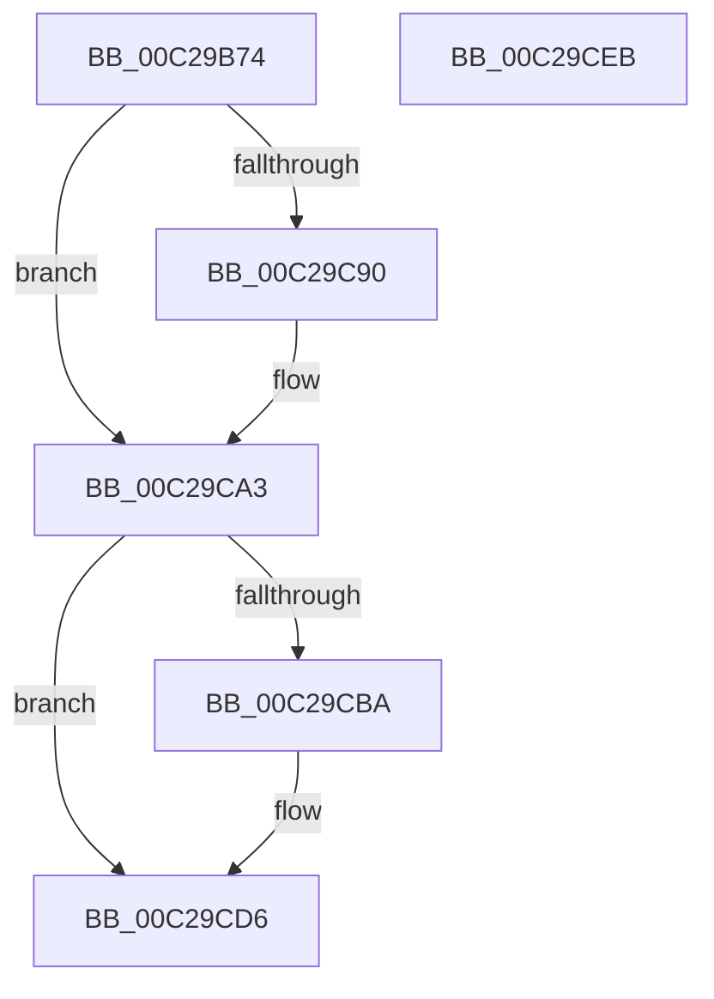

# VslBindNtIum

- RVA: `0x00C29B74`–`0x00C29CEC` (길이 `376` bytes)
- VA: `0x0000000140C29B74`
- 실행 섹션: `INIT`
- PDB 이름 있음: `예`; PDB Function 태그: `아니요`
- unwind 정보 RVA: `0x000C6E18`
- 디코드: `71`개 명령, `376/376` bytes 표시
- 미해석 바이트: `0` (있으면 어셈블리에 `.byte`로 보존)

> 이 문서는 커널 이미지의 기계어와 PDB 기호를 분석해 생성했습니다. 4번과 5번은 함수 원형과 자료형을 바이너리 사용 방식에서 추정한 C 해석이며 원본 소스 복구 결과는 아닙니다.

## 1. Dependencies

- 직접 호출 지점: **6**; 고유 호출 대상: **5**
- 직접 호출자로 확인된 함수: **1**
- RIP 상대 이미지 참조: **1**

### Outgoing calls
- `0x00C29BA2` → [memset](../../text/6C/memset_function_006C6C40.md) (function, `0x006C6C40`)
- `0x00C29C69` → [MmGetPhysicalAddress](../../text/23/MmGetPhysicalAddress_function_0023A500.md) (function, `0x0023A500`)
- `0x00C29C94` → [MmGetPhysicalAddress](../../text/23/MmGetPhysicalAddress_function_0023A500.md) (function, `0x0023A500`)
- `0x00C29CB1` → [VslpEnterIumSecureMode](../../text/23/VslpEnterIumSecureMode_function_00235E50.md) (function, `0x00235E50`)
- `0x00C29CD0` → [KeBugCheckEx](../../text/4F/KeBugCheckEx_function_004FD660.md) (function, `0x004FD660`)
- `0x00C29CDD` → [_security_check_cookie](../../text/6A/_security_check_cookie_function_006AC640.md) (function, `0x006AC640`)

### Direct callers
- [HvlEnableVsmCalls](HvlEnableVsmCalls_function_00C29AB0.md) at `0x00C29AD5`

### Static image references
- `0x00C29B82` → RVA `0x00E0A740` (`.data`; read)

## 2. Other-region calls and transfers

- 다른 실행 섹션으로 향하는 call: **6**
  - `0x00C29BA2` → [memset](../../text/6C/memset_function_006C6C40.md) (`INIT` → `.text`)
  - `0x00C29C69` → [MmGetPhysicalAddress](../../text/23/MmGetPhysicalAddress_function_0023A500.md) (`INIT` → `.text`)
  - `0x00C29C94` → [MmGetPhysicalAddress](../../text/23/MmGetPhysicalAddress_function_0023A500.md) (`INIT` → `.text`)
  - `0x00C29CB1` → [VslpEnterIumSecureMode](../../text/23/VslpEnterIumSecureMode_function_00235E50.md) (`INIT` → `.text`)
  - `0x00C29CD0` → [KeBugCheckEx](../../text/4F/KeBugCheckEx_function_004FD660.md) (`INIT` → `.text`)
  - `0x00C29CDD` → [_security_check_cookie](../../text/6A/_security_check_cookie_function_006AC640.md) (`INIT` → `.text`)
- 별도 외부 분기/꼬리 이동을 확인하지 못했습니다.

## 3. Assembly (complete function range)

```asm
00C29B74  40 55                           push rbp
00C29B76  48 8D 6C 24 A0                  lea rbp, [rsp - 0x60]
00C29B7B  48 81 EC 60 01 00 00            sub rsp, 0x160
00C29B82  48 8B 05 B7 0B 1E 00            mov rax, qword ptr [rip + 0x1e0bb7]
00C29B89  48 33 C4                        xor rax, rsp
00C29B8C  48 89 45 50                     mov qword ptr [rbp + 0x50], rax
00C29B90  33 D2                           xor edx, edx
00C29B92  48 C7 45 D8 00 80 00 00         mov qword ptr [rbp - 0x28], 0x8000
00C29B9A  48 8D 4D E0                     lea rcx, [rbp - 0x20]
00C29B9E  44 8D 42 68                     lea r8d, [rdx + 0x68]
00C29BA2  E8 99 D0 A9 FF                  call 0x1406c6c40
00C29BA7  48 83 64 24 40 00               and qword ptr [rsp + 0x40], 0
00C29BAD  48 8D 44 24 30                  lea rax, [rsp + 0x30]
00C29BB2  48 83 65 A0 00                  and qword ptr [rbp - 0x60], 0
00C29BB7  48 8D 4C 24 30                  lea rcx, [rsp + 0x30]
00C29BBC  48 89 45 E8                     mov qword ptr [rbp - 0x18], rax
00C29BC0  48 C7 44 24 30 80 D0 00 00      mov qword ptr [rsp + 0x30], 0xd080
00C29BC9  48 C7 44 24 38 80 01 00 00      mov qword ptr [rsp + 0x38], 0x180
00C29BD2  48 C7 44 24 48 00 CF 00 00      mov qword ptr [rsp + 0x48], 0xcf00
00C29BDB  48 C7 44 24 50 07 00 00 00      mov qword ptr [rsp + 0x50], 7
00C29BE4  48 C7 44 24 58 E8 93 00 00      mov qword ptr [rsp + 0x58], 0x93e8
00C29BED  48 C7 44 24 60 D0 00 00 00      mov qword ptr [rsp + 0x60], 0xd0
00C29BF6  48 C7 44 24 68 D1 00 00 00      mov qword ptr [rsp + 0x68], 0xd1
00C29BFF  48 C7 44 24 70 24 00 00 00      mov qword ptr [rsp + 0x70], 0x24
00C29C08  48 C7 44 24 78 44 00 00 00      mov qword ptr [rsp + 0x78], 0x44
00C29C11  48 C7 45 80 D0 06 00 00         mov qword ptr [rbp - 0x80], 0x6d0
00C29C19  48 C7 45 88 E0 9B 00 00         mov qword ptr [rbp - 0x78], 0x9be0
00C29C21  48 C7 45 90 05 00 00 00         mov qword ptr [rbp - 0x70], 5
00C29C29  48 C7 45 98 98 07 00 00         mov qword ptr [rbp - 0x68], 0x798
00C29C31  48 C7 45 A8 C0 04 00 00         mov qword ptr [rbp - 0x58], 0x4c0
00C29C39  48 C7 45 B0 E4 01 00 00         mov qword ptr [rbp - 0x50], 0x1e4
00C29C41  48 C7 45 B8 E6 01 00 00         mov qword ptr [rbp - 0x48], 0x1e6
00C29C49  48 C7 45 C0 98 00 00 00         mov qword ptr [rbp - 0x40], 0x98
00C29C51  48 C7 45 C8 1C 03 00 00         mov qword ptr [rbp - 0x38], 0x31c
00C29C59  48 C7 45 D0 78 00 00 00         mov qword ptr [rbp - 0x30], 0x78
00C29C61  48 C7 45 F0 B0 00 00 00         mov qword ptr [rbp - 0x10], 0xb0
00C29C69  E8 92 08 61 FF                  call 0x14023a500
00C29C6E  48 C1 E8 0C                     shr rax, 0xc
00C29C72  8B C0                           mov eax, eax
00C29C74  48 89 45 F8                     mov qword ptr [rbp - 8], rax
00C29C78  48 8D 44 24 30                  lea rax, [rsp + 0x30]
00C29C7D  25 FF 0F 00 00                  and eax, 0xfff
00C29C82  48 05 B0 00 00 00               add rax, 0xb0
00C29C88  48 3D 00 10 00 00               cmp rax, 0x1000
00C29C8E  76 13                           jbe 0x140c29ca3
00C29C90  48 8D 4D DF                     lea rcx, [rbp - 0x21]
00C29C94  E8 67 08 61 FF                  call 0x14023a500
00C29C99  48 C1 E8 0C                     shr rax, 0xc
00C29C9D  8B C0                           mov eax, eax
00C29C9F  48 89 45 00                     mov qword ptr [rbp], rax
00C29CA3  BA 00 01 00 00                  mov edx, 0x100
00C29CA8  4C 8D 4D E0                     lea r9, [rbp - 0x20]
00C29CAC  45 33 C0                        xor r8d, r8d
00C29CAF  B1 02                           mov cl, 2
00C29CB1  E8 9A C1 60 FF                  call 0x140235e50
00C29CB6  85 C0                           test eax, eax
00C29CB8  79 1C                           jns 0x140c29cd6
00C29CBA  48 83 64 24 20 00               and qword ptr [rsp + 0x20], 0
00C29CC0  45 33 C9                        xor r9d, r9d
00C29CC3  48 63 D0                        movsxd rdx, eax
00C29CC6  41 B8 FF 00 00 00               mov r8d, 0xff
00C29CCC  41 8D 49 6F                     lea ecx, [r9 + 0x6f]
00C29CD0  E8 8B 39 8D FF                  call 0x1404fd660
00C29CD5  CC                              int3
00C29CD6  48 8B 4D 50                     mov rcx, qword ptr [rbp + 0x50]
00C29CDA  48 33 CC                        xor rcx, rsp
00C29CDD  E8 5E 29 A8 FF                  call 0x1406ac640
00C29CE2  48 81 C4 60 01 00 00            add rsp, 0x160
00C29CE9  5D                              pop rbp
00C29CEA  C3                              ret
00C29CEB  CC                              int3
```

## 4. C-style interpretation (structured pseudocode)

```c
__int64 __fastcall VslBindNtIum(__int64 a1, int a2)
{
    __int64 result;
    __int64 v_rsp;
    unsigned __int64 v_stack_m100;
    unsigned __int64 v_stack_m108;
    unsigned __int64 v_stack_m110;
    unsigned __int64 v_stack_m118;
    unsigned __int64 v_stack_m120;
    unsigned __int64 v_stack_m128;
    unsigned __int64 v_stack_m130;
    unsigned __int64 v_stack_m138;
    unsigned __int64 v_stack_m148;
    unsigned __int64 v_stack_m18;
    unsigned __int64 v_stack_m68;
    unsigned __int64 v_stack_m70;
    unsigned __int64 v_stack_m78;
    unsigned __int64 v_stack_m80;
    unsigned __int64 v_stack_m88;
    unsigned __int64 v_stack_m89;
    unsigned __int64 v_stack_m90;
    unsigned __int64 v_stack_m98;
    unsigned __int64 v_stack_mA0;
    unsigned __int64 v_stack_mA8;
    unsigned __int64 v_stack_mB0;
    unsigned __int64 v_stack_mB8;
    unsigned __int64 v_stack_mC0;
    unsigned __int64 v_stack_mC8;
    unsigned __int64 v_stack_mD0;
    unsigned __int64 v_stack_mD8;
    unsigned __int64 v_stack_mE0;
    unsigned __int64 v_stack_mE8;
    unsigned __int64 v_stack_mF0;
    unsigned __int64 v_stack_mF8;

    v_rsp = (v_rsp) - (352);
    result = (*(unsigned __int64 *)(v_rip + 1969079)) ^ (v_rsp);
    v_stack_m18 = result;
    a2 = 0;
    v_stack_m90 = 0x8000ULL;
    result = memset(v_stack_m88, a2, a2 + 104, a4);
    v_stack_m80 = v_stack_m138;
    v_stack_m138 = 0xD080ULL;
    v_stack_m130 = 384;
    v_stack_m120 = 0xCF00ULL;
    v_stack_m118 = 7;
    v_stack_m110 = 0x93E8ULL;
    v_stack_m108 = 208;
    v_stack_m100 = 209;
    v_stack_mF8 = 36;
    v_stack_mF0 = 68;
    v_stack_mE8 = 0x6D0ULL;
    v_stack_mE0 = 0x9BE0ULL;
    v_stack_mD8 = 5;
    v_stack_mD0 = 0x798ULL;
    v_stack_mC0 = 0x4C0ULL;
    v_stack_mB8 = 484;
    v_stack_mB0 = 486;
    v_stack_mA8 = 152;
    v_stack_mA0 = 796;
    v_stack_m98 = 120;
    v_stack_m78 = 176;
    result = MmGetPhysicalAddress(v_stack_m138, a2, a2 + 104, a4);
    result = (result) >> (12);
    v_stack_m70 = (unsigned int)((unsigned int)(result));
    result = (unsigned int)((v_stack_m138) & (0xFFFULL));
    result = (result) + (176);
    if (result >= = 0x1000ULL) {
        a1 = v_stack_m89;
        result = MmGetPhysicalAddress(a1, a2, a2 + 104, a4);
        result = (result) >> (12);
        result = (unsigned int)(result);
        v_stack_m68 = result;
    }
    a3 = 0;
    result = VslpEnterIumSecureMode(2, 256, a3, v_stack_m88);
    if (sign_flag) {
        a4 = 0;
        a2 = (int)((unsigned int)(result));
        a3 = 255;
        a1 = a4 + 111;
        result = KeBugCheckEx(a1, a2, a3, a4);
    }
    a1 = (v_stack_m18) ^ (v_rsp);
    result = _security_check_cookie(a1, a2, a3, a4);
    v_rsp = (v_rsp) + (352);
    return result;
}
```

## 5. (Beta) C Style

```c
int64_t VslBindNtIum(int64_t Arg1, int32_t Arg2)
{
    int64_t result;
    int64_t local_rsp;
    uint64_t v_stack_m100;
    uint64_t v_stack_m108;
    uint64_t v_stack_m110;
    uint64_t v_stack_m118;
    uint64_t v_stack_m120;
    uint64_t v_stack_m128;
    uint64_t v_stack_m130;
    uint64_t v_stack_m138;
    uint64_t v_stack_m148;
    uint64_t v_stack_m18;
    uint64_t v_stack_m68;
    uint64_t v_stack_m70;
    uint64_t v_stack_m78;
    uint64_t v_stack_m80;
    uint64_t v_stack_m88;
    uint64_t v_stack_m89;
    uint64_t v_stack_m90;
    uint64_t v_stack_m98;
    uint64_t v_stack_mA0;
    uint64_t v_stack_mA8;
    uint64_t v_stack_mB0;
    uint64_t v_stack_mB8;
    uint64_t v_stack_mC0;
    uint64_t v_stack_mC8;
    uint64_t v_stack_mD0;
    uint64_t v_stack_mD8;
    uint64_t v_stack_mE0;
    uint64_t v_stack_mE8;
    uint64_t v_stack_mF0;
    uint64_t v_stack_mF8;

    local_rsp = (local_rsp) - (352);
    result = (*(uint64_t *)(v_rip + 0x1E0BB7)) ^ (local_rsp);
    v_stack_m18 = result;
    Arg2 = 0;
    v_stack_m90 = 0x8000ULL;
    result = memset(v_stack_m88, Arg2, Arg2 + 104, a4);
    v_stack_m80 = v_stack_m138;
    v_stack_m138 = 0xD080ULL;
    v_stack_m130 = 384;
    v_stack_m120 = 0xCF00ULL;
    v_stack_m118 = 7;
    v_stack_m110 = 0x93E8ULL;
    v_stack_m108 = 208;
    v_stack_m100 = 209;
    v_stack_mF8 = 36;
    v_stack_mF0 = 68;
    v_stack_mE8 = 0x6D0ULL;
    v_stack_mE0 = 0x9BE0ULL;
    v_stack_mD8 = 5;
    v_stack_mD0 = 0x798ULL;
    v_stack_mC0 = 0x4C0ULL;
    v_stack_mB8 = 484;
    v_stack_mB0 = 486;
    v_stack_mA8 = 152;
    v_stack_mA0 = 796;
    v_stack_m98 = 120;
    v_stack_m78 = 176;
    result = MmGetPhysicalAddress(v_stack_m138, Arg2, Arg2 + 104, a4);
    result = (result) >> (12);
    v_stack_m70 = (uint32_t)((uint32_t)(result));
    result = (uint32_t)((v_stack_m138) & (0xFFFULL));
    result = (result) + (176);
    if (result >= = 0x1000ULL) {
        Arg1 = v_stack_m89;
        result = MmGetPhysicalAddress(Arg1, Arg2, Arg2 + 104, a4);
        result = (result) >> (12);
        result = (uint32_t)(result);
        v_stack_m68 = result;
    }
    a3 = 0;
    result = VslpEnterIumSecureMode(2, 256, a3, v_stack_m88);
    if (sign_flag) {
        a4 = 0;
        Arg2 = (int32_t)((uint32_t)(result));
        a3 = 255;
        Arg1 = a4 + 111;
        result = KeBugCheckEx(Arg1, Arg2, a3, a4);
    }
    Arg1 = (v_stack_m18) ^ (local_rsp);
    result = _security_check_cookie(Arg1, Arg2, a3, a4);
    local_rsp = (local_rsp) + (352);
    return result;
}
```

## 6. Execution-region graph

[열기: 2D/3D 그래프와 함수 탐색 컨트롤 패널](../../../control-panel.html?section=init&rva=0x00C29B74&view=graph)

- 2D 그래프는 위에서 아래로 흐르고, 3D 그래프는 빈 공간을 드래그해 회전합니다. Shift+드래그는 이동, 휠은 확대·축소, 함수 노드 선택은 대상 보고서 이동입니다.

### Static fallback


