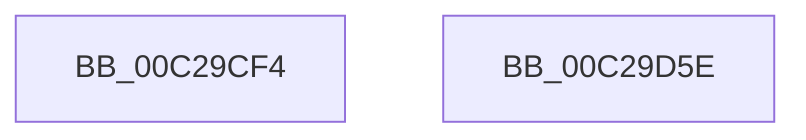

# VslInitializeSyscallProviders

- RVA: `0x00C29CF4`–`0x00C29D5F` (길이 `107` bytes)
- VA: `0x0000000140C29CF4`
- 실행 섹션: `INIT`
- PDB 이름 있음: `예`; PDB Function 태그: `아니요`
- unwind 정보 RVA: `0x000AA6F8`
- 디코드: `22`개 명령, `107/107` bytes 표시
- 미해석 바이트: `0` (있으면 어셈블리에 `.byte`로 보존)

> 이 문서는 커널 이미지의 기계어와 PDB 기호를 분석해 생성했습니다. 4번과 5번은 함수 원형과 자료형을 바이너리 사용 방식에서 추정한 C 해석이며 원본 소스 복구 결과는 아닙니다.

## 1. Dependencies

- 직접 호출 지점: **3**; 고유 호출 대상: **3**
- 직접 호출자로 확인된 함수: **1**
- RIP 상대 이미지 참조: **2**

### Outgoing calls
- `0x00C29D18` → [memset](../../text/6C/memset_function_006C6C40.md) (function, `0x006C6C40`)
- `0x00C29D41` → [VslpEnterIumSecureMode](../../text/23/VslpEnterIumSecureMode_function_00235E50.md) (function, `0x00235E50`)
- `0x00C29D51` → [_security_check_cookie](../../text/6A/_security_check_cookie_function_006AC640.md) (function, `0x006AC640`)

### Direct callers
- [PsInitializeSyscallProviders](../C4/PsInitializeSyscallProviders_function_00C44BA4.md) at `0x00C44BBA`
- [PsInitializeSyscallProviders](../C4/PsInitializeSyscallProviders_function_00C44BA4.md) at `0x00C44BDA`

### Static image references
- `0x00C29CFB` → RVA `0x00E0A740` (`.data`; read)
- `0x00C29D1D` → RVA `0x01201D30` (`CFGRO`; read)

## 2. Other-region calls and transfers

- 다른 실행 섹션으로 향하는 call: **3**
  - `0x00C29D18` → [memset](../../text/6C/memset_function_006C6C40.md) (`INIT` → `.text`)
  - `0x00C29D41` → [VslpEnterIumSecureMode](../../text/23/VslpEnterIumSecureMode_function_00235E50.md) (`INIT` → `.text`)
  - `0x00C29D51` → [_security_check_cookie](../../text/6A/_security_check_cookie_function_006AC640.md) (`INIT` → `.text`)
- 별도 외부 분기/꼬리 이동을 확인하지 못했습니다.

## 3. Assembly (complete function range)

```asm
00C29CF4  48 81 EC A8 00 00 00            sub rsp, 0xa8
00C29CFB  48 8B 05 3E 0A 1E 00            mov rax, qword ptr [rip + 0x1e0a3e]
00C29D02  48 33 C4                        xor rax, rsp
00C29D05  48 89 84 24 90 00 00 00         mov qword ptr [rsp + 0x90], rax
00C29D0D  33 D2                           xor edx, edx
00C29D0F  48 8D 4C 24 20                  lea rcx, [rsp + 0x20]
00C29D14  44 8D 42 68                     lea r8d, [rdx + 0x68]
00C29D18  E8 23 CF A9 FF                  call 0x1406c6c40
00C29D1D  48 8D 05 0C 80 5D 00            lea rax, [rip + 0x5d800c]
00C29D24  48 C7 44 24 30 20 00 00 00      mov qword ptr [rsp + 0x30], 0x20
00C29D2D  BA EA 00 00 00                  mov edx, 0xea
00C29D32  48 89 44 24 28                  mov qword ptr [rsp + 0x28], rax
00C29D37  4C 8D 4C 24 20                  lea r9, [rsp + 0x20]
00C29D3C  45 33 C0                        xor r8d, r8d
00C29D3F  B1 02                           mov cl, 2
00C29D41  E8 0A C1 60 FF                  call 0x140235e50
00C29D46  48 8B 8C 24 90 00 00 00         mov rcx, qword ptr [rsp + 0x90]
00C29D4E  48 33 CC                        xor rcx, rsp
00C29D51  E8 EA 28 A8 FF                  call 0x1406ac640
00C29D56  48 81 C4 A8 00 00 00            add rsp, 0xa8
00C29D5D  C3                              ret
00C29D5E  CC                              int3
```

## 4. C-style interpretation (structured pseudocode)

```c
__int64 __fastcall VslInitializeSyscallProviders(__int64 a1, int a2)
{
    __int64 result;
    __int64 v_rsp;
    unsigned __int64 v_stack_m18;
    unsigned __int64 v_stack_m78;
    unsigned __int64 v_stack_m80;
    unsigned __int64 v_stack_m88;

    v_rsp = (v_rsp) - (168);
    result = (*(unsigned __int64 *)(v_rip + 1968702)) ^ (v_rsp);
    v_stack_m18 = result;
    a2 = 0;
    result = memset(v_stack_m88, a2, a2 + 104, a4);
    v_stack_m78 = 32;
    v_stack_m80 = v_rip + 6127628;
    a3 = 0;
    result = VslpEnterIumSecureMode(2, 234, a3, v_stack_m88);
    a1 = (v_stack_m18) ^ (v_rsp);
    result = _security_check_cookie(a1, 234, a3, v_stack_m88);
    v_rsp = (v_rsp) + (168);
    return result;
}
```

## 5. (Beta) C Style

```c
int64_t VslInitializeSyscallProviders(int64_t Arg1, int32_t Arg2)
{
    int64_t result;
    int64_t local_rsp;
    uint64_t v_stack_m18;
    uint64_t v_stack_m78;
    uint64_t v_stack_m80;
    uint64_t v_stack_m88;

    local_rsp = (local_rsp) - (168);
    result = (*(uint64_t *)(v_rip + 0x1E0A3E)) ^ (local_rsp);
    v_stack_m18 = result;
    Arg2 = 0;
    result = memset(v_stack_m88, Arg2, Arg2 + 104, a4);
    v_stack_m78 = 32;
    v_stack_m80 = v_rip + 6127628;
    a3 = 0;
    result = VslpEnterIumSecureMode(2, 234, a3, v_stack_m88);
    Arg1 = (v_stack_m18) ^ (local_rsp);
    result = _security_check_cookie(Arg1, 234, a3, v_stack_m88);
    local_rsp = (local_rsp) + (168);
    return result;
}
```

## 6. Execution-region graph

[열기: 2D/3D 그래프와 함수 탐색 컨트롤 패널](../../../control-panel.html?section=init&rva=0x00C29CF4&view=graph)

- 2D 그래프는 위에서 아래로 흐르고, 3D 그래프는 빈 공간을 드래그해 회전합니다. Shift+드래그는 이동, 휠은 확대·축소, 함수 노드 선택은 대상 보고서 이동입니다.

### Static fallback


